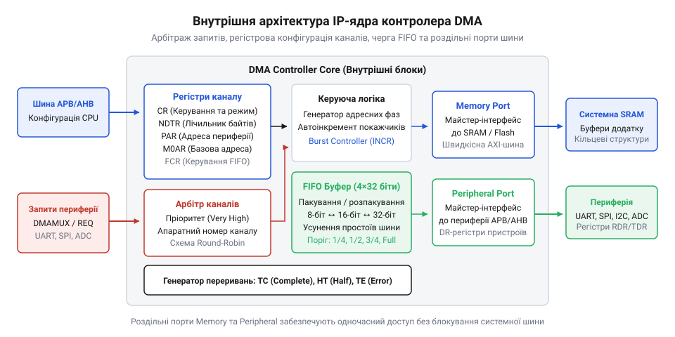

# Контролер прямого доступу до пам'яті (DMA)

## Обмеження процесорного обміну даними

У вбудованих системах швидкісні периферійні інтерфейси — послідовні шини, аналого-цифрові перетворювачі чи мережеві модулі — генерують неперервні потоки даних зі швидкістю від сотень кілобайтів до десятків мегабайтів на секунду. Якщо цим обміном керує центральний процесорний блок @@en|CPU@@ (від англ. *central processing unit* — центральний процесор), кожен байт доводиться обробляти програмно.

При циклічному опитуванні @@en|polling@@ (від англ. *poll* — опитувати за списком) процесор у нескінченному циклі зчитує прапорець готовності периферійного регістра. Поки черговий байт не надійде, обчислювальне ядро виконує порожні перевірки. Процесор витрачає 100% свого тактового бюджету на очікування, блокуючи виконання будь-яких прикладних алгоритмів.

Перехід на апаратні переривання @@en|interrupt@@ (від лат. *interruptus* — перерваний посеред дії) дозволяє ядру виконувати інші задачі між надходженнями байтів, проте породжує затримку переривання @@en|interrupt latency@@ (від англ. *interrupt* та лат. *latens* — прихований) і накладні витрати на збереження стану. При кожному сигналі периферії процесор апаратно зупиняє виконання коду, зберігає набір регістрів ядра у стек, зчитує вектор із таблиці та переходить до підпрограми обробки. Лише після цього ядро копіює прийнятий байт в оперативну пам'ять @@en|RAM@@ (від англ. *random access memory* — пам'ять із довільним доступом), відновлює регістри зі стека та повертається до перерваної задачі.

Розрахуємо сумарний тактовий бюджет `T_byte`, необхідний процесору для обробки одного байта через переривання, склавши витрати на контекст `C_context` і час перенесення `C_transfer`:

```
T_byte = C_context + C_transfer
= 32 + 16       [сума тактів збереження контексту та копіювання даних]
= 48            [тактовий бюджет на один байт]
```

Отримане значення свідчить, що витрати на збереження та відновлення регістрів удвічі перевищують корисну дію копіювання. При потоці даних 2 МБ/с на тактовій частоті 48 МГц процесор витрачатиме практично всі такти виключно на обслуговування переривань. Будь-яка затримка реакції призводить до апаратного переповнення буфера @@en|overrun@@ (від англ. *over* — понад міру та *run* — бігти) і безповоротної втрати даних. Щоб зняти це обмеження, обмін даними відокремлюють від процесора, передаючи його апаратному співпроцесору, який забезпечує [високошвидкісну передачу даних](root:sf-devices/dma-spi-display-transfer).

## Принцип роботи контролера DMA

Фізичним розв'язанням проблеми є контролер прямого доступу до пам'яті @@en|DMA@@ (від англ. *direct memory access* — прямий доступ до пам'яті). Він є спеціалізованим апаратним автоматом, здатним переміщувати байти без участі ядра. Зазвичай процесор виступає єдиним майстром шини @@en|bus master@@ (від англ. *bus* — шина та *master* — керівник), що формує адреси й сигнали читання чи запису. Контролер @@en|DMA@@ стає другим повноправним майстром магістралі.

Щоб два вузли не конфліктували за спільні лінії, мікроконтролер використовує апаратний арбітраж шини @@en|bus arbitration@@ (від англ. *bus* та лат. *arbitrium* — суддівське рішення). Коли периферія виставляє запит на передачу, контролер @@en|DMA@@ надсилає сигнал захоплення шини. Процесор завершує поточний мікроцикл, переводить власні шинні лінії у високоімпедансний стан і підтверджує передачу керування. Контролер @@en|DMA@@ безпосередньо зчитує дані з периферійного порту й записує їх у пам'ять, після чого звільняє шину.

Кожен канал контролера містить адресний регістр джерела @@en|SAR@@ (від англ. *source address register*), адресний регістр призначення @@en|DAR@@ (від англ. *destination address register*) та лічильник кількості передач @@en|NDTR@@ (від англ. *number of data register*). Після кожної транзакції контролер інкрементує адреси та декрементує лічильник. Внутрішня черга вирівнювання @@en|FIFO@@ (від англ. *first in, first out* — першим прийшов, першим вийшов) накопичує поодинокі байти периферії для виконання швидких 32-бітних пакетних записів у пам'ять.


*Внутрішня архітектура контролера DMA: адресні регістри, лічильник транзакцій та черга FIFO забезпечують пряме переміщення даних між периферією та оперативною пам'яттю.*

Контролер підтримує одиночний режим для одноразового копіювання масиву та циклічний режим @@en|circular mode@@ (від лат. *circularis* — круговий), де регістри автоматично повертаються до початкових значень після обнулення лічильника. Для безперервного потоку даних застосовують подвійну буферизацію @@en|double buffering@@ (від англ. *double* — подвійний та *buffer* — роздільник). Контролер послідовно наповнює кільцевий буфер у пам'яті. Прапорець половини передачі @@en|HTIF@@ (від англ. *half transfer interrupt flag*) сповіщає ядро про готовність першої половини масиву, поки @@en|DMA@@ безперервно пише у другу. Прапорець повного завершення @@en|TCIF@@ (від англ. *transfer complete interrupt flag*) сигналізує про готовність другої половини. Це унеможливлює втрати даних і знижує [навантаження на обчислювальне ядро](root:sf-devices/audio-dac-dma-streaming) до двох переривань на весь великий блок.