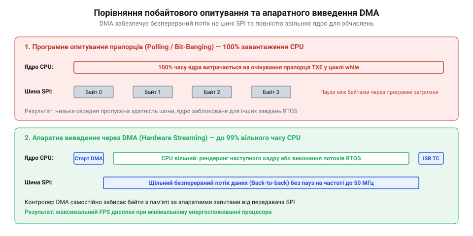
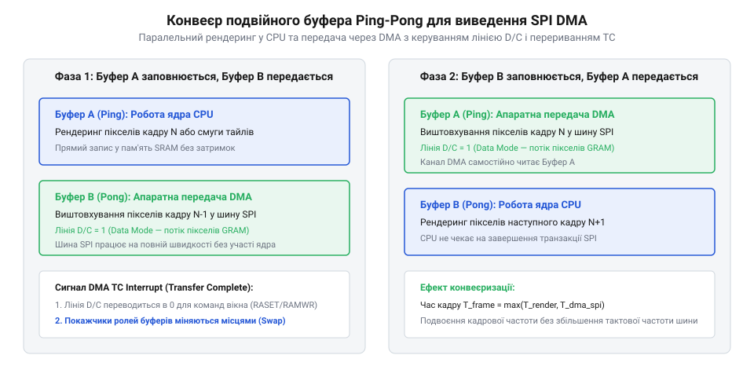
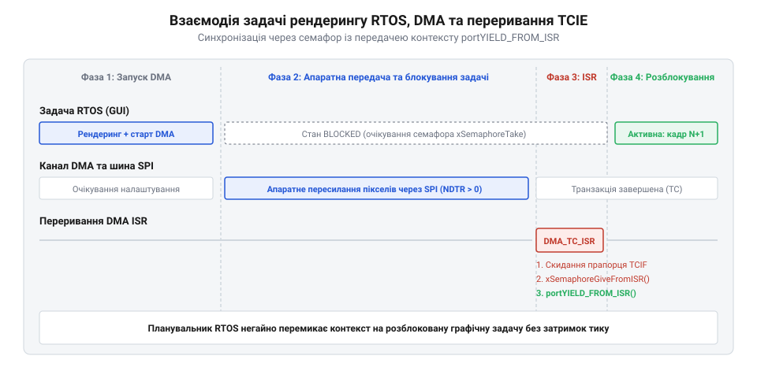
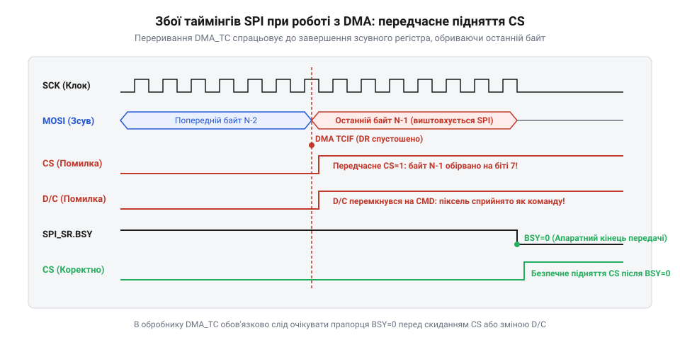

# Передавання графічних буферів через SPI з апаратним DMA

## Початкові концепції та фізичні принципи

Оновлення графічного зображення на кольоровому растровому дисплеї в мікроконтролерних системах вимагає безперервного прокачування значних масивів пиксельних даних через послідовний шинний інтерфейс. Якщо роздільна здатність екрана становить 320×240 пікселів при кодуванні @@en|RGB565@@ (від англ. *red green blue 565* — 16-бітний колірний простір), один повний кадр займає в оперативній пам'яті рівно 153 600 байтів. Для забезпечення якісного візуального сприйняття динамічного графічного інтерфейсу з частотою 30 кадрів на секунду система повинна транслювати понад 4.6 мегабайта даних щосекунди. При спробі реалізувати це завдання класичним програмним шляхом центральний процесор @@en|CPU@@ (від англ. *central processing unit* — центральний процесор) опиняється повністю заблокованим рутинними операціями побайтового пересилання.

У кодуванні @@en|RGB565@@ кожен піксель складається з двох байтів: 5 бітів виділяється під червону складову, 6 бітів — під зелену (через вищу чутливість людського ока до зеленого спектра) і 5 бітів — під синю. Оскільки більшість 32-бітних процесорних ядер використовують прямий порядок байтів @@en|Little-Endian@@ (від англ. *little-endian* — молодшим байтом уперед), двобайтове значення пікселя в пам'яті зберігається так, що молодший байт передує старшому. Під час відправки через 8-бітний послідовний інтерфейс @@en|SPI@@ (від англ. *serial peripheral interface* — послідовний периферичний інтерфейс), де дані передаються старшим бітом уперед (@@en|MSB First@@ — від англ. *most significant bit first*), виникає потреба в перестановці байтів @@en|Byte Swapping@@ (від англ. *byte swapping* — перестановка байтів). Якщо виконувати цю операцію програмно для кожного пікселя кадру, обчислювальне навантаження на процесор зростає ще більше.

При програмному виведенні процесор у щільному циклі опитує прапорець готовності передавального буфера @@en|TXE@@ (від англ. *transmit buffer empty* — прапор пустоти передавального буфера) периферичного контролера @@en|SPI@@ і записує черговий байт у регістр даних. Такий підхід, відомий як @@en|Polling@@ (від англ. *polling* — опитування), виконує коротку послідовність інструкцій читання стану, перевірки біта та запису. На виконання цієї послідовності для одного байта витрачається від 10 до 15 тактів процесора. При роздільній здатності 320×240 пікселів це вимагає від 1.5 до 2.3 мільйона процесорних інструкцій на кожен кадр, що при частоті 30 кадрів на секунду означає марнування понад 50 мільйонів тактів щосекунди порожньою роботою.

У результаті операційна система реального часу @@en|RTOS@@ (від англ. *real-time operating system* — операційна система реального часу) втрачає свій головний показник — детермінізм. Фоновому обчислювальному потоку не вистачає процесорного часу, збільшується джитер @@en|Jitter@@ (від англ. *jitter* — фазове тремтіння) обробки високопріоритетних переривань від сенсорів та мережевих адаптерів, а процесор позбавляється можливості переходити в енергозберігаючі режими сну @@en|Sleep Mode@@ (від англ. *sleep mode* — режим сну).

Еволюція методів виведення графіки у вбудованих системах пройшла шлях від блокирующего побайтового опитування прапорців готовності @@en|SPI@@ до апаратних неблокуючих транзакцій через контролер @@en|DMA@@ (від англ. *direct memory access* — прямий доступ до пам'яті). Зі зростанням роздільної здатності екранів та переходом від монохромних матриць до кольорових @@en|TFT@@ (від англ. *thin-film transistor* — тонкоплівковий транзистор) панелей з глибиною кольору 16 або 24 біти, програмне опитування стало головним вузьким місцем продуктивності. Вирішенням проблеми стала поява апаратного зв'язування подій периферії та використання подвійної буферизації @@en|Ping-Pong Buffer@@ (від англ. *ping-pong buffer* — човниковий подвійний буфер), що дозволило повністю звільнити процесор від рутинного копіювання байтів і передати цю функцію спеціалізованій шинній периферії.

Фізичний рівень з'єднання між мікроконтролером і дисплейним контролером включає чотири основні лінії. Сигнал тактування @@en|SCLK@@ (від англ. *serial clock* — тактовий сигнал послідовної шини) задає часові інтервали зсуву бітів. Лінія @@en|MOSI@@ (від англ. *master output slave input* — лінія даних від господаря до веденого) транслює послідовність бітів від мікроконтролера до дисплея. Сигнал вибору пристрою @@en|CS@@ (від англ. *chip select* — сигнал вибору мікросхеми) переводить дисплейний контролер у активний стан. Додаткова лінія @@en|D/C@@ (від англ. *data/command* — лінія розрізнення даних та команд) керує інтерпретацією вхідного потоку: низький логічний рівень позначає передачу конфігураційної команди, а високий — пиксельних даних для запису у внутрішній @@en|Frame Buffer@@ (від англ. *frame buffer* — буфер кадру).

Передача даних по шині @@en|SPI@@ узгоджується за двома параметрами тактування: полярністю @@en|CPOL@@ (від англ. *clock polarity* — полярність тактового сигналу) та фазою @@en|CPHA@@ (від англ. *clock phase* — фаза тактового сигналу). Більшість графічних контролерів працюють у режимі Mode 0 (CPOL=0, CPHA=0) або Mode 3 (CPOL=1, CPHA=1), де зчитування стану лінії @@en|MOSI@@ здійснюється по наростаючому або спадному фронту @@en|SCLK@@.

Під час роботи на високих тактових частотах шини @@en|SPI@@ (від 40 до 80 МГц) критичного значення набуває фізична цілісність сигналів @@en|Signal Integrity@@ (від англ. *signal integrity* — цілісність сигналу) на друкованій платі. Високочастотні гармоніки тактового сигналу @@en|SCLK@@ зазнають спотворень через паразитичну ємність провідників @@en|PCB Capacitance@@ (від англ. *PCB capacitance* — ємність друкованої плати) та індуктивність виводів. Для запобігання перевідбиткам сигналів @@en|Signal Ringing@@ (від англ. *signal ringing* — звон або перевідбитки сигналу) у лінію @@en|SCLK@@ послідовно впаюють узгоджувальні резистори @@en|Series Termination Resistors@@ (від англ. *series termination resistors* — послідовні термінаційні резистори) опором від 22 до 47 Ом безпосередньо біля виводу мікроконтролера. Крім того, мінімальна тривалість перебування лінії @@en|CS@@ у низькому стані перед першим імпульсом @@en|SCLK@@ регулюється часом встановлення @@en|Setup Time@@, недотримання якого призводить до втрати синхронізації першого біта транзакції.

Часовий бюджет виведення графічної інформації визначається фізичною частотою @@en|SCLK@@, загальним обсягом даних кадру в бітах та накладними витратами на налаштування периферійних регістрів. Для математичної оцінки максимальної частоти кадрів використовують співвідношення між параметрами роздільної здатності, колірної дискретизації @@en|Bits Per Pixel@@ (від англ. *bits per pixel* — кількість бітів на піксель) та часом апаратної конфігурації.

Розглянемо математичну модель обчислення часу трансляції кадру T_frame та частоти кадрів FPS для дисплея роздільною здатністю W × H пікселів при глибині кольору bpp біт і частоті тактування @@en|SPI@@ рівній f_SCLK Гц:

[Формула розрахунку часу трансляції кадру T_frame та частоти кадрів FPS]
T_frame = (W × H × bpp) ÷ f_SCLK + t_overhead
= (320 × 240 × 16) ÷ 40000000 + 0.00005     [підстановка параметрів 320x240 RGB565 при 40 МГц SPI]
= 1228800 ÷ 40000000 + 0.00005             [обчислення загальної кількості біт кадру]
= 0.03072 + 0.00005                        [обчислення чистого часу передачі в секундах]
= 0.03077 с                                [додавання накладних витрат на налаштування DMA]

FPS = 1 ÷ T_frame
= 1 ÷ 0.03077                              [підстановка обчисленого часу кадру]
≈ 32.5 кадри/с                            [розрахунок результуючої частоти кадрів]

З розрахунку видно, що при частоті @@en|SPI@@ 40 МГц чистий час апаратного зсуву бітів становить 30.72 мілісекунди. При програмному опитуванні @@en|Polling@@ процесор @@en|CPU@@ був би зайнятий протягом усього цього часу. Натомість при використанні @@en|DMA@@ процесорний час витрачається лише на величину t_overhead (близько 50 мікросекунд) для запису конфігураційних адрес та обробки фінального переривання.

Ефективність використання шинного часу визначається коефіцієнтом корисної дії трансляції:

[Формула розрахунку шинної ефективності E_bus]
E_bus = T_data ÷ (T_data + t_overhead)
= 0.03072 ÷ (0.03072 + 0.00005)            [підстановка чистого часу та накладних витрат]
= 0.03072 ÷ 0.03077                        [обчислення знаменника]
≈ 0.9984                                   [ефективність використання шини склала 99.84%]

Високе значення E_bus демонструє, що @@en|DMA@@ практично повністю усуває паузи між байтами, які неминуче виникають при програмній перевірці прапорців процесором.

Завдяки асинхронності процесів, коли [високорівневий графічний інтерфейс](root:sf-devices/hrafichnyi-interfeis) готує новий буфер кадру, @@en|CPU@@ виконує обчислення геометричних примітивів або растрування шрифтів паралельно з тим, як контролер @@en|DMA@@ автономно висуває біти попереднього кадру в шину @@en|SPI@@.

*Порівняння шинної активності CPU та контролера DMA під час відправки кадру на дисплей.*

Таким чином, фізичні принципи неблокуючого виведення графіки полягають у розділенні функцій: @@en|CPU@@ формує логічний вміст зображення в пам'яті, а апаратний контролер @@en|DMA@@ у зв'язці з @@en|SPI@@ забезпечує фізичне транспортування бітів на дисплей.

## Внутрішня будова та алгоритми роботи

Внутрішня архітектура модуля апаратного прискорення графічного виведення базується на узгодженій взаємодії трьох незалежних апаратних вузлів мікроконтролера: контролера прямого доступу до пам'яті @@en|DMA Engine@@ (від англ. *direct memory access engine* — апаратний рушій прямого доступу до пам'яті), периферичного контролера @@en|SPI@@ та автономного контролера TFT-дисплея. Розуміння логіки їхньої співпраці на рівні шинної матриці та регістрів керування дозволяє будувати детерміновані графічні конвеєри без часових розривів та затримок.

Контролер @@en|DMA Engine@@ виступає в ролі самостійного господаря шини @@en|Bus Master@@ (від англ. *bus master* — господар шини). Він містить у собі регістр адреси джерела @@en|Memory Address Register@@ (від англ. *memory address register* — регістр адреси пам'яті), регістр адреси призначення @@en|Peripheral Address Register@@ (від англ. *peripheral address register* — регістр адреси периферії) та лічильник кількості передач @@en|Number of Data Register@@ (від англ. *number of data register* — регістр кількості даних). При виведенні графіки джерелом виступає масив в статичній оперативній пам'яті @@en|SRAM@@ (від англ. *static random-access memory* — статична оперативна пам'ять), а призначенням — передавальний регістр даних @@en|SPI TXDR@@.

Під час передачі даних @@en|DMA Engine@@ змагається з @@en|CPU@@ за доступ до внутрішніх шин мікроконтролера через механізм арбітражу шинної матриці @@en|Bus Matrix Arbitration@@ (від лат. *arbitrium* — рішення арбітра). Арбітр розрізняє декілька рівнів пріоритету каналів (Very High, High, Medium, Low) та використовує алгоритм циклічного опитування @@en|Round-Robin@@ (від англ. *round-robin* — круговий обхід) для каналів із однаковим пріоритетом.

Якщо процесор виконує інструкції з внутрішньої флеш-пам'яті @@en|Flash Memory@@ (від англ. *flash memory* — флеш-пам'ять) або кешу інструкцій @@en|ICache@@ (від англ. *instruction cache* — кеш інструкцій), а @@en|DMA Engine@@ зчитує графічний буфер із пам'яті @@en|SRAM@@, конфлікти шини @@en|Bus Contention@@ (від англ. *bus contention* — шинна конфліктність) відсутні, оскільки вони використовують різні фізичні шини (I-Code/D-Code проти System Bus). Якщо ж і @@en|CPU@@, і @@en|DMA Engine@@ звертаються до одного блоку @@en|SRAM@@, арбітр почергово надає їм доступ, мінімізуючи затримки обох пристроїв.

Периферичний контролер @@en|SPI@@ складається з передавального буфера @@en|TX FIFO@@ (від англ. *first in first out transmit buffer* — передавальний буфер першим прийшов, першим вийшов) та зсувного регістра @@en|Shift Register@@ (від англ. *shift register* — зсувний регістр). Алгоритм апаратного запиту @@en|DMA TX Request@@ (від англ. *dma transmit request* — запит прямого доступу на передачу) працює в суворому апаратному циклі без участі @@en|CPU@@:

1. Щойно @@en|TX FIFO@@ звільняється від попередніх даних або рівень його заповнення падає нижче встановленого порогу, контролер @@en|SPI@@ формує апаратний сигнал запиту к каналу @@en|DMA Engine@@. 2. Контролер @@en|DMA Engine@@ захоплює шину @@en|SRAM@@, зчитує порцію пікселів (байт 8 біт, півслово 16 біт або слово 32 біти), автоінкрементує вказівник джерела в @@en|Memory Address Register@@ і записує дані в @@en|SPI TXDR@@. 3. Зсувний регістр @@en|Shift Register@@ під дією тактового генератора @@en|SCLK@@ побітово висуває отримані дані на лінію @@en|MOSI@@. 4. Процес повторюється автоматично, доки значення в @@en|Number of Data Register@@ не зменшиться до нуля.

З іншого боку шини перебуває автономний контролер TFT-дисплея, який володіє власною графічною оперативною пам'яттю @@en|GRAM@@ (від англ. *graphic random-access memory* — графічна оперативна пам'ять). Перш ніж розпочати передачу пиксельних даних, @@en|CPU@@ має відправити на дисплей послідовність команд налаштування прямокутного вікна малювання. Для цього відправляється команда @@en|Column Address Set@@ (від англ. *column address set* — команда встановлення адреси колонок, код 0x2A), яка задає початкову та кінцеву колонку, та команда @@en|Page Address Set@@ (від англ. *page address set* — команда встановлення адреси сторінок, код 0x2B), яка задає початковий і кінцевий рядок. Після цього надсилається команда @@en|Memory Write@@ (від англ. *memory write* — команда запису в пам'ять, код 0x2C), яка переводить контролер дисплея в режим безперервного прийому пікселів у буфер @@en|GRAM@@.

Обов'язковою умовою стабільності є керування лінією @@en|D/C@@. Під час надсилання коду команди 0x2C лінія @@en|D/C@@ перебуває в низькому рівні (Command). Після цього процесор повинен витримати час встановлення @@en|Setup Time@@ (від англ. *setup time* — час встановлення сигналу), перевести лінію @@en|D/C@@ у високий рівень (Data) і витримати час утримання @@en|Hold Time@@ (від англ. *hold time* — час утримання сигналу) перед запуском каналу @@en|DMA Engine@@. Помилка в часових затримках перемикання @@en|D/C@@ призводить до того, що перші байти пиксельного буфера сприймаються дисплеєм як конфігураційні команди, руйнуючи структуру адресації.

Для досягнення максимальної швидкості оновлення без затримок на рендеринг застосовують алгоритм подвійної буферизації @@en|Ping-Pong Buffer@@. Пам'ять розділяється на два однакові буфери: Buffer A та Buffer B.

*Взаємодія процесів рендерингу CPU та асинхронного виведення DMA з перемиканням буферів Ping-Pong.*

Алгоритм функціонування конвеєра @@en|Ping-Pong Buffer@@ включає наступні кроки:

1. @@en|CPU@@ виконує рендеринг графічної сцени у Buffer A. 2. Після завершення малювання @@en|CPU@@ ініціює асинхронне виведення Buffer A через @@en|DMA Engine@@ на шину @@en|SPI@@. 3. Не чекаючи закінчення передачі, @@en|CPU@@ миттєво розпочинає рендеринг наступного кадру у Buffer B. 4. По закінченню відправки Buffer A контролер @@en|DMA Engine@@ генерує переривання @@en|Transfer Complete Interrupt@@ (@@en|TCIE@@ — від англ. *transfer complete interrupt enable* — дозвіл переривання за завершенням передачі). 5. Обробник переривання звільняє Buffer A, повертає статус готовності у @@en|RTOS@@ та, якщо рендеринг у Buffer B вже закінчився, одразу запускає трансляцію Buffer B.

Після завершення передачі останнього байта кадру канал @@en|DMA Engine@@ виставляє прапорець завершення транзакції та формує високопріоритетний сигнал переривання до вкладеного векторного контролера переривань @@en|NVIC@@ (від англ. *nested vectored interrupt controller* — вкладений векторний контролер переривань). Обробник переривання @@en|Interrupt Service Routine@@ (@@en|ISR@@ — від англ. *interrupt service routine* — служба обробки переривань) повинен виконуватись за мінімальний час, щоб не порушувати детермінізм роботи системи. Всередині @@en|ISR@@ заборонено виконувати важкі обчислення чи блокуючі виклики; натомість застосовують спеціалізовані асинхронні функції оперативної системи реального часу, такі як @@en|vTaskNotifyGiveFromISR@@ або @@en|xSemaphoreGiveFromISR@@. Це дозволяє миттєво розблокувати графічну задачу рендерингу та ініціювати розплановане контекстне перемикання @@en|Context Switch@@ (від англ. *context switch* — перемикання контексту) безпосередньо при виході з переривання.

Якщо обсяг @@en|SRAM@@ мікроконтролера обмежений і не дозволяє виділити пам'яті під два повні кадрові буфери, застосовують алгоритм пошматового рендерингу @@en|Line Buffer@@ (від англ. *line buffer* — рядковий буфер). У цьому режимі екран розбивається на горизонтальні смуги (наприклад, по 16 або 32 рядки), і пару малих рядкових буферів передають конвеєрно один за одним.

Під час розробки неблокуючих драйверів необхідно враховувати апаратні граничні випадки:

- **Узгодженість кеш-пам'яті**: На процесорах з L1-кешем даних (наприклад, Cortex-M7) @@en|CPU@@ пише пікселі в кеш, і вони можуть не потрапити у фізичну @@en|SRAM@@. Оскільки @@en|DMA Engine@@ зчитує дані безпосередньо з @@en|SRAM@@, без очищення кешу @@en|Cache Clean@@ (від англ. *cache clean* — скидання кешу) на дисплей відправляться застарілі дані. Механізми управління узгодженістю детально описані в матеріалі про проблеми [когерентності кеш-пам'яті](root:sf-devices/mpu-cache-coherency). - **Синхронізація розгортки кадру**: Щоб уникнути горизонтального розриву зображення @@en|Tearing Effect@@ (від англ. *tearing effect* — ефект розриву кадру), який виникає при збігу процесів запису в @@en|GRAM@@ і внутрішнього зчитування дисплея, старт @@en|DMA Engine@@ прив'язують до зовнішнього імпульсу [синхронізації за сигналом TE](root:sf-devices/tearing-effect-vsync-synchronization). - **Передача незв'язаних масивів пам'яті**: Для автоматичного виведення складних спрайтів чи неперервних фрагментів пам'яті без участі @@en|CPU@@ конфігурують [ланцюжки дескрипторів DMA](root:sf-devices/dma-scatter-gather-descriptors) (@@en|Scatter-Gather Descriptors@@ — від англ. *scatter-gather descriptors* — дескриптори збирання-розкидання). - **Мінімізація обсягу транзакцій**: При відображенні статичних елементів меню замість повного перемалювання кадру задіюють [апаратний скролінг контролера](root:sf-devices/display-hardware-scrolling) дисплея.

Нижче наведено практичну реалізацію подвійно-буферизованого виведення кадру через @@en|DMA Engine@@ та @@en|SPI@@ мовами C та C++.

:::tabs
:::code root\eng\sf-devices\dma-spi-display-transfer/dma-spi-display-transfer-d/c/display-start-dma-transfer.c c
:::code root\eng\sf-devices\dma-spi-display-transfer/dma-spi-display-transfer-d/cpp/dmaspidisplaydriver.cpp cpp
:::

Застосування @@en|DMA Engine@@ у поєднанні з розглянутими алгоритмами створює детермінований базовий рівровень графічної підсистеми вбудованого пристрою, спроможний забезпечити високу частоту оновлення зображення з нульовим навантаженням на центральний процесор.

## Апаратна реалізація та низькорівневий C/C++ код

Спроба побудувати високошвидкісне виведення графіки за допомогою стандартних бібліотек абстракції апаратного рівня призводить до катастрофічної деградації частоти оновлення екрана. Універсальні функції драйверів від виробників мікроконтролерів створені для широкої сумісності з будь-якою периферією, тому вони містять надлишкові рівні непрямої адресації, перевіряють вказівники на валідність перед кожним записом регістра та нерідко блокують глобальні переривання процесора. При розбитті екрана на малі фрагменти накладні витрати на виклики таких бібліотечних функцій поглинають до чверті загального бюджету часу @@en|CPU@@. Для досягнення граничної пропускної здатності шини графічний драйвер взаємодіє з регістрами мікроконтролера напряму, спираючись на архітектурний принцип передавання без проміжного копіювання @@en|Zero-Copy@@ (від англ. *zero-copy* — нульове копіювання).

В архітектурі @@en|Zero-Copy@@ обчислювальний графічний потік генерує растрові примітиви безпосередньо у виділеному масиві пам'яті @@en|SRAM@@, фізична адреса якого надалі передається контролеру @@en|DMA Engine@@ як джерело трансляції. Завдяки цьому повністю усувається етап проміжного дублювання пікселів у системні буфери драйвера. Проте пряма передача висуває суворі вимоги до апаратного вирівнювання: початкові адреси буферів у пам'яті та їхні розміри мають бути строго кратними ширині шини передачі даних контролера @@en|DMA Engine@@ (зазвичай 4 байти для 32-бітної архітектури або 32 байти для узгодження з розміром рядка кеш-пам'яті). Якщо передати непарну адресу в регістр @@en|Memory Address Register@@ при увімкненому 16-бітному або 32-бітному режимі зчитування, контролер згенерує апаратну помилку або спотворить порядок байтів у пікселях через некоректну роботу мультиплексора шини.

Коли мікроконтролер містить спеціалізовану внутрішню пам'ять даних зі щільним зв'язком @@en|Data Tightly Coupled Memory@@ (@@en|DTCM@@ — від англ. *data tightly coupled memory* — пам'ять даних зі щільним зв'язком), графічні буфери розміщують саме в цьому адресному просторі. Шина пам'яті @@en|DTCM@@ під'єднана безпосередньо до процесорного ядра та шинної матриці в обхід кеш-пам'яті першого рівня, що забезпечує детермінований доступ за один такт і повністю усуває потребу у виконанні операцій @@en|Cache Clean@@. Якщо ж виділення пам'яті @@en|DTCM@@ неможливе і буфери розташовуються в загальній оперативній пам'яті @@en|SRAM@@ за наявності увімкненого кешу даних L1, відповідний діапазон адрес конфігурують через апаратний блок захисту пам'яті @@en|Memory Protection Unit@@ (@@en|MPU@@ — від англ. *memory protection unit* — блок захисту пам'яті). Призначення цьому регіону атрибута пам'яті без кешування дозволяє процесору записувати пікселі у фізичну пам'ять миттєво, що гарантує когерентність даних під час подальшого зчитування з боку контролера @@en|DMA Engine@@.

У багатозадачному середовищі під керуванням операційної системи реального часу @@en|RTOS@@ графічний потік після запуску передавання буфера блокується планувальником, вивільняючи процесорний час для виконання фонових задач. Традиційне використання класичних бінарних семафорів для сповіщення задачі про завершення транзакції створює помітні часові затримки: звернення до семафора вимагає блокування черги подій ядра, маніпуляцій зі списком очікування та захоплення критичної секції @@en|Critical Section@@ (від англ. *critical section* — критична секція). Натомість високоефективні драйвери задіюють механізм [прямих сповіщень задач](root:sf-devices/rtos-task-notifications) (@@en|Direct Task Notification@@ — від англ. *direct task notification* — пряме сповіщення задачі). Функція зворотного виклику з переривання змінює стан 32-бітного лічильника подій безпосередньо у структурі дескриптора задачі, що скорочує затримку розблокування обчислювального потоку з декількох мікросекунд до лічених десятків тактів ядра.

Для неперервного виведення зображення без пауз на повторне програмне налаштування регістрів застосовують кільцевий режим прямого доступу @@en|Circular DMA@@ (від англ. *circular DMA* — кільцевий режим прямого доступу) у парі з перериванням за завершенням половини передачі @@en|Half-Transfer Interrupt@@ (@@en|HTIE@@ — від англ. *half-transfer interrupt enable* — дозвіл переривання за половиною передачі). Єдиний виділений буфер у пам'яті логічно ділиться на дві рівні половини: молодшу та старшу. Контролер @@en|DMA Engine@@ зчитує дані циклічно, безперервно передаючи потік пікселів у регістр @@en|SPI TXDR@@. Щойно передано першу половину буфера, апаратно генерується переривання @@en|HTIE@@. У цей момент @@en|CPU@@ рендерить нову порцію графіки в молодшу половину, тоді як @@en|DMA Engine@@ без жодної затримки транслює старшу половину. Коли лічильник @@en|Number of Data Register@@ досягає нуля, спрацьовує переривання @@en|TCIE@@, покажчик джерела автоматично повертається на початок буфера, а @@en|CPU@@ починає малювати у старшу половину.

*Часова діаграма подій синхронізації RTOS, обробника переривання ISR та апаратного виведення буфера.*

Щоб графічний конвеєр функціонував неперервно без простоїв апаратного тракту, час трансляції одного фрагмента пам'яті через шину @@en|SPI@@ повинен перевищувати сумарний час на перемикання контексту операційної системи та виконання коду обробника переривання. Сумарні накладні витрати операційного ядра позначимо t_overhead. Визначимо мінімальний обсяг фрагмента буфера S_min у байтах, за якого накладні витрати планувальника повністю маскуються апаратним передаванням. Нехай частота тактування шини f_SCLK становить 40 МГц, тривалість виконання коду переривання t_isr становить 1.2 мікросекунди, час перемикання контексту задачі в операційній системі t_switch становить 2.8 мікросекунди, а на кожен переданий байт припадає 8 тактів тактового сигналу @@en|SCLK@@:

t_overhead = t_isr + t_switch
= 0.0000012 + 0.0000028                        [додавання затримок обробника переривання та планувальника]
= 0.0000040 с                                  [сумарні накладні витрати становлять 4 мікросекунди]

S_min = (t_overhead × f_SCLK) ÷ 8
= (0.0000040 × 40000000) ÷ 8                   [множення затримки на частоту шини з діленням на 8 біт]
= 160 ÷ 8                                      [обчислення загальної кількості біт]
= 20 байтів                                    [мінімальний розмір неподільного буфера передачі]

Отриманий результат показує, що трансляція будь-якої порції даних, меншої за 20 байтів (що еквівалентно 10 пікселям у форматі @@en|RGB565@@), призведе до спустошення апаратного передавача раніше, ніж операційна система встигне передати керування задачі рендерингу. На практиці обсяг фрагмента @@en|Line Buffer@@ обирають у діапазоні від декількох сотень до кількох тисяч байтів (наприклад, від 16 до 32 повних рядків екрана), що гарантує надійний запас часу для обчислювального процесу.

При інтеграції драйвера з [бібліотекою графічного інтерфейсу LVGL](root:sf-devices/hrafichnyi-interfeis) низькорівневий шар надає функцію скидання буфера на екран. Графічний рушій передає координати прямокутної області та вказівник на піксельний масив. Драйвер встановлює межі прямокутника через команди @@en|Column Address Set@@ (код 0x2A) та @@en|Page Address Set@@ (код 0x2B), надсилає команду запису у відеопам'ять @@en|Memory Write@@ (код 0x2C), переводить лінію @@en|D/C@@ у високий логічний рівень і запускає асинхронну транзакцію @@en|DMA Engine@@. Коли обробник переривання фіксує завершення відправки, він надсилає сповіщення задачі, яка інформує бібліотеку про готовність прийому наступного блоку.

Нижче наведено практичну реалізацію високоефективного неблокуючого драйвера з прямим керуванням регістрами периферії та інтеграцією з планувальником задач мовами C та C++.

:::tabs
:::code root\eng\sf-devices\dma-spi-display-transfer/dma-spi-display-transfer-d/c/lcd-hw-driver-init.c c
:::code root\eng\sf-devices\dma-spi-display-transfer/dma-spi-display-transfer-d/cpp/dmaspidisplaycontroller.cpp cpp
:::

Представлена C++ реалізація інкапсулює специфіку регістрів контролера за допомогою статичних адрес та констант компіляції. Це дозволяє оптимізатору компілятора розгортати виклики методів у мінімальну послідовність апаратних інструкцій без накладних витрат на віртуальні таблиці та динамічне виділення пам'яті.

## Практичне застосування та відлагодження

Під час фізичного запуску графічної підсистеми розробник стикається з несправностями, які неможливо локалізувати за допомогою звичайних точок зупинки програмного зневаджувача. Якщо зупинити процесорне ядро під час трансляції кадру, контролер @@en|DMA Engine@@ і периферія @@en|SPI@@ залишаються активними або зависають у невизначеному стані на середині транзакції. На екрані це проявляється у вигляді зміщення кольорових рядків, горизонтальних смуг спотворених пікселів або повної відсутності зображення. Виявлення причин таких відмов вимагає апаратного аналізу протоколу обміну безпосередньо на фізичних лініях друкованої плати.

Основним інструментом інженера стає цифровий логічний аналізатор @@en|Logic Analyzer@@ (від англ. *logic analyzer* — логічний аналізатор) у поєднанні з високошвидкісним осцилографом @@en|Digital Oscilloscope@@ (від англ. *digital oscilloscope* — цифровий осцилограф). Чотири вимірювальні щупи під'єднують до ліній @@en|SCLK@@, @@en|MOSI@@, @@en|CS@@ та @@en|D/C@@ якомога ближче до контактів дисплейного модуля. Запуск захоплення налаштовують на спадний фронт лінії @@en|CS@@ або на зміну логічного рівня лінії @@en|D/C@@, що дозволяє зафіксувати момент передачі заголовка пакета команд та перших пікселів кадру. Систематичну процедуру зняття сигналів та декодування пакетів розкриває [використання логічного аналізатора](root:sf-devices/logic-analyzer-spi-debugging) при діагностиці послідовних шин.

*Часові діаграми апаратних збоїв: передчасне підняття сигналу CS до спустошення Shift Register та спотворення лінії D/C відносно тактового сигналу SCLK.*

Найбільш поширеною апаратною помилкою є передчасне зняття сигналу вибору мікросхеми @@en|CS@@. Прапорець переривання @@en|Transfer Complete Interrupt@@ у контролері @@en|DMA Engine@@ виставляється в той момент, коли останній байт або слово з пам'яті @@en|SRAM@@ переміщено у вхідний буфер @@en|TX FIFO@@ периферійного модуля @@en|SPI@@. Проте сам модуль @@en|SPI@@ ще не передав ці дані у фізичну лінію: у його внутрішньому зсувному регістрі @@en|Shift Register@@ та буфері залишається від одного до кількох байтів. Якщо в обробнику переривання @@en|ISR@@ підняти лінію @@en|CS@@ у високий рівень одразу після фіксації прапорця завершення @@en|DMA@@, передавання буде миттєво обірвано. Дисплейний контролер проігнорує останні пікселі рядка, що призведе до зсуву фази адресації наступного рядка та хаотичного зміщення всієї екранної геометрії. Єдиним надійним вирішенням є обов'язкове очікування скидання прапорця зайнятості @@en|SPI_SR_BSY@@ перед деактивацією стробу @@en|CS@@.

Друга критична проблема полягає у порушенні часових параметрів утримання сигналу @@en|D/C@@. Контролер дисплея аналізує стан лінії @@en|D/C@@ строго за наростаючим фронтом тактового сигналу @@en|SCLK@@. Якщо програмний код повертає лінію @@en|D/C@@ у режим передачі даних (високий рівень) до того, як зсувний регістр @@en|SPI@@ завершив передавання байта команди 0x2C, дисплей сприйме команду як параметр даних, і потік пікселів не запишеться у пам'ять @@en|GRAM@@. Для усунення цієї аномалії перемикання лінії @@en|D/C@@ виконують лише після підтвердження завершення попереднього байта через перевірку прапорців @@en|TXE@@ та зайнятості шини.

При паралельній роботі інших периферійних модулів (наприклад, мережевого контролера Ethernet або шини USB) виникає апаратне спустошення черги передавача @@en|FIFO Underflow@@ (від англ. *FIFO underflow* — спустошення буфера). Якщо високопріоритетний потік обміну блокує внутрішню шину мікроконтролера, контролер @@en|DMA Engine@@ не встигає підвантажувати пікселі у буфер @@en|TX FIFO@@. Оскільки шина @@en|SPI@@ є синхронним інтерфейсом без підтримки апаратного розтягування такту @@en|Clock Stretching@@ (від англ. *clock stretching* — розтягування тактового сигналу), генератор @@en|SCLK@@ продовжує висувати біти, передаючи випадкові значення або попередній стан виводу @@en|MOSI@@. На екрані з'являються характерні білі або різнокольорові «прорізи» на растрових зображеннях. Запобігти цьому дозволяє встановлення найвищого пріоритету (Very High) для графічного каналу @@en|DMA Engine@@ в конфігураційному регістрі та вибір шинної матриці з підтримкою багатошарового паралельного доступу.

Ще одним джерелом раптових аварійних перезавантажень процесора є апаратна помилка шини @@en|Bus Fault@@ (від англ. *bus fault* — апаратна помилка шини). Якщо розмір передаваного буфера не вирівняно на межу слова, або покажчик джерела виходить за межі дозволеного регіону оперативної пам'яті, контролер @@en|DMA Engine@@ генерує шинне виключення, яке переводить ядро в обробник катастрофічної помилки HardFault. Для усунення таких збоїв у прошивці застосовують макроси жорсткого вирівнювання структур пам'яті директивами компілятора та конфігурують [блок захисту пам'яті MPU](root:sf-devices/mpu-cache-coherency) для відстеження порушень меж буферів.

Якщо на екрані спостерігається візуальний ефект «розриву» динамічного зображення @@en|Tearing Effect@@, коли верхня половина екрана показує старий кадр, а нижня — вже новий, проблема полягає у відсутності фазової синхронізації між внутрішнім генератором розгортки дисплея та стартом трансляції @@en|DMA Engine@@. Дисплейний контролер зчитує пам'ять @@en|GRAM@@ зверху вниз із фіксованою швидкістю. Якщо запис нового буфера починається в довільний момент часу, вказівник запису неминуче наздоганяє покажчик зчитування. Підключення лінії зворотного зв'язку TE до виводу зовнішнього переривання мікроконтролера дозволяє ініціювати передачу кадру строго в момент завершення кадрового імпульсу зворотного ходу променя.

Для швидкої ідентифікації та усунення несправностей рекомендується спиратися на систематичну матрицю діагностики графічної підсистеми:

| Візуальний симптом на екрані | Імовірний апаратний механізм збою | Спосіб виявлення на осцилографі або аналізаторі | Спосіб усунення у коді прошивки |
| :--- | :--- | :--- | :--- |
| Повний білий екран після ініціалізації | Збій стану лінії @@en|D/C@@ під час надсилання конфігураційних команд | Рівень @@en|D/C@@ високий під час імпульсів @@en|SCLK@@ команди 0x2C | Перемикати стан виводу @@en|D/C@@ лише після скидання прапорця @@en|SPI_SR_BSY@@ |
| Горизонтальний зсув рядків праворуч | Передчасне підняття сигналу @@en|CS@@ до виходу останніх бітів із зсувного регістра | Спадна лінія @@en|CS@@ піднімається до завершення 16-го такту @@en|SCLK@@ | Додати опитування біта зайнятості периферії перед встановленням виводу @@en|CS@@ у високий стан |
| Окремі піксельні шуми та кольорові смуги | Спустошення @@en|FIFO Underflow@@ через шинні конфлікти з іншою периферією | Паузи в генерації тактового сигналу @@en|SCLK@@ всередині пакета пікселів | Підвищити пріоритет арбітражу каналу @@en|DMA Engine@@ до максимального рівня |
| Застаріле або розмите зображення | Порушення когерентності кеш-пам'яті першого рівня процесора | Дані на лінії @@en|MOSI@@ не відповідають оновленим масивам у коді | Виконати скидання кешу @@en|Cache Clean@@ або вимкнути кешування через @@en|MPU@@ |
| Горизонтальна лінія розриву при русі | Неузгодженість частоти оновлення пам'яті @@en|GRAM@@ з розгорткою дисплея | Зсув старту передачі відносно фронту сигналу TE дисплея | Запускати транзакцію @@en|DMA Engine@@ за перериванням від апаратної лінії TE |

Для кількісного вимірювання ефективності розробленого модуля прошивку оснащують інструментами точного профілювання затримки. Застосування апаратного лічильника циклів модуля трасування @@en|Data Watchpoint and Trace@@ (@@en|DWT@@ — від англ. *data watchpoint and trace* — блок точок спостереження та трасування даних) дозволяє визначити тривалість виконання кожної фази обробки з точністю до одного такту системного генератора. Додатково вільний вивід мікроконтролера призначають тестовою лінією діагностики: його виставляють у високий логічний рівень на початку генерації кадру графічною бібліотекою і скидають у нуль у момент завершення обробника переривання @@en|ISR@@. Підключення цифрового щупа логічного аналізатора до цього виводу дає змогу безпосередньо спостерігати процентне співвідношення між фазою обчислень процесора та фоновою трансляцією буферів.

У випадках, коли статичні фрагменти інтерфейсу займають значну частину екрана, замість повного переписування буфера кадру задіюють [апаратний зсув екранного вікна](root:sf-devices/display-hardware-scrolling) за допомогою команд вертикальної прокрутки контролера дисплея. Це зменшує обсяг щосекундної передачі через шину @@en|SPI@@ у кілька разів, повністю вивільняючи пропускну здатність для динамічних елементів інтерфейсу.