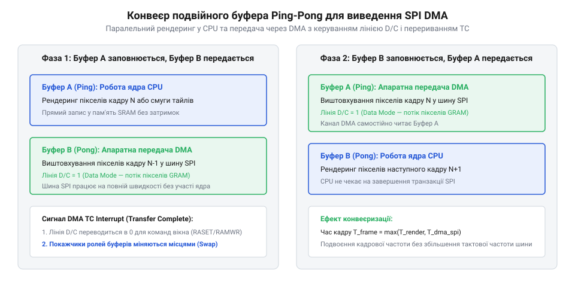

# Передавання графічних буферів через SPI з апаратним DMA

## Обмеження програмного виведення графіки

Коли мікроконтролер виводить [графічний інтерфейс на екран](root:sf-devices/hrafichnyi-interfeis), обсяг передаваних графічних даних стрімко зростає разом із роздільною здатністю та глибиною кольору. Наприклад, для невеликого дисплея формату `320 × 240` точок із кодуванням кольору @@en|RGB565@@ на один піксел припадає два байти пам'яті. Повний обсяг даних одного кадру `V` визначається добутком кількості стовпців `W`, рядків `H` та розміру одного пікселя `B`:

    V = W × H × B
      = 320 × 240 × 2        [підстановка параметрів екрана]
      = 153600               [обсяг у байтах]

Цей розрахунок дає близько 150 КБ на один кадр. Щоб отримати комфортну для людського ока динамічну анімацію з частотою 30 кадрів на секунду, пропускна здатність інтерфейсу має перевищувати 4.6 МБ/с. Для послідовної передачі це відповідає безперервному потоку даних із тактовою частотою шини понад 36.8 МГц.

За прямого програмного керування процесорне ядро записує черговий байт у вихідний регістр послідовного інтерфейсу периферії @@en|SPI@@ (англ. *Serial Peripheral Interface* — послідовний інтерфейс периферії) і зупиняється в циклічному очікуванні @@en|polling@@ (англ. *poll* — опитування, підрахунок голосів), перевіряючи апаратний прапорець звільнення буфера передавача. Поки зсувний регістр повільно виштовхує біти на лінію передачі, процесор марнує сотні тактових циклів на кожен байт, виконуючи порожні інструкції. Під час оновлення всього кадру процесорне ядро виявляється повністю завантаженим очікуванням периферії замість рендерингу графіки чи обробки датчиків.

Ба більше, в системах під керуванням операційної системи реального часу @@en|RTOS@@ (англ. *Real-Time Operating System* — операційна система реального часу) таке блокування порушує роботу інших задач. Якщо ж примусово перемикати контекст на інші задачі під час передачі, передавач @@en|SPI@@ простоюватиме порожнім, що спричинить розриви на шині, падіння частоти кадрів і тремтіння анімації. Навіть якщо графічний контролер підтримує [апаратний скролінг дисплея](root:sf-devices/display-hardware-scrolling) для зсуву статичних ділянок зображення, рухомі елементи інтерфейсу однаково вимагають постійної передачі пікселів. Щоб зберегти швидкість оновлення й детермінізм системи, перенесення графічних буферів необхідно відокремити від виконання коду в ядрі.

## Подвійна буферизація та DMA-конвеєр

Перекласти рутинне перенесення даних на апаратний рівень дозволяє контролер прямого доступу до пам'яті @@en|DMA@@ (англ. *Direct Memory Access* — прямий доступ до пам'яті). Він діє як автономний співпроцесор обміну даними між оперативною пам'яттю та периферією по внутрішній системній шині. Модуль @@en|SPI@@ при звільненні свого передавача самостійно генерує апаратний запит до @@en|DMA@@. У відповідь контролер @@en|DMA@@ без участі процесора зчитує черговий байт чи слово з оперативної пам'яті та записує його в регістр даних @@en|SPI@@.

Перед початком виведення пікселів процесор налаштовує прямокутне вікно у внутрішній пам'яті контролера дисплея. Для цього лінію вибору кристала @@en|CS@@ (англ. *Chip Select* — вибір кристала) переводять у низький активний рівень, а лінію режиму @@en|D/C@@ (англ. *Data/Command* — дані або команда) встановлюють у низький стан команди. Ядро передає байти координат вікна, після чого встановлює лінію @@en|D/C@@ у високий стан даних і запускає канал @@en|DMA@@. Лінія @@en|CS@@ залишається активною протягом усього сеансу передавання графічного блоку.

Якщо під час апаратного передавання процесор почне малювати в той самий буфер пам'яті, на екрані з'являться артефакти накладання та розриви кадру. Щоб усунути цей конфлікт, застосовують подвійну буферизацію @@en|double buffering@@ (англ. *buffer* від старофранцузького *buffe* — поштовх) за конвеєрною схемою @@en|ping-pong@@. Пам'ять для виведення ділять на два однакових буфери. Доки контролер @@en|DMA@@ самостійно викачує дані з першого буфера по шині @@en|SPI@@, процесор паралельно виконує рендеринг @@en|rendering@@ (англ. *render* від старофранцузького *rendre* — відтворювати, повертати) нового зображення в другий буфер.

*Ядро формує наступний буфер пікселів, доки контролер DMA передає попередній по шині SPI без навантаження на процесор.*

Синхронізація роботи ядра та шини відбувається через механізм переривань. Коли контролер @@en|DMA@@ передає останній байт поточного буфера, він викликає переривання завершення транзакції. Його обробник сигналізує планувальнику @@en|RTOS@@ через двійковий семафор або чергу повідомлень. Графічна задача прокидається, міняє покажчики буферів місцями і негайно перезапускає @@en|DMA@@ для передачі свіжого кадру, а ядро береться малювати наступний кадр у звільнений буфер. Така організація конвеєра усуває простої шини @@en|SPI@@ і повертає ядровим обчисленням понад 90% процесорного часу.