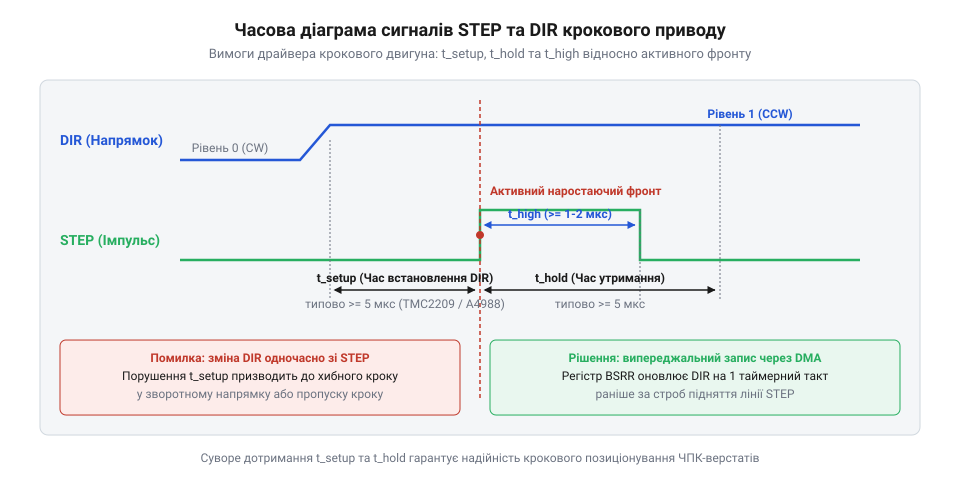
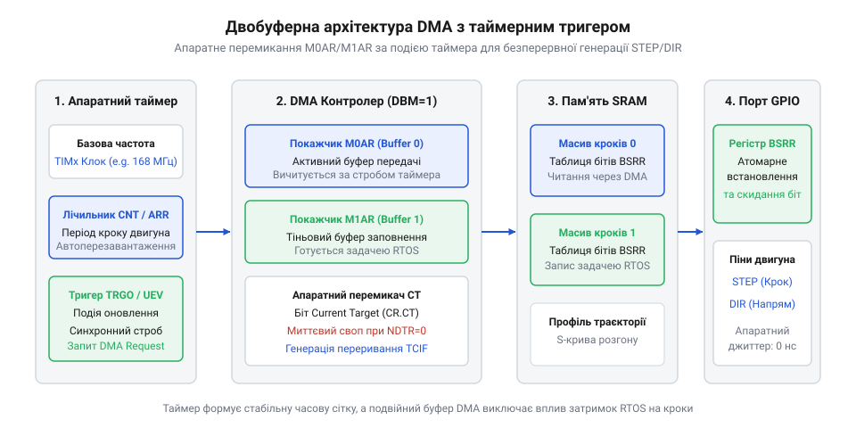
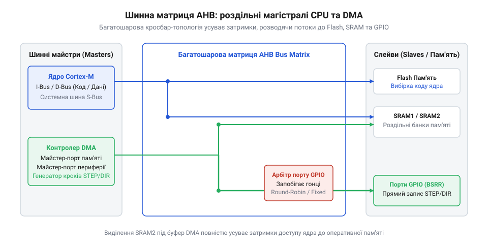
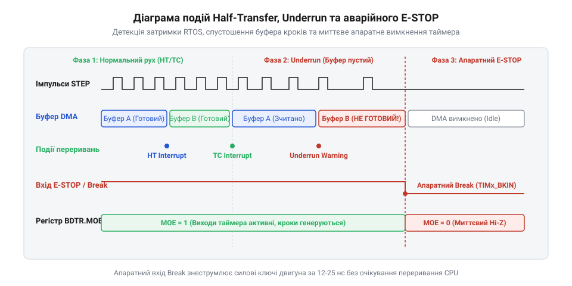

# Генерація імпульсів STEP/DIR засобами DMA та таймерів мікроконтролера

## Початкові концепції та фізичні принципи

У керуванні прецизійними механічними приводами — від багатоосьових верстатів з числовим програмним керуванням (ЧПК) та промислових маніпуляторів до високоточних 3D-принтерів — основним апаратним виконавчим елементом є кроковий двигун, керований спеціалізованим силовим драйвером. Фізичний зв'язок між обчислювальним мікроконтролером та електронною схемою драйвера реалізується через базовий цифровий інтерфейс, що складається з двох ключових ліній: `@@en|STEP@@` (крок) та `@@en|DIR@@` (напрямок). Фізична сутність даного інтерфейсу полягає у суворій дискретизації руху: кожен окремий активний фронт на лінії `@@en|STEP@@` примушує силові ключі драйвера переключити струм у обмотках статора, що викликає поворот ротора на один дискретний кутовий крок або мікрокрок. Кількість згенерованих імпульсів пропорційна підсумковому кутовому переміщенню вала, а миттєва частота слідування цих імпульсів задає кутову швидкість обертання приводу.

Для забезпечення надійної роботи силових транзисторів драйвера (наприклад, поширених мікросхем серій `@@en|TMC2209@@`, `@@en|A4988@@` або `@@en|TB6600@@`) керуючі сигнали повинні суворо відповідати специфікаціям часових затримок. Порівняно повільні вхідні оптичні розв'язки або внутрішні цифрові фільтри драйверів вимагають дотримання кількох фізичних часових інтервалів: Детальні параметри допустимих затримок та фізичні вимоги до фронтів висвітлюють [часові обмеження сигналів STEP/DIR](root:sf-devices/stepper-pulse-timing-constraints).

1. Мінімальна тривалість активного імпульсу `t_high` та тривалість паузи `t_low`. Якщо ширина імпульсу `@@en|STEP@@` виявиться коротшою за апаратний поріг (зазвичай від 1.0 до 2.5 мікросекунд), внутрішній тригер драйвера не встигне зафіксувати зміну стану, що призведе до пропускання кроку без будь-яких помилок з боку прошивки. 2. Час попереднього встановлення напрямку `t_setup`. Сигнал на лінії `@@en|DIR@@` повинен стабілізуватися і набути визначеного логічного рівня за певний час до появі активного фронту імпульсу `@@en|STEP@@`. Якщо переключення `@@en|DIR@@` відбудеться одночасно з фронтом `@@en|STEP@@` або після нього, драйвер зробить перший крок у попередньому (старому) напрямку. 3. Час утримання напрямку `t_hold`. Логічний рівень на лінії `@@en|DIR@@` повинен залишатися незмінним протягом певного часу після проходження активного фронту `@@en|STEP@@`.


*Часова діаграма керуючих сигналів крокового драйвера та критичні часові вікна стабілізації.*

Математичний зв'язок між потрібною кутовою швидкістю ротора `ω(t)` (вираженою в радіанах за секунду) та частотою генерації імпульсів `f_step(t)` описується рівнянням, що враховує кількість конструктивних кроків двигуна на один повний оберт `N_rot` (найчастіше 200 кроків для 1.8-градусних двигунів) та коефіцієнт дроблення кроку `K_micro` (наприклад, 1/16, 1/64 або 1/256):

```
f_step(t) = ω(t) · N_rot · K_micro / (2 · π)
```

Застосуємо цю формулу для реального прикладу високошвидкісного переміщення приводу.

**Обчислення частоти імпульсів для мікрокрокування 1/256:**
Потрібно забезпечити кутову швидкість `ω = 20 · π rad/s` (що відповідає 10 обертам вала на секунду) для стандартного двигуна з `N_rot = 200` при коефіцієнті мікрокрокування `K_micro = 256`.

```
f_step = (20 · π) · 200 · 256 / (2 · π)
= 10 · 200 · 256                        [скорочення 2·π]
= 512000 Hz                             [підсумкова частота в герцах]
= 512 kHz                               [переведення в кілогерці]
```

Якщо система керує чотирма осями координат одночасно (наприклад, `X`, `Y`, `Z`, `E`), сумарне навантаження на обчислювач сягає понад 2 мільйони подій генерації фронтів на секунду.

Історично першим і найпростішим підходом до розв'язання цієї задачі була програмна генерація у перериваннях апаратного таймера. У цьому підході використовується [алгоритм дискретного накопичення](root:sf-devices/dda-step-generation) помилки (від англ. @@en|Digital Differential Analyzer@@, DDA — цифрового обчислювача приросту), який працює безпосередньо в обробнику переривання (від англ. @@en|Interrupt Service Routine@@, ISR — процедури обслуговування переривань). З кожним тактом таймера процесор додає дробові прирости координат до акумулятора, перевіряє переповнення і вручну змінює стан виводів `@@en|GPIO@@` (від англ. @@en|General Purpose Input/Output@@ — портів введення-виведення загального призначення).

Однак при спробі підняти частоту генерації до сотень кілогерців програмний підхід `@@en|DDA@@` натрапляє на три фундаментальні апаратні бар'єри:

Перший бар'єр — **обчислювальна перевантаженість процесорного ядра**. Кожен вхід у процедуру обслуговування переривання `@@en|ISR@@` на мікроконтролерах з архітектурою `@@en|ARM Cortex-M@@` або `@@en|ESP32@@` супроводжується апаратним та програмним збереженням контексту: виштовхуванням робочих регістрів у стек, оновленням покажчика стека та завантаженням вектора переривань. На це витрачається від 12 до 30 тактів процесора на вхід та стільки ж на вихід. При частоті переривань 500 кГц процесор витрачає понад 80% усіх своїх тактових ресурсів виключно на накладні витрати збереження контексту, не виконуючи жодної корисної математичної роботи з розрахунку траєкторії.

Другий бар'єр — **фазове тремтіння (джитер)**. У реальних прошивках мікроконтролерів точний момент входу в `@@en|ISR@@` не є сталим. Наявність критичних секцій коду з заблокованими перериваннями, виконання інших високоприоритетних переривань від шин `@@en|USB@@`, `@@en|Wi-Fi@@` чи `@@en|UART@@`, а також промахи у кеш-пам'яті інструкцій спричиняють непередбачувані затримки. У результаті виникає часовий джитер (від англ. @@en|jitter@@ — тремтіння, часове коливання фази), через який реальний інтервал між кроками `Δt_real` відхиляється від ідеального `Δt_ideal`. Виникає небезпечна [зміна інтервалу між імпульсами](root:sf-devices/interrupt-jitter-mitigation), яка спотворює теоретичний профіль швидкості.

Третій бар'єр — **механічний резонанс та пропуск кроків**. Фізика крокового двигуна суворо підпорядковується законам динаміки. Миттєве кутове прискорення ротора `α(t)` виражається як похідна від швидкості по часу, що в дискретному вигляді визначається зміною інтервалів `Δt`:

```
α_inst = (v_new - v_old) / Δt
```

Якщо через джитер переривань один із часових інтервалів `Δt` раптово скорочується вдвічі, миттєве прискорення `α_inst` зростає у кілька разів. Механічна система з моментом інерції ротора та навантаження `J` створює протидіючий динамічний момент:

```
M_dyn = J · α_inst
```

Якщо сума статичного моменту опору та миттєвого динамічного піку перевищує максимальний утримуючий момент двигуна `M_hold`, магнітні полюси статора не встигають затягнути ротор у наступне рівноважне положення. Двигун миттєво втрачає синхронізм, видає характерний високочастотний вереск і повністю зупиняється, хоча прошивка продовжує вважати, що координата змінюється.

Дослідження показують, що аналізуючи [найгірші затримки обробки](root:sf-devices/esp-tail-latency-optimization) (хвостову затримку p99) у чисто програмних алгоритмах генерації, уникнути джитеру на рівні мікросекунд принципово неможливо.

Радикальним розв'язанням цієї физичної та обчислювальної суперечності є перехід до апаратного розвантаження процесора. Ідея полягає в тому, щоб усунути CPU з ланцюжка генерації кожного окремого імпульсу. Обов'язок вивантаження керуючих слів у фізичні виводи перекладається на спеціалізований периферійний модуль прямого доступу до пам'яті (від англ. @@en|Direct Memory Access@@, DMA — прямого керування шиною без участі ядра).

У такій системі [архітектура апаратних таймерів](root:sf-devices/microcontroller-hardware-timers-architecture) використовується як детерміноване джерело тактування шини. Таймер генерує періодичні апаратні події, які запускають канальний контролер `@@en|DMA controller@@`. Останній самостійно, за допомогою високошвидкісної шинної матриці (наприклад, `@@en|AHB@@` або `@@en|AXI@@`), вичитує з оперативної пам'яті (`@@en|SRAM@@`) заздалегідь розраховані бітові маски або інтервали та записує їх у регістри керування `@@en|GPIO@@`. Процесорне ядро при цьому повністю вивільняється і працює в фоновому режимі, підготовлюючи нові блоки даних у пам'яті з низьким пріоритетом.

## Внутрішня будова та алгоритми роботи

Внутрішня архітектура модуля апаратного прискорення генерації імпульсів базується на тісній узгодженості трьох компонентів: апаратного таймера-тригера, контролера `@@en|DMA@@` та оперативної пам'яті `@@en|SRAM@@`. На практиці розробники вбудованих систем використовують дві основні архітектурні моделі організації даних для `@@en|DMA@@`.

Перша модель — **квантування часу через буфер масок GPIO (GPIO Pattern Buffer Mode)**. У цій моделі оперативна пам'ять виділяється під масив 32-бітних слів, де кожен біт відповідає фізичному стану відповідного виводу порту `@@en|GPIO@@`. Апаратний таймер налаштовується на постійну частоту дискретизації `f_dma` (наприклад, 1 МГц, що дає часовий дискрет `T_step = 1 мкс`). При кожному переповненні лічильника таймер генерує апаратний запит `@@en|DMA request@@`. Контролер `@@en|DMA@@` зчитує чергове слово з масиву в `@@en|SRAM@@` і записує його в регістр прямого встановлення та скидання портів (наприклад, регістр `BSRR` у мікроконтролерах `@@en|STM32@@` або регістри `W1TS`/`W1TC` в `@@en|ESP32@@`).

Головною перевагою даного підходу є абсолютна синхронність усіх осей: маска керування для 4, 8 або 16 виводів `@@en|STEP@@` та `@@en|DIR@@` записується в регістри за один-єдиний такт шини, повністю виключаючи часовий зсув між осями. Низькорівневу організацію таких масивів у пам'яті описує [буфер бітових масок GPIO для DMA](root:sf-devices/gpio-dma-pattern-buffer).

Проте обсяг пам'яті для цієї моделі жорстко прив'язаний до частоти квантування та тривалості часового блоку. Обчислимо необхідну ємність оперативної пам'яті для зберігання одинсекундного профілю руху.

**Обчислення обсягу буфера пам'яті для масок GPIO:**
Нехай частота тактування `f_dma = 1000000 Hz` (1 МГц), тривалість буферизованого кванту часу `T_chunk = 10 ms` (0.01 с), а розмір одного слова керування становить `S_word = 4 bytes` (32 біти).

```
N_samples = f_dma · T_chunk
= 1000000 · 0.01                        [кількість вибірок у блоці]
= 10000                                 [вибірок]

V_buf = N_samples · S_word
= 10000 · 4                             [загальний обсяг у байтах]
= 40000 bytes                           [байтів]
= 39.06 KiB                             [кілобайтів]
```

Таким чином, для підтримки постійного вивантаження даних потрібна двобуферна структура загальним обсягом близько 80 КіБ, що є цілком прийнятним для сучасних мікроконтролерів із сотнями кілобайтів `@@en|SRAM@@`.

Друга модель — **перезавантаження регістрів порівняння таймера (Timer Compare Reload Mode)**. У цій моделі використовується [базовий модуль порівняння](root:sf-devices/hardware-output-compare) апаратного таймера. Буфер у пам'яті містить не бітові маски портів, а послідовність часових інтервалів між сусідніми кроками (значення для регістра порівняння `CCR` або регістра автоперезавантаження `ARR`). Коли таймер дораховує до заданого значення, апаратний вивід таймера автоматично змінює свій стан на протилежний, і одночасно виникає `@@en|DMA request@@`. Контролер `@@en|DMA controller@@` записує наступне значення інтервалу з пам'яті у регістр `CCR`.

Ця модель є надзвичайно економною щодо пам'яті: один крок займає лише 2 або 4 байти незалежно від того, скільки мікросекунд триває пауза між імпульсами. Однак її застосування для багатоосьових систем вимагає наявності складних матриць зв'язаних таймерів або окремого каналу `@@en|DMA@@` на кожну вісь.

Для забезпечення безперервного потоку генерації імпульсів без зупинки двигунів використовується двобуферна організація (від англ. @@en|Double Buffering@@ — почергове використання двох блоків пам'яті) на основі кільцевого режиму контролера `@@en|DMA@@` (від англ. @@en|Circular Mode@@ — кільцевого режиму перезапуску).


*Конвеєр двобуферного вивантаження паттернів кроків із пам'яті RAM у периферійні регістри GPIO.*

Схема функціонування двобуферного конвеєра полягає у наступному:
1. Загальний масив у `@@en|SRAM@@` розбивається на дві рівні секції: **Сегмент A** (Ping) та **Сегмент B** (Pong). 2. Контролер `@@en|DMA controller@@` запускається в режимі `@@en|Circular Mode@@` і починає послідовно передавати дані з **Сегмента A** в регістри `@@en|GPIO@@`. 3. У цей же час процесорне ядро, працюючи в фоновій задачі операційної системи реального часу `@@en|FreeRTOS@@`, розраховує кінематику для наступного відрізка шляху, спираючись на [трапецеїдальний профіль швидкості](root:sf-devices/trapezoidal-velocity-profile) або більш складний [планувальник S-кривих](root:sf-devices/planner-trapezoidal-s-curve-profile), і заповнює **Сегмент B**. 4. Коли `@@en|DMA controller@@` доходить до середини загального буфера (закінчує вигрузку Сегмента A), апаратний контролер генерує переривання половинної передачі (від англ. @@en|Half-Transfer Complete@@, HT). 5. Обробник переривання `@@en|HT ISR@@` надсилає швидкий сигнал задачі розрахунку траєкторії. Процесор знає, що Сегмент A тепер вільний, і починає записувати туди нові розраховані паттерни для майбутніх кроків. 6. Коли `@@en|DMA controller@@` досягає кінця Сегмента B, генерується переривання повного завершення (від англ. @@en|Transfer Complete@@, TC). Апаратний `@@en|DMA controller@@` за 0 тактів переключає свій внутрішній вказівник знову на початок Сегмента A і продовжує видачу сигналів без найменшого часового розриву, а процесор переключається на перезаповнення Сегмента B.

Критичним моментом в алгоритмах роботи є аварійна ситуація спустошення буфера (від англ. @@en|Buffer Underrun@@ — вичерпання підготовлених даних). Якщо через тимчасове навантаження на обчислювальне ядро задача `@@en|FreeRTOS@@` не встигне обчислити новий сегмент до того, як `@@en|DMA controller@@` перейде на нього, виникне небезпека вигрузки застарілих або сміттєвих даних з пам'яті.

Щоб запобігти цьому, застосовується [захист від спустошення буфера](root:sf-devices/dda-buffer-underrun-protection). Драйвер підтримує атомарні прапорці готовності сегментів. Якщо при настанні події `@@en|HT@@` або `@@en|TC@@` прапорець готовності відповідного сегмента виявляється скинутим, прошивка негайно переводить канал `@@en|DMA@@` у режим безаварійного очікування: наступний сегмент примусово заповнюється маскою затиснення (усі біти `@@en|STEP@@` в 0, біти `@@en|DIR@@` збережено). Двигун при цьому зупиняється без розінхронізації та механічного удару, а система фіксує подію помилки реального часу.

Для підтримання високого детермінізму вся обробка траєкторій виконується за допомогою [обчислень із фіксованою крапкою](root:sf-devices/fixed-point-kinematics), що повністю виключає варіативність часу виконання інструкцій плаваючої крапки (`FPU`).

Оцінка ефективності та налагодження розробленого модуля здійснюються за допомогою спеціалізованого системного інструментарію. Розробник використовує [профілювання системних таймерів](root:sf-devices/esp-timer-profiling) для контролю часу заповнення сегментів пам'яті, візуальний [аналіз у SEGGER SystemView](root:sf-devices/esp-systemview-tracing-analysis) для контролю моменту виклику переривань `@@en|HT/TC@@` та відсутності інверсії пріоритетів, а також збирає [статистику виконання задач FreeRTOS](root:sf-devices/freertos-task-runtime-stats).

Завдяки застосуванню зв'язки таймера та `@@en|DMA@@` досягається абсолютний часовий детермінізм: джитер фронтів `@@en|STEP@@` знижується від декількох мікросекунд (у програмному DDA) до кількох наносекунд (визначених лише фазовим шумом кварцового генератора мікроконтролера), а навантаження на процесорне ядро зменшується у 20–50 разів.

## Апаратна реалізація та низькорівневий C/C++ код

Коли мікроконтролер генерує імпульси керування одночасно для кількох осей приводу, стандартне програмне модифікування виводів портів виявляється непридатним. Будь-яка спроба встановити або скинути окремий біт фізичного порту через загальний регістр вихідних даних @@en|ODR@@ (від англ. @@en|Output Data Register@@ — регістр вихідних даних) вимагає виконання трикрокової послідовності «читання-модифікація-запис» (від англ. @@en|Read-Modify-Write@@). Процесорне ядро зчитує поточний стан порту, накладає бітову маску за допомогою логічних інструкцій `OR` або `AND` і записує модифіковане значення назад у пам'ять периферійного блоку. Якщо в проміжку між зчитуванням старого стану та записом модифікованого слова виникає асинхронне переривання або паралельний потік намагається змінити сусідній пін того самого порту, виникає стан гонитви, що неминуче спотворює вихідні сигнали та спричиняє пропуск кроків.

Для забезпечення абсолютної апаратної атомарності у сучасних мікроконтролерах використовують спеціалізовані регістри прямого встановлення та скидання ліній. В архітектурі @@en|STM32@@ таким ключовим вузлом є @@en|BSRR@@ (від англ. @@en|Bit Set/Reset Register@@ — регістр побітового встановлення та скидання). Регістр @@en|BSRR@@ має ширину 32 біти і розділений на дві незалежні функціональні половини: молодші 16 бітів (від 0 до 15) відповідають за встановлення виводів порту в логічну одиницю (Set), а старші 16 бітів (від 16 до 31) — за їхнє примусове скидання в логічний нуль (Reset). Запис одиничного біта у відповідний розряд регістра @@en|BSRR@@ змінює фізичний потенціал виводу за один-єдиний такт периферійної шини. Водночас запис нуля в будь-який розряд регістра не чинить жодного впливу на поточний стан лінії. Завдяки цій властивості контролер прямого доступу до пам'яті @@en|DMA@@ (від англ. @@en|Direct Memory Access@@ — прямий доступ до пам'яті) може безперервно вивантажувати заздалегідь підготовлені бітові слова за фіксованою адресою регістра @@en|BSRR@@. Це дозволяє синхронно керувати лініями @@en|STEP@@ та @@en|DIR@@ для десятка незалежних приводів без жодного втручання процесорного ядра та без ризику пошкодити сусідні біти порту @@en|GPIO@@ (від англ. @@en|General Purpose Input/Output@@ — порти введення-виведення загального призначення). Апаратні особливості та схемотехніку таких регістрів розглядає [атомарне керування регістрами GPIO через DMA](root:sf-devices/dma-gpio-atomic-bsrr-control).

Тактування та синхронізація вивантаження масок спираються на апаратні ресурси таймерів. У цьому конвеєрі [апаратні таймери мікроконтролера](root:sf-devices/microcontroller-hardware-timers-architecture) налаштовуються як прецизійні задавальні генератори часових інтервалів. При кожному переповненні базового лічильника таймера генерується апаратний запит оновлення @@en|DMA@@, який ініціює передачу чергового 32-бітного слова з оперативної пам'яті @@en|SRAM@@ (від англ. @@en|Static Random Access Memory@@ — статична пам'ять із довільним доступом). Канал @@en|DMA@@ конфігурується у напрямку від пам'яті до периферії з автоінкрементом адреси джерела та незмінною адресою приймача.

Надійність генерації кроків критично залежить від топології внутрішніх шин мікроконтролера. В архітектурах @@en|ARM Cortex-M@@ процесорне ядро та контролер @@en|DMA@@ конкурують за доступ до пам'яті та периферійних модулів через багатошарову комутаційну матрицю шин @@en|AHB@@ (від англ. @@en|Advanced High-performance Bus@@ — вдосконалена високопродуктивна системна шина) або @@en|AXI@@ (від англ. @@en|Advanced eXtensible Interface@@ — передовий розширюваний інтерфейс шини). Якщо буфер крокових патернів розміщено в тому самому банку оперативної пам'яті, де процесор розташовує змінні стека чи структури операційної системи, виникають шинні колізії. Арбітр матриці змушений циклічно зупиняти конвеєр ядра для надання доступу контролеру @@en|DMA@@, або затримувати передачу слів кроків, викликаючи фазовий джитер імпульсів.


*Апаратна топологія шинної матриці AHB та розділення трафіку процесора й контролера DMA.*

Для усунення конфліктів шинного арбітражу застосовують просторове розділення пам'яті. У мікроконтролерах із роздільними блоками оперативної пам'яті буфери @@en|DMA@@ виносять у вторинні банки пам'яті (наприклад, @@en|SRAM2@@) або спеціалізовані секції пам'яті шини периферії, залишаючи ядру первинний банк або надшвидку пам'ять із прямим зв'язком @@en|TCM@@ (від англ. @@en|Tightly-Coupled Memory@@ — пам'ять із прямим зв'язком). За такої конфігурації потік передачі даних у регістр @@en|BSRR@@ використовує виділені комутаційні мости і не перетинається з потоками вибірки інструкцій та локальних даних процесора.

Оцінимо частку пропускної здатності системної шини, яку вимагає безперервне вивантаження паттернів генератора на граничній частоті дискретизації.

**Розрахунок смуги пропускання шини для потоку DMA:**
Нехай частота запитів оновлення таймера становить `f_dma = 1000000 Hz` (1 МГц), розрядність переданого слова дорівнює `W_data = 4 bytes` (32 біти), а робоча частота шинної матриці мікроконтролера сягає `f_bus = 168000000 Hz` (168 МГц).

```
B_dma = f_dma · W_data
      = 1000000 · 4              [множення частоти вибірок на ширину слова]
      = 4000000 bytes/s          [пропускна здатність потоку DMA]
      = 4 MB/s                   [переведення в мегабайти за секунду]

B_bus = f_bus · W_data
      = 168000000 · 4            [гранична пропускна здатність 32-бітної шини]
      = 672000000 bytes/s        [теоретичний потік шини]
      = 672 MB/s                 [переведення в мегабайти за секунду]

K_bus = B_dma / B_bus
      = 4 / 672                  [відношення трафіку DMA до ресурсу шини]
      ≈ 0.00595                  [десятковий дріб]
      = 0.595%                   [підсумкове завантаження шинної матриці]
```

Отримане значення свідчить, що безперервне вивантаження масок частотою 1 МГц навантажує системну шину менше ніж на 0.6%, залишаючи понад 99.4% шинного ресурсу для виконання команд та обслуговування інших вузлів системи.

У високопродуктивних мікроконтролерах із ядрами @@en|ARM Cortex-M7@@ розробник обов'язково стикається з проблемою когерентності кеш-пам'яті даних @@en|D-Cache@@ (від англ. @@en|Data Cache@@ — кеш-пам'ять даних). Коли процесор розраховує траєкторію та заповнює масив слів у пам'яті, модифіковані дані осідають у рядках кешу і не записуються негайно у фізичну пам'ять @@en|SRAM@@. Оскільки периферійний контролер @@en|DMA@@ звертається до комірок оперативної пам'яті безпосередньо через шинну матрицю в обхід кешу процесора, він вичитує старі, не оновлені значення. Це призводить до видачі некоректних сигналів на драйвери двигунів.

Для гарантування когерентності пам'яті застосовують апаратну ізоляцію через модуль захисту пам'яті @@en|MPU@@ (від англ. @@en|Memory Protection Unit@@ — модуль захисту пам'яті). Область пам'яті, де розташовано черговий @@en|Ping-Pong Buffer@@ (від англ. @@en|Ping-Pong Buffer@@ — почерговий подвійний буфер), конфігурують як некешовану пам'ять (атрибут Non-Cacheable). Якщо використання модуля @@en|MPU@@ неможливе, після завершення розрахунку кожного сегмента викликають програмне очищення рядків кешу за адресою буфера, виштовхуючи модифіковані байти у фізичну пам'ять @@en|SRAM@@ перед передачею сегмента контролеру @@en|DMA@@.

Генерація масивів бітових слів спирається на [алгоритм дискретного накопичення](root:sf-devices/dda-step-generation) приросту координат. Кожен окремий елемент буфера відповідає одному часовому дискрету `Δt`. Під час заповнення сегмента алгоритм визначає стан кожної осі: якщо на поточному кроці квантування потрібно видати імпульс, у молодші 16 бітів записується бітова маска встановлення виводу @@en|STEP@@. На наступному кроці, після витримки необхідної апаратної тривалості імпульсу `t_high`, у старші 16 бітів регістра @@en|BSRR@@ записується маска скидання, яка повертає лінію @@en|STEP@@ у нульовий рівень. Біти напрямку @@en|DIR@@ встановлюються із завчасним випередженням, забезпечуючи [планування періодичних подій](root:sf-devices/periodic-scheduling) та виконання часових вимог силового каскаду.

Нижче наведено практичну реалізацію драйвера апаратного вивантаження імпульсів крокових приводів через @@en|DMA@@ та таймер мовами C та C++ для сімейства мікроконтролерів @@en|STM32@@.

:::tabs
:::code root\eng\sf-devices\dma-step-generation-hardware-acceleration/dma-step-generation-hardware-acceleration-d/c/stm32/dma-step-driver-init.c c

:::code root\eng\sf-devices\dma-step-generation-hardware-acceleration/dma-step-generation-hardware-acceleration-d/cpp/stm32/dmastepcontroller.cpp cpp
:::

Представлений програмний комплекс демонструє подвійну буферизацію з детермінованим часом реакції. У підпрограмі обслуговування переривань @@en|ISR@@ (від англ. @@en|Interrupt Service Routine@@ — процедура обслуговування переривання) події половинної передачі @@en|HT@@ (від англ. @@en|Half-Transfer@@ — завершення половини передачі) та повного завершення @@en|TC@@ (від англ. @@en|Transfer-Complete@@ — повне завершення передачі) сигналізують планувальнику про звільнення відповідної області пам'яті. Використання атомарних прапорців та моделі впорядкування пам'яті усуває стан гонитви між фоновими математичними розрахунками операційної системи реального часу @@en|FreeRTOS@@ та автономним апаратним циклом периферійного блоку.

## Практичне застосування та відлагодження

Практична експлуатація апаратного конвеєра генерації імпульсів охоплює багатоосьові верстати з числовим програмним керуванням, портальні лазерні комплекси, високошвидкісні 3D-принтери та промислові маніпулятори. У таких системах критичною вимогою є суворе збереження просторової форми траєкторії руху виконавчого органа. Коли привід одночасно інтерполює рух по кількох координатних осях, будь-який часовий перекіс між сигналами кроків різних осей викликає локальне відхилення від прямолінійного чи дугового сегмента. Завдяки тому, що контролер @@en|DMA@@ вивантажує 32-бітне слово маски в регістр @@en|BSRR@@ за один такт периферійної шини, фронти сигналів на лініях @@en|STEP@@ для всіх осей з'являються абсолютно одночасно. Розбіжність між фронтами імпульсів визначається виключно паразитними ємностями друкованої плати та не перевищує часток наносекунди, що повністю ліквідує хвилястість оброблюваної поверхні.

Найважливішим граничним режимом під час функціонування конвеєра подвійної буферизації є аварійне спустошення буфера @@en|Buffer Underrun@@ (від англ. @@en|Buffer Underrun@@ — спустошення буфера). Ця небезпечна ситуація настає тоді, коли фонова задача розрахунку кінематики в операційній системі реального часу @@en|RTOS@@ (від англ. @@en|Real-Time Operating System@@ — операційна система реального часу) не встигає підготувати та завантажити новий півбуфер даних до того моменту, коли контролер @@en|DMA@@ завершить відтворення попереднього блоку. Затримка процесорного ядра може бути викликана блокуванням планувальника пріоритетнішими перериваннями системних інтерфейсів, тривалою операцією стирання блоку внутрішньої флеш-пам'яті або сплеском обчислювальної складності геометрії.

Якщо в момент виникнення переривання @@en|HT@@ або @@en|TC@@ драйвер не перевірить готовність чергового блоку, контролер @@en|DMA@@ у кільцевому режимі @@en|Circular Mode@@ (від англ. @@en|Circular Mode@@ — кільцевий режим) продовжить циклічне читання пам'яті. У результаті на виводи драйвера потраплять старі або частково перезаписані маски. Кроковий двигун отримає раптовий пакет високочастотних імпульсів, темп слідування яких значно перевищить максимальне прискорення ротора. Ротор миттєво втратить магнітне зчеплення з полем статора, що викличе механічний удар, зрив приводу в резонанс та безповоротну втрату поточних координат деталі.

Для запобігання подібним аваріям у прошивку вбудовують [захист від спустошення буфера](root:sf-devices/dda-buffer-underrun-protection). Обробник переривання контролера @@en|DMA@@ під час кожного перемикання сегментів атомарно зчитує статус готовності даних. Якщо наступний блок не готовий до відтворення, драйвер негайно здійснює захисне глушіння: у незаповнений сегмент вноситься апаратна маска скидання кроків. Усі лінії @@en|STEP@@ фіксуються в логічному нулі, тоді як лінії @@en|DIR@@ зберігають свій попередній стан. Двигун плавно зупиняється вибігом без зміни напрямку та без механічних перевантажень, а система реального часу генерує повідомлення про фатальну помилку планувальника.

Другим критичним фактором є забезпечення часових інтервалів стабілізації ліній напрямку руху. Паспортні характеристики інтегральних драйверів крокових двигунів вимагають суворого дотримання інтервалу попереднього встановлення `t_setup` та інтервалу утримання `t_hold`. Якщо при реверсі координатної осі сигнал на лінії @@en|DIR@@ зміниться одночасно з активним наростаючим фронтом імпульсу @@en|STEP@@, вхідний тригер силового каскаду зафіксує попередній рівень сигналу. У результаті привід здійснить помилковий крок у зворотному напрямку, що призведе до накопичення похибки позиціонування.

Щоб запобігти збоям реверсу, алгоритм наповнення буфера застосовує вставлення мертвого часу @@en|Dead-Time@@ (від англ. @@en|Dead-Time@@ — мертвий час затримки). Коли [трапецеїдальний профіль швидкості](root:sf-devices/trapezoidal-velocity-profile) фіксує зміну знака руху осі, генератор формує в буфері порожній часовий квант тривалістю від 2 до 5 мікросекунд. У цьому кванті модифікується виключно біт лінії @@en|DIR@@, а всі біти ліній @@en|STEP@@ залишаються скинутими. Тільки після закінчення інтервалу мертвого часу драйвер дозволяє виставити перший активний фронт кроку для нового напрямку руху.

Окрему увагу слід приділити граничній затримці реакції системи на команди аварійної зупинки @@en|E-stop@@ (від англ. @@en|Emergency Stop@@ — аварійна зупинка) або спрацьовування захисних кінцевих вимикачів. Оскільки в системі працює подвійний конвеєр пам'яті, у буфері @@en|DMA@@ завжди присутній накопичений масив уже згенерованих команд, які очікують вивантаження в порти.

**Розрахунок затримки зупинки при природному спустошенні буфера:**
Нехай ємність половини буфера становить `N_half = 5000` вибірок, частота таймерних запитів оновлення дорівнює `f_dma = 500000 Hz` (500 кГц), а поточна швидкість переміщення робочого органу верстата сягає `v_axis = 300 mm/s`.

```
T_latency = N_half / f_dma
          = 5000 / 500000                [ділення кількості вибірок на частоту]
          = 0.01 s                       [час спорожнення одного сегмента]
          = 10 ms                        [переведення в мілісекунди]

ΔS_overrun = v_axis · T_latency
           = 300 · 0.01                  [множення швидкості на час затримки конвеєра]
           = 3 mm                        [неконтрольований вибіг механізму]
```


*Часова діаграма обробки подій Half-Transfer, спустошення буфера та апаратного вимкнення при аварійній зупинці.*

Вибіг порталу верстата на відстань 3 мм після зіткнення з кінцевим вимикачем є неприпустимим, оскільки це спричинить механічне пошкодження несучих конструкцій та інструменту. Тому реакція системи на сигнал @@en|E-stop@@ у жодному разі не повинна спиратися на природне очікування вичерпання активного буфера @@en|DMA@@.

Аварійний захист реалізується через пряме апаратне блокування виходів:
1. Сигнал аварійної події миттєво викликає високорівневе переривання, яке скидає біт запуску базового таймера `TIMx->CR1 &= ~TIM_CR1_CEN`, зупиняючи генерацію запитів передачі. 2. Контролер @@en|DMA@@ деактивується скиданням біта дозволу потоку в регістрі керування. 3. Процесор виконує прямий атомарний запис у регістр @@en|BSRR@@, миттєво встановлюючи старші 16 бітів для скидання всіх виводів @@en|STEP@@ у нуль за час менше 20 наносекунд. Схемотехніку та програмні контури швидкого аварійного скидання конвеєра аналізує [апаратне блокування та миттєва зупинка в системах із буферизованим рухом](root:sf-devices/stepper-dma-estop-fast-abort).

Не менш важливо враховувати вплив внутрішніх конфліктів шини мікроконтролера. Якщо в системі паралельно працюють контролери зв'язку @@en|Ethernet@@, обміну даними через картку пам'яті або відеоконтролери, вони генерують потужні транзакції в пам'яті. Якщо каналу @@en|DMA@@ генератора імпульсів призначено однаковий або нижчий пріоритет арбітражу, шинна матриця затримає вивантаження слова в регістр порту.

Для запобігання часовим спотворенням каналу @@en|DMA@@ генератора кроків призначають найвищий апаратний пріоритет (Very High Priority). Крім того, активують вбудований апаратний буфер @@en|FIFO@@ (від англ. @@en|First In, First Out@@ — першим увійшов, першим вийшов) контролера @@en|DMA@@ з порогом спрацьовування в половину ємності. Буфер @@en|FIFO@@ згладжує короткочасні затримки арбітражу системної шини, гарантуючи детерміновану видачу бітів на фізичні контакти.

Практичне налагодження та діагностика апаратного генератора здійснюються за допомогою спеціалізованого обладнання. Основним вимірювальним засобом виступає цифровий логічний аналізатор @@en|Logic Analyzer@@ (від англ. @@en|Logic Analyzer@@ — логічний аналізатор) із відкритим пакетом @@en|Sigrok@@ або апаратними комплексами фірми @@en|Saleae@@. За допомогою щупів аналізатора, підключених до ліній @@en|STEP@@ та @@en|DIR@@, інженер виконує такі задачі:
1. Контролює відповідність реальної тривалості імпульсу `t_high` мінімальним паспортним характеристикам оптопар драйвера. 2. Перевіряє коректність витримки мертвого часу перед зміною рівня сигналу на лінії @@en|DIR@@ під час реверсу осей, яким керує [планувальник траєкторій](root:sf-devices/planner-trapezoidal-s-curve-profile). 3. Формує статистичну гістограму розподілу міжімпульсних інтервалів `Δt` для підтвердження відсутності фазового джитеру. У той час як програмна генерація демонструє широкий статистичний розкид інтервалів через неоднорідність часу входу в переривання, апаратний конвеєр видає дельта-подібний розподіл, у якому відхилення тривалості інтервалу між імпульсами прагне до нуля.

Для програмної діагностики поведінки завдань у часі застосовують засоби динамічного трасування. Підключення інструменту [аналіз у SEGGER SystemView](root:sf-devices/esp-systemview-tracing-analysis) дає змогу візуалізувати часову діаграму роботи переривань @@en|HT@@ та @@en|TC@@, вимірювати тривалість виконання задачі наповнення буфера та оцінювати вільні запаси обчислювального часу. Якщо тривалість заповнення сегмента перевищує 50% від тривалості його апаратного вивантаження контролером @@en|DMA@@, прошивка оптимізується шляхом переходу на [розрахунки з фіксованою крапкою](root:sf-devices/fixed-point-kinematics), що виключає повільні операції програмної емуляції математики.

Розробник також регулярно аналізує [статистику використання процесорного часу](root:sf-devices/freertos-task-runtime-stats) для гарантування детермінізму системи реального часу, залучає [профілювання системних таймерів](root:sf-devices/esp-timer-profiling) для хронометражу критичних алгоритмів та проводить [профілювання покриття коду](root:sf-devices/esp-gcov-code-coverage-profiling) під час стендових випробувань @@en|Hardware-in-the-Loop@@ (від англ. @@en|Hardware-in-the-Loop@@ — тестування апаратури в контурі керування, HIL). Це забезпечує повну перевірку всіх нештатних ситуацій, включаючи обробку спустошення буфера та миттєве аварійне блокування приводів.

Комплексне поєднання апаратних таймерів, контролера прямого доступу до пам'яті та подвійної буферизації перетворює стандартний мікроконтролер на детермінований генератор імпульсів промислового класу. Усунення процесорного ядра з циклу формування кожного окремого фронту імпульсу відкриває можливість реалізації складних кінематичних алгоритмів без загрози втрати синхронізації крокових приводів.