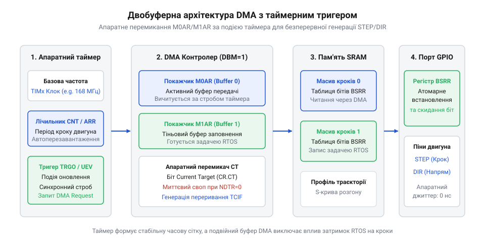

# Генерація імпульсів STEP/DIR засобами DMA та таймерів мікроконтролера

## Фізичні межі програмної генерації STEP/DIR

У системах цифрового керування рухом позиціювання механічних вузлів спирається на інтерфейс @@en|STEP/DIR@@ (від англ. *step/direction* — крок і напрямок). Щоб змістити вісь, мікроконтролер подає на вхід крокового драйвера прямокутний імпульс на лінію @@en|STEP@@, утримуючи заданий рівень напруги на лінії @@en|DIR@@. Кожен силовий драйвер висуває жорсткі часові вимоги: імпульс кроку повинен тривати щонайменше 1–2 мікросекунди для надійного спрацьовування вхідної оптопари, а сигнал напрямку має стабілізуватися за певний проміжок часу до появи активного фронту. У традиційній схемі програмний [генератор кроків DDA](root:sf-devices/dda-step-generation) (від англ. *digital differential analyzer* — цифровий диференційний аналізатор; @@en|DDA@@) розраховує інтервали між кроками безпосередньо всередині підпрограми обробки переривань — @@en|ISR@@ (від англ. *interrupt service routine* — підпрограма обробки переривань) апаратного таймера. При багатоосьовому русі та високих швидкостях частота кроків сягає сотень кілогерців. Час входу в переривання, збереження регістрів процесорного ядра у стек і перерахунок дробових акумуляторів швидко вичерпують обчислювальний бюджет мікроконтролера, паралізуючи виконання фонових задач.

Ще критичнішою затримкою є фазовий джитер — @@en|jitter@@ (від англ. *jitter* — тремтіння, розкид затримок). Вхід в @@en|ISR@@ ніколи не відбувається в ідеально фіксований момент: виклики блокуються критичними секціями операційної системи реального часу або витісняються пріоритетнішими системними перериваннями. Навіть мікросекундне відхилення моменту видачі імпульсу грубо спотворює плавний [трапецеїдальний профіль швидкості](root:sf-devices/trapezoidal-velocity-profile). Раптове скорочення інтервалу між двома сусідніми імпульсами створює миттєвий сплеск частоти, що еквівалентно різкому стрибку прискорення. Оскільки ротор двигуна та механічне навантаження мають відчутну інерцію, привід фізично не встигає відпрацювати цей пік. Виникають акустичний вереск, вібрації механіки й аварійний зрив синхронізму, за якого двигун зупиняється з втратою поточної координати. Програмна корекція не здатна усунути цю нестабільність, тому для подолання [апаратного джитера переривань](root:sf-devices/interrupt-jitter-mitigation) процес генерації імпульсів необхідно повністю вивести з-під контролю процесорного ядра.

## Апаратне розвантаження через зв'язку таймера та DMA

Детерміновану генерацію кроків забезпечує апаратне вивантаження керуючих сигналів. Для цього прошивка задіює [апаратний модуль порівняння](root:sf-devices/hardware-output-compare) таймера та контролер прямого доступу до пам'яті — @@en|DMA@@ (від англ. *direct memory access* — прямий доступ до пам'яті). Таймер налаштовують на фіксовану базову частоту квантування часу. Кожен періодичний сигнал переповнення таймера виступає апаратним тригером, за яким контролер @@en|DMA@@ без участі процесора зчитує чергове слово з пам'яті та передає його в порти введення-виведення загального призначення — @@en|GPIO@@ (від англ. *general-purpose input/output*). Щоб зміна станів окремих осей була безпечною, вивантаження здійснюється в атомарні регістри встановлення та скидання бітів порту. Це усуває потребу в інструкціях читання-модифікації-запису й повністю виключає апаратні конфлікти між різними виводами.

*Апаратний таймер виступає тригером DMA для прямого перенесення бітових масок у регістри GPIO без участі процесора.*

Неперервний рух без зупинок досягається завдяки подвійній буферизації — @@en|ping-pong buffer@@ (від звуконаслідувальної назви настільного тенісу *ping-pong* — почерговий обмін двома буферами). Фоновий [планувальник траєкторій](root:sf-devices/planner-trapezoidal-s-curve-profile) заздалегідь квантує траєкторію на фіксовані часові інтервали й формує в пам'яті бітові маски ліній @@en|STEP@@ та @@en|DIR@@. Поки контролер @@en|DMA@@ автономно передає першу половину буфера, процесорне ядро у фоні заповнює даними другу. Щойно передача половини завершується, апаратні події контролера перемикають канал на інший буфер і сповіщають ядро про необхідність розрахунку наступної партії кроків.

Якщо планувальник затримується через важкі кінематичні обчислення й не встигає підготувати блок, виникає спустошення буфера — @@en|buffer underrun@@ (від англ. *underrun* — спустошення, вичерпання даних у буфері). Повторне надсилання старого фрагмента спричинило б непередбачуваний рух верстата. Щоб захистити механіку, вбудовують апаратний [захист від спустошення буфера](root:sf-devices/dda-buffer-underrun-protection): обробник переривання @@en|DMA@@ перевіряє статус готовності секції і при затримці негайно зупиняє лічильник таймера, переводячи лінії @@en|STEP@@ у пасивний стан. За схожим апаратним ланцюжком реалізують аварійне вимкнення приводу — @@en|E-stop@@ (від англ. *emergency stop* — аварійна зупинка): сигнал тривоги миттєво блокує виходи таймера та вимикає лінії активації драйверів без очікування реакції операційної системи.