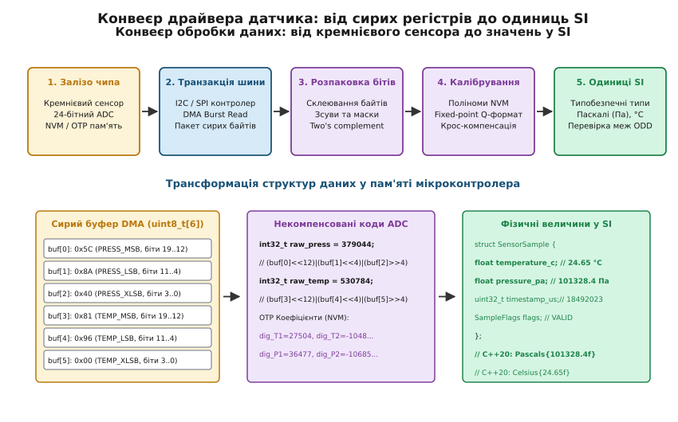
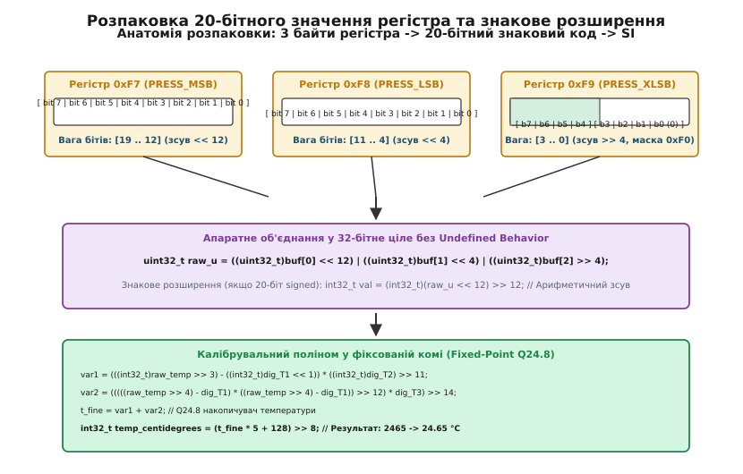
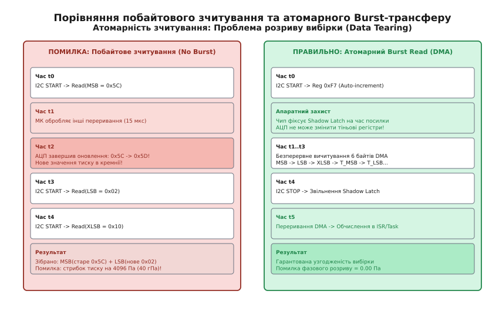
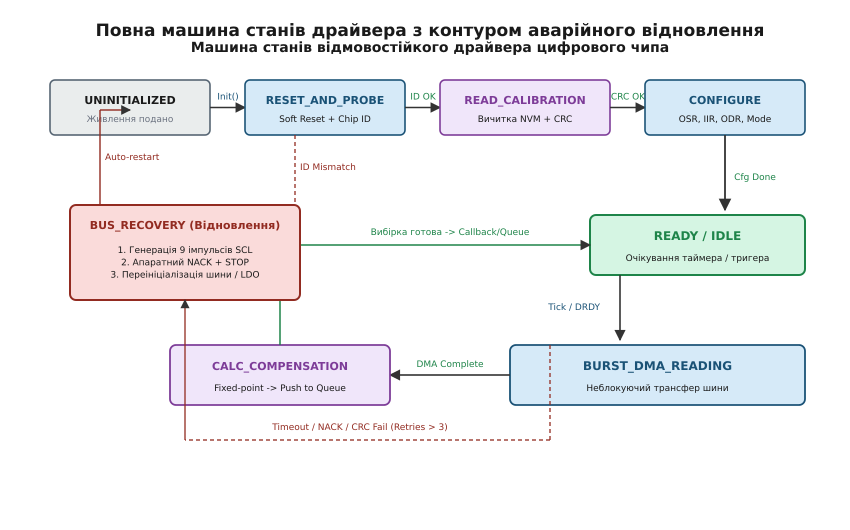

# Драйвер чипа: від регістрової карти до значення у SI

<preknowlist>
- [Рівень транзакцій: відділити чип від шини](root:sf-devices/riven-tranzaktsii)
- [Послідовність ініціалізації, якої ніхто не пояснює](root:sf-devices/poslidovnist-initsializatsii-iakoi-nikhto)
- [Опитування, переривання чи DMA у драйвері](root:sf-devices/opytuvannia-pereryvannia-chy-dma-u-draiveri)
- [Таймаути, помилки й повторна ініціалізація чипа](root:sf-devices/taimauty-pomylky-i-povtorna-initsializatsiia-chypa)
- [I2C протокол](root:com-devices/i2c)
- [Фіксована кома та Q-формат](root:hw-arch/fixed-point)
</preknowlist>

Коли мікроконтролер запитує через шину I2C або SPI вимірювання фізичної величини, він отримує не градуси Цельсія і не Паскалі, а сирий масив байтів, складений із доповняльних кодів, зміщених масок та окремих бітових прапорців. Помилка в один біт при розпаковці знакової сітки або вичитування регістрів окремими байтами замість атомарного пакета миттєво спотворює тиск на сотні гектопаскалів, ініціюючи аварійне спрацьвування захисту в польотному контролері чи медичному апараті.

Драйвер зовнішнього цифрового чипа є мостом між дискретним кремнієвим світом регістрів та математичним світом фізичних рівнянь. Його завдання — організувати надійний транспорт по ненадійній шині, гарантувати атомарність вибірки, розпакувати бітові поля без невизначеної поведінки компілятора, скомпенсувати нелінійності чутливого елемента за допомогою індивідуальних заводських коефіцієнтів та видати результат у міжнародній системі одиниць SI з детермінованим часом реакції.


*Архітектурний конвеєр проходження сигналу в драйвері цифрового датчика від фізичного кремнієвого чутливого елемента до типізованого значення у міжнародній системі одиниць SI.*

## 1. Анатомія зовнішнього цифрового чипа: міст між фізикою та кремнієм

Сучасний цифровий датчик (наприклад, барометричний сенсор Bosch Sensortec BMP280, давач вологості Sensirion SHT4x або інерційний модуль TDK InvenSense ICM-42688) є інтегрованою мікроелектромеханічною системою (MEMS), що поєднує чутливий кремнієвий кристал та цифрову керуючу мікросхему ASIC в єдиному мініатюрному корпусі LGA.

Внутрішня архітектура такого чипа складається з п'яти взаємопов'язаних вузлів:

### Чутливий кремнієвий елемент (MEMS Core)
Для вимірювання тиску використовується тонка пружна мембрана з монокристалічного кремнію, під якою сформована вакуумована порожнина опорного тиску. На поверхні мембрани методом дифузійного легування сформовано п'єзорезистивний вимірювальний міст Вітстона.

Коли зовнішній атмосферний тиск змінюється, мембрана механічно прогинається. Внаслідок п'єзорезистивного ефекту опір плечей моста змінюється на соті частки відсотка:

```
ΔR / R = π_l · σ_l + π_t · σ_t
```
де `π_l, π_t` — поздовжній та поперечний п'єзорезистивні коефіцієнти кремнію, а `σ_l, σ_t` — механічні напруження стиснення та розтягування в тілі мембрани.

Оскільки кремній є анізотропним кристалом, чутливість моста жорстко залежить від орієнтації кристалографічних осей. Технологічний процес вимагає розміщення п'єзорезисторів строго вздовж напрямків максимальної п'єзочутливості `[110]` на пластині з орієнтацією `(100)`. Найменше кутове відхилення при фотолітографії викликає зміщення нуля та зміну температурного нахилу, що робить кожен виготовлений чип унікальним за своїми характеристиками.

Крім того, у тілі напівпровідника неминуче виникають паразитні термоелектричні явища. При наявності температурного градієнта вздовж кристала на спаях дифузійних резисторів з алюмінієвою металізацією виникає термо-ЕРС Зеєбека амплітудою до 400 мкВ/К. Якщо чіп нагрівається асиметрично (наприклад, через тепловий потік від сусіднього мікроконтролера), цей паразитний потенціал додається до вихідного сигналу моста, імітуючи зміну тиску.

Також у мості Вітстона діє фундаментальний термодинамічний шум Джонсона — Найквіста (Johnson-Nyquist Noise), породжений хаотичним тепловим рухом носіїв заряду. Спектральна густина напруги цього шуму визначається класичним виразом:

```
e_n = sqrt(4 · k_B · T · R)
```
де `k_B` — стала Больцмана (`1.380649 · 10^-23 Дж/К`), `T` — абсолютна температура в Кельвінах, а `R` — еквівалентний опір моста (типово від 5 кОм до 20 кОм). Поруч із тепловим шумом діє низькочастотний флікер-шум `1/f`, зумовлений пастками на межі поділу кремнію та діоксиду кремнію. Для подолання цих шумів аналоговий тракт чипа повинен застосовувати активну динамічну фільтрацію.

Додатковим фізичним чинником довготривалого дрейфу є поступова деградація вакууму в опорній камері. Протягом років експлуатації відбувається мікроскопічна дифузія легких газів (водню та гелію) крізь евтектичний шов з'єднання кристалів (Eutectic Bonding) та газовиділення з внутрішніх поверхонь кремнію (Outgassing). Це призводить до повільного монотонного зміщення опорного нуля зі швидкістю близько 0.1–0.2 гПа на рік. Драйвер промислового рівня враховує цей ефект, надаючи механізми періодичного калібрування локального зміщення висотоміра.

### Аналоговий тракт (Analog Front-End, AFE)
Низькорівневий диференційний сигнал розбалансу моста (амплітудою всього від кількох сотень мікровольтів до одиниць мілівольтів) надходить на вхід малошумного інструментального підсилювача з регульованим коефіцієнтом підсилення (PGA, англ. *Programmable Gain Amplifier*).

Для пригнічення власного низькочастотного флікер-шуму (`1/f` шуму) та напруги зміщення транзисторів вхідний підсилювач використовує чопперну модуляцію (Chopper-Stabilized Amplification). Вхідний постійний сигнал комутується на високій частоті (наприклад, 125 кГц), підсилюється на змінному струмі та демодулюється назад на виході, що повністю усуває дрейф нуля аналогового тракту.

Оцифрування виконується прецизійним сигма-дельта (Σ-Δ) аналого-цифровим перетворювачем (АЦП) другого порядку. Передатна функція дискретного сигма-дельта модулятора в Z-області описується виразом:

```
Y(z) = X(z) · z^-2 + E(z) · (1 - z^-1)^2
```
де `X(z)` — корисний вхідний сигнал, `E(z)` — шум квантування внутрішнього компаратора, а множник `(1 - z^-1)^2` реалізує формування шуму 2-го порядку (Noise Shaping). Завдяки подвійному диференціюванню шум квантування виштовхується з низькочастотної смуги вимірювання у високі частоти.

Вбудований цифровий децимаційний фільтр низьких частот sinc³ з коефіцієнтом децимації `N` згортає бітовий потік, формуючи 20-бітне вихідне слово:

```
|H(f)| = |sin(π · f · N / f_s) / (N · sin(π · f / f_s))|^3
```
Нулі передатної характеристики фільтра розташовані на частотах, кратних `f_s / N`. Шляхом точного підбору тактової частоти модулятора виробник чипа розташовує нулі АЧХ точно на частотах 50 Гц та 60 Гц, забезпечуючи апаратне придушення мережевих завад понад 80 дБ без залучення ресурсів мікроконтролера.

### Блок опорної напруги типу Bandgap
Для роботи АЦП потрібне термостабільне джерело опорної напруги `V_ref`. На кристалі реалізовано джерело на базі забороненої зони кремнію (Bandgap Reference). Воно комбінує пряму напругу p-n переходу біполярного транзистора (що має негативний температурний коефіцієнт близько -2 мВ/°C) та різницю напруг двох переходів з різною густиною струму `ΔV_be = (k·T/q)·ln(N)` (що має позитивний температурний коефіцієнт).

Сума цих сигналів дає теоретично температурно-інваріантну напругу близько 1.25 В. Проте залишкова нелінійність 2-го порядку генерує параболічний температурний дрейф, який згодом мусить компенсувати математичне ядро драйвера.

### Цифровий логічний автомат керування та масив тіньових регістрів (Shadow Registers)
Цифрове ядро чипа координує послідовність вимірювань, керує тактуванням модуляторів, виконує проміжну IIR-фільтрацію та обслуговує транзакції інтерфейсного блока I2C/SPI.

Критичним компонентом є двопортовий масив регістрів вихідних даних:
* Порт запису: оновлюється цифровим ядром сенсора асинхронно по завершенню роботи децимаційного фільтра АЦП.
* Порт читання: доступний для мікроконтролера через шину зв'язку.
* Вузол апаратного фіксування (Shadow Latch): блокує зміну даних у вихідних регістрах під час активного зчитування пакета хостом, що виключає стан гонитви.

### Енергонезалежна пам'ять калібрувань (OTP / NVM ROM)
Під час виготовлення кремнієвої пластини кожен окремий кристал має унікальні мікроскопічні геометричні та технологічні похибки: нерівномірність товщини мембрани, розкид легування п'єзорезисторів та залишкові термічні напруження після корпусування.

Для усунення цих похибок кожен кристал на заводі піддається калібруванню в автоматизованій термобарокамері. Обчислені індивідуальні коефіцієнти записуються в комірки одноразово програмованої енергонезалежної пам'яті (One-Time Programmable ROM або eFuse). Під час подачі живлення внутрішній автомат чипа копіює ці байти в спеціальний блок регістрової карти, доступний мікроконтролеру для читання.

Повна практична реалізація взаємодії з цими вузлами представлена у проєктній вставці [Практичний конвеєр драйвера датчика](root:sf-devices/draiver-chypa/proj-sensor-driver-pipeline.md).

## 2. Регістрова карта як апаратно-програмний контракт

З погляду вбудованого програміста будь-який цифровий чип представляє собою масив 8-бітних комірок пам'яті (регістрів), адресованих 8-бітним (або 16-бітним) числовим значенням.

Регістрова карта — це суворий специфікаційний контракт між розробником кремнію та автором драйвера. Вона чітко розмежовує зони відповідальності:

| Діапазон адрес | Тип регістра | Режим доступу | Функціональне призначення |
| :--- | :--- | :--- | :--- |
| **`0xD0`** | `CHIP_ID` | Read Only | Апаратний ідентифікатор типу та ревізії кристала (`0x58` для BMP280, `0x60` для BME280). |
| **`0xE0`** | `RESET` | Write Only | Регістр програмного скидання. Запис байта `0xB6` ініціює повний цикл POR. |
| **`0x88...0xA1`** | `CALIB00...CALIB23` | Read Only | 24 байти індивідуальних калібрувальних коефіцієнтів NVM у форматі Little-Endian. |
| **`0xF3`** | `STATUS` | Read Only | Бітові прапорці стану: `measuring` (йде перетворення АЦП) та `im_update` (копіювання NVM). |
| **`0xF4`** | `CTRL_MEAS` | Read / Write | Налаштування передискретизації температури (`osrs_t`), тиску (`osrs_p`) та режиму живлення (`mode`). |
| **`0xF5`** | `CONFIG` | Read / Write | Налаштування часу очікування (`t_sb`), коефіцієнта IIR-фільтра (`filter`) та режиму 3-wire SPI. |
| **`0xF7...0xF9`** | `PRESS_MSB...XLSB` | Read Only | 20-бітний сирий результат АЦП тиску (старші 8 бітів у MSB, середні в LSB, молодші 4 в XLSB[7:4]). |
| **`0xFA...0xFC`** | `TEMP_MSB...XLSB` | Read Only | 20-бітний сирий результат АЦП температури (MSB, LSB, XLSB[7:4]). |


*Послідовність розпаковки сирих байтів з регістрової карти сенсора: виділення розрядів, знакове розширення та застосування калібрувальних поліномів.*

### Детальний розбір конфігураційних полів регістра `CTRL_MEAS` (0xF4)
Регістр керування та вимірювань `CTRL_MEAS` визначає поведінку аналогового ядра та складається з трьох бітових полів:

1. **Біти `[7:5]` — `osrs_t` (Temperature Oversampling):**
   * `000`: Вимірювання температури вимкнено (регістри повертають `0x800000`).
   * `001`: Передискретизація ×1 (роздільна здатність 16 бітів, час ~5.5 мс).
   * `010`: Передискретизація ×2 (роздільна здатність 17 бітів).
   * `011`: Передискретизація ×4 (роздільна здатність 18 бітів).
   * `100`: Передискретизація ×8 (роздільна здатність 19 бітів).
   * `101...111`: Передискретизація ×16 (роздільна здатність 20 бітів, максимальна фільтрація шуму).
2. **Біти `[4:2]` — `osrs_p` (Pressure Oversampling):**
   * Аналогічно керує кількістю циклів інтегрування сигма-дельта модулятора тиску від `000` (вимкнено) до `101` (×16). Збільшення коефіцієнта з ×1 до ×16 знижує середньоквадратичний шум вимірювання тиску з 3.3 Па до 0.2 Па, проте збільшує час перетворення з 5.5 мс до 43.5 мс.
3. **Біти `[1:0]` — `mode` (Power Mode):**
   * `00` (`Sleep Mode`): Усі аналогові модулі вимкнені, споживання струму падає до 0.1 мкА. Доступ до регістрової карти через I2C/SPI залишається активним.
   * `01` або `10` (`Forced Mode`): Чип прокидається, виконує рівно одне повне вимірювання температури та тиску відповідно до налаштувань OSR, зберігає результат у вихідних регістрах і автоматично повертається у стан `Sleep Mode`. Це базовий режим для автономних пристроїв з батарейним живленням.
   * `11` (`Normal Mode`): Чип працює в неперервному циклі: виконує вимірювання, записує результат, переходить у стан очікування на час `t_sb` (Standby Time), після чого автоматично запускає наступне перетворення.

### Детальний розбір конфігураційних полів регістра `CONFIG` (0xF5)
Регістр `CONFIG` визначає динамічні та інтерфейсні властивості:

1. **Біти `[7:5]` — `t_sb` (Standby Time):**
   Задає час неактивності між вимірюваннями в режимі Normal Mode: `000` = 0.5 мс, `001` = 62.5 мс, `010` = 125 мс, `011` = 250 мс, `100` = 500 мс, `101` = 1000 мс, `110` = 2000 мс, `111` = 4000 мс.
2. **Біти `[4:2]` — `filter` (IIR Filter Coefficient):**
   Керує внутрішнім цифровим фільтром з нескінченною імпульсною характеристикою (IIR). Фільтр першого порядку реалізує рекурентне рівняння:
   ```
   data_filtered[n] = (data_filtered[n-1] · (coeff - 1) + data_raw[n]) / coeff
   ```
   де значення поля задають коефіцієнт `coeff`: `000` = Off (фільтр вимкнено), `001` = 2, `010` = 4, `011` = 8, `100...111` = 16.
   Передатна функція IIR-фільтра в Z-області має вигляд:
   ```
   H(z) = (1 / coeff) / (1 - ((coeff - 1) / coeff) · z^-1)
   ```
   IIR-фільтр ефективно пригнічує високочастотний акустичний шум та динамічні сплески тиску від потоків повітря (наприклад, пориви вітру або турбулентність від пропелерів дрона). Проте фільтр вносить експоненційну фазову затримку (Group Delay). При виборі коефіцієнта `coeff = 16` час досягнення 99% амплітуди перехідного процесу вимагає `n = -ln(0.01) / ln(15/16) ≈ 72` послідовні вибірки. Якщо сенсор працює на частоті 20 Гц, затримка становить 3.6 секунди, що є неприпустимим для контуру швидкої стабілізації висоти коптера. Драйвер польотного контролера зазвичай обирає компромісний коефіцієнт `filter = 2` або `filter = 4`.
3. **Біт `[0]` — `spi3w_en` (3-Wire SPI Enable):**
   При встановленні в `1` лінія `SDI` стає двонаправленою шиною даних для роботи у 3-провідному режимі SPI, звільняючи пін `SDO`.

### Поведінка бітів статусу в регістрі `STATUS` (0xF3)
Регістр `STATUS` містить два критичні індикатори внутрішнього стану цифрового автомата:
* **Біт 3 (`measuring`):** апаратний тригер сигналізує про активне перетворення сигма-дельта модулятора. Цей біт встановлюється в `1` у момент старту вимірювання і скидається в `0` лише після того, як результати будуть скопійовані у вихідний тіньовий масив. Опитування цього біта у циклі з таймаутом є надійним способом визначення готовності вибірки без використання зовнішніх ліній переривання.
* **Біт 0 (`im_update`):** прапорець завантаження калібрувальних даних. Під час процедури Power-On Reset або після отримання команди скидання вбудований контролер NVM зчитує байти з масиву eFuse і копіює їх у тіньову пам'ять SRAM регістрової карти. Поки цей процес триває (близько 2–3 мс), біт `im_update` утримується в `1`. Якщо драйвер спробує зчитати калібрувальні коефіцієнти раніше, ніж цей біт скинеться в `0`, він отримає спотворені нульові значення.

### Правила роботи з зарезервованими бітами (Reserved Bits)
Багато регістрів містять невикористані біти, позначені в документації як `reserved`. Драйвер зобов'язаний дотримуватися залізного правила модифікації регістрів «Read-Modify-Write»:
1. Зчитати поточний стан регістра.
2. Накласти бітову маску очищення цільових розрядів `reg &= ~MASK`.
3. Накласти бітову маску нового значення `reg |= (val << SHIFT) & MASK`.
4. Записати байт назад у чип.

Прямий запис константи без попереднього читання може змінити зарезервовані заводські біти тестового режиму (Test Mode Bits), що призведе до непередбачуваної поведінки аналогового тракту або повного блокування виходу даних.

## 3. Атомарний зріз даних (Burst Read) проти побайтового зчитування

Чому побайтове зчитування регістрів є однією з найнебезпечніших прихованих помилок у вбудованому програмуванні?

Розглянемо детальний часовий аналіз роботи АЦП та шини зв'язку. Результат вимірювання тиску займає 20 бітів і розподілений між трьома регістрами:
* `PRESS_MSB` (адреса `0xF7`, біти `[19:12]`)
* `PRESS_LSB` (адреса `0xF8`, біти `[11:4]`)
* `PRESS_XLSB` (адреса `0xF9`, біти `[3:0]` у верхньому ніблі)

Припустимо, вхідний тиск плавно зростає, і внутрішній код АЦП змінюється з `0x07_FF_F0` на `0x08_00_00` (відбувається переповнення та перехід через межу старшого байта MSB).

Якщо драйвер звертається до сенсора трьома окремими шинними транзакціями читання:

```
Час T0: МК відправляє I2C START -> Адреса 0xF7 -> Читає PRESS_MSB = 0x70 -> I2C STOP
Час T1: Сенсор завершує перетворення АЦП і записує в регістри НОВЕ значення 0x08_00_00!
Час T2: МК відправляє I2C START -> Адреса 0xF8 -> Читає PRESS_LSB = 0x00 -> I2C STOP
Час T3: МК відправляє I2C START -> Адреса 0xF9 -> Читає PRESS_XLSB = 0x00 -> I2C STOP
```

Коли драйвер склеїть ці три байти, він отримає:

```
ADC_P = (0x70 << 12) | (0x00 << 4) | (0x00 >> 4) = 0x070000 = 458752 одиниць
```

Проте реальне значення в момент часу T0 становило `0x07FFF0` (524272 одиниці), а в момент T1 стало `0x080000` (524288 одиниць).

У результаті розриву даних виникає миттєвий фіктивний провал на:

```
ΔADC = 524288 - 458752 = 65536 одиниць коду
```

При переведенні у фізичні величини цей стрибок відповідає помилці тиску близько 6400 Па (64 гПа). У системі керування безпілотним літальним апаратом або крилатою ракетою такий стрибок тиску інтерпретується автопілотом як миттєве падіння висоти на 550 метрів. Система керування дає максимальний газ двигунів на підйом, що призводить до аварії літального апарата або зриву стабілізації польоту.


*Порівняння побайтового зчитування (виникнення розриву даних через оновлення АЦП посеред транзакції) та атомарного Burst Read з блокуванням тіньових регістрів.*

### Апаратне вирішення: пакетне читання (Burst Read) з автоінкрементом
Цифрова логіка сенсора реалізує механізм блокування тіньових регістрів (Shadow Registers Latch):
1. Мікроконтролер видає умову `START`, надсилає адресу пристрою для запису та передає адресу першого регістра блока `0xF7` (PRESS_MSB).
2. Мікроконтролер генерує умову повторного старту `REPEATED START` та надсилає адресу пристрою для читання.
3. У момент виставлення першого адресного байта сенсор апаратно блокує (заморожує) оновлення всього вихідного масиву `0xF7...0xFC`. Якщо під час передачі АЦП сформує нове вимірювання, воно залишатиметься у внутрішньому буфері конвертера і не перепише вихідні регістри.
4. При кожному наступному такті `SCL` та підтвердженні `ACK` від мікроконтролера сенсор видає наступний байт, автоматично збільшуючи внутрішній вказівник регістра (`0xF7 -> 0xF8 -> 0xF9 -> 0xFA -> 0xFB -> 0xFC`).
5. Після прийому 6-го байта мікроконтролер видає сигнал `NACK` та генерує умову `STOP`.
6. Лише після отримання сигналу `STOP` сенсор розблоковує тіньові регістри та копіює туди найсвіжіше накопичене значення АЦП.

Таким чином, драйвер зобов'язаний вичитувати всі 6 байтів вимірювань (тиск + температура) єдиною безперервною пакетною транзакцією (Burst Read), що гарантує 100% часову та просторову узгодженість вибірки.

## 4. Транзакційна ізоляція та чиста архітектура драйвера (HAL)

Драйвер сенсора повинен містити виключно логіку функціонування чипа і не мати жодних прямих залежностей від типу мікроконтролера, версії SDK або конкретної апаратної шини.

Прямий виклик функцій вендорного HAL мікроконтролера (наприклад, `HAL_I2C_Mem_Read(&hi2c1, ...)` у STM32 або `i2c_master_transmit(...)` в ESP-IDF) безпосередньо у коді драйвера призводить до таких фатальних проблем:
* Драйвер неможливо скомпілювати та протестувати на робочому комп'ютері розробника (Host Machine Unit Testing) без підключеного заліза.
* При переході з одного мікроконтролера на інший (наприклад, зі STM32 на RISC-V або Nordic nRF) доводиться переписувати весь код драйвера.
* Драйвер не може керувати кількома однаковими сенсорами на різних шинах або з різними адресами (відсутність інкапсуляції стану).

Для забезпечення чистої транзакційної ізоляції драйвер використовує шаблон інверсії залежностей (Dependency Injection) через структуру інтерфейсу шини:

:::tabs
== C99 (MISRA-C сумісна ізоляція)
:::code draiver-chypa-d/c/stdint.h
== C++20 (Нуль-витратний концепт без vtable)
:::code draiver-chypa-d/cpp/4-tranzaktsiina.cpp
:::

Така архітектура дозволяє передавати в драйвер будь-яку реалізацію шини: апаратний I2C, апаратний SPI, програмний Bit-Banging I2C або тестовий програмний мок-емулятор `MockBus` для запусків у середовищі GoogleTest чи Catch2.

### Багатоекземплярність драйвера (Multi-Instance Support)
Часто в одній системі встановлюється два однакових барометри для резервування або вимірювання різниці тисків у різних відсіках корпусу. Датчик BMP280 підтримує зміну адреси за допомогою піна `SDO`:
* `SDO` підключено до `GND`: адреса I2C становить `0x76`.
* `SDO` підключено до `V_DDIO`: адреса I2C становить `0x77`.

Завдяки інкапсуляції стану у дескрипторі `bmp280_handle_t` застосунок створює два незалежні екземпляри без глобальних змінних:

:::tabs
== C99 (Дескриптори екземплярів)
:::code draiver-chypa-d/c/bahatoekzempliarnist.h
== C++20 (Об'єкти екземплярів)
```cpp
Bmp280Driver<HardwareI2cBus> baroPrimary(bus1, 0x76);
Bmp280Driver<HardwareI2cBus> baroSecondary(bus2, 0x77);

baroPrimary.init();
baroSecondary.init();
```
:::

## 5. Порядок байтів (Endianness), пакування та безпечне знакове розширення

Сирий масив байтів, прочитаний через шину, містить числа у специфічному пакуванні, яке ніколи не відповідає внутрішньому розміщенню змінних у пам'яті процесора.

### Змішаний порядок байтів у протоколі чипа
Виробники сенсорів оптимізують передачу даних для різних сценаріїв:
* **Калібрувальні коефіцієнти NVM (0x88..0xA1):** передаються у форматі **Little-Endian** (молодший байт `LSB` передається першим за меншою адресою, старший байт `MSB` — другим).
* **Потокові дані вимірювань АЦП (0xF7..0xFC):** передаються у форматі **Big-Endian** (старший байт `MSB` передається першим за меншою адресою, середній `LSB` — другим, а молодший `XLSB` — третім).

Спроба прочитати багатобайтне значення шляхом небезпечного приведення покажчиків:

:::tabs
== C99 (Небезпечний нетипізований покажчик)
```c
/* ГРУБА ПОМИЛКА: Невирівняний доступ та порушення Strict Aliasing! */
uint16_t dig_T1 = *(uint16_t*)(&buffer[0]);
```
== C++20 (Небезпечне реінтерпретування)
```cpp
// ГРУБА ПОМИЛКА: Undefined Behavior та апаратний HardFault
auto dig_T1 = *reinterpret_cast<const uint16_t*>(&buffer[0]);
```
:::
призводить до фатальних наслідків:
1. **Порушення суворого аліасингу (Strict Aliasing Rule):** компілятори GCC та Clang оптимізують код виходячи з припущення, що покажчики різних типів (`uint8_t*` та `uint16_t*`) не вказують на одну й ту саму область пам'яті, що викликає агресивне видалення записів або перевпорядкування інструкцій.
2. **Апаратний збій невирівняного доступу (Unaligned Access HardFault):** процесорні ядра ARM Cortex-M0/M0+ не мають апаратної підтримки читання 16-бітних та 32-бітних слів за непарними адресами. Виклик інструкції `LDRH` з непарної адреси викликає апаратне виключення `HardFault` та зависання прошивки.
3. **Несумісність з архітектурами Big-Endian:** код, скомпільований для процесорів з іншим порядком байтів, прочитає старший і молодший байти навпаки.

Драйвер виконує явне побайтове збирання чисел за допомогою зсувів, що гарантує абсолютну переносимість:

:::tabs
== C99 (Явний розпак Little-Endian)
```c
uint16_t unpack_uint16_le(const uint8_t *buf) {
    return (uint16_t)(((uint16_t)buf[1] << 8) | (uint16_t)buf[0]);
}

int16_t unpack_int16_le(const uint8_t *buf) {
    return (int16_t)(((uint16_t)buf[1] << 8) | (uint16_t)buf[0]);
}
```
== C++20 (Constexpr розпак Little-Endian)
```cpp
constexpr uint16_t unpackUint16Le(std::span<const uint8_t, 2> buf) noexcept {
    return static_cast<uint16_t>((static_cast<uint16_t>(buf[1]) << 8) | static_cast<uint16_t>(buf[0]));
}

constexpr int16_t unpackInt16Le(std::span<const uint8_t, 2> buf) noexcept {
    return static_cast<int16_t>((static_cast<uint16_t>(buf[1]) << 8) | static_cast<uint16_t>(buf[0]));
}
```
:::

### Безпечне знакове розширення (Sign Extension) без Undefined Behavior
Результати вимірювання тиску та температури мають розрядність 20 бітів. Якщо число є від'ємним (у форматі доповняльного коду Two's Complement), його 19-й біт дорівнює `1`. Для виконання коректних математичних операцій у стандартній 32-бітній арифметиці цей знаковий біт необхідно розмножити на старші розряди з 20-го по 31-й.

У стандарті C99 операція зсуву вліво від'ємного значення (`val << 12`, де `val < 0`) є Невизначеною Поведінкою (Undefined Behavior).

Стандарт MISRA C:2012 вимагає виконувати всі проміжні зсуви виключно на беззнакових типах `uint32_t` з подальшим явним приведенням до знакового типу:

:::tabs
== C99 (MISRA знакове розширення 20 біт)
:::code draiver-chypa-d/c/bezpechne-znakove.c
== C++20 (Constexpr знакове розширення)
```cpp
constexpr int32_t unpackSigned20BitBe(std::span<const uint8_t, 3> raw) noexcept {
    const uint32_t u20 = (static_cast<uint32_t>(raw[0]) << 12) |
                         (static_cast<uint32_t>(raw[1]) << 4)  |
                         (static_cast<uint32_t>(raw[2]) >> 4);

    return static_cast<int32_t>(u20 << 12) >> 12;
}
```
:::

Арифметичний зсув `>> 12` знакового типу `int32_t` реалізується апаратною інструкцією `ASR` (Arithmetic Shift Right), яка автоматично дублює знаковий біт без залучення повільних умовних розгалужень `if (val & 0x80000)`.

## 6. Фабричні коефіцієнти NVM та їхня валідація

Усі чутливі кремнієві структури страждають від двох основних фізичних ефектів:
1. **Зсув нуля (Zero Offset):** вихідний код АЦП при нульовому тиску не дорівнює нулю і має випадковий розкид від чипа до чипа.
2. **Температурний коефіцієнт чутливості (TCS, Temperature Coefficient of Sensitivity):** крутизна перетворення напруги моста змінюється при нагріванні або охолодженні кристала через зміну рухливості носіїв заряду в кремнії.

Для усунення цих похибок датчик BMP280 зберігає в NVM масив з 12 коефіцієнтів:

```
dig_T1 (uint16_t), dig_T2 (int16_t), dig_T3 (int16_t) - калібрування термометра
dig_P1 (uint16_t)                                    - масштаб чутливості тиску
dig_P2...dig_P9 (int16_t)                            - матриця температурної корекції тиску
```

### Фізичний зміст кожного калібрувального коефіцієнта
Розглянемо фізичну роль окремих констант:
* `dig_T1`: задає абсолютну точку відліку термодатчика (Offset при 0 °C).
* `dig_T2`: крутизна лінійної залежності опору діода або транзистора від температури.
* `dig_T3`: коефіцієнт корекції нелінійності 2-го порядку (параболічний вигин вольт-амперної характеристики).
* `dig_P1`: базовий масштаб чутливості п'єзорезистивного моста (Span).
* `dig_P2, dig_P3`: лінійний та квадратичний температурні коефіцієнти чутливості (TCS). Вони коригують нахил характеристики тиску при нагріванні кристала.
* `dig_P4, dig_P5, dig_P6`: лінійний, квадратичний та кубічний температурні коефіцієнти зміщення нуля (TCO, Temperature Coefficient of Offset). Вони компенсують температурне розширення матеріалу мембрани та корпусу.
* `dig_P7, dig_P8, dig_P9`: коефіцієнти високого порядку для компенсації нелінійної пружності мембрани при екстремальних прогинах (тиск вище 1000 гПа).

### Захист від пошкоджених коефіцієнтів NVM
Якщо в процесі читання NVM на шині відбувся збій або чип був скинутий, мікроконтролер може зчитати масив, заповнений нулями `0x00` або одиницями `0xFF`.

Якщо передати таку невалідовану таблицю в математичний конвеєр, виникне аварійна ситуація:
* Коефіцієнт `dig_P1 = 0` викличе ділення на нуль у формулі розрахунку чутливості тиску `var1_P`.
* На процесорах з увімкненим контролем ділення на нуль (наприклад, Cortex-M3/M4 з бітом `DIV_0_TRP` в регістрі `CCR`) виникне апаратний HardFault.

Драйвер містить обов'язковий етап санітарної перевірки коефіцієнтів перед переведенням чипа в робочий стан:

:::tabs
== C99 (Валідація коефіцієнтів)
:::code draiver-chypa-d/c/zakhyst-vid-poshkodzhenykh.c
== C++20 (Валідація коефіцієнтів)
```cpp
constexpr bool isCalibrationValid(const CalibrationData& calib) noexcept {
    if (calib.dig_T1 == 0x0000 || calib.dig_T1 == 0xFFFF) return false;
    if (calib.dig_P1 == 0x0000 || calib.dig_P1 == 0xFFFF) return false;
    return true;
}
```
:::

## 7. Математичне ядро компенсації: чому сирі коди не є фізичною величиною

Сирий вихідний код АЦП тиску `ADC_P` являє собою безрозмірне 20-бітне ціле число в діапазоні `[0 ... 1048575]`. Це число не є лінійно пропорційним тиску в Паскалях, оскільки залежить від комплексної фізичної моделі кристала.

Математична компенсація виконується у два строго послідовні кроки:

### Крок 1: Обчислення точної температури кристала `t_fine`
Датчик тиску неможливо скомпенсувати, не знаючи точної поточної температури кремнієвої мембрани. Тому температура обчислюється першою:

```
var1_T = (((ADC_T >> 3) - (dig_T1 << 1)) · dig_T2) >> 11
var2_T = (((((ADC_T >> 4) - dig_T1)² ) >> 12) · dig_T3) >> 14
t_fine = var1_T + var2_T
```
Величина `t_fine` є високоточним внутрішнім поданням температури у форматі Q24.8 (де 1 одиниця молодшого розряду LSB відповідає `1/256 °C` або приблизно `0.0039 °C`).

### Крок 2: Двовимірна температурна корекція тиску
Зсув нуля мембрани `Offset` та чутливість `Sensitivity` розраховуються як поліноми від `t_fine`:

```
Offset(T)      = dig_P4 · 2³⁵ + dig_P5 · t_fine · 2¹⁷ + dig_P6 · t_fine²
Sensitivity(T) = (2⁴⁷ + dig_P2 · t_fine · 2¹² + dig_P3 · t_fine² / 256) · dig_P1 / 2³³
```

Фінальний нелінійний розрахунок тиску враховує квадратичний прогин мембрани під великими навантаженнями:

```
P_raw = (1048576 - ADC_P)
P_scaled = (P_raw · 2³¹ - Offset(T)) · 3125 / Sensitivity(T)
P_final = P_scaled + (dig_P9 · (P_scaled >> 13)² >> 25) + (dig_P8 · P_scaled >> 19) + (dig_P7 << 4)
```

Детальний аналітичний розбір виведення цих поліномів та оцінка залишкових нелінійностей представлені у вставці [Математика калібрувальних поліномів](root:sf-devices/draiver-chypa/math-calibration-polynomials.md).

## 8. Цілочисельна реалізація у фіксованій комі (Q-формат)

Використання обчислень з плаваючою комою (`float` або `double`) у критичних вбудованих системах має серйозні недоліки:
* На мікроконтролерах без FPU програмна емуляція `float` через бібліотеку `libgcc` вимагає до 1500 тактів CPU на одну вибірку замість 150 тактів у цілих числах.
* Недетермінований час виконання операцій ділення з плаваючою комою порушує часові обмеження жорсткого реального часу (Hard Real-Time).
* Різні версії компіляторів генерують різний машинний код для плаваючої коми, що унеможливлює побітово-точне тестування (Bit-Exact Verification).

Промисловий драйвер реалізує повний математичний конвеєр на 32-бітних та 64-бітних цілих числах `int32_t` та `int64_t`:

:::tabs
== C99 (Fixed-Point Q24.8 розрахунок)
:::code draiver-chypa-d/c/8-tsilochyselna.c
== C++20 (Типобезпечна компенсація)
:::code draiver-chypa-d/cpp/8-tsilochyselna.hpp
:::

## 9. Конвертація у фізичні величини SI та перевірка достовірності

Фінальний етап роботи драйвера — надання прикладному рівню типізованих даних у міжнародній системі одиниць SI.

Драйвер повертає значення у базових фізичних одиницях:
* **Тиск:** Паскалі (Па), де `1 Па = 1 Н / м²`. Для зручності роботи з авіаційними висотомірами та метеостанціями підтримуються методи конвертації у гектопаскалі (`1 гПа = 100 Па`) та мілібари (`1 мбар = 1 гПа`).
* **Температура:** градуси Цельсія (°C) з можливістю отримання абсолютного значення в Кельвінах (`K = °C + 273.15`).

### Санітарна верифікація фізичних меж (Sanity Check)
Перед передачею даних у систему керування драйвер перевіряє потрапляння результату у фізично можливі діапазони:

```
30 000 Па ≤ P ≤ 110 000 Па  (Атмосферний тиск від вершини Евересту до рівня моря)
-40.0 °C  ≤ T ≤ +85.0 °C    (Промисловий температурний діапазон працездатності)
```

Якщо виміряне значення виходить за ці межі, вибірка позначається прапорцем `isValid = false`, а системний лічильник аномалій драйвера інкрементується, сигналізуючи про можливий апаратний дефект сенсора.

### Розрахунок барометричної висоти та варіометра
Отриманий тиск `P` перетворюється на барометричну висоту `h` за стандартною барометричною формулою міжнародної організації цивільної авіації (ICAO Standard Atmosphere):

```
h = 44330.0 · (1.0 - (P / P₀)^(1.0 / 5.255))
```
де `P₀` — опорний тиск на рівні моря (типово `101325 Па` за стандартом ISA або поточний локальний тиск аеродрому QNH).

Драйвер забезпечує високу відносну точність: при зміні висоти всього на 9 сантиметрів тиск повітря змінюється приблизно на 1 Па (0.01 гПа), що надійно фіксується 20-бітним АЦП сенсора.

## 10. Асинхронний збір даних через DMA та когерентність кешу

У системах керування реального часу блокуюче опитування сенсора (Polling) через виклики `HAL_I2C_Master_Receive()` є неприпустимим, оскільки блокує процесор на сотні мікросекунд під час повільної передачі байтів на частоті 400 кГц.

Драйвер підтримує повністю неблокуючий конвеєр на базі контролера прямого доступу до пам'яті (DMA):

```
[Апаратний таймер / DRDY]
         │
         ▼
[Старт неблокуючого DMA зчитування 6 байтів] ──► CPU вільний для виконання інших задач!
         │
         ▼ (Шина I2C самостійно перекачує байти в SRAM)
         │
[Переривання DMA Transfer Complete ISR]
         │
         ▼
[Інвалідація D-Cache (для Cortex-M7)]
         │
         ▼
[Виклик швидкої цілочисельної компенсації bmp280_dma_complete_callback()]
         │
         ▼
[Запис вибірки у Lock-free SPSC кільцевий буфер]
```

### Когерентність кешу даних (D-Cache Coherency) на ядрах Cortex-M7
На мікроконтролерах із гарвардською архітектурою та кешем даних D-Cache (STM32H7, NXP RT1060) контролер DMA записує дані безпосередньо в оперативну пам'ять AXI SRAM, оминаючи L1 D-Cache процесора.

Якщо ядро звернеться до буфера `dma_rx_buf`, воно зчитає старі кешовані дані замість щойно прийнятих байтів.

Для гарантування когерентності пам'яті драйвер виконує інвалідацію кешу перед розпаковкою:

:::tabs
== C99 (Апаратний CMSIS API)
```c
/* Інвалідація діапазону кешу розміром у буфер DMA */
SCB_InvalidateDCache_by_Addr((uint32_t*)dev->dma_rx_buf, BMP280_BURST_DATA_SIZE);
```
== C++20 (Типобезпечна інвалідація)
```cpp
template <size_t N>
void invalidateDmaBuffer(std::span<const uint8_t, N> buf) noexcept {
    SCB_InvalidateDCache_by_Addr(reinterpret_cast<uint32_t*>(const_cast<uint8_t*>(buf.data())), static_cast<int32_t>(N));
}
```
:::

### Бар'єри пам'яті ARM Cortex-M
Для запобігання перевпорядкуванню інструкцій конвеєром процесора та буфером запису (Write Buffer) драйвер застосовує спеціальні асемблерні бар'єри:
* `__DMB()` (*Data Memory Barrier*): гарантує, що всі операції доступу до пам'яті, оголошені перед бар'єром, будуть фізично завершені до виконання будь-яких наступних операцій читання/запису.
* `__DSB()` (*Data Synchronization Barrier*): призупиняє виконання будь-яких нових інструкцій CPU до повного завершення всіх попередніх транзакцій пам'яті (зокрема запису у конфігураційні регістри периферії DMA).
* `__ISB()` (*Instruction Synchronization Barrier*): очищає конвеєр вибірки інструкцій процесора, гарантуючи виконання оновленого контексту.

## 11. Потокобезпечна черга SPSC без блокувань

Для передачі вибірок із контексту апаратного переривання DMA ISR в основний потік керування RTOS заборонено використовувати стандартні блокуючі м'ютекси (`xSemaphoreTake`).

Драйвер реалізує безблокувальний кільцевий буфер SPSC (Single-Producer Single-Consumer Lock-free Queue):

:::tabs
== C99 (Структура кільцевого буфера)
```c
#define SENSOR_QUEUE_SIZE 16U /* Строго ступінь двійки */

typedef struct {
    bmp280_sample_t buffer[SENSOR_QUEUE_SIZE];
    volatile uint32_t head; /* Індекс запису (модифікує тільки Producer ISR) */
    volatile uint32_t tail; /* Індекс читання (модифікує тільки Consumer Task) */
} sensor_spsc_queue_t;
```
== C++20 (Шаблонний клас черги)
```cpp
template <typename T, size_t Size>
requires ((Size & (Size - 1)) == 0)
class SpscQueue {
public:
    std::array<T, Size> buffer{};
    std::atomic<uint32_t> head{0};
    std::atomic<uint32_t> tail{0};
};
```
:::

Використання операцій маскування за модулем степеня двійки `(head + 1) & (SENSOR_QUEUE_SIZE - 1)` гарантує відсутність повільних операцій ділення. Апаратний бар'єр пам'яті `__DMB()` перед модифікацією індексу `head` виключає стан, коли читач бачить оновлений індекс, але зчитує не повністю записані байти структури вибірки.

## 12. Шинні збої та детерміноване аварійне відновлення

Шина I2C схильна до апаратного зависання веденого пристрою (Slave Lockup). Якщо мікроконтролер був перезавантажений сторожовим таймером Watchdog у момент, коли сенсор передавав нульовий біт, сенсор залишається у стані очікування тактування лінії SCL і продовжує примусово утримувати лінію `SDA` на низькому рівні (Low).

Оскільки лінія SDA заблокована в нулі, апаратний I2C-контролер мікроконтролера не може сформувати стартову умову `START` і випадає в стан вічного таймауту `BUS_BUSY`.


*Скінченний автомат станів драйвера з детермінованими переходами між ініціалізацією, зчитуванням DMA та аварійним розклинюванням шини.*

### Алгоритм аварійного розклинювання (9 SCL Recovery Pulses)
Драйвер містить детермінований алгоритм відновлення шини:
1. Тимчасово відключити периферійний блок I2C у мікроконтролері.
2. Переконфігурувати піни `SCL` та `SDA` у режим програмного виходу з відкритим стоком (GPIO Open-Drain).
3. Згенерувати до 9 імпульсів тактування на лінії `SCL` (період 10 мкс). Після кожного такту перевіряється стан лінії `SDA`: як тільки сенсор відпускає SDA (вона підтягується резистором до High), тактування припиняється.
4. Згенерувати примусову апаратну умову `STOP` (перепад SDA з Low в High при високому рівні SCL).
5. Повернути піни у режим альтернативної функції апаратного I2C.
6. Виконати програмне скидання сенсора (Soft Reset) командою `0xB6`.

### Апаратне силове скидання живлення (Power Cycling via MOSFET)
Якщо 9 тактів SCL не розблокували шину (наприклад, внутрішній цифровий автомат чипа увійшов у стан тиристорного замикання Latch-Up через електростатичний розряд), драйвер ініціює апаратне відключення живлення:
* Верхнє плече живлення сенсора підключається через P-канальний MOSFET-транзистор, керований виводом GPIO мікроконтролера.
* Драйвер підтягує затвор MOSFET до High, знеструмлюючи шину `V_DD` сенсора на 10 мс.
* Усі лінії введення-виведення (SCL, SDA, CSB) обов'язково переводяться мікроконтролером у стан логічного нуля (Low), щоб запобігти паразитному живленню чипа через захисні ESD-діоди портів вводу.
* Після повернення живлення драйвер повторює повний цикл ініціалізації.

## 13. Захист цілісності шини за допомогою CRC-8

Для застосувань із підвищеними вимогами до безпеки (автомобільна електроніка, авіоніка) передача сирих даних захищається контрольною сумою CRC-8.

Драйвер реалізує табличний розрахунок за поліномом Dallas/Maxim (`x^8 + x^5 + x^4 + 1`, маска `0x31`):

:::tabs
== C99 (Табличний розрахунок CRC-8)
```c
uint8_t bmp280_calc_crc8_dallas(const uint8_t *data, size_t len) {
    uint8_t crc = 0x00U;
    for (size_t i = 0; i < len; ++i) {
        crc = crc8_table[crc ^ data[i]];
    }
    return crc;
}
```
== C++20 (Обчислення CRC-8)
```cpp
constexpr uint8_t calcCrc8Dallas(std::span<const uint8_t> data) noexcept {
    uint8_t crc = 0x00;
    for (uint8_t byte : data) {
        crc = crc8Table[crc ^ byte];
    }
    return crc;
}
```
:::

Таблиця `crc8_table[256]` розташовується в постійній пам'яті Flash і дозволяє перевірити цілісність пакета всього за 4 машинні інструкції на байт.

## 14. Скінченний автомат драйвера (FSM) та обробка помилок

Драйвер функціонує як детермінований скінченний автомат з 10 станами:
1. `UNINITIALIZED` — чип вимкнено або не ініціалізовано.
2. `RESETTING` — видача команди скидання `0xB6` та очікування POR.
3. `READING_NVM` — зчитування та санітарна верифікація коефіцієнтів калібрування.
4. `CONFIGURING` — запис конфігурації фільтрів, OSR та режимів живлення.
5. `IDLE` — очікування тригера вимірювання.
6. `MEASURING` — виконання аналогового перетворення АЦП.
7. `BURST_READ_DMA` — активна фонова передача вибірки через DMA.
8. `COMPENSATING` — виконання математичного конвеєра в Q-форматі.
9. `RECOVERY` — виконання процедури 9 тактів SCL після таймауту шини.
10. `FATAL_ERROR` — апаратна відмова чипа або невідповідність Chip ID.

### Стратегія повторних спроб з експоненційним бекоффом (Exponential Backoff)
При виникненні одиничних збоїв зв'язку (наприклад, NACK через сплеск завад від комутації електродвигуна) драйвер не переходить миттєво у стан аварії, а реалізує алгоритм експоненційного наростання затримок між спробами:

```
t_wait = t_base · 2^retry_count + random_jitter()
```
де `t_base = 2 мс`, а `random_jitter()` додає псевдовипадкову варіацію до 1 мс. Це запобігає виникненню фазової синхронізації колізій між кількома паралельними драйверами, підключеними до однієї шини (Thundering Herd Problem).

## 15. Проектування API: MISRA C99 проти сучасного C++20

Порівняння реалізацій демонструє переваги обох підходів:

| Критерій проектування | MISRA C:2012 (C99) | Сучасний C++20 |
| :--- | :--- | :--- |
| **Парадигма абстракції** | Структура покажчиків на функції (HAL) | Шаблонні концепти `concept BusDevice` |
| **Накладні витрати виклику** | Непрямий виклик через покажчик (Indirect Call) | Повний інлайнінг коду компілятором (Zero Overhead) |
| **Типобезпека величин** | Безрозмірні цілі числа `uint32_t pressure_pa` | Класи фізичних величин `units::Pascals`, `units::Celsius` |
| **Користувацькі літерали** | Відсутні (макроси `#define`) | Типобезпечні літерали `1013.25_hPa`, `24.5_C` |
| **Обробка помилок** | Числові коди повернення `bmp280_status_t` | Семантика `std::optional<SensorSample>` або `std::expected` |
| **Керування пам'яттю** | Повна заборона `malloc` | Статичне розміщення об'єктів без динамічної купи |

## 16. Електричні та схемотехнічні аспекти надійності інтерфейсів зв'язку

При створенні промислових приладів програмна надійність драйвера безпосередньо залежить від правильного проектування фізичного рівня зв'язку. Навіть ідеально написаний код не зможе отримати валідні дані, якщо через схемотехнічні помилки форма сигналів на шині спотворюється або зашумлюється.

### Розрахунок підтягувальних резисторів шини I2C
Шина I2C є пасивною лінією з відкритим колектором / стоком. Перехід лінії у стан логічної одиниці здійснюється виключно за рахунок зовнішніх підтягувальних резисторів `R_pullup`.

Швидкість наростання фронту сигналу описується постійною часу `τ = R_pullup · C_bus`, де `C_bus` — сумарна паразитна ємність монтажу друкованої плати, роз'ємів, кабелю та вхідних ємностей усіх підключених мікросхем.

Час наростання сигналу від рівня `0.3 · V_DD` до `0.7 · V_DD` розраховується як:

```
t_rise = 0.8473 · R_pullup · C_bus
```

Згідно зі стандартом I2C (NXP UM10204), максимальний допустимий час наростання `t_rise` становить:
* Для Standard Mode (100 кГц): не більше `1000 нс`.
* Для Fast Mode (400 кГц): не більше `300 нс`.
* Для Fast Mode Plus (1 МГц): не більше `120 нс`.

Якщо паразитна ємність шини становить `C_bus = 150 пФ`, максимальний допустимий опір підтяжки для частоти 400 кГц дорівнює:

```
R_pullup_max = 300 · 10^-9 / (0.8473 · 150 · 10^-12) ≈ 2360 Ом
```

З іншого боку, мінімальний опір обмежений вихідним струмом транзисторів чипа (типово `I_OL = 3 мА` при напрузі `V_OL = 0.4 В`):

```
R_pullup_min = (V_DD - V_OL) / I_OL = (3.3 В - 0.4 В) / 3 мА ≈ 966 Ом
```

Вибір номіналу в діапазоні `1.5 кОм ... 2.2 кОм` забезпечує круті фронти сигналів без перевантаження вихідних каскадів сенсора.

### Явище Clock Stretching та апаратні таймаути
Деякі цифрові мікросхеми (наприклад, датчики Sensirion SHT3x або крипточипи ATECC608) використовують апаратне розтягування тактового сигналу (Clock Stretching). Якщо чип ще не закінчив внутрішнє аналогове перетворення, він примусово притискає лінію `SCL` до землі після отримання адреси.

Майстер I2C зобов'язаний вимірювати тривалість низького рівня SCL:
1. Якщо майстер намагається підняти SCL у High, але лінія залишається в Low, апаратний модуль МК чекає, поки ведений пристрій відпустить лінію.
2. Драйвер мікроконтролера обов'язково повинен містити апаратний лічильник таймауту Clock Stretching (типово від 10 мс до 50 мс). Якщо сенсор утримує лінію SCL довше ліміту, драйвер зобов'язаний зафіксувати збій `BUS_STATUS_ERROR_TIMEOUT` та ініціювати процедуру відновлення, а не зависати у вічному циклі `while(!SCL_READ())`.

### Демпфування та узгодження ліній зв'язку SPI
При тактових частотах SPI понад 5 МГц довжина друкованих доріжок стає порівнянною з довжиною хвилі фронту сигналу (час наростання `t_r < 2 нс`). Виникають паразитні відбиття від кінців лінії, що проявляється як високочастотний дзвін (Ringing) та хибні подвійні спрацьовування тригерів тактування.

Для усунення цього ефекту послідовно в лінії `SCK`, `MOSI`, `CSB` встановлюються демпфуючі резистори номіналом 22–33 Ом безпосередньо біля виводів передавача (Source Termination).

## 17. Практичний розбір сімейства цифрових чипів: SHT4x, ICM-42688, ADS1115

Принципи побудови надійного драйвера залишаються універсальними для широкого спектра цифрових датчиків, проте різні класи мікросхем мають свої архітектурні особливості:

### Давачі вологості та температури Sensirion SHT4x
На відміну від BMP280, чип SHT4x не має традиційної регістрової карти. Керування здійснюється за допомогою 8-бітних командних кодів:
* `0xFD`: Запуск вимірювання високої точності (High Precision, тривалість ~8.2 мс).
* `0xF6`: Запуск вимірювання середньої точності (Medium Precision, ~4.5 мс).
* `0xE0`: Запуск вимірювання низької точності (Low Precision, ~1.7 мс).
* `0x39`: Увімкнення вбудованого мікронагрівача (Integrated Heater) потужністю 200 мВт на 1 секунду. Нагрівач випаровує конденсат та видаляє адсорбовані леткі органічні сполуки після тривалого перебування в умовах 100% вологості.

Формат відповіді SHT4x містить обов'язкові байти апаратної контрольної суми:
`[Temp_MSB] [Temp_LSB] [CRC-8] [Hum_MSB] [Hum_LSB] [CRC-8]`.
Драйвер перевіряє обидві контрольні суми перед розпаковкою:

:::tabs
== C99 (Формули перетворення SHT4x)
```c
/* Формули перетворення SHT4x у фізичні одиниці SI */
float temperature_c = -45.0f + 175.0f * ((float)raw_t / 65535.0f);
float humidity_pct  = -6.0f + 125.0f * ((float)raw_rh / 65535.0f);
```
== C++20 (Типізоване перетворення SHT4x)
```cpp
constexpr auto decodeSht4x(uint16_t rawT, uint16_t rawRh) noexcept {
    return std::pair{
        units::Celsius(-45.0f + 175.0f * (static_cast<float>(rawT) / 65535.0f)),
        units::RelativeHumidity(-6.0f + 125.0f * (static_cast<float>(rawRh) / 65535.0f))
    };
}
```
:::

### Шестиосьові інерційні модулі IMU (TDK InvenSense ICM-42688)
Інерційні модулі генерують потік даних на високих частотах (до 8 кГц для гіроскопа та акселерометра). Опитування кожного вимірювання окремо перевантажило б процесор.

Тому драйвер ICM-42688 працює з апаратним буфером FIFO об'ємом 2048 байтів:
1. Чип накопичує 16-бітні або 20-бітні пакети даних (Data Packets) у FIFO.
2. При досягненні порога заповнення (FIFO Watermark, наприклад, 512 байтів) чип генерує переривання на піні `INT1`.
3. Драйвер запускає пакетний DMA трансфер через SPI на частоті 10 МГц, вичитуючи 512 байтів за 410 мікросекунд.
4. Процесор розбирає заголовок кожного пакета (Header Byte), витягує дані трьох осей акселерометра, трьох осей гіроскопа та 16-бітної мітки часу (Timestamp).

### Прецизійні аналого-цифрові перетворювачі Texas Instruments ADS1115
Для 16-бітного чотириканального АЦП ADS1115 регістрова карта містить всього 4 регістри:
* `0x00` — `CONVERSION`: 16-бітний результат у форматі доповняльного коду.
* `0x01` — `CONFIG`: 16-бітний регістр конфігурації (біт `OS` для старту перетворення, вибір мультиплексора вхідних каналів `MUX[2:0]`, програмований діапазон підсилення `PGA[2:0]`, режим однократного або неперервного вимірювання `MODE`).
* `0x02`, `0x03` — `LO_THRESH`, `HI_THRESH`: пороги цифрового компаратора для генерації апаратного сигналу тривоги на піні `ALERT/RDY`.

Драйвер ADS1115 обов'язково враховує, що всі регістри є 16-бітними та передаються у форматі Big-Endian, вимагаючи двобайтових операцій запису.

## 18. Багатопотоковість, захист від інверсії пріоритетів та черги в RTOS

У реальних вбудованих системах під керуванням операційних систем реального часу (FreeRTOS, Zephyr, RTEMS) кілька задач різного пріоритету можуть одночасно звертатися до одного сенсора або до різних чипів, розташованих на одній спільній шині I2C.

### Проблема небезпечної інверсії пріоритетів (Priority Inversion)
Розглянемо типовий сценарій збою:
1. Низькопріоритетна задача телеметрії (Low Priority Task) захоплює звичайний бінарний семафор шини I2C і починає повільне зчитування температури.
2. У цей момент виникає подія в системі навігації, і планувальник пробуджує високопріоритетну задачу стабілізації польоту (High Priority Task).
3. Високопріоритетна задача намагається захопити шину I2C для читання барометра і блокується, оскільки семафор утримується низькопріоритетною задачею.
4. У проміжку з'являється середньопріоритетна задача обробки мережевого протоколу (Medium Priority Task), яка витісняє низькопріоритетну задачу з CPU.

У результаті високопріоритетна задача навігації виявляється заблокованою на невизначений час середньопріоритетною задачею, що не має жодного відношення до шини сенсора. Це явище називається неконтрольованою інверсією пріоритетів (Unbounded Priority Inversion) і було причиною відомої аварії марсохода Mars Pathfinder у 1997 році.

### Вирішення: протокол успадкування пріоритетів (Priority Inheritance Protocol)
Для виключення інверсії пріоритетів драйвер сенсора в RTOS зобов'язаний використовувати виключно м'ютекси з підтримкою успадкування пріоритетів:

:::tabs
== C99 (FreeRTOS м'ютекс)
:::code draiver-chypa-d/c/vyrishennia-protokol.c
== C++20 (RAII блокування з timeout)
```cpp
template <BusDevice BusImpl>
void threadSafeRead(Bmp280Driver<BusImpl>& driver, std::timed_mutex& busMtx, SensorSample& out) {
    if (std::unique_lock lock(busMtx, std::chrono::milliseconds(50)); lock.owns_lock()) {
        if (auto sample = driver.readSync(); sample.has_value()) {
            out = *sample;
        }
    }
}
```
:::

У C++20 для безпечного захоплення шини застосовується RAII-патерн блокування:

```cpp
template <BusDevice BusImpl>
class BusLockGuard {
public:
    explicit BusLockGuard(std::mutex& mtx) : lock_(mtx) {}
private:
    std::lock_guard<std::mutex> lock_;
};
```

Це гарантує автоматичне звільнення м'ютекса шини при будь-якому виході з функції, виключаючи витік блокувань.

## 19. Діагностика, самотестування (BIST) та відмовостійкість

У критичних системах (автомобільні системи допомоги водієві ADAS, медичні апарати штучної вентиляції легень, системи керування тягою ракетних двигунів) драйвер зобов'язаний постійно перевіряти працездатність сенсора та детектувати внутрішні фізичні пошкодження кристала.

### Апаратне електростатичне самотестування (Built-In Self-Test, BIST)
Сучасні MEMS-сенсори містять вбудований електрод самотестування, розташований під кремнієвою мембраною.

Процедура BIST виконується за таким алгоритмом:
1. Драйвер зчитує 20 послідовних вибірок тиску в стані спокою і розраховує базове середнє значення `P_baseline`.
2. Драйвер записує спеціальний біт `self_test_en` у конфігураційний регістр чипа.
3. Внутрішній зарядовий насос ASIC подає на тестовий електрод високу напругу (близько 15–20 В). Виникає електростатична сила Кулона, яка примусово притягує мембрану до підкладки, імітуючи дію зовнішнього надлишкового тиску.
4. Драйвер зчитує 20 вибірок тиску при увімкненому самотесті `P_selftest`.
5. Розраховується різниця `ΔP_bist = P_selftest - P_baseline`.
6. Якщо мембрана ціла і не має мікротріщин чи механічного залипання, величина `ΔP_bist` повинна строго потрапляти в заводський допуск виробника (наприклад, від +50 гПа до +150 гПа). Якщо `ΔP_bist < 50 гПа`, це свідчить про обрив п'єзорезисторів або втрату герметичності вакуумної камери.
7. Драйвер вимикає тестовий біт і повертає чип у штатно налаштований режим.

## 20. Стандарти функціональної безпеки (ISO 26262, DO-178C) та методологія тестування

Розробка промислового драйвера завершується суворою верифікацією за міжнародними стандартами безпеки:

### Аудит за стандартом MISRA C:2012 / AUTOSAR
Код драйвера перевіряється статичними аналізаторами (PC-lint Plus, Clang-Tidy) на дотримання обов'язкових правил:
* **Rule 1.3 (Обов'язкове):** Не допускається наявність невизначеної чи критичної поведінки компілятора (Undefined / Critical Unspecified Behavior).
* **Rule 4.6 (Консультативне):** Заборонено використання базових числових типів C (`int`, `short`, `long`, `char`). Дозволено виключно строго типізовані типи фіксованої ширини з `<stdint.h>` (`uint8_t`, `int16_t`, `int32_t`, `uint32_t`).
* **Rule 8.13 (Рекомендоване):** Покажчик повинен бути оголошений з модифікатором `const`, якщо через нього не змінюються дані (`const uint8_t *raw_buf`).
* **Rule 14.4 (Обов'язкове):** Умовні вирази в операторах `if`, `while` повинні мати виключно булевий тип `bool`, заборонено числові перевірки типу `if (ptr)`.
* **Rule 15.6 (Обов'язкове):** Тіло будь-якої керуючої конструкції (`if`, `else`, `for`, `while`) обов'язково береться у фігурні дужки `{ }`, навіть якщо воно складається з одного рядка.

### Метрики покриття коду тестами (MC/DC Coverage)
Для сертифікації за рівнем безпеки ISO 26262 ASIL-D або DO-178C Level A модульні тести драйвера на базі програмних мок-об'єктів (Mock HAL) повинні демонструвати 100% покриття за критерієм видозміненого покриття умов/рішень (MC/DC, Modified Condition/Decision Coverage).

Кожна гілка умовних переходів (перевірка Chip ID, валідація коефіцієнтів NVM, обробка помилок таймауту, детекція CRC) перевіряється окремими модульними тестами з інжекцією граничних і невалідних значень.

## 21. Промисловий життєвий цикл драйвера: від Linux Kernel IIO до Bare-Metal

Архітектура драйвера цифрового чипа повинна масштабуватися від високорівневих операційних систем загального призначення до ультралегких систем без операційної системи (Bare-Metal).

### Драйвер у просторі ядра Linux (Linux Kernel IIO Driver)
В операційній системі Linux датчики підключаються через спеціалізовану підсистему індустріального введення-виведення (IIO Subsystem, англ. *Industrial I/O*).

Опис підключення чипа задається в дереві пристроїв (Device Tree Source, DTS):

```dts
&i2c1 {
    status = "okay";
    clock-frequency = <400000>;

    bmp280@76 {
        compatible = "bosch,bmp280";
        reg = <0x76>;
        vdd-supply = <&vreg_3v3>;
        vddio-supply = <&vreg_3v3>;
    };
};
```

Ядро Linux автоматично зіставляє рядок `compatible` з таблицею ідентифікаторів драйвера `bmp280_i2c_id` та викликає функцію ініціалізації `bmp280_common_probe(struct device *dev, struct regmap *regmap)`.

Драйвер ядра реєструє структуру каналів `struct iio_chan_spec`, яка описує вимірювані фізичні величини:

:::tabs
== C (Канали підсистеми Linux IIO)
:::code draiver-chypa-d/c/draiver-u-prostori-iadra.c
== C++20 (Опис дескриптора каналів)
:::code draiver-chypa-d/cpp/draiver-u-prostori-iadra.cpp
:::

Після завантаження драйвера операційна система експортує файлові вузли у віртуальну файлову систему `sysfs`:
* `/sys/bus/iio/devices/iio:device0/in_pressure_raw` — сире нескомпенсоване значення тиску.
* `/sys/bus/iio/devices/iio:device0/in_pressure_scale` — масштабний коефіцієнт для переведення в кілопаскалі (кПа).
* `/sys/bus/iio/devices/iio:device0/in_temp_raw` — сире значення температури.
* `/sys/bus/iio/devices/iio:device0/in_temp_scale` — масштабний коефіцієнт переведення в міліградуси Цельсія (`0.001 °C`).

Прикладні програми користувацького простору (User-Space Applications) можуть зчитувати показання звичайними системними викликами `read()` або підключатися до кільцевого буфера вибірок через файловий дескриптор `/dev/iio:device0`.

### Драйвер у суперциклі без ОС (Bare-Metal Super-Loop)
У простих мікроконтролерних системах без RTOS драйвер організовується як неблокуючий скінченний автомат, що викликається з головного циклу `while(1)`:

:::tabs
== C99 (Суперцикл)
```c
void main_super_loop(void) {
    bmp280_fsm_process(&g_sensor_dev);
    
    if (bmp280_has_new_sample(&g_sensor_dev)) {
        bmp280_sample_t sample;
        bmp280_get_sample(&g_sensor_dev, &sample);
        process_telemetry(&sample);
    }
}
```
== C++20 (Суперцикл)
```cpp
void mainSuperLoop(Bmp280Driver<HardwareI2cBus>& sensor) {
    sensor.processFsm();
    
    if (auto sample = sensor.pollSample(); sample.has_value()) {
        processTelemetry(*sample);
    }
}
```
:::

Такий підхід гарантує відсутність блокуючих затримок `delay_ms()` у суперциклі, забезпечуючи високу реактивність інших задач керування.

## 22. Крайові випадки, тепловий самонагрів та оптичні ефекти кремнію

При експлуатації датчиків у реальних приладах виникають специфічні фізичні ефекти, які не описані у скорочених довідниках:

### Ефект теплового самонагріву (Self-Heating Effect)
Якщо сенсор налаштовано на максимальну частоту вибірок у неперервному режимі `Normal Mode` з передискретизацією `osrs_t = ×16` та `osrs_p = ×16`, струм споживання аналогового ядра та вбудованого АЦП зростає до 1.2 мА при напрузі живлення 3.3 В.

Споживана потужність становить:

```
P_dissipated = 3.3 В · 1.2 мА ≈ 4.0 мВт
```

Оскільки кристал MEMS розміщений у мініатюрному корпусі LGA розміром всього 2.0 × 2.5 × 0.95 мм з високим тепловим опором «кристал-середовище» (`R_th ≈ 250 К/Вт`), кристал нагрівається вище температури навколишнього повітря на:

```
ΔT_self_heating = P_dissipated · R_th = 0.004 Вт · 250 К/Вт = 1.0 °C
```

Цей градус нагріву призводить до спотворення вимірювання температури середовища на +1.0 °C. Оскільки математична модель тиску використовує виміряну температуру для температурної компенсації мембрани, самонагрів кристала вносить зміщення тиску близько 0.3–0.5 гПа.

Для усунення цього ефекту в прецизійних метеостанціях драйвер використовує режим `Forced Mode` з інтервалом опитування не частіше 1 разу на секунду, що знижує середній струм споживання до 3 мкА і повністю усуває самонагрів.

### Фотовольтаїчний ефект (Optoelectronic Glitch)
Корпус барометричного датчика містить відкритий вентиляційний отвір для доступу повітря до мембрани. Кремній є напівпровідником із шириною забороненої зони 1.12 еВ, що відповідає спектру видимого та ближнього інфрачервоного світла.

Якщо на сенсор потрапляє пряме сонячне світло або спалах фотоспалаху, фотони генерують електронно-діркові пари в p-n переходах аналогового підсилювача та моста Вітстона. Виникає миттєвий фотострум, який зсуває вихідний код АЦП тиску на еквівалент 10–50 гПа (хибне «падіння» висоти на 100–400 метрів).

Драйвер польотного контролера захищає систему комбіновано:
1. Конструктивно: плата барометра захищається світлонепроникною повітропроникною пористою піною (Baro Foam).
2. Програмно: драйвер містить фільтр відхилення сплесків (Glitch Rejection Filter), що бракує вибірки з градієнтом зміни тиску, який перевищує фізично можливу швидкість зниження літального апарата (`dp/dt > 50 гПа/10 мс`).

## 23. Апаратна трансляція рівнів (Logic Level Shifting) та електромагнітна сумісність (EMC)

При проектуванні приладів, де мікроконтролер працює від напруги 3.3 В або 5.0 В, а сучасний цифровий сенсор вимагає низьковольтного живлення ядра `V_DD = 1.8 В` та `V_DDIO = 1.8 В`, виникає необхідність двонаправленої трансляції логічних рівнів.

### Двонаправлений MOSFET-транслятор рівнів
Для шини I2C неможливо використати однонаправлені буфери (наприклад, 74LVC245), оскільки лінія SDA є двонаправленою. Стандартна схемотехніка використовує польовий N-канальний транзистор MOSFET (BSS138 або PCA9306) зі з'єднанням затвора з низьковольтним джерелом живлення `V_DDIO` (1.8 В):

1. **Стан спокою (Лінія вільна):** обидві шини підтягнуті резисторами до своїх рівнів живлення (1.8 В з боку чипа та 3.3 В з боку МК). Напруга затвор-витік `V_GS = 0 В`, транзистор закритий.
2. **Передача Low від низьковольтного чипа (1.8 В -> 3.3 В):** чип притискає витік до 0 В. Напруга `V_GS = 1.8 В` перевищує порогову напругу відкривання `V_th` (типово 1.0 В), транзистор відкривається і притискає високовольтну лінію 3.3 В до землі.
3. **Передача Low від високовольтного мікроконтролера (3.3 В -> 1.8 В):** мікроконтролер притискає стік транзистора до 0 В. Внутрішній паразитний діод підкладки (Body Diode) транзистора відкривається у прямому напрямку, притискаючи витік до 0.4 В. Як тільки напруга на витоці падає, `V_GS` зростає, канал транзистора повністю відкривається і дотягує лінію до чистих 0 В.

Паразитна вихідна ємність транзистора `C_oss` додається до загальної ємності шини, тому при розрахунку швидкості наростання фронтів драйвер враховує додаткові 15–20 пФ на кожен транслятор.

### Захист від електромагнітних завад (EMC / EMI Filter)
У промисловому середовищі поблизу потужних контакторів та серводвигунів у сигнальні лінії наводяться синфазні імпульсні перешкоди. Драйвер спирається на апаратний захист:
* Встановлення феритових бусин (Ferrite Beads) з імпедансом 600 Ом на частоті 100 МГц у коло живлення `V_DD`.
* Двонаправлені супресорні TVS-діоди з наднизькою ємністю `C_io < 1.0 пФ` (наприклад, ESD5Z3.3T1G) на лініях SCL та SDA для захисту від електростатичних розрядів контактного розряду 8 кВ за стандартом IEC 61000-4-2.
* Топологія друкованої плати: сигнальні провідники I2C та SPI обов'язково прокладаються над суцільним полігоном заземлення (Solid Ground Plane) без розривів, що мінімізує площу електромагнітної петлі зворотного струму та запобігає появі паразитних наведень на аналогові кола.

## 24. Підсумковий синтез: архітектурний чек-лист розробника драйверів

Промисловий драйвер цифрового чипа — це надійний математично вивірений конвеєр, у якому кожен рівень строго ізольований від інших:
1. **Апаратний рівень:** підтягувальні резистори розраховані під ємність шини, а автомат відновлення 9 тактів SCL гарантує розклинювання ліній SDA при збоях живлення.
2. **Транзакційний рівень:** дані вичитуються виключно єдиним атомарним пакетом (Burst Read) для фіксації стану тіньових регістрів та виключення станів гонитви з АЦП.
3. **Рівень розпаковки:** порядок байтів зібрано явно через бітові зсуви, а знакове розширення 20-бітних чисел виконано на беззнакових типах без невизначеної поведінки.
4. **Математичний рівень:** заводські коефіцієнти NVM перевірені на валідність, а компенсація виконана у фіксованій комі Q-формату без використання важкої та недетермінованої плаваєчої коми.
5. **Прикладний рівень:** результат повертається у типізованих одиницях SI з повною перевіркою фізичної достовірності та фільтрацією аномалій.
