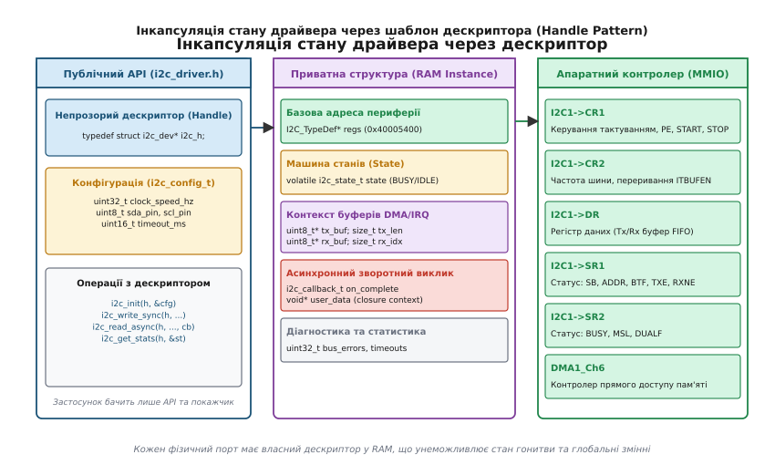
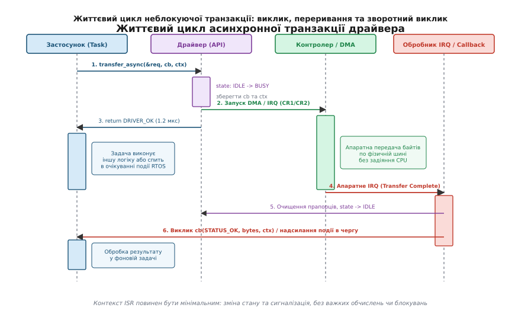

# Шаблон драйвера периферії

<preknowlist>
- [CMSIS: стандартний інтерфейс ПЗ для Cortex-M](root:sf-devices/cmsis) — структури регістрів, інтринсики компілятора та доступ до NVIC.
- [GPIO-регістри](root:sf-devices/gpio-registers) — прямий доступ до пам'яті через структури, атомарний запис і конфігурація виводів.
- [Модель модуля](root:sf-devices/module-model) — інкапсуляція стану підсистеми, життєвий цикл і відокремлення внутрішніх буферів.
- [ARM Cortex-M](root:hw-arch/cortex-m) — модель винятків, векторна таблиця, пріоритети переривань та контекст виконання.
- [Memory-mapped IO](root:hw-arch/memory-mapped-io) — відображення регістрів периферійних блоків у єдиний адресний простір.
- [FreeRTOS](root:sf-devices/freertos) — контекст задач, переривання, черги та семафори.
- [Таблиця віртуальних методів C++](root:sf-devices/virtual-dispatch-cpp) — механізм vtable, накладні витрати пам'яті та такти непрямого виклику.
- [Драйвер чипа: від регістрової карти до значення у SI](root:sf-devices/draiver-chypa) — перетворення даних та відокремлення сенсора від шини.
- [Рівень транзакцій: відділити чип від шини](root:sf-devices/riven-tranzaktsii) — черги запитів та арбітраж спільного каналу зв'язку.
</preknowlist>

Коли розробник пише перший варіант прошивки для читання показів датчика температури чи зовнішньої пам'яті, найпростіший шлях — написати прямий запис у глобальні регістри мікроконтролера. Функція `i2c_write()` бере апаратний макрос `I2C1->DR`, очікує у нескінченному циклі встановлення прапорця `I2C1->SR1 & I2C_SR1_TXE` і повертає значення. Поруч оголошують статичний глобальний масив `static uint8_t g_rx_buf[32]` і прапорець зайнятості `static volatile int g_busy`. Поки на платі розведено рівно один датчик і система виконується в одному потоці [super-loop](root:sf-devices/super-loop), такий код працює.

Катастрофа починається у той момент, коли на плату додають другий такий самий сенсор на шину `I2C2` або ще одну мікросхему пам'яті на `I2C3`. Глобальна функція `i2c_write()` жорстко прив'язана до адрес `I2C1`. Щоб запрацював другий датчик, доводиться копіювати весь файл драйвера, перейменовувати функції на `i2c2_write()`, створювати дублікати глобальних буферів `g_rx_buf2` і перекомпілювати проєкт. Будь-яка виправлена помилка в логіці обробки шини вимагає синхронного ручного редагування трьох окремих файлів. Якщо ж у системі з'являється операційна система реального часу ([FreeRTOS](root:sf-devices/freertos)), спроба двох незалежних задач звернутися до одного периферійного блоку через спільні глобальні змінні призводить до пошкодження пам'яті, гонитви станів та апаратного блокування ліній шини.

Грамотно спроєктований драйвер периферії вирішує ці проблеми через суворе розділення стану, конфігурації, коду реалізації та апаратного інтерфейсу.

## Анатомія периферійного доступу та апаратний бар'єр

Усі периферійні контролери сучасного мікроконтролера — послідовні інтерфейси I2C, SPI, UART, таймери, модулі прямого доступу до пам'яті (DMA) — підключені до внутрішніх шин кристала (AHB, APB) і відображені в єдиний адресний простір ядра як [регістри в пам'яті (Memory-Mapped I/O)](root:hw-arch/memory-mapped-io).

Коли процесорне ядро ARM Cortex-M звертається до регістра апаратного модуля, воно виконує звичайні асемблерні команди завантаження (`LDR`) або збереження (`STR`) за фіксованою 32-бітною адресою. Проте, на відміну від комірок оперативної пам'яті SRAM, звернення до регістрів периферії має принципові фізичні особливості:

1. **Побічні ефекти читання та запису (Side Effects)**: Читання комірки пам'яті SRAM є пасивною операцією, яка не змінює вмісту комірки. Читання ж регістра даних `I2C->DR` або `USART->DR` призводить до апаратного виштовхування байта з приймального FIFO-буфера та автоматичного скидання прапорця готовності `RXNE` в регістрі статусу. Якщо компілятор згенерує зайву команду читання регістра заради оптимізації, байт даних буде безповоротно втрачено для прикладного коду.
2. **Зміна стану апаратними блоками без участі CPU**: Прапорець статусу `TXE` (Transmit Data Register Empty) або `BUSY` встановлюється і скидається зовнішньою логікою шинного контролера незалежно від коду програми. Якщо змінна, що вказує на цей регістр, не оголошена з кваліфікатором `volatile`, компілятор збереже перше зчитане значення в загальний регістр ядра `R0`–`R12` і замість циклічного опитування шини побудує нескінченний цикл над закешованим значенням, повністю зависнувши.
3. **Порядок виконання операцій та бар'єри пам'яті**: Сучасні конвеєри процесорів і буфери запису шинної матриці можуть змінювати порядок звернень до пам'яті. Щоб гарантувати, що конфігураційний біт увімкнення периферії `CR1_PE` зафіксувався на апаратних тригерах до того, як програма почне записувати байти у регістр даних, драйвер зобов'язаний використовувати архітектурні інструкції бар'єрів пам'яті ядра:
   - `__DMB()` (Data Memory Barrier) — гарантує завершення всіх попередніх операцій із пам'яттю до початку наступних;
   - `__DSB()` (Data Synchronization Barrier) — зупиняє виконання будь-яких наступних інструкцій до повного завершення всіх попередніх операцій доступу до пам'яті;
   - `__ISB()` (Instruction Synchronization Barrier) — очищає конвеєр інструкцій ядра, змушуючи процесор перечитати команди після зміни системної конфігурації.

Усі ці низькорівневі нюанси доступу до шини повинні бути приховані всередині драйвера, надаючи прикладному програмному забезпеченню чистий, передбачуваний та надійний інтерфейс.

## Фізичні обмеження та таймінги шини

Перед тим як перейти до програмної архітектури драйвера, необхідно чітко розуміти фізичні обмеження ліній зв'язку, якими цей драйвер керує.

Наприклад, інтерфейс I2C побудований на лініях з відкритим колектором (Open-Drain). Це означає, що мікроконтролер та периферійні чипи можуть активно притягувати лінію до землі (LOW), але перехід у стан логічної одиниці (HIGH) відбувається виключно пасивно — через зовнішні підтягуючі резистори R_p.

Через наявність паразитної ємності друкованої плати, роз'ємів та виводів мікросхем (C_bus), фронт сигналу наростає за експоненційним законом. Стандарт I2C визначає максимальний час наростання фронту (t_r):
- Для стандартного режиму (Standard Mode, 100 кГц): t_r ≤ 1000 нс;
- Для швидкого режиму (Fast Mode, 400 кГц): t_r ≤ 300 нс.

Драйвер периферії конфігурує апаратні таймінгові регістри (наприклад, `CCR` — Clock Control Register та `TRISE` у контролерах STM32) на основі частоти внутрішньої шини f_PCLK1:
- У стандартному режимі (Duty 50%): `CCR = f_PCLK1 / (2 × f_I2C)`;
- Регістр максимального часу наростання: `TRISE = (1000 нс × f_PCLK1) + 1`.

Якщо розробник драйвера некоректно розрахує ці константи або не врахує зміну тактування шини APB при переході мікроконтролера на живлення від іншого кварцового резонатора (PLL), апаратний модуль генеруватиме хибні переривання колізій (Arbitration Lost / Bus Error) або не зможе розпізнати фронти від ведених чипів.

## Реентрабельність та атомарні критичні секції

Коли потік виконання викликає функцію ініціації асинхронної транзакції `i2c_transfer_async()`, драйвер перевіряє поточний стан `if (handle->state != I2C_STATE_IDLE) return DRIVER_STATUS_BUSY;`, після чого встановлює `handle->state = I2C_STATE_BUSY_TX;`.

Якщо в проміжку між перевіркою та записом нового стану спрацює високопріоритетне апаратне переривання або перемикання контексту RTOS, інша задача може викликати ту саму функцію. Обидві задачі побачать стан `IDLE` і одночасно спробують налаштувати апаратний блок на різні транзакції.

Щоб гарантувати неподільність операцій переходу станів, драйвер використовує **вкладені критичні секції (Nested Critical Sections)** на основі системного регістра `PRIMASK`:

:::tabs
:::code driver-pattern-d/c/reentrabelnist-ta-atomarni.c
:::code driver-pattern-d/cpp/reentrabelnist-ta-atomarni.cpp
:::

Такий механізм запобігає стану гонитви (Race Condition), не блокуючи роботу планувальника RTOS на довший час, ніж потрібно для виконання двох-трьох машинних інструкцій запису в пам'ять.

## Пастка глобального стану та ізоляція екземпляра

Корінь проблем із наївними драйверами лежить у змішуванні трьох принципово різних сутностей:
- **Незмінний алгоритмічний код (Code / `.text`)**: Машинні інструкції, що керують протоколом I2C чи SPI (формування стартової умови, передача адреси, перевірка біта підтвердження ACK, читання байтів у FIFO), абсолютно ідентичні для `I2C1`, `I2C2` та `I2C3`. Вони мають перебувати у флеш-пам'яті в єдиному екземплярі секції `.text`.
- **Статична конфігурація (Config / `.rodata`)**: Базова адреса регістрів, номери виводів GPIO, карти каналів DMA, номери ліній переривань NVIC та заводські таймінги є постійними для кожної конкретної друкованої плати. Вони не змінюються під час роботи і можуть розміщуватися у секції констант у Flash.
- **Змінний стан виконання (Runtime State / `.bss` / `.data` в RAM)**: Поточний стан кінцевого автомата (IDLE, BUSY, ERROR), покажчик на активний буфер передачі, лічильник залишкових байтів, зареєстровані зворотні виклики та примітиви блокування операційної системи є унікальними для кожного фізичного контролера і мусять розташовуватися в оперативній пам'яті RAM.


*Архітектура дескриптора драйвера: застосунок взаємодіє виключно з публічним API та непрозорим покажчиком, тоді як уся внутрішня машина станів, прив'язка до регістрів MMIO та контекст буферів інкапсульовані у структурі екземпляра в оперативній пам'яті.*

Якщо стан зберігається у глобальних змінних драйвера, ми позбавляємо себе можливості створити другий екземпляр того самого контролера. Щоб зробити код придатним для багаторазового використання (reusable та multi-instance capable), застосовують шаблон дескриптора (**Handle Pattern**).

Дескриптор — це структура даних у RAM, яка містить увесь змінний контекст одного конкретного апаратного вузла, а кожна функція драйвера приймає покажчик на цей дескриптор першим аргументом. Замість виклику `i2c_write(data, len)` застосунок викликає `i2c_write(handle, data, len)`.

### Пошаровий розподіл полів дескриптора

Продумана структура дескриптора чітко розмежовує поля за їхнім призначенням:

1. **Апаратна прив'язка (Hardware Link)**: Вказівник на структуру регістрів периферійного модуля (наприклад, `I2C_TypeDef* regs` або цілочисельний базовий адрес `uintptr_t hw_base`).
2. **Конфігураційний профіль (Config Profile)**: Копія налаштувань користувача або посилання на незмінну конфігурацію в ROM (тактова частота, таймаут шини, прапорці дозволу DMA).
3. **Машина станів транзакції (Transaction FSM)**: Атомарна або `volatile` змінна стану (`I2C_STATE_IDLE`, `I2C_STATE_BUSY_TX`, `I2C_STATE_BUSY_RX`, `I2C_STATE_ERROR`).
4. **Контекст передачі даних (Data Context)**:
   - Покажчик на буфер передачі `const uint8_t* tx_buffer` та лічильник байтів `volatile size_t tx_remaining`;
   - Покажчик на буфер прийому `uint8_t* rx_buffer` та поточний індекс `volatile size_t rx_transferred`;
   - Цільова апаратна адреса веденого пристрою `uint8_t slave_address`.
5. **Асинхронний контекст оповіщення (Async Context)**:
   - Вказівник на функцію зворотного виклику `on_complete_cb`;
   - Контекстний покажчик користувача `void* user_data` (замикання / closure context).
6. **Синхронізація для багатопотокового середовища (OS Sync Context)**:
   - М'ютекс для взаємного виключення одночасного доступу з різних задач;
   - Бінарний семафор або черга сповіщення для переведення задачі в стан сну під час очікування апаратного переривання.
7. **Лічильники діагностики та телеметрії (Telemetry Stats)**: Кількість успішних байтів, помилок підтвердження NACK, таймаутів, зафіксованих збоїв шини.

:::tabs
:::code driver-pattern-d/c/stdint.h
:::code driver-pattern-d/cpp/posharovyi-rozpodil-poliv.cpp
:::

Така схема дозволяє створити в коді програми стільки екземплярів `i2c_handle_t` або `I2cDriver`, скільки фізичних контролерів встановлено на кристалі:

:::tabs
:::code driver-pattern-d/c/posharovyi-rozpodil-poliv.c
:::code driver-pattern-d/cpp/posharovyi-rozpodil-poliv-2.cpp
:::

Тепер логіка передачі даних стала універсальною. Функція нічого не знає про те, з яким саме портом вона працює, доки не отримає покажчик на дескриптор.

## Інкапсуляція та техніка непрозорих покажчиків (Opaque Pointers)

Описаний вище підхід вирішує проблему кількох екземплярів, але створює іншу небезпеку: протікання деталей реалізації (Abstraction Leakage).

Якщо повне визначення структури `struct i2c_handle_s` розміщене у відкритому файлі `i2c_driver.h`, будь-який прикладний модуль, що підключає цей заголовок, отримує прямий доступ до внутрішніх полів: `handle->state = I2C_STATE_IDLE;` або `handle->reg_base = NULL;`. Програміст високого рівня може випадково або навмисно обійти відкритий API та напряму змінити лічильник байтів чи зміщення в буфері. Це миттєво руйнує інваріанти машини станів і призводить до важковловимих дефектів, коли переривання намагається відправити байт за недійсним покажчиком.

Крім того, будь-яка зміна внутрішньої структури драйвера (наприклад, додавання поля для роботи з DMA або семафора FreeRTOS) змушує компілятор перекомпілювати всі файли проєкту, де було підключено `i2c_driver.h`.

Щоб досягти справжньої модульності, у мові C застосовують ідіому непрозорого покажчика (**Opaque Pointer**, у C++ відома як **PIMPL** — Pointer to Implementation).

У публічному заголовку `i2c_driver.h` оголошують лише неповний тип структури (forward declaration) та псевдонім покажчика на неї:

:::tabs
:::code driver-pattern-d/c/i2c_driver.h
:::code driver-pattern-d/cpp/i2c_driver.hpp
:::

Повне визначення структури переноситься виключно у файл реалізації:

:::tabs
:::code driver-pattern-d/c/i2c_driver.c
:::code driver-pattern-d/cpp/i2c_driver.cpp
:::

При такому підході клієнтський код взагалі не може звернутися до `handle->hw_base` — компілятор видасть помилку `dereferencing pointer to incomplete type`. Жодна зміна внутрішніх полів у `i2c_driver.c` не впливає на бінарний або синтаксичний контракт публічного заголовка.

### Компроміс алокації: статичний пул проти динамічної пам'яті

Непрозорий покажчик має одну проблему у вбудованих системах: компілятор не знає розміру `sizeof(struct i2c_driver_context_s)` під час компіляції клієнтського коду, тому клієнт не може виділити структуру на власному стеку чи у своєму статичному блоці пам'яті як звичайну локальну змінну.

Існує три інженерні рішення цієї проблеми:

1. **Динамічне виділення через `malloc()`**: Функція `i2c_create_instance()` викликає `malloc(sizeof(struct ...))`. У системах із жорстким реальним часом або сертифікацією безпеки (DO-178C, ISO 26262, MISRA C:2012 Dir 4.12) використання динамічної купи (heap) суворо заборонено через ризик фрагментації пам'яті та недетермінований час виконання.
2. **Статичний пул екземплярів усередині драйвера**: Файл `i2c_driver.c` заздалегідь виділяє фіксований масив структур для максимально можливої кількості портів чипа (наприклад, 2 для мікроконтролера з двома I2C-модулями). Функція `i2c_get_handle(port_id)` повертає покажчик на відповідний слот масиву. Це найнадійніший і найпростіший метод для bare-metal та RTOS.
3. **Буфер фіксованого розміру з вирівнюванням**: Публічний заголовок експортує байтовий масив з гарантованим вирівнюванням і запасом розміру:

:::tabs
```c
/* Виділення пам'яті дескриптора на боці клієнта на C99 */
typedef struct {
    alignas(uint32_t) uint8_t storage[64];
} i2c_handle_storage_t;
```
```cpp
/* Виділення пам'яті дескриптора на боці клієнта на C++20 */
struct alignas(alignof(uint32_t)) I2cStorage {
    std::array<std::byte, 64> storage{};
};
```
:::

Клієнт створює змінну `i2c_handle_storage_t handle_mem;` статично у своїй пам'яті, а драйвер приводить її покажчик до внутрішньої структури `(struct i2c_driver_context_s*)&handle_mem`, попередньо виконавши перевірку `static_assert(sizeof(struct i2c_driver_context_s) <= sizeof(i2c_handle_storage_t))`.

### Цілочисельні дескриптори та захист магічним числом (Canary Word)

У критично важливих системах передача «сирих» покажчиків пам'яті через публічні функції може вважатися загрозою безпеці: якщо скомпрометований модуль передасть недійсний покажчик на довільну адресу RAM, драйвер здійснить запис у чужу пам'ять і викличе падіння системи.

Для захисту від таких помилок застосовують два механізми:

1. **Цілочисельні дескриптори (Integer Handles / IDs)**: Клієнт оперує числовим типом `typedef uint8_t i2c_device_id_t;`. Драйвер зберігає таблицю покажчиків і під час кожного виклику перевіряє `if (id >= MAX_I2C_DEVICES) return ERROR_INVALID_HANDLE;`. Це повністю унеможливлює передачу некоректної адреси пам'яті.
2. **Магічне число валідації (Canary Magic Word)**: Першим полем внутрішньої структури дескриптора розміщують фіксовану константу:

:::tabs
```c
#define I2C_HANDLE_MAGIC 0x49324331U /* ASCII "I2C1" */
struct i2c_driver_context_s {
    uint32_t magic;
    /* інші поля */
};
```
```cpp
namespace driver {
    constexpr uint32_t I2cHandleMagic = 0x49324331U;
    struct I2cContext {
        uint32_t magic{I2cHandleMagic};
        /* інші поля */
    };
}
```
:::

На початку кожної функції драйвер виконує перевірку `if (handle == NULL || handle->magic != I2C_HANDLE_MAGIC) return DRIVER_STATUS_INVALID_PARAM;`. Якщо пам'ять дескриптора була затерта переповненням стека або не проініціалізована, драйвер відмовить у виконанні операції до виникнення фатального збою.

## Моделі виконання: блокування, переривання та DMA

Драйвер периферії може виконувати обмін даними за однією з трьох концептуальних моделей. Вибір моделі визначає внутрішню складність драйвера та навантаження на процесорне ядро.

### 1. Блокуючий режим (Synchronous / Polling)

У блокуючому режимі процесор повністю бере на себе контроль за кожним кроком транзакції. Функція відправки байта записує значення в регістр передачі даних і зациклюється, перевіряючи регістр статусу (Polling).

Перевага блокуючого драйвера — мінімальний розмір коду, повна відсутність гонитви станів та відсутність потреби у налаштуванні контролера переривань NVIC.

Головна небезпека блокуючого опитування — **блокування шини та витрата процесорного часу**. Якщо тактова частота шини I2C становить 100 кГц, передача одного байта (з урахуванням 9-го такту ACK) займає 9 × 10 мкс = 90 мкс. Для передачі пакету з 32 байтів процесор із тактовою частотою 168 МГц проведе в порожньому циклі очікування 32 × 90 мкс = 2.88 мс, що еквівалентно майже півмільйону втрачених тактів CPU.

Якщо ж ведений пристрій (Slave) збився і затиснув лінію тактування SCL у нуль (Clock Stretching) або перестав відповідати, наївний цикл `while (!(I2C1->SR1 & I2C_SR1_TXE));` назавжди повісить мікроконтролер.

Тому **залізне правило блокуючого драйвера**: кожен цикл опитування прапорця апаратного регістра мусить мати жорсткий таймаут:

:::tabs
:::code driver-pattern-d/c/1-blokuiuchyi-rezhym.c
:::code driver-pattern-d/cpp/1-blokuiuchyi-rezhym.cpp
:::

Для детермінованих вимірювань таймауту в мікросекундах замість умовних ітерацій циклу використовують апаратний лічильник тактів процесора **DWT Cycle Counter** (Data Watchpoint and Trace):

:::tabs
```c
/* Точний таймаут на апаратному лічильнику тактів ядра DWT->CYCCNT на C99 */
static inline bool check_deadline_dwt(uint32_t start_cycles, uint32_t timeout_cycles) {
    return (DWT->CYCCNT - start_cycles) >= timeout_cycles;
}
```
```cpp
/* Точний таймаут на апаратному лічильнику тактів ядра DWT->CYCCNT на C++20 */
namespace driver {
    inline bool check_deadline_dwt(uint32_t start_cycles, uint32_t timeout_cycles) noexcept {
        return (DWT->CYCCNT - start_cycles) >= timeout_cycles;
    }
}
```
:::

### 2. Асинхронний режим на перериваннях (Interrupt-Driven)

Асинхронний драйвер розділяє ініціацію транзакції та її безпосереднє виконання.

Функція `i2c_transfer_async()` лише записує параметри запиту в дескриптор, переводить стан екземпляра у `I2C_STATE_BUSY_TX`, дозволяє відповідні лінії переривань у контролері периферії (наприклад, `ITEVTEN` та `ITBUFEN`) і миттєво повертає керування прикладній програмі (зазвичай за 1–2 мікросекунди).


*Часова діаграма асинхронного драйвера: задача ініціює запит і миттєво продовжує виконання; апаратний модуль передає байти в режимі DMA/IRQ; після завершення обробник переривання повертає статус через зворотний виклик або чергу повідомлень.*

Кожен відправлений або прийнятий байт генерує апаратне переривання. Обробник переривання (ISR — Interrupt Service Routine) зчитує черговий байт із буфера дескриптора, записує його у регістр даних і декрементує лічильник залишку:

```
+-------------------+      i2c_write_async()       +-------------------+
|  Прикладна задача  | --------------------------> | Драйвер периферії |
|   (Thread Mode)   | <-------------------------- |    (Стан: BUSY)   |
+-------------------+      повертає негайно       +-------------------+
          |                                                 |
          | виконує фонові                                  | налаштовує IRQ
          | обчислення / сон                                | та стартує шину
          v                                                 v
   ... час іде ...                                  +-------------------+
                                                    |  Апаратний блок   |
                                                    +-------------------+
                                                            |
                                               byte sent    | апаратний імпульс
                                                            v
+-------------------+       зміна стану             +-------------------+
|  Прикладна задача  | <--------------------------- |   Обробник ISR    |
| (Отримує подію)   |      виклик Callback()        |  (Handler Mode)   |
+-------------------+                               +-------------------+
```

Кінцевий автомат обробника переривань відстежує послідовність апаратних подій згідно зі специфікацією протоколу:
- Подія `SB` (Start Bit): контролер сформував старт — обробник записує у `DR` адресу пристрою з бітом R/W;
- Подія `ADDR` (Address Matched): пристрій відповів ACK — обробник вичитує регістри статусу `SR1` та `SR2` для очищення прапорця адреси;
- Подія `TXE` (Data Empty): регістр передачі готовий — запис чергового байта з масиву `handle->tx_buffer[idx++]`;
- Подія `BTF` (Byte Transfer Finished) на останньому байті: генерація умови STOP та переведення стану драйвера в `IDLE`.

### Конфігурація контролера переривань NVIC та пріоритетні пастки

При проєктуванні асинхронного драйвера розробник налаштовує контролер переривань ядра NVIC:

1. **Групування пріоритетів (Priority Grouping)**: Функція `NVIC_SetPriorityGrouping()` визначає, скільки бітів пріоритету відведено під Preemption Priority (здатність витісняти інші переривання), а скільки під Subpriority (порядок вибору при одночасному спрацюванні).
2. **Інтеграція з FreeRTOS та поріг `configMAX_SYSCALL_INTERRUPT_PRIORITY`**: Будь-яке переривання периферійного драйвера, яке викликає функції сповіщення RTOS (наприклад, `xQueueSendFromISR` чи `vTaskNotifyGiveFromISR`), **зобов'язане** мати числовий пріоритет, рівний або нижчий (тобто числове значення більше) за `configLIBRARY_MAX_SYSCALL_INTERRUPT_PRIORITY`. Якщо драйвер встановить собі вищий пріоритет (наприклад, пріоритет 0), виклик API RTOS із його обробника зіпсує внутрішні черги планувальника операційної системи і викличе падіння ядра.
3. **Хибне повторне спрацювання (Tail-Chaining & Write Buffer Delay)**: На швидких процесорах Cortex-M4/M7 запис у регістр периферії для очищення прапорця переривання проходить через чергу запису шини (Write Buffer). Якщо вийти з обробника `I2C1_EV_IRQHandler` відразу після інструкції скидання прапорця, сигнал переривання на вході NVIC може не встигнути спасти до завершення інструкції `BX LR`. Ядро миттєво зайде у той самий ISR вдруге (Tail-Chaining Glitch). Щоб запобігти цьому, наприкінці ISR додають бар'єр даних `__DSB()`.

### 3. Прямий доступ до пам'яті (DMA — Direct Memory Access)

Коли обсяг даних становить десятки або сотні байтів (наприклад, передача кадру на дисплей через SPI або вичитування масиву аудіосемплів), обробка кожного байта через переривання створює надмірні накладні витрати: вхід та вихід із переривання на ядрі ARM Cortex-M займає щонайменше 12–16 тактів процесора на кожен байт для збереження регістрів у стек (Stack Stacking).

Контролер DMA бере на себе побайтове перекачування даних із RAM безпосередньо у регістр периферійного блоку за допомогою спеціальних апаратних запитів (DMA Requests). Процесор взагалі не бере участі в передачі й отримує лише одне фінальне переривання `DMA_TC` (Transfer Complete) після відправки останнього байта буфера.

При використанні DMA у драйверах для високоефективних ядер (наприклад, Cortex-M7 із увімкненим кешем даних D-Cache) виникає критична проблема **когерентності кешу** (Cache Coherency):
- Процесор записує нові дані у масив, але вони залишаються у швидкому L1 D-Cache і ще не потрапили у фізичну пам'ять SRAM.
- Контролер DMA зчитує фізичну SRAM і відправляє в периферію старе «сміття».
- Аналогічно при прийомі: DMA записує прийняті байти у фізичну RAM, а процесор читає старі дані зі свого кешу.

Тому драйвер із підтримкою DMA зобов'язаний керувати кешем:
- Перед початком передачі: очистити кеш (Clean/Flush) для буфера передачі `SCB_CleanDCache_by_Addr((uint32_t*)tx_buf, len)`.
- Перед читанням прийнятих даних: інвалідувати кеш (Invalidate) для буфера прийому `SCB_InvalidateDCache_by_Addr((uint32_t*)rx_buf, len)`.

Буфери для DMA у системі з D-Cache **мусять бути вирівняні за межами рядка кешу** (32 байти для Cortex-M7):

:::tabs
```c
/* Вирівнювання за розміром рядка кешу L1 на C99 */
alignas(32) static uint8_t s_dma_rx_buffer[64];
```
```cpp
/* Вирівнювання за розміром рядка кешу L1 на C++20 */
alignas(32) static std::array<uint8_t, 64> s_dma_rx_buffer{};
```
:::

Якщо буфер не вирівняний за 32-байтною межею, операція інвалідації кешу для частини нашого буфера знищить сусідні змінні іншого модуля, які випадково опинилися в тому самому 32-байтному рядку кешу (False Sharing Corruption).

Ще однією важливою технікою для високошвидкісних драйверів (UART, I2S) є **подвійна буферизація (Double Buffering / Ping-Pong Buffers)**: контролер DMA налаштовується у циклічний режим (Circular Mode) із двома буферами. Поки DMA наповнює перший буфер, процесор обробляє другий. Подія `Half-Transfer Complete` (HT) сповіщає про завершення першої половини, а `Transfer Complete` (TC) — другої половини. Це дозволяє здійснювати безперервний потік даних без жодної втрати байтів (Zero Dropped Packets).

## Зворотні виклики (Callbacks), замикання та неблокуючі черги

Коли асинхронна транзакція завершується всередині обробника переривання, драйвер повинен повідомити прикладний код про результат операції.

Найпоширеніший патерн сповіщення — реєстрація функції зворотного виклику (**Callback Function**).

### Анатомія зворотного виклику та покажчик `user_data`

Типова помилка початківців — оголошувати тип зворотного виклику без контекстного покажчика:

:::tabs
```c
/* ПОГАНО: немає контексту на C99 */
typedef void (*bad_callback_t)(driver_status_t status);
```
```cpp
/* ПОГАНО: немає контексту на C++20 */
using BadCallback = void (*)(Status status);
```
:::

Якщо функція зворотного виклику не приймає контекстний покажчик, користувач не зможе зрозуміти, який саме об'єкт або підсистема ініціювала цей запит, і буде змушений знову використовувати глобальні змінні.

Правильна сигнатура зворотного виклику **завжди** приймає дескриптор драйвера, статус виконання та вказівник на дані користувача (`void* user_data` або `closure context`):

:::tabs
:::code driver-pattern-d/c/anatomiia-zvorotnoho.h
:::code driver-pattern-d/cpp/anatomiia-zvorotnoho.cpp
:::

Покажчик `user_data` дозволяє прив'язати до виклику будь-яку прикладну структуру, наприклад екземпляр драйвера датчика чи дескриптор задачі FreeRTOS.

### Золоте правило обробника переривань (ISR Context Trap)

Зворотний виклик, зареєстрований у драйвері, викликається **всередині функції обробника апаратного переривання (ISR)**.

Це накладає найсуворіші обмеження на те, що дозволено робити всередині callback:
1. **Заборонено блокуючі очікування та затримки**: Жодних `vTaskDelay()`, `sleep()`, циклів очікування прапорців.
2. **Заборонено захоплення блокуючих примітивів синхронізації**: Не можна викликати `xSemaphoreTake()` без суфікса `FromISR`.
3. **Заборонено виділення динамічної пам'яті**: `malloc()` та `free()` не є реентерабельними і призводять до миттєвого зависання або виклику HardFault.
4. **Мінімальний час виконання**: Чим довше процесор перебуває в ISR, тим більша затримка реакції (Interrupt Latency) на інші критичні події системи.
5. **Небезпека переповнення стека MSP**: Обробники переривань виконуються на головному стеку (Main Stack Pointer — MSP). Якщо зворотний виклик почне створювати великі локальні масиви або викликати складні вкладені функції, стек MSP переповниться і затре пам'ять глобальних змінних.

### Перехід від ISR до контексту задачі: неблокуючі кільцеві буфери

Щоб звільнити обробник переривання від важкої роботи, драйвер периферії використовує **модель відкладеної обробки** (Deferred Interrupt Handling).

Обробник переривання лише забирає сирі байти з апаратного регістра, складає їх у потокобезпечний кільцевий буфер (Lock-free Ring Buffer / SPSC Queue) і надсилає повідомлення у чергу подій або зводить біт у прапорцях подій RTOS (`xEventGroupSetBitsFromISR` чи `xQueueSendFromISR`).

Сама бізнес-логіка (парсинг пакетів протоколу, валідація контрольних сум CRC, математична фільтрація) виконується у звичайній фоновій задачі операційної системи (Thread Context).

:::tabs
:::code driver-pattern-d/c/perekhid-vid-isr-do.c
:::code driver-pattern-d/cpp/perekhid-vid-isr-do.cpp
:::

## Шаблон черги транзакцій (Transaction Queue Pattern)

У складних вбудованих пристроях один периферійний інтерфейс (наприклад, шина I2C або SPI) одночасно обслуговує кілька зовнішніх чипів: дисплей, датчик тиску, акселерометр та мікросхему EEPROM. Кожен чип періодично потребує обміну даними.

Якщо кожен драйвер сенсора почне самостійно смикати функцію `i2c_transfer_async()`, виникне ситуація, коли запит від дисплея надійде в момент, коли шина ще зайнята передачею пакета акселерометра. Драйвер поверне статус `DRIVER_STATUS_BUSY`, і прикладному коду дисплея доведеться самостійно реалізовувати логіку повторного опитування та очікування.

Щоб позбавити високорівневий код від цієї рутини, драйвер шини оснащують **чергою дескрипторів транзакцій (Transaction Queue)**:

1. Клієнт формує структуру транзакції `i2c_transaction_t`:
:::tabs
:::code driver-pattern-d/c/shablon-cherhy-tranzaktsii.c
```cpp
/* Структура дескриптора транзакції на C++20 */
struct Transaction {
    uint8_t dev_addr{0};
    std::span<const uint8_t> tx_data{};
    std::span<uint8_t> rx_data{};
    DriverCallback callback{nullptr};
    void* user_data{nullptr};
    bool hold_bus{false};
};
```
:::
2. Функція `i2c_submit_transaction(handle, &trans)` поміщає покажчик на транзакцію у внутрішню кільцеву чергу.
3. Якщо шина у стані `IDLE`, драйвер негайно запускає першу транзакцію.
4. Якщо шина `BUSY`, транзакція залишається у черзі.
5. Коли обробник переривання завершує поточну транзакцію, він викликає її callback, автоматично витягує наступну транзакцію з черги і запускає її без повернення в контекст задачі.

Це дозволяє усім підсистемам надсилати запити в асинхронному режимі без взаємного блокування та втрати пакетів.

## Керування енергоспоживанням (Power Management & Clock Gating)

У батарейних пристроях мікроконтролер більшу частину часу проводить у режимах глибокого сну (Sleep, Stop, Standby). Периферійні блоки, підключені до шин APB, споживають струм навіть у стані простою, якщо на них подається тактовий сигнал.

Драйвер периферії повинен підтримувати концепцію динамічного тактування (**Clock Gating**):

1. **Динамічне вмикання тактування (On-Demand Gating)**: Під час ініціалізації дескриптора тактування периферії залишається вимкненим у регістрах `RCC->APB1ENR`. Драйвер вмикає тактування лише перед безпосереднім початком транзакції й вимикає його після генерації сигналу STOP та переходу в стан `IDLE`.
2. **Збереження та відновлення контексту (Context Retention)**: При переході процесора в режим Stop живлення деяких периферійних блоків знімається повністю, а значення конфігураційних регістрів (`CR1`, `CR2`, `OAR1`) скидаються до значень за замовчуванням. Дескриптор зберігає повну копію конфігурації в оперативній пам'яті (яка живиться в режимі сну від внутрішнього регулятора LDO), і при пробудженні ядра функція `driver_resume(handle)` швидко відновлює стан усіх апаратних регістрів без повторного виклику важкої процедури повної ініціалізації.

## Патерни "Стратегія" та "Адаптер" у драйверах сенсорів

Часто перед розробником постає завдання створити драйвер для зовнішнього чипа (наприклад, цифрового барометра BMP280, акселерометра LIS3DH або дисплея ST7789), який підтримує як інтерфейс I2C, так і інтерфейс SPI.

Якщо написати драйвер акселерометра, прив'язаний до конкретних функцій `i2c_master_write()` та `i2c_master_read()`, такий драйвер буде абсолютно неможливо використати на платі, де той самий акселерометр підключений до шини SPI.

Для відокремлення логіки чипа від фізичного каналу зв'язку використовують патерни проєктування **Стратегія (Strategy)** та **Адаптер (Adapter)**.

### Реалізація на C99: Таблиця віртуальних методів шини (Operations Table)

У мові C абстракція реалізується через структуру покажчиків на функції (по суті, ручну віртуальну таблицю інтерфейсу):

:::tabs
:::code driver-pattern-d/c/realizatsiia-na-c99.c
:::code driver-pattern-d/cpp/realizatsiia-na-c99.cpp
:::

## C++20: Статичний поліморфізм без віртуальних таблиць (Zero-Cost Abstractions)

У класичному об'єктно-орієнтованому програмуванні на C++ інтерфейс шини оформлюють як абстрактний базовий клас із чисто віртуальними методами:

:::tabs
```c
/* Класичний виклик через покажчики на C99 */
typedef struct {
    int (*write)(void* ctx, const uint8_t* d, size_t l);
} c_bus_ops_t;
```
```cpp
/* КЛАСИЧНИЙ, АЛЕ НЕЕФЕКТИВНИЙ ДЛЯ MCU ПІДХІД */
class IBus {
public:
    virtual ~IBus() = default;
    virtual Status write_reg(uint8_t addr, uint8_t reg, std::span<const uint8_t> data) = 0;
    virtual Status read_reg(uint8_t addr, uint8_t reg, std::span<uint8_t> data) = 0;
};
```
:::

Для мікроконтролерів із обмеженими ресурсами динамічний поліморфізм через `virtual` тягне за собою суттєві накладні витрати:
1. **Витрата пам'яті RAM на покажчик `vptr`**: Кожен об'єкт класу отримує приховане поле покажчика на віртуальну таблицю (4 байти на 32-бітному ARM Cortex-M).
2. **Витрата пам'яті Flash на таблицю `vtable`**: Таблиця покажчиків на функції розміщується у секції `.rodata`.
3. **Неможливість інлайнінгу (Inlining)**: Компілятор не може вбудувати код методу в місце виклику, оскільки адреса функції визначається під час виконання (Runtime Dispatch). Виклик вимагає 2 звернення до пам'яті (читання `vptr`, читання адреси з `vtable`) та непрямий перехід `BLX R3`, що збиває конвеєр інструкцій процесора. Детально анатомію цих витрат розібрано у темі [Таблиця віртуальних методів C++](root:sf-devices/virtual-dispatch-cpp).

### Рішення C++20: Концепти (`concepts`) та Шаблони

Стандарт C++20 дає можливість замінити динамічний поліморфізм **статичним поліморфізмом під час компіляції**.

За допомогою ключових слів `concept` та `requires` ми декларуємо контракт шини. Компілятор перевіряє наявність потрібних методів під час збирання проєкту:

:::tabs
:::code driver-pattern-d/c/rishennia-c-20-kontsepty.c
:::code driver-pattern-d/cpp/rishennia-c-20-kontsepty.cpp
:::

Оскільки тип шини відомий компілятору під час компіляції `Bmp280Sensor<I2cBusAdapter>`, компілятор GCC/Clang повністю розгортає виклики, інлайнить метод `write_reg` безпосередньо в код сенсора і перетворює виклик на прямі інструкції запису в апаратні регістри:
```assembly
/* Асемблерний лістинг виклику sensor.init() на Thumb-2 */
LDR     R2, =0x40005400      @ Завантаження адреси I2C1->DR
STR     R1, [R2, #0x10]      @ Прямий запис байта без жодного виклику BLX!
```
Накладні витрати абстракції становлять рівно **0 байтів RAM і 0 додаткових тактів процесора** (Zero-Cost Abstraction).

### Шаблон CRTP як альтернатива для складних ієрархій

Якщо крім статичної перевірки інтерфейсу потрібне спільне перевикористання базового коду драйвера (наприклад, розрахунок контрольних сум CRC чи чергування транзакцій), використовують патерн **CRTP** (Curiously Recurring Template Pattern):

:::tabs
```c
/* Базовий диспетчер операцій на C99 */
typedef struct {
    driver_status_t (*send_frame)(void* ctx, const uint8_t* f, size_t l);
} packet_sender_ops_t;

static inline driver_status_t send_with_crc(packet_sender_ops_t* ops, void* ctx, const uint8_t* d, size_t l) {
    /* Додавання CRC і виклик базового send_frame */
    return ops->send_frame(ctx, d, l);
}
```
:::code driver-pattern-d/cpp/shablon-crtp-iak.hpp
:::

## Обробка апаратних помилок і відновлення шини (Bus Recovery)

У реальних вбудованих системах периферійні шини піддаються впливу електромагнітних завад, стрибків напруги живлення та імпульсних наведень від електродвигунів.

Надійний драйвер відрізняється від лабораторного прототипу тим, як він обробляє позаштатні ситуації.

### Класифікація помилок периферії

1. **NACK (No Acknowledge)**: Ведений пристрій не притягнув лінію SDA до нуля на 9-му такті. Причини: датчик ще не прокинувся після подачі живлення, вказано неправильну I2C-адресу, або відсутній контакт на платі. Драйвер повинен сформувати умову STOP і повернути статус `DRIVER_STATUS_NACK`.
2. **BERR / Overrun / Frame Error**: Помилка синхронізації фрейму або переповнення апаратного буфера, коли CPU/DMA не встиг вичитати байт до надходження наступного. Драйвер очищає прапорці помилок і скидає внутрішні індекси.
3. **I2C Bus Lockup (Зависання шини)**: Найнебезпечніший стан. Якщо мікроконтролер перезавантажився посеред операції читання байта (наприклад, через спрацювання [сторожового таймера Watchdog](root:sf-devices/watchdog)), ведений чип залишається у стані передачі нуля і продовжує утримувати лінію даних SDA на рівні LOW. Оскільки лінія SDA затиснута зовнішнім пристроєм, апаратний блок I2C мікроконтролера вважає шину зайнятою (`I2C_SR2_BUSY`) і не може згенерувати сигнал START.

### Алгоритм примусового розблокування (9 Clock Pulses Recovery)

Щоб вивести ведений чип зі стану зависання, драйвер I2C під час ініціалізації перевіряє стан лінії SDA. Якщо SDA затиснута в LOW:
1. Тимчасово вимкнути апаратний модуль I2C в регістрі `CR1`.
2. Переналаштувати виводи SCL та SDA у режим звичайного виходу GPIO типу Open-Drain.
3. Згенерувати на лінії SCL **9 послідовних тактових імпульсів** (перемиканням піна в 0 і 1 з паузами по 5 мкс). Бачачи такти на SCL, ведений чип передасть залишок свого внутрішнього байта і відпустить лінію SDA у стан HIGH.
4. Згенерувати програмну умову STOP (притягнути SDA до 0, підняти SCL до 1, потім підняти SDA до 1).
5. Повернути виводи GPIO у режим альтернативної функції (Alternate Function) та знову увімкнути апаратний блок I2C.

:::tabs
:::code driver-pattern-d/c/alhorytm-prymusovoho.c
:::code driver-pattern-d/cpp/alhorytm-prymusovoho.cpp
:::

### Повторні спроби (Retry Pattern) та експоненційний бекоф

Коли транзакція повертає статус `NACK` або `TIMEOUT`, високорівнева логіка не повинна одразу переводити пристрій в аварійний стан. Драйвер застосовує шаблон повторних спроб (Retry Strategy):
1. **Фіксована кількість повторів (Max Retries)**: зазвичай 3 спроби.
2. **Пауза між спробами (Backoff Delay)**: короткий таймаут (100–500 мкс) дозволяє зарядам на ємності довгих ліній зв'язку осісти до вихідного рівня через підтягуючі резистори (Pull-Up).
3. **Апаратний скид блока (Peripheral Reset)**: якщо 3 спроби поспіль зазнали невдачі, драйвер скидає контролер через регістри скидання підсистеми тактування `RCC->APB1RSTR |= RCC_APB1RSTR_I2C1RST; RCC->APB1RSTR &= ~RCC_APB1RSTR_I2C1RST;`, після чого заново виконує процедуру ініціалізації.

## Синхронізація у багатозадачному середовищі (RTOS Integration)

Коли в системі під керуванням FreeRTOS або Zephyr кілька задач одночасно намагаються взаємодіяти з різними датчиками на одній спільній шині I2C, виникає потреба в координації доступу.

Якщо Задача А почне передавати адресу датчика тиску, а посеред транзакції планувальник витіснить її і передасть керування Задачі Б, яка почне вичитувати акселерометр, дані на шині перемішаються, а обидва сенсори зафіксують протокольний збій.

### 1. Захист шини м'ютексом із успадкуванням пріоритетів

Для запобігання колізіям дескриптор шини оснащують м'ютексом (`SemaphoreHandle_t mutex`).

Перед початком будь-якої транзакції задача зобов'язана захопити м'ютекс:

:::tabs
```c
/* Захоплення м'ютекса шини на C99 */
if (xSemaphoreTake(handle->bus_mutex, pdMS_TO_TICKS(100)) != pdTRUE) {
    return DRIVER_STATUS_TIMEOUT; /* Шина заблокована іншою задачею */
}
/* Виконання транзакції */
xSemaphoreGive(handle->bus_mutex);
```
```cpp
/* Захоплення м'ютекса шини на C++20 через RAII */
{
    std::unique_lock lock(bus_mutex);
    // Виконання транзакції
}
```
:::

Використання саме м'ютекса (а не бінарного семафора) є критичним через механізм **успадкування пріоритетів (Priority Inheritance)**: якщо низькопріоритетна задача утримує м'ютекс шини, а високопріоритетна задача намагається його захопити, RTOS тимчасово піднімає пріоритет низькопріоритетної задачі, запобігаючи небезпечному явищу пріоритетної інверсії (Priority Inversion).

### 2. Очікування завершення асинхронної транзакції через Direct-to-Task Notifications

Коли задача ініціює асинхронну передачу через DMA, вона не повинна витрачати ресурси CPU на опитування прапорця завершення. Замість цього задача переходить у стан сну (Blocked State):

:::tabs
:::code driver-pattern-d/c/2-ochikuvannia.c
:::code driver-pattern-d/cpp/2-ochikuvannia.cpp
:::

У момент виникнення переривання DMA `Transfer Complete` обробник ISR викликає `vTaskNotifyGiveFromISR(handle->calling_task, &xHigherPriorityTaskWoken)`, що миттєво повертає задачу у стан готовності (Ready). Процесор взагалі не витрачає жодного такту на порожнє очікування.

## Модульне тестування драйверів без апаратного забезпечення (Host Unit Testing & Mocks)

Однією з головних переваг шаблону дескриптора є можливість повного модульного тестування (Unit Testing) драйвера на комп'ютері розробника під керуванням Linux, macOS чи Windows без фізичної наявності мікроконтролера та друкованої плати.

Коли драйвер прив'язаний до дескриптора `i2c_handle_t`, поле `reg_base` може вказувати не на фізичну адресу кристала `0x40005400`, а на звичайну структуру-імітатор (Mock Registers) в оперативній пам'яті тестового процесу:

:::tabs
:::code driver-pattern-d/c/modulne-testuvannia.c
:::code driver-pattern-d/cpp/modulne-testuvannia.hpp
:::

Такий підхід дозволяє перевірити всі крайові випадки (таймаути, колізії, переповнення буферів, асинхронні переривання) в автоматизованому пайплайні CI/CD за частки секунди до прошивки коду в реальне залізо.

## Порівняльний аналіз підходів до проектування драйверів

Нижче наведено порівняння трьох головних архітектурних стилів розробки драйверів для вбудованих систем:

| Критерій оцінки | Глобальний моноліт (C99 Global) | Дескриптор Handle (C99 Opaque) | Статичний Zero-Cost (C++20 Concepts) |
|---|---|---|---|
| **Витрата пам'яті RAM** | Мінімальна (фіксовані глобальні змінні) | Тільки виділені структури екземплярів | Мінімальна (без vptr, поля класу) |
| **Витрата пам'яті Flash** | Зростає лінійно при копіюванні під нові порти | Єдиний спільний екземпляр алгоритму | Агресивний інлайнінг або спільний код |
| **Накладні витрати на виклик** | 0 тактів (прямий виклик) | 1–2 такти (передача покажчика `handle`) | **0 тактів** (повний інлайнінг) |
| **Багатоекземплярність (Multi-Instance)** | ✖ Неможлива без дублювання коду | ✔ Повна підтримка будь-якої кількості портів | ✔ Повна підтримка на рівні типів |
| **Інкапсуляція стану** | ✖ Відсутня (все відкрито у заголовках) | ✔ Повна (Opaque Pointer / PIMPL) | ✔ Повна (модифікатори `private`) |
| **Безпека типів під час збирання** | ✖ Слабкі перевірки C | ⚠ Часткова (приведення `void*`) | ✔ **Сувора валідація концептів** |
| **Тестованість на Host (CI/CD)** | ✖ Неможлива без переписування коду | ✔ Проста заміна базової адреси на Mock | ✔ Повна заміна типів на рівні шаблонів |

## Діагностика, телеметрія та супроводжуваність

Виробничий драйвер периферії повинен надавати засоби діагностики без потреби підключення апаратного налагоджувача JTAG/SWD на працюючому виробі.

Для цього в структуру дескриптора закладають лічильники подій (Telemetry Metrics):
- `total_transfers` — загальна кількість ініційованих транзакцій;
- `nack_errors` — кількість відмов ведених чипів;
- `timeout_errors` — кількість таймаутів шини;
- `bus_recoveries` — кількість виконаних процедур скидання та розблокування ліній;
- `dma_underruns` — випадки переповнення черг або втрати даних.

Ці метрики збираються атомарно всередині драйвера та експортуються через публічну функцію `driver_get_stats(handle, &stats)`. Системний монітор здоров'я ([Health Monitor](root:sf-devices/health-monitor)) періодично вичитує ці структури і виявляє деградацію апаратних ліній зв'язку задовго до повного відмови пристрою.

## Межі архітектури: де зупиняється драйвер шини

Чітке проведення меж між шарами — запорука чистої архітектури:
1. **Драйвер контролера шини (Bus Driver, наприклад I2C Master Driver)**: відповідає виключно за генерацію сигналів на фізичних лініях, переривання, таймінги, роботу з DMA, обробку шинних колізій і відновлення ліній зв'язку. Він нічого не знає про те, які саме байти він передає, і не знає форматів регістрів датчиків.
2. **Транзакційний рівень (Transaction Layer)**: упаковує запити на читання/запис блоків і забезпечує чергування доступу різних пристроїв до однієї спільної шини (докладно розкрито у темі [Рівень транзакцій: відділити чип від шини](root:sf-devices/riven-tranzaktsii)).
3. **Драйвер чипа (Chip Driver, наприклад BMP280 Driver)**: працює через абстрактний інтерфейс шини, перетворює байти регістрової карти датчика у фізичні інженерні величини системи SI (градуси Цельсія, Паскалі, метри за секунду у квадраті) та виконує калібрувальні розрахунки (докладно розкрито у темі [Драйвер чипа: від регістрової карти до значення у SI](root:sf-devices/draiver-chypa)).

Повний приклад побудови промислового модульного драйвера з підтримкою неблокуючих транзакцій, черг дескрипторів та обробки помилок на C99 і C++20 наведено у практичній вставці [Каркас модульного драйвера периферії з підтримкою асинхронних транзакцій](root:sf-devices/driver-pattern/proj-driver-framework-core.md).
