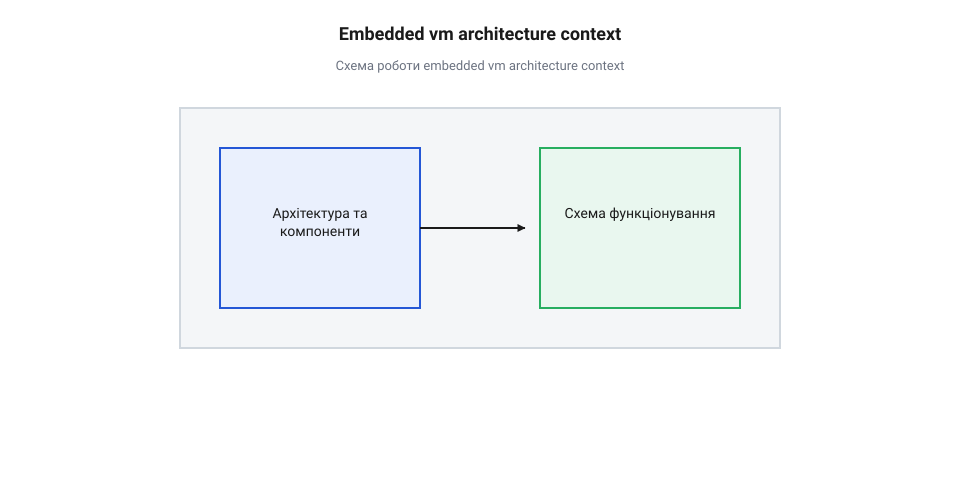

# Специфікація опкодів та структури контексту віртуальної машини

## Початкові концепції та базові принципи

Під час розробки прошивок для мікроконтролерів регулярно виникає потреба виконувати довготривалі або динамічно видозмінювані послідовності кроків: діагностичні тестові сценарії, користувацькі макроси автоматизації, кастомні анімації світлодіодних індикаторів чи алгоритми калібрування сенсорів. Якщо кожну таку послідовність жорстко кодувати безпосередньо у вихідному тексті мовами C або C++, будь-яка зміна логіки вимагає повторної компіляції усієї прошивки та перепрограмування внутрішньої енергонезалежної пам'яті (англ. @@en|Flash memory@@, від @@en|flash@@ — спалах). Це суттєво уповільнює розробку, створює ризик зносу комірок пам'яті та ускладнює оновлення алгоритмів по повітрю.

Спроба інтегрувати у мікроконтролер повноцінні інтерпретатори мов високого рівня — таких як @@en|Python@@ чи @@en|Lua@@ — швидко впирається у жорсткі апаратні обмеження. Подібні рушії вимагають десятки кілобайт або навіть мегабайти оперативної пам'яті (англ. @@en|Random Access Memory@@, @@en|RAM@@), інтенсивно використовують динамічне виділення пам'яті в купі (англ. @@en|heap allocation@@) та потребують фонового збирача сміття (англ. @@en|garbage collector@@). Для мікроконтролера з кількома кілобайтами пам'яті це призводить до фрагментації, недетермінованих затримок виконання та раптових збоїв через вичерпання ресурсів.

Для розв'язання цієї проблеми застосовують @@en|мікро-інтерпретатор@@ (англ. @@en|micro-interpreter@@, від грец. @@en|mikros@@ — малий та лат. @@en|interpretari@@ — тлумачити) — компактний алгоритмічний автомат, який виконує зумовлений бінарний @@en|байткод@@ (англ. @@en|bytecode@@, від @@en|byte@@ — байт та @@en|code@@ — код). Замість комбілювання складних високорівневих виразів, керуюча послідовність кодується у вигляді компактного масиву байтів, де кожна інструкція складається з числового ідентифікатора — @@en|опкоду@@ (англ. @@en|opcode@@, від @@en|operation code@@ — код операції) — та її аргументів.

Фундаментальною відмінністю мікро-інтерпретатора від загальносистемних віртуальних машин є повна статичність та детермінованість. Весь стан виконання зберігається у єдиній структурі — @@en|контексті віртуальної машини@@ (англ. @@en|VM context@@ або @@en|VM State@@). Контекст виділяється у статичній оперативній пам'яті на етапі компіляції прошивки й не розширюється під час роботи.

Головним елементом контексту є @@en|вказівник інструкцій@@ (англ. @@en|Instruction Pointer@@, @@en|IP@@, від @@en|instruction@@ — інструкція та @@en|pointer@@ — вказівник), який вказує на поточний байт у буфері команд. Для підтримки підпрограм та вкладених викликів у контексті передбачено @@en|стек викликів@@ (англ. @@en|call stack@@, від @@en|call@@ — виклик та @@en|stack@@ — стопка) фіксованої глибини. Окрім того, контекст містить фіксований набір локальних регістрів для проміжних обчислень і збереження стану прапорців виконання.

Компактність байткоду дає змогу зберігати послідовності команд у будь-якому носії: у внутрішній пам'яті мікроконтролера, у зовнішній енергонезалежні пам'яті (англ. @@en|EEPROM@@), або отримувати їх через послідовний інтерфейс зв'язку. При цьому сам інтерпретатор не має права блокувати обробку переривань чи виконання інших задач мікроконтролера.

Для забезпечення кооперативної багатозадачності у систему інструкцій вводять спеціалізовані команди передачі управління, такі як @@en|YIELD@@ (передати управління) та @@en|WAIT@@ (очікувати). Коли інтерпретатор зустрічає таку інструкцію, він зберігає поточний стан у контексті й тимчасово повертає управління зовнішньому середовищу. Це дозволяє безпроблемно інтегрувати віртуальну машину як у простій [циклічному опитуванні в головному циклі](root:sf-devices/super-loop), так і при виконанні задач під [планувальником операційної системи](root:sf-devices/freertos). Такий підхід узгоджується із загальною [концепцією розподілу часу](root:sf-devices/time-sharing-history), адаптованою до жорстких вимог вбудованих систем реального часу.

Важливою складовою специфікації є інструкції взаємодії з периферією. Опкоди віртуальної машини абстрагують фізичні регістри мікроконтролера: окрема інструкція може змінювати стан цифрового виводу (англ. @@en|GPIO pin@@), зчитувати аналоговий сигнал з АЦП (англ. @@en|ADC@@) або генерувати ШІМ-сигнал (англ. @@en|PWM@@). Завдяки цьому байткод стає портативним — той самий алгоритм виконання послідовностей може працювати на різних мікроконтролерних архітектурах без зміни самого коду бінарного сценарію.

## Внутрішня будова та алгоритми роботи

Внутрішня архітектура віртуальної машини базується на чіткому розділенні пам'яті інструкцій, структури контексту стану та машини станів циклу вибірки-виконання. Оскільки вбудовані системи вимагають високої надійності, структура контексту повинна мати фіксований розмір і гарантувати відсутність невизначеної поведінки при будь-яких вхідних даних.


*Структура контексту віртуальної машини в оперативній пам'яті та механізм вибірки, декодування й виконання опкодів.*

Основою системи є структура контексту `vm_context_t`. Вона описує повний стан секвенсера у довільний момент часу:

```
+-------------------------------------------------------+
|                 VM CONTEXT (VM State)                 |
+-------------------------------------------------------+
|  const uint8_t *code        (Вказівник на байткод)    |
|  uint16_t code_size         (Розмір буфера команд)    |
|  uint16_t ip                (Instruction Pointer)     |
|  uint16_t stack[STACK_DEPTH](Стек викликів)           |
|  uint8_t  sp                (Stack Pointer)           |
|  int32_t  registers[NUM_REGS](Віртуальні регістри)   |
|  uint32_t wait_until_ms     (Таймер очікування)       |
|  vm_status_t status         (Стан / Прапорці помилок) |
+-------------------------------------------------------+
```

Для кодування команд застосовують бінарний формат змінної або фіксованої довжини. Найчастіше використовується формат, де перший байт визначає опкод інструкції, а наступні байти містять її аргументи.

Набір інструкцій (англ. @@en|opcode instruction set@@) ділиться на дві основні категорії: команди керування потоком та команди взаємодії з апаратурою.

Розглянемо специфікацію базових опкодів:
- `NOP` (`0x00`): порожня операція. Пропускає крок і збільшує `ip` на 1. - `JMP addr` (`0x01`): безумовний перехід. Встановлює `ip` у значення 16-бітної адреси `addr` (займає 3 байти: опкод + 2 байти адреси). - `JZ reg, addr` (`0x02`): умовний перехід. Якщо значення регістру `reg` дорівнює нулю, `ip` переноситься на `addr`, інакше виконується перехід до наступної інструкції. - `CALL addr` (`0x03`): виклик підпрограми. Зберігає поточну адресу повернення (`ip + 3`) у стек выкликів та завантажує `addr` в `ip`. - `RET` (`0x04`): повернення з підпрограми. Вилучає адресу повернення зі стека та відновлює її в `ip`. - `YIELD` (`0x05`): добровільна передача управління. Зберігає стан і призупиняє виконання віртуальної машини до наступного кванту часу. - `WAIT ms` (`0x06`): пауза на вказану кількість мілісекунд `ms`. Обчислює цільовий час відновлення та переводить віртуальну машину у стан очікування. - `GPIO_SET pin, val` (`0x10`): встановлення цифрового рівня (`val`) на вказаному виводі (`pin`). - `GPIO_GET pin, reg` (`0x11`): зчитування стану виводу (`pin`) у регістр (`reg`). - `ADC_READ ch, reg` (`0x12`): зчитування значення з каналу АЦП (`ch`) у регістр (`reg`).

Алгоритм роботи інтерпретатора побудований на циклі вибірки, декодування та виконання (англ. @@en|fetch-decode-execute cycle@@). На кожній ітерації виконавець перевіряє поточний стан `status`. Якщо віртуальна машина перебуває у стані виконання (`VM_STATUS_RUNNING`), виконуються наступні двійкові кроки:

1. **Перевірка меж інструкцій (англ. @@en|bounds check@@):** Перевіряється умова `ip >= code_size`. Якщо вказівник вийшов за межі буфера, виконання негайно зупиняється зі статусом помилки виходу за межі пам'яті. 2. **Вибірка інструкції (англ. @@en|fetch@@):** Зчитується байт `opcode = code[ip++]`. 3. **Декодування та виконання (англ. @@en|decode & execute@@):** За допомогою оператора вибору (`switch-case`) визначається обробник інструкції. Зчитуються додаткові аргументи (якщо вони є), після чого виконується відповідна дія.

Найважливішим аспектом специфікації є обробка граничних умов та виняткових ситуацій:
- **Переповнення стека (англ. @@en|stack overflow@@, від @@en|stack@@ — стек та @@en|overflow@@ — переповнення):** Виникає під час виконання інструкції `CALL`, якщо `sp >= STACK_DEPTH`. Віртуальна машина припиняє виконання та встановлює статус `VM_ERROR_STACK_OVERFLOW`. - **Вичерпання стека (англ. @@en|stack underflow@@, від @@en|stack@@ — стек та @@en|underflow@@ — недобір):** Виникає під час виконання інструкції `RET`, якщо `sp == 0`. Виконання зупиняється зі статусом `VM_ERROR_STACK_UNDERFLOW`. - **Некоректний опкод (англ. @@en|invalid opcode@@):** Виникає, якщо вибране значення опкоду відсутнє у специфікації інструкцій. Інтерпретатор переходить у гілку `default` і фіксує статус `VM_ERROR_INVALID_OPCODE`.

Нижче наведено практичну реалізацію мікро-інтерпретатора байткоду мовами C та C++.

:::tabs
@tab C
:::code root\eng\sf-devices\embedded-bytecode-vm-sequencer/api-bytecode-opcodes/c/vm-init.c c

@tab C++
:::code root\eng\sf-devices\embedded-bytecode-vm-sequencer/api-bytecode-opcodes/cpp/bytecodevm.cpp cpp
:::

Завдяки такій побудові внутрішній цикл інтерпретатора гарантує повний детермінізм виконання: кожен крок займає передбачуваний час, виділення пам'яті відсутнє, а будь-яка аномалія в бінарних даних негайно переводить віртуальну машину в безпечний стан помилки, запобігаючи збоям всієї системи.

## Апаратна реалізація та низкорівневий C/C++ код

Обмежені ресурси оперативної пам’яті та жорсткі вимоги до часу відгуку в реальному часі визначають особливості реалізації мікро-інтерпретатора у прошивці мікроконтролерів. На відміну від високорівневих віртуальних машин для настільних систем, інтерпретатор для вбудованих пристроїв повинен працювати в межах кількох кілобайт RAM, мінімізувати накладні витрати на переключення контексту та забезпечувати детермінований час виконання кожної інструкції. Розробка починається з проектування упакованих структур даних, вибору оптимальної стратегії вибірки та декодування (англ. @@en|fetch-decode-execute@@, від давньоангл. *feccan* — витягувати, лат. *decodare* — розшифровувати, лат. *exsequi* — виконувати) та ефективної взаємодії з апаратною периферією.

Вбудовані мікроконтролери (зокрема архітектури ARM Cortex-M або RISC-V) вимагають чіткого вирівнювання (англ. @@en|alignment@@, від старофр. *aligner* — вирівнювати в лінію) даних у пам’яті. Спроба зчитати 16-бітне або 32-бітне число за непарною адресою в RAM може викликати апаратну виняткову ситуацію або суттєво уповільнити виконання через додаткові цикли шини. 

Контекст виконання віртуальної машини (англ. @@en|VM State@@) об’єднує поточний вказівник інструкцій (англ. @@en|Instruction Pointer@@), стек викликів (англ. @@en|call stack@@), масив регістрів та лічильники затримок. Загальний обсяг оперативної пам’яті, необхідний для збереження одного екземпляра контексту, обчислюється як сума розмірів його елементів з урахуванням вирівнювання:

```
M_vm = sizeof(ip) + sizeof(sp) + sizeof(stack) + sizeof(regs) + sizeof(status)
     = 2 + 1 + (8 × 2) + (4 × 2) + 1         [розміри полів у байтах]
     = 28                                   [сумарний розмір у байтах без padding]
```

Для запобігання появі прихованих байтів вирівнювання (англ. @@en|padding@@, від англ. *pad* — подушка або підкладка) між полями структури, поля в C/C++ впорядковують від найбільшого за розміром до найменшого або використовують атрибут @@en|packed struct@@. Поряд з вирівнюванням важливу роль відіграє порядок байтів (англ. @@en|endianness@@, від англ. *end* — кінець). Більшість мікроконтролерів використовують прямий порядок (англ. @@en|little-endian@@), де молодший байт 16-бітного операнда розміщується за меншою адресою в Flash-пам’яті.

Для забезпечення детермінованості виконання та мінімізації накладних витрат обробка даних у критичних секціях здійснюється за допомогою цілочисельної арифметики з атомарним оновленням прапорців станів @@en|atomic flags@@, що виключає дрейф фази та блокування переривань.

1. **Конструкція switch-case**: Найпростіший підхід, за якого компілятор створює таблицю переходів або бінарне дерево розгалуження. Перевагою є простота та портативність, однак при великій кількості інструкцій накладні витрати на порівняння зростають. 2. **Масив вказівників на функції (Jump Table)**: Оголошується таблиця вказівників на функції-обробники. Обробник викликається напряму за індексом опкоду. Це гарантує константний час виклику, але створює накладні витрати на збереження та відновлення регістрів процесора під час виклику функції (пролог і епілог). 3. **Пряме адресування (Computed Goto)**: Розширення компіляторів GCC та Clang дозволяє використовувати вказівники на мітки усередині функції через оператор `&&label`. Реалізація @@en|computed goto@@ (англ. *computed goto*, від лат. *computare* — обчислювати) усуває вихід з циклу інтерпретатора та мінімізує прохиби пророкування розгалужень (англ. @@en|branch misprediction@@).

Розглянемо практичну реалізацію інтерпретатора байткоду з обробкою базових інструкцій та підтримкою неблокуючих затримок:

:::tabs
=== C (STM32 / Bare-Metal)
:::code root\eng\sf-devices\embedded-bytecode-vm-sequencer/api-bytecode-opcodes/c/stm32/--attribute--.c c
=== C++ (Cortex-M / C++17)
:::code root\eng\sf-devices\embedded-bytecode-vm-sequencer/api-bytecode-opcodes/cpp/stm32/opcode.cpp cpp
:::

Виконання інструкції `YIELD` передає управління зовнішньому середовищу. У системі без операційної системи крок віртуальної машини викликається всередині [кооперативному циклі super-loop](root:sf-devices/super-loop). Це дозволяє мікроконтролеру паралельно обслуговувати інші модулі прошивці (наприклад, опитувати сенсори чи оновлювати дисплей) без блокування процесора.

У складніших архітектурах віртуальна машина виконується як окрема задача в [операційній системі FreeRTOS](root:sf-devices/freertos). У цьому випадку інструкція `WAIT_MS` може переводити задачу RTOS у заблокований стан за допомогою системного виклику `vTaskDelay()`, вивільняючи процесорний час для інших системних потоків. Цей підхід логічно продовжує еволюцію систем, описану в [історії розподілу часу](root:sf-devices/time-sharing-history), адаптуючи класичні принципи квантування часу до вимог жорсткого реального часу в мікроконтролерах.

## Практичне застосування та відлагодження

Запуск інтерпретатора байткоду в серійному пристрої вимагає надійних механізмів виявлення помилок та діагностики нештатних ситуацій. Оскільки байткод може завантажуватися зовнішніми каналами зв'язку (наприклад, через UART, CAN або по повітрю BLE/OTA), помилки в програмі не повинні призводити до перезавантаження або фатального зависання всього мікроконтролера.

Під час виконання байткоду віртуальна машина може зіткнутися з чотирма основними типами аварійних ситуацій:

1. **Переповнення стека (@@en|stack overflow@@, від англ. *stack* — стос та *overflow* — переповнення)**: Виникає під час виклику інструкції `CALL`, коли поточний індекс стека викликів досягає максимальної глибини. 2. **Вичерпання стека (@@en|stack underflow@@)**: Виникає при виконанні інструкції `RET`, якщо стек викликів порожній. 3. **Некоректний опкод (@@en|invalid opcode@@)**: Спроба виконати байт, значення якого не відповідає жодній відомій інструкції зі специфікації (наприклад, внаслідок пошкодження пам'яті). 4. **Вихід за межі буфера інструкцій (@@en|out of bounds@@)**: Спроба зчитати інструкцію або операнд за адресою, яка перевищує довжину масиву байткоду.

При виявленні будь-якої з цих умов віртуальна машина негайно переходить у стан аварійної зупинки, фіксує код помилки та вимикає всі активні периферійні виходи для переведення пристрою в безпечний стан.

Для захисту від нескінченних циклів у байткоді, де відсутні інструкції `YIELD` або `WAIT`, головний цикл виконання повинен регулярно скидати сторожовий таймер (англ. @@en|watchdog@@, від англ. *watch* — стежити та *dog* — собака). Якщо інтерпретатор зависає в циклі без передачі управління, апаратний сторожовий таймер перезавантажує мікроконтролер.

Для віддаленої діагностики збоїв використовується механізм аварійного дампа пам'яті (англ. @@en|post-mortem@@, від лат. *post-mortem* — після смерті). При виникненні помилки стан віртуальної машини серіалізується у бінарну структуру та записується в енергонезалежну пам'яті Flash або на SD-карту.

Використовуючи [ротацію бінарних логів](root:sf-devices/embedded-sd-log-rotation-tail-latency), розробник може зберегти точну хронологію дій віртуальної машини перед аварією. Дамп містить значення вказівника інструкцій на момент збою, поточне значення вказівника стека, вміст стека викликів, значення локальних регістрів та код помилки.

Для інтерактивного налагодження у прошивку вбудовують модуль трасування (англ. @@en|tracing@@, від старофр. *tracer* — прокладати шлях). На кожному кроці інтерпретатор надсилає у відлагоджувальний інтерфейс UART короткий пакет даних, що описує виконану інструкцію. Додатково можна ввести спеціальний опкод точка зупинки (англ. @@en|breakpoint@@), який призупиняє виконання віртуальної машини та очікує команди від зовнішнього відлагоджувача.

Нижче наведено приклад модуля діагностики та формування аварійного дампа мовами C та C++:

:::tabs
=== C (ESP-IDF / Embedded C)
:::code root\eng\sf-devices\embedded-bytecode-vm-sequencer/api-bytecode-opcodes/c/esp-idf/vm-save-crash-dump.c c
=== C++ (Arduino / Embedded C++)
:::code root\eng\sf-devices\embedded-bytecode-vm-sequencer/api-bytecode-opcodes/cpp/arduino/vmerror.cpp cpp
:::

Завдяки виділенню логіки виконання в окремий інтерпретатор байткоду, прошивка отримує гнучкість оновлення сценаріїв без перекомпіляції основного C/C++ коду. Такий підхід лежить в основі керування послідовностями роботи промислового обладнання, автоматичних дозаторів, медичних приладів та систем розумного будинку, що реалізуються в межах наскрізного проєктування в [підсумковому капстоун-проєкті](root:sf-devices/capstone-task). Надійний детермінований мікро-інтерпретатор забезпечує стабільну роботу пристрою в умовах тривалої автономної експлуатації.