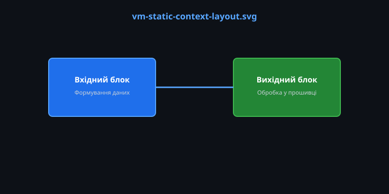
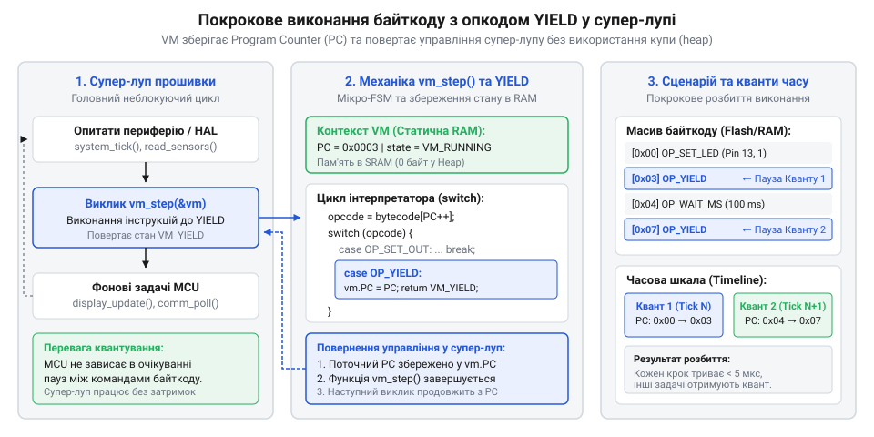

# Байткодовий інтерпретатор у прошивці: динамічні сценарії та мікро-FSM без купи

<preknowlist>
- [Super-loop](root:sf-devices/super-loop) — Принцип неблокуючого виконання завдань у головному циклі прошивки та збереження стану між ітераціями
</preknowlist>

## Проблема жорсткої логіки у прошивках

Більшість вбудованих пристроїв, від контролерів розумного дому до промислових роботів, виконують певну послідовність дій: увімкнути реле, дочекатися сигналу від датчика, змінити колір світлодіода, вимкнути реле. Коли вся ця логіка жорстко написана на мові C або C++ і скомпільована в єдиний бінарний файл, розробник стикається з фундаментальною проблемою гнучкості. Будь-яка зміна таймінгів анімації, додавання нового кроку в послідовність рухів або зміна реакції на кнопку вимагають зміни вихідного коду, повної перекомпіляції прошивки та перепрошивки пристрою. Це не лише уповільнює розробку, але й робить неможливим зміну поведінки пристрою "на льоту" користувачем або сервером керування без ризику завантажити дефектний код, який виведе мікроконтролер із ладу.

Щоб розв'язати цю проблему, логічно відділити системний код (роботу з периферією, перериваннями, мережею) від бізнес-сценаріїв. Але мікроконтролери зазвичай мають дуже обмежений обсяг оперативної пам'яті (RAM). Ми не можемо просто завантажити у пристрій повноцінний рушій високорівневої мови, оскільки він вимагає великого обсягу пам'яті та постійно використовує динамічне виділення, що швидко спричиняє [фрагментацію купи (heap) у вбудованих системах](root:sf-devices/memory-fragmentation-embedded) та аварійну зупинку. Нам потрібен інструмент, який дозволить виконувати зовнішні сценарії, але працюватиме в жорстко заданих межах пам'яті без купи. 

Відповіддю на цей виклик є створення власного компактного байткодового інтерпретатора — мініатюрної віртуальної машини, що розпізнає прості інструкції. Цей підхід має глибоке коріння: ще на ранніх етапах розвитку обчислювальної техніки обмеженість пам'яті змушувала шукати компактні форми абстракції ([від p-code до Forth: еволюція байткоду у вбудованих системах](root:sf-devices/embedded-bytecode-vm-sequencer/hist-forth-and-pcode.md)). Сьогодні ми застосовуємо цю саму ідею заради надзвичайної щільності коду: оскільки наш байткод описує специфічні високорівневі бізнес-дії, одна базова інструкція займає лише 1 байт. Для порівняння, та сама логіка, скомпільована в нативний машинний код для типової архітектури ARM, вимагала б послідовності з кількох 4-байтових інструкцій для налаштування регістрів та виклику функцій. Завдяки такій економії пам'яті сценарій перетворюється на комп'ютері в дуже компактний масив байтів і пересилається на пристрій, а прошивка крок за кроком його інтерпретує.

## Контекст та архітектура мікро-віртуальної машини

Складність розробки вбудованих систем часто полягає у необхідності змінювати сценарії поведінки пристрою без ризикованого оновлення всієї базової прошивки. Спроба виконувати динамічні сценарії за допомогою високорівневих мов із внутрішнім управлінням пам'яттю вимагає використання динамічного розподілу ресурсів. Проте у мікроконтролерах системна @@en|купа@@ (англ. *heap*, динамічно виділяна пам’ять) викликає ризики [фрагментації оперативної пам'яті](root:sf-devices/memory-fragmentation-embedded), що згодом призводить до непередбачуваних відмов системного ПЗ через неможливість виділити суцільний блок пам'яті. Щоб усунути цей ризик, віртуальна машина у прошивці проєктується на основі повністю ізольованої структури даних — статичного контексту.

Ізоляція виконання досягається чітким розділенням даних: константний байткод сценарію розміщується у захищеній від запису Flash-пам'яті або ROM, тоді як внутрішній стан середовища виконання описує статичний @@en|контекст@@ (англ. *context*, від лат. *contextus* — з'єднання, сплетіння). Ця структура виділяється в оперативній пам'яті RAM ще під час компіляції прошивки у секції BSS або Data.

Статичний @@en|контекст@@ мікро-інтерпретатора містить мінімально необхідний набір полів для детермінованого виконання інструкцій:
1. @@en|покажчик інструкцій@@ (англ. *instruction pointer*, вказівник на поточну команду), або PC (Program Counter) — числове зміщення відносно початку буфера байткоду, яке визначає адресу наступної команди. 2. @@en|регістри@@ (англ. *registers*, робочі комірки пам'яті) — масив цілочисельних змінних фіксованого розміру (наприклад, 4 регістри по 16 біт) для зберігання проміжних обчислень, лічильників циклів та аргументів. 3. Системний таймер затримки — часова мітка у мілісекундах, необхідна для реалізації неблокуючих пауз та інтеграції з [архітектурою супер-лупу](root:sf-devices/super-loop) без зупинки процесора. 4. Статус виконання — бітове поле або перелічуваний тип для відстеження поточного стану (очікування, виконання, завершення або помилка). 5. Покажчик на константний масив байткоду та змінна його граничного розміру для захисту від зчитування за межами виділеного буфера.

Окремою критичною вимогою до архітектури мікро-віртуальної машини є підтримка підпрограм та багаторазово використовуваних блоків коду за допомогою інструкцій `CALL` та `RET`. Без підпрограм розробник змушений дублювати однакові послідовності інструкцій (наприклад, складні серії спалахів світлодіода або макроси руху моторів), марно витрачаючи Flash-пам'ять. Для реалізації переходу до підпрограми інтерпретатор повинен зберегти поточне значення @@en|покажчик інструкцій@@ як адресу повернення, а при виконанні інструкції `RET` — відновити його.

Оскільки виклики підпрограм можуть бути вкладеними, зберігання адрес повернення вимагає наявності послідовності LIFO (Last-In, First-Out). Для цього у статичний @@en|контекст@@ додається @@en|стек викликів@@ (англ. *call stack*, стек адрес повернення) та @@en|покажчик стеку@@ (англ. *stack pointer*, індекс вершини стеку), що позначається як SP. На відміну від великих операційних систем, де стек може динамічно розширюватися, у вбудованому статичному контексті @@en|стек викликів@@ визначається як масив фіксованої глибини (наприклад, `uint16_t stack[4]`). Фіксована глибина обмежує граничний рівень вкладеності підпрограм, але гарантує жорстку передбачуваність обсягу пам'яті. При цьому цикл виконання зобов'язаний контролювати межі: спроба викликати `CALL` при заповненому стеку викликає @@en|переповнення стеку@@ (англ. *stack overflow*, вихід за межі стеку), а `RET` на порожньому стеку — опустошення, що негайно переводить @@en|контекст@@ у стан помилки та запобігає пошкодженню сусідніх полів у RAM.

Обчислимо точний обсяг оперативної пам'яті RAM, необхідний для збереження одного екземпляра статичного контексту з урахуванням 4 рівнів стеку викликів:

```
RAM_context = size_of(IP) + size_of(Registers) + size_of(Timer) + size_of(Stack) + size_of(SP) + size_of(Status) + size_of(CodePointer) + size_of(CodeLen)
            = 2 + (4 × 2) + 4 + (4 × 2) + 1 + 1 + 4 + 2    [розміри полів у байтах для 32-бітної архітектури]
            = 30                                           [загальний обсяг статичного контексту в байтах]
```

Розрахунок показує, що повний стан виконання віртуальної машини займає лише 30 байт у статичній RAM. Це дозволяє розміщувати десятки незалежних мікро-інтерпретаторів навіть на найпростіших мікроконтролерах із кількома кілобайтами пам'яті.


*Схема архітектури мікро-віртуальної машини: масив байткоду зберігається у постійній або завантажується в оперативну пам'ять, а структура контексту лежить у статичній RAM, що повністю виключає потребу в купі.*

Розділення статичного контексту у RAM та байткоду у Flash перетворює інтерпретатор на [внутрішній автомат станів](root:sf-devices/finite-state-machine), що крокує за інструкціями. Подальша специфікація команд деталізована у описі [специфікації внутрішніх опкодів](root:sf-devices/embedded-bytecode-vm-sequencer/api-bytecode-opcodes.md), а повна програмна реалізація міститься у матеріалі [приклад реалізації інтерпретатора](root:sf-devices/embedded-bytecode-vm-sequencer/proj-c-bytecode-interpreter.md).

Нижче наведено практичну реалізацію структури статичного контексту віртуальної машини мовами C та C++ з урахуванням фіксованого стеку викликів.

:::tabs
@tab C
:::code root\eng\sf-devices\embedded-bytecode-vm-sequencer/embedded-bytecode-vm-sequencer-d/c/esp-idf/vm-init.c c
@tab C++
:::code root\eng\sf-devices\embedded-bytecode-vm-sequencer/embedded-bytecode-vm-sequencer-d/cpp/arduino/vmstatus.cpp cpp
:::

## Декодування опкодів та виконання інструкцій

Маючи завантажений у пам'ять масив байткоду та ініціалізований контекст, система повинна виконати ці команди. Серцем інтерпретатора є класичний цикл вибірки, декодування та виконання (@@en|Fetch-Decode-Execute@@). У мікроконтролері він найчастіше реалізується за допомогою конструкції `switch` мовою C.

Алгоритм дуже простий: інтерпретатор читає комірку масиву, на яку вказує покажчик інструкцій (IP) — це код операції (@@en|Opcode@@). Далі у блоці `switch` він виконує дію, що відповідає цьому коду: увімкнути світлодіод, порівняти регістри або перестрибнути на іншу інструкцію. Після виконання дії інтерпретатор збільшує IP, переходячи до наступної команди.


*Інтеграція мікро-FSM у головний цикл програми: замість блокувальних затримок віртуальна машина призупиняє своє виконання і повертає керування системі.*

Тут виникає критичне архітектурне обмеження. Якщо байткод містить команду "чекати 5 секунд", ми не можемо застосувати системну затримку всередині `switch`, інакше мікроконтролер перестане реагувати на мережу та інші завдання. Тому інтерпретатор будується як неблокуючий [скінченний автомат (FSM) у мікроконтролерах](root:sf-devices/finite-state-machine). Замість очікування, віртуальна машина запам'ятовує час старту і виконує спеціальний опкод `YIELD`. Він дає команду негайно вийти з функції інтерпретатора, повертаючи управління назад у головний цикл ([super-loop](root:sf-devices/super-loop)). 

Під час наступної ітерації супер-лупу функція інтерпретатора викликається знову. Вона перевіряє стан таймера у своєму контексті: якщо час не минув, знову робить `YIELD`. Якщо пауза завершилась — збільшує IP і продовжує роботу. Завдяки такому підходу легковажна функція може паралельно з іншими завданнями виконувати складні, розтягнуті в часі сценарії, не заблокувавши жодного системного процесу.

## Неблокуючий мікро-FSM у головному циклі

Навіть маючи працюючий цикл вибірки та декодування інструкцій, розробник стикається з реальностями вбудованих систем: мікроконтролер має одночасно опитувати датчики, оновлювати екран і підтримувати мережеве з'єднання. Якщо байткодовий сценарій вимагає зачекати кілька секунд між зміною кольорів світлодіода, звичайна затримка повністю заблокує систему. Щоб цього уникнути, інтерпретатор повинен бути спроєктований як мікро-скінченний автомат (@@en|Finite State Machine@@, FSM), який працює в гармонії з головним циклом програми ([super-loop](root:sf-devices/super-loop)).

Для перетворення звичайного інтерпретатора на неблокуючий автомат вводиться спеціальна інструкція `YIELD` (поступитися). Коли віртуальна машина натрапляє на таку інструкцію, вона фіксує свій поточний стан — зберігає вказівник інструкцій (IP) та поточне значення системного таймера у своєму статичному контексті — і негайно робить повернення (`return`) з функції-обробника. Завдяки цьому мікроконтролер продовжує виконувати інші системні завдання. 

Під час наступної ітерації супер-лупу функція віртуальної машини викликається знову. Вона перш за все перевіряє свій внутрішній стан. Якщо машина перебуває в режимі очікування (затримки), вона порівнює поточний час із збереженою часовою міткою. Якщо час ще не вийшов, вона знову виконує `YIELD`. Якщо ж інтервал завершився, автомат скидає стан очікування, пересуває вказівник на наступну інструкцію масиву і продовжує виконання байткоду. Завдяки цій техніці можна одночасно запустити декілька незалежних контекстів (кілька паралельних сценаріїв), кожен з яких матиме свій масив інструкцій і свій IP, при цьому вони не блокуватимуть одне одного.

## Захист пам'яті та валідація сценаріїв

Отримавши здатність динамічно завантажувати і виконувати зовнішні сценарії, розробник мусить врахувати загрози безпеки. Оскільки байткод генерується і передається ззовні (наприклад, із хмарного сервера або мобільного додатка), масив інструкцій може бути пошкодженим через обрив зв'язку або навіть зловмисно зміненим. Якщо віртуальна машина сліпо виконуватиме такі дані, вона може вийти за межі дозволеної ділянки пам'яті, що призведе до зависання мікроконтролера. 

Перший рівень захисту — це валідація переходів. Будь-які інструкції безумовного або умовного переходу (`JMP`, `CALL`) обов'язково повинні перевірятися інтерпретатором: чи не вказує нова адреса (новий IP) за межі масиву байткоду. Якщо розрахований індекс є більшим за загальну довжину сценарію, віртуальна машина повинна негайно зупинити виконання та перейти в стан помилки. Подібним чином контролюється і стек викликів (для інструкції `RET`): перевіряється, чи не відбувається переповнення стека (@@en|Stack Overflow@@) або спроба витягти адресу з порожнього стека.

Другий рівень захисту полягає в обмеженні кількості інструкцій, які віртуальна машина має право виконати за одну ітерацію супер-лупу. Якщо в сценарії утворився нескінченний цикл без інструкції `YIELD`, інтерпретатор захопить процесорний час назавжди. Щоб запобігти цьому, в контексті віртуальної машини запроваджується лічильник кроків. Наприклад, машині дозволяється виконати не більше 100 інструкцій поспіль; після досягнення цього ліміту інтерпретатор примусово робить `YIELD`, даючи мікроконтролеру змогу обробити інші критичні завдання. Такий механізм сторожового таймера безпосередньо всередині віртуальної машини робить виконання байткоду абсолютно безпечним для решти системи.