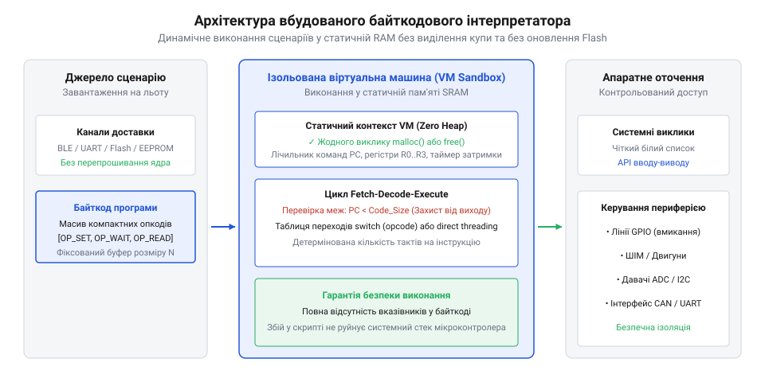
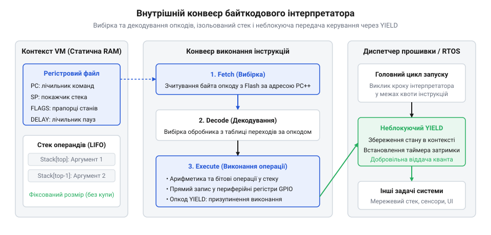
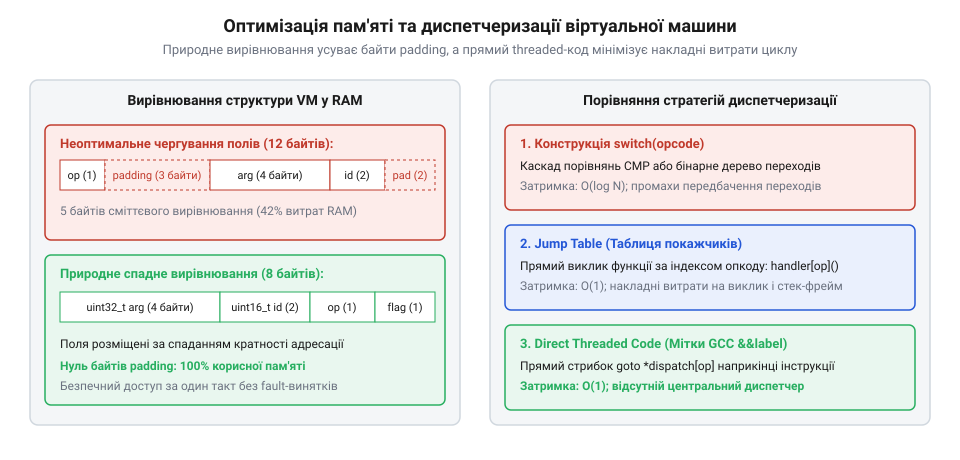
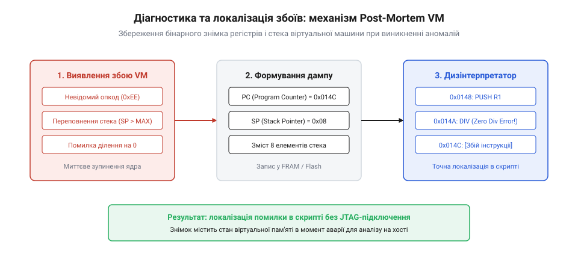

# Байткодовий інтерпретатор у прошивці: динамічні сценарії та мікро-FSM без купи

## Початкові концепції та фізичні принципи

В автономних вбудованих системах регулярно виникає потреба змінювати послідовності керування без зміни базового бінарного образу програми: калібрування сенсорів, покрокове опитування периферії або сценарії виходу з аварійних режимів. Традиційне оновлення вимагає повної перекомпіляції та перезапису енергонезалежної пам'яті @@en|Flash@@ (від англ. *flash* — спалах). Проте ресурси напівпровідникових комірок Flash обмежені циклами стирання, запис займає сотні мілісекунд із блокуванням переривань, а рестарт пристрою зупиняє технологічний процес.

Використання повнорозмірних інтерпретаторів скриптових мов (MicroPython, Lua) натрапляє на брак оперативної пам'яті та небезпеку фрагментації системної купи @@en|heap@@ (від англ. *heap* — купа). У довготривалих задачах подрібнення пам'яті призводить до збоїв @@en|out-of-memory@@, а непередбачувані паузи збирача сміття спричиняють пікові затримки @@en|tail latency@@ (від англ. *tail* — хвіст та лат. *latens* — прихований). Це порушує детермінізм задач [операційної системи FreeRTOS](root:sf-devices/freertos) і провокує перезавантаження через апаратний @@en|сторожовий таймер@@ (від англ. *watchdog timer*).

Розв'язанням є спеціалізований інтерпретатор байткоду @@en|bytecode@@ (від англ. *bytecode* — двійковий проміжний код), побудований за принципом нульового використання купи @@en|zero-heap@@. Байткод завантажується у виділений буфер статичної оперативної пам'яті @@en|RAM@@ або зчитується безпосередньо з постійної пам'яті без зміни образу прошивки.

Для оцінки детермінізму визначимо тривалість віртуальної інструкції через тактову частоту ядра `f_cpu` та період `T_clk = 1 / f_cpu`:

```
T_instr = (C_fetch + C_decode + C_exec) · T_clk
        = (C_dispatch + C_exec) / f_cpu    [об'єднання фаз вибірки та вибору гілки в постійні витрати]
        = N_cycles / f_cpu                 [визначення тривалості віртуальної інструкції через частоту]
```

Оскільки витрати диспетчеризації `C_dispatch` сталі, тривалість кроку є фіксованою, що усуває часове тремтіння @@en|jitter@@ (від англ. *jitter* — тремтіння).

Потреба у статичній пам'яті для структури контексту `S_context`, стека глибиною `N_stack` зі слотом `S_slot` та `N_regs` регістрів розраховується за формулою:

```
M_ram = S_context + (N_stack · S_slot) + (N_regs · S_reg)
      = S_context + (N_stack · 4) + (N_regs · 4)    [підстановка 32-бітних слів]
      = S_static                                    [фіксований обсяг оперативної пам'яті]
```

Значення `S_static` резервується на етапі лінкування. Такий компактний автомат станів @@en|micro-FSM@@ детерміновано виконується в циклі [простого суперциклу](root:sf-devices/super-loop) або у задачі з [розподілом процесорного часу](root:sf-devices/time-sharing-history).


*Концепція байткодового інтерпретатора: ізольоване виконання динамічних сценаріїв у статичній оперативній пам'яті без звернення до купи та без перепрошивання пам'яті Flash.*

## Внутрішня будова та алгоритми роботи

Архітектура компактного інтерпретатора базується на моделі віртуального процесора з фіксованими ресурсами. Стан обчислень зосереджено в єдиному статичному контексті: покажчик інструкцій @@en|Program Counter@@ (`PC`), покажчик верхівки оцінювального стека @@en|Stack Pointer@@ (`SP`), банк регістрів загального призначення, системні прапорці та код помилки.

Потік байткоду складається з однобайтових кодів операцій @@en|opcode@@:
1. Завантаження констант і маніпуляції зі стеком. 2. Арифметико-логічні операції над верхівкою стека. 3. Команди пересилання між стеком та регістрами. 4. Безумовні та умовні переходи з перевіркою верхівки стека. 5. Команди взаємодії з цифровими портами @@en|GPIO@@ та перетворювачем @@en|ADC@@. 6. Команда тимчасової паузи та передачі керування.

Вибірка та виконання команд спираються на механізм @@en|switch dispatch@@, який компілятори оптимізують у пряму таблицю переходів @@en|jump table@@ для виклику обробника за фіксовану кількість тактів.

Щоб не блокувати фонові задачі прошивки очікуванням, використовується механізм передачі керування @@en|yield@@ командою `WAIT_MS`. Інтерпретатор фіксує момент пробудження за системним таймером і миттєво повертає керування диспетчеру, формуючи неблокуючий автомат @@en|micro-FSM@@.

За відсутності апаратного блока MMU інтерпретатор забезпечує програмну ізоляцію @@en|sandboxing@@, виконуючи динамічну валідацію:
- Контроль перебування `PC` у межах масиву байткоду. - Перевірка `SP` перед записом для усунення переповнення @@en|stack overflow@@. - Контроль наявності операндів для запобігання спустошенню @@en|stack underflow@@. - Валідація цільових адрес переходів.

Завантажені образи попередньо перевіряє [валідатор і дизінтерпретатор байткоду](root:sf-devices/embedded-vm-disassembler), а телеметрія фіксується через [збереження на SD-карті](root:sf-devices/embedded-sd-log-rotation-tail-latency).

Для захисту від зациклення виконання обмежується лімітом інструкцій на виклик:

```
N_budget = T_slice / T_max_instr
         = (T_slice · f_cpu) / C_max_cycles    [вираження через тактову частоту та тактність]
         = K_budget                            [ліміт інструкцій на квант часу]
```

Нижче наведено практичну реалізацію ядра байткодового інтерпретатора мовою C та обгортку інтерфейсу драйвера мовою C++:

:::tabs
@tab C
:::code root/eng/sf-devices/embedded-bytecode-vm-sequencer/proj-c-bytecode-interpreter/c/main.c c
@tab C++
:::code root/eng/sf-devices/embedded-bytecode-vm-sequencer/proj-c-bytecode-interpreter/cpp/main.cpp cpp
:::


*Внутрішня будова інтерпретатора: контекст регістрів і стека, конвеєр вибірки й декодування інструкцій та механізм неблокуючої затримки YIELD для інтеграції в диспетчер.*

## Апаратна реалізація та низькорівневий C/C++ код

Виконання байткоду у мікроконтролерах спирається на шинну архітектуру процесорного ядра. Вбудовані процесори накладають жорсткі вимоги на вирівнювання даних @@en|alignment@@ (від англ. *alignment* та старофр. *aligner* — вирівнювати в лінію; прив'язка адрес змінних до кратності машинного слова). Ядро ARM Cortex-M0 генерує апаратний збій шини @@en|BusFault@@ (від англ. *bus* — шина та *fault* — збій; виняткова ситуація при некоректному доступі до пам'яті) під час спроби некратного читання слів із бінарного потоку @@en|bytecode@@. Щоб уникнути збоїв і часового розкиду @@en|jitter@@ на будь-яких ядрах, аргументи опкодів вибирають побайтово у прямому порядку @@en|little-endian@@:

```c
uint16_t operand = (uint16_t)code[ip] | ((uint16_t)code[ip + 1] << 8);
ip += 2;
```

У статичній пам'яті @@en|RAM@@ поля контексту віртуальної машини розміщують за спаданням розміру типів, що зводить байти вирівнювання @@en|padding@@ до нуля без неефективної директиви `packed`. Позначимо розміри полів таймера як `S_timer`, покажчика інструкцій як `S_ip`, масивів стека викликів як `N_depth · S_word`, віртуальних регістрів як `N_regs · S_reg`, покажчика стека як `S_sp`, статусу як `S_status`, а доповнення як `S_pad`. Сумарний розмір структури `M_ctx` становить:

```
M_ctx = S_timer + S_ip + (N_depth · S_word) + (N_regs · S_reg) + S_sp + S_status + S_pad
      = 4 + 2 + (8 · 2) + (4 · 2) + 1 + 1 + 0    [впорядкування полів за спаданням розміру для 32-бітного ядра]
      = 32                                       [підсумковий обсяг статичного контексту в RAM без втрат пам'яті]
```

Для диспетчеризації замість конструкції `switch` використовують прямий шитий код @@en|direct threaded code@@: масив адрес міток дозволяє переходити до наступного обробника через `goto *dispatch_table[code[ip++]];`, усуваючи накладні витрати циклу. Взаємодія з периферією @@en|GPIO@@ здійснюється через атомарні регістри встановлення/скидання бітів, а сигнали @@en|ADC@@ зчитуються неблокувально.

:::tabs
@tab C
:::code root/eng/sf-devices/embedded-bytecode-vm-sequencer/proj-c-bytecode-interpreter/c/main.c c
@tab C++
:::code root/eng/sf-devices/embedded-bytecode-vm-sequencer/proj-c-bytecode-interpreter/cpp/main.cpp cpp
:::

Фіксований час кроку дозволяє викликати інтерпретатор у [кооперативному головному циклі](root:sf-devices/super-loop). Якщо потрібна тривала пауза, задачу перемикає [планувальник операційної системи](root:sf-devices/freertos), реалізуючи детермінований розподіл квантів за принципами [історії розподілу часу](root:sf-devices/time-sharing-history).


*Низькорівнева оптимізація інтерпретатора: природне вирівнювання полів структури для усунення байтів padding та порівняння диспетчеризації через switch, jump table і direct threaded code.*

## Практичне застосування та відлагодження

Динамічне завантаження сценаріїв несе небезпеку некоректного бінарного коду. Якщо скрипт містить логічну помилку чи обривається під час завантаження, апаратний відлагоджувач зупиняє процесор на інструкції C-рушія, приховуючи внутрішній стан віртуальної машини.

Критичні збої інтерпретатора охоплюють переповнення або спустошення стека, невідомий код операції @@en|invalid opcode@@ (від англ. *invalid* — недійсний та *opcode* — код операції) і вихід за межі буфера інструкцій @@en|out of bounds@@ (від англ. *out of bounds* — за межами). Для захисту від зациклення інтерпретатор ніколи не скидає сторожовий таймер @@en|watchdog timer@@: він виконує обмежену квоту інструкцій і повертає керування супервізору. Якщо сценарій зависає, сторожовий таймер переповнюється та ініціює скидання процесора.

У разі збою віртуальна машина знеструмлює лінії @@en|GPIO@@ і формує аварійний зліпок стану @@en|post-mortem dump@@ (від лат. *post mortem* — після смерті та англ. *dump* — аварійний знімок): покажчик інструкцій, код збою, регістри та стек. Збереження аварійного знімка реалізує [фіксація бінарних логів](root:sf-devices/embedded-sd-log-rotation-tail-latency), а його порівняння з лістингом забезпечує [автономний дизінтерпретатор байткоду](root:sf-devices/embedded-vm-disassembler). Для діагностики на стенді передбачено трасування через UART, точку зупинки @@en|breakpoint@@ та сторожове слово @@en|stack canary@@ (від англ. *canary* — канарка).

Практичну структуру аварійного зліпка та функцію фіксації стану наведено в лістингах:

:::tabs
@tab C
:::code root/eng/sf-devices/embedded-bytecode-vm-sequencer/proj-c-bytecode-interpreter/c/vm-capture-dump.c c
@tab C++
:::code root/eng/sf-devices/embedded-bytecode-vm-sequencer/proj-c-bytecode-interpreter/cpp/vmcrashdump.cpp cpp
:::

Ізоляція пам'яті, контроль меж і аварійне протоколювання перетворюють інтерпретатор на надійне ядро для польових сценаріїв і завдань у [підсумковому капстоун-проєкті](root:sf-devices/capstone-task).


*Діагностика та локалізація збоїв: механізм перехоплення граничних станів, збереження post-mortem зліпка пам'яті та його аналіз через автономний дизінтерпретатор.*