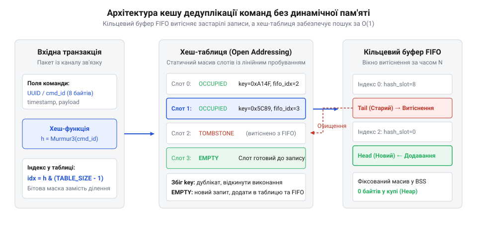
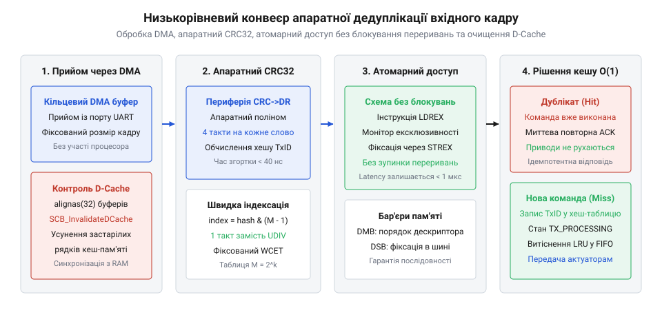
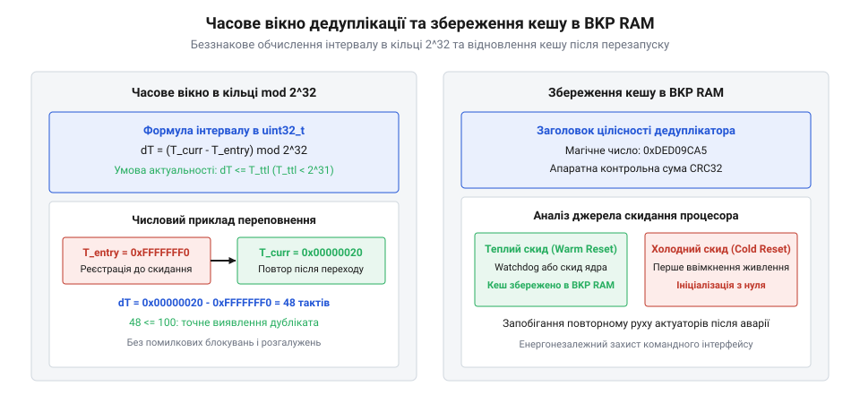

# Дедуплікація команд у прошивці: кеш транзакцій без динамічної пам'яті

## Початкові концепції та фізичні принципи

У реальних умовах експлуатації вбудованих систем фізичні канали зв'язку між контролерами та зовнішнім світом постійно зазнають впливу електромагнітних завад, стрибків напруги, перехресних наводок та міжсимвольної спотвореності. Промислові шини передачі даних, такі як @@en|UART@@ (з англ. *Universal Asynchronous Receiver-Transmitter* — універсальний асинхронний приймач-передавач), @@en|RS-485@@, @@en|CAN bus@@ (з англ. *Controller Area Network* — мережа контролерів) або бездротові інтерфейси @@en|LoRa@@ та @@en|Sub-GHz RF@@, функціонують у середовищі з ненульовим рівнем шуму. Щоб забезпечити надійність доставки пакетів, апаратні трансивери та протоколи мережевого рівня реалізують автоповтор передачі кадрів при виявленні помилок @@en|CRC32@@ (з англ. *Cyclic Redundancy Check* — циклічний надлишковий код) або втраті підтвердження @@en|ACK@@. У результаті один і той самий пакет керування може бути фізично прийнятий мікроконтролером кілька разів поспіль.

Якщо приймальна прошивка обробляє кожен вхідний кадр без урахування його історії, виникає небезпека повторного виконання неідемпотентних команд. У фізичному світі подвійне виконання наказу «повернути кроковий двигун на 45 градусів», «імпульсно відкрити клапан подачі реагенту на 100 мілісекунд» або «переключити силовий контактор» призводить до катастрофічних наслідків. Замість коригування траєкторії актуатор виходить за допустимі механічні межі, руйнує виконавчий механізм або створює аварійний стан обладнання. Щоб запобігти таким збоям, розробники реалізують [два шари рішення](root:sf-devices/reaktsiia-chy-plan), поєднуючи реактивне [рантайм-екранування безпеки](root:sf-devices/safety-shielding-cage-architecture) із суворими [блокуваннями й умовами допуску](root:sf-devices/blokuvannia-i-umovy-dopusku-interlock), які гарантують ідемпотентність обробки командних транзакцій.

Фундаментальною вимогою до прошивок критичних пристроїв (зокрема у стандартах ISO 26262, IEC 61508 та рекомендаціях @@en|MISRA C@@) є повна заборона динамічного розподілу пам'яті. Виклики стандартних функцій `malloc()` та `free()` (або операторів `new` та `delete` у C++) недопустимі з кількох фізичних та архітектурних причин:

1. **Недетермінований час виконання**: шукаючи вільний блок у купі (heap), аллокатор пам'яті здійснює обхід об'єднаних списків, що робить @@en|WCET@@ (з англ. *Worst-Case Execution Time* — найгірший час виконання) непередбачуваним і порушує суворі часові рамки операційної системи реального часу @@en|RTOS@@ (з англ. *Real-Time Operating System* — операційна система реального часу). 2. **Фрагментація оперативної пам'яті**: багаторазове виділення та звільнення блоків різного розміру в обмеженому статичному @@en|RAM@@ мікроконтролера неминуче призводить до фрагментації, коли сумарно вільної пам'яті достатньо, але немає жодного безперервного блоку потрібної довжини. 3. **Ризик фатального збою**: вичерпання купи викликає повернення вказівника `NULL`, що в критичних секціях без належної обробки провокує переривання @@en|hardfault@@ та повну зупинку пристрою.

З огляду на ці обмеження модуль дедуплікації команд мусить функціонувати виключно у статично виділеній пам'яті (`.bss` або `.data` секції), гарантуючи обробку за детермінований час `O(1)` незалежно від кількості прийнятих пакетів.

Ключовим поняттям алгоритму є ідентичність транзакції, яка задається унікальним маркером @@en|TxID@@ (з англ. *Transaction Identifier* — ідентифікатор транзакції). У найпростішому випадку @@en|TxID@@ формується як комбінація ідентифікатора вузла-відправника та монотонно зростаючого лічильника послідовності. У складніших протоколах @@en|TxID@@ є криптографічним або хеш-згортком вхідного кадру, який обчислюється периферійним модулем контролера.

Здатність системи повертати тотожний результат на повторний виклики описується поняттям @@en|idempotency@@ (з англ. *idempotency* — ідемпотентність). Для забезпечення ідемпотентності прошивка зберігає у кеші транзакцій не лише факт отримання пакета, а й результат його виконання. Якщо прийнятий пакет має @@en|TxID@@, який уже зафіксований у кеші як виконаний, прошивка не передає його на виконання актуаторам, а негайно повторно надсилає збережену відповідь.

Розмір часового вікна дедуплікації та необхідна ємність кешу визначаються фізичними параметрами мережі. Нехай `R_max` — максимальна інтенсивність надходження нових команд (команд за секунду), а `T_retry` — максимальний інтервал часу, протягом якого відправник повторює спроби доставки непідтвердженого пакета.

Мінімально необхідна кількість комірок кешу `N_capacity` обчислюється з добутку інтенсивності на час повтору з обов'язковим урахуванням дискретного квантування мережевих тайм-аутів. У реальних протоколах зв'язку інтервал повторної передачі `T_retry` не є гладкою неперервною величиною: він прив'язаний до системних квантів таймера протокольного стека або дискретних часових слотів експоненційного відступу. Під час пакетних сплесків, коли кілька вузлів одночасно конкурують за спільну шину або відновлюють зв'язок після короткочасного обриву лінії, пакети накопичуються в транзитних буферах і скидаються у фізичний канал лавиноподібно. У цей момент миттєва пікова інтенсивність потоку повторів багаторазово перевищує середньостатистичну `R_max`, а квантування призводить до згущення копій транзакцій усередині короткого часового проміжку. Якщо обсяг пам'яті розраховувати без урахування дискретності тайм-ауту та коефіцієнта пакетного згущення, лавина повторів передчасно витіснить ідентифікатори ще активних команд із кільцевої черги, відкриваючи вікно для повторного виконання неідемпотентного наказу на виконавчому механізмі. Тому базовий розрахунок місткості кешу здійснюють за піковими граничними параметрами:

N_capacity = R_max × T_retry

Щоб уникнути продуктивності хеш-таблиці через колізії, коефіцієнт заповнення `α` відкритої таблиці не повинен перевищувати значення `0.7`. Тоді необхідна кількість бакетів статичної хеш-таблиці `M_buckets` розраховується за кроком:

M_buckets = N_capacity ÷ α
          = (R_max × T_retry) ÷ 0.7      [умова запобігання каскадним колізіям]

Оскільки кеш оперує хеш-значеннями @@en|TxID@@ обмеженої розрядності, необхідно враховувати ймовірність хеш-колізій, описувану математичною моделлю парадоксу днів народження @@en|Birthday Paradox@@. Для `n` одночасно збережених транзакцій у кеші та `b`-бітного хеш-коду імовірність колізії `P_collision` оцінюється виразом:

P_collision ≈ 1 - exp(- (n × (n - 1)) ÷ (2 × 2ᵇ))
            = 1 - exp(- (256 × 255) ÷ (2 × 4294967296))    [для 32-бітного хешу та 256 елементів]
            ≈ 0.0000076                                     [імовірність колізії кешу]

Цей розрахунок показує, що використання 32-бітного @@en|CRC32@@ або згортки @@en|SipHash@@ гарантує знехтувно малу ймовірність колізій на рівні `7.6 × 10⁻⁶` для розміру буфера у 256 елементів, що є повністю прийнятним для високонадійних вбудованих систем.

## Внутрішня будова та алгоритми роботи

Для реалізації кешу транзакцій без викликів динамічної пам'яті застосовується двохрівнева статична структура даних, яка поєднує кільцевий буфер @@en|ring buffer@@ (з англ. *ring buffer* — кільцевий буфер) з відкритою адресацією хеш-таблиці @@en|open addressing@@ (з англ. *open addressing* — відкрита адресація).

Кільцевий буфер працює за принципом @@en|FIFO@@ (з англ. *First-In, First-Out* — перший прийшов, перший вийшов). Він зберігає хронологічну послідовність записів та керує автоматом витіснення за застарілістю @@en|LRU@@ (з англ. *Least Recently Used* — найдавніше використаний). Хеш-таблиця забезпечує детермінований пошук за залишками @@en|TxID@@ за час `O(1)`.

Кожен елемент кешу описується дескриптором транзакції:
- `tx_id`: 32-бітне або 64-бітне значення ідентифікатора пакета. - `sender_id`: 16-бітна адреса вузла-джерела. - `state`: стан транзакції (`TX_EMPTY`, `TX_PROCESSING`, `TX_COMPLETED`, `TX_FAILED`). - `timestamp_ms`: системний клок @@en|RTOS@@ на момент отримання. - `cached_response`: статичний байтовий масив фіксованого розміру для збереження підтвердження.

*Архітектура кешу транзакцій у статичній пам'яті: кільцевий буфер FIFO керує витісненням за часом, а відкрита хеш-таблиця забезпечує детермінований O(1) пошук дублікатів.*

Покроковий алгоритм обробки вхідної команди автоматом дедуплікації функціонує наступним чином:

1. **Отримання та обчислення хешу**: Переривання периферії приймає кадр через прямий доступ до пам'яті @@en|DMA@@ (з англ. *Direct Memory Access* — прямий доступ до пам'яті). Прошивка обчислює хеш кадру за допомогою апаратного модуля @@en|CRC32@@ мікроконтролера. 2. **Пошук у хеш-таблиці**: Алгоритм обчислює початковий індекс бакета `index = hash % M_buckets`. Використовується лінійне зондування @@en|linear probing@@ (з англ. *linear probing* — лінійне зондування) з обмеженою кількістю кроків `K_max` для пошуку існуючого @@en|TxID@@. 3. **Аналіз результату пошуку**:
   - **Випадок 1 (Hit, COMPLETED)**: Транзакцію вже виконано. Система копіює `cached_response` у буфер передачі та надсилає повторний ACK без запуску виконавчих механізмів. Якщо під час попереднього виконання сталася помилка, застосовується [компенсація фізичних збоїв](root:sf-devices/hardware-compensating-transactions-rollback) для безпечного інформування джерела. - **Випадок 2 (Hit, PROCESSING)**: Попередня команда з цим @@en|TxID@@ прямо зараз виконується іншим потоком @@en|RTOS@@. Повторний пакет відкинуто або поставлено в чергу очікування, запобігаючи гонитві потоків. - **Випадок 3 (Miss)**: Нова транзакція. Якщо кільцевий буфер заповнений, найстаріший елемент витісняється, його індекс очищається в хеш-таблиці. Новий дескриптор отримує стан `TX_PROCESSING`, записується у бакет і передається на виконання.

Багатопотокова синхронізація в середовищі @@en|RTOS@@ вимагає мінімізації часу блокування. Замість важких м'ютексів оновлення статичного кешу здійснюється у коротких критичних секціях або за допомогою спінлоків @@en|spinlock@@ (з англ. *spinlock* — блокування в очікуванні). Це гарантує, що затримка переривань @@en|interrupt latency@@ залишається в межах 1 мікросекунди. Вибір примітива синхронізації критично впливає на поведінку планувальника: якщо захистити хеш-таблицю звичайним м'ютексом без підтримки успадкування пріоритетів @@en|priority inheritance@@, виникає небезпека інверсії пріоритетів @@en|priority inversion@@ (від лат. *inversio* — перевертання та *prior* — перший). У такому сценарії низькопріоритетна задача захоплює блокування для перевірки дубліката, після чого витісняється середньою задачею обчислень, блокуючи критичну високопріоритетну задачу керування актуатором на невизначений час. Використання гранично коротких критичних секцій із вимкненням переривань або маскуванням планувальника повністю усуває можливість перемикання контексту всередині операцій хеш-таблиці, що математично унеможливлює розрив контуру та запобігає недетермінованим затримкам реального часу.

Особлива увага приділяється виключенню людського фактора та невірно розпізнаних станів інтерфейсу: для цього використовується інтеграція з моделями, що запобігають [плутанині режимів і цілей](root:sf-devices/mode-and-target-confusion-hmi). При цьому відсікання численних повторів запобігає перезавантаженню системи аналізу тривог, забезпечуючи [придушення лавини тривог](root:sf-devices/alarm-flood-suppression-and-shelving).

Нижче наведено практичну виробничу реалізацію дедуплікатора команд у статичній пам'яті для мікроконтролерів ARM Cortex-M (STM32).

:::tabs
:::code root\eng\sf-devices\embedded-command-deduplication/embedded-command-deduplication-d/c/stm32/dedup-hash.c c
:::code root\eng\sf-devices\embedded-command-deduplication/embedded-command-deduplication-d/cpp/stm32/commanddeduplicator.cpp cpp
:::

## Апаратна реалізація та низькорівневий C/C++ код

Алгоритмічна схема дедуплікації в оперативній пам'яті виглядає простою на концептуальному рівні, проте у прошивці мікроконтролера вона негайно стикається з фізичними обмеженнями процесорного ядра. Коли контролер керує приводами чи силовими перетворювачами, частота ядра становить від 48 до 216 МГц, а кожен контур керування має жорсткий ліміт часу виконання @@en|WCET@@ (з англ. *Worst-Case Execution Time* — найгірший час виконання). Програмні цикли обчислення контрольних сум, блокування переривань або нехтування кеш-пам'яттю провокують сплеск затримки реакції @@en|interrupt latency@@ (з англ. *interrupt latency* — затримка переривань), що призводить до аварійних збоїв.

Для усунення затримок дедуплікацію переносять на апаратну периферію: блок обчислення @@en|CRC32@@ (з англ. *Cyclic Redundancy Check* — циклічний надлишковий код), контролер прямого доступу до пам'яті @@en|DMA@@ (з англ. *Direct Memory Access* — прямий доступ до пам'яті), лічильник тактових циклів ядра @@en|DWT@@ (з англ. *Data Watchpoint and Trace* — модуль стеження за даними та трасування) та механізми когерентності пам'яті.

Програмне обчислення полінома @@en|CRC32@@ забирає від 16 до 20 процесорних тактів на кожен байт або вимагає 1 КБ флеш-пам'яті під таблиці, спричиняючи промахи в кеші інструкцій. Апаратний блок @@en|CRC32@@ в архітектурі @@en|ARM Cortex-M@@ виконує згортку апаратно: прошивка записує 32-бітне слово в регістр `CRC->DR`, а внутрішня логіка обчислює залишок за 4 процесорні такти. Обчислення хеш-ідентифікатора @@en|TxID@@ (з англ. *Transaction Identifier* — ідентифікатор транзакції) для кадру довжиною 16 байтів триває менше 40 наносекунд при частоті 168 МГц.

Крок системного таймера @@en|SysTick@@ в операційній системі реального часу @@en|RTOS@@ (з англ. *Real-Time Operating System* — операційна система реального часу) зазвичай становить 1 мілісекунду. На польових шинах @@en|CAN bus@@ (з англ. *Controller Area Network* — мережа контролерів) або @@en|RS-485@@ зі швидкістю 1 Мбіт/с пакети надходять з інтервалом у десятки мікросекунд. Мілісекундна мітка не фіксує фазове тремтіння @@en|jitter@@ (з англ. *jitter* — тремтіння затримки / фазове тремтіння). Для точного хронометражу використовують 32-бітний лічильник `DWT->CYCCNT`, який при частоті 168 МГц має дискретність 5.95 наносекунди, що дозволяє відрізнити легітимний повторний пакет від брязкоту лінії зв'язку.

Індексацію хеш-таблиці оптимізують відмовою від операції взяття залишку `hash % TableSize`. Інструкція ділення `UDIV` на Cortex-M4 та Cortex-M7 виконується за 2–12 тактів, порушуючи детермінізм. Якщо зафіксувати розмір таблиці як ступінь двійки `M = 2ᵏ`, ділення замінюється побітовим логічним І з маскою `(M - 1)`.

Нехай `N_div` — середня кількість процесорних тактів для виконання інструкції ділення `UDIV`, а `N_and` — тривалість виконання побітової інструкції `AND`. Коефіцієнт прискорення обчислення індексу бакета `S_index` визначається співвідношенням витрачених циклів:

S_index = N_div ÷ N_and
        = 6 ÷ 1                          [значення тактів інструкцій UDIV та AND]
        = 6                              [прискорення обчислення індексу]

Використання побітової маски скорочує час визначення бакета в 6 разів і гарантує фіксовану тривалість рівно в 1 такт за будь-яких значень хеш-коду, що критично для детермінованих систем.

На процесорах із кешем даних @@en|D-Cache@@ прийом пакетів через @@en|DMA@@ з порту @@en|UART@@ (з англ. *Universal Asynchronous Receiver-Transmitter* — універсальний асинхронний приймач-передавач) створює загрозу когерентності. Якщо ядро звертається до дескриптора, воно може прочитати старі дані з рядка кешу замість щойно прийнятого буфера, або витіснений брудний рядок перетре вхідний пакет. Тому структури кільцевого буфера @@en|FIFO@@ (з англ. *First-In, First-Out* — перший прийшов, перший вийшов) вирівнюють на 32 байти директивою `alignas(32)` або `__attribute__((aligned(32)))`, а після завершення @@en|DMA@@ викликають інвалідацію рядка пам'яті.

Порядок доступу до пам'яті фіксують апаратні бар'єри пам'яті @@en|memory barrier@@ (з англ. *memory barrier* — бар'єр пам'яті): бар'єр пам'яті даних @@en|DMB@@ (з англ. *Data Memory Barrier* — бар'єр пам'яті даних) гарантує завершення запису полів дескриптора до оновлення прапорця стану, а бар'єр синхронізації даних @@en|DSB@@ (з англ. *Data Synchronization Barrier* — бар'єр синхронізації даних) зупиняє шинні операції до завершення активних звернень.

Заборона переривань макросом `__disable_irq()` неприйнятна через зростання @@en|interrupt latency@@. Дедуплікатор будують за схемою без блокувань @@en|lock-free@@ (з англ. *lock-free* — без блокувань) на інструкціях ексклюзивного доступу @@en|LDREX@@ та @@en|STREX@@. Інструкція `LDREX` читає індекс голови буфера та активує локальний монітор ексклюзивності. Якщо під час розрахунку інший контекст не змінив пам'ять, `STREX` фіксує новий індекс і повертає нуль; при колізії операція повторюється без зупинки інших переривань.

Команди після дедуплікації спрямовуються на виконавчі органи лише після перевірки на [блокування й умови допуску](root:sf-devices/blokuvannia-i-umovy-dopusku-interlock) та проходження через [рантайм-екранування](root:sf-devices/safety-shielding-cage-architecture). У разі апаратної відмови застосовують [фізичні транзакції та відкат](root:sf-devices/hardware-compensating-transactions-rollback). Такий механізм формує нижній реактивний шар концепції [два шари рішення](root:sf-devices/reaktsiia-chy-plan).

*Потік обробки вхідного кадру в апаратній пам'яті: взаємодія кільцевого DMA-буфера, периферійного модуля CRC32, ексклюзивних атомарних інструкцій LDREX/STREX та механізмів очищення D-Cache.*

Нижче наведено виробничу реалізацію дедуплікатора з апаратним прискоренням для платформи @@en|STM32@@.

:::tabs
:::code root\eng\sf-devices\embedded-command-deduplication/embedded-command-deduplication-d/c/stm32/--attribute--.c c
:::code root\eng\sf-devices\embedded-command-deduplication/embedded-command-deduplication-d/cpp/stm32/hardwarededuplicator.cpp cpp
:::

## Практичне застосування та відлагодження

На стенді в лабораторії дедуплікація виглядає бездоганно: трафік стабільний, живлення рівне, завади відсутні. Проте в реальній промисловій установці прошивка стикається з жорсткими граничними станами: переповненням таймерів, лавинами повторів через обриви зв'язку, раптовими перезавантаженнями живлення та люфтом приводів. Без системної обробки цих крайових випадків кеш транзакцій перетворюється на джерело аварій.

Першою прихованою пасткою є переповнення апаратних таймерів. Стандартний 32-бітний системний таймер мілісекунд переповнюється через 49.7 діб безперервної роботи, швидкісний мікросекундний лічильник скидається в нуль кожні 71.5 хвилин, а регістр тактових циклів ядра `DWT->CYCCNT` при частоті 168 МГц повертається до нуля кожні 25.5 секунди.

Небезпека виникає при наївному порівнянні міток часу. Якщо розробник перевіряє актуальність запису конструкцією `if (current_time > entry_time + TTL)`, система відмовляє в момент переходу через нуль. Коли лічильник переповнюється від `0xFFFFFFFF` до `0x00000000`, значення `current_time` стає меншим за суму `entry_time + TTL`. Старі записи стають «вічно валідними», блокуючи реєстрацію нових команд на цілий цикл таймера, або свіжі транзакції помилково відкидаються.

Математично коректний розв'язок базується на алгебрі кілець за модулем `2³²`. Нехай `T_curr` — поточне значення 32-бітного лічильника типу `uint32_t`, `T_entry` — мітка часу реєстрації початкової транзакції, а `T_ttl` — допустиме вікно актуальності команди в системних тактах.

Операція беззнакового віднімання обчислює часову дистанцію між подіями `ΔT` за правилом модуля:

ΔT = (T_curr - T_entry) mod 2³²

Якщо тривалість вікна `T_ttl` не перевищує половини шкали лічильника (`T_ttl < 2³¹`), умова актуальності транзакції перевіряється єдиним виразом `ΔT ≤ T_ttl` без додаткових умовних розгалужень та обробників переповнення.

Розглянемо числовий приклад розрахунку при переході через нульову відмітку. Нехай транзакція була зареєстрована перед переповненням таймера при значенні `T_entry = 0xFFFFFFF0`, повторний пакет надійшов після скидання лічильника при `T_curr = 0x00000020`, а допустимий поріг затримки становить `T_ttl = 100` тактів:

ΔT = (T_curr - T_entry) mod 2³²
   = (0x00000020 - 0xFFFFFFF0) mod 2³²    [віднімання в беззнаковій арифметиці uint32_t]
   = 48                                   [фактична різниця тактів]

Оскільки обчислена різниця `48 ≤ 100`, прошивка однозначно визначає, що пакет надійшов у межах дозволеного часового вікна, успішно відсікаючи дублікат.

Другим критичним сценарієм є шторм повторних пакетів при порушенні зв'язку. Коли відправник не отримує підтвердження, він лавиноподібно надсилає повтори. Якщо шина перевантажена, кільцевий буфер @@en|FIFO@@ швидко заповнюється, і покажчик запису витісняє старі слоти.

Критична небезпека полягає у витісненні незавершеної дії. Якщо вхідний пакет витіснить слот транзакції, яка в цей момент виконується актуатором (`TX_IN_PROGRESS`), запис про неї зникає з хеш-таблиці. Якщо наступної миті надійде дублікат цієї транзакції, дедуплікатор прийме його як нову команду і запустить паралельне виконання того самого наказу. Це спричиняє накладання керуючих впливів та пошкодження механіки.

Для захисту алгоритм блокує витіснення слотів зі станом `TX_IN_PROGRESS`. Якщо всі комірки зайняті активними процесами, модуль активує зворотне гальмування @@en|backpressure@@ (з англ. *backpressure* — зворотний тиск / зворотне гальмування), призупиняючи вичитку кадрів з буфера @@en|DMA@@. При цьому рух актуаторів утримується у межах, які визначає [динамічний конверт безпеки](root:sf-devices/operational-design-domain-limits).

Якщо дублікат надходить із запізненням, коли час його життя `T_ttl` вичерпано і запис витіснено з кешу, повторна дія сервоприводу спричиняє механічну похибку через зазори в редукторах. Для усунення цієї проблеми в контурі керування обов'язково застосовується [компенсація люфту в прошивці](root:sf-devices/backlash-compensation).

Коли в момент приходу запізнілої команди оператор вручну коригує положення вузла, виникає колізія між автоматикою та людиною. Для гармонізації керування прошивка використовує [злиття керування проти витіснення](root:sf-devices/control-blending-vs-winner-take-all) та механізми [кооперативного керування](root:sf-devices/haptic-shared-control-and-cooperative-steering), усуваючи [плутанину режимів і цілей](root:sf-devices/mode-and-target-confusion-hmi).

Особливим ризиком є короткочасні збої живлення @@en|brownout@@ (з англ. *brownout* — короткочасне просідання напруги) або перезапуск через сторожовий таймер @@en|watchdog@@ (з англ. *watchdog timer* — сторожовий таймер). У звичайній статичній пам'яті @@en|SRAM@@ (з англ. *Static Random-Access Memory* — статична оперативна пам'ять) секція `.bss` обнуляється при старті. Якщо відправник повторить команду одразу після перезапуску контролера, пристрій сприйме її як нову і виконає вдруге.

Розв'язанням є розміщення кешу у виділеній пам'яті, що зберігає стан при теплому перезапуску @@en|Warm Reset@@ (з англ. *Warm Reset* — теплий перезапуск): резервній пам'яті з батарейним живленням @@en|BKP RAM@@ (з англ. *Backup RAM* — резервна оперативна пам'ять), пам'яті ядра @@en|CCMRAM@@ (з англ. *Core Coupled Memory RAM* — оперативна пам'ять із прямим зв'язком із процесорним ядром) або сегнетоелектричній пам'яті @@en|FRAM@@ (з англ. *Ferroelectric RAM* — сегнетоелектрична оперативна пам'ять).

Блок кешу постачається заголовком із магічним числом `0xDED09CA5` та контрольною сумою @@en|CRC32@@. Під час завантаження прошивка опитує регістр джерела скидання: якщо перезапуск відбувся за сигналом @@en|watchdog@@ або програмним скиданням ядра, і контрольна сума збігається, кеш відновлюється без очищення. При холодному включенні @@en|Cold Reset@@ (з англ. *Cold Reset* — холодний перезапуск) кеш ініціалізується з нуля.

*Робота дедуплікатора у граничних режимах: беззнакове обчислення інтервалу в кільці 2³² та відновлення валідованого кешу після перезапуску сторожовим таймером.*

Для налагодження дедуплікатора на робочому обладнанні виклики `printf()` через @@en|UART@@ непридатні через внесення затримок у кілька мілісекунд. Найточнішим методом вимірювання затримок є осцилографічне профілювання через перемикання виводів загального призначення @@en|GPIO@@ (з англ. *General-Purpose Input/Output* — вивід загального призначення). Встановлення виводу в логічну одиницю на вході в алгоритм і скидання в нуль на виході дозволяє логічному аналізатору зафіксувати точний інтервал виконання без спотворення конвеєра ядра.

Для передачі діагностики без зупинки процесора застосовують модуль послідовного виводу @@en|SWO@@ (з англ. *Serial Wire Output* — послідовний вивід трасування) з макрокоміркою @@en|ITM@@ (з англ. *Instrumentation Trace Macrocell* — макрокомірка інструментального трасування) або технологію @@en|RTT@@ (з англ. *Real-Time Transfer* — передача в реальному часі). Запис діагностичного коду в порт `ITM->PORT[0]` займає 1 такт і виводиться апаратно.

Дедуплікатор веде підрахунок метрик: кількість відфільтрованих повторів, нових команд, глибину лінійного зондування та лічильник витіснень. Ці дані передаються в систему вищого рівня, де вимоги [життєвого циклу сигналізації](root:sf-devices/alarm-management-lifecycle-isa18) та алгоритми [придушення лавини тривог](root:sf-devices/alarm-flood-suppression-and-shelving) запобігають перевантаженню операторського інтерфейсу повідомленнями про штатно відкинуті дублікати.

Завершальну перевірку виконують на стендах моделювання в замкненому контурі @@en|HIL@@ (з англ. *Hardware-in-the-Loop* — моделювання в замкненому контурі). Стенд генерує шторми повторів, мікросекундні затримки та короткочасні збої живлення, гарантуючи відсутність повторних дій актуаторів перед серійним виробництвом.