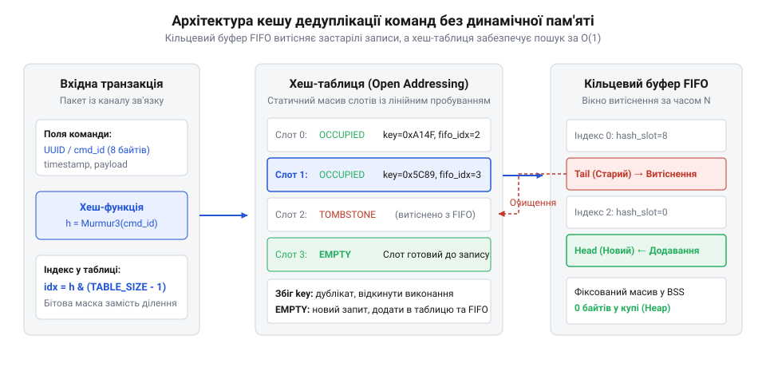

# Дедуплікація команд у прошивці: кеш транзакцій без динамічної пам'яті

<preknowlist>
- [Реакція чи план: два шари рішення](root:sf-devices/reaktsiia-chy-plan) — різниця між швидкою реакцією та плановою обробкою
- [Блокування й умови допуску (interlock)](root:sf-devices/blokuvannia-i-umovy-dopusku-interlock) — захист від некоректного виконання команд
</preknowlist>

## Завади зв'язку та ризик повторів

Фізичні канали передачі даних у промислових середовищах зазнають постійного впливу електромагнітних завад, стрибків напруги та перехресних наводок. Апаратні трансивери шин @@en|UART@@ (з англ. *universal asynchronous receiver-transmitter* — універсальний асинхронний приймач-передавач) чи польових інтерфейсів використовують контроль цілісності кадру через @@en|CRC32@@ (з англ. *cyclic redundancy check* — циклічний надлишковий код) і протокольні підтвердження @@en|ACK@@ (з англ. *acknowledgement* — підтвердження). При втраті або спотворенні підтвердження відправник автоматично надсилає пакет повторно, через що мікроконтролер фізично приймає одну й ту саму команду кілька разів поспіль.

Якщо прошивка обробляє кожне вхідне повідомлення без збереження історії, виникає небезпека повторного виконання неідемпотентних команд. Подвійне спрацьовування наказу повернути кроковий двигун на певний кут чи відкрити клапан призводить до механічного пошкодження приводу або аварійного стану обладнання. Щоб запобігти цьому, інженери поєднують реактивне [рантайм-екранування безпеки](root:sf-devices/safety-shielding-cage-architecture) із суворими [блокуваннями й умовами допуску](root:sf-devices/blokuvannia-i-umovy-dopusku-interlock), розділяючи поведінку на [два шари рішення](root:sf-devices/reaktsiia-chy-plan).

Стандарти функціональної безпеки категорично забороняють використання динамічної пам'яті в критичних вбудованих пристроях. Виклики стандартних алокаторів руйнують детермінізм найгіршого часу виконання @@en|WCET@@ (з англ. *worst-case execution time* — найгірший час виконання) у системі @@en|RTOS@@ (з англ. *real-time operating system* — операційна система реального часу), створюють небезпеку фрагментації пам'яті @@en|RAM@@ (з англ. *random-access memory* — пам'ять із довільним доступом) та загрожують фатальними помилками при вичерпанні купи. Тому механізм дедуплікації має розміщуватися виключно у статичній пам'яті та працювати за детермінований час O(1).

## Статичний кеш транзакцій та ідемпотентність

Основою захисту від дублювання є властивість ідемпотентності — @@en|idempotency@@ (від лат. *idem* — той самий та *potens* — здатний), коли повторний виклик операції повертає той самий результат без повторного фізичного впливу на актуатори. Кожна команда отримує унікальний маркер транзакції — @@en|TxID@@ (з англ. *transaction identifier* — ідентифікатор транзакції), сформований з адреси відправника та лічильника або апаратно обчисленого хешу вмісту пакета.

Для збереження історії у статичній пам'яті застосовують комбінацію двох структур: кільцевого буфера — @@en|ring buffer@@ (з англ. *ring buffer* — кільцевий буфер) та відкритої хеш-таблиці — @@en|open addressing@@ (з англ. *open addressing* — відкрита адресація). Кільцевий буфер за принципом @@en|FIFO@@ (з англ. *first-in, first-out* — перший прийшов, перший вийшов) зберігає хронологічний порядок записів для автоматичного витіснення за застарілістю @@en|LRU@@ (з англ. *least recently used* — найдавніше використаний). Водночас відкрита хеш-таблиця забезпечує миттєвий пошук ідентифікатора за час O(1).

*Архітектура кешу транзакцій у статичній пам'яті: кільцевий буфер FIFO керує витісненням за часом, а відкрита хеш-таблиця забезпечує детермінований O(1) пошук дублікатів.*

Коли пакет надходить через прямий доступ до пам'яті @@en|DMA@@ (з англ. *direct memory access* — прямий доступ до пам'яті), алгоритм обчислює індекс бакета та виконує пошук методом лінійного зондування — @@en|linear probing@@ (з англ. *linear probing* — лінійне зондування). Якщо запис із таким @@en|TxID@@ знайдено у стані завершеного виконання, прошивка миттєво відправляє збережену відповідь без повторної активації приводів, а в разі попередньої аварії ініціює [компенсацію фізичних збоїв](root:sf-devices/hardware-compensating-transactions-rollback). Якщо ж транзакція прямо зараз виконується іншим потоком, повторний запит тимчасово блокується, усуваючи гонитву даних. Коли надходить новий наказ, він займає чергову позицію в кільцевому буфері, витісняє застарілий запис при переповненні та переходить до обробки.