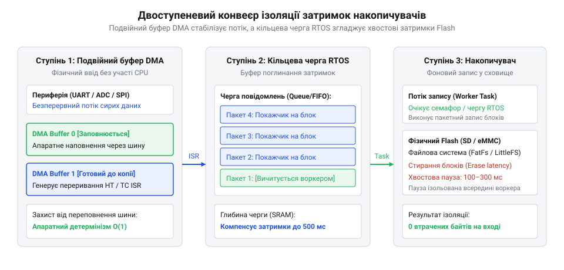
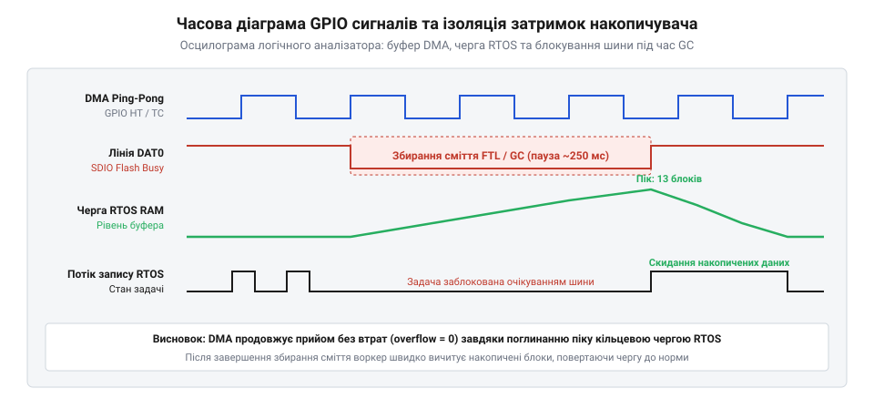

# Архітектура двобуферних кільцевих черг RTOS для ізоляції затримок накопичувачів

## Початкові концепції та физичні принципи

У високопродуктивних вбудованих системах захоплення даних реального часу — таких як цифрова обробка сигналів тензодатчиків, спектральний аналіз звуку або реєстрація польотної телеметрії — ключовою вимогою є суворий детермінізм часових інтервалів. Якщо периферійний аналого-цифровий перетворювач або швидкісний шинний інтерфейс зчитує вибірки з частотою 50 кГц, кожен новий відлік має бути зчитаний та збережений рівно через 20 мікросекунд. Проте при спробі зберегти цей безперервний потік даних безпосередньо у фізичний @@en|накопичувач флеш-пам'яті@@ (англ. @@en|flash memory@@, від англ. @@en|flash@@ — спалах, через миттєве стирання блоків) розробник стикається з фізичним бар'єром: час виконання операцій запису у твердотілі носії за своєю природою є недетермінованим.

Фізика напівпровідникових структур @@en|NAND@@ та @@en|NOR@@ флеш-пам'яті, а також зовнішніх карт пам'яті, таких як @@en|SD-карта@@ (англ. @@en|Secure Digital@@) або вбудована пам'ять @@en|eMMC@@ (англ. @@en|embedded MultiMediaCard@@), вимагає обов'язкового попереднього стирання комірок перед записом нових даних. На відміну від оперативної пам'яті, де перезапис окремого байта виконується за один такт шини, флеш-пам'ять оперує сторінками (англ. @@en|pages@@) розміром від 512 байт до 4 кілобайт для запису та блоками стирання (англ. @@en|erase blocks@@) розміром від 64 кілобайт до 512 кілобайт. Стандартна операція програмування однієї сторінки триває від 200 мікросекунд до 2 мілісекунд. Проте внутрішній транслятор підрівня флеш-пам'яті (англ. @@en|Flash Translation Layer@@, @@en|FTL@@) періодично виконує фонові процедури обслуговування: @@en|вирівнювання зносу@@ (англ. @@en|wear leveling@@, від англ. @@en|wear@@ — знос, перерозподіл циклів перезапису між фізичними блоками) та @@en|збирання сміття@@ (англ. @@en|garbage collection@@, перенесення збережених сторінок у нові блоки з наступним стиранням старих блоків). Під час виконання таких процедур внутрішній контролер накопичувача виставляє сигнал зайнятості шини (наприклад, утримує низький рівень лінії `DAT0` на інтерфейсі SD/SDIO), призупиняючи будь-які зовнішні операції зчитування та запису на час від 50 до 500 мілісекунд.

Крім того, на тривалість затримок суттєво впливає коефіцієнт підсилення запису (англ. @@en|Write Amplification Factor@@, @@en|WAF@@). Якщо потік даних зчитується нерівномірно або файлова система виконує оновлення таблиць атрибутів (наприклад, файлової алокації FAT), контролер накопичувача змушений постійно зчитувати, модифікувати та стирати цілі фізичні блоки заради запису кількох байтів метаданих. Це викликає додаткові непередбачувані паузи шини.

Якщо задача вищого пріоритету в @@en|операційній системі реального часу@@ (англ. @@en|Real-Time Operating System@@, @@en|RTOS@@) спробує виконати безпосередній синхронний запис у файл під час такої затримки, її виконання буде негайно заблоковано. У результаті виникає катастрофічне порушення часового детермінізму: @@en|затримка@@ (англ. @@en|latency@@, від латинського @@en|latens@@ — прихований) виконання задачі зростає на кілька порядків, виникає часовий @@en|джиттер@@ (англ. @@en|jitter@@, від англ. @@en|jitter@@ — тремтіння, флуктуація періоду обробки), а апаратні регістри периферії переповнюються. Для уникнення втрати даних апаратне забезпечення мікроконтролера повинне зчитувати вибірки незалежно від центрального процесора, використовуючи модуль @@en|безпосереднього доступу до пам'яті@@ (англ. @@en|Direct Memory Access@@, @@en|DMA@@).

Апаратний контролер @@en|DMA@@ здатний транспортувати дані з шинного інтерфейсу безпосередньо в оперативну пам'ять @@en|SRAM@@ (англ. @@en|Static Random-Access Memory@@) без залучення ядра мікроконтролера. Однак проста схема з однобуферним @@en|DMA@@ швидко виявляє свої обмеження. Коли єдиний буфер заповнюється, контролер @@en|DMA@@ генерує переривання, вимагаючи від центрального процесора негайно зупинити приймання, обробити або скопіювати накопичений масив даних та перезапустити канал. Якщо ядро процесора заблоковано записом у флеш-пам'ять або перебуває у тривалій критичній секції, процес перезапуску @@en|DMA@@ запізнюється, що призводить до апаратного переповнення (англ. @@en|overrun error@@) та незворотного викривлення вхідного сигналу.

Розв'язанням цієї апаратної проблеми є схема @@en|подвійного буферування@@ (англ. @@en|double buffering@@) із використанням @@en|ping-pong буфера@@ (англ. @@en|ping-pong buffer@@, названого за аналогією з настільним тенісом через почергове переключення двох рівних накопичувачів). У цій архітектурі апаратний канал @@en|DMA@@ налаштовується у кільцевий режим роботи поверх єдиного суцільного масиву в оперативній пам'яті, який логічно розділено на дві рівні половини: буфер A (`Buffer_A`) та буфер B (`Buffer_B`). 

Сучасні мікроконтролери (зокрема серії @@en|ARM Cortex-M@@) мають двоадресні регістри призначення в модулі @@en|DMA@@ (`M0AR` та `M1AR`). Коли периферійний пристрій заповнює буфер A, контролер @@en|DMA@@ автоматично генерує апаратне переривання половинного перенесення (англ. @@en|Half-Transfer Interrupt@@, `HT`) і без жодної паузи чи затримки на рівні тактів переключає апаратний покажчик запису на буфер B. Поки апаратний модуль заповнює буфер B, процесор отримує часове вікно для безпечного зчитування вмісту буфера A. Після заповнення буфера B генерується переривання повного перенесення (англ. @@en|Transfer-Complete Interrupt@@, `TC`), і контролер @@en|DMA@@ знову безпаузно переключається на буфер A.

Проте самого лише апаратного @@en|ping-pong буфера@@ недостатньо для повної ізоляції затримок накопичувача. Розглянемо конкретний часовий розрахунок. Якщо швидкість вхідного потоку даних становить `V_in = 100` кБ/с, а розмір кожної половини апаратного буфера дорівнює 1 кілобайту, час заповнення одного півбуфера `T_hb` обчислюється як:

```
T_hb = B_half / V_in
= 1024 / 102400
= 0.010 с (10 мілісекунд)
```

Якщо фізичний накопичувач у цей момент входить у фазу збирання сміття із затримкою `T_stall = 200` мс, то вже через 20 мілісекунд обидві половини апаратного буфера будуть повністю заповнені. На 21-й мілісекунді контролер @@en|DMA@@ почне перезаписувати ще не збережені дані в буфері A, спричиняючи апаратне переповнення та незворотну втрату вибірок.

Для подолання цього часового дисбалансу застосовують багаторівневий архітектурний синтез, що поєднує апаратний @@en|ping-pong буфер@@, [відкладену обробку переривань](root:sf-devices/interrupt-bottom-half-mechanisms) та об'ємний оперативний @@en|кільцевий буфер@@ (англ. @@en|ring buffer@@) у системній пам'яті під управлінням @@en|RTOS@@. У такій системі функції строго розділені за рівнями відповідальності:

1. Перший рівень (апаратний): Модуль @@en|DMA@@ працює у режимі подвійного буферування з жорстким часовим детермінізмом, гарантуючи приймання байтів без втрат протягом часу заповнення половини буфера `T_hb`. 2. Другий рівень (контекст переривання): @@en|Обробник переривань@@ (англ. @@en|Interrupt Service Routine@@, @@en|ISR@@) не виконує тривалих операцій з накопичувачем. Він лише передає вказівник на заповнену половину буфера у глибинну чергу пам'яті через швидкі [атомарні операції буфера](root:sf-devices/lock-free-ring-buffer-spsc) і сигналізує задачі зберігання. 3. Третій рівень (контекст задачі): В @@en|RTOS@@ створюється [окремий потік-виконавець](root:sf-devices/dedicated-worker-threads-rtos) із низьким або середнім пріоритетом. Цей потік зчитує накопичені блоки з великого кільцевого буфера оперативної пам'яті та записує їх у фізичний накопичувач оптимальними блоками, вирівняними під сектори файлової системи.

Математична умова гарантії відсутності втрат даних під час сплесків затримок накопичувача виражається через баланс об'єму накопичувальної кільцевої черги в оперативній пам'яті @@en|RAM@@. Нехай вхідна швидкість надходження даних становить `V_in` байт на секунду, середня швидкість запису на накопичувач — `V_out` байт на секунду (причому обов'язково `V_out > V_in` на тривалих інтервалах спостереження), максимальна тривалість паузи накопичувача — `T_stall` секунд, а розмір одного блоку черги — `B_size` байт.

Необхідна кількість блоків `N_blocks` у кільцевій черзі @@en|RTOS@@ для безвтратного поглинання затримки обчислюється за формулою:

```
N_blocks = ceil((V_in × T_stall) / B_size)
```

Звідси випливає значення максимально допустимої паузи накопичувача `T_max_stall`, яку здатна компенсувати сформована архітектура:

```
T_max_stall = (N_blocks × B_size) / V_in
```

Розглянемо практичний інженерний приклад: при високочастотному зборі телеметрії з вхідним потоком `V_in = 200` кБ/с (204800 байт/с), розмірі блоку `B_size = 4096` байт та очікуваній максимальній затримці стирання флеш-блоку `T_stall = 250` мс (0.25 с), обчислення кількості блоків дає:

```
N_blocks = ceil((204800 × 0.25) / 4096)
= ceil(51200 / 4096)
= 13 блоків
```

Оскільки ємність кільцевого буфера зазвичай обирається як найближчий степінь двійки, приймаємо `N_blocks = 16`. Розрахунковий об'єм оперативної пам'яті для кільцевої черги становить `16 × 4096 = 65536` байт (64 кілобайти). За такої конфігурації фактичний часовий запас ізоляції затримок дорівнює:

```
T_max_stall = (16 × 4096) / 204800
= 65536 / 204800
= 0.320 с (320 мілісекунд)
```

Завдяки такій двоступеневій ізоляції високоефективне приймання даних залишається повністю детермінованим. Короткочасні сплески затримок флеш-пам'яті до 320 мілісекунд повністю амортизуються за рахунок тимчасового зростання рівня заповнення кільцевої черги в @@en|RAM@@, не створюючи жодного зворотного впливу на апаратне захоплення сигналів та жорсткі часові рамки роботи мікроконтролера.

---

## Внутрішня будова та алгоритми роботи

Для практичної реалізації детермінованої ізоляції затримок накопичувача використовується двоступенева конвеєрна структура даних, що поєднує апаратні регістри мікроконтролера, оперативну пам'ять та механізми планувальника @@en|RTOS@@.


*Підпис: Двоступенева конвеєрна схема передачі даних від периферійного пристрою через подвійний буфер DMA та кільцеву чергу RTOS до фізичного накопичувача.*

Передавання даних у цій архітектурі відбувається за чітким конвеєрним алгоритмом:

1. Апаратна периферія (наприклад, @@en|ADC@@ або @@en|SPI@@) після завершення кожного вимірювання завантажує значення у свій вихідний регістр і генерує сигнал запиту @@en|DMA@@. 2. Контролер @@en|DMA@@ без залучення ядра процесора копіює дані у поточну активну половину апаратного подвійного буфера (`Buffer_A` або `Buffer_B`). 3. При досягненні межі півбуфера контролер @@en|DMA@@ генерує переривання (`HT` або `TC`) і миттєво переключає апаратне призначення на другу половину буфера. 4. В @@en|ISR@@ обробник виконує [відкладену обробку переривань](root:sf-devices/interrupt-bottom-half-mechanisms): замість байтового копіювання даних застосовується концепція @@en|нульового копіювання@@ (англ. @@en|zero-copy@@, передача адреси масиву замість пересилання його вмісту). @@en|ISR@@ отримує вказівник на заповнений блок і поміщає цей дескриптор у кільцеву чергу блоків в оперативній пам'яті. 5. @@en|ISR@@ надсилає сигнал розблокування задачі зберігання через сервіси @@en|RTOS@@ (наприклад, пряме сповіщення задачі `vTaskNotifyGiveFromISR`). 6. Планувальник @@en|RTOS@@, використовуючи [витісняльну багатозадачність](root:sf-devices/cooperative-vs-preemptive-multitasking), активує задачу зберігання, коли CPU вивільняється від задач із вищим пріоритетом. 7. Задача зберігання витягує накопичені дескриптори блоків із кільцевої черги та виконує виклики файлової системи, забезпечуючи [вирівнювання кластерів](root:sf-data/fatfs-cluster-alignment) під фізичний розмір секторів носійного накопичувача.

Серцем програмної частини цього модуля є @@en|кільцевий буфер@@ дескрипторів блоків, організований за принципом @@en|один виробник один споживач@@ (англ. @@en|Single-Producer Single-Consumer@@, @@en|SPSC@@). Щоб забезпечити максимальну швидкість роботи в контексті переривання, ця структура даних реалізується як @@en|безблокувальна@@ (англ. @@en|lock-free@@, відсутність затримувальних м'ютексів та критичних секцій під час додавання елементів).

Буфер складається з фіксованого масиву дескрипторів або покажчиків на блоки пам'яті ємністю `C`, де ємність обов'язково обирається як степінь двійки: `C = 2^k` (наприклад, 16, 32 або 64 блоки). Використання степеня двійки дозволяє замінити затратну операцію ділення за модулем `%` під час закольцьовування вказівників на надшвидку побітову операцію @@en|AND@@ з маскою `(C - 1)`.

Керування кільцевим буфером здійснюється двома беззнаковими індексами: індексом запису `head_idx` та індексом зчитування `tail_idx`. Модифікацію індексу `head_idx` виконує виключно виробник (обробник переривання @@en|DMA@@), а індекс `tail_idx` модифікує виключно споживач (потік зберігання даних).

Для обчислення поточного апаратного індексу в масиві використовуються вирази:

```
write_pos = head_idx & (CAPACITY - 1)
```

```
read_pos = tail_idx & (CAPACITY - 1)
```

Кількість доступних для зчитування блоків визначається різницею індексів:

```
available_items = head_idx - tail_idx
```

Завдяки властивостям додаткового коду беззнакових цілих чисел в обчислювальних ядрах (наприклад, @@en|ARM Cortex-M@@), віднімання `head_idx - tail_idx` дає математично точний результат навіть у момент переповнення та закольцьовування лічильників. Наприклад, якщо `head_idx` досягає значення `0x00000002` після переповнення 32-бітного регістра, а `tail_idx` дорівнює `0xFFFFFFFE`, різниця `head_idx - tail_idx` у беззнаковій арифметиці повертає точне значення `4`, що відповідає реальній кількості елементів у черзі.

Для гарантії коректності в архітектурах із можливими змінами порядку виконання інструкцій або наявністю кеш-пам'яті використовуються бар'єри пам'яті. Перед оновленням значення `head_idx` у контексті переривання виконується атомарна інструкція бар'єра даних (англ. @@en|Data Memory Barrier@@, `__dmb()`), яка гарантує, що всі записи вмісту блоку в оперативну пам'ять завершені до того, як споживач побачить новий індекс `head_idx`.

Взаємодія кільцевої черги з операційною системою регулюється через [контрольний блок задачі](root:sf-devices/task-control-block-structure) та [автомат станів задачі](root:sf-devices/task-states). Пріоритет задачі зберігання налаштовується нижче за задачі первинного збору вибірок та критичні цифрові фільтри, але вище за фоновий потік обслуговування інтерфейсу користувача. Коли кільцева черга порожня (`head_idx == tail_idx`), задача зберігання переходить у стан блокування (англ. @@en|Blocked state@@), вивільняючи ресурси процесора для виконання фонових обчислень або переходу системи у режим низького енергоспоживання.

Під час надходження нового блоку @@en|ISR@@ викликає сповіщення задачі (наприклад, `vTaskNotifyGiveFromISR`). Завдяки механізмам @@en|RTOS@@ це сповіщення виконується без застосування важких м'ютексів, забезпечуючи [уникнення інверсії пріоритетів](root:sf-devices/priority-inversion-and-inheritance) та мінімізуючи накладні витрати на [перемикання контексту задач](root:sf-devices/rtos-context-switch-mechanics).

В алгоритмі функціонування модуля передбачено опрацювання двох граничних станів:

1. Граничний стан «Порожня черга»: Виникає, коли накопичувач працює швидко і задача зберігання повністю вичитала всі доступні блоки. Споживач перевіряє умову `head_idx == tail_idx`, атомарно засинає та очікує наступного переривання @@en|DMA@@. 2. Граничний стан «Переповнення черги» (англ. @@en|Queue Overflow@@): Виникає, коли тривалість затримки накопичувача `T_stall` перевищує розраховане граничне значення `T_max_stall`, і кількість заповнених блоків досягає ємності буфера: `(head_idx - tail_idx) == CAPACITY`.

У разі переповнення черги реалізується одна з двох системних стратегій:
- Стратегія відкидання нових даних (англ. @@en|drop new@@): Нові блоки від @@en|DMA@@ ігноруються, лічильник втрачених кадрів інкрементується. Ця стратегія є пріоритетною для систем вимірювання, де цілісність уже збереженої історичної хронології важливіша за свіжі вибірки. - Стратегія кільцевого перезапису (англ. @@en|overwrite old@@): Новий блок перезаписує найстаріший елемент, а індекс `tail_idx` примусово зсувається вперед.

Критичним фактором продуктивності на мікроконтролерах із високою тактовою частотою (наприклад, @@en|ARM Cortex-M7@@) є @@en|вирівнювання пам'яті@@ (англ. @@en|memory alignment@@) та взаємодія з кешем. Буфери даних @@en|DMA@@ повинні вирівнюватися за межею рядка кешу (наприклад, `alignas(32)` для 32-байтових рядків D-Cache). Для спрощення синхронізації область оперативної пам'яті під буфери @@en|DMA@@ може конфігуруватися через модуль захисту пам'яті (англ. @@en|Memory Protection Unit@@, @@en|MPU@@) як область без кешування (англ. @@en|Non-Cacheable@@) або з прямим записом (англ. @@en|Write-Through@@). Якщо ж кешування увімкнено, перед передачею блоку накопичувачу програма зобов'язана інвалідувати або очистити кеш-пам'ять (англ. @@en|clean and invalidate D-Cache@@, за допомогою системних викликів `SCB_CleanDCache_by_Addr` та `SCB_InvalidateDCache_by_Addr`), щоб запобігти неузгодженості між даними в @@en|RAM@@ та даними у @@en|кеш-пам'яті@@ ядра.

Крім того, для запобігання @@en|конфлікту системних шин@@ (англ. @@en|bus contention@@, арбітражу затримки між модулем @@en|DMA@@ та процесорним ядром на внутрішній шині @@en|AHB@@/@@en|AXI@@) буфери @@en|DMA@@ розміщують у спеціалізованих блоках оперативної пам'яті (наприклад, `SRAM1`), тоді як стек задачі зберігання та [переповнення стека задачі](root:sf-devices/task-stack-overflow-detection) контролюються у незалежному блоці пам'яті (наприклад, `DTCM` або `SRAM2`).

Використовуючи короткі [критичні секції RTOS](root:sf-devices/critical-sections-in-rtos) лише для зчитування атомарних індексів, система досягає максимального ступеня паралелізму, гарантуючи повний детермінізм приймання даних навіть у моменти найтриваліших пауз фізичного накопичувача.

## Апаратна реалізація та низькорівневий C/C++ код

У практичній реалізації на рівні мікроконтролера перехід від абстрактної математичної схеми до надійної прошивки вимагає узгодження конфігурації периферії, каналів прямого доступу до пам'яті та планувальника операційної системи. Якщо ядро процесора залучається до побайтового копіювання вибірок, система втрачає обчислювальний ресурс і стає вразливою до апаратного переповнення (англ. @@en|overrun@@, від англ. @@en|run over@@ — вихід за межі ємності регістра) під час виконання високорівневих задач. Тому первинний збір даних покладається виключно на контролер @@en|DMA@@, який налаштовується у безперервний кільцевий або подвійний буферний режим роботи (англ. @@en|double-buffer mode@@).

В архітектурі мікроконтролерів @@en|ARM Cortex-M@@ апаратний канал @@en|DMA@@ зв'язує вихідний регістр даних периферійного модуля (наприклад, перетворювача @@en|ADC@@ або швидкісного послідовного інтерфейсу @@en|SPI@@) з областю оперативної пам'яті @@en|SRAM@@. У режимі подвійного буферування задіюються два адресні регістри пам'яті: `M0AR` (Memory 0 Address Register) та `M1AR` (Memory 1 Address Register), а також лічильник кількості передач `NDTR` (Number of Data to Transfer). Коли канал активовано, модуль @@en|DMA@@ автоматично записує транзакції в буфер за адресою `M0AR`. У момент завершення заповнення першого буфера апаратний автомат перемикає внутрішній покажчик на адресу `M1AR` за нуль тактів процесора, одночасно виставляючи прапорець переривання половинного або повного перенесення. Завдяки цьому жоден байт вхідного потоку не губиться, навіть якщо центральний процесор у цей момент зайнятий перемиканням контексту або обслуговуванням іншого переривання.

Однак на високопродуктивних мікроконтролерах із гарвардською архітектурою (зокрема серії @@en|Cortex-M7@@) прямий доступ @@en|DMA@@ до пам'яті створює критичну проблему узгодженості кешу (англ. @@en|cache coherency@@, від лат. @@en|cohaerere@@ — зв'язок, узгодженість даних між кешем та основною пам'яттю). Процесорне ядро працює через дворівневий кеш інструкцій та кеш даних (англ. @@en|D-Cache@@), тоді як контролер @@en|DMA@@ здійснює транзакції безпосередньо в фізичну пам'ять через матрицю системних шин, оминаючи кеш ядра. Якщо процесор зчитує масив даних, рядки якого вже завантажені в @@en|D-Cache@@, він отримає застарілі значення замість свіжих вибірок, щойно записаних контролером @@en|DMA@@. Навпаки, якщо ядро записує щось у сусідні змінні, «брудні» рядки кешу (англ. @@en|dirty cache lines@@) при витісненні у пам'ять можуть безповоротно затерти щойно збережені апаратні вибірки.

Для усунення цієї аномалії застосовують один із двох апаратних підходів:
1. Конфігурація модуля захисту пам'яті (англ. @@en|Memory Protection Unit@@, @@en|MPU@@, від лат. @@en|protectio@@ — прикриття, захист): виділена область оперативної пам'яті під буфери @@en|DMA@@ оголошується як некешована (англ. @@en|Normal Non-Cacheable@@) або з прямим наскрізним записом (англ. @@en|Write-Through@@). Це гарантує, що будь-який запис або зчитування виконується безпосередньо в комірки @@en|SRAM@@ без кешування в @@en|D-Cache@@. 2. Програмне обслуговування кешу (англ. @@en|cache maintenance@@): пам'ять залишається кешованою, але перед зчитуванням заповненого буфера виконується інвалідація кешу за його адресою (`SCB_InvalidateDCache_by_Addr`), а перед передачею даних на запис у накопичувач — очищення кешу (`SCB_CleanDCache_by_Addr`).

При цьому обов'язковою інженерною вимогою є вирівнювання буферів даних за розміром рядка кешу (англ. @@en|cache line alignment@@, 32 байти для ядер Cortex-M7) за допомогою специфікатора `alignas(32)` або атрибута `__attribute__((aligned(32)))`. Розмір кожного півбуфера також повинен бути строго кратним 32 байтам, щоб операція інвалідації не пошкодила сусідні системні змінні.

Наступним критичним елементом є впорядкування операцій доступу до пам'яті. Суперскалярні процесори та оптимізуючі компілятори можуть змінювати порядок виконання інструкцій або затримувати оновлення регістрів у конвеєрі. Для запобігання ситуації, коли індекс готовності нового блоку оновлюється раніше, ніж завершиться фізичний запис даних у пам'ять, застосовується апаратний бар'єр пам'яті даних (англ. @@en|Data Memory Barrier@@, @@en|DMB@@, від лат. @@en|barrier@@ — перепона, апаратний бар'єр пам'яті для впорядкування операцій запису). Інструкція `__DMB()` примушує ядро завершити всі попередні операції запису в пам'ять до виконання наступних інструкцій збереження індексу. Якщо ж потрібна повна синхронізація шинних транзакцій та зупинка конвеєра до завершення операцій шини, застосовується бар'єр синхронізації даних (англ. @@en|Data Synchronization Barrier@@, @@en|DSB@@).

Зв'язок між апаратним перериванням @@en|DMA@@ та задачею зберігання реалізується за принципом нульового копіювання через безблокувальну кільцеву чергу дескрипторів блоків. Замість важкого пересилання тисяч байтів обробник переривання (англ. @@en|Interrupt Service Routine@@, @@en|ISR@@) записує у кільцеву чергу лише легкий дескриптор: вказівник на початок заповненого півбуфера, його довжину, часову мітку та порядковий номер вибірки. У черзі застосовуються швидкі [атомарні операції для SPSC](root:sf-devices/lock-free-ring-buffer-spsc) буферів без залучення важких блокуючих м'ютексів.

Після додавання дескриптора у чергу обробник виконує [механізми відкладеної обробки](root:sf-devices/interrupt-bottom-half-mechanisms) переривань: він не викликає файлову систему всередині @@en|ISR@@, а лише надсилає пряме сповіщення задачі (англ. @@en|Direct Task Notification@@ у середовищі @@en|FreeRTOS@@ через виклик `vTaskNotifyGiveFromISR`). Цей механізм має найменші накладні витрати пам'яті та мінімізує [перемикання контексту в мікроконтролерах](root:sf-devices/rtos-context-switch-mechanics), оскільки не вимагає виділення окремої черги повідомлень операційної системи.

На стороні споживача створюється [окремий потік-виконавець](root:sf-devices/dedicated-worker-threads-rtos) збереження даних з низьким або середнім пріоритетом. Задача перебуває у заблокованому стані на системному виклику `ulTaskNotifyTake(pdTRUE, portMAX_DELAY)`. Щойно надходить сигнал від @@en|ISR@@, потік активується, перевіряє кількість накопичених блоків за формулою `head - tail` і пакетно вичитує їх для запису у фізичний накопичувач (наприклад, через інтерфейс @@en|SDMMC@@ або бібліотеку @@en|FatFs@@). Якщо в системі діє [подієво-орієнтована архітектура прошивок](root:sf-devices/event-driven-firmware), сповіщення може транслюватися через диспетчер подій, проте пряме сповіщення забезпечує максимальний часовий детермінізм. Для узгодження лічильників між потоками вхідні [критичні секції в RTOS](root:sf-devices/critical-sections-in-rtos) використовуються лише для атомарного зчитування глобальних індексів, а основна передача дескрипторів відбувається повністю без блокувань.

Нижче наведено практичну реалізацію модуля двобуферної кільцевої черги на мовах C та C++ для вбудованих систем на базі ядер Cortex-M та @@en|RTOS@@ @@en|FreeRTOS@@. Код підтримує вирівнювання пам'яті під кеш-лінії, вбудовані апаратні бар'єри @@en|DMB@@, нульове копіювання дескрипторів та прямі сповіщення задач.

:::tabs
@c
:::code root\eng\sf-devices\embedded-rtos-ring-buffer-dma-storage-decoupling/embedded-rtos-ring-buffer-dma-storage-decoupling-d/c/cortex-m/ring-queue-init.c c
@cpp
:::code root\eng\sf-devices\embedded-rtos-ring-buffer-dma-storage-decoupling/embedded-rtos-ring-buffer-dma-storage-decoupling-d/cpp/cortex-m/spscblockqueue.cpp cpp
:::

## Практичне застосування та відлагодження

Практична інтеграція двобуферних кільцевих черг у серійні пристрої вимагає глибокого розуміння прихованих апаратних взаємодій між процесорним ядром, шинною матрицею, контролерами накопичувачів та фізичною флеш-пам'яттю. Навіть ідеально розрахована математична черга вийде з ладу, якщо не враховано крайні режими роботи напівпровідникових носіїв, конкуренцію на внутрішніх шинах мікроконтролера та накладні витрати файлових бібліотек.

Головним граничним випадком є перевищення розрахункової затримки накопичувача: коли тривалість блокування шини накопичувачем `T_stall` перевищує розрахований часовий запас ізоляції `T_max_stall`. У цей момент кільцева черга дескрипторів заповнюється повністю: різниця між індексами виробника та споживача досягає граничного значення `(head - tail) == CAPACITY`. Якщо переривання @@en|DMA@@ надходить, коли вільних слотів у черзі немає, архітектура прошивки зобов'язана виконати одну з трьох визначених системних стратегій запобігання невизначеному стану:

1. Стратегія відкидання свіжих даних (англ. @@en|drop-new strategy@@): обробник переривання виявляє відсутність вільних дескрипторів, інкрементує лічильник втрачених кадрів `dropped_count` і не змінює індекс `head`. Поточний апаратний буфер відкидається. Цей підхід є єдино припустимим у вимірювальних приладах та системах цифрової обробки сигналів, де розрив фази або спотворення історичної послідовності вибірок робить весь наступний масив даних непридатним для аналізу. 2. Стратегія витіснення застарілих даних (англ. @@en|overwrite-old strategy@@): виробник примусово інкрементує індекс споживача `tail`, звільняючи найстаріший слот для запису найновішого дескриптора. Такий підхід є стандартом для бортових аварійних реєстраторів (англ. @@en|black-box flight recorders@@) та систем моніторингу відмов автомобільної електроніки, де критично зберегти саме останні мілісекунди телеметрії безпосередньо перед аварійним знеструмленням. 3. Апаратне зворотне гальмування (англ. @@en|hardware backpressure@@): якщо джерело даних підтримує апаратне керування потоком (наприклад, лінії CTS/RTS у послідовних інтерфейсах або призупинення тактування таймера перетворювача @@en|ADC@@), обробник тимчасово деактивує тригер захоплення, запобігаючи генерації нових вибірок до вивільнення слотів у черзі.

Для постійного контролю стійкості черги в пам'яті ведеться відстеження пікового рівня заповнення — максимальної ватерлінії (англ. @@en|high watermark@@, від англ. @@en|watermark@@ — позначка рівня води на корпусі судна). Ватерлінія обчислюється як максимальне зафіксоване значення різниці індексів:

```
peak_watermark = max(peak_watermark, head - tail)
```

Якщо під час випробувань під екстремальним навантаженням ватерлінія наближається до ємності черги (наприклад, перевищує 80% від `CAPACITY`), це сигналізує про недостатній об'єм оперативної пам'яті для компенсації найгірших пауз накопичувача або про необхідність оптимізації драйвера носія.

Другим прихованим бар'єром детермінізму є конфлікт на шинній матриці мікроконтролера (англ. @@en|bus contention@@). Сучасні мікроконтролери використовують багатошаровий матричний перемикач шин (англ. @@en|crossbar switch@@), що з'єднує кількох майстрів шини (ядро процесора, контролер @@en|DMA1@@ захоплення вибірок, контролер @@en|DMA2@@ шини @@en|SDMMC@@) з різними банками оперативної пам'яті @@en|SRAM@@. Якщо буфер вхідного @@en|DMA@@, кільцева черга дескрипторів, стек задачі збереження та буфер запису на накопичувач розміщені в одному фізичному банку пам'яті, виникає жорстка конкуренція за доступ до пам'яті. Арбітр шини змушений чергувати такти доступу, через що швидкісний контролер @@en|DMA@@ не встигає вчасно вивантажити внутрішній апаратний FIFO, виникає апаратне переповнення периферії (англ. @@en|overrun@@), а процесорне ядро зависає на тактах очікування (англ. @@en|wait states@@).

Інженерним розв'язком цієї проблеми є фізична просторова сегментація пам'яті:
- Вхідні буфери @@en|ping-pong DMA@@ розміщують у виділеному банку `SRAM1`. - Кільцеву чергу дескрипторів та структури обміну розташовують у банку `SRAM2`. - Стек задачі збереження та системні змінні ядра розміщують у щільно зв'язаній пам'яті даних (англ. @@en|Data Tightly Coupled Memory@@, @@en|DTCM@@), яка підключена до процесорного ядра через виділену 64-бітну шину безпосереднього доступу з нульовими тактами затримки. - Пріоритети шинних потоків конфігуруються у регістрах арбітражу: канал @@en|DMA@@ захоплення датчиків отримує найвищий пріоритет (`VERY_HIGH`), тоді як потік вивантаження на накопичувач — середній або низький. Такий [арбітраж матриці шин](root:sf-devices/bus-matrix-microcontrollers) гарантує, що важкий запис у флеш-пам'ять жодним чином не сповільнює первинне захоплення вибірок.

Третім важливим аспектом оптимізації є взаємодія з драйвером флеш-носія (наприклад, через стек @@en|SDIO@@ / @@en|SDMMC@@ та бібліотеку @@en|FatFs@@). Контролери карт пам'яті оперують блоками розміром по 512 байт та сторінками розподілу (англ. @@en|Allocation Unit@@, AU) розміром від 4 до 16 мегабайт. Якщо потік зберігання записує дані невеликими некратними порціями (наприклад, скидає кожен окремий 512-байтовий блок окремою командою `CMD24`), внутрішній транслятор накопичувача змушений виконувати постійні цикли зчитування-модифікації-запису всієї сторінки флеш-пам'яті. Це різко збільшує коефіцієнт підсилення запису (англ. @@en|Write Amplification Factor@@, @@en|WAF@@) та провокує контролер накопичувача запускати фонове збирання сміття щохвилини, генеруючи тривалі півсекундні паузи. Застосовуючи пакетний запис кількох вирівняних блоків за одну команду багаторазового запису `CMD25`, задача зберігання знижує навантаження на накопичувач у рази.

Для відлагодження та валідації часових характеристик системи в реальних умовах застосовують апаратне профілювання через виводи цифрового вводу-виводу (GPIO profiling) разом із цифровим логічним аналізатором (англ. @@en|logic analyzer@@). На платі виділяють три діагностичні виводи:
- Вивід `TP_DMA_ISR`: підіймається у високий рівень на вході в обробник переривання @@en|DMA@@ та скидається при виході. Дозволяє виміряти точну тривалість виконання @@en|ISR@@ та періодичність заповнення буферів. - Вивід `TP_STORAGE_TASK`: активується під час виконання операції запису задачею збереження. За його станом безпосередньо фіксують тривалість затримок запису та моменти виникнення пауз накопичувача. - Вивід `TP_QUEUE_WARN`: формує імпульс у разі перевищення попереджувального порогу заповнення черги або фіксує високий рівень при втраті кадрів (`drop`).


*Часова діаграма сигналів GPIO логічного аналізатора, що демонструє заповнення кільцевої черги під час блокування шини накопичувачем.*

Для вимірювання затримок виконання з точністю до одного такту процесора використовують модуль апаратного моніторингу та трасування ядра (англ. @@en|Data Watchpoint and Trace@@, @@en|DWT@@). Вбудований 32-бітний регістр лічильника циклів ядра `CYCCNT` активується через керуючі регістри налагодження `CoreDebug->DEMCR |= CoreDebug_DEMCR_TRCENA_Msk` та `DWT->CTRL |= DWT_CTRL_CYCCNTENA_Msk`. Зчитуючи значення `DWT->CYCCNT` до та після системних викликів запису на диск, прошивка фіксує точний [лічильник циклів DWT](root:sf-devices/dwt-cycle-counter) для обчислення найгіршого часу виконання (англ. @@en|Worst-Case Execution Time@@, @@en|WCET@@) файлових операцій у реальному масштабі часу без накладних витрат на вивід у послідовний порт.

У складних багатопотокових середовищах стан черг відстежують за допомогою системного трасування @@en|RTOS@@ через інструменти @@en|SEGGER SystemView@@ або @@en|Percepio Tracealyzer@@. Перевіряючи [автомат станів задачі](root:sf-devices/task-states), інженер контролює, що задача зберігання переходить у стан очікування без паразитного активного опитування (англ. @@en|busy-waiting@@). При цьому інформація про стан потоку зберігається у [контрольному блоці задачі](root:sf-devices/task-control-block-structure) операційної системи, а [витісняльна багатозадачність](root:sf-devices/cooperative-vs-preemptive-multitasking) гарантує швидке переривання запису, якщо виникає необхідність виконання критичних обчислень.

Особливу увагу слід звертати на розмір стека задачі зберігання: виклики бібліотек файлових систем (таких як @@en|FatFs@@) використовують глибоку вкладеність функцій та локальні секторні буфери. Недостатній розмір стека призводить до тихого затирання пам'яті. Щоб цьому запобігти, у конфігурації @@en|FreeRTOS@@ обов'язково активують [виявлення переповнення стека](root:sf-devices/task-stack-overflow-detection) (макрос `configCHECK_FOR_STACK_OVERFLOW = 2`), що заповнює область пам'яті байтовим шаблоном і перевіряє цілісність канарок. Крім того, використання прямих сповіщень та легких семафорів виключає [інверсію пріоритетів у RTOS](root:sf-devices/priority-inversion-and-inheritance), а для некритичних статистичних операцій (наприклад, підрахунку середньої пропускної здатності) обробка може виноситися у [відкладене виконання на спільному](root:sf-devices/work-queue) системному потоці.

Комплексне поєднання апаратного подвійного буферування, сегментації шин, безблокувальних дескрипторних черг та інструментального профілювання перетворює ненадійний ланцюжок запису на передбачувану детерміновану систему, здатну безперервно зберігати високошвидкісні потоки даних без втрати жодного байта навіть під час найдовших пауз носіїв.