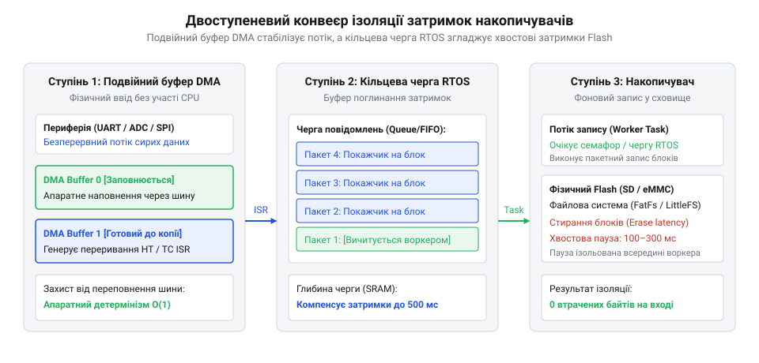

# Архітектура двобуферних кільцевих черг RTOS для ізоляції затримок накопичувачів

<preknowlist>
- [Окремі потоки-виконавці для ізольованих задач в RTOS](root:sf-devices/dedicated-worker-threads-rtos) — використання виділеного воркера для повільних операцій
- [Алгоритми та атомарні операції для SPSC lock-free буферів](root:sf-devices/lock-free-ring-buffer-spsc) — робота кільцевого буфера між джерелом та споживачем
</preknowlist>

## Затримки Flash та подвійний буфер DMA

У вбудованих системах захоплення високочастотних сигналів і телеметрії кожен відлік сенсора має фіксуватися у суворо визначений момент часу. Проте збереження потоку даних безпосередньо у твердотілу пам'ять — @@en|flash memory@@ (від англ. *flash* — спалах) — стикається з фізичною затримкою операцій запису. Перед збереженням нових байтів мікросхема мусить виконати високовольтне стирання цілого фізичного блоку. Внутрішній контролер трансляції — @@en|Flash Translation Layer@@, @@en|FTL@@ (з англ. *flash translation layer* — рівень трансляції флеш-пам'яті) — періодично запускає фонове вирівнювання зносу — @@en|wear leveling@@ (від англ. *wear* — знос та *leveling* — вирівнювання) та збирання сміття — @@en|garbage collection@@ (від англ. *garbage* — сміття та *collection* — збирання). Ці процедури утримують лінію зайнятості шини, блокуючи будь-які операції вводу-виводу на час від 50 до 500 мілісекунд.

Якщо задача операційної системи реального часу — @@en|Real-Time Operating System@@, @@en|RTOS@@ (від англ. *real-time operating system* — операційна система реального часу) — спробує виконати прямий запис у накопичувач під час паузи, вона миттєво втратить детермінізм, а періодичний процес отримає небезпечний джитер — @@en|jitter@@ (від англ. *jitter* — тремтіння). Щоб процесор не відволікався на зчитування кожного вхідного байта, залучають апаратний прямий доступ до пам'яті — @@en|Direct Memory Access@@, @@en|DMA@@ (від англ. *direct memory access* — прямий доступ до пам'яті). Контролер переносить дані з периферії безпосередньо в оперативну пам'ять — @@en|SRAM@@ (від англ. *static random-access memory* — статична пам'ять із довільним доступом).

Однак використання єдиного буфера DMA призводить до втрати вибірок: щойно буфер заповнюється, процесор мусить негайно зупинити приймання, скопіювати дані та перезапустити канал. Розв'язанням є схема подвійного буферування — @@en|double buffering@@ (від англ. *double* — подвійний та *buffering* — буферування) на базі перемикання половин масиву — @@en|ping-pong buffer@@ (від англ. *ping-pong* — пінг-понг та *buffer* — буфер). Контролер DMA заповнює одну половину буфера, викликає легке апаратне переривання половинного перенесення і безшовно перемикається на другу половину, надаючи процесору запас часу на обробку накопичених даних.

## Багаторівнева черга в RTOS для ізоляції затримок

Самого лише апаратного ping-pong буфера недостатньо для поглинання кількасотмілісекундної паузи накопичувача, оскільки його ємність в оперативній пам'яті обмежена. Для надійної ізоляції затримок формують трирівневий конвеєр обробки. Перший апаратний рівень DMA безперервно приймає сирі вибірки у подвійний буфер. Другий рівень реалізує [механізми відкладеної обробки переривань](root:sf-devices/interrupt-bottom-half-mechanisms): апаратний обробник передає покажчик на заповнену половину буфера вглиб системи через швидкі [атомарні операції для SPSC lock-free буферів](root:sf-devices/lock-free-ring-buffer-spsc).

*Архітектура трирівневої ізоляції потоку даних: апаратний ping-pong буфер DMA, переривання та кільцева черга в оперативній пам'яті під керуванням воркера RTOS.*

Третім рівнем є об'ємний кільцевий буфер — @@en|ring buffer@@ (від англ. *ring* — кільце та *buffer* — буфер) у системній пам'яті @@en|RAM@@ (від англ. *random-access memory* — пам'ять із довільним доступом). За вичитку блоків із черги та збереження їх у файлову систему відповідає [окремий потік-виконавець для ізольованих задач](root:sf-devices/dedicated-worker-threads-rtos) із низьким пріоритетом. Завдяки механізмам [витісняльної багатозадачності](root:sf-devices/cooperative-vs-preemptive-multitasking) планувальник у будь-який момент призупиняє фоновий потік запису на користь критичних вимірювальних задач. Об'єм кільцевої черги обирають так, щоб добуток вхідної швидкості на максимальний час блокування накопичувача повністю вміщувався в пам'яті, гарантуючи збереження неперервного потоку даних без втрати жодного відліку.