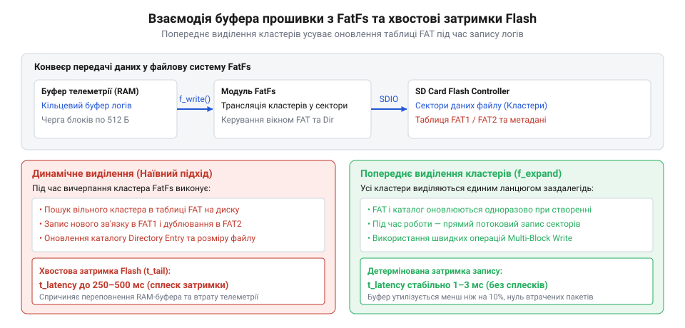
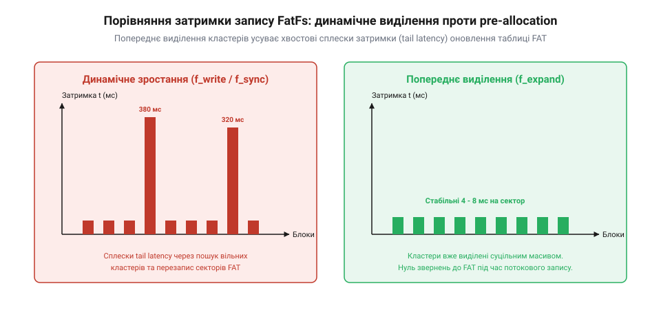
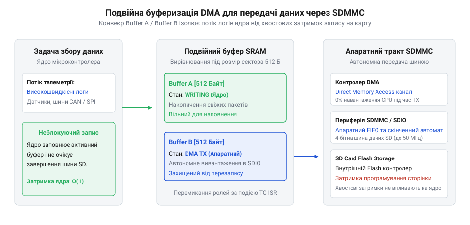
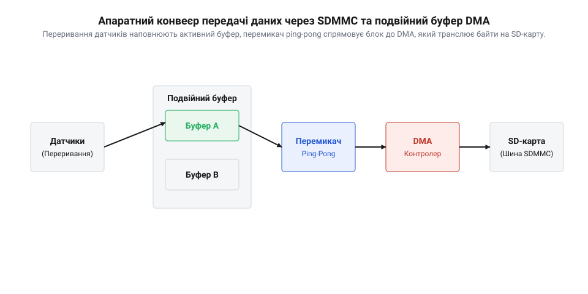

# Ротація бінарних логів на SD-карті: FatFs, попереднє виділення кластерів і хвостова затримка Flash

## Початкові концепції та фізичні принципи

Неперервна фіксація телеметричних даних у вбудованій системі висуває жорсткі вимоги до детермінізму операцій запису. Коли мікроконтролер реєструє параметри польоту дрона або зчитує високочастотні медичні датчики, будь-яка затримка під час збереження кадру даних на зовнішній носій загрожує втратою інформації та переповненням оперативної пам’яті. На практиці розробники часто стикаються з катастрофічним явищем: під час чергового виконання системного виклику запису файлу стандартна @@en|SD-карта@@ (від англ. @@en|Secure Digital card@@) раптово блокує шину даних не на передбачувані сотні мікросекунд, а на цілу секунду. У системі з [операційною системою FreeRTOS](root:sf-devices/freertos) це призводить до блокування задач реального часу, а в архітектурі [простого суперциклу Super-loop](root:sf-devices/super-loop) спричиняє повне замирання периферії та спрацювання сторожового таймера. Причина такої непередбачуваної поведінки лежить у глибокому конфлікті між фізичною природою твердотільної пам'яті та механізмами оновлення метаданих файлової системи.

Апаратний накопичувач @@en|SD-карта@@ є складною обчислювальною системою, всередині якої працює власний мікропроцесорний контролер (від англ. @@en|controller@@ — управитель, від латинського @@en|contra@@) та прошарок адаптації флеш-пам'яті (від англ. @@en|Flash Translation Layer@@, @@en|FTL@@). Фізична пам'ять @@en|NAND Flash@@ (від англ. @@en|NAND Flash memory@@) організована у вигляді сторінок розміром від 4 до 16 кілобайт і фізичних блоків стирання (від англ. @@en|erase block@@), які також називають одиницями виділення (від англ. @@en|Allocation Unit@@, @@en|AU@@) розміром від 4 до 16 мегабайт. Основне фізичне обмеження комірок пам'яті @@en|Flash@@ полягає в тому, що перезапис даних вимагає попереднього стирання всього блоку @@en|AU@@, під час якого всі біти повертаються у логічну одиницю. Контролер накопичувача приховує цю складність за допомогою алгоритмів вирівнювання зносу (від англ. @@en|wear leveling@@) та автономного збирання сміття (від англ. @@en|garbage collection@@, @@en|GC@@).

Коли прошивка виконує черговий запис секторів, контролер накопичувача намагається записати нові блоки у вільні сторінки активного блоку @@en|AU@@. Якщо ж вільний простір у поточному фізичному блоці вичерпано або виникає потреба перенести частково оновлені сектори в інше місце, контролер @@en|FTL@@ ініціює внутрішню фонову операцію: зчитує валідні сторінки зі старого блоку, витирає весь фізичний блок @@en|AU@@ і записує об'єднані дані у новий блок. Під час цієї процедури накопичувач виставляє сигнальну лінію даних у стан зайнятості, що створює так звану хвостову затримку (від англ. @@en|tail latency@@, де @@en|latency@@ походить від латинського @@en|latens@@ — прихований). Якщо звичайний запис блоку триває від 0.5 до 1.5 мілісекунди, то запуск процедури збирання сміття @@en|garbage collection@@ розтягує операцію до 250–1500 мілісекунд, створюючи аномальний пік у хвості статистичного розподілу затримок. Детальніше про внутрішній розподіл блоків та апаратні алгоритми контролера розповідає [внутрішня будова FTL та алгоритми зношування SD-карт](root:sf-data/ftl-flash-translation).

Ситуація суттєво погіршується, якщо для роботи з файлами використовується поширена вбудована файлова система @@en|FatFs@@ у режимі динамічного розширення файлу. Під час додавання нових байтів у кінець файлу за межі поточного кластера (від англ. @@en|cluster@@ — гніздо, скупчення), файлова система @@en|FatFs@@ змушена послідовно виконувати службові операції:
1. Зчитувати сектори таблиці розміщення файлів (від англ. @@en|File Allocation Table@@, @@en|FAT32@@ або @@en|exFAT@@) для пошуку вільного кластера. 2. Модифікувати запис у таблиці @@en|FAT32@@ та зберігати оновлений сектор на диск. 3. Оновлювати елемент каталогу (від англ. @@en|directory entry@@) із внесенням нової довжини файлу та часу модифікації.

Ці оновлення метаданих є хаотичними точковими записами в різні сектори накопичувача. З точки зору контролера @@en|FTL@@ це викликає постійне руйнування неперервності фізичного запису і змушує його переривати поточний потік даних для перезапису та стирання блоків метаданих, що багаторазово збільшує ймовірність виникнення хвостової затримки @@en|tail latency@@.

Для усунення недетермінованості оновлення метаданих застосовують концепцію попереднього виділення кластерів (від англ. @@en|contiguous cluster pre-allocation@@) у поєднанні з ротацією файлів (від англ. @@en|file rotation@@). Суть розв'язку полягає у завчасному резервуванні суцільного фізичного масиву кластерів на етапі ініціалізації системи за допомогою спеціального системного виклику `f_expand`. При цьому таблиця @@en|FAT32@@ та елементи каталогу формуються один раз до початку активного логування. Під час роботи прошивка здійснює запис у вже виділені сектори без зміни розміру файлу у файловій системі @@en|FatFs@@. Завдяки цьому системний виклик `f_write` перетворюється на безперервний потік потокових операцій над фізичними секторами, який не вимагає модифікації таблиці @@en|FAT32@@ та дозволяє накопичувачу @@en|SD-карта@@ оптимально використовувати внутрішні буфери без раптових зупинок на збирання сміття @@en|garbage collection@@.

## Внутрішня будова та алгоритми роботи

Архітектурно модуль логування на базі бібліотеки @@en|FatFs@@ будується на розділенні задач збору даних та їх безпосереднього збереження на диск. Джерело даних (переривання датчика або задача збору) вміщує бінарні кадри у безблокувальний кільцевий буфер (від англ. @@en|ring buffer@@) в оперативній пам'яті. Окрема демонічна задача запису зчитує накоплені кадри та формує з них вирівняні блоки, розмір яких кратний розміру сектора накопичувача (512 байтів) або розміру кластера (наприклад, 32 або 64 кілобайти). Завдяки використанню суцільного попереднього виділення (від англ. @@en|pre-allocation@@), демонічна задача не викликає функцій пошуку вільних кластерів, а виконує прямий запис у заздалегідь підготовлені файли фіксованого розміру.

Внутрішній механізм попереднього виділення реалізується через виклик функції `f_expand(&fil, size, 1)`. Останній параметр зі значенням `1` вказує файловій системі @@en|FatFs@@ виділити суцільний (contiguous) ланцюжок кластерів. Процедура виконує пошук підряд розташованих вільних кластерів у таблиці @@en|FAT32@@ і прописує їхні номери в єдину послідовність. Якщо прапорець неперервності підтримується конфігурацією, @@en|FatFs@@ оптимізує подальші звернення до файла: замість покрокового зчитування кожного сектора таблиці @@en|FAT32@@ під час зсуву вказівника позиції через функцію `f_lseek`, адресація фізичного сектора обчислюється за прямою арифметичною формулою: Тонкі налаштування секторів і конфігураційних прапорців розкриває [оптимізація бібліотеки FatFs під високочастотний запис та exFAT](root:sf-data/fatfs-exfat-optimizations).

```
Сектор_диска = Стартовий_сектор + (Поточний_зсув ÷ Розмір_сектора)
```

Алгоритм кільцевої ротації файлів логів (від англ. @@en|file rotation@@) оперує фіксованим набором заздалегідь виділених файлів (наприклад, `log_0.bin` ... `log_3.bin`). Під час запуску прошивка перевіряє наявність цих файлів або створює їх за допомогою `f_expand`. Поточний зсув запису відстежується у локальній структурі модуля. Коли зсув досягає верхньої межі виділеного розміру файла S_max, система не закриває файл з викликом перерахунку розміру, а виконує скидання буферів пристрою через `f_sync`, закриває поточний диск і переходить до наступного файлу в кільці, скидаючи зсув у нуль за допомогою `f_lseek(&fil, 0)`.

Розрахунок загального часу затримки під час виконання системного виклику запису наочно демонструє перевагу попереднього виділення кластерів:

```
[Запуск динамічного f_write]
Затримка_запису = t_transfer + t_fat_search + t_fat_update + t_dir_update + t_ftl_gc
= 0.6 ms + 1.8 ms + 12.0 ms + 8.5 ms + 450.0 ms
= 472.9 ms    [пікове значення tail latency]

[Запуск пре-алокованого f_write]
Затримка_запису = t_transfer + t_direct_sector_write
= 0.6 ms + 0.9 ms
= 1.5 ms      [детермінована затримка]
```

Як видно з покрокового обчислення, усунення фаз пошуку кластерів t_fat_search, модифікації метаданих t_fat_update, t_dir_update та блокуючого збирання сміття t_ftl_gc скорочує пікову хвостову затримку (від англ. @@en|tail latency@@) у сотні разів.


*Архітектурний потік даних від кільцевого буфера до SD-карти та порівняння хвостової затримки при динамічному розширенні та попередньому виділенні кластерів.*


*Архітектурний потік даних від кільцевого буфера до SD-карти та порівняння хвостової затримки при динамічному розширенні та попередньому виділенні кластерів.*

Для практичного використання у вбудованих системах розроблені ідіоматичні реалізації модуля ротаційного логування з попереднім виділенням пам'яті.

:::tabs
@tab C (FatFs / ESP-IDF)
:::code root\eng\sf-devices\embedded-sd-log-rotation-tail-latency/api-fatfs-cluster-preallocation/c/esp-idf/logger-init-preallocated.c c

@tab C++ (FreeRTOS / FatFs)
:::code root\eng\sf-devices\embedded-sd-log-rotation-tail-latency/api-fatfs-cluster-preallocation/cpp/freertos/binarypreallocatedlogger.cpp cpp
:::

## Апаратна реалізація та низькорівневий C/C++ код

Попереднє виділення неперервних кластерів у файловій системі @@en|FatFs@@ повністю усуває затримки на оновлення метаданих усередині таблиці @@en|FAT32@@, проте передача байтів на фізичний носій залишається вразливим місцем усього тракту збереження даних. Якщо прошивка мікроконтролера записує підготовлені масиви через послідовний інтерфейс @@en|SPI@@ (від англ. @@en|Serial Peripheral Interface@@) за допомогою програмного опитування регістрів (від англ. @@en|polling@@), процесорне ядро марнує мільйони тактів на очікування відправлення кожного байта. Будь-яка короткочасна зайнятість накопичувача повністю блокує виконання обчислень. Для досягнення стабільної пропускної здатності та детермінізму вбудована система вимагає спеціалізованої апаратної периферії: контролера шини @@en|SDIO@@ (від англ. @@en|Secure Digital Input Output@@) або @@en|SDMMC@@ та прямої передачі блоків без участі процесора.

Шина @@en|SDMMC@@ оперує чотирма паралельними лініями даних DAT0–DAT3 на тактовій частоті від 25 до 50 МГц, забезпечуючи фізичну швидкість передачі до 200 Мбіт/с. Проте головний виграш досягається не лише тактовою частотою, а усуненням ядра мікроконтролера з циклу пересилання. Для цього застосовують апаратний [контролер прямого доступу DMA](root:sf-devices/dma-controller) (від англ. @@en|Direct Memory Access@@ — прямий доступ до пам'яті, від @@en|direct@@ — прямий). Контролер @@en|DMA@@ автономно зчитує підготовлені масиви з оперативної пам'яті @@en|SRAM@@ (від англ. @@en|Static Random Access Memory@@) і завантажує їх безпосередньо у внутрішній вхідний буфер @@en|FIFO@@ (від англ. @@en|First In, First Out@@) периферійного модуля @@en|SDMMC@@, звільняючи процесор для збору показів датчиків і фільтрації сигналів.

На фізичному рівні накопичувача @@en|SD-карта@@ поодинокі виклики запису одного сектора розміром 512 байтів через команду CMD24 руйнують продуктивність. Контролер @@en|FTL@@ змушений завершувати внутрішній цикл програмування комірок після кожного окремого блоку, виставляючи лінію зайнятості в активний стан. Значно вищу швидкість забезпечує багатоблоковий запис через команду CMD25. Але й тут криється підводний камінь: якщо використовувати відкриту послідовність запису (від англ. @@en|open-ended write@@), для зупинки трансляції мікроконтролер надсилає команду CMD12 (від англ. @@en|STOP_TRANSMISSION@@). Картка отримує цю команду безпосередньо під час запису, що змушує контролер @@en|FTL@@ терміново закривати активні конвеєри, створюючи додаткову затримку на десятки мілісекунд.

Найбільш детерміновану поведінку демонструють [команди протоколу SDIO](root:sf-devices/sd-card-sdio-protocol) за умови попереднього виклику команди CMD23 (від англ. @@en|SET_BLOCK_COUNT@@) або специфічної для додатків команди ACMD23 (від англ. @@en|SET_WR_BLK_ERASE_COUNT@@). Команда CMD23 завчасно передає контролеру картки точну кількість секторів, що надійдуть у наступній пачці CMD25. Отримавши цю директиву, контролер @@en|FTL@@ відкриває внутрішній конвеєр запису у фізичну одиницю виділення @@en|Allocation Unit@@ і автоматично фіналізує операцію після отримання останнього сектора без необхідності надсилати асинхронну команду зупинки CMD12. Це запобігає фрагментації внутрішніх сторінок і різко зменшує ймовірність виникнення хвостової затримки @@en|tail latency@@.

Оскільки тривалість збереження блоку навіть за наявності @@en|DMA@@ піддається випадковим затримкам з боку контролера @@en|FTL@@, модуль логування організовує подвійну буферизацію (від англ. @@en|double buffering@@, де @@en|double@@ — подвійний, @@en|buffer@@ — підпірка, пом'якшувач). Система виділяє два незалежні масиви пам'яті однакового розміру: поки перший буфер прив'язаний до каналу передачі @@en|DMA@@ і скидається на носій, високопріоритетні переривання сенсорів або задачі збору наповнюють другий буфер. Розмір кожного буфера обирають строго кратним розміру сектора (512 байтів) або розміру кластера файлової системи (наприклад, 32 або 64 кілобайти), що дозволяє повністю закривати один або кілька кластерів за одну неподільну апаратну трансакцію.

У високопродуктивних мікроконтролерах із гарвардською архітектурою ядро використовує кеш даних (від англ. @@en|D-Cache@@), тоді як контролер @@en|DMA@@ зчитує фізичну пам'ять напряму через внутрішню шинну матрицю. Це створює загрозу розбіжності даних: якщо процесор модифікував байти логу в кеші, але вони ще не скинуті у фізичну пам'ять, контролер @@en|DMA@@ відправить на карту застарілий вміст. Щоб запобігти пошкодженню інформації, буфери розміщують у пам'яті з обов'язковим апаратним вирівнюванням за розміром, який має рядок кешу (від англ. @@en|cache line@@, де @@en|cache@@ походить від латинського @@en|coactare@@ через французьке @@en|cacher@@ — ховати), тобто 32 або 64 байти. Безпосередньо перед передачею вказівника каналу @@en|DMA@@ прошивка викликає операцію очищення кешу даних (від англ. @@en|clean data cache@@), примусово виштовхуючи модифіковані рядки кешу у фізичну @@en|SRAM@@.

Управління чергою запису покладається на системні механізми синхронізації. Якщо в системі працює [диспетчеризація задач у FreeRTOS](root:sf-devices/freertos), фонова задача запису логів переводиться в режим очікування за допомогою легкозважного прямого сповіщення `ulTaskNotifyTake`. Після завершення передачі останнього байта блоку апаратне переривання модуля @@en|SDMMC@@ або контролера @@en|DMA@@ викликає функцію `vTaskNotifyGiveFromISR`, яка негайно повертає задачу запису до виконання без накладних витрат, притаманних стандартним чергам чи важким семафорам. У простіших системах, де працює [кооперативний цикл Super-loop](root:sf-devices/super-loop), перемикання прапорців готовності буферів виконується через атомарні змінні всередині головної ітерації опитування периферії.

Щоб обчислити мінімальний обсяг оперативної пам'яті під буферний пул, визначають баланс між швидкістю генерації потоку даних сенсорами та максимальною затримкою носія. Мінімальна місткість буферного сховища `S_buf` розраховується як добуток швидкості надходження бінарного потоку `R_data` на максимальну тривалість хвостової затримки накопичувача `t_tail`:

```
S_buf
= R_data × t_tail                       [умова непорушності накопичення потоку]
= 64 KB/s × 1.5 s                       [розрахунок для типового телеметричного вузла]
= 96 KB                                 [гарантований резерв буферної пам'яті]
```

Отримане значення показує: якщо два робочі буфери подвійної буферизації мають розмір по 32 кілобайти (сумарно 64 кілобайти), а сплеск @@en|tail latency@@ через фонове збирання сміття @@en|garbage collection@@ триває 1.5 секунди, система переповнить вільний буфер задовго до завершення запису першого. Для гарантованої відсутності втрат система повинна розширити оперативний пул до 96 кілобайтів за допомогою додаткового проміжного кільцевого буфера або збільшити розмір робочих блоків.


*Схема апаратного тракту подвійної буферизації з контролером DMA та шиною SDMMC для нівелювання затримок flash-пам'яті.*


*Схема апаратного тракту: переривання датчиків наповнюють активний буфер, перемикач ping-pong спрямовує заповнений блок до контролера DMA, який через шину SDMMC транслює байти на SD-карту без зупинки процесора.*

Практична реалізація подвійної буферизації з попереднім вирівнюванням та асинхронним скиданням наведена нижче на мовах C та C++.

:::tabs
@tab C (STM32 / SDMMC DMA)
:::code root\eng\sf-devices\embedded-sd-log-rotation-tail-latency/api-fatfs-cluster-preallocation/c/stm32/dma-logger-init.c c

@tab C++ (FreeRTOS / C++17)
:::code root\eng\sf-devices\embedded-sd-log-rotation-tail-latency/api-fatfs-cluster-preallocation/cpp/freertos/dmadoublebufferlogger.cpp cpp
:::

## Практичне застосування та відлагодження

У лабораторних умовах попереднє виділення кластерів за допомогою `f_expand` гарантує плавну фіксацію телеметрії без затримок. Проте в реальній експлуатації автономний реєстратор неминуче стикається з жорсткими граничними станами: раптовим знеструмленням, фізичним вилученням накопичувача під час сесії запису та невідповідністю форматування картки апаратним характеристикам твердотільного носія. Без ретельного обліку цих факторів система втрачає надійність.

Найгострішим викликом для попередньо виділених файлів є аварійне знеструмлення (від англ. @@en|brownout reset@@, де @@en|brownout@@ означає просідання напруги живлення, від англ. @@en|brown@@ — темніти). Оскільки функція `f_expand` одразу прописує в елементі каталогу повний фінальний розмір файлу (наприклад, 16 мегабайтів), операційна система комп'ютера після збою бачить файл заявленого розміру. Але корисна телеметрія займає лише частину виділеного простору, тоді як решта кластерів містить або застарілі байти попередніх циклів ротації, або фізичні нулі та одиниці стертої флеш-пам'яті.

Щоб однозначно розмежувати валідні записи та «хвіст» недописаного простору без постійного виклику блокуючої функції `f_sync`, кожен бінарний запис упаковують у суворий структурний кадр. Кадр містить фіксований заголовок із магічною константою `0xA55A`, монотонний 32-бітний лічильник послідовності, мітку часу в мікросекундах та довжину корисного навантаження. Завершується кожен кадр контрольною сумою — це циклічний надлишковий код (від англ. @@en|Cyclic Redundancy Check@@, @@en|CRC32@@, від латинського @@en|cyclus@@ — коло та @@en|redundantia@@ — надлишок).

Коли прошивка перезавантажується після скидання живлення, процедура ініціалізації логера сканує активний файл послідовними кроками від початку. Щойно зустрічається блок, де магічне число порушене або обчислений @@en|CRC32@@ не збігається зі збереженим значенням, алгоритм фіксує точну межу валідного сеансу. Зсув запису встановлюється на цю точку за допомогою `f_lseek`. Усі попередні кадри залишаються цілісними та неушкодженими, оскільки попереднє виділення ізолювало їх від модифікацій таблиці @@en|FAT32@@. При цьому структура самої файлової системи залишається абсолютно непошкодженою, адже службові сектори каталогу взагалі не чіпалися під час запису телеметрії.

Друга поширена пастка полягає у порушенні фізичного вирівнювання файлової системи відносно внутрішньої геометрії твердотільного накопичувача. Якщо користувач відформатував карту пам'яті стандартними засобами операційної системи ПК без урахування параметрів носія, стартовий сектор розділу даних може виявитися зміщеним відносно межі блоку стирання @@en|Allocation Unit@@ (наприклад, 4 мегабайти). У такому випадку логічний кластер розміром 32 кілобайти перетинає фізичну межу двох суміжних блоків стирання. Це спричиняє паразитарний коефіцієнт посилення запису (від англ. @@en|write amplification factor@@, від латинського @@en|amplificare@@ — розширювати): контролер @@en|FTL@@ змушений виконувати подвійне зчитування, модифікацію та стирання фізичних блоків на кожен записаний сектор. Щоб уникнути цього дефекту, карти слід форматувати спеціалізованою офіційною утилітою SD Card Formatter або чітко розраховувати зсув першого сектора кластерів кратно межі @@en|AU@@.

Окрему загрозу становить зависання або вилучення накопичувача під час активного збереження. Коли зношена карта входить у глибоку фазу вирівнювання зносу @@en|wear leveling@@, внутрішня затримка може перевищити період спрацювання системного таймера безпеки, яким є сторожовий таймер (від англ. @@en|watchdog timer@@, де @@en|watch@@ — вартувати, @@en|dog@@ — пес). Якщо апаратний драйвер опитуватиме статус карти в нескінченному циклі, переповнення лічильника @@en|watchdog@@ перезавантажить мікроконтролер, викликавши лавиноподібний перезапуск. Щоб запобігти цьому, низькорівневий рівень адаптації `disk_write` обов'язково забезпечують жорстким апаратним або програмним тайм-аутом (наприклад, 1200 мілісекунд). У разі фіксації тайм-ауту функція повертає код помилки `FR_DISK_ERR`, дозволяючи модулю зберегти аварійні кадри в локальну енергонезалежну пам'ять @@en|FRAM@@ (від англ. @@en|Ferroelectric Random Access Memory@@) або сповістити супервізор системи.

Для ефективного налагодження та верифікації часових характеристик у прошивку інтегрують інструментальний замір тривалості запису. На мікроконтролерах із процесорними ядрами ARM Cortex-M для цього використовують апаратний лічильник тактових імпульсів модуля трасування @@en|DWT@@ (від англ. @@en|Data Watchpoint and Trace@@). Регістр `DWT->CYCCNT` збільшується щотакту, забезпечуючи дискретність вимірювання в одиниці наносекунд без жодного сповільнення процесора.

Контроль надійності в довготривалих випробуваннях доповнюється відстеженням пікового рівня черги, який фіксує позначка найвищого рівня води (від англ. @@en|high-water mark@@ — відмітка максимального заповнення ємності). Збереження максимального значення непоміщених у файл кадрів за добу роботи дозволяє перевірити запас міцності: якщо позначка @@en|high-water mark@@ не наближається до верхньої межі пулу пам'яті більше ніж на 60–70%, обраний розмір буферів повністю нівелює всі внутрішні затримки накопичувача. Для стрес-тестування системи розробники також застосовують програмну ін'єкцію штучної затримки у низькорівневому драйвері, емулюючи раптові зупинки шини на 1.5 секунди й перевіряючи поведінку буферів під граничним навантаженням.

Практичний код сканування та верифікації бінарних записів після збою живлення, а також модуль заміру хвостових затримок представлено нижче.

:::tabs
@tab C (STM32 / DWT & Recovery)
:::code root\eng\sf-devices\embedded-sd-log-rotation-tail-latency/api-fatfs-cluster-preallocation/c/stm32/calculate-crc32.c c

@tab C++ (FreeRTOS / C++17)
:::code root\eng\sf-devices\embedded-sd-log-rotation-tail-latency/api-fatfs-cluster-preallocation/cpp/freertos/logstreamvalidator.cpp cpp
:::