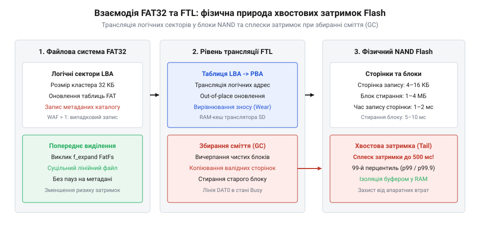
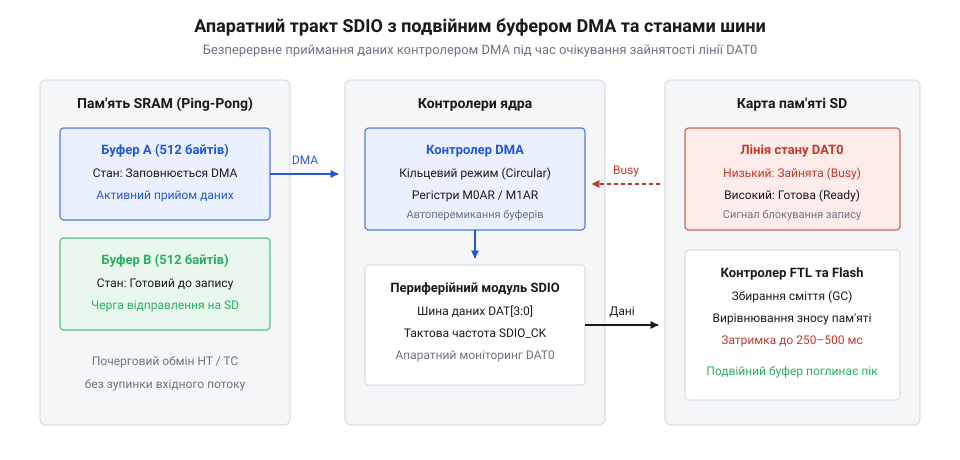

# Ротація бінарних логів на SD-карті: FatFs, попереднє виділення кластерів і хвостова затримка Flash

## Початкові концепції та фізичні принципи

Запис телеметрії та діагностичних подій на знімну картку пам'яті @@en|SD-card@@ (від англійського *Secure Digital* — захищена цифрова картка) здається найпростішим шляхом збереження великих масивів бінарних даних у вбудованих системах. Розробники підключають відкриту бібліотеку @@en|FatFs@@ (від власної назви модуля *FatFs*), ініціалізують монтирування файлової системи @@en|FAT32@@ (від англійського *File Allocation Table* — таблиця розміщення файлів) і викликають функцію запису щоразу, коли мікроконтролер отримує чергову порцію даних від датчиків. Проте у системі реального часу під керуванням [FreeRTOS](root:sf-devices/freertos) або в класичному циклі [Super-loop](root:sf-devices/super-loop) такий підхід миттєво створює критичну проблему: стандартні виклики запису, які зазвичай виконуються за 1–2 мілісекунди, періодично «зависають» на сотні мілісекунд чи навіть на цілу секунду. У детермінованій прошивці такий сплеск затримки спричиняє переповнення буферів переривань @@en|ISR@@ (від англійського *Interrupt Service Routine* — обробник переривання), втрату кадрів шини даних та порушення часових квантів задач [Розподіл часу: від мейнфреймів до мікроконтролерів](root:sf-devices/time-sharing-history).

Щоб зрозуміти джерело цієї нестабільності, необхідно розглянути внутрішню апаратну будову накопичувача. Всередині картки пам'яті встановлено кристали @@en|NAND Flash@@ (від англійського *Not AND Flash* — тип енергонезалежної напівпровідникової пам'яті) та окремий мікроконтролер із власною мікропрограмою, що реалізує @@en|FTL@@ (від англійського *Flash Translation Layer* — шар трансляції флеш-пам'яті). Осереди пам'яті @@en|NAND Flash@@ мають сувору фізичну дискретність:
1. Запис і читання даних виконуються сторінками @@en|page@@ (з англійської *page* — сторінка) розміром від 4 до 16 @@en|KB@@ (від англійського *Kilobyte* — кілобайт). 2. Очищення комірок можливе лише великими фізичними блоками стирання @@en|Erase Block@@ (з англійської *erase block* — блок стирання), чий розмір в сучасних накопичувачах становить від 512 @@en|KB@@ до 4 чи 8 @@en|MB@@ (від англійського *Megabyte* — мегабайт). У специфікації @@en|SD-card@@ цей блок називають @@en|AU@@ (від англійського *Allocation Unit* — одиниця виділення пам'яті у флеш-контролері). Детальніше про механізми трансляції адрес та фонове обслуговування блоків розповідає [внутрішня архітектура FTL та вирівнювання зносу у Flash-пам'яті](root:sf-data/ftl-flash-translation).

Фізична властивість @@en|NAND Flash@@ полягає в тому, що біт не можна перезаписати зі значення 0 у 1 без попереднього стирання всього блоку @@en|AU@@. Коли прошивка мікроконтролера записує невеличку порцію логу (наприклад, 128 байтів), @@en|FTL@@ зберігає її у вільній сторінці поточного блоку. Проте коли вільні сторінки вичерпуються або відбувається модифікація вже існуючого сектора, контролер накопичувача змушений запускати процедуру @@en|garbage collection@@ (від англійського *garbage collection* — збирання сміття у флеш-пам'яті):
1. Прочитати весь вміст фізичного @@en|AU@@ у внутрішню @@en|RAM@@ (від англійського *Random Access Memory* — оперативна пам'ять) картки. 2. Стерти фізичний блок @@en|AU@@ (це триває від 2 до 10 мілісекунд). 3. Об'єднати старі дані з новими змінами у буфері. 4. Записати оновлені сторінки у новий стертий блок. 5. Оновити внутрішню таблицю трансляції логічних адрес у фізичні.

Саме ця апаратна процедура спричиняє виникнення часового викиду, який називають @@en|tail latency@@ (від англійського *tail latency* — хвостова затримка, викривлення розподілу затримок у правому хвості). Звичайні операції запису проходять миттєво через внутрішній @@en|RAM@@-буфер картки, але під час збирання сміття картка утримує лінію @@en|DAT0@@ шини [інтерфейсу SDIO](root:sf-devices/embedded-sd-card-spi-sdio-bus-interface) у стані низького рівня (сигнал @@en|BUSY@@), блокуючи подальший обмін даними.

Ситуація критично погіршується, якщо бінарний лог пишеться у файл, що динамічно росте за допомогою стандартних викликів @@en|FatFs@@. Файлова система @@en|FAT32@@ розбиває диск на @@en|cluster@@ (від англійського *cluster* — логічний блок файлової системи) розміром, наприклад, 32 @@en|KB@@. Якщо прошивка додає дані потроху й не турбується про розміщення, файлова система при досягненні межі поточного кластера виконує такі дії:
1. Шукає вільний кластер у таблиці @@en|FAT@@. 2. Записує номер нового кластера в сектор таблиці @@en|FAT@@. 3. Записує дані логу в новий кластер на диску. 4. Оновлює дескриптор файла @@en|directory entry@@ (від англійського *directory entry* — елемент каталогу файлової системи), змінюючи точний розмір файла та час останньої модифікації.

Оскільки сектор таблиці @@en|FAT@@, сектор каталогу та сектор даних розташовані в абсолютно різних логічних адресах накопичувача, один виклик запису логу перетворюється на хаотичний вибірковий запис у три різні зони @@en|SD-card@@. Це провокує масове перерозподілення блоків у @@en|FTL@@, передчасне @@en|wear leveling@@ (від англійського *wear leveling* — вирівнювання зносу осередків пам'яті) та призводить до сплесків затримки тривалістю до 500–1200 мілісекунд.

Розрахуємо повну тривалість виклику запису сектора з урахуванням ймовірності виникнення збирання сміття та оновлення метаданих файлової системи.

Загальна затримка операції запису обчислюється як сума шинного обміну, оновлення метаданих, фізичного програмування сторінки та ймовірнісної затримки стирання блоку:

        T_write = T_bus + T_fat_meta + T_flash_page + P_gc * T_erase_au

При цьому ймовірність запуску процедури збирання сміття P_gc зростає пропорційно фрагментації файлової системи та кількості хаотичних оновлень таблиці @@en|FAT@@:

        P_gc = N_rand_writes / N_free_pages
        = (N_meta_updates + N_data_clusters) / N_free_pages

З наведеного співвідношення видно: якщо усунути динамічне оновлення метаданих (T_fat_meta = 0) і звести кількість випадкових записів до нуля (N_rand_writes -> 0), ймовірність виникнення P_gc припадатиме виключно на передбачувані межі послідовних фізичних блоків @@en|AU@@, що дозволяє повністю ліквідувати раптові хвостові затримки під час потокової роботи.


*Фізичний процес утворення хвостової затримки при випадковому записі кластерів та оновленні метаданих FAT32.*

## Внутрішня будова та алгоритми роботи

Для досягнення детермінованого часу виконання запису бінарних логів у вбудованих системах розробляють спеціалізований модуль прошивки. Його архітектура базується на трьох фундаментальних принципах:
1. Попереднє виділення суцільних кластерних ланцюжків @@en|cluster@@ на диску до початку логування (англійською @@en|contiguous cluster pre-allocation@@). 2. Розділення потоків обчислень через дворазовий кільцевий буфер у @@en|RAM@@ та окрему фонову задачу логування в [FreeRTOS](root:sf-devices/freertos). 3. Кільцева ротація лог-файлів фіксованого розміру без виконання викликів видалення (@@en|f_unlink@@) або динамічного створення нових файлів під час активного збереження даних.

Перший крок розв'язання проблеми — відмова від динамічного розширення файла. При ініціалізації системи прошивка створює лог-файл заданого граничного обсягу (наприклад, 10 @@en|MB@@) і викликає функцію @@en|f_expand@@ з бібліотеки @@en|FatFs@@. Функція @@en|f_expand@@ знаходить на @@en|SD-card@@ суцільний неприривний фрагмент вільних кластерів і записує всю ланцюгову таблицю @@en|FAT@@ за один підхід.

Якщо функція @@en|f_expand@@ недоступна в конкретній збірці @@en|FatFs@@, аналогічний ефект досягається позиціонуванням покажчика на кінець потрібного обсягу через @@en|f_lseek@@ та виконанням одноразового запису фіктивного фінального байта з наступним поверненням на початок файла: @@en|f_lseek(&file, 0)@@.

Завдяки попередньому виділенню:
- Усі кластери файла розташовані на @@en|SD-card@@ фізично послідовно один за одним. - Під час реального логування @@en|FatFs@@ не модифікує сектори таблиці @@en|FAT@@, оскільки номери кластерів вже прописані. - Контролер @@en|FTL@@ отримує суто послідовні багатосекторні команди запису @@en|multi-sector write@@ через інтерфейс @@en|SDIO@@ (від англійського *Secure Digital Input Output* — шинний інтерфейс обміну даними з SD-картками), що активує всередині картки високошвидкісний режим потокового запису без запуску запізнілого збирання сміття.

Другий компонент модуля — усунення прямих викликів @@en|f_write@@ з контексту робочих задач чи обробників переривань. Вимірювальні задачі та сенсорні переривання вміщують бінарні структури логів у кільцеву чергу @@en|FIFO@@ (від англійського *First In, First Out* — черга «першим прийшов — першим вийшов»).

Фонова задача логування з низьким пріоритетом вичищає чергу @@en|FIFO@@ та копіює записи у внутрішній буфер розміром у декілька секторів (наприклад, 4096 байтів, що відповідає розміру логічного блоку кластера). Фізичний запис на картку пам'яті через @@en|f_write@@ виконується виключно тоді, коли буфер повністю заповнений або настала вимушена пауза у надходженні даних. При цьому розмір порції запису завжди кратний розміру фізичного сектора (512 байтів). Для досягнення максимальної швидкодії передача даних з @@en|RAM@@ у периферійний контролер здійснюється за допомогою прямого доступу до пам'яті @@en|DMA@@ (від англійського *Direct Memory Access* — прямий доступ до пам'яті).

Третій компонент — алгоритм ротації логів без динамічного перерозподілу пам'яті. У файловій системі заздалегідь створюється фіксований пул із `N` файлів (наприклад, `LOG_000.BIN` ... `LOG_003.BIN`), кожен з яких попередньо виділений на рівні @@en|f_expand@@.

Алгоритм ротації працює за такою схемою:
1. Запис здійснюється у поточний активний файл `LOG_k.BIN` від зсуву 0 до максимального заздалегідь виділеного розміру `FILE_MAX_SIZE`. 2. В оновлюваній структурі заголовка файла зберігаються порядковий номер сесії, унікальний @@en|CRC32@@ (від англійського *Cyclic Redundancy Check* — циклічний надлишковий код перевірки) та часова мітка. 3. Коли поточний файл заповнюється до межі `FILE_MAX_SIZE`, прошивка скидає залишки буфера в файл, закриває його викликом @@en|f_close@@ і переходить до наступного файла `LOG_(k+1) mod N.BIN`. 4. Замість видалення файла `LOG_(k+1).BIN` за допомогою @@en|f_unlink@@ (що призвело б до фрагментації та стирання секторів каталогу), прошивка просто відкриває його й скидає поточну позицію запису на початок: @@en|f_lseek(&file, 0)@@. 5. Старі дані переписуються поверху новими пакетами секторами по 512 байтів.

Такий підхід повністю усуває процедури видалення та створення файлів під час тривалої роботи пристрою. Файлова система залишається в ідеально стабільному стані без фрагментації протягом років експлуавації.

Проілюструємо реалізацію модуля ротації бінарних логів із попереднім виділенням кластерів та секторним вирівнюванням буфера на двох мовах програмування.

:::tabs
:::code root\eng\sf-devices\embedded-sd-log-rotation-tail-latency/api-sdio-sd-bus-interface/c/freertos/log-init-preallocated-pool.c c

:::code root\eng\sf-devices\embedded-sd-log-rotation-tail-latency/api-sdio-sd-bus-interface/cpp/freertos/sdbinarylogger.cpp cpp
:::

Завдяки комбінації попереднього виділення кластерів та вирівняної фонової буферизації у @@en|RAM@@:
1. Тривалість виклику додавання запису логу в чергу зменшується до декількох мікросекунд (просте копіювання в оперативну пам'ять). 2. Затримка фонової операції @@en|f_write@@ стає стабільною та прогнозованою (не перевищує 3–5 мілісекунд на 4096 байтів). 3. Ліквідуються некоординовані модифікації таблиці @@en|FAT@@ та блокувань @@en|FTL@@, що гарантує детерміновану роботу всієї вбудованої системи.

## Апаратна реалізація та низькорівневий C/C++ код

Коли прошивка намагається зберегти потік бінарних логів на картку пам'яті через стандартні виклики файлової бібліотеки, система неминуче стикається з апаратним блокуванням процесорного ядра. Стандартна функція запису транслює операцію на низькорівневий шар @@en|diskio@@ (від англійського *disk input/output* — дискове введення-виведення, шар низькорівневих апаратних драйверів носіїв), де наївна реалізація опитує регістри периферії у безперервному блокувальному циклі очікування. Поки картка пам'яті @@en|SD-card@@ виконує внутрішнє стирання блоків та утримує лінію @@en|DAT0@@ у стані низької напруги, центральний процесор витрачає мільйони корисних тактів даремно. У системі під керуванням [планувальника операційної системи FreeRTOS](root:sf-devices/freertos) або при використанні [архітектури простого суперциклу Super-loop](root:sf-devices/super-loop) це призводить до зриву детермінізму, пропуску вибірок датчиків та руйнування розкладу [розподілу квантів процесорного часу](root:sf-devices/time-sharing-history). Подолання цієї затримки вимагає переходу від поодиноких процесорних викликів до апаратного конвеєра на базі спеціалізованого периферійного контролера @@en|SDMMC@@ (від англійського *Secure Digital Multimedia Card* — периферійний апаратний контролер шини карток пам'яті) та прямого доступу до пам'яті @@en|DMA@@.

Обмін даними відбувається через фізичні лінії [шинного інтерфейсу SDIO](root:sf-devices/embedded-sd-card-spi-sdio-bus-interface). Чотирибітна конфігурація передає півбайти паралельно по провідниках @@en|DAT0@@–@@en|DAT3@@, а частоту синхронізації задає лінія тактування @@en|CLK@@ у діапазоні від 25 до 50 МГц. Базовий протокол підтримує одиночний запис за командою @@en|CMD24@@ (від англійського *Command 24* — команда запису одного блоку), яка надсилає рівно один сектор на 512 байтів. Після кожного такого сектора накопичувач перевіряє контрольну суму @@en|CRC16@@, виставляє сигнал підтвердження й утримує лінію @@en|DAT0@@ у низькому логічному рівні стану @@en|BUSY@@, самостійно програмуючи комірки флеш-пам'яті. Запис великого масиву поодинокими командами @@en|CMD24@@ створює колосальні накладні витрати: внутрішній контролер накопичувача змушений щоразу заново ініціалізувати апаратний автомат конвеєра запису.

Для досягнення максимальної пропускної здатності шини застосовують потоковий запис багатьох секторів за командою @@en|CMD25@@ (від англійського *Command 25* — команда запису множини блоків). Найважливіший крок оптимізації полягає у попередньому надсиланні спеціальної команди @@en|ACMD23@@ (від англійського *Application Command 23* — команда попереднього встановлення кількості блоків стирання). Передаючи в параметрі команди @@en|ACMD23@@ точну кількість секторів, що надійдуть слідом, прошивка повідомляє внутрішньому мікроконтролеру накопичувача планований обсяг операції. Завдяки цій інформації шар трансляції @@en|FTL@@ заздалегідь готує суцільний фізичний блок стирання @@en|AU@@, не перериваючи приймання байтів із шини. Це знижує ймовірність раптової апаратної зупинки конвеєра @@en|write stall@@ (від англійського *write stall* — затримка або зависання процесу запису через очікування готовності носія) у чотири-п'ять разів порівняно зі звичайною послідовністю @@en|CMD25@@, яку зупиняють постфактум командою @@en|CMD12@@.

Перенесення байтів із системної оперативної пам'яті в апаратний буфер контролера @@en|SDMMC@@ виконує внутрішній модуль прямого доступу до пам'яті @@en|IDMA@@ (від англійського *Internal Direct Memory Access* — внутрішній прямий доступ до пам'яті периферійного контролера). Для безперервної обробки потоку оперативну пам'ять організовують як подвійну буферизацію @@en|double buffering@@ (від англійського *double buffering* — техніка поперемінного використання двох однакових буферів) за схемою човникового буфера @@en|ping-pong buffer@@ (від назви гри *ping-pong* — човниковий буфер із чергуванням половин). Поки одне плече буфера вивантажується контролером @@en|DMA@@ у шину носія, прикладні сенсорні потоки записують нові порції вимірювань у друге плече. На сучасних мікроконтролерах із процесорними ядрами високої швидкодії виникає апаратна колізія — порушення узгодженості кеш-пам'яті @@en|cache coherency@@ (від англійського *cache coherency* — узгодженість даних між процесорним кешем та фізичною оперативною пам'яттю). Процесорне ядро записує дані через внутрішній кеш першого рівня. Якщо рядок кешу @@en|cache line@@ (від англійського *cache line* — мінімальний неподільний елемент кеш-пам'яті розміром 32 байти) залишається нескинутим у фізичну пам'ять @@en|RAM@@, контролер @@en|DMA@@ зчитає з пам'яті застарілі дані. Щоб запобігти пошкодженню логів, блоки пам'яті вирівнюють за межею 32 байтів, а перед стартом передачі викликають операцію примусового скидання кешу @@en|cache clean@@ (від англійського *cache clean* — примусове вивантаження модифікованих рядків із процесорного кешу у фізичну оперативну пам'ять).

Розрахуємо мінімальний розмір оперативної пам'яті для човникового буфера, який гарантує збереження всіх даних під час найдовшого вимушеного простою накопичувача. Позначимо через `R_in` максимальну швидкість надходження бінарних логів у байтах за секунду. Позначимо через `T_tail` максимальну тривалість хвостової затримки накопичувача у секундах, коли лінія @@en|DAT0@@ блокується внутрішнім збиранням сміття. Позначимо через `K_safe` безрозмірний коефіцієнт запасу надійності для компенсації нерівномірності диспетчеризації задач. Позначимо через `S_sec` апаратний розмір одного сектора картки пам'яті у байтах. Позначимо через `B_min` мінімальний сумарний обсяг буферної пам'яті у байтах. Позначимо через `N_sec` розрахункову кількість секторів для розміщення цього масиву.

```
B_min
= K_safe × R_in × T_tail                         [визначення мінімального обсягу буфера]
= 1.5 × 65536 × 0.500                            [підстановка значень величин]
= 49152                                          [розрахунковий обсяг у байтах]

N_sec
= ⌈B_min ÷ S_sec⌉                                [кількість секторів накопичувача]
= ⌈49152 ÷ 512⌉                                  [ділення на розмір сектора 512 байтів]
= 96                                             [вирівняна кількість секторів]
```

Отриманий результат показує, що для гарантованого уникнення втрати даних за півсекундної хвостової затримки сумарний буфер має вміщувати щонайменше 96 секторів, тобто 48 секторів (24576 байтів) на кожне плече човникової черги. Якщо накопичувач заблокує шину на 500 мілісекунд, активне плече прийме весь вхідний потік повідомлень, після чого накопичений блок буде швидко передано через [архітектуру контролера DMA](root:sf-devices/dma-controller) усього за декілька мілісекунд.


*Апаратний конвеєр перенесення секторів у фоновому режимі через прямий доступ до пам'яті з ізоляцією робочих задач від затримок Flash.*

Наведемо практичну низькорівневу реалізацію безблокуючого конвеєра логування з використанням прямого доступу до пам'яті та сповіщень операційної системи мовами C та C++.

:::tabs
:::code root\eng\sf-devices\embedded-sd-log-rotation-tail-latency/api-sdio-sd-bus-interface/c/freertos/calculate-crc32.c c

:::code root\eng\sf-devices\embedded-sd-log-rotation-tail-latency/api-sdio-sd-bus-interface/cpp/freertos/sdiodmastreamer.cpp cpp
:::

## Практичне застосування та відлагодження

В умовах реальної експлуатації вбудованих пристроїв автономне збереження логів стикається з фізичними факторами, які здатні зруйнувати цілісність накопичувача. Найнебезпечнішим серед них є аварійне зникнення або просідання напруги живлення — явище @@en|brownout@@ (від англійського *brownout* — короткочасне падіння напруги живлення нижче мінімально допустимого порогу стабілізації). Під час активного запису сторінок флеш-пам'яті внутрішні перетворювачі картки споживають імпульсний струм величиною до 100–150 мА. Якщо лінія живлення 3.3 В має підвищений паразитарний опір або недостатню ємність фільтрувальних танталових конденсаторів, стрибок струму викликає локальне падіння напруги, яке перезавантажує мікроконтролер накопичувача безпосередньо під час модифікації фізичних осередків.

У типових реалізаціях із динамічним виділенням кластерів аварійне знеструмлення посеред запису призводить до фатального пошкодження носія: структура @@en|FAT32@@ виявляється розсинхронізованою з каталогом, а ланцюжки кластерів обриваються. Архітектура з попереднім виділенням суцільного пулу файлів функцією @@en|f_expand@@ повністю усуває цю вразливість. Оскільки всі кластери та елементи каталогу створюються одноразово під час ініціалізації накопичувача, таблиця розміщення залишається незмінною протягом усього життєвого циклу пристрою. Раптове вимкнення живлення може пошкодити лише дані одного фізичного сектора, який записувався в момент аварії, тоді як глобальна структура тому зберігає абсолютну цілісність. Це створює надійну основу для реалізації [стійкості до втрати живлення](root:sf-devices/fail-safe-journaling-flash) на рівні прошивки приладу.

Щоб безпомилково визначити межу валідних даних після аварійного перезавантаження, кожен бінарний пакет логу оформлюють як самодостатню структуру. Пакет відкривається сигнатурою магічного числа (кодом `0x53444C47`), містить 64-бітний монотонний лічильник послідовності, мітку часу, довжину тіла та завершується контрольною сумою @@en|CRC32@@. Після старту системи прошивка сканує попередньо виділені файли кругового пулу. Вільні сектори заздалегідь виділеного простору містять початкові байти `0xFF` або застарілі записи попереднього циклу ротації. Алгоритм відновлення послідовно читає пакети сектор за сектором: щойно черговий блок повертає невідповідність магічного числа, збій контрольної суми @@en|CRC32@@ або порушення монотонності лічильника, ця точка фіксується як логічний кінець збереженого потоку. Запис нових даних продовжується саме з цієї позиції без ризику затирання попередніх сесій.

Наведемо алгоритм сканування межі валідного потоку у попередньо виділеному файлі після аварійного відновлення живлення.

:::tabs
:::code root\eng\sf-devices\embedded-sd-log-rotation-tail-latency/api-sdio-sd-bus-interface/c/freertos/log-recover-stream-boundary.c c

:::code root\eng\sf-devices\embedded-sd-log-rotation-tail-latency/api-sdio-sd-bus-interface/cpp/freertos/logstreamrecovery.cpp cpp
:::

Іншим критичним граничним випадком є фізичне вилучення картки пам'яті під час запису або повне апаратне зависання її внутрішнього контролера через дефект кремнію. Якщо мікроконтролер не контролює максимальний час очікування відповіді, фонова задача навічно блокується у стані очікування сигналу від шини. Периферійний блок @@en|SDMMC@@ оснащують апаратним сторожовим таймером @@en|watchdog@@ (від англійського *watchdog* — сторожовий таймер контролю зависання), який рахує такти шини за регістром тайм-ауту даних. Якщо тривалість низького рівня лінії @@en|DAT0@@ перевищує заданий поріг (наприклад, 1000 мілісекунд), контролер генерує апаратне переривання помилки. У відповідь прошивка примусово скидає шинний інтерфейс, переводить конвеєр логування в режим скидання пакетів та виставляє системний прапорець відмови носія, не блокуючи виконання критичних контурів керування.

Для діагностики та верифікації реальних затримок накопичувача використовують цифровий апаратний прилад — @@en|logic analyzer@@ (від англійського *logic analyzer* — логічний аналізатор цифрових сигналів шини). Вимірювальні щупи приладу підключають безпосередньо до фізичних контактів роз'єму картки пам'яті: лінія тактування @@en|CLK@@, лінія передачі команд @@en|CMD@@ та лінія даних @@en|DAT0@@. Додатковий канал підключають до тестового виводу @@en|GPIO@@ мікроконтролера, який прошивка встановлює у високий рівень на весь час перебування всередині функції відправлення секторів. На осцилограмі чітко видно взаємодію протоколу шини та затримок флеш-пам'яті:
1. Під час передачі 512-байтового сектора лінія @@en|DAT0@@ передає дані разом з іншими лініями шини. 2. Після закінчення блоку накопичувач повертає трибітний код відповіді (значення `0b010` свідчить про успішне приймання пакета без помилок CRC). 3. Одразу після цього картка самостійно притискає лінію @@en|DAT0@@ до низького логічного рівня. За маркерами логічного аналізатора визначають тривалість цього низького стану: звичайне програмування сторінки триває від 200 до 450 мікросекунд, тоді як збирання сміття та стирання блоку розтягує низький стан лінії до 200–600 мілісекунд.

Для запобігання втраті даних у польових умовах прошивка веде постійний моніторинг заповнення черги — показник пікового рівня @@en|high-water mark@@ (від англійського *high-water mark* — найвищий зафіксований рівень заповнення буфера). Значення фіксує максимальну кількість секторів, одночасно зайнятих в оперативній пам'яті під час найдовшої затримки картки. Якщо під час температурних чи навантажувальних випробувань цей показник перевищує 80% від сумарного обсягу буферів, це свідчить про необхідність збільшення виділеної оперативної пам'яті або про наявність суттєвих дефектів у конкретній партії карток пам'яті. У поєднанні з низьким пріоритетом фонової задачі в операційній системі це гарантує збереження телеметрії без найменшого впливу на контури керування реального часу.