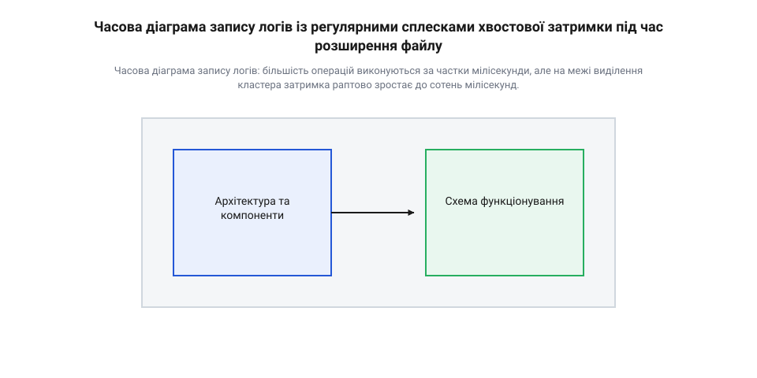
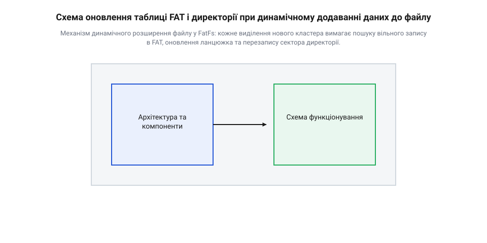
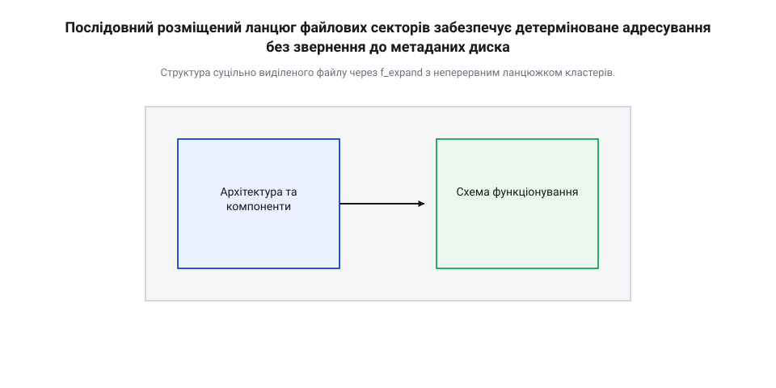
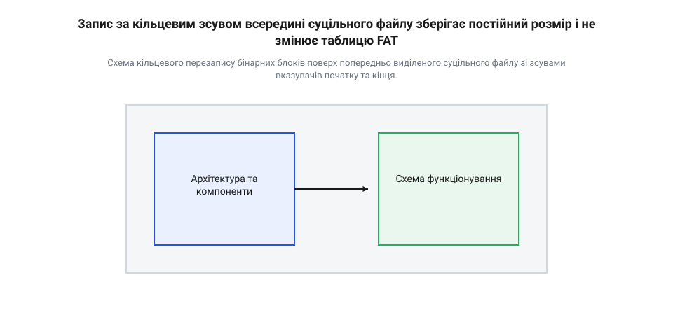

# Ротація бінарних логів на SD-карті: FatFs, попереднє виділення кластерів і хвостова затримка Flash

<preknowlist>
- [FreeRTOS](root:sf-devices/freertos) — поняття задач реального часу, пріоритети потоків та наслідки блокування точок виконання
- [Super-loop](root:sf-devices/super-loop) — архітектура кооперативного циклу виконання та часові вимоги до затримок крок за кроком
</preknowlist>

## Непередбачувані затримки запису телеметрії

Розробники прошивок для мікроконтролерів часто сприймають карту пам'яті як швидкий і простий накопичувач. Підключивши карту через апаратний інтерфейс `@@en|SDIO@@` або шину `@@en|SPI@@` (відповідно до специфікацій з джерела [інтерфейсу шини SDIO та SPI](root:sf-devices/embedded-sd-log-rotation-tail-latency/api-sdio-sd-bus-interface.md)), інженер додає до системи бібліотеку файлової системи та починає регулярно зберігати показники датчиків. Початкові тести на лабораторному столі демонструють чудову результативність: кожен новий пакет телеметрії обсягом 512 байтів записується за декілька сотень мікросекунд. Проте під час тривалої роботи пристрою в реальних умовах виникає кричуща аномалія: час виконання звичайної операції запису раптово зростає у сотні або навіть тисячі разів.

У системах реального часу, де керуючий цикл виконується в межах кооперативного циклу `@@en|super-loop@@` (згаданого у матеріалах про [кооперативний цикл виконання](root:sf-devices/super-loop)) або під управлінням операційної системи `@@en|FreeRTOS@@` (описаної у праці про [концепції задач реального часу](root:sf-devices/freertos)), подібне зависання стає катастрофічним. Коли потік логування викликає функцію запису у файл, і вона блокує виконання на 250–500 мілісекунд, апаратний модуль `@@en|SDIO@@` або шина `@@en|SPI@@` зависає в очікуванні звільнення лінії готовності флеш-карти, утримуючи ядро мікроконтролера в синхронному циклі введення-виведення. Через це процесор втрачає можливість вчасно вичищати вхідні апаратні буфери `@@en|FIFO@@` (англ. *first in, first out*, `@@en|FIFO@@`, від *first* — перший, *in* — всередину, *out* — назовні) периферійних інтерфейсів. Апаратний буфер `@@en|UART@@` або `@@en|CAN@@` у мікроконтролерах зазвичай вміщує лише від кількох байтів до десятка слів; як тільки вхідний зсувний регістр приймає наступний байт при заповненому буфері, периферійний модуль опиняється у стані переповнення (англ. *overrun error*, `@@en|overrun error@@`, від *over* — понад та *run* — бігти) і просто скидає нові вхідні кадри, доки процесор не зчитає застряглі дані та не скине прапорець помилки. Паралельно з цим заблокована система перестає оновлювати лічильник сторожового таймера (англ. *watchdog timer*, від *watchdog* — сторожовий собака та *timer* — вимірювач часу), що призводить до раптового апаратного перезапуску пристрою безпосередньо під час незавершеного запису на SD-карту.

Головна пастка полягає у принциповій відмінності між середньою пропускною здатністю накопичувача та його детермінованим часом відгуку. Виробники карт маркують продукцію класами швидкості, обіцяючи стабільні 10 або 30 мегабайтів за секунду. Однак цей показник обчислюється для великих неперервних масивів даних у побутовій електроніці. Для вбудованих систем визначальним параметром є не середня швидкість, а граничний час виконання операції (англ. *worst-case execution time*, `@@en|WCET@@`, від *worst* — найгірший, *case* — випадок, *execution* — виконання, *time* — час). Власність збереження даних на флеш-пам'яті така, що поодинокі операції потрапляють у так звану хвостову затримку (англ. *tail latency*, від *tail* — хвіст розподілу й *latency* — затримка).


*Часова діаграма запису логів: більшість операцій виконуються за частки мілісекунди, але на межі виділення кластера затримка раптово зростає до сотень мілісекунд.*

На діаграмі виразно видно, що переважна більшість викликів функції запису завершується майже миттєво. Проте через певні інтервали виникають гострі сплески `@@en|tail latency@@`. Вивчення історичного контексту показує, що [еволюція логування у вбудованих системах](root:sf-devices/embedded-sd-log-rotation-tail-latency/hist-sd-card-logging-evolution.md) пройшла шлях від прямого запису в сирі блоки флеш-пам'яті до використання повноцінних файлових систем на картах пам'яті, де й виникла ця проблема.

Якщо розробник не враховує моменти виникнення `@@en|tail latency@@`, прошивка втрачає передбачуваність. Спроба виклику стандартних функцій збереження безпосередньо з періодичної задачі призводить до десинхронізації системи. Засобами практичного вимірювання таких затримок можна скористатися завдяки [стенду вимірювання хвостової затримки SD-карт](root:sf-devices/embedded-sd-log-rotation-tail-latency/proj-sd-tail-latency-tester.md).

Для захисту задач реального часу від затримок накопичувача застосовують проміжне буферування в оперативній пам'яті мікроконтролера. Обчислення необхідного обсягу оперативної пам'яті для кільцевого буфера здійснюється на основі пікового значення хвостової затримки:

```
B_min = R_data × T_tail_max
      = 50 KB/s × 0.3 s                       [підстановка швидкості потоку даних та пікового часу затримки]
      = 15 KB                                 [найменший обсяг буфера ОЗП для запобігання втрати даних]
```

Детальний аналіз цих обчислень наведено у керівництві з [розрахунку розмірів буферів телеметрії](root:sf-devices/embedded-sd-log-rotation-tail-latency/math-sd-log-buffer-math.md). Для надійної ізоляції потоків запису використовується [архітектура двобуферних кільцевих черг RTOS](root:sf-devices/embedded-rtos-ring-buffer-dma-storage-decoupling).

Нижче наведено приклад коду на мовах C та C++, який ілюструє найпростіший, але небезпечний спосіб безперервного додавання логів у файл без попередньої підготовки простору.

:::tabs
@c|esp-idf
:::code root\eng\sf-devices\embedded-sd-log-rotation-tail-latency/embedded-sd-log-rotation-tail-latency-d/c/naive-logging-task.c c
@cpp|arduino
:::code root\eng\sf-devices\embedded-sd-log-rotation-tail-latency/embedded-sd-log-rotation-tail-latency-d/cpp/telemetrypacket.cpp cpp
:::

Як показує практика, прямий запис у файл без додаткових заходів не здатний забезпечити стабільні часові характеристики. Для розуміння причин цих сплесків необхідно зануритися в апаратний устрій самих карт пам'яті.

## Апаратні затримки внутрішнього контролера Flash

Карта пам'яті формату `@@en|SD@@` або `@@en|microSD@@` лише зовні здається простим набором осередків пам'яті. Всередині пластикового корпусу розміщено повноцінну обчислювальну систему: кристали полупровідникової напівпровідникової нанд-флеш-пам'яті (англ. *NAND Flash*, від логічного елемента *NOT-AND*) та спеціалізований мікроконтролер. Цей контролер виконує власну прошивку — шар адаптації флеш-пам'яті (англ. *Flash Translation Layer*, `@@en|FTL@@`, від *translation* — трансляція, переведення). Докладний опис цієї архітектури міститься у матеріалі про [особливості функціонування контролера FTL](root:sf-devices/embedded-sd-log-rotation-tail-latency/comp-sd-flash-card.md) та довіднику з [механізмів збирання сміття FTL](root:sf-data/ftl-flash-translation).

Головна особливість `@@en|NAND Flash@@` полягає у жорсткому фізичному розділенні операцій читання, запису та стирання за обсягом даних:
1. Читання та програмування (запис) виконуються сторінками (англ. *page*, розміром від 4 до 16 кілобайтів). 2. Стирання здійснюється виключно великими блоками (англ. *erase block*, розміром від 512 кілобайтів до 8 мегабайтів). 3. Перезапис сторінки безпосередньо поверх існуючих даних фізично неможливий: перед новим записом увесь блок має бути повністю очищений і заповнений логічними одиницями.

Оскільки файлові системи оперують логічними секторами (англ. *Logical Block Addressing*, `@@en|LBA@@`, від *logical* — логічний, *block* — блок, *addressing* — адресація) розміром 512 байтів, контролер `@@en|FTL@@` змушений транслювати адреси `@@en|LBA@@` у фізичні адреси сторінок (англ. *Physical Block Addressing*, `@@en|PBA@@`). Коли мікроконтролер пристрою надсилає команду запису сектора, `@@en|FTL@@` шукає чисту фізичну сторінку у вже підготовленому очищеному блоці.

Коли вільні очищені блоки вичерпуються, контролер `@@en|FTL@@` вимушено зупиняє обробку зовнішніх команд шини `@@en|SDIO@@` чи `@@en|SPI@@` та запускає внутрішній процес збирання сміття (англ. *garbage collection*, `@@en|garbage collection@@`, від *garbage* — сміття й *collection* — збирання). Під час збирання сміття `@@en|FTL@@` виконує такі кроки:
- Знаходить фізичний блок, який містить як актуальні, так і застарілі сторінки. - Зчитує всі актуальні сторінки з цього блоку в оперативну пам'ять контролера karty. - Записує зчитані актуальні сторінки у новий, заздалегідь очищений блок. - Запускає фізичний процес стирання старого блоку високою напругою.

Операція стирання блоку `@@en|NAND Flash@@` є найповільнішою фізичною операцією у напівпровідникових накопичувачах. Вона триває від 200 до 500 мілісекунд. Протягом цього часу карта пам'яті утримує лінію даних `@@en|DAT0@@` у низькому стані (стан зайнятості, `@@en|busy state@@`), блокуючи апаратний периферійний модуль мікроконтролера.

Додатково контролер вирівнює знос осередків пам'яті (англ. *wear leveling*, `@@en|wear leveling@@`, від *wear* — знос й *leveling* — вирівнювання). Щоб окремі блоки не зношувалися швидше за інші при частих оновленнях однакових секторів, `@@en|FTL@@` періодично переміщує статичні дані на нові фізичні блоки. Якщо хост-система виконує запис випадковими невеликими порціями, виникає явище підсилення запису (англ. *write amplification factor*, `@@en|write amplification factor@@`, від *amplification* — підсилення).

Розрахуємо граничний час апаратної затримки `@@en|FTL@@` під час вимушеного збирання сміття для блоку обсягом 4 мегабайти (64 сторінки по 64 кілобайти):

```
T_tail_ftl = T_page_read + T_block_erase + T_page_program
           = (64 × 45 μs) + 350 ms + (64 × 700 μs)      [перенесення та стирання 4 МБ блоку Flash]
           = 2.88 ms + 350 ms + 44.8 ms                 [сумування апаратних інтервалів]
           = 397.68 ms                                  [пікова апаратна затримка FTL]
```

З обчислення видно, що фізична природа `@@en|NAND Flash@@` створює неминучу затримку майже у 400 мілісекунд, яку неможливо усунути зміною налаштувань SPI або підвищенням частоти тактування шини.

Якщо прошивка записує дані строго послідовно у неперервні сектори, контролер `@@en|FTL@@` оптимізує роботу: він відкриває одну активну область запису й очищує блоки у фоновому режимі. Проте як тільки система починає чергувати запис даних із перезаписом метаданих файлової системи у випадкові сектори диска, `@@en|FTL@@` втрачає можливість передбачити потік даних, що призводить до миттєвого виклику найгіршого сценарію збирання сміття.

## Динамічний пошук кластерів у FatFs

Проблема непередбачуваних затримок посугублюється на рівні програмного забезпечення при використанні файлової системи `@@en|FatFs@@`. Для організації файлів на диску `@@en|FatFs@@` розбиває область даних на логічні групи секторів — кластери (англ. *cluster*, від *cluster* — скупчення, група). Інформація про зв'язки між кластерами зберігається у таблиці розміщення файлів (англ. *File Allocation Table*, `@@en|FAT@@`, від *allocation* — виділення, розподіл). Повні технічні деталі цієї структури висвітлено у праці про [структурну організацію FatFs](root:sf-data/fat-filesystem) та довіднику [функцій керування кластерами FatFs](root:sf-devices/embedded-sd-log-rotation-tail-latency/api-fatfs-cluster-preallocation.md).

Коли прошивка відкриває файл у режимі дописування і викликає функцію `f_write()`, `@@en|FatFs@@` виконує запис у сектори поточного кластера. Однак, як тільки поточний кластер заповнюється повністю, система не може просто продовжити запис у наступний сектор. Вона вимушена виконати складну процедуру динамічного розширення файлу:
1. Зчитати з SD-карти сектор таблиці `@@en|FAT@@`, щоб знайти вільний кластер (запис зі значенням `0x00000000`). 2. Оновити запис поточного кластера в таблиці `@@en|FAT@@`, записавши туди номер новознайденого кластера. 3. Записати маркер кінця ланцюжка (`0x0FFFFFFF`) у запис нового кластера в таблиці `@@en|FAT@@`. 4. Зберегти змінений сектор `@@en|FAT@@` назад на карту пам'яті. Якщо використовується дубльована таблиця `FAT2`, виконується додатковий запис у другий сектор. 5. Знайти та зчитати сектор директорії (англ. *directory entry*, `@@en|directory entry@@`, від *entry* — елемент запису), де зберігається метаінформація про файл. 6. Оновити точний розмір файлу у байтах та час його останньої модифікації у записі директорії. 7. Записати оновлений сектор директорії назад на карту пам'яті.


*Механізм динамічного розширення файлу у FatFs: кожне виділення нового кластера вимагає пошуку вільного запису в FAT, оновлення ланцюжка та перезапису сектора директорії.*

З наведеної схеми чітко видно, що замість однієї послідовної операції запису логів прошивка генерує серію хаотичних звернень до різних областей диска. Запис логу йде у сектор @@en|Data Region@@, потім голівка логічної адресації стрибає на мегабайти назад у @@en|FAT Region@@, потім у @@en|Directory Region@@, і лише після цього повертається до @@en|Data Region@@. Головною причиною такого виснажливого секторного трішингу (англ. *sector thrashing*, @@en|sector thrashing@@, від *thrash* — молотити, шарпатися) є фундаментальне обмеження архітектури @@en|FatFs@@ — використання єдиного внутрішнього односекторного буфера вікна @@en|win[]@@ (англ. *window*, від *window* — вікно). Оскільки об'єкт файлової системи здатен утримувати в оперативній пам'яті лише один сектор даних, @@en|FatFs@@ не спроможна одночасно кешувати сектор логів, сектор таблиці @@en|FAT@@ та сектор директорії. Кожен крок розширення файлу змушує систему витісняти поточний вміст буфера: модифікований сектор логу мусить бути примусово записаний на SD-карту перед завантаженням сектора FAT1. Наступне оновлення дубльованої таблиці FAT2 та оновлення елемента каталогу @@en|directory entry@@ повторно витісняють @@en|win[]@@, змушуючи прошивку щоразу виконувати фізичний перезапис секторів на карту пам'яті, перш ніж повернутися до збереження телеметрії.

Така хаотична зміна секторів завдає нищівного удару по внутрішній логіці `@@en|FTL@@`. Внутрішній контролер karty вимушений закривати поточний активний блок запису даних, відкривати новий блок для таблиці `@@en|FAT@@`, а потім ще один блок для директорії. Це миттєво вичерпує резервний фонд очищених блоків флеш-пам'яті та провокує описаний раніше процес блокуючого збирання сміття `@@en|garbage collection@@`.

Для розуміння того, як саме динамічне розширення розриває неперервний потік I/O, розглянемо приклад коду, що демонструє внутрішню послідовність файлових викликів під час заповнення кластера.

:::tabs
@c
:::code root\eng\sf-devices\embedded-sd-log-rotation-tail-latency/embedded-sd-log-rotation-tail-latency-d/c/write-telemetry-with-trace.c c
@cpp
:::code root\eng\sf-devices\embedded-sd-log-rotation-tail-latency/embedded-sd-log-rotation-tail-latency-d/cpp/fatfstracer.cpp cpp
:::

Отже, динамічний процес розширення файлу у `@@en|FatFs@@` є головним тригером, який перетворює апаратні особливості `@@en|NAND Flash@@` на проблеми систем реального часу. Очевидним висновком є необхідність повного усунення операцій модифікації метаданих під час збереження телеметрії.

## Предвиділення суцільного простору для файлу

Динамічне розширення файлів під час безперервного збереження телеметрії створює критичну загрозу для часової детермінованості прошивки. Коли пристрій записує черговий блок бінарних даних через бібліотеку @@en|FatFs@@ (англ. *FatFs*, від англійської абревіатури *FAT* — *File Allocation Table* та *Fs* — *File System*), файлова система вимушена постійно звертатися до дискової структури. У момент, коли поточна позиція запису перетинає межу поточного кластера, бібліотека виконує пошук вільного кластера в таблиці розміщення файлів. Цей процес вимагає зчитування секторів таблиці @@en|FAT@@ (англ. *FAT*, від англійської абревіатури *File Allocation Table*), модифікації ланцюжка записів та оновлення метаданих елемента директорії, зокрема поточного розміру файла та часу останньої модифікації.

Така поведінка несумісна з вимогами до систем реального часу. Базовий аналіз показує, що кожна модифікація службових структур супроводжується випадковими записами у різні області SD-карти. Контролер пам'яті всередині карти пам'яті змушений задіяти прошарок трансляції @@en|Flash Translation Layer@@ (англ. *Flash Translation Layer*, від англійських слів *flash* — «спалах», *translation* — «перенесення» та *layer* — «шар»), або @@en|FTL@@, який ініціює операції стирання фізичних блоків та вирівнювання зносу @@en|wear leveling@@ (англ. *wear leveling*, від англійських слів *wear* — «знос» та *level* — «вирівнювати»). Вивчити [структурну організацію FatFs](root:sf-data/fat-filesystem) важливо для розуміння того, як динамічне виділення кластерів викликає непередбачувані затримки виконання. Поєднуючись із [внутрішньою архітектурою карт](root:sf-devices/embedded-sd-log-rotation-tail-latency/comp-sd-flash-card.md), ці операції призводять до виникнення сплесків часової затримки — так званої хвостової затримки @@en|tail latency@@ (англ. *tail latency*, від англійського *tail* — «хвіст» та латинського *latens* — «прихований»), яка може досягати сотень мілісекунд і перевищувати гранично припустимий час виконання @@en|WCET@@ (англ. *WCET*, акронім від *Worst-Case Execution Time*).

Історичний аналіз показує, як еволюціонували підходи до організації збереження даних у вбудованих системах. [Еволюція методів логування](root:sf-devices/embedded-sd-log-rotation-tail-latency/hist-sd-card-logging-evolution.md) пройшла шлях від прямого запису в необроблені сектори флеш-пам'яті до використання повнофункціональних файлових систем, де виклики детермінованості вирішуються спеціальними архітектурними прийомами.

Єдиним надійним способом усунути часову затримку на рівні файлової системи є відмова від динамічного розширення файлу під час роботи основного циклу прошивки. Для цього застосовується механізм попереднього виділення простору @@en|pre-allocation@@ (англ. *pre-allocation*, від латинського *prae-* — «попередньо» та *locare* — «розміщувати»). Бібліотека @@en|FatFs@@ надає для цієї задачі виклики спеціалізованого програмного інтерфейсу. Використовуючи довідник [функцій попереднього резервування](root:sf-devices/embedded-sd-log-rotation-tail-latency/api-fatfs-cluster-preallocation.md), розробник може гарантувати створення суцільного масиву кластерів на етапі ініціалізації пристрою.

Ключовою функцією у даному процесі є `f_expand`. Вона приймає вказівник на об'єкт файла, необхідний обсяг пам'яті у байтах та режим виділення. При виклику `f_expand` із параметром підготовки суцільного блоку, @@en|FatFs@@ шукає на диску послідовний ланцюжок вільних кластерів @@en|cluster@@ (англ. *cluster*, від давньоанглійського *clyster* — «пучок» або «гроно») необхідної довжини та зв'язує їх у таблиці @@en|FAT@@ в один неподільний сегмент. При цьому фізичні сектори файла розміщуються один за одним без фрагментації, а в системному прапорці об'єкта файла встановлюється відмітка суцільного розміщення.


*Структура суцільно виділеного файлу через f_expand з неперервним ланцюжком кластерів.*

Перевага суцільного предвиділення полягає у тому, що після його завершення обчислення фізичної адреси сектора на SD-карті виконується за чистою арифметичною формулою на основі стартового сектора та поточного зсуву файла. Файлова система повністю звільняється від потреби зчитувати сектори таблиці @@en|FAT@@ під час запису.

Перед викликом резервування необхідно точно розрахувати необхідний розмір файла. Обсяг предвиділення залежить від інтенсивності генерування телеметрії, розміру одного запису логу та необхідного часу зберігання даних. Для розрахунку обсягу файлового простору застосовується покрокова математична модель, узгоджена з алгоритмами з опису [розрахунку розміру буферів](root:sf-devices/embedded-sd-log-rotation-tail-latency/math-sd-log-buffer-math.md):

S_raw = R_rate × T_retention                     [обчислення обсягу корисних даних телеметрії]
S_aligned = ⌈ S_raw ÷ S_cluster ⌉ × S_cluster  [вирівнювання розміру до межі кластера]
S_file = S_aligned + S_header                    [підсумовування з розміром заголовочного сектора]

У даній формулі `R_rate` позначено інтенсивність потоку даних у байтах за секунду, `T_retention` — необхідний інтервал зберігання у секундах, `S_cluster` — розмір кластера файлової системи у байтах (зазвичай від 4096 до 32768 байтів), а `S_header` — розмір заголовочного блоку файла, вирівняний за розміром сектора @@en|sector@@ (англ. *sector*, від латинського *sector* — «той, що ріже»), який на більшості SD-карт дорівнює 512 байтам.

Нижче наведено ідіоматичну реалізацію процесу предвиділення суцільного лог-файлу для мікроконтролера STM32 мовами C та C++.

:::tabs
@tab C
:::code root\eng\sf-devices\embedded-sd-log-rotation-tail-latency/embedded-sd-log-rotation-tail-latency-d/c/stm32/--attribute--.c c
@tab C++
:::code root\eng\sf-devices\embedded-sd-log-rotation-tail-latency/embedded-sd-log-rotation-tail-latency-d/cpp/stm32/preallocatedlogfile.cpp cpp
:::

Виклик `f_expand` гарантує, що вся потрібна ємність диска виділяється за один крок під час завантаження пристрою. У результаті файл отримує жорстку фіксовану структуру секторів. Під час подальшого запису даних прошивка більше не викличе жодної процедури пошуку кластерів у таблиці @@en|FAT@@, що усуває головне джерело програмної затримки.

## Кільцева ротація логів без розширення

Після підготовки суцільно виділеного файла система логування переходить у режим циліндричного або кільцевого перезапису (@@en|ring buffer@@, від давньоанглійського *hring* — «кільце» та староірландського *bufe* — «буфер»). Замість додавання нових блоків у кінець файла зі збільшенням його розміру, нові бінарні записи розміщуються за циклічно змінюваним зсувом всередині вже зарезервованого простору.

Головна архітектурна перевага даного підходу — нульова зміна логічного розміру файла. Розмір файла, збережений у структурі `f_size`, залишається нерухомим протягом усього терміну експлуатації пристрою. Коли поточна позиція запису досягає кінця предвиділеного блоку, зсув запису автоматично переноситься на початок області даних (відразу після заголовочного сектора). Цей механізм має назву обгортання зсуву @@en|wrap-around@@ (англ. *wrap-around*, від англійських слів *wrap* — «обгортати» та *around* — «навколо»).


*Схема кільцевого перезапису бінарних блоків поверх попередньо виділеного суцільного файлу зі зсувами вказувачів початку та кінця.*

Оскільки логічний розмір файла не росте, функція `f_write` виконує модифікацію виключно даних усередині вже виділених секторів. При цьому повністю виключаються наступні часоємні операції:
1. Пошук вільних кластерів та запис нових значень у таблицю @@en|FAT@@. 2. Модифікація атрибутів елемента каталогу (розміру файла та першого кластера). 3. Фрагментація дискового простору та додаткові стрибки головки читання/запису по секторах.

Для забезпечення максимальної ефективності перезапису бінарні блоки логів повинні вирівнюватися по межах секторів SD-карти (512 байтів). Якщо запис виконується кратно розміру сектора, контролер SD-карти не витрачає час на читання часткових секторів перед модифікацією (цикл read-modify-write), що додатково знижує апаратну затримку пам'яті.

У високонавантажених прошивках безпосередній запис на SD-карту з контексту вимірювальних задач або переривань є неприпустимим. Навіть при відсутності файлових затримок сам апаратний контролер пам'яті може заблокувати шину [апаратний інтерфейс SDIO](root:sf-devices/embedded-sd-log-rotation-tail-latency/api-sdio-sd-bus-interface.md) під час внутрішнього вирівнювання зносу. Щоб гарантувати часову детермінованість задач, у системі на базі [операційну систему FreeRTOS](root:sf-devices/freertos) або [архітектуру кооперативного циклу](root:sf-devices/super-loop) застосовують асинхронну ізоляцію. Для цього будують [двобуферні кільцеві черги](root:sf-devices/embedded-rtos-ring-buffer-dma-storage-decoupling), через які високопріоритетні потоки передають структури даних фоновому завданню запису.

Поки фонова задача очікує завершення передачі секторів через контролер прямого доступу до пам'яті @@en|direct memory access@@ (англ. *direct memory access*, від латинських слів *directus* — «прямий», *memoria* — «пам'ять» та *accessus* — «доступ»), або @@en|DMA@@, високопріоритетні вимірювальні задачі продовжують безперешкодно накопичувати телеметрію в ОЗП. Це дозволяє прошивці легко згладжувати апаратні затримки, пов'язані з [механізмами збирання сміття](root:sf-data/ftl-flash-translation) накопичувача.

Вся логіка управління кільцевим файлом зосереджена в заголовочному секторі @@en|header@@ (англ. *header*, від давньоанглійського *hēafod* — «голова»). Заголовок містить зсув поточної позиції запису (`write_offset`), зсув найстарішого запису (`read_offset`), загальний лічильник збережених блоків та контрольну суму.

Щоб запобігти зносу першого сектора SD-карти через часте скидання заголовка на диск, процедуру оновлення заголовка виконують пакетами або зберігають поточний зсув запису у стабільній енергонезалежній пам'яті (FRAM/SRAM), а при аварійному перезавантаженні відновлюють вказівник за допомогою сканування маркерів послідовності.

Нижче наведено повний виробничий модуль ротації логів для бібліотеки @@en|FatFs@@ мовами C та C++. Дана реалізація деталізує концепцію, представлену у [модуль ротації логів](root:sf-devices/embedded-sd-log-rotation-tail-latency/proj-fatfs-preallocated-log-rotator.md).

:::tabs
@tab C
:::code root\eng\sf-devices\embedded-sd-log-rotation-tail-latency/embedded-sd-log-rotation-tail-latency-d/c/stm32/--attribute---2.c c
@tab C++
:::code root\eng\sf-devices\embedded-sd-log-rotation-tail-latency/embedded-sd-log-rotation-tail-latency-d/cpp/stm32/logrotator.cpp cpp
:::

Перевірка працездатності розробленого кільцевого логера здійснюється на спеціальних апаратних вимірювальних стендах. Застосовуючи [вимірювальний тестовий стенд](root:sf-devices/embedded-sd-log-rotation-tail-latency/proj-sd-tail-latency-tester.md), розробник може наочно порівняти два режими логування:
- **Звичайне розширення файла (append)**: характеризується серіями стабільних записів (1-3 мс) з періодичними катастрофічними сплесками часової затримки до 300-700 мс під час виділення кластерів та оновлення метаданих. - **Предвиділена кільцева ротація**: показує жорстко обмежену затримку на рівні фізичного запису блоку (1-15 мс) без жодного відхилення, викликаного файловою системою.

Завдяки попередньому виділенню кластерів та кільцевому перезапису прошивка отримує повністю передбачувану часову поведінку, усуваючи ризик втрати даних телеметрії через раптові зависання накопичувача.