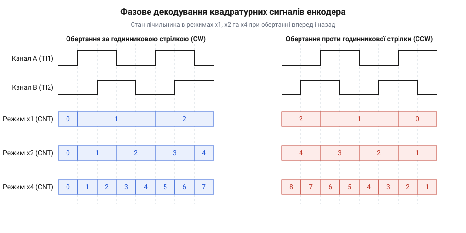
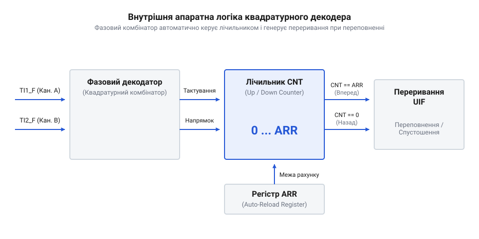
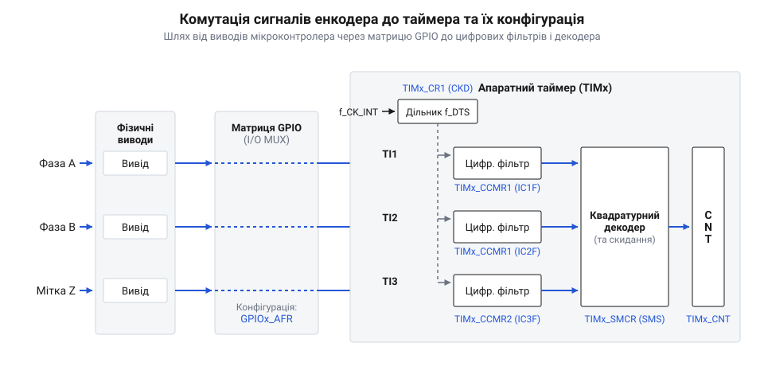

# Апаратний режим квадратурного декодера таймера мікроконтролера

<preknowlist>
- [GPIO-регістри](root:sf-devices/gpio-registers) — принципи роботи вхідних цифрових буферів та налаштування підтягуючих резисторів на виводах
- [mcu-pin-multiplexing](root:sf-devices/pin-multiplexing) — механізми комутації альтернативних функцій виводів мікроконтролера для підключення периферійних таймерів
- [Запобігання перехідним імпульсним завадам на лініях GPIO](root:sf-devices/gpio-glitch-prevention) — фізична природа брязкіту та перехідних процесів на вхідних лініях енкодера
</preknowlist>

## Обмеження програмної обробки квадратурних енкодерів

Під час розробки систем керування рухом — від прецизійних верстатів із ЧПУ до сервоприводів робототехніки — виникає фундаментальна задача: зчитування поточного кутового положення та швидкості обертання вала електродвигуна. Для цього найчастіше використовується [інкрементальний квадратурний енкодер](root:sf-devices/encoder-hardware-timer-mode/comp-incremental-quadrature-encoder.md) (від англ. *encoder*, від *code* — кодувати; @@en|incremental quadrature encoder@@), який генерує дві послідовності прямокутних імпульсів на вихідних лініях `A` та `B`. Першою інтуїтивною ідеєю інженера-початківця є підключення цих ліній безпосередньо до вхідних виводів @@en|GPIO@@ (англ. *General-Purpose Input/Output*; @@en|GPIO pin@@) мікроконтролера та обробка кожного фронту сигналу за допомогою механізму зовнішніх переривань (від лат. *interruptus* — перерваний; @@en|interrupt service routine@@, або @@en|ISR@@). Проте при виході двигуна на робочі оберти така програмна схема миттєво демонструє свою повну непридатність.

Розглянемо фізичну природу виникаючої проблеми. Кожен оберт оптичного диска енкодера із роздільною здатністю, наприклад, 1024 імпульси на оберт (@@en|pulses per revolution@@, @@en|PPR@@), створює 1024 періоди сигналів на лінії `A` та 1024 періоди на лінії `B`. Оскільки обидва канали зсунуті один відносно одного на чверть періоду, у кожному періоді виникає чотири зміни фазового стану: наростаючий фронт `A`, наростаючий фронт `B`, спадаючий фронт `A` та спадаючий фронт `B`. Якщо підключити переривання @@en|GPIO@@ до обох ліній на відслідковування обох фронтів (@@en|change interrupt@@), процесор мусить обробляти по 4096 подій переривань за один повний оберт вала.

Обчислимо обчислювальне навантаження на процесорний сердечник для типового промислового вала, що обертається зі швидкістю `n = 3000` обертів на хвилину:

```
f_rot = n / 60                      [переведення обертів за хвилину в оберти за секунду (Гц)]
f_rot = 3000 / 60 = 50 Гц          [частота обертання вала електродвигуна]

N_edges = PPR × 4                   [кількість переходів фазових станів на один оберт]
N_edges = 1024 × 4 = 4096 фронтів   [загальна кількість подій на оберт]

f_ISR = f_rot × N_edges             [загальна частота викликів переривань GPIO]
f_ISR = 50 × 4096 = 204800 Гц       [204.8 тисяч переривань за секунду]
```

Частота виклику @@en|ISR@@ у `204.8` кГц означає, що переривання генерується кожні `T_int = 1 / 204800 ≈ 4.88` мікросекунди. У мікроконтролері з тактовою частотою 72 МГц (наприклад, архітектури ARM Cortex-M) апаратний вхід у процедуру обробки переривання та вихід із неї (збереження регістрів `R0-R3`, `R12`, `LR`, `PC`, `xPSR` у стек та їх відновлення; @@en|stack push/pop latency@@) займає близько 24–30 тактів. Додавши час на виконання самого коду обробника (зчитування станів виводів через [конфігурацію GPIO регістрів](root:sf-devices/gpio-registers), визначення напрямку та зміну змінної лічильника), кожна процедура @@en|ISR@@ вимагає щонайменше 150–200 тактів процесора. Помноживши 200 тактів на `204 800` викликів за секунду, отримуємо понад `40.96` мільйонів тактів за секунду — тобто понад 57% усього обчислювального ресурсу мікроконтролера витрачається виключно на обслуговування фронтів енкодера. При зростанні обертів до 6000 RPM або використанні високоточного енкодера на 4096 @@en|PPR@@ процесор впадає в стан постійного переривання (@@en|interrupt storm@@), а виконання основної програми та контурів керування (PID) повністю блокується.

Окрім перевантаження CPU, програмна обробка через @@en|GPIO@@ стикається з критичною проблемою втрати точності через перехідні імпульсні завади та механічний брязкіт контактів (@@en|bounce@@). Будь-який механічний чи оптичний сигнал у реальному виробничому середовищі піддається впливу електромагнітних наведень від силових ключів інвертора двигуна. Напруга на лінії @@en|GPIO@@ у момент переходу може коливатися, утворюючи високочастотну серію пачок коротких паразитів і сплесків. Застосування стандартного підходу, про який ідеться в матеріалі про [запобігання перехідним імпульсним завадам](root:sf-devices/gpio-glitch-prevention), на рівні звичайних вхідних буферів часто виявляється недостатнім, оскільки програмна підтишувальна затримка в @@en|ISR@@ робить обробку ще повільнішою і призводить до пропуску дійсно валідних фронтів при швидкому обертанні. Якщо під час зміщення лінії `A` на лінії `B` виникає мікросекундний сплеск, обробник @@en|ISR@@ помилково зчитає невірну комбінацію фаз і змінить лічильник позиції у протилежному напрямку, спричинивши накопичення фундаментальної помилки позиціонування рухомого вузла.

Еволюція засобів зчитування інкрементальних енкодерів пройшла шлях від перших оптичних дисків із програмним опитуванням стану в цикли або через переривання процесора до появі спеціалізованих апаратних логічних блоків у складі периферійних таймерів мікроконтролерів. На світанку мікропроцесорної техніки низькошвидкісні вали опитувалися програмно, проте зі зростанням робочих обертів електродвигунів та вимог до роздільної здатності програмне опрацювання кожного фронту ліній A і B перетворилося на вузьке місце: процесорний сердечник вимушений був витрачати майже весь свій обчислювальний ресурс на збереження контексту та виконання рутинних ISR, що приводило до пропуску імпульсів і збоїв позиціонування. Для вирішення цієї проблеми розробники кремнію винесли розшифровку квадратурних фазових сигналів у комбінаційну логіку всередині самих таймерів, де апаратні тригери та цифровий декодатор самостійно аналізують фронти сигналів і керують реверсивним лічильником без найменшого залучення центрального процесора.

Для того щоб апаратний таймер міг абсолютно надійно зчитувати квадратурний сигнал навіть у критично зашумленому середовищі, до складу його вхідних каналів вбудовують спеціалізовані мобільні блоки, де застосовується [вбудована цифрова фільтрація периферії](root:sf-devices/hardware-digital-signal-filtering).


*Блок-схема цифрового фільтра шуму на вході каналу таймера з часовими діаграмами подавлення брязкіту.*

Вхідний цифровий фільтр (@@en|input digital filter@@) таймера працює за принципом послідовного вибіркового контролю (@@en|N-sample majority voting filter@@). Сигнал із фізичного виводу через [комутацію альтернативних функцій](root:sf-devices/pin-multiplexing) потрапляє на зсувний регістр, що тактується від внутрішнього дільника частоти @@en|prescaler@@ (`f_DTS`). Внутрішній стан фільтра змінюється лише тоді, коли новий логічний рівень на лінії зберігається стабільним протягом `N` послідовних тактів (наприклад, 6, 8 або 12 тактів). Якщо завада чи брязкіт створює імпульс тривалістю меншою за `N / f_DTS`, апаратний фільтр повністю відсікає цей сплеск, не пропускаючи його до схеми фазового декодування.

Проілюструємо кардинальну різницю між програмним опитуванням через переривання @@en|GPIO@@ та апаратним зчитуванням за допомогою периферійного таймера. Нижче наведено приклади коду для обидвох підходів.

:::tabs
:::code root\eng\sf-devices\encoder-hardware-timer-mode/encoder-hardware-timer-mode-d/c/esp-idf/gpio-encoder-isr-handler.c c
:::code root\eng\sf-devices\encoder-hardware-timer-mode/encoder-hardware-timer-mode-d/cpp/arduino/hardwaretimerencoder.cpp cpp
:::

Як видно з порівняльного прикладу, апаратна конфігурація таймера повністю звільняє процесор від необхідності виконувати код переривань на кожен фронт сигналу. Лічильник таймера `CNT` змінюється прозоро й апаратно в самому кремнії, забезпечуючи нульову затримку реакції та гарантовану точність визначення положення вала.

## Логіка фазового декодування режимів квадратури

Усвідомивши переваги апаратного підрахунку сигналів, необхідно розібратися, як саме апаратура таймера визначає напрямок обертання ротора та розширює роздільну здатність енкодера. В основі роботи квадратурного декодера лежить аналіз часового зсуву двох прямокутних сигналів каналів `A` та `B`. Термін «квадратурний» (від лат. *quadratura* — утворення квадрата, зсув фаз на 90°; @@en|quadrature phase shift@@) означає, що хвильові форми сигналів `A` і `B` зсунуті одна відносно одної рівно на чверть періоду `T` (тобто на `90°` електричних градусів).

Завдяки цьому фазовому зсуву послідовність зміни логічних рівнів пар `(A, B)` прямо залежить від напрямку обертання дисків енкодера:
* **За годинниковою стрілкою (CW, напрямок Up):** стан змінюється за циклом `(0,0) → (1,0) → (1,1) → (0,1) → (0,0)`. * **Проти годинникової стрілки (CCW, напрямок Down):** стан змінюється за зворотним циклом `(0,0) → (0,1) → (1,1) → (1,0) → (0,0)`.

Зверніть увагу, що така кодова послідовність є різновидом коду Ґрея (@@en|Gray code@@): при кожному переході змінюється рівень лише одного з двох каналів. Це повністю виключає гонку сигналів та хибні проміжні стани.

Внутрішня комбінаційна логіка таймера — фазовий декодатор (@@en|phase decoder@@, або @@en|phase combinator@@) — постійно відстежує поточний та попередній стан ліній `A` і `B`. На основі цього вона генерує два внутрішні апаратні сигнали: сигнал тактування лічильника `COUNT_PULSE` та сигнал напрямку `DIR` (0 — збільшення `CNT`, 1 — зменшення `CNT`). Детальніше про проектування подібних цифрових автоматів розповсюджено в матеріалі про [проектування квадратурного декодера ПЛІС](root:hw-digital/fpga-quadrature-decoder-design).

Залежно від конфігурації регістрів периферійного таймера, апаратний декодатор може працювати в одному з трьох режимів кратності декодування: `x1`, `x2` або `x4`.


*Осцилограми сигналів каналів A і B та стан лічильника в режимах декодування x1, x2 та x4 для обох напрямків обертання.*

Розглянемо відмінності між цими режимами:

1. **Режим x1 (TI1 Encoder Mode):**
   Апаратний лічильник `CNT` змінює своє значення лише по фронтах (наприклад, наростаючому та спадаючому) каналу `TI1` (лінія `A`). Рівень сигналу на каналі `TI2` (лінія `B`) у момент фронту `A` визначає напрямок лічби `DIR`. За один повний період електричного сигналу енкодера лічильник змінюється лише на 1 відлік. 2. **Режим x2 (TI1 or TI2 Single Edge Mode):**
   Лічильник `CNT` змінює своє значення по обох фронтах (наростаючому та спадаючому) одного з каналів або по активних фронтах обох каналів. За один період сигналу генерується 2 відліки лічильника, що подвоює фізичну роздільну здатність системи. 3. **Режим x4 (TI1FP1 and TI2FP2 Encoder Mode):**
   Найбільш досконалий і поширений режим. Апаратний декодатор фіксує абсолютно всі фазові переходи: наростаючі та спадаючі фронти як лінії `A` (`TI1`), так і лінії `B` (`TI2`). Оскільки за один період прямокутного імпульсу відбуваються 4 зміни фазового стану, значення реверсивного лічильника `CNT` змінюється 4 рази за один фізичний період енкодера.

Для кращого розуміння апаратної організації розглянемо функціональну блок-схему внутрішніх блоків таймера:


*Схема внутрішньої логіки апаратного декодера таймера, що включає фазовий декодатор, реверсивний лічильник CNT та регістр автоперезавантаження ARR.*

Як видно зі схеми, після проходження цифрових фільтрів і селекторів полярності імпульси входять у квадричний фазовий декодатор. Його виходи безпосередньо керують реверсивним лічильником `CNT` (@@en|up/down counter@@). Коли ротор обертається вперед, `CNT` інкрементується від `0` до значення регістра автоперезавантаження `ARR` (@@en|auto-reload register@@). При досягненні `CNT == ARR` наступний імпульс спричиняє переповнення (@@en|overflow@@), лічильник скидається в `0`, а периферія генерує прапор переривання `UIF` (@@en|update interrupt flag@@). При обертанні назад `CNT` декрементується; при досягненні `0` наступний імпульс викликає спустошення (@@en|underflow@@), лічильник завантажує значення з `ARR`, і знову генерується прапор `UIF`.

Вибір режиму декодування безпосередньо впливає на математичний розрахунок дискретності руху та кутової роздільної здатності. Якщо енкодер має фізичну паспортну характеристику `PPR` імпульсів на оберт, підсумкова кількість відліків на один повний оберт вала `CPR` (@@en|counts per revolution@@) визначається за формулою:

```
N_CPR = PPR × K_mode               [де K_mode = 1 для x1, 2 для x2, 4 для x4]
θ_res = 360° / N_CPR               [кутова роздільна здатність одного відліку в градусах]
θ_rad = (2 × π) / N_CPR            [кутова роздільна здатність одного відліку в радіанах]

θ(t) = (CNT(t) × 360°) / N_CPR     [поточний кут повороту вала в градусах]
```

Проведемо конкретний покроковий розрахунок для енкодера з `PPR = 1000` при роботі в режимі `x4`:

**Умова:** Фізична роздільна здатність енкодера `PPR = 1000` ліній/оберт. Обрано режим декодування `x4`. Поточне значення лічильника `CNT = 2500`.

```
N_CPR = 1000 × 4                    [обчислення дискретизації для режиму x4]
N_CPR = 4000 відліків/оберт        [загальна кількість апаратних відліків на оберт]

θ_res = 360° / 4000                 [кутова роздільна здатність одного апаратного відліку]
θ_res = 0.09°                       [точність визначення кута положення вала]

θ(t) = (2500 × 360°) / 4000         [обчислення поточного абсолютного кута повороту]
θ(t) = 900000° / 4000
θ(t) = 225°                         [кут повороту ротора становить рівно 225 градусів]
```

Таким чином, режим `x4` дозволяє в чотири рази підвищити точність вимірювання кутового положення вала без використання дорожчих оптичних дисків.

Для практичного впровадження розрахунків швидкості та обробки багатооборотного обертання, де лічильник переповнюється через `ARR`, застосовується [обробка розширеного лічильника](root:sf-devices/encoder-hardware-timer-mode/proj-encoder-timer-mode-driver.md). При цьому детальна [математика квадратурного декодування](root:sf-devices/encoder-hardware-timer-mode/math-quadrature-decoding-resolution-math.md) дає можливість враховувати дискретизацію за часом для точного обчислення миттєвої кутової швидкості. Детальні відомості про структуру регістрів можна знайти в довіднику, де описано [програмний інтерфейс налаштування регістрів](root:sf-devices/encoder-hardware-timer-mode/api-timer-encoder-registers-config.md), а фізичні схеми комутації виходів `A`, `B`, `Z` містить посібник про [схеми підключення каналів енкодера](root:sf-devices/encoder-hardware-timer-mode/api-timer-encoder-hardware-interface.md).

## Цифрова фільтрація та захист від завад

Навіть якщо апаратний фазовий декодатор повністю визволив центральний процесор від обслуговування переривань, реальне промислове середовище готує інше випробування для системи керування рухом. Високовольтні імпульсні інвертори (@@en|PWM inverters@@), електричні дуги та контактний брязкіт (від англ. *bounce* — відскок; @@en|bounce@@ чи @@en|chatter@@) оптичних або механічних контактів генерують на довгих з'єднувальних кабелях енкодера високочастотні перехідні завади (від англ. *glitch* — збій, сплеск; @@en|glitch@@). Якщо короткий паразитарний пік тривалістю в кілька десятків наносекунд проникає на вхід квадратурного декодера, чутливі апаратні тригери мікроконтролера сприймуть його як валідний фронт сигналу. Це призведе до хибного нарощування лічильника позиції або навіть помилкової фіксації реверсу напрямку обертання вала.

Щоб запобігти цьому, фізичні сигнали з ліній `A`, `B` та `Z` проходять багаторівневий шлях маршрутизації в кремнії, перш ніж потрапити на декодатор. Сигнал із фізичних виводів мікроконтролера через [комутацію альтернативних функцій](root:sf-devices/pin-multiplexing) та [конфігурацію GPIO регістрів](root:sf-devices/gpio-registers) комутується у внутрішні вхідні канали таймера `TI1` та `TI2`. Для правильного розподілу ресурсів системний інженер має враховувати [модель модуля](root:sf-devices/module-model) та специфіку конкретної шини вводу-виводу, наприклад [маршрутизацію матриці GPIO](root:sf-devices/esp-idf-gpio-matrix-iomux-routing).


*Схема комутації фізичних виводів енкодера A, B, Z через матрицю вводу-виводу до внутрішніх каналів таймера та відповідних бітів конфігураційних регістрів.*

Прямо на вході кожного каналу таймера розташовано спеціалізований блок, де реалізована [вбудована цифрова фільтрація периферії](root:sf-devices/hardware-digital-signal-filtering) (від лат. *filtrum* — повсть, цідилок; @@en|digital noise filter@@). Головним завданням цього блока є затримка і перевірка стабільності сигналу перед передачею його до комбінаційної логіки декодування.

В основі роботи вбудованого цифрового фільтра покладено механізм мажоритарного стробування зсувним регістром (від англ. *sample* — вибірка; @@en|N-sample majority voting filter@@). Вхідний сигнал тактується внутрішньою частотою стробування `f_DTS` (від англ. *Digital Timer Sampling*; @@en|sampling rate@@), яка отримується шляхом ділення основної тактової частоти таймера `f_CK_INT` через внутрішній дільник (від англ. *prescale* — попередньо ділити; @@en|prescaler@@) за допомогою бітів `CKD` у регістрі `TIMx_CR1`. 

Логіка фільтрації працює наступним чином:
1. Вхідний сигнал із виводу мапується на зсувний регістр (@@en|shift register@@) завдовжки `N` біт (найчастіше `N = 6, 8, 12, 16`). 2. На кожному такті частоти стробування `f_DTS` вихідний логічний рівень порівнюється із поточним вхідним рівнем. 3. Новий логічний стан пропускається далі до фазового декодатора **лише тоді**, коли `N` послідовних вибірок поспіль зберігають одинаковий значення (усі `1` або усі `0`). 4. Якщо тривалість імпульсу завади чи сплеску `T_glitch` є меншою за тривалість фільтруючого вікна `T_filter`, зсувний регістр не встигає повністю заповнитися однаковими значеннями, і паразитарний імпульс повністю ігнорується кремнієвою логікою.

Розрахунок тривалості фільтруючого вікна `T_filter` вимагає суворого балансу між придушенням завад та збереженням корисного сигналу при максимальних обертах вала. Якщо обрати занадто довге фільтруюче вікно, корисні високочастотні прямокутні імпульси енкодера будуть сприйняті фільтром як завада і зріжуться, що спричинить пропуск відліків. Якщо ж вікно занадто коротке — імпульсні завади від інвертора проникнуть у лічильник.

Сформулюємо математичні формули для розрахунку параметрів цифрової фільтрації:

```
f_pulse_max = (RPM_max / 60) × PPR          [максимальна частота імпульсів одного каналу]
T_state_min = 1 / (4 × f_pulse_max)          [найкоротша тривалість фазового стану при зсуві 90°]
f_sampling = f_DTS / N_prescaler             [частота стробування цифрового фільтра]
T_filter = N_samples / f_sampling            [тривалість вікна перевірки стабільності сигналу]
T_noise_max < T_filter < T_state_min         [фундаментальна умова вибору параметрів фільтрації]
```

Розглянемо практичний покроковий приклад розрахунку на конкретних інженерних даних.

**Умова:** Високошвидкісний серводвигун обертається із максимальною швидкістю `RPM_max = 6000` об/хв. На валу встановлено [інкрементальний квадратурний енкодер](root:sf-devices/encoder-hardware-timer-mode/comp-incremental-quadrature-encoder.md) із роздільною здатністю `PPR = 2048` імпульсів на оберт. Тактова частота периферійного таймера становить `f_CK_INT = 72` МГц. Осцилографічні вимірювання показують, що тривалість імпульсних завад від комутації силових транзисторів не перевищує `T_noise = 120` нс. Необхідно розрахувати оптимальний режим фільтрації та обрати значення конфігураційних бітів.

```
f_pulse_max = (6000 / 60) × 2048             [переведення обертів у секунди та помноження на PPR]
f_pulse_max = 100 × 2048 = 204 800 Гц       [максимальна частота періоду прямокутних імпульсів]

T_state_min = 1 / (4 × 204 800)             [тривалість 1/4 періоду фазового зсуву 90°]
T_state_min = 1 / 819 200 ≈ 1.221 мкс       [мінімальний час перебування сигналу в одному стані]

f_DTS = f_CK_INT = 72 000 000 Гц            [обираємо пряме тактування DTS без попереднього ділення]
```

Для гарантованого придушення завад тривалістю `120` нс обираємо фільтруюче вікно `N_samples = 8` вибірок при тактуванні від `f_DTS = f_CK_INT`:

```
T_filter = 8 / 72 000 000                   [розрахунок часової затримки цифрового фільтра]
T_filter = 1.111 × 10⁻⁷ с = 111.1 нс       [тривалість апаратного фільтруючого вікна]
```

Перевіримо виконання фундаментальної умови:
`120 нс ≈ T_filter (111.1 нс) < T_state_min (1221 нс)`. Оскільки фільтруюче вікно `111.1` нс є значно меншим за мінімальну тривалість корисного фазового стану `1221` нс (майже в 11 разів!), фільтр гарантовано пропустить усі корисні імпульси навіть при `6000` RPM, забезпечуючи [запобігання перехідним завадам](root:sf-devices/gpio-glitch-prevention).

Програмно налаштування фільтрації здійснюється записом відповідного коду в бітові поля `IC1F[3:0]` та `IC2F[3:0]` регістру `TIMx_CCMR1`. Ознайомитися з детальною структурою відповідних полів дозволяє [карта регістрів таймера](root:sf-devices/encoder-hardware-timer-mode/api-timer-encoder-registers-config.md), а підключення ліній описано в довіднику про [схеми підключення каналів енкодера](root:sf-devices/encoder-hardware-timer-mode/api-timer-encoder-hardware-interface.md).

Нижче наведено практичні приклади конфігурації цифрового фільтра апаратного декодера для систем на базі ESP32 та ARM Cortex-M.

:::tabs
:::code root\eng\sf-devices\encoder-hardware-timer-mode/encoder-hardware-timer-mode-d/c/esp-idf/init-hardware-encoder-with-filter.c c
:::code root\eng\sf-devices\encoder-hardware-timer-mode/encoder-hardware-timer-mode-d/cpp/arduino/quadraturedecoderfilter.cpp cpp
:::

## Керування лічильником та обробка переповнень

Після очищення вхідного сигналу від завад фазовий декодатор безперервно подає стробовані імпульси на реверсивний лічильник `CNT` (від англ. *count* — підрахунок; @@en|counter register@@). Проте будь-який апаратний лічильник у складі мікроконтролера має фізичне обмеження — розрядність (від англ. *bit capacity*; @@en|bit depth@@). Найчастіше таймери мають 16-бітні регістри (діапазон від `0` до `65 535`) або 32-бітні регістри (від `0` до `4 294 967 295`).

У сервоприводах або системах лінійного переміщення з великим ходом вал електродвигуна здійснює сотні або тисячі обертів. Якщо енкодер у режимі `x4` генерує `4000` відліків на один оберт, то 16-бітний лічильник заповниться всього за:
`N_rev = 65536 / 4000 = 16.38` обертів.

При подальшому обертанні вперед значення `CNT` досягає регістра автоперезавантаження `ARR` (від англ. *auto-reload register*; @@en|auto-reload register@@) та скидається в `0`. Цей стан називається переповненням (від англ. *overflow* — переповнення; @@en|overflow@@). При обертанні у зворотний бік значення `CNT` знижується до `0`, після чого наступний відлік завантажує в регістр значення `ARR`. Цей стан називається спустошенням (від англ. *underflow* — замале значення, спустошення; @@en|underflow@@). Обидва явища узагальнено називаються циклічним згортанням (від англ. *wrap-around* — згортання; @@en|wrap-around@@).

Якщо програма керування просто зчитуватиме поточне значення `CNT`, то після першого ж переповнення розрахунок абсолютного положення повністю зламається. Тому виникає задача програмного розширення розрядності апаратного лічильника до 64 біт (`int64_t`), що гарантує безперервний відлік позиції протягом усього терміну експлуатації обладнання.

Апаратна периферія таймера підтримує спеціальний прапор напрямку `DIR` (від англ. *direction* — напрямок; @@en|direction flag@@) у регістрі `TIMx_CR1`. Коли апаратний декодатор фіксує обертання вперед, біт `DIR = 0` (рахунок вгору); при зворотному обертанні `DIR = 1` (рахунок вниз). При досягненні меж `ARR` або `0` периферія автоматично встановлює прапор переривання оновлення `UIF` (від англ. *update interrupt flag*; @@en|update interrupt flag@@) у регістрі status `TIMx_SR`.

Існує два основні підходи до обробки згортання та побудови 64-бітного лічильника:

### 1. Метод переривань оновлення (Interrupt-Driven High-Word Expansion)
При виникненні події `UIF` викликається процедура обробки переривання (@@en|ISR@@). Всередині обробника перевіряється біт `DIR`:
* Якщо `DIR == 0` (обертання вперед), старша 48-бітна частина лічильника `high_word` інкрементується на `1`.
* Якщо `DIR == 1` (обертання назад), `high_word` декрементується на `1`.

Підсумкова 64-бітна позиція обчислюється як:
`Pos64 = (high_word × (ARR + 1)) + CNT`.

Проте цей метод приховує небезпечну пастку — стан гонки даних (від англ. *race condition* — умова гонки; @@en|race condition@@). Якщо зчитування `CNT` відбувається в той самий мікросекундний момент, коли лічильник переповнюється, програма може зчитати нове значення `CNT = 0`, але зі старим значенням `high_word`, отримавши гігантську помилку позиціонування на цілий діапазон `ARR`. Для усунення цієї проблеми необхідне атомарне зчитування (від грец. *atomos* — неподільний; @@en|atomic access@@).

### 2. Безпереривний метод двійкового доповнення (Polling / 2's Complement Delta)
Більш елегантним та надійним підходом для періодичних контурів керування (наприклад, у такті таймера системи RTOS із частотою 100–1000 Гц) є розрахунок різниці відліків через двійкове доповнення (від англ. *two's complement*; @@en|2's complement@@).

Якщо періодичне опитування `CNT` здійснюється з частотою `f_poll`, при якій вал енкодера між двома опитуваннями фізично не встигає повернутися більше ніж на половину діапазону таймера (`ARR / 2`), то різниця між поточним `CNT_curr` та попереднім `CNT_prev` при приведенні до знакового типу `int16_t` математично коректно обчислює напрямок та величину переміщення без жодних переривань і без аналізу прапорця `DIR`!

Обчислимо граничні умови частоти опитування для запобігання втрати переносу:

```
f_cnt_max = (RPM_max / 60) × (PPR × 4)       [максимальна частота приросту відліків лічильника]
T_half_overflow = (ARR / 2) / f_cnt_max      [час, за який CNT змінюється на половину діапазону]
f_poll_min > 1 / T_half_overflow             [найменша припустима частота періодичного опитування]
```

Проведем розрахунок для реальної промислової системи:

**Умова:** Привід обертається зі швидкістю `RPM_max = 3000` об/хв. Використовується 16-бітний таймер (`ARR = 65 535`) та енкодер на `PPR = 1000` у режимі `x4` (`N_CPR = 4000`). Знайти мінімальну частоту періодичного зчитування `f_poll_min`.

```
f_cnt_max = (3000 / 60) × 4000               [обчислення частоти відліків при 3000 RPM]
f_cnt_max = 50 × 4000 = 200 000 Гц          [200 тисяч відліків лічильника за секунду]

T_half_overflow = (65535 / 2) / 200 000      [обчислення часу зміни на 32767 відліків]
T_half_overflow = 32767.5 / 200 000 ≈ 0.1638 с [час досягнення півдіапазону]

f_poll_min > 1 / 0.1638                      [обчислення мінімальної частоти опитування]
f_poll_min > 6.105 Гц                        [частота опитування має бути вищою за 6.11 Гц]
```

Оскільки стандартні цикли регулювання швидкості та позиції виконуються з частотою `100` Гц або `1000` Гц (тобто кожні 10 мс або 1 мс), умова `f_poll >> 6.11` Гц виконується з величезним запасом, забезпечуючи абсолютну надійність розрахунку.

Практичну обробку математичних формул для визначення миттєвої швидкості розгортає [математика квадратурного декодування](root:sf-devices/encoder-hardware-timer-mode/math-quadrature-decoding-resolution-math.md), а загальну концепцію побудови драйвера розкрито в матеріалі про [обробку розширеного лічильника](root:sf-devices/encoder-hardware-timer-mode/proj-encoder-timer-mode-driver.md). При цьому для систем із підвищеними вимогами до позиціонування застосовують [абсолютні енкодери та цифрові протоколи](root:hw-sensing/absolute-encoders-interfaces).

Наведемо приклади програмної реалізації розширення розрядності лічильника до 64 біт мовами C та C++.

:::tabs
:::code root\eng\sf-devices\encoder-hardware-timer-mode/encoder-hardware-timer-mode-d/c/esp-idf/encoder-64bit-init.c c
:::code root\eng\sf-devices\encoder-hardware-timer-mode/encoder-hardware-timer-mode-d/cpp/arduino/encoder64bitdriver.cpp cpp
:::

Докладніше про програмні структури даних для роботи з периферією розповідає [карта регістрів та програмний інтерфейс](root:sf-devices/encoder-hardware-timer-mode/api-timer-encoder-registers-config.md), що доповнює представлений алгоритм керування.

## Конфігурація регістрів та підключення периферії

Коли прямокутні імпульси від двох фазових ліній A та B [інкрементального квадратурного енкодера](root:sf-devices/encoder-hardware-timer-mode/comp-incremental-quadrature-encoder.md) (від лат. *incrementum* — приріст, збільшення) надходять на вхідні виводи мікроконтролера, периферійний таймер спроможний розпізнавати напрямок обертання та рахувати кожну зміну стану без участі процесора. Проте апаратна логіка декодера не запрацює автоматично одразу після подачі живлення. Неправильно скомутований пін, відсутність внутрішньої підтяжки або помилковий режим узгодження фаз перетворюють точний лічильник переміщення на джерело хаотичних збоїв та пропущених дискрет. Щоб перетворити кремнієвий модуль таймера на надійний фазовий @@en|quadrature decoder@@ (від лат. *quadratura* — надання квадратної форми, та лат. *decodere* — розшифровувати), необхідно виконати сувору послідовність налаштування його фізичних виводів та вбудованих керуючих регістрів.

Першим кроком є фізична комутація сигнальних ліній енкодера до вхідних каналів таймера. Виводи загального призначення спочатку переводяться в режим альтернативної функції через [мультиплексування виводів](root:sf-devices/pin-multiplexing) (від лат. *multiplex* — багатократний, складений), що зв'язує фізичний пін мікросхеми безпосередньо з вхідною тригерною схемою таймера TI1 (@@en|Timer Input 1@@) та TI2 (@@en|Timer Input 2@@). Детальні [схеми підключення каналів енкодера](root:sf-devices/encoder-hardware-timer-mode/api-timer-encoder-hardware-interface.md) визначають, які саме виводи таймера мають апаратний доступ до фазових сигналів. При цьому необхідно враховувати тип виходу самих датчиків: якщо енкодер має вихід із відкритим колектором, у [конфігурації GPIO-регістрів](root:sf-devices/gpio-registers) (від середньовічного лат. *registrum* — список, книга записів) слід обов'язково увімкнути внутрішні підтягуючі резистори @@en|pull-up@@ (від англ. *pull-up* — підтягування догори) до лінії живлення, аби уникнути невизначеного плаваючого стану на входах. Завдяки гнучкому [керуванню матрицею вводу-виводу](root:sf-devices/esp-idf-gpio-matrix-iomux-routing) виводи можна комутувати на потрібні канали периферії без перевидання друкованої плати.

Після комутації виводів сигнальний потік потрапляє в блок вхідної обробки таймера. Електричні завади від електродвигунів та контактний @@en|chatter@@ (від англ. *chatter* — брязкання, тремтіння) можуть створювати фальшиві перехідні імпульси. Для [запобігання завадам на лініях GPIO](root:sf-devices/gpio-glitch-prevention) у каскад вхідного захоплення вмикається вбудований @@en|digital noise filter@@ (від англ. *digital noise filter* — цифровий фільтр шуму). Його конфігурація задається значеннями полів `IC1F` та `IC2F` у регістрі `CCMR1` (@@en|Capture/Compare Mode Register 1@@). Цей фільтр виконує стробування вхідного сигналу з частотою тактування периферії або діленого сигналу `f_DTS`, підтверджуючи зміну логічного рівня лише тоді, коли новий стан утримується протягом `N` послідовних вибірок. Така [вбудована цифрова фільтрація вхідних сигналів](root:sf-devices/hardware-digital-signal-filtering) ефективно відсікає короткочасний @@en|glitch@@ (від їдиш *glitsh* — ковзання, збій), запобігаючи помилковому спрацьовуванню лічильника. Разом із фільтрацією у регістрі `CCER` (@@en|Capture/Compare Enable Register@@) налаштовується полярність сигналів `CC1P` та `CC2P`, що дозволяє апаратно інвертувати вхідний сигнал без зміни фізичного розпаювання проводів каналів A та B.

Головним серцем апаратного декодера є конфігурація режимів веденого модуля в керуючому регістрі `SMCR` (@@en|Slave Mode Control Register@@). За вибір квадратурного режиму відповідають біти `SMS` (@@en|Slave Mode Selection@@):
- Значення `SMS = 001` (режим Encoder 1) налаштовує таймер на підрахунок перепадів сигналу лише на каналі TI1. При цьому напрямок рахунку визначається поточним логічним рівнем на каналі TI2. Це відповідає декодуванню x2 з подвоєною роздільною здатністю. - Значення `SMS = 010` (режим Encoder 2) налаштовує підрахунок перепадів лише на каналі TI2, використовуючи канал TI1 як сигнал напрямку, що також дає режим x2. - Значення `SMS = 011` (режим Encoder 3) вмикає декодування x4. У цьому режимі таймер фіксує абсолютно всі наростаючі та спадні фронти на обох каналах TI1 та TI2. Кожен фазовий зсув на 90° між лініями A і B генерує @@en|tick@@ (від англ. *tick* — тик, дискрета) реверсивного лічильника.

Для забезпечення безперервного підрахунку позиції регістр автоперезавантаження `ARR` (@@en|Auto-Reload Register@@) встановлюється у максимально можливе значення для даної розрядності — `0xFFFF` для 16-бітного або `0xFFFFFFFF` для 32-бітного таймера. Виснажливий опис усіх бітів містить [карта регістрів та програмний інтерфейс](root:sf-devices/encoder-hardware-timer-mode/api-timer-encoder-registers-config.md) апаратного декодера.

Багато інкрементальних енкодерів мають додатковий канал Z (@@en|Index Pulse@@), який формує один вузький імпульс на кожний повний оберт вала. Опрацювання цього сигналу необхідне для встановлення точної нульової точки позиції при калібруванні системи. Підключити лінію Z до таймера можна двома шляхами: через лінію зовнішнього скидання `ETR` (@@en|External Trigger Input@@) або через канал зовнішнього переривання `EXTI`. При підключенні до `ETR` таймер можна налаштувати так, щоб імпульс Z апаратно скидав вміст лічильника `CNT` у нуль при збігу з визначеним фазовим станом ліній A та B. Якщо ж Z підключено до переривання, системний @@en|driver@@ (від англ. *drive* — керувати) фіксує поточний оберт та коригує розширений 64-бітний лічильник позиції без втрати поточних імпульсів.

:::tabs
@tab C
:::code root\eng\sf-devices\encoder-hardware-timer-mode/encoder-hardware-timer-mode-d/c/timer-encoder-init.c c
@tab C++
:::code root\eng\sf-devices\encoder-hardware-timer-mode/encoder-hardware-timer-mode-d/cpp/hardwareencoderdecoder.cpp cpp
:::

## Розрахунок позиції та швидкості в реальному часі

Апаратний лічильник таймера повертає лише безрозмірне число імпульсів `CNT`, розширене розрядністю програмного обробника. Проте цифрова система керування сервоприводом чи робототехнічним маніпулятором оперує фізичними величинами: кутом обертання в радіанах чи градусах, кутовою швидкістю в рад/с або RPM, а також лінійним переміщенням у міліметрах. Спроба обчислювати швидкість простим чисельним диференціюванням позиції на кожному такті системи без урахування дискретності енкодера призводить до виникнення сильного обчислювального шуму та нестійкості контурів регулювання. Для отримання точних і гладких кінематичних параметрів необхідно правильно пов'язати роздільну здатність декодера з часовим інтервалом оновлення даних.

Перерахунок кількості дискрет у фізичний кут обертання визначається паспортом енкодера та обраним апаратним режимом декодування. Основною характеристикою датчика є кількість імпульсів на один оберт `PPR` (@@en|Pulses Per Revolution@@). Під час апаратного декодування кількість відліків на оберт `CPR` (@@en|Counts Per Revolution@@) залежить від коефіцієнта помноження:
- У режимі x1: `CPR = PPR`
- У режимі x2: `CPR = 2 × PPR`
- У режимі x4: `CPR = 4 × PPR`

Детальний аналіз цих співвідношень пропонує [математика квадратурного декодування](root:sf-devices/encoder-hardware-timer-mode/math-quadrature-decoding-resolution-math.md).

Для обчислення поточного кута положення ротора `θ` в радіанах з розширеного 64-бітного значення лічильника `N` застосовується формула пропорційного перерахунку.

Обчислення кута в радіанах:
```
θ = 2 × π × N ÷ CPR
```

Застосовуючи перетворення одиниць вимірювання, кутове переміщення в градусах `θ_deg` отримується наступним чином:

```
θ_deg = 360 × N ÷ CPR
```

Якщо механічна передача зв'язує вал двигуна з ходовим гвинтом або колесом радіуса `R`, лінійне переміщення `s` обчислюється як довжина дуги:

```
s = 2 × π × R × N ÷ CPR
```

Обчислення кутової швидкості обертання ротора вимагає диференціювання зміни позиції за часом. На практиці застосовуються два основних методи цифрового вимірювання швидкості:

1. **Метод фіксованого періоду вибірки (метод T / Frequency Measurement)**:
Позиція зчитується з однаковим інтервалом часу `Δt`, який задається високоточним системним таймером переривань. Кутова швидкість `ω` обчислюється за різницею дискрет `ΔN = N(t) - N(t - Δt)`:

```
ω = Δθ ÷ Δt
= (2 × π × ΔN) ÷ (CPR × Δt)      [заміна Δθ на кутове переміщення]
```

Цей метод ідеально працює на середніх та високих швидкостях обертання. Однак на наднизьких швидкостях число імпульсів `ΔN` за квант часу `Δt` стає малим (0, 1 або 2), що викликає фатальний @@en|quantization noise@@ (від лат. *quantus* —кільки, та англ. *noise* — шум) та різкі стрибки виміряної швидкості.

2. **Метод часового інтервалу між імпульсами (метод M / Period Measurement)**:
На низьких швидкостях вимірюється часовий інтервал `Δt_pulse` між двома сусідніми імпульсами енкодера за допомогою допоміжного високоелементного таймера тактування:

```
ω = 2 × π ÷ (CPR × Δt_pulse)
```

Цей метод забезпечує високу точність на малій швидкості, проте при розгоні двигуна частота імпульсів зростає, перевантажуючи обробник переривань.

Для усунення дискретного шуму диференціювання в реальному часі обчислена швидкість `ω_raw` пропускається через цифровий фільтр низьких частот першого порядку (@@en|exponential moving average filter@@):

```
ω_filtered[k] = α × ω_raw[k] + (1 - α) × ω_filtered[k-1]
```

де `α` — коефіцієнт згладжування (`0 < α ≤ 1`), що розраховується на основі бажаної частоти зрізу фільтра. Надійний [proj-encoder-timer-mode-driver](root:sf-devices/encoder-hardware-timer-mode/proj-encoder-timer-mode-driver.md) реалізує таку фільтрацію безпосередньо у періодичному обробнику переривань, забезпечуючи плавність зворотного зв'язку для обраного контролера руху.

:::tabs
@tab C
:::code root\eng\sf-devices\encoder-hardware-timer-mode/encoder-hardware-timer-mode-d/c/encoder-estimator-init.c c
@tab C++
:::code root\eng\sf-devices\encoder-hardware-timer-mode/encoder-hardware-timer-mode-d/cpp/encoderestimator.cpp cpp
:::