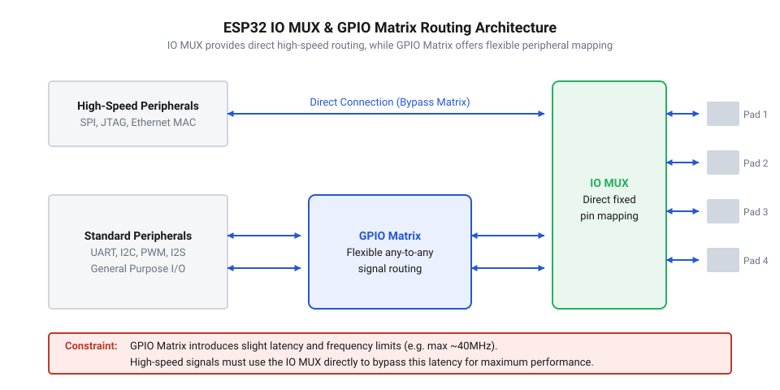
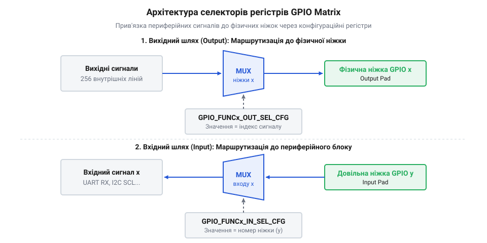
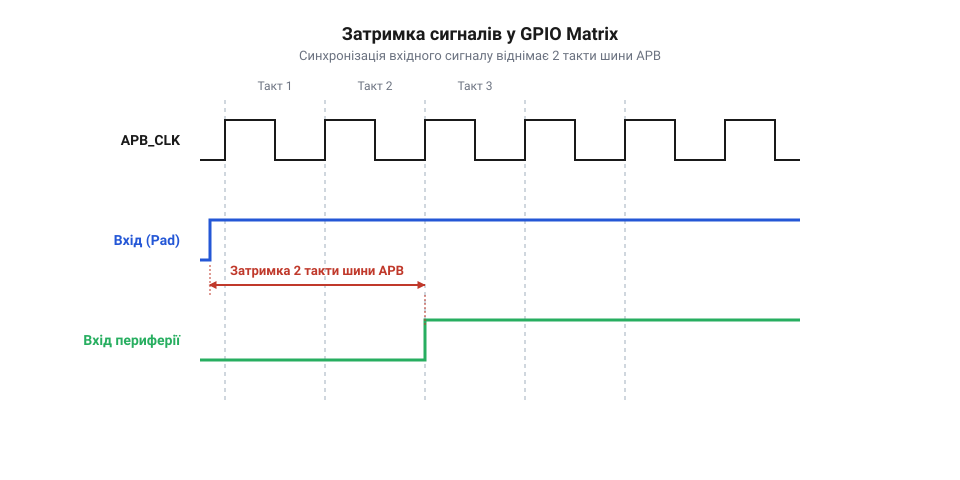

# Маршрутизація GPIO Matrix та IO_MUX в ESP-IDF: дворівнева комутація, апаратна інверсія та ціна затримки шини APB

<preknowlist>
- [Конфігурація виводів](root:sf-devices/pin-multiplexing) — основи мультиплексування функцій виводів у мікроконтролерах
- [Швидкісний SPI](root:sf-devices/dma-spi-display-transfer) — вимоги до частоти та затримок при роботі з периферійними шинами
</preknowlist>

## Архітектурний глухий кут фіксованого розпінування та відповідь ESP32

У класичних мікроконтролерах попередніх поколінь (зокрема серій AVR або більшості базових лінійок ARM Cortex-M) кожен внутрішній периферійний блок жорстко прив'язаний до кількох фіксованих фізичних виводів мікросхеми. Наприклад, апаратний інтерфейс UART1 може бути виведений виключно на піни PA9/PA10 або перенаправлений за допомогою функції ремапінгу (@@en|pin remap@@) на суворо визначену альтернативну пару PB6/PB7. Якщо під час проектування друкованої плати ці виводи вже зайняті шиною пам'яті чи швидкісним АЦП, розробник опиняється перед вибором: або змінювати трасування плати, перетинаючи сигнальні доріжки, або емулювати потрібний протокол програмно (програмний @@en|bit-bang@@), марнуючи обчислювальний ресурс процесора.

Інженери Espressif у мікроконтролерах лінійки ESP32 реалізували принципово іншу архітектуру комутації вводу-виводу — повноцінну цифрову матрицю GPIO (@@en|GPIO Matrix@@, або @@en|Crossbar Switch@@; від англ. *matrix* — матриця та *crossbar* — перехресний комутатор). Цей блок є повнозв'язним апаратним матричним комутатором, розташованим між периферійними модулями кристала (UART, SPI, I2S, LEDC PWM, RMT) та фізичними контактними майданчиками (@@en|PAD@@).

Завдяки такій структурі будь-який внутрішній вихідний сигнал можна спрямувати на будь-який фізичний пін мікроконтролера, а вхідний сигнал із будь-якого зовнішнього піна під'єднати до будь-якого внутрішнього периферійного блока. Більше того, один вихідний сигнал (наприклад, тактовий генератор або тактовий сигнал SPI) можна одночасно подати на 2, 3 чи більше різних фізичних пінів паралельно без використання додаткових зовнішніх буферів.


*Дворівнева архітектура комутації вводу-виводу: швидкісний прямий шлях IO_MUX та універсальний гнучкий комутатор GPIO Matrix.*

## Дворівнева модель комутації: прямий шлях IO_MUX проти GPIO Matrix

Повна комутаційна система мікроконтролера ESP32 побудована з двох послідовних рівнів: блока керування фізичними виводами (@@en|IO_MUX@@, від англ. *Input/Output Multiplexer*) та матричного комутатора (@@en|GPIO Matrix@@).

Блок @@en|IO_MUX@@ відповідає за низькорівневе фізичне налаштування контактного майданчика. Саме тут розташовані керуючі регістри, що визначають:
- Підтягувальні резистори: увімкнення внутрішнього підтягування до живлення (@@en|pull-up@@, типово 45 кОм) або до землі (@@en|pull-down@@).
- Навантажувальну здатність вихідного каскаду: налаштування струму виводу (5 мА, 10 мА, 20 мА або 40 мА через біти `DRIVE`).
- Режим утримання стану в глибокому сні (@@en|pad hold@@), що фіксує вихідний рівень під час переходу кристала у режим Deep Sleep.
- Вибір джерела сигналу: чи підключається фізичний пін безпосередньо до рідного швидкісного периферійного каналу (@@en|IOMUX Native Path@@), чи перемикається на цифрову шину GPIO Matrix.

Прямий шлях через IO_MUX є суто асинхронним комбінаційним колом без внутрішніх тригерів синхронізації. Сигнал проходить крізь мультиплексор IO_MUX з мінімальною фізичною затримкою кремнію (менше 1.5–2 нс). Проте кількість прямих з'єднань суворо обмежена: кожен периферійний модуль має лише один фіксований комплект виводів «рідного розпінування» (@@en|native pins@@).

Універсальний шлях через GPIO Matrix розриває цю жорстку прив'язку. Вихідний сигнал від периферії спочатку надходить у матрицю, перемикається на потрібний канал і лише потім подається на вхід блоку IO_MUX.

## Регістрова структура та апаратна інверсія сигналів

Маршрутизація сигналів у середовищі ESP-IDF здійснюється через низькорівневі виклики бібліотеки драйверів `rom/gpio.h`: `gpio_matrix_out()` та `gpio_matrix_in()`. Під капотом цих функцій лежить прямий запис конфігураційних бітів у два масиви апаратних регістрів.

Для кожного вихідного піна GPIO `n` виділено 32-бітний регістр вибору вихідного сигналу `GPIO_FUNCn_OUT_SEL_CFG_REG`. Ключові поля цього регістра:
- `GPIO_FUNCn_OUT_SEL` (біти 0..8): 9-бітний числовий індекс периферійного сигналу (наприклад, індекс 17 відповідає сигналу `U0TXD_OUT`, індекс 23 — сигналу `SPIQ_OUT`). Спеціальний індекс `0x100` (256) відключає периферію та повертає пін під пряме керування програмного регістра `GPIO_OUT_REG`.
- `GPIO_FUNCn_OUT_INV_SEL` (біт 9): біт апаратного інвертування вихідного сигналу.
- `GPIO_FUNCn_OEN_SEL` (біт 10): вибір джерела дозволу виходу (@@en|Output Enable@@). Якщо біт скинуто в 0, лінією керує вихідний буфер самої периферії; якщо встановлено в 1 — вихід керується глобальним регістром напрямку `GPIO_ENABLE_REG`.
- `GPIO_FUNCn_OEN_INV_SEL` (біт 11): інверсія сигналу дозволу виходу.

Для кожного внутрішнього периферійного входу `m` виділено відповідний регістр вибору вхідного піна `GPIO_FUNCm_IN_SEL_CFG_REG`:
- `GPIO_FUNCm_IN_SEL` (біти 0..5): номер фізичного піна GPIO (від 0 до 39), з якого зчитується сигнал.
- `GPIO_FUNCm_IN_INV_SEL` (біт 6): біт апаратного інвертування вхідного сигналу.
- `GPIO_SIGm_IN_SEL` (біт 7): перемикач між зчитуванням сигналу з виводу та примусовою фіксацією логічної константи.


*Структура конфігураційних регістрів комутатора GPIO Matrix: вибір джерела, маппінг ліній та біти апаратної інверсії.*

Апаратна інверсія сигналів (`OUT_INV` та `IN_INV`) є надзвичайно потужним інструментом вбудованого розробника. Наприклад, при підключенні опторозв'язок, що інвертують рівень логічного нуля та одиниці, або при роботі з протоколами з активним низьким рівнем (@@en|active-low@@), інверсію виконує сама матриця. Це повністю звільняє ядро процесора від зайвих операцій логічного заперечення `~` у прошивці та виключає потребу встановлювати на плату дискретні мікросхеми інверторів (наприклад, 74HC04).

## Синхронізація шиною APB та ціна часової затримки

Головна ціна, яку розробник сплачує за абсолютну гнучкість комутатора GPIO Matrix, — це додаткова затримка розповсюдження сигналу (@@en|propagation delay@@).

На відміну від пасивного IO_MUX, комутатор GPIO Matrix побудований на синхронних D-тригерах, які тактуються внутрішньою системною шиною APB (@@en|Advanced Peripheral Bus@@). Стандартна робоча тактова частота шини APB в ESP32 становить:

```
F_APB = 80 МГц
T_APB = 1 / F_APB
      = 1 / (80 × 10⁶)
      = 12.5 нс
```

Будь-який цифровий сигнал, що надходить у GPIO Matrix або виходить із неї, проходить крізь каскад синхронізаторів для запобігання виникненню метастабільності тригерів ядра:
- Вхідний сигнал із піна проходить через вхідний синхронізатор, затримуючись на 1 або 2 такти шини APB.
- Вихідний сигнал від периферійного модуля перед надходженням на вихідний каскад затримується ще на 1 такт шини APB.

Сумарна затримка проходження сигналу через матрицю складає:

```
t_delay_matrix = N_cycles × T_APB
t_delay_min = 1 × 12.5 нс
            = 12.5 нс                  [мінімальна затримка 1 такт]
t_delay_max = 2 × 12.5 нс
            = 25.0 нс                  [типова затримка 2 такти]
```


*Часова діаграма проходження цифрового фронту крізь GPIO Matrix: внесення затримки на 1-2 такти шини APB (12.5-25 нс).*

Для низькошвидкісних інтерфейсів — таких як UART (навіть на високій швидкості 921600 біт/с тривалість біта становить `1.085` мкс), I2C (період 2.5 мкс на 400 кГц) або ШІМ генераторів звуку — затримка у 25 нс складає менше 1–2% від тривалості фронту сигналу і не чинить жодного помітного впливу на працездатність протоколу.

## Граничні частотні обмеження швидкісних інтерфейсів (SPI та SDIO)

Ситуація стає критичною при переході до високошвидкісних синхронних шин, насамперед SPI (наприклад, при роботі з графічними дисплеями та зовнішньою пам'яттю flash) та SDIO/MMC.

Розглянемо роботу головного контролера SPI у режимі Master на граничній частоті тактування `F_SPI = 80` МГц:

```
T_SPI = 1 / F_SPI
      = 1 / (80 × 10⁶)
      = 12.5 нс
```

Тривалість півперіоду тактового сигналу `T_half` (час, протягом якого рівень SCK залишається високим або низьким) становить лише:

```
T_half = T_SPI ÷ 2
       = 12.5 ÷ 2
       = 6.25 нс
```

Якщо тактовий сигнал SCK виводиться через GPIO Matrix, він затримується на 2 такти APB (`t_out = 25` нс). Периферійний пристрій (наприклад, мікросхема флеш-пам'яті) отримує цей затриманий такт, зчитує вихідний біт і виставляє сигнал MISO з власною затримкою реакції `t_co` (близько 6–8 нс). Сигнал MISO повертається на пін мікроконтролера, проходить крізь вхідний синхронізатор GPIO Matrix і затримується ще на 2 такти APB (`t_in = 25` нс).

Повний час кругового пробігу сигналу (@@en|round-trip loop delay@@) становить:

```
t_round_trip = t_out + t_co + t_in
             = 25 нс + 7 нс + 25 нс
             = 57 нс
```

Оскільки затримка пробігу `57` нс у 4.5 раза перевищує період усього тактового циклу `12.5` нс, вхідний модуль SPI контролера буде захоплювати дані зі зміщенням у 4 такти вперед. Це призводить до повної втрати цілісності передачі даних та зчитування випадкового сміття.

З цієї причини в апаратній специфікації ESP32 діє суворе правило:
- **Швидкість понад 40 МГц (до 80 МГц):** вимагає використання виключно «рідних» виводів IO_MUX (наприклад, для шини HSPI це фіксовані виводи GPIO 12, 13, 14, 15). Сигнал іде в обхід матриці напряму через комбінаційні ключі IO_MUX.
- **Швидкість до 40 МГц включно:** дозволяє вільне призначення будь-яких довільних виводів через GPIO Matrix. При цьому драйвер ESP-IDF автоматично налаштовує компенсацію затримки фази (фазовий зсув тактування через спеціальні біти попереднього захоплення `SPI_CK_OUT_EDGE`).

Порівняльний практичний бенчмарк затримок та пропускної здатності прямих пінів проти матричної комутації реалізовано у [практичному проєкті вимірювання затримок IO_MUX та GPIO Matrix](root:sf-devices/esp-idf-gpio-matrix-iomux-routing/proj-high-speed-vs-flexible-routing-bench.md).
