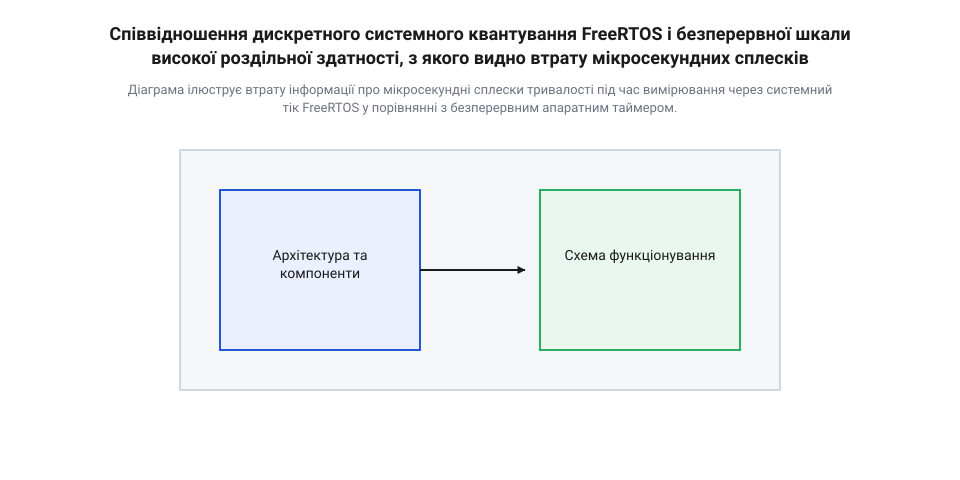
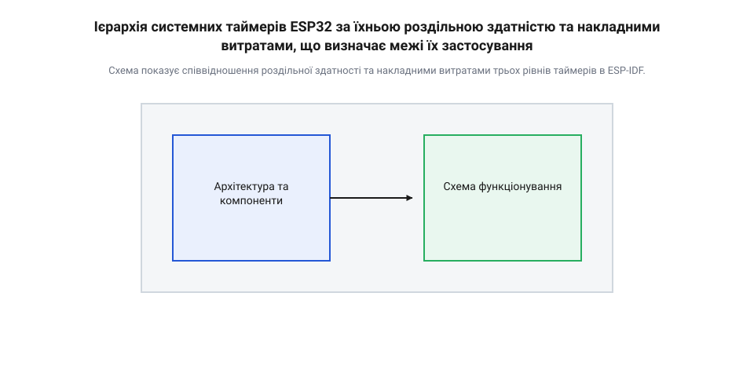
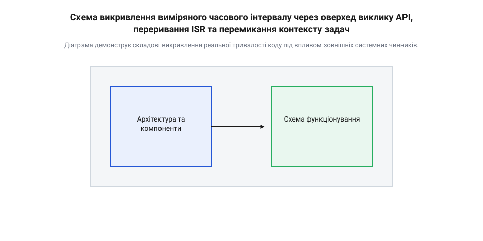
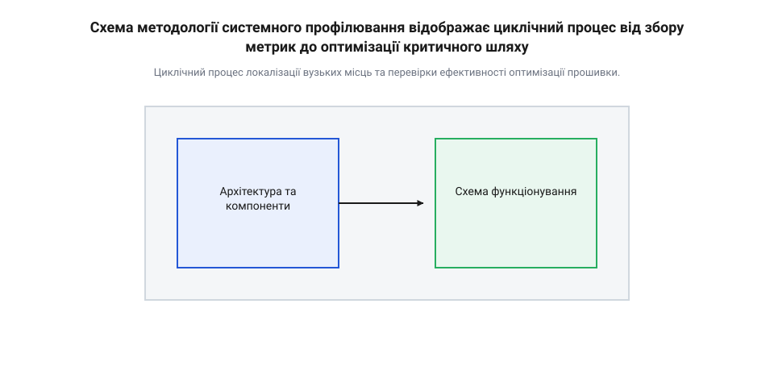

# Профілювання продуктивності за допомогою системних таймерів ESP-IDF

<preknowlist>
- [Точний час](root:sf-devices/millis-micros) — базові принципи відліку інтервалів у мілісекундах та мікросекундах без використання ОС.
- [Неблокуючий час](root:sf-devices/nonblocking-time) — концепція вимірювання різниці між зафіксованими мітками часу замість використання затримуючих викликів.
</preknowlist>

## Невідомі затримки у прошивці реального часу

У розробці вбудованих систем реального часу виникають ситуації, коли пристрій зовні працює некоректно, але стандартні інструменти діагностики не показують жодних відхилень. Припустимо, розробник реалізує систему високоточного моторного приводу, де потрібна [генерація кроків DDA](root:sf-devices/dda-step-generation) з мікросекундним інтервалом між імпульсами. Періодично двигун пропускає кроки, або в послідовному протоколі зв'язку виникають поодинокі помилки кадрів. Намагаючись знайти джерело проблеми, інженер обгортає підозрілу функцію викликами системного таймера операційної системи @@en|FreeRTOS@@, щоб виміряти тривалість її виконання. Проте після тисяч запусків журналювання показує нульову тривалість затримки. Функція виконується нібито миттєво, хоча фактичний дедлайн (від @@en|deadline@@ — граничний термін виконання завдання) обробки події регулярно порушується.

Джерело цієї ілюзії полягає в принципово різній природі дискретного системного квантування та безперервного апаратного часу. Операційна система @@en|FreeRTOS@@ відлічує час за допомогою системних тіків (від @@en|tick@@ — цокання або квант часу), які генеруються періодичним перериванням апаратного таймера. Типова частота системного тіка `@@en|configTICK_RATE_HZ@@` у середовищі @@en|ESP-IDF@@ за замовчуванням становить 100 Гц або 1000 Гц, що відповідає періоду квантування (від @@latin|quantus@@ — скільки чи яка кількість) у 10 мс або 1 мс. Вибір цієї частоти визначає компроміс між роздільною здатністю вимірювання та накладними витратами (від @@en|overhead@@ — згори над основними витратами) процесорного часу. Підвищення частоти тіків робить сітку вимірювання щільнішою та покращує реакцію планувальника задач, проте змушує ядро мікроконтролера частіше виконувати обробник переривання тіка (на збереження регістрів, перевірку тайм-аутів та перемикання контексту), витрачаючи цінну обчислювальну потужність на системне обслуговування. Зниження ж частоти зменшує накладні витрати до незначних часток відсотка, але збільшує період квантування, через що коротка функція стає «невидимою» для системного лічильника. Коли функція `@@en|xTaskGetTickCount()@@` зчитує поточне значення лічильника тіків, вона отримує дискретне ціле число. Якщо вимірювана ділянка коду виконується за 150 мкс, то з високою ймовірністю між початком і кінцем її виконання не відбудеться жодного переривання тіка. У результаті різниця між двома мітками часу дорівнюватиме нулю тіків. Якщо ж виконання функції тривалістю ті ж 150 мкс випадково перетне межу системного тіка, зафіксована різниця становитиме рівно 1 тік (тобто 1000 мкс або 10000 мкс). Таке хронометрування (від @@el|χρόνος@@ — час та @@el|μέτρον@@ — вимірювання) дає величезну дискретну похибку, яка робить системний тік непридатним для вимірювання швидких алгоритмів.

В історії вбудованого програмного забезпечення методи профілювання (від @@en|profile@@ — боковий нарис чи профіль предмета) пройшли довгий шлях від найпростіших апаратних маніпуляцій до складних внутрішньопроцесорних лічильників. На ранніх 8-бітних мікроконтролерах розробники вимірювали час шляхом переключення логічного рівня на вільних @@en|GPIO@@-пінах пристрою та підключення зовнішнього осцилографа або логічного аналізатора, або ж вручну підраховували кількість машинних тактів кожної інструкції в асемблерному лістингу. З появою 32-бітних архітектур @@en|Xtensa@@ та @@en|RISC-V@@ у мікроконтролерах @@en|ESP32@@ апаратні лічильники тактів `@@en|CCOUNT@@`/`@@en|CYCLE@@` та високоточний периферійний драйвер `@@en|esp_timer@@` у середовищі @@en|ESP-IDF@@ перенесли функціонал хронометрування безпосередньо всередину кристала. Проте впровадження операційних систем реального часу (@@en|RTOS@@) одночасно ускладнило вимірювання: поява системного кванту часу, затримок перемикання контексту задач та асинхронних переривань створила додаткові часові викривлення, які розробник мусить системно враховувати.


*Діаграма ілюструє втрату інформації про мікросекундні сплески тривалості під час вимірювання через системний тік FreeRTOS у порівнянні з безперервним апаратним таймером.*

Математично похибка дискретизації системного тіка описується виразом відносної похибки вимірювання. Якщо справжня тривалість виконання ділянки коду позначена як Δt_true, а період системного тіка як T_tick, то виміряне значення Δt_measured набуває значень залежно від моменту настання переривання таймера:

```
Δt_measured = 0                      [якщо під час виконання не було переривання тіка]
Δt_measured = T_tick                 [якщо під час виконання відбулося переривання тіка]
ε_rel = |Δt_measured - Δt_true| / Δt_true
```

Коли Δt_true значно менше за T_tick (наприклад, 100 мкс проти 1000 мкс), відносна похибка ε_rel становить або 100% (при Δt_measured = 0), або досягає 900% (при Δt_measured = T_tick). Для подолання цього обмеження розробник має перейти від системних лічильників операційної системи до безперервних апаратних таймерів. У мікроконтролерах @@en|ESP32@@ для цього використовується [апаратний периферійний таймер](root:sf-devices/esp-timer-profiling/comp-hardware-timer-peripheral.md), який тактується від високочастотного кварцового генератора незалежно від ядра процесора та планувальника задач. Хоча високорівневий [збір статистики задач FreeRTOS](root:sf-devices/freertos-task-runtime-stats) корисний для оцінки загального завантаження ядер процесора, аналіз локальних затримок окремих функцій вимагає безпосереднього доступу до високоточних лічильників.

Нижче наведено приклад коду, що демонструє непридатність функцій системного тіка для точного вимірювання мікросекундних затримок.

:::tabs
@tab C (ESP-IDF)
:::code root\eng\sf-devices\esp-timer-profiling/esp-timer-profiling-d/c/esp-idf/calculate-fast-hash.c c
@tab C++ (ESP-IDF)
:::code root\eng\sf-devices\esp-timer-profiling/esp-timer-profiling-d/cpp/esp-idf/fasthasher.cpp cpp
:::

Як демонструє приклад коду, вимірювання коротких обчислювальних блоків за допомогою квантованого системного часу не дає реальної інформації про тривалість виконання, вимагаючи використання високоточних периферійних інструментів вимірювання.

## Вибір інструменту вимірювання часових інтервалів

У середовищі @@en|ESP-IDF@@ розробник має у своєму розпорядженні три основних інструменти вимірювання часових інтервалів, кожен з яких володіє власною роздільною здатністю, накладними витратами (від @@en|overhead@@ — накладні витрати) та контекстними обмеженнями. Для вибору оптимального інструменту необхідно розуміти їхню апаратну та програмну реалізацію: Детальніше про низькорівневу архітектуру цих периферійних модулів відліку часу розповідають [апаратні таймери LACT та SysTimer в ESP32](root:sf-devices/esp-timer-hardware-lact).

1. `@@en|xTaskGetTickCount()@@` — системний лічильник тіків @@en|FreeRTOS@@. Має мілісекундну роздільну здатність (зазвичай 1–10 мс). Накладні витрати на виклики мінімальні (1–2 такти процесора, оскільки функція лише зчитує глобальну змінну). Безпечний для виклику в задачевому контексті, але непридатний для швидких обчислень. 2. `@@en|esp_timer_get_time()@@` — високорівневий мікросекундний таймер @@en|ESP-IDF@@. Повертає 64-бітне значення часу в мікросекундах від моменту ініціалізації системи. Спирається на апаратний периферійний лічильник (@@en|SysTimer@@ або @@en|LACT@@). Володіє роздільною здатністю в 1 мкс. Накладні витрати виклику становлять близько 0.5–1.5 мкс (залежно від частоти ядра CPU та стану кєш-пам'яті). Функція є потокобезпечною, може викликатися з будь-якого ядра @@en|CPU@@, з контексту задач та з обробників переривань (@@en|ISR@@ — від @@en|Interrupt Service Routine@@). 3. `@@en|esp_cpu_get_cycle_count()@@` — пряме зчитування 32-бітного лічильника тактових імпульсів процесора (`@@en|CCOUNT@@` для архітектури @@en|Xtensa@@ або `@@en|mcycle@@` для @@en|RISC-V@@). Володіє максимально можливою наносекундною роздільною здатністю (один такт ядра: ~4.16 нс при частоті CPU 240 МГц). Накладні витрати виклику мінімальні — 1 такт CPU на виконання інструкції зчитання регістру. Проте лічильник прив'язаний до конкретного ядра CPU, переповнюється кожні 17.8 секунди при 240 МГц та залежить від динамічної зміни частоти процесора (@@en|DVFS@@).


*Схема показує співвідношення роздільної здатності та накладними витратами трьох рівнів таймерів в ESP-IDF.*

Під час вимірювання надкоротких інтервалів реальна тривалість коду може спотворюватися через низку системних факторів. Основними джерелами викривлення замірів є накладні витрати самих викликів функцій таймера, виникнення джиттеру (від @@en|jitter@@ — тремтіння або фазове відхилення) через вкладені переривання @@en|ISR@@, перемикання контексту задач планувальником @@en|FreeRTOS@@, промахи кєш-пам'яті (@@en|Cache miss@@) при виконанні коду з зовнішньої @@en|Flash@@/@@en|PSRAM@@, а також переупорядкування інструкцій компілятором у процесі оптимізації.


*Діаграма демонструє складові викривлення реальної тривалості коду під впливом зовнішніх системних чинників.*

Для отримання точного значення тривалості коду розробник мусить застосовувати математичну модель калібрування замірів. Якщо накладні витрати зчитування таймера позначені як t_overhead, то скориговане значення тривалості Δt_true обчислюється шляхом віднімання оверхеду:

```
t_start = get_timer_value()          [знімок початку вимірювання]
t_end = get_timer_value()            [знімок кінця вимірювання]
Δt_raw = t_end - t_start             [сирий виміряний інтервал]
Δt_true = Δt_raw - t_overhead        [скориговане значення тривалості]
```

Параметри калібрування оверхеду розгортає [математична модель калібрування](root:sf-devices/esp-timer-profiling/math-timer-overhead-calibration.md) накладних витрат. При використанні тактного лічильника процесора переведення кількості тактів Δcycles у фізичні одиниці часу Δt_ns виконується за пропорцією залежно від поточної тактової частоти ядра f_cpu_mhz:

```
Δt_ns = (Δcycles × 1000) / f_cpu_mhz        [обчислення тривалості в наносекундах]
Δt_us = Δcycles / f_cpu_mhz                 [обчислення тривалості в мікросекундах]
```

Особливості переведення одиниць та обробки 32-бітного переповнення регістру деталізує [математика обчислення тактів](root:sf-devices/esp-timer-profiling/math-cpu-cycle-conversion-overflow.md) процесора.

Щоб запобігти передчасному або запізнілому виконанню зчитування таймера внаслідок оптимізацій компілятора, у код вводять бар'єри пам'яті (@@en|memory barrier@@) `asm volatile("" ::: "memory")`. Вони забороняють компілятору переносити інструкції читання та запису через точку вимірювання.

Вибір відповідного методу з [програмного інтерфейсу вимірювання](root:sf-devices/esp-timer-profiling/api-esp-timer-profiling-idf.md) залежить від тривалості ділянки та контексту. На цій основі можна побудувати закончений [модуль профілювання коду](root:sf-devices/esp-timer-profiling/proj-esp-profiling-harness.md) для системних випробувань. Комплексний аналіз продуктивності також доповнюється [візуальним трасуванням задач](root:sf-devices/esp-systemview-tracing-analysis) та інструментами, де [аналіз покриття коду](root:sf-devices/esp-gcov-code-coverage-profiling) поєднується з хронометруванням. Отримані метрики застосовують при проведенні робіт із [синхронізації точного аптайму](root:sf-devices/uptime-clock-sync) та розробки систем, орієнтованих на [періодичне планування подій](root:sf-devices/periodic-scheduling). Загальну концепцію вимірювань за мітками визначає [базовий неблокуючий час](root:sf-devices/nonblocking-time), а фундаментальний відлік забезпечує [мікросекундний точний час](root:sf-devices/millis-micros) пристрою.

Нижче наведено практичний приклад точного профілювання функції з калібруванням оверхеду, захистом від компілятора та переведенням тактів CPU у мікросекунди.

:::tabs
@tab C (ESP-IDF)
:::code root\eng\sf-devices\esp-timer-profiling/esp-timer-profiling-d/c/esp-idf/measure-cycle-overhead.c c
@tab C++ (ESP-IDF)
:::code root\eng\sf-devices\esp-timer-profiling/esp-timer-profiling-d/cpp/esp-idf/preciseprofiler.cpp cpp
:::

Для усунення впливу фонових задач RTOS при профілюванні критичних секцій код вимірювання огортається в критичну секцію @@en|portENTER_CRITICAL()@@, що блокує переривання на поточному ядрі процесора ESP32 та гарантує точність відліку циклів лічильника @@en|esp_cpu_get_cycle_count()@@.

## Калібрування та віднімання системного оверхеду

Виклики функцій вимірювання часу самі по собі є набором машинних інструкцій процесора, які потребують процесорного часу на виконання. Якщо виконати два послідовних зчитування лічильника `esp_cpu_get_cycle_count()` або функції `esp_timer_get_time()` одне за одним без жодного коду між ними, отриманий результат не буде нульовим. Цей доданий часовий інтервал є систематичною похибкою вимірювання, яка називається @@en|оверхедом@@ (від англ. @@en|overhead@@ — накладні витрати) виклику @@en|API@@. Якщо досліджуваний алгоритм виконується за 30 тактів процесора, а сам таймер витрачає 15 тактів на зчитування регістру, то сире виміряне значення містить викривлення у 50%. Без розуміння та урахування цих витрат оцінка швидкодії коротких ділянок коду втрачає будь-яку точність.

Накладні витрати виникають через сукупність апаратних та програмних факторів. На рівні мікроконтролера @@en|ESP32@@ виклики функцій хронометрування звертаються до апаратних регістрів або периферійних модулів, що детально описує [периферійний модуль апаратного таймера](root:sf-devices/esp-timer-profiling/comp-hardware-timer-peripheral.md). При зверненні до апаратного регістру тактів процесора `CCOUNT` в архітектурі @@en|Xtensa@@ або `cycle` в @@en|RISC-V@@ конвеєр процесора виконує вибірку інструкції, зчитування спеціального регістру та збереження значення в регістр загального призначення. Коли вимірювання здійснюється через виклик функції фреймворку, додаються накладні витрати узгодження виклику (@@en|Application Binary Interface@@, @@en|ABI@@): збереження регістрів на стек, перехід за адресою функції, вибір блоку даних і повернення з функції. Для високорівневих викликів на кшталт `esp_timer_get_time()`, як показано в [огляді програмного інтерфейсу ESP-IDF](root:sf-devices/esp-timer-profiling/api-esp-timer-profiling-idf.md), функція також здійснює зчитування 64-бітного значення з шини @@en|APB@@, розрахунок масштабування та обробку можливого переповнення молодших регістрів, що збільшує оверхед до кількох десятків або сотень тактів.

Нехай `T_measured` — сире виміряне значення часового інтервалу між двома мітками часу, `T_target` — істинний час виконання аналізованого коду, а `T_overhead` — систематична похибка таймера. Тоді виміряний час визначається рівнянням:

```
T_measured = T_target + T_overhead
T_target = T_measured - T_overhead      [віднімання системного оверхеду]
```

Для визначення `T_overhead` виконують серію порожніх вимірювань — замір тривалості виконання порожнього блоку коду, де між збереженням початкової та кінцевої мітки часу немає жодних обчислень. Оскільки будь-яке зовнішнє переривання може штучно збільшити час порожнього заміру, оверхед визначається як мінімальне значення з серії N замірів:

```
T_overhead = min(T_empty_1, T_empty_2, ..., T_empty_N)
```

Детальні математичні властивості цього розрахунку та оцінка відхилень викладені у [математичній моделі калібрування оверхеду](root:sf-devices/esp-timer-profiling/math-timer-overhead-calibration.md).

Апаратний лічильник тактів `esp_cpu_get_cycle_count()` повертає значення в процесорних тактах (@@en|clock cycles@@). Для переведення тактів у фізичні одиниці часу (наносекунди або мікросекунди) необхідно враховувати поточну тактову частоту ядра CPU (наприклад, 80 МГц, 160 МГц або 240 МГц). Тривалість одного такту визначається як обернена величина до тактової частоти. Формула переведення тактів у наносекунди має вигляд:

```
t_ns = (cycles × 1000000000) / f_cpu
     = (cycles × 1000) / f_cpu_MHz      [масштабування для цілочисельної арифметики]
```

При тактовій частоті ядра 240 МГц один такт процесора триває приблизно 4.1667 наносекунд. Переведення 120 тактів у наносекунди розраховується за кроками:

```
t_ns = (120 × 1000) / 240
     = 120000 / 240                     [цілочисельне множення на 1000]
     = 500                              [тривалість у наносекундах]
```

Апаратний регістр тактів `CCOUNT` є 32-бітним беззнаковим цілим числом (`uint32_t`), яке переповнюється після досягнення значення 4294967295. На частоті 240 МГц повний цикл лічильника розраховується так:

```
T_overflow = 4294967296 / 240000000     [ділення кількості тактів на частоту в Гц]
           ≈ 17.895                     [тривалість у секундах]
```

Оскільки обчислення різниці між кінцевою та початковою міткою виконується в 32-бітній беззнаковій арифметиці, переповнення лічильника обробляється апаратно за правилами арифметики за модулем 2³². Якщо часовий інтервал не перевищує 17.89 секунди, обчислення `(uint32_t)(end_cycles - start_cycles)` дає точну кількість тактів навіть у випадку, коли лічильник перетнув нуль під час вимірювання. Тонкощі арифметики та обробки масштабних коефіцієнтів розкрито в [математиці переведення тактів CPU](root:sf-devices/esp-timer-profiling/math-cpu-cycle-conversion-overflow.md).

Наведемо приклад реалізації вимірювання оверхеду та коригування замірів в ESP-IDF. Цей підхід лежить в основі [практичного модуля профілювання](root:sf-devices/esp-timer-profiling/proj-esp-profiling-harness.md).

:::tabs
@tab C (ESP-IDF)
:::code root\eng\sf-devices\esp-timer-profiling/esp-timer-profiling-d/c/esp-idf/measure-timer-overhead.c c
@tab C++ (ESP-IDF)
:::code root\eng\sf-devices\esp-timer-profiling/esp-timer-profiling-d/cpp/esp-idf/cpuprofiler.cpp cpp
:::

## Вплив контексту виконання на похибку

Навіть після точного обчислення та віднімання постійного оверхеду викликів таймера серійні заміри того самого детермінованого коду демонструють несподівану нестабільність. Один і той самий алгоритм обробки масиву у 95% випадків виконується за 140 тактів CPU, але в окремих замірах час раптово підстрибує до 3500 або навіть 20000 тактів. Ця часова варіативність називається @@en|джиттером@@ (від англ. @@en|jitter@@ — тремтіння) замірів. Якщо спиратися на поодиноке вимірювання або просте середнє арифметичне значення, розробник зробить хибний висновок про низьку ефективність коду або нестабільну роботу алгоритму.

Причина аномальних сплесків тривалості полягає у фізичній природі роботи багатозадачної операційної системи реального часу та апаратної архітектури мікроконтролера:

1. **Витіснення задач системним планувальником**: Операційна система @@en|FreeRTOS@@ використовує квантування часу на основі системного тіка. Якщо під час виконання хронометрованої ділянки коду спрацьовує переривання системного таймера і планувальник вирішує передати управління іншій задачі з вищим або рівним пріоритетом, поточна задача витісняється (@@en|витіснення задач@@ — англ. @@en|preemption@@). Час, витрачений іншими задачами, а також операція перемикання контексту (збереження та відновлення регістрів CPU, що займає близько 100–300 тактів), додається до вимірюваного інтервалу. 2. **Апаратні переривання (ISR)**: Незалежно від стану системного планувальника, апаратні периферійні модулі (@@en|Wi-Fi@@, @@en|Bluetooth@@, @@en|UART@@, @@en|DMA@@) генерують апаратні переривання. Обробник переривання (@@en|ISR@@ — від англ. @@en|Interrupt Service Routine@@ — служба обробки переривань) призупиняє виконання основного коду ядра, виконує свою роботу й лише потім повертає управління. У результаті таймер фіксує не лише час роботи алгоритму, а й сумарний час виконання усіх обробників переривань, що вклинилися у процес. 3. **Промахи кєш-пам'яті та стан конвеєра**: Мікроконтролери @@en|ESP32@@ виконують інструкції прошивки з зовнішньої кєш-пам'яті @@en|Flash@@ через внутрішній кєш інструкцій (@@en|I-Cache@@) та кєш даних (@@en|D-Cache@@). При першому виклику функції відбувається промах кєш-пам'яті (@@en|промах кєш-пам'яті@@ — англ. @@en|cache miss@@), і процесор зупиняється на десятки тактів для зчитування даних із зовнішньої флеш-пам'яті. При повторних викликах інструкції вже знаходяться у швидкому внутрішньому кєші (@@en|cache hit@@), і замір показує чистий час обчислень. 4. **Реорганізація інструкцій компілятором**: Оптимізуючий компілятор переставляє машинні інструкції місцями для ефективнішого заповнення конвеєра CPU. Якщо не застосувати спеціальні обмеження, компілятор може винести частину обчислень за межі блоку вимірювання або, навпаки, затягнути завантаження змінних із пам'яті всередину вимірювального вікна.

Для усунення впливу контексту та отримання чистих характеристик продуктивності застосовують сукупність системних методів:

- **Ізоляція коду критичними секціями**: Для ультракоротких замірів (одиниці мікросекунд) тимчасово вимикають переривання та системне витіснення за допомогою критичних секцій `taskENTER_CRITICAL()` / `taskEXIT_CRITICAL()`. Це гарантує детерміноване виконання без втручання планувальника та ISR. Однак критичні секції не можна утримувати довго, щоб не порушити роботу мережевих стеків та системних таймерів. - **Бар'єри пам'яті та модифікатор volatile**: Для запобігання реорганізації коду компілятором перед і після зчитування таймера додають інструкції комбінованого бар'єра пам'яті: `__asm__ __volatile__("" ::: "memory")`. На апаратному рівні для гарантії завершення всіх шинних операцій запису використовують інструкцію `memw` в архітектурі Xtensa або `fence` в RISC-V. - **Статистична фільтрація замірів**: Замість одного заміру виконують серію з N випробувань (наприклад, N = 100). В апаратних системах без змінного стану алгоритму будь-які зовнішні фактори (ISR, витіснення, промахи кєшу) можуть лише збільшити час виконання. Звідси випливає фундаментальне правило: мінімальне значення серії вимірювань `min(T_1, ..., T_N)` є найточнішою оцінкою істинного часу виконання коду на CPU. Для оцінки поведінки в умовах реального навантаження системи розраховують медіану та перцентилі (P95, P99), які характеризують затримки найгіршого випадку (@@en|Worst-Case Execution Time@@, @@en|WCET@@).

У разі потреби детального аналізу розподілу процесорного часу між задачами використовують [збір статистики операційної системи](root:sf-devices/freertos-task-runtime-stats). Для наочного візуального аналізу перемикання контексту та часових затримок ISR у реальному часі застосовують [візуальне трасування задач](root:sf-devices/esp-systemview-tracing-analysis). Аналіз повноти виконання гілок коду під час бенчмаркінгу здійснюється через [профілювання покриття коду](root:sf-devices/esp-gcov-code-coverage-profiling). Отримані точні затримки є критичними під час проектування таких систем реального часу, як [квантування часу в DDA-генераторах](root:sf-devices/dda-step-generation).

Наведемо практичний приклад ізоляції вимірювального вікна та статистичної фільтрації результатів в ESP-IDF.

:::tabs
@tab C (ESP-IDF)
:::code root\eng\sf-devices\esp-timer-profiling/esp-timer-profiling-d/c/esp-idf/compare-uint32.c c
@tab C++ (ESP-IDF)
:::code root\eng\sf-devices\esp-timer-profiling/esp-timer-profiling-d/cpp/esp-idf/isolatedprofiler.cpp cpp
:::

## Системний вияв та усунення вузьких місць

Уявіть типову ситуацію під час налагодження прошивки для мікроконтролера @@en|ESP32@@: інженер успішно опанував калібрування системних хронометрів, навчився ізолювати заміри від апаратних переривань і зібрав точні мікросекундні метрики виконання окремих функцій. Проте пристрій усе одно періодично пропускає дедлайни реального часу. Намагаючись виправити проблему, розробник починає хаотично оптимізувати першу-ліпшу обчислювальну функцію — наприклад, переписує складний математичний алгоритм фільтрації сигналів. Після кількох днів роботи функція прискорюється на 40%, проте загальна поведінка системи не змінюється: пристрій продовжує пропускати кроки двигуна або скидати з'єднання через виникнення тайм-аутів.

Помилка інженера полягає в тому, що він оптимізував ділянку коду, яка не впливала на загальну затримку системи. Обчислювальний алгоритм займав лише 3% процесорного часу, тоді як 85% часу витрачалося на очікування прапорців готовності периферії та неефективне копіювання даних між буферами. Безсистемні правки коду без попереднього аналізу всієї прошивки не дають результату. Для гарантування стабільної роботи системних алгоритмів необхідно осягнути методологію локалізації вузьких місць (від англійського *bottleneck* — звужена шийка пляшки, обмежувальний елемент продуктивності) та аналізу критичних шляхів (від англійського *critical path* — найдовша послідовність послідовних операцій, що визначає підсумкову тривалість виконання).


*Циклічний процес локалізації вузьких місць та перевірки ефективності оптимізації прошивки.*

Локалізація критичного шляху починається з декомпозиції скнарозних затримок (від англійського *latency breakdown* — розкладання затримки на окремі складові). Будь-який наскрізний процес обробки даних у прошивці — від отримання переривання від датчика до відправки пакета в мережу — складається з послідовності окремих етапів. Загальна тривалість виконання обчислюється як сума часу кожної фази:

```
T_total = T_acquire + T_filter + T_compute + T_serialize + T_transmit  [розкладання сквозного часу обробки на послідовні фази]
```

Якщо фаза `T_compute` займає лише 30 мікросекунд із загальних 1000 мікросекунд `T_total`, навіть її повна миттєва оптимізація до 0 мікросекунд зменшить загальний час лише на 3%. Натомість якщо фаза `T_serialize` триває 850 мікросекунд через неефективне копіювання байтів у циклі, саме вона є вузьким місцем системи.

Для первинного верхньорівневого виявлення важких задач розробник спирається на інструменти [статистики використання процесорного часу](root:sf-devices/freertos-task-runtime-stats) операційної системи @@en|FreeRTOS@@ та системи [візуального трасування задач](root:sf-devices/esp-systemview-tracing-analysis). Вони показують, яка саме задача споживає більшість ресурсів ядра процесора. Проте для точної локалізації конкретного рядка коду всередині цієї задачі використовують [модуль автоматизованого профілювання](root:sf-devices/esp-timer-profiling/proj-esp-profiling-harness.md), що базується на апаратних таймерах.

Другим важливим аспектом є відмова від оцінки продуктивності за середнім арифметичним значенням. У системах реального часу середня швидкодія не гарантує відсутності збоїв. Наприклад, якщо з 1000 прогонів функція 999 разів виконується за 10 мікросекунд, а 1 раз — за 50 мілісекунд (через промах кєш-пам'яті або витіснення вищоприоритетною задачею), середнє значення дорівнюватиме лише 59 мікросекундам. Проте цей один сплеск тривалістю 50 мілісекунд викличе зрив синхронізації пристрою.

Тому профілювання систем реального часу спирається на перцентилі (від латинського *per centum* — на сто, кількісна межа статистичного розподілу) та аналіз затримок у найгіршому випадку (від англійського *worst-case execution time* або @@en|tail latency@@ — гранична затримка найповільніших замірів):

```
p50 = median(sorted_samples)             [медіана — типовий час виконання 50% замірів]
p95 = sample_at_index(0.95 × N)          [гранична тривалість для 95% найшвидших замірів]
p99 = sample_at_index(0.99 × N)          [гранична тривалість для 99% замірів]
```

Значення @@en|p99@@ показує затримку, яку система гарантовано не перевищує у 99% випадків. Побудова гістограми (від грецького *histos* — щогла, та *gramma* — запис, графічний розподіл частоти виникнення замірів) дозволяє одразу виявити аномальні зсуви. Застосовуючи [математичну модель калібрування](root:sf-devices/esp-timer-profiling/math-timer-overhead-calibration.md) та віднімаючи систематичний оверхед, розробник отримує очищені статистичні профілі продуктивності.

Після локалізації вузького місця процес оптимізації виконується за замкненим циклом:
1. **Фіксація базового рівня (@@en|baseline@@)**: вимірювання @@en|p50@@, @@en|p99@@ та максимального часу до внесення правок. 2. **Точкова оптимізація**: проведення рефакторингу (від латинського *re-* — знову, та англійського *factor* — чинник, перебудова коду без зміни зовнішньої поведінки). Прикладами оптимізації в @@en|ESP-IDF@@ є перенесення критичних функцій у швидку статичну оперативну пам'ять за допомогою атрибута `IRAM_ATTR`, заміна динамічної алокації пам'яті в `heap` на статичні буфери, або використання векторних інструкцій процесора. 3. **Повторне вимірювання та перевірка**: повторний бенчмаркінг (від англійського *benchmark* — опорна відмітка, порівняльне вимірювання швидкодії) у тих самих умовах. 4. **Контроль покриття**: використання [аналізу покриття коду](root:sf-devices/esp-gcov-code-coverage-profiling) для впевненості, що під час вимірювань були виконані всі гілки алгоритму.

Цей підхід є критичним під час розробки відповідальних вузлів прошивки, таких як [генератор кроків DDA](root:sf-devices/dda-step-generation), де стабільне підтримання затримок є передумовою плавності рухів, або при організації [періодичних подій](root:sf-devices/periodic-scheduling), що вимагають жорсткого дотримання часових інтервалів. Розгортаючи [неблокуючий вимірювач часу](root:sf-devices/nonblocking-time) на основі апаратних функцій фреймворку, як-от [системні хронометри ESP-IDF](root:sf-devices/esp-timer-profiling/api-esp-timer-profiling-idf.md) або регістри [апаратного таймера](root:sf-devices/esp-timer-profiling/comp-hardware-timer-peripheral.md), розробник отримує повну прозорість часової поведінки програми.

Нижче наведено практичну реалізацію модуля статистичного профілювання конвеєра обробки даних, який обчислює тривалість окремих фаз, визначає вузькі місця та підраховує перцентилі затримок.

:::tabs
@tab C (ESP-IDF)
:::code root\eng\sf-devices\esp-timer-profiling/esp-timer-profiling-d/c/esp-idf/compare-uint32-2.c c

@tab C++ (ESP-IDF)
:::code root\eng\sf-devices\esp-timer-profiling/esp-timer-profiling-d/cpp/esp-idf/pipelinebenchmark.cpp cpp
::: Для боротьби з виявленими аномальними сплесками виконання та забезпечення жорстких дедлайнів застосовується [оптимізація граничних затримок p99](root:sf-devices/esp-tail-latency-optimization).