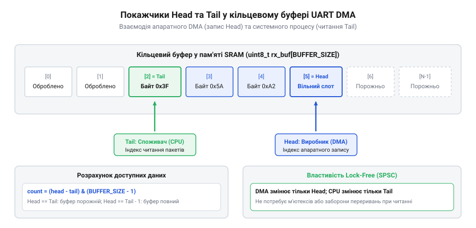
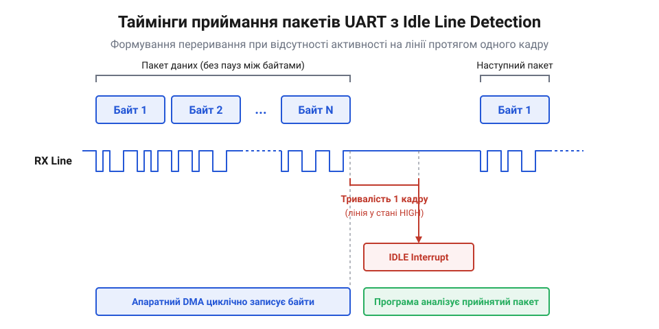

# Апаратне DMA та кільцеві буфери UART для хост-мікроконтролерів

Приймання високошвидкісних потоків даних через інтерфейс UART на швидкостях 115200–3000000 бод створює критичне навантаження на процесорне ядро, якщо кожен прийнятий байт обробляється окремим перериванням (RXNE / RX FIFO Interrupt). На швидкості 921600 бод один байт передається за 10.85 мкс. Якщо пролог і епілог переривання разом із контекстним перемиканням у RTOS займають 2–4 мкс, ядро витрачає від 20% до 40% свого бюджету лише на збереження регістрів і читання регістра даних периферії. Найменша затримка обслуговування переривання іншим високопріоритетним процесом призводить до переповнення апаратного приймача (Overrun Error, ORE) та безповоротної втрати пакетів.

Вирішенням проблеми є конфігурація контролера прямого доступу до пам'яті (Direct Memory Access, DMA) у зацикленому (циркулярному) режимі, коли периферія UART самостійно перевантажує дані з регістра приймача в оперативну пам'ять без участі CPU.


## Фізичний механізм циркулярного перенесення даних

Контролер DMA функціонує як незалежний співпроцесор шини даних (AHB/AXI). При кожному завершенні прийому байта або слова інтерфейсом UART апаратний сигнал запиту DMA Request (DMARX) ініціює одиночну транзакцію шини:

1. Читання байта з регістра прийому даних (RDR або DR).
2. Запис байта в поточну адресу в ОЗП (SRAM), що вказується регістром цільової пам'яті DMA (Memory Address Register).
3. Декремент внутрішнього апаратного лічильника кількості передач (наприклад, `NDTR` у контролерах STM32 або лічильника дескрипторів у ESP32/ESP8266).
4. Автоматичний інкремент покажчика пам'яті на одиницю.

У звичайному одиночному режимі (Normal Mode) після досягнення `NDTR == 0` контролер вимикає потік і чекає реініціалізації від процесора. У циркулярному режимі (Circular Mode) контролер при досягненні кінця виділеного буфера атомарно скидає цільову адресу на початкову комірку буфера в пам'яті, а лічильник `NDTR` автоматично відновлює початкове значення розміру буфера `BUFFER_SIZE`. Перенесення даних триває безперервно без жодної наносекунди затримки та без втручання ядра.

## Обчислення позиції запису та механіка кільця

Оскільки контролер DMA змінює лічильник залишку передач `NDTR` апаратно, положення голови буфера (Head / Write Index) не потребує програмної змінної. Процесор обчислює поточну позицію запису прямим читанням регістра:

```
write_index = BUFFER_SIZE - DMA_Stream->NDTR
```

Якщо розмір буфера вибрано ступенем двійки (`BUFFER_SIZE = 2^N`), операції обчислення відстаней між покажчиками спрощуються до бітової маски `MASK = BUFFER_SIZE - 1`.



Програмний стек утримує власний покажчик читання (`read_index` або Tail), який зміщується лише функціями прикладного рівня. Доступ до буфера за схемою «один письменник (DMA) — один читач (CPU)» є природно потокобезпечним (lock-free) за умови дотримання двох правил:
- Процесор ніколи не змінює лічильник DMA під час передачі;
- Процесор враховує можливість переповнення: якщо швидкість надходження байтів перевищує швидкість їх обробки, голова DMA зробить повний оберт і наздожене хвіст (`write_index == read_index`), перезаписавши ще не прочитані байти.

Кількість доступних для читання байтів у будь-який момент часу розраховується як:

```
if (write_index >= read_index) {
    available = write_index - read_index;
} else {
    available = BUFFER_SIZE - read_index + write_index;
}
```

## Детекція закінчення пакета: переривання простою лінії (IDLE Line)

Циркулярне DMA чудово захищає від переповнення, але породжує фундаментальну проблему: як дізнатися, що передавач завершив відправку пакета довільної довжини, якщо буфер заповнений лише частково? Чекати спрацьовування прапорця Transfer Complete (TC) не можна, оскільки розмір мережевого чи телеметричного кадру зазвичай набагато менший за буфер.

Для вирішення цієї задачі периферія UART містить апаратний детектор простою лінії (IDLE Line Detection).



Приймач постійно аналізує рівень напруги на лінії `RX`. Якщо лінія перебуває у стані логічної одиниці (високий пасивний рівень) протягом часу тривалості одного повного кадру (типово 10 бітових інтервалів: 1 старт, 8 даних, 1 стоп), модуль UART фіксує кінець передачі пакета та виставляє апаратне переривання `USART_IT_IDLE`.

Алгоритм обробки переривання IDLE:
1. Очистити прапорець `IDLE` (читанням регістрів `SR/ISR` та послідовним читанням `DR/RDR`).
2. Прочитати поточний залишок лічильника `NDTR` контролера DMA.
3. Розрахувати `write_index = BUFFER_SIZE - NDTR`.
4. Якщо `write_index != read_index`, передати накопичені байти в чергу обробника протоколу або розбудити фонову задачу через семафор RTOS.
5. DMA продовжує приймати наступні кадри без зупинки.

Такий комбінований підхід знижує кількість переривань у сотні разів: переривання виникає не на кожен байт, а рівно **один раз на цілий пакет**, незалежно від того, складається він з 5 байтів чи 1500 байтів.

## Кеш-когерентність та бар'єри пам'яті на сучасних мікроконтролерах

На мікроконтролерах з гарвардською архітектурою та кешем даних (Cortex-M7, ESP32-S3) передача даних через DMA вимагає врахування когерентності пам'яті. Оскільки контролер DMA пише напряму в SRAM в обхід кешу L1 (D-Cache), процесор може прочитати застарілі дані з кешу замість свіжих байтів з пам'яті.

Для запобігання цій помилці застосовують один із підходів:
- Розміщення циркулярного кільцевого буфера в некешованій області пам'яті (через Memory Protection Unit, MPU);
- Примусова інвалідація кешу даних (D-Cache Invalidate) для діапазону адрес буфера безпосередньо перед читанням даних процесором: `SCB_InvalidateDCache_by_Addr()`;
- Використання пам'яті TCM (Tightly Coupled Memory, DTCM), яка підключена до ядра без кешування і не має проблем когерентності.

Практичну програмну реалізацію безблокуючого драйвера кільцевого буфера з обробкою переривання простою лінії та перевіркою кеш-когерентності наведено у вставці [Драйвер кільцевого буфера UART на базі циркулярного DMA](root:sf-devices/esp8266-uart-dma-ringbuffer/proj-uart-dma-ringbuffer-driver.md).
