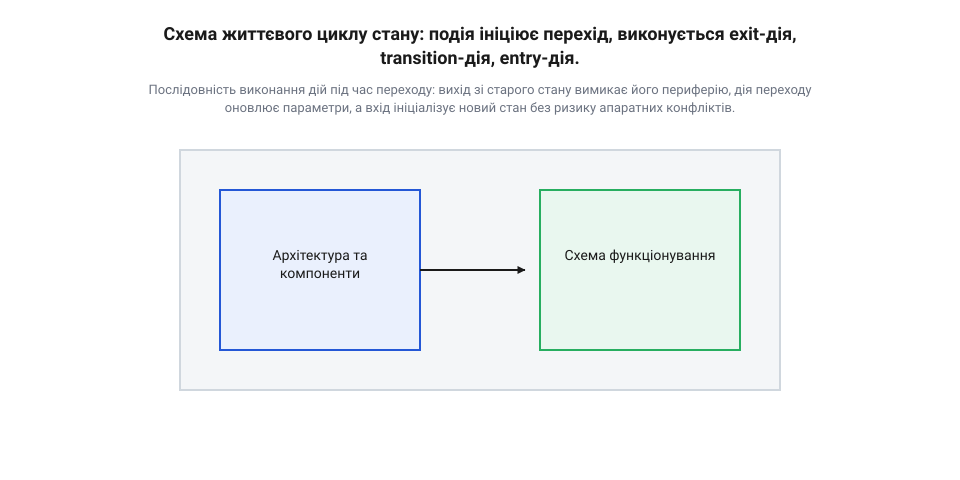
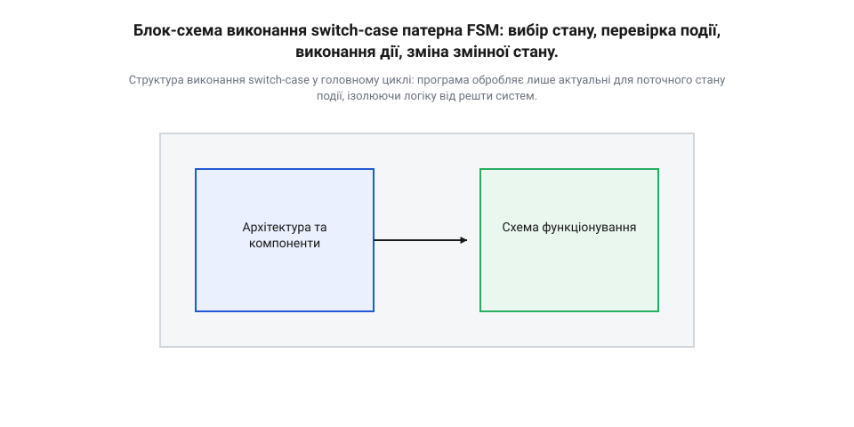
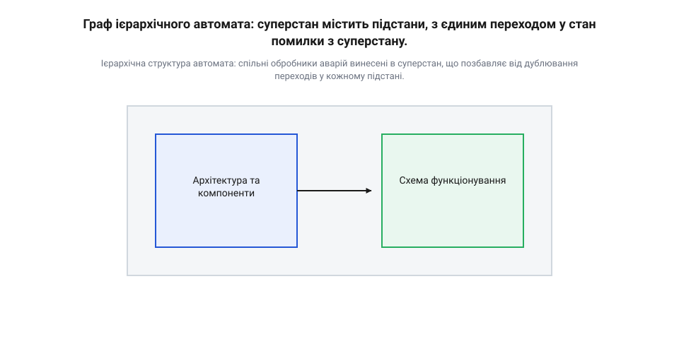
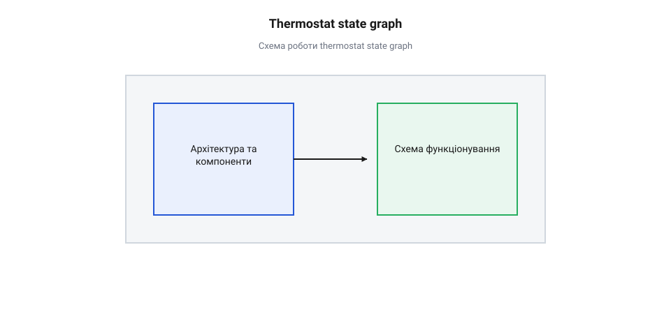

# Скінченний автомат у розробці прошивок

## Коли код перетворюється на локшину

Розробка прошивки часто починається з простого лінійного коду. Щоб увімкнути реле за натисканням кнопки, достатньо прочитати стан піна, додати затримку на антидребезг і перемкнути вихід. Такий підхід працює, доки пристрій виконує одну задачу, і вся логіка вміщується в кілька рядків. Проблеми починаються, коли вимоги до поведінки пристрою зростають. 

Щойно кнопка має розрізняти коротке та довге натискання, у коді з'являється прапорець фіксації натискання та таймер утримання. Потім додається нова умова: якщо реле вже увімкнене, довге натискання переводить пристрій у режим налаштування, але лише за відсутності помилки суміжного датчика. Лінійний код швидко обростає десятками вкладених умов і глобальних прапорців: зміна однієї умови випадково ламає іншу, а пошук причини перетворюється на розплутування нескінченної локшини з `if` та `else`. 

Ця складність виникає не через погану мову програмування чи брак досвіду розробника, а через відсутність архітектури. Пристрій намагається перевірити всі можливі умови одночасно, на кожному кроці циклу, і не має чіткого контексту. Щоб зробити код надійним і керованим, потрібно фундаментально змінити підхід: програма має визначати свою поведінку через поточний стан. Коли код розділено на ізольовані контексти, зайві перевірки відсікаються автоматично. Перебуваючи в певному режимі, пристрій виконує лише відповідну йому ділянку коду, фізично ігноруючи решту. Замість громіздкої умови `if (натиснуто_кнопку && режим_налаштування && немає_помилки)` достатньо перевірити лише натискання кнопки, бо все інше вже гарантовано самим фактом перебування в цьому режимі. Замість того, щоб щоразу питати «які з усіх існуючих умов зараз виконуються?», програма має знати «в якому контексті я зараз перебуваю і які події мають значення саме для нього?».

## Що таке скінченний автомат

Коли пристрій виконує складний сценарій, його поведінка в будь-який момент часу залежить не лише від поточних сигналів на входах, а й від попередньої історії роботи. Без чіткого збереження цього контексту програма змушена перевіряти десятки прапорців у кожному циклі execution. Скінченний автомат (@@en|finite-state machine, FSM@@; від грец. @@el|automatos@@ — той, що діє самостійно) розв'язує цю проблему через жорстке обмеження: система завжди перебуває рівно в одному з наперед визначених станів і змінює його лише під дією чітко розпізнаних подій. Усі події, які не мають значення для поточного стану, пристрій просто ігнорує. Це повністю звільняє обробники від зайвих перевірок і гарантує, що апаратура реагуватиме лише на доречні команди.

Ця абстракція походить із теорії цифрових автоматів середини двадцятого століття. Математично реальні пристрої описують двома класичними моделями: автоматом Мура (@@en|Moore machine@@) та автоматом Мілі (@@en|Mealy machine@@). Головна відмінність між ними полягає у фізичному способі формування вихідних сигналів. В автоматі Мура стан виходів периферії вираховується виключно на основі поточного стану системи. Це робить виходи стабільними й захищеними від завад на входах, але вимагає обов'язкового переходу в новий стан для будь-якої зміни сигналів. В автоматі Мілі вихідний сигнал залежить як від поточного стану, так і від поточних вхідних даних. Модель Мілі дає миттєву реакцію в межах того самого такту, але створює ризик програмних і апаратних сплесків (@@en|glitch@@), коли випадкова завада на вході короткочасно спотворює вихідний сигнал ще до зміни стану. У розробці прошивок ці моделі часто комбінують для збалансування швидкості та стабільності.

Найбільш критичною частиною роботи автомата є механізм переходу між станами. Будь-яка зміна стану складається з трьох послідовних фаз: дії виходу (@@en|exit action@@), дії переходу (@@en|transition action@@) та дії входу (@@en|entry action@@). 

Порядок виконання `exit -> transition -> entry` є єдиним безпечним та логічно можливим для фізичного обладнання. У мікроконтролерах кожен стан керує конкретними апаратними ресурсами: силовими ключами, таймерами, регуляторами чи буферами пам'яті. Якщо змінити порядок і виконати дію входу у новий стан до виходу зі старого, обидва стани на коротку частку секунди виявляться активними одночасно. Наприклад, якщо стан гальмування утримує низький силовий ключ мостової схеми, а стан прискорення під час входу вмикає верхній ключ, їхнє одночасне перекриття створить пряме коротке замикання (@@en|shoot-through@@) силових транзисторів. 

Дія виходу (@@en|exit action@@) гарантує повне безпечне деактивування периферії поточного стану та приведення апаратури в нейтральний, захищений режим. Тільки після того, як старий стан повністю вивільнив свої ресурси і скасував власні інваріанти, виконується дія переходу (@@en|transition action@@). Вона оновлює внутрішні лічильники, обчислює нові уставки та готує дані для наступного режиму. Завершує процес дія входу (@@en|entry action@@), яка конфігурує апаратні модулі для роботи в новому стані, запускає таймери та вмикає необхідні переривання. Будь-якое порушення цієї послідовності призводить до непередбачуваних проміжних станів, деконфігурації силових кіл та виникнення перегонів (@@en|race condition@@).

*Послідовність виконання дій під час переходу: вихід зі старого стану вимикає його периферію, дія переходу оновлює параметри, а вхід ініціалізує новий стан без ризику апаратних конфліктів.*

У програмуванні мовою C або C++ класичний автомат реалізують через конструкцію `switch-case`. Головний цикл програми перевіряє значення змінної стану і передає управління у відповідну гілку `case`. Всередині цього блоку перевіряються лише ті прапорці або повідомлення, які стосуються даного режиму. Якщо потрібна подія сталася, обробник послідовно викликає функції виходу, переходу та входу, після чого оновлює змінну поточного стану. Такий ізольований підхід дозволяє створювати надійні обробники натискань кнопок та інтерфейсних режимів, де кожен етап процесів має власний контекст. Зміна поведінки в одному стані не може випадково зламати обробку подій у сусідніх режимах.

*Структура виконання switch-case у головному циклі: програма обробляє лише актуальні для поточного стану події, ізолюючи логіку від решти систем.*

У складних мікроконтролерних системах автомати не існують ізольовано. Вони об'єднуються у цілі мережі, де вихідні події одного автомата стають вхідними тригерами для іншого. Для цього використовують [подієво-орієнтовану архітектуру прошивок](root:sf-devices/event-driven-firmware), де події передаються через черги повідомлень без блокування головного циклу. Коли кількість станів одного модуля зростає і вони починають дублювати однакові реакції на системні збої, застосовують [ієрархічні автомати станів](root:sf-devices/hierarchical-fsm). Вкладання підстанів у спільний суперстан дозволяє описати загальну реакцію на аварію один раз на верхньому рівні, уникнувши дублювання коду переходів у кожному окремому режимі.

*Ієрархічна структура автомата: спільні обробники аварій винесені в суперстан, що позбавляє від дублювання переходів у кожному підстані.*

## Граф станів як проєктна документація

Головна інженерна перевага скінченного автомата полягає в тому, що він дозволяє повністю спроєктувати та перевірити поведінку пристрою ще до написання коду. Логіка роботи переноситься з голови на папір за допомогою [орієнтованих графів](root:sf-devices/finite-state-machine/math-fsm-graph.md). На такому графі кожен вузол (коло) позначає окремий стан, а спрямоване ребро (стрілка) між ними — подію, що викликає перехід.

Візуалізація змушує інженера продумати всі можливі сценарії та крайові випадки. Дивлячись на граф, одразу стає видно «глухі кути» (стани, з яких немає жодного виходу) або невраховані апаратні збої, які забули обробити. Наприклад, якщо пристрій проєктується з графічним дисплеєм, дуже зручно мислити так, де [кожен екран є окремим станом](root:sf-devices/finite-state-machine/proj-device-menu.md), а натискання фізичних кнопок під екраном — подіями, що змінюють ці стани. Граф станів стає не просто допоміжним малюнком, а вичерпною проєктною документацією, за якою можна однозначно та без помилок написати надійну [подієво-орієнтовану](root:sf-devices/event-driven-firmware) прошивку.

## Реалізація автомата на switch-case

Щоб перетворити абстрактну модель на працюючий код, пристрою потрібна змінна для збереження поточного контексту та механізм вибору наступних дій на основі цього контексту. Найпростіший і найпоширеніший спосіб реалізувати скінченний автомат у програмуванні — це використати перелічуваний тип (@@en|enum@@) для визначення станів та конструкцію `switch` для керування логікою. 

Спочатку поведінку системи формалізують, перш ніж писати бодай рядок коду. Зазвичай це роблять у вигляді орієнтованого [графа станів та таблиці переходів](root:sf-devices/finite-state-machine/math-fsm-graph.md), де чітко видно, з якого стану і за якої події система переходить в інший. Коли граф готовий, його легко перенести в код: кожен вузол графа стає блоком `case`, а кожне ребро — умовою `if` усередині цього блоку.

Змінна стану зберігає, де саме зараз знаходиться система. Головний цикл програми або обробник переривання періодично викликає функцію автомата, яка перевіряє цю змінну за допомогою `switch`. Завдяки цьому обробка подій ізолюється: якщо пристрій чекає натискання кнопки, він ігноруватиме події від датчика температури, бо код для іншого стану просто не виконається. Це усуває потребу в десятках прапорців та вкладених `if-else`.

Розглянемо базовий шаблон реалізації автомата мовою C, що працює в головному циклі:

:::tabs
:::code root\eng\sf-devices\finite-state-machine/finite-state-machine-d/c/updatefsm.c c
:::code root\eng\sf-devices\finite-state-machine/finite-state-machine-d/cpp/devicestate.cpp cpp
:::

У кожному стані перевіряються лише ті події, які мають для нього сенс. Якщо сталася подія, що вимагає зміни стану, ми просто присвоюємо нове значення змінній `currentState`. На наступному виклику функції `updateFsm` конструкція `switch` направить виконання вже у новий блок `case`. Такий підхід робить логіку передбачуваною і дозволяє легко додавати нові стани без ризику зламати старі. Гарним прикладом того, як ця базова структура вирішує типові задачі надійності, є алгоритм для [обробки натискань кнопки](root:sf-devices/finite-state-machine/proj-button-debouncer.md), який фільтрує брязкіт контактів та розпізнає тривалість утримання.

## Події, дії та переходи

Сама по собі зміна стану — це лише перемикання контексту. Щоб пристрій виконував корисну роботу, автомат має реагувати на події певними діями. Дії можуть бути прив'язані до самого стану або до моменту переходу між станами. Правильне розмежування цих дій — ключ до уникнення дублювання коду та помилок ініціалізації.

Коли автомат опиняється в новому стані, йому часто потрібно виконати певну роботу один раз: увімкнути світлодіод, запустити таймер або вивести повідомлення на екран. Це називається вхідною дією (@@en|entry action@@). Замість того, щоб копіювати цей код у кожному місці, звідки можливий перехід у цей стан, його виконують безпосередньо при вході. Аналогічно, вихідна дія (@@en|exit action@@) виконується перед тим, як покинути стан, наприклад, щоб вимкнути той самий світлодіод або зупинити таймер.

Дії під час переходу (@@en|transition action@@) виконуються миттєво як реакція на подію, що спричинила перехід. Наприклад, якщо при перегріві система переходить зі стану нагрівання в стан помилки, дією переходу може бути запис коду помилки в журнал логів.

Щоб реалізувати вхідні та вихідні дії у класичному `switch-case`, змінної поточного стану недостатньо. Автомат має "знати", чи він щойно увійшов у цей стан, щоб виконати дію один раз. Це вирішується введенням змінної попереднього стану:

:::tabs
:::code root\eng\sf-devices\finite-state-machine/finite-state-machine-d/c/updatefsm-2.c c
:::code root\eng\sf-devices\finite-state-machine/finite-state-machine-d/cpp/updatefsm.cpp cpp
:::

Виокремлення вхідних дій робить архітектуру надзвичайно гнучкою. Особливо яскраво це проявляється в розробці інтерфейсів. Наприклад, логіка [навігації дисплейним меню](root:sf-devices/finite-state-machine/proj-device-menu.md) розглядає кожен екран як окремий стан, а малювання самого меню на екрані відбувається саме як вхідна дія. Це гарантує, що дисплей оновлюється лише тоді, коли меню дійсно змінюється, і процесор не витрачає час на перемальовування сталого зображення в кожному циклі.

## Таблиця переходів замість switch-case

Коли кількість станів і подій у пристрої розростається, конструкція на основі `switch-case` стає громіздкою. Величезні блоки коду з вкладеними перевірками важко читати, а додавання нових умов легко призводить до помилок. Для великих автоматів логіку розгалуження замінюють структурою даних — таблицею переходів.

Таблиця переходів — це масив структур, де кожен елемент описує одне правило: поточний стан, очікувана подія, дія, яку треба виконати, і наступний стан. Замість того, щоб кодувати розгалуження операторами, ми формалізуємо поведінку як дані.

Рушій такого автомата — це невеликий цикл. Коли надходить подія, він перебирає масив і шукає рядок, що збігається за поточним станом і цією подією. Знайшовши — викликає прив'язану функцію за вказівником і оновлює змінну стану. Якщо збігів немає, подія просто ігнорується.

Цей підхід чітко відокремлює маршрут пристрою від механізму його виконання. Увесь граф автомата наочно видно в одному місці, що робить [подієво-орієнтовану архітектуру прошивок](root:sf-devices/event-driven-firmware) передбачуваною і спрощує перевірку на коректність.

Шлях пристрою зручно проектувати візуально перед тим, як переносити його в код. Читайте про це у вставці [Граф станів та таблиця переходів](root:sf-devices/finite-state-machine/math-fsm-graph.md). Приклад практичної реалізації наведено у вставці [Автомат обробки натискань кнопки](root:sf-devices/finite-state-machine/proj-button-debouncer.md).

## Ієрархічні автомати для складних пристроїв

Скінченний автомат чудово працює для простих процесів, але пасує перед складними інтерфейсами. Уявіть пристрій, де кнопка «Повернутися» має працювати на більшості екранів. У плоскому автоматі довелося б явно додавати цей перехід до кожного стану. Що більше екранів, то більше дублювання коду, і це призводить до вибуху кількості станів і переходів.

Цю проблему розв'язують [Ієрархічні автомати станів (Statecharts)](root:sf-devices/hierarchical-fsm). Вони дозволяють групувати стани, вкладаючи їх один в одний. Один стан може виступати контейнером і мати власні підстани. Замість дублювання реакції на кнопку «Повернутися», ми створюємо загальний стан, у якому прописуємо цей перехід, а всі екрани робимо його підстанами.

Головна перевага ієрархії — наслідування поведінки. Коли стається подія, її спершу намагається обробити активний підстан. Якщо в нього немає правила для цієї події, вона автоматично передається батьківському стану. Це дозволяє описати загальні глобальні реакції лише один раз, залишаючи специфічну поведінку локальним станам.

Такий розподіл відповідальності робить код модульним. Як саме це працює на практиці, демонструє вставка [Автомат навігації дисплейним меню](root:sf-devices/finite-state-machine/proj-device-menu.md).