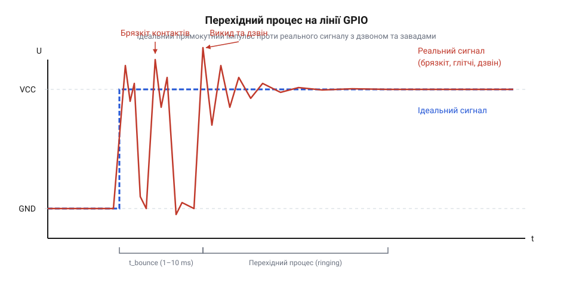
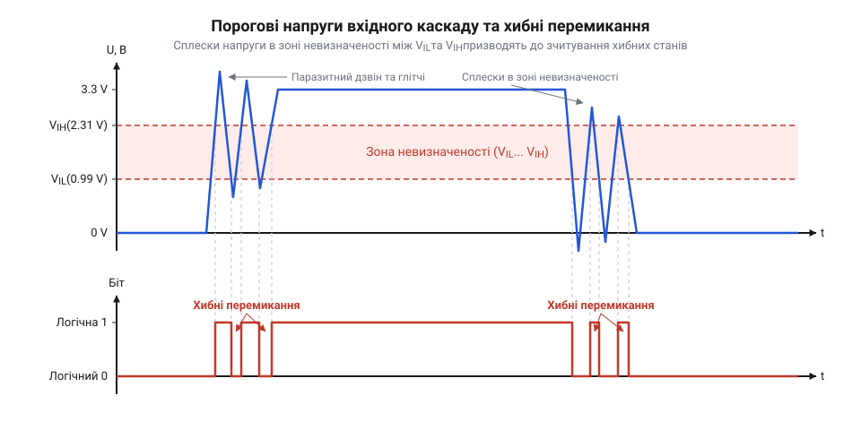
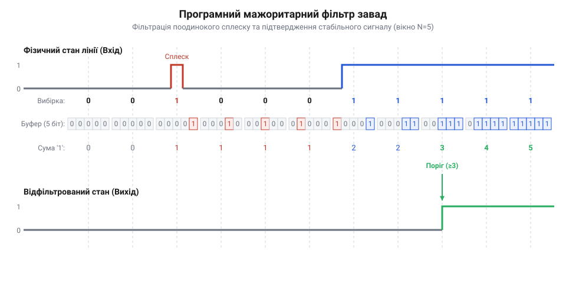
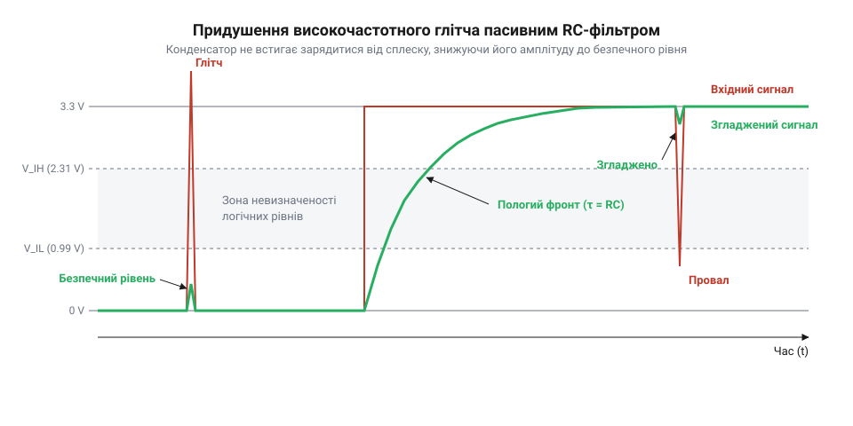
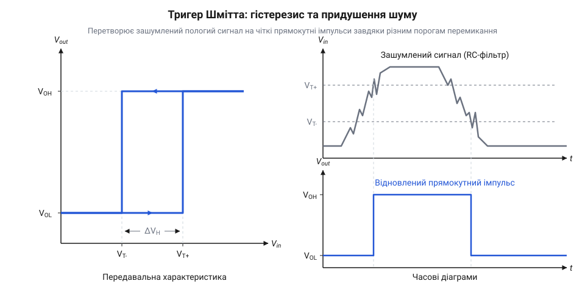
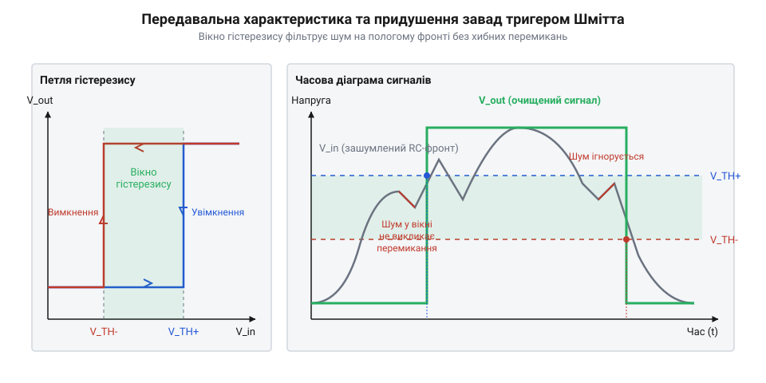
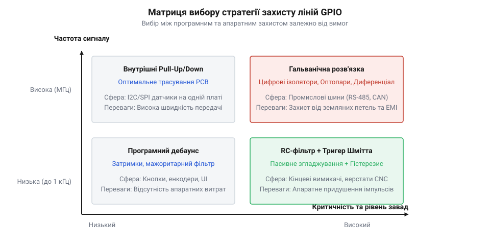

# Запобігання перехідним імпульсним завадам на лініях GPIO

<preknowlist>
- [GPIO-регістри](root:sf-devices/gpio-registers) — розуміння того, що фізичний стан піна відображається в бітах регістрів мікроконтролера.
- [Конфігурація пінів як єдине джерело правди](root:sf-devices/konfihuratsiia-piniv-iak-iedyne-dzherelo-pravdy) — базові знання про налаштування режимів входу та виходу мікроконтролера.
</preknowlist>

## Звідки беруться хибні спрацьовування

У цифровій схемотехніці та розробці вбудованих систем існує небезпечна ілюзія: вважати, що сигнал на виході або вході цифрового виводу перемикається миттєво між двома ідеальними рівнями напруги — логічним нулем 0 V та логічною одиницею 3.3 V. Схематичні діаграми зображують прямокутні імпульси з вертикальними фронтами та пласкими вершинами. Проте реальний фізичний провідник на друкованій платі або в з'єднувальному кабелі не підпорядковується абстрактним концепціям булевої алгебри. Він діє як складне розподілене електричне коло, підпорядковане законам електродинаміки. Коли розробник налаштовує @@en|GPIO@@ (від англ. *General-Purpose Input/Output* — вхід/вихід загального призначення) на зміну стану чи зчитування зовнішнього датчика, замість чистого прямокутного фронту в лінію вриваються паразитні згасаючі коливання, високочастотні сплески та короткі імпульсні збої. Без глибокого розуміння фізичної природи цих явищ будь-яка спроба побудувати надійний пристрій наражається на спонтанні перезавантаження, помилкові спрацьовування переривань та спотворення даних.

Кожен металевий провідник на друкованій платі має власні незаплановані електричні параметри. Омічний опір мідної доріжки `R` доповнюється паразитною ємністю @@en|parasitic capacitance@@ (від англ. *parasitic capacitance* — паразитна ємність між провідником і заземленим шаром або сусідніми лініями, яка становить від 5 pF до 50 pF) та паразитною індуктивністю @@en|parasitic inductance@@ (від англ. *parasitic inductance* — індуктивність провідника, що дорівнює приблизно 1 nH – 10 nH на кожен сантиметр довжини траси). Разом ці величини утворюють еквівалентний паразитний @@en|RLC circuit@@ (від англ. *RLC circuit* — коливальний контур із резистора, індуктивності та ємності). У момент, коли транзисторний ключ вихідного каскаду відчиняється за кілька наносекунд, струм перезаряджання ємності лінії не може зрости чи впасти миттєво через індуктивну протидію провідника. Перехідний процес перетворюється на реактивну хитавицю енергії між паразитною індуктивністю та ємністю.

Цей коливальний процес називають @@en|ringing@@ (від англ. *ringing* — дзвін або паразитні згасаючі коливання на фронтах сигналу). Напруга на лінії після крутого фронту не зупиняється на позначці 3.3 V, а за інерцією проскочує її вгору. Такий короткочасний вихід напруги за межі живлення називають @@en|overshoot@@ (від англ. *overshoot* — викид напруги вгору). Одразу після викиду напруга провалюється нижче встановленого рівня — виникає @@en|undershoot@@ (від англ. *undershoot* — провал напруги вхідного сигналу). Коливальний дзвін згасає лише в міру розсіювання енергії на омічному опорі лінії `R`. Якщо ж швидкість наростання фронту дуже висока або поруч проходить потужна силова лінія, напруга створює надкороткі імпульси тривалістю від одиниць до сотень наносекунд. Такі поодинокі чи групові сплески називають @@en|glitch@@ (від англ. *glitch* — короткочасний імпульсний збій або глітч).

Щоб оцінити масштаб проблеми, визначимо власну частоту паразитних коливань `f_ring`, яку створює контур лінії. Власна частота резонансу визначається за формулою Томсона через паразитну індуктивність `L_p` та паразитну ємність `C_p`:

**Умова:** Обчислення частоти паразитних коливань `f_ring` на трасі друкованої плати довжиною `10 см` із паразитною індуктивністю `L_p = 50 нГн` (50 × 10⁻⁹ Гн) та паразитною ємністю `C_p = 20 пФ` (20 × 10⁻¹² Ф).

```
L_p × C_p = (50 × 10⁻⁹) × (20 × 10⁻¹²)    [перемноження паразитних індуктивності та ємності]
          = 1 × 10⁻¹⁶ с²                 [добуток LC-параметрів]

√(L_p × C_p) = √(1 × 10⁻¹⁶)              [добування квадратного кореня]
             = 1 × 10⁻⁸ с                 [часова константа паразитного контуру]

f_ring   = 1 ÷ (2 × π × 1 × 10⁻⁸)        [підстановка у формулу Томсона]
         = 1 ÷ (6.283 × 10⁻⁸)            [обчислення знаменника]
         = 15 915 494 Гц ≈ 15.92 МГц     [підсумкова частота дзвону]
```

Отримане значення 15.92 MHz показує, що паразитний дзвін генерує високочастотні коливання, періоди яких співмірні з тактовою частотою багатьох мікроконтролерів. Вхідний каскад цифрового піна встигає зреагувати на кожну таку півхвилю як на окрему зміну логічного стану.

Крім реактивних властивостей самої траси, глітчі виникають через зовнішні взаємодії. Якщо довжина траси перевищує кілька сантиметрів, у ній виникають [дзвін та відбиття в лініях](root:sf-devices/transmission-reflections), зумовлені неузгодженістю хвильового опору провідника та вихідного імпедансу драйвера. Одночасно з цим сусідні паралельні доріжки на друкованій платі утворюють паразитне ємкісне та індуктивне зчеплення. Перемикання сигналу у сусідньому високочастотному провіднику через наводку @@en|crosstalk@@ (від англ. *crosstalk* — перехресні завади) індукує короткий сплеск струму в сусідній лінії @@en|GPIO@@.

Ситуація ще більше ускладнюється, коли джерелом сигналу є механічний перемикач, реле або кнопка. Під час фізичного змикання металевих пружинних контактів виникає [брязкіт механічних контактів](root:sf-devices/contact-bounce). Контакти мікроскопічно відскокують один від одного протягом 1–10 ms, генеруючи пачку з десятків хаотичних розмикань і замикань. Цей низькочастотний брязкіт накладається на високочастотний паразитний дзвін `f_ring`, створюючи складний зашумлений сигнал.


*Порівняння ідеального прямокутного імпульсу та реального перехідного процесу в лінії GPIO з паразитним дзвоном та викидами напруги.*

Фізична природа глітчів показує: жодна реальна лінія @@en|GPIO@@ не буває абсолютно чистою. Навіть найкоротша друкована доріжка створює сплески напруги, які безпосередньо впливають на вхідні транзистори мікросхеми.

## Як мікроконтролер бачить зашумлену лінію

Для мікроконтролера зовнішній світ завжди лишається аналоговим. Хоча розробник сприймає зчитування піна як отримання булевого значення `0` або `1`, вхідний каскад мікросхеми має справу з безперервною зміною напруги. Усі сучасні мікроконтролери будуються на основі польових транзисторів @@en|CMOS@@ (від англ. *Complementary Metal-Oxide-Semiconductor* — доповняльна структура метал-оксид-напівпровідник). Вхідний каскад кожного виводу @@en|GPIO@@ являє собою пару комплементарних транзисторів, що керуються вхідною напругою лінії. Залежно від потенціалу на затворах цих транзисторів, внутрішня логіка визначає, який біт записати у [фізичні GPIO регістри](root:sf-devices/gpio-registers).

Для чіткого розмежування логічних станів специфікація будь-якого мікроконтролера задає дві критичні порогові напруги:
* `V_IL` (від англ. *Voltage Input Low*) — максимальний рівень вхідної напруги, який гарантовано розпізнається внутрішньою логікою як логічний нуль. Для мікроконтролерів із живленням 3.3 V це значення зазвичай становить близько 0.3 × `V_DD` (тобто 0.99 V). * `V_IH` (від англ. *Voltage Input High*) — мінімальний рівень вхідної напруги, який гарантовано розпізнається як логічна одиниця. Зазвичай він дорівнює 0.7 × `V_DD` (тобто 2.31 V).

Діапазон між `V_IL` та `V_IH` (у даному прикладі від 0.99 V до 2.31 V) є зоною невизначеності. Якщо напруга сигналу перебуває всередині цієї зони, стан вхідного тригера стає нестабільним: пара транзисторів @@en|CMOS@@ опиняється в частково відкритому стані. Це викликає підвищене споживання струму (так званий наскрізний струм) та створює хаотичні перемикання вихідного логічного біта від найменших температурних чи шумових флуктуацій.

Коли зашумлений сигнал з паразитним дзвоном та глітчами подається на такий вхід, кожна півхвиля дзвону, яка перетинає пороги `V_IH` або `V_IL`, миттєво перемикає внутрішній стан логічного каскаду. Якщо лінія @@en|GPIO@@ налаштована на генерування переривань за фронтом (rising/falling edge interrupt), один фізичний глітч тривалістю 50 ns із кількома піками дзвону викличе 3–5 послідовних переривань процесора підряд! Процесор витрачає увесь свій час на обробку хибних подій, що призводить до переповнення стека та зриву виконання основного циклу програми. Якщо ж лінія зчитується періодичним опитуванням (полінгом), програма випадковим чином фіксує то `0`, то `1`, сприймаючи зашумлений перехідний процес як серію швидких натискань чи команд.

Взаємодію зашумленого сигналу з пороговими напругами вхідного каскаду проілюстровано на діаграмі:


*Співвідношення порогових напруг V_IL та V_IH цифрового входу MCU із вхідними сплесками напруги завади та їхнє перетворення на серію хибних імпульсів.*

Щоб зменшити вразливість до шумів, розробник використовує внутрішні [апаратні налаштування входу](root:sf-devices/gpio-glitch-prevention/api-gpio-input-stage.md) @@en|GPIO@@. Зокрема, підтягувальні резистори @@en|pull-up@@ (від англ. *pull-up* — резистор підтяжки до лінії живлення) або @@en|pull-down@@ (від англ. *pull-down* — резистор підтяжки до землі) фіксують високімпедансний стан входу, не дозволяючи лінії «висіти в повітрі» та збирати ефірні завади. Окрім цього, у багатьох контролерах регулюється швидкість перемикання виходів @@en|slew rate@@ (від англ. *slew rate* — швидкість наростання напруги). Для запобігання хибним спрацьовуванням на пологих чи зашумлених фронтах застосовується [інтегрований тригер Шмітта](root:sf-devices/gpio-glitch-prevention/comp-schmitt-trigger.md) (@@en|Schmitt trigger@@), який розносить пороги ввімкнення та вимкнення, створюючи захисну зону гістерезису.

Якщо ж вбудованого апаратного гістерезису недостатньо або сигнал має високу амплітуду завад, інженер комбінує апаратні та програмні методи. Для згладжування високочастотного дзвону застосовується [розрахунок RC-фільтра](root:sf-devices/gpio-glitch-prevention/math-rc-filter.md), у поєднанні з яким будується повне [апаратне придушення глітчів](root:sf-devices/gpio-glitch-prevention/proj-hardware-rc-schmitt.md). На рівні прошивки для ігнорування поодиноких сплесків реалізується [програмна фільтрація завад](root:sf-devices/gpio-glitch-prevention/proj-software-debounce.md) через часові вікна або мажоритарні вибірки.

У коді нижче продемонстровано, як пряме зчитування стану лінії @@en|GPIO@@ без придушення завад фіксує кожну короткочасну заваду як зміну сигналу:

:::tabs
@c|esp-idf
#include "driver/gpio.h"
#include "esp_log.h"
#include "freertos/FreeRTOS.h"
#include "freertos/task.h"

#define INPUT_GPIO_PIN  GPIO_NUM_4
static const char *TAG = "GPIO_GLITCH_DEMO";

void app_main(void) {
    gpio_config_t io_conf = {
        .pin_bit_mask = (1ULL << INPUT_GPIO_PIN),
        .mode = GPIO_MODE_INPUT,
        .pull_up_en = GPIO_PULLUP_ENABLE,
        .pull_down_en = GPIO_PULLDOWN_DISABLE,
        .intr_type = GPIO_INTR_DISABLE
    };
    gpio_config(&io_conf);

    int prev_state = gpio_get_level(INPUT_GPIO_PIN);
    uint32_t glitch_counter = 0;

    while (1) {
        int current_state = gpio_get_level(INPUT_GPIO_PIN);
        // Без фільтрації кожен перехід через поріг сприймається як новий стан
        if (current_state != prev_state) {
            glitch_counter++;
            ESP_LOGW(TAG, "Виявлено хибне спрацьовування! Сплесків: %lu, стан: %d", 
                     glitch_counter, current_state);
            prev_state = current_state;
        }
        vTaskDelay(pdMS_TO_TICKS(10));
    }
}

@cpp|arduino
#include <Arduino.h>

const uint8_t INPUT_PIN = 4;
int lastState = HIGH;
unsigned long glitchCounter = 0;

void setup() {
  Serial.begin(115200);
  pinMode(INPUT_PIN, INPUT_PULLUP);
}

void loop() {
  int currentState = digitalRead(INPUT_PIN);

  // Пряме зчитування реєстра фіксує короткочасні глітчі як зміну стану входу
  if (currentState != lastState) {
    glitchCounter++;
    Serial.print(F("Хибне перемикання лінії! Лічильник глітчів: "));
    Serial.print(glitchCounter);
    Serial.print(F(", новий стан біта: "));
    Serial.println(currentState);
    lastState = currentState;
  }
  delay(10);
}
:::

Таким чином, вхідний каскад мікроконтролера не здатний відрізнити корисний прямокутний імпульс від паразитних сплесків напруги, якщо вони перетинають порогові значення `V_IL` та `V_IH`. Захист ліній @@en|GPIO@@ вимагає узгодженого комбінування апаратних схем узгодження та програмних фільтрів, які розбираються у наступних розділах.

## Програмна фільтрація коротких завад

Високочастотні імпульсні завади (@@en|glitch@@) можуть проникати на лінію входу мікроконтролера через наводки від суміжних силових провідників або комутацію індуктивних навантажень. Якщо цифровий пін налаштований на генерацію апаратних переривань або опитується в циклі без попередньої перевірки часової стабільності, поодинокий короткий сплеск тривалістю в кілька наносекунд призведе до хибного спрацьовування обробника, збою лічильників або аварійної зупинки пристрою. Пряма обробка апаратного переривання від "сирого" входу в умовах сильних електромагнітних завад створює ризик катастрофічного перевантаження процесора (@@en|interrupt storm@@), коли мікроконтролер витрачає весь обчислювальний ресурс лише на вхід у переривання та вихід із нього.

Першою лінією захисту від подібних сплесків є програмна фільтрація. Вона не вимагає додавання нових компонентів на друковану плату, оскільки базується на регулярному опитуванні фізичного стану лінії через [читувані GPIO-регістри](root:sf-devices/gpio-registers) мікроконтролера за допомогою системного таймера.

Основна ідея програмного придушення завад полягає у відмові від миттєвої реакції на кожну поодиноку зміну рівня напруги. Замість цього розробник вводить часове вікно дискретизації (@@en|sampling window@@) — фіксований інтервал часу `t_sample`, через який процесор знімає поточне значення цифрового входу. Якщо тривалість завади `t_glitch` менша за період опитування `t_sample`, вірогідність того, що сплеск потрапить саме на момент зняття вибірки, суттєво знижується, а серія послідовних вибірок дає змогу відрізнити справжній корисний сигнал від короткого шуму.

Для надійної селекції сигналу застосовують алгоритм, який називається мажоритарним фільтром (@@en|majority filter@@). Принцип його роботи полягає в збереженні останніх `N` вибірок стану лінії у зсувному регістрі та прийнятті логічного рішення на основі більшості однакових значень.


*Покрокова фільтрація зашумленого сигналу мажоритарним алгоритмом із вікном із 5 вибірок.*

Кожного разу, коли спрацьовує переривання таймера з періодом `t_sample`, новий стан піна записується в молодший біт буферного регістру пам'яті `history`, а попередні значення зсуваються вліво на один розряд. Логічний стан лінії вважається підтвердженим лише тоді, коли всі або більшість бітів у буфері збігаються. Наприклад, для 8-бітного бувера значення `0xFF` свідчить про стабільний високий рівень, а значення `0x00` — про стабільний низький рівень. Будь-які проміжні комбінації бітів (наприклад, `0b11011111`, де один біт виявився нульовим через випадковий спотворений відлік) ігноруються як шум або перебування сигналу у перехідному стані.

Строгий варіант мажоритарного фільтра вимагає повної ідентичності всіх `N` вибірок. Це гарантує придушення завад, але вносить фіксовану затримку розпізнавання сигналу (@@en|detection latency@@), яка дорівнює добутку `N × t_sample`. Значення `t_sample` та розрядність буфера `N` обирають виходячи з максимальної частоти корисного сигналу та очікуваної тривалості завад: період опитування має бути достатньо малим, щоб не пропустити корисну зміну стану, але більшим за максимальну тривалість імпульсу завади.

Коли джерелом завад є не лише поодинокі електромагнітні сплески, а й тривалий [брязкіт механічних контактів](root:sf-devices/contact-bounce) під час натискання кнопок, мажоритарний фільтр доповнюють таймерною затримкою (@@en|debounce@@). Практична реалізація алгоритму на базі таймера детально розібрана у проєктній вставці [програмного фільтра завад](root:sf-devices/gpio-glitch-prevention/proj-software-debounce.md), де наведено готову структуру даних.

Нижче наведено приклад реалізації мажоритарного фільтра на мовах C та C++. Алгоритм опитує пін через рівні проміжки часу та підтверджує зміну стану лише за умови наявності не менше 6 високих рівнів із 8 останніх вибірок.

:::tabs
:::code root\eng\sf-devices\gpio-glitch-prevention/gpio-glitch-prevention-d/c/gpio-filter-init.c c
:::code root\eng\sf-devices\gpio-glitch-prevention/gpio-glitch-prevention-d/cpp/gpiomajorityfilter.cpp cpp
:::

Програмні методи фільтрації є надзвичайно гнучкими: вони дають змогу динамічно змінювати пороги підтвердження та частоту опитування залежно від режиму роботи пристрою. Тим не менш, виключно програмний захист має обмеження. Якщо швидкість наростання напруги завади перевищує допустимі межі або імпульс має високу амплітуду, пін мікроконтролера може зазнати фізичного пошкодження ще до того, як обробник переривання чи таймер встигне зняти перший відлік.

## Апаратний захист через RC-фільтри

Хоча програмна фільтрація ефективно відсікає поодинокі хибні відліки, вона не здатна захистити мікроконтролер від завад надвисокої амплітуди, розрядів статичної електрики або суцільного високовольтного шуму, який виникає під час стартів потужних двигунів. Більш того, коли імпульсні завади надходять на вхід мікроконтролера під час його скидання (@@en|reset@@) або до завершення ініціалізації, програмний код ще не виконується, і [конфігурація пінів контролера](root:sf-devices/konfihuratsiia-piniv-iak-iedyne-dzherelo-pravdy) лишається в невизначеному стані. Наукові та промислові стандарти вимагають придушувати високочастотні імпульсні наводки безпосередньо у фізичному середовищі, до того як вони потраплять на чутливий напівпровідниковий вхід.

Найпростішим і найефективнішим апаратним засобом придушення завад є пасивний низькочастотний RC-фільтр (@@en|low-pass filter@@). Він складається з послідовно ввімкненого резистора `R` та паралельно підключеного конденсатора `C`, розташованого між лінією входу GPIO та землею (GND).

Фізичний принцип дії RC-фільтра базується на обмеженні струму заряду резистором та інерційності на накопичення заряду конденсатором. Високочастотний глітч є коротким сплеском напруги з високою швидкістю наростання фронту. Коли такий імпульс проходить через резистор `R`, струм починає заряджати ємність `C`. Оскільки тривалість завади `t_glitch` є дуже малою, конденсатор просто не встигає зарядитися до порогового рівня напруги логічної одиниці `V_IH`. Завада згладжується, а її пікова амплітуда знижується до безпечного рівня, який логічний каскад мікроконтролера сприймає як стабільний нуль.


*Придушення високочастотного глітча та формування пологого фронту на виході пасивного RC-ланцюжка.*

Ключовим параметром для розрахунку компонентів фільтра є стала часу (@@en|time constant@@), позначувана грецькою літерою `τ` (тау). Вона визначає час, за який напруга на конденсаторі досягає приблизно 63.2% від значення амплітуди вхідного стрибка. Частота зрізу (@@en|cutoff frequency@@) `f_c` позначає межу, вище якої амплітуда вхідних коливань послаблюється щонайменше на 3 decibel (дБ).

Для визначення параметрів RC-ланцюжка застосовують покроковий розрахунок:

```
τ = R × C                [визначення сталої часу]
f_c = 1 ÷ (2 × π × τ)   [обчислення частоти зрізу]
```

Під час вибору номіналів обирають опір `R` у діапазоні від 1 kΩ до 10 kΩ. Занадто малий опір не забезпечить достатнього обмеження струму завади, а занадто великий — створить помітне падіння напруги через вхідний струм витоку GPIO (@@en|input leakage current@@). Ємність `C` підбирають так, щоб стала часу `τ` перевищувала максимальну тривалість коротких завад `t_glitch`, але була суттєво меншою за мінімальну тривалість корисного імпульсу сигналу `t_pulse`. Математичний розрахунок номіналів компонентів для заданої смуги частот та максимальної тривалості імпульсів наведено в матеріалі про [розрахунок RC-фільтра](root:sf-devices/gpio-glitch-prevention/math-rc-filter.md).

Незважаючи на ефективне усунення завад, пасивний RC-фільтр створює побічний ефект: він перетворює крутий прямокутний фронт цифрового сигналу на пологий експоненційний схил. Коли напруга на конденсаторі повільно проходить через зону невизначеності між пороговими значеннями `V_IL` та `V_IH` комплементарної структури метал-оксид-напівпровідник (@@en|CMOS@@, від англ. *Complementary Metal-Oxide-Semiconductor*), виникають дві критичні проблеми:

1. **Скрізний струм (@@en|shoot-through current@@):** У проміжному стані напруги вхідні комплементарні транзистори (PMOS та NMOS) відкриті одночасно, утворюючи пряме коротке замикання між шиною живлення та землею, що викликає локальне нагрівання та підвищене енергоспоживання chip. 2. **Мультиплікативне перемикання від шуму:** Дрібні амплітудні коливання або термошум, накладені на пологий фронт напруги в зоні порогу перемикання, викликають серію хаотичних перемикань вихідного цифрового буфера.

Для усунення проблеми пологого фронту після RC-фільтра обов'язково застосовують тригер Шмітта (@@en|Schmitt trigger@@, названий на честь винахідника Отто Шмітта, від англ. *Otto Schmitt*).


*Усунення неоднозначності й шуму на пологому фронті за допомогою гістерезису тригера Шмітта.*

Основною особливістю тригера Шмітта є наявність апаратного гістерезису (@@en|hysteresis@@, від грец. *ὑστέρησις* — запізнення). Пристрій має два окремих пороги перемикання: верхній поріг `V_T+` для наростаючого фронту та нижній поріг `V_T-` для спадаючого фронту. Різниця між ними утворює ширину петлі гістерезису `ΔV_H = V_T+ - V_T-`. Коли напруга зростає і перетинає `V_T+`, вихід тригера стрибкоподібно змінюється на логічну одиницю і лишається в цьому стані навіть якщо вхідна напруга дещо знизиться через шум, доки вона не впаде нижче другого порогу `V_T-`. Завдяки цьому пологий зашумлений сигнал відновлюється у крутий прямокутний імпульс із чіткими фронтами.

Принцип дії розщеплених порогів перемикання розглянуто в описі компонента [тригер Шмітта](root:sf-devices/gpio-glitch-prevention/comp-schmitt-trigger.md), де показана схема внутрішнього позитивного зворотного зв'язку. Спільне використання RC-ланцюжка та тригера Шмітта утворює класичний апаратний фільтр завад. Приклад комбінування зовнішнього RC-ланцюжка з буферною мікросхемою подано в практичній схемі [апаратного придушення глітчів](root:sf-devices/gpio-glitch-prevention/proj-hardware-rc-schmitt.md).

У багатьох сучасних мікроконтролерах тригери Шмітта вже вбудовані безпосередньо у вхідні каскади GPIO. Крім того, деякі архітектури мають внутрішні програмовані цифрофізичні фільтри завад у блоках вводу-виводу або мостах периферичних шин. Наприклад, коли вмикається апаратний [режим декодера таймера](root:sf-devices/encoder-hardware-timer-mode), мікроконтролер дозволяє активувати вбудований цифровий фільтр, який тактується від внутрішнього генератора й пропускає сигнал на обробку лише після того, як рівень на піні залишається незмінним протягом заданої кількості системних тактів `N_clk`.

Детальне розведення сигналів у складних SOC та правильне [налаштування входу GPIO](root:sf-devices/gpio-glitch-prevention/api-gpio-input-stage.md) включає вибір внутрішніх підтягуючих резисторів (Pull-up / Pull-down) та активацію тригерів Шмітта через системні регістри контролера вводу-виводу.

Грамотне поєднання апаратного RC-ланцюжка з тригером Шмітта на вході та програмного мажоритарного фільтра у коді створює багаторівневий захист (@@en|defense in depth@@). Це гарантує беззбійну роботу мікроконтролера в найсуворіших промислових умовах з високим рівнем електромагнітних завад.

## Тригер Шмітта для чистих фронтів

Пасивний @@en|RC filter@@ (від en. @@en|resistor-capacitor filter@@) чудово справляється зі зрізанням високочастотних імпульсних завад, але створення аналогового ланцюжка згладжування має неминучий побічний ефект: він перетворює стрімкий прямокутний цифровий фронт на пологий експоненціальний сигнал. Коли вхідна напруга повільно зростає або спадає, мікроконтролер опиняється у критичній зоні невизначеності вхідного каскаду @@en|CMOS@@ (від en. @@en|Complementary Metal-Oxide-Semiconductor@@). Звичайний цифровий вхід має єдине фіксоване значення порогової напруги перемикання. Якщо на пологий фронт накладається навіть мікроскопічний шум чи електромагнітна наводка амплітудою в кілька мілівольт, напруга сигналу багаторазово перетинає цей поріг уперед і назад. У результаті логічний вентиль замість одного чистого перепаду ґенерує пачку хибних цифрових імпульсів, які сприймаються системою як серія швидких натискань або збоїв обміну даними.

Крім того, тривале перебування напруги сигналу між логічними рівнями `V_IL` та `V_IH` викликає виникнення @@en|shoot-through current@@ (від en. shoot-through + current — скрізний струм) у вхідному каскаді. При проміжній напрузі верхній PMOS-транзистор і нижній NMOS-транзистор CMOS-інвертора опиняються частково відкритими одночасно. Це створює пряме низькоомне коло між шиною живлення `V_DD` та землею `GND`, призводячи до невиправданого енергоспоживання, виділення тепла та збільшення рівня внутрішнього шуму мікроконтролера.

Для розв'язання цієї проблеми застосовують @@en|Schmitt trigger@@ (від прізвища винахідника Otto Schmitt), головною апаратною особливістю якого є @@en|hysteresis@@ (від грец. ὕстеρησις — запізнення, відставання). На відміну від класичного компаратора з єдиним порогом, тригер Шмітта розділяє точки перемикання для наростаючого та спадаючого фронтів. Він має два чітко рознесені пороги: верхній поріг увімкнення `V_TH+` та нижній поріг вимкнення `V_TH-`.


*Принцип дії гістерезису: шум на пологому експоненціальному фронті відфільтровується всередині вікна гістерезису без хибних перемикань.*

Ширина вікна гістерезису `ΔV_H` визначається як різниця між верхнім та нижнім пороговими значеннями напруги:

```
ΔV_H = V_TH+ - V_TH-      [різниця порогових напруг гістерезису]
```

Поки амплітуда високочастотного шуму чи наводки на пологому фронті не перевищує значення `ΔV_H`, вихідний стан тригера Шмітта залишається непорушним. Коли напруга зростає і перетинає верхній поріг `V_TH+`, вихід миттєво стрибає у стан логічної одиниці. Якщо після цього через шум напруга трохи опуститься нижче `V_TH+`, вихід не змінить свого стану, оскільки для перемикання в нуль напруга має впасти аж до нижнього порогу `V_TH-`. Це забезпечує формування абсолютно чистих, прямокутних фронтів із високою швидкістю наростання (@@en|slew rate@@) навіть із дуже зашумленого та розмитого аналогового сигналу.

У сучасних мікроконтролерах вбудований [тригер Шмітта з гістерезисом](root:sf-devices/gpio-glitch-prevention/comp-schmitt-trigger.md) є штатною частиною більшості цифрових входів. Однак ширина його внутрішнього гістерезису зазвичай становить від `150 mV` до `400 mV` (залежно від напруги живлення `V_DD`). У жорстких промислових умовах або при роботі з довгими кабелями цього може виявитися недостатньо. У таких випадках перед входом мікроконтролера встановлюють зовнішню мікросхему інвертуючого або неінвертуючого тригера Шмітта (наприклад, 74HC14 або 74LVC1G14), де ширина гістерезису досягає `0.8 V`–`1.0 V`.

Поєднуючи зовнішній пасивний RC-ланцюжок та тригер Шмітта, розробник отримує завершену схему фільтрації. Конкретна схема [апаратного захисту ліній](root:sf-devices/gpio-glitch-prevention/proj-hardware-rc-schmitt.md) гарантує, що високі амплітудні сплески поглинаються конденсатором, а пологий фронт розряджання або заряджання миттєво перетворюється на крутий цифровий перепад. Крім того, правильне налаштування [вхідного каскаду піна](root:sf-devices/gpio-glitch-prevention/api-gpio-input-stage.md) на рівні регістрів мікроконтролера дає змогу додатково увімкнути внутрішні резистори підтяжки (@@en|pull-up@@ або @@en|pull-down@@) для фіксації невизначених станів (@@en|floating input@@).

Нижче наведено приклад конфігурації вхідного каскаду @@en|GPIO@@ для надійного зчитання сигналу із застосуванням тригера Шмітта.

:::tabs
@tab C (ESP-IDF)
:::code root\eng\sf-devices\gpio-glitch-prevention/gpio-glitch-prevention-d/c/esp-idf/init-gpio-input-stage.c c
@tab C++ (Arduino)
:::code root\eng\sf-devices\gpio-glitch-prevention/gpio-glitch-prevention-d/cpp/arduino/schmittgpioinput.cpp cpp
:::

## Вибір оптимальної стратегії захисту

При проєктуванні електронних пристроїв інженер завжди шукає компроміс між апаратними витратами (розмір плати, специфікація матеріалів @@en|BOM@@ — від en. @@en|Bill of Materials@@) та навантаженням на обчислювальні ресурси мікроконтролера. Не існує єдиного захисного рішення, однакового для всіх ліній @@en|GPIO@@. Метод, ідеальний для зчитування стану механічної кнопки на передній панелі, виявиться незадовільним для оптичного квадратурного енкодера або лінії аварійного зупину (@@en|Emergency Stop@@).

Щоб обрати оптимальний метод придушення завад, слід оцінити лінію керування за трьома основними критеріями: швидкодія сигналу, критичність системи до затримок (@@en|latency@@) та фізичне середовище розповсюдження завад.

По-перше, аналізують частотний діапазон корисного сигналу. Якщо сигнал змінюється повільно (людське натискання кнопки має тривалість сотні мілісекунд), придушити завади найпростіше програмно. Для цього [застосовують програмну фільтрацію](root:sf-devices/gpio-glitch-prevention/proj-software-debounce.md), яка відсікає короткі сплески за допомогою таймерів або мажоритарних зсувних регістрів. Проте якщо лінія передає високочастотні імпульси від датчика обертів (десятки кілогерц), програмна фільтрація створюватиме неприпустиме завантаження процесора. У таких випадках логічно використати апаратний фільтр або передати обробку [квадратурному декодеру таймера](root:sf-devices/encoder-hardware-timer-mode) мікроконтролера, який рахує імпульси на рівні периферифного заліза.

По-друге, враховують критичність лінії до хибних спрацьовувань. Якщо лінія @@en|GPIO@@ налаштована на ґенерацію апаратного переривання (@@en|EXTI@@), одиничний короткий глітч наносекундної тривалості здатен викликати шторм переривань (@@en|interrupt storm@@). Процесор витрачатиме увесь свій час на вхід і вихід із обробника переривань, що призведе до зависання пристрою. У критичних колах захисту суто програмний дебаунс є недієвим: апаратний вектор переривання спрацьовує по першому ж короткому фронту завади до того, як програмний код встигне проаналізувати тривалість сигналу. Для таких ліній необхідне обов'язкове апаратне придушення сплесків.

По-третє, визначають фізичне джерело імпульсних завад. Коли [механічні контакти брязкають](root:sf-devices/contact-bounce) під час комутації, тривалість перехідного процесу становить від `1 ms` до `20 ms`. Якщо ж завади виникають через [відбиття в довгих провідниках](root:sf-devices/transmission-reflections) або перехресні наводки (@@en|crosstalk@@) від сусідніх силових кабелів, вони мають вигляд коротких високочастотних дзвіноподібних сплесків (@@en|ringing@@) з амплітудою, що перевищує напругу живлення.


*Стратегічний вибір захисту GPIO: від програмного дебаунсу для повільних кнопок до гальванічно розв'язаних апаратних схем для промислових ліній.*

Для систематизації вибору використовують такі базові конфігурації захисту:

1. **Суто програмна фільтрація (Software Debounce)**. *Застосування:* Некритичні кнопки користувача, DIP-перемикачі режимів. *Переваги:* Відсутність додаткових апаратних компонентів, нульова вартість BOM, можливість динамічно змінювати таймаут у коді. *Обмеження:* Вносить затримку визначення стану (зазвичай `10 ms`–`50 ms`), створює навантаження на процесор при використанні переривань.

2. **Апаратний RC-фільтр + вбудований тригер Шмітта MCU**. *Застосування:* Зовнішні цифрові датчики, кінцеві вимикачі, клавіатурні матриці у зашумленому промисловому середовищі. *Переваги:* Повне поглинання високочастотних завад до надходження у вхідний каскад мікроконтролера, відсутність затримки обробки на CPU. *Обмеження:* Потребує точного розрахунку номіналів. Щоб обчислити номінали [компонентів RC-ланцюжка](root:sf-devices/gpio-glitch-prevention/math-rc-filter.md), орієнтуються на постійну часу `τ = R · C`, яка має бути більшою за тривалість глітчу, але меншою за період корисного сигналу.

3. **Комплексний захист (Зовнішній тригер Шмітта + RC + Захисні діоди або Оптопара)**. *Застосування:* Промислові входи `24 V`, лінії аварійного вимкнення (@@en|E-Stop@@), довгі кабелі поза корпусом пристрою. *Переваги:* Захист від електростатичних розрядів (@@en|ESD@@ — від en. @@en|Electrostatic Discharge@@), висока завадостійкість, повна гальванічна розв'язка при використанні оптопар. *Обмеження:* Збільшення площі друкованої плати та загальної вартості виробу.

Щоб структура коду залишалася гнучкою при будь-якому обраному способі захисту, дотримуються принципу відокремлення апаратної конфігурації. Коли [конфігурація пінів визначена](root:sf-devices/konfihuratsiia-piniv-iak-iedyne-dzherelo-pravdy) як єдиний реєстр параметрів входу, розробник може змінити спосіб зчитування (наприклад, переключитися з прямого опитування [GPIO-регістрів](root:sf-devices/gpio-registers) на опитування через таймерний фільтр) без внесення змін у бізнес-логіку пристрою.

Нижче наведено приклад реалізації гібридної системи обробки вхідних сигналів, яка поєднує опитування вхідних регістрів із програмною перевіркою стабільності сигналу.

:::tabs
@tab C (ESP-IDF)
:::code root\eng\sf-devices\gpio-glitch-prevention/gpio-glitch-prevention-d/c/esp-idf/hybrid-input-init.c c
@tab C++ (Arduino)
:::code root\eng\sf-devices\gpio-glitch-prevention/gpio-glitch-prevention-d/cpp/arduino/hybridgpioinput.cpp cpp
:::