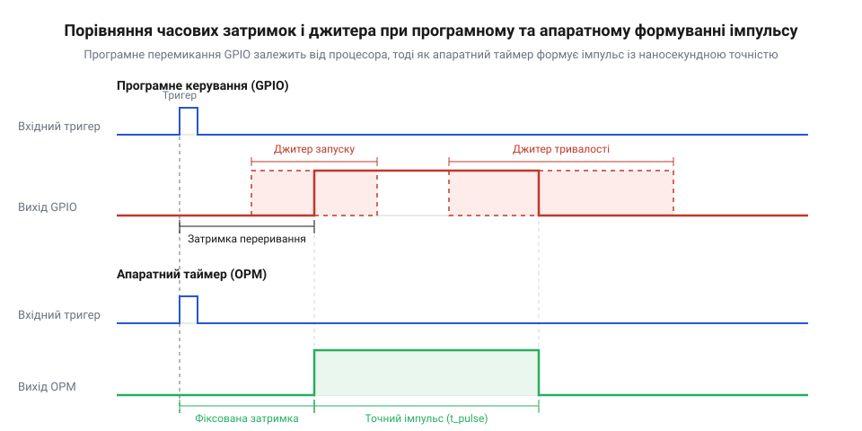
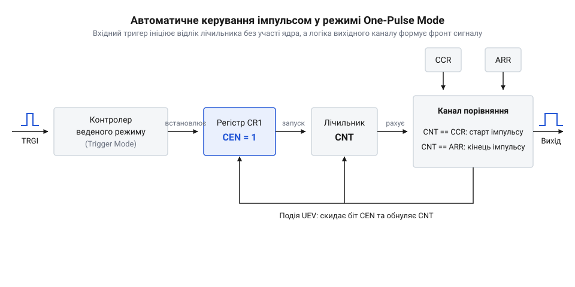
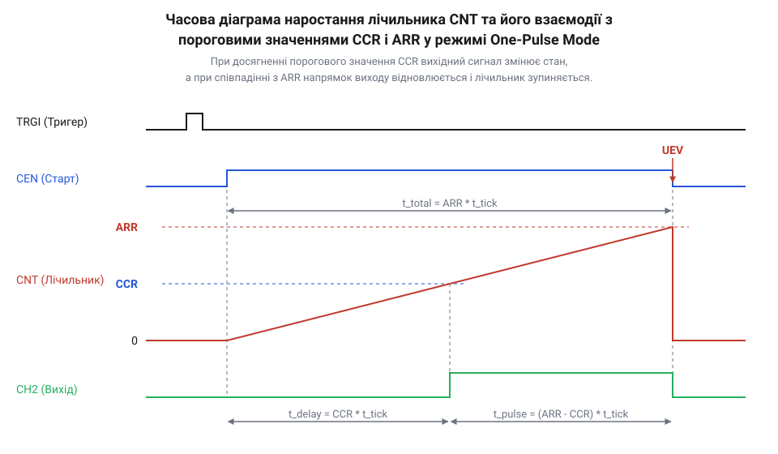

# Апаратний таймер у режимі одиничного імпульсу (One-Pulse Mode)

<preknowlist>
- [Зовнішні апаратні переривання мікроконтролерів](root:sf-devices/exti-microcontrollers) — Механізм обробки вхідних апаратних сигналів та формування подій тригерування периферії.
- [Bit-bang протоколи на GPIO](root:sf-devices/bitbang-protocol) — Програмний доступ до виводів GPIO та обмеження точності таймінгів при програмному формуванні сигналів.
</preknowlist>

## Проблема програмного формування поодиноких сигналів

У розробці вбудованих систем виникають задачі, де периферійний пристрій вимагає подачі строго одного електричного імпульсу строго визначеної тривалості. Це може бути 10-мікросекундний сигнал запуску для ультразвукового дальноміра, коротке відімкнення силового ключа або строго затримане стробування зовнішньої схеми. Найпростіша інтуїтивна спроба розв'язати це завдання полягає в прямому програмному маніпулюванні виводом мікроконтролера через регістри @@en|GPIO@@ (від англ. *General-Purpose Input/Output* — виводи загального призначення), що відомо як @@en|bit-bang@@ протоколи ([програмне маніпулювання виводами](root:sf-devices/bitbang-protocol)). Програміст встановлює високий логічний рівень на ніжці, виконує затримку у циклі або чекає спрацьовування системного таймера, після чого скидає рівень у нуль. Однак такий підхід працює надійно лише в ідеалізованих навчальних прикладах, де процесор не зайнятий іншими завданнями й виконує код у строго детермінованому середовищі.

У реальній операційній системі або мультизадачній прошивці виконання коду постійно переривається. Коли приходить запит від послідовного порту, завершується передача @@en|DMA@@ (від англ. *Direct Memory Access* — прямий доступ до пам'яті) або спрацьовує системний квант часу, процесор миттєво призупиняє виконання поточної функції. Період між виникненням події та початком виконання першої інструкції обробника називається затримкою переривання (@@en|interrupt latency@@, від лат. *latens* — прихований, затриманий). Цей інтервал включає збереження контексту регістрів у стек, очищення апаратного конвеєра інструкцій та вибірку вектора переривання. Якщо переривання виникає в момент, коли програма вже підняла сигнал на виводі і очікує моменту його зняття, зняття сигналу відкладається на весь час виконання обробника переривання. У результаті замість стабільного 10-мікросекундного імпульсу на виводі формується сигнал тривалістю 15, 50 або навіть 200 мікросекунд, що створює недопустимий часовий джитер (@@en|jitter@@, від англ. *jitter* — тремтіння).

Спроба використати апаратний генератор широтно-імпульсної модуляції (@@en|PWM@@, від англ. *pulse-width modulation* — широтно-імпульсна модуляція) також не вирішує проблему поодинокого імпульсу. Апаратний таймер у режимі PWM працює безперервно, циклічно генеруючи серію імпульсів із заданою частотою та коефіцієнтом заповнення. Щоб отримати один імпульс через PWM, розробнику доводиться запускати таймер, а потім програмно зупиняти його в обробнику переривання після першого ж періоду. Проте сам момент зупинки таймера знову прив'язується до програмного виконання коду. Якщо обробник переривання запізниться бодай на один тактовий імпульс через конкуренцію за ресурси процесора, таймер встигне розпочати новий цикл і видасть на вивід другий, небажаний імпульс або обрізаний фрагмент хвильової форми.

Еволюція схемотехнічних рішень пройшла тривалий шлях від дискретних аналогових одновибраторів (від лат. *mono* — один та англ. *stable* — стабільний), таких як класична мікросхема 555 або 74121 із зовнішніми RC-ланцюгами, до інтегрованих периферійних модулів. В аналогових схемах тривалість імпульсу задавалася зарядом конденсатора через резистор, що робило часові інтервали вразливими до температури довкілля, технологічного розкиду номіналів компонентів та старіння матеріалів. Перехід до цифрових програмованих лічильників усередині мікроконтролерів усунув дрейф параметрів і дав змогу формувати мікросекундні затримки за допомогою тактового генератора з кварцевою стабілізацією. При цьому концептуальна сутність ланцюжка «тригер-затримка-імпульс» залишилася незмінною, проте перемістилася безпосередньо у залізо периферійного блоку.


*Програмне перемикання GPIO залежить від затримок переривань і поточного стану процесора, тоді як апаратний таймер формує імпульс із наносекундною точністю.*

Таким чином, сформувалися чіткі вимоги до апаратного механізму: формування поодинокого імпульсу має запускатися апаратною або програмною подією (@@en|trigger@@, від англ. *trigger* — курок, спусковий гачок), а відлік часових інтервалів та зупинка лічильника повинні здійснюватися повністю апаратно, без залучення ядра процесора. Сучасні [багатофункціональні апаратні таймери-лічильники](root:sf-devices/hardware-timer-one-pulse-mode/comp-hardware-timer-peripheral.md) містять для цього спеціалізований апаратний режим — @@en|One-Pulse Mode@@ (@@en|OPM@@, від англ. *pulse* — імпульс та *mode* — режим), який поєднує можливості вхідного тригерування та вихідного каналу порівняння.

## Апаратний механізм режиму одиничного імпульсу

Внутрішня архітектура таймера в режимі @@en|One-Pulse Mode@@ (@@en|OPM@@) являє собою апаратний скінченний автомат, у якому генерація хвильової форми жорстко синхронізована з тактовою частотою периферії. Головна відмінність OPM від звичайного режиму лічби полягає в автоматичному керуванні бітом дозволу роботи лічильника `CEN` (від англ. *counter enable* — дозвіл лічильника) у головному регістрі керування. Коли таймер переводиться у режим одиничного імпульсу, апаратний блок активує логіку однократного запуску: після завершення одного повного циклу зрахування лічильник самостійно скидає біт `CEN` у 0 і переходить у стан очікування наступного вхідного сигналу.

Робота механізму починається з приходу вхідного тригера. Джерелом тригерування може виступати як програмний запис у регістр, так і зовнішній апаратний сигнал із ніжки мікроконтролера, сформований через [зовнішні апаратні переривання](root:sf-devices/exti-microcontrollers) або зкомутований через [матрицю вхідних тригерів](root:sf-devices/hardware-timer-trigger-selector-matrix). Вхідний сигнал надходить на контролер веденого режиму (@@en|Slave Mode Controller@@), налаштований у режим тригерування (@@en|Trigger Mode@@). Отримавши фронт тригера, контролер веденого режиму апаратно встановлює біт `CEN` у 1 рівно за один тактовий імпульс периферії. Це ініціює запуск каскаду лічильника `CNT` (від англ. *counter* — лічильник), який починає лінійно нарощувати своє значення від 0 до заданої межі.

Під час руху лічильника `CNT` вгору апаратна логіка вихідного каналу порівняння (@@en|Capture/Compare Channel@@) постійно зіставляє поточне значення `CNT` із вмістом двох конфігураційних регістрів: регістру порівняння `CCR` (від англ. *Capture/Compare Register*) та регістру автоперезавантаження `ARR` (від англ. *Auto-Reload Register*). Вихідна ніжка таймера за замовчуванням перебуває в пасивному стані (наприклад, низький логічний рівень 0). Як тільки значення лічильника `CNT` досягає порогу `CCR`, логіка порівняння миттєво змінює стан вихідного виводу на активний (високий логічний рівень 1). Це означає закінчення фази затримки і початок формування корисного імпульсу.

Лічильник `CNT` продовжує наростати далі, поки його значення не зрівняється зі значенням регістру `ARR`. У момент співпадіння `CNT == ARR` апаратна схема генерує подію оновлення (@@en|Update Event@@, @@en|UEV@@). З настанням події `UEV` відбуваються три одночасні апаратні дії:
1. Логіка вихідного каналу повертає вихідну ніжкову лінію в пасивний стан (низький рівень 0), завершуючи формування імпульсу. 2. Значення лічильника `CNT` обнуляється (або скидається до початкового стану). 3. Апаратний тригер однократного запуску OPM автоматично скидає біт `CEN` у 0, зупиняючи тактування лічильника.


*Вхідний тригер ініціює відлік лічильника без участі ядра, а логіка вихідного каналу формує спадний або зростаючий фронт сигналу.*

Завдяки такій апаратній послідовності процесор взагалі не бере участі в процесі формування затримки та імпульсу. Ядро мікроконтролера може виконувати обчислення, обслуговувати інші інтерфейси або перебувати у режимі зниженого енергоспоживання (@@en|sleep mode@@). Повний опис конфігураційних бітів та взаємозв'язків периферії наведено в [карті апаратних регістрів OPM](root:sf-devices/hardware-timer-one-pulse-mode/api-opm-hardware-registers.md), а програмні методи ініціалізації розкрито у [програмному інтерфейсі OPM](root:sf-devices/hardware-timer-one-pulse-mode/api-opm-driver-interface.md). Практичним прикладом застосування цього механізму є [проект генератора стробування HC-SR04](root:sf-devices/hardware-timer-one-pulse-mode/proj-hc-sr04-trigger-generator.md), де OPM формує строб запуску вимірювання відстані.

## Узгодження регістрів таймера для формування інтервалів

Для того щоб апаратний таймер згенерував імпульс із точними часовими параметрами, розробник має математично узгодити значення трьох ключових регістрів: дільника частоти `PSC` (від лат. *prae* — попереду та англ. *scale* — шкала, дільник), регістру порівняння `CCR` та регістру автоперезавантаження `ARR`. Взаємодія цих регістрів визначає дві часові величини: часову затримку від приходу тригера до початку імпульсу (`t_delay`) та тривалість самого імпульсу (`t_pulse`).

Вхідна тактова частота периферійної шини `f_CLK` надходить на дільник частоти `PSC`. Дільник зменшує частоту тактування лічильника у `(PSC + 1)` разів, формуючи квант часу одного такту лічильника `t_tick`:

```
f_CNT = f_CLK / (PSC + 1)
t_tick = 1 / f_CNT
       = (PSC + 1) / f_CLK                      [визначення періоду одного такту лічильника]
```

Значення регістру порівняння `CCR` задає кількість тактів лічильника від моменту запуску (`CNT = 0`) до формування першого фронту імпульсу. Відповідно, часова затримка `t_delay` обчислюється як:

```
t_delay = CCR * t_tick
        = CCR * (PSC + 1) / f_CLK               [підстановка періоду тактування в затримку]
```

Значення регістру автоперезавантаження `ARR` задає загальну кількість тактів від моменту запуску до зупинки таймера. Оскільки імпульс починається при `CNT = CCR` і закінчується при `CNT = ARR`, тривалість імпульсу `t_pulse` дорівнює різниці між `ARR` та `CCR`:

```
t_pulse = (ARR - CCR) * t_tick
        = (ARR - CCR) * (PSC + 1) / f_CLK       [розрахунок тривалості активного стану]
t_total = ARR * t_tick
        = ARR * (PSC + 1) / f_CLK               [загальний час від тригера до зупинки]
```


*При досягненні порогового значення CCR вихідний сигнал змінює стан, а при співпадінні з ARR напрямок виходу відновлюється і лічильник зупиняється.*

Розглянемо практичний розрахунок конфігурації регістрів для конкретного завдання.

**Умова:** Необхідно налаштувати таймер з тактовою частотою шини `f_CLK = 84 МГц` для формування поодинокого імпульсу з затримкою `t_delay = 50 мкс` та тривалістю імпульсу `t_pulse = 20 мкс`.

Покрокове обчислення значень регістрів здійснюється наступним чином:

```
t_tick = 1 мкс                                  [обираємо зручний квант часу 1 мікросекунда]

PSC = (f_CLK * t_tick) - 1
    = (84000000 * 0.000001) - 1                 [обчислення коефіцієнта дільника частоти]
    = 84 - 1
    = 83                                        [значення регістру PSC]

CCR = t_delay / t_tick
    = 50 / 1                                    [обчислення порогу початку імпульсу]
    = 50                                        [значення регістру CCR]

ARR = CCR + (t_pulse / t_tick)
    = 50 + (20 / 1)                             [обчислення порогу завершення та зупинки]
    = 50 + 20
    = 70                                        [значення регістру ARR]
```

Як видно з розрахунку, при заданих значеннях регістр `PSC = 83` забезпечує крок лічби в 1 мікросекунду, `CCR = 50` витримує затримку 50 мікросекунд від приходу тригера, а `ARR = 70` завершує імпульс через 20 мікросекунд після його початку та автоматично вимикає лічильник.

Важливим апаратним аспектом є використання тіньових регістрів (@@en|shadow register@@, від англ. *shadow* — тінь) та механізму попереднього завантаження (@@en|preload register@@). Коли біт `preload` увімкнено, нові значення `ARR` або `CCR`, записані програмою, не змінюють поточний процес зрахування негайно. Вони переносяться в активні тіньові регістри лише в момент події оновлення `UEV` або при початковому тригеруванні. Це унеможливлює виникнення часових аномалій під час динамічного переналаштування параметрів імпульсу.

Повний математичний апарат із врахуванням крайових умов та апаратних квантів описано в [математичному розрахунку часових інтервалів OPM](root:sf-devices/hardware-timer-one-pulse-mode/math-opm-timing-calculation.md). Описаний принцип узгодження регістрів є критичним для задач фазового керування, наприклад у [формувачі фазового імпульсу керування симистором](root:sf-devices/hardware-timer-one-pulse-mode/proj-triac-phase-pulse-driver.md), де затримка `t_delay` відраховує фазовий кут від нуля мережі, а `t_pulse` задає ширину відімкненого імпульсу відкриття симистора, на відміну від безперервної [генерації широтно-імпульсної модуляції PWM](root:sf-devices/hardware-timer-pwm-generation-modes).

## Джерела тригерування та зв'язок каналів таймера

Програмний запуск одиничного імпульсу шляхом запису одиниці в біт увімкнення лічильника `CEN` завжди пов'язаний із невизначеністю часу обробки переривання та затримками виконання інструкцій процесором. Якщо система вимагає синхронізації імпульсу із зовнішньою швидкісною подією — наприклад, переходом синусоїдальної напруги через нуль або надходженням фронту від оптичного датчика, — програмний запуск неминуче створює часовий джитер тривалістю від кількох тактів до мікросекунд. Для усунення цієї затримки в апаратному таймері передбачено запуски через контролер веденого режиму (від англ. @@en|Slave Mode Controller@@), який пов'язує вхідні події безпосередньо з апаратним стартом лічильника.

Серцем апаратного запуску є вибір джерела тригерування. Вхідний сигнал (від англ. @@en|Trigger Input@@, або @@en|TRGI@@) надходить на контролер веденого режиму, який налаштовано в режим тригерування (від англ. @@en|Trigger Mode@@). У цьому режимі активний фронт на лінії @@en|TRGI@@ автоматично встановлює біт `CEN` у регістрі керування `CR1` за один такт тактування периферії. Процесор у цьому процесі не бере жодної участі, що гарантує абсолютно детерміновану затримку та нульовий джитер запуску.

Джерела тригерування в сучасних мікроконтролерах поділяються на дві основні категорії:
1. Зовнішні тригери, які надходять безпосередньо з фізичних виводів мікроконтролера (`TI1`, `TI2` або `ETR`). Сигнал із вхідного каналу проходить через селектор полярності (вибір наростаючого чи спадного фронту) та цифровий фільтр входу (від англ. @@en|input filter@@). Фільтр вимагає послідовного підтвердження нового стану протягом заданої кількості тактів внутрішньої частоти тактування, що гарантує [усунення брязкоту контактів](root:sf-devices/switch-debounce) та короткочасних електричних перешкод до моменту формування внутрішнього сигналу `TI1FP1` чи `TI2FP2`. Коли зовнішній сигнал із ніжки через [зовнішні апаратні переривання](root:sf-devices/exti-microcontrollers) або вхідні канали таймера ініціює відлік, таймер реагує на події без залучення ядерних переривань. 2. Внутрішні тригери (лінії `ITR0`–`ITR3`), які з'єднують периферійні блоки між собою всередині кристала. Подія оновлення або порівняння одного таймера (майстра) може слугувати джерелом @@en|TRGI@@ для іншого таймера (ведомого), що дозволяє створювати складні каскадні часові послідовності. Щоб гнучко конфігурувати [вхідні тригери та матрицю подій](root:sf-devices/hardware-timer-trigger-selector-matrix) між різними периферійними модулями, у мікроконтролерах використовують внутрішні міжпериферійні зв'язки.

Найбільш поширеною конфігурацією режиму одиничного імпульсу є зв'язок вхідного каналу захоплення з вихідним каналом порівняння. У такій схемі вхідний канал (наприклад, `CH1`) налаштовується як приймач тригера `TI1FP1`, а вихідний канал (наприклад, `CH2`) генерує імпульс заданої тривалості.

Повний апаратний ланцюжок виконання подій розгортається кроками:
1. Зовнішній сигнал надходить на ніжку `CH1`, проходить цифровий фільтр і детектор полярності, перетворюючись на внутрішній тригер `TI1FP1`. 2. Селектор джерела тригерування спрямовує `TI1FP1` на шину @@en|TRGI@@ контролера веденого режиму. 3. @@en|Slave Mode Controller@@ у режимі @@en|Trigger Mode@@ автоматично встановлює біт `CEN = 1` у регістрі `CR1`. Лічильник `CNT` починає обнулятися й рахувати вгору від `0`. 4. Поки `CNT` менше за значення регістра порівняння `CCR2`, вихідний рівень ніжки `CH2` залишається у пасивному стані (інтервал апаратної затримки). 5. При досягненні умови `CNT == CCR2` схемотехніка порівняння миттєво перемикає вихід `CH2` в активний стан (початок вихідного імпульсу). 6. Лічильник продовжує відлік до значення регістра автоперезавантаження `ARR`. При досягненні `CNT == ARR` вихід `CH2` повертається в неактивний стан (кінець імпульсу), генерується подія оновлення `UEV`, а апаратний логічний елемент скидає біт `CEN = 0`, зупиняючи лічильник.

Такий повністю апаратний ланцюжок застосовують у багатьох практичних задачах. Наприклад, для ультразвукових дальномірів потрібне точне [створення імпульсів запуску](root:sf-devices/hardware-timer-one-pulse-mode/proj-hc-sr04-trigger-generator.md) тривалістю 10 мікросекунд, де найменша варіація часу призводить до помилок розрахунку відстані. У силовій електроніці цей самий механізм використовують для фазового імпульсного керування, формуючи [керування фазовим імпульсом](root:sf-devices/hardware-timer-one-pulse-mode/proj-triac-phase-pulse-driver.md) відносно переходу напруги мережі через нуль.

Вся ця поведінка базується на загальній [архітектурі апаратного таймера](root:sf-devices/hardware-timer-one-pulse-mode/comp-hardware-timer-peripheral.md) мікроконтролера, де детальний опис надає [карта регістрів периферії](root:sf-devices/hardware-timer-one-pulse-mode/api-opm-hardware-registers.md) в режимі одиничного імпульсу, а на рівні програмного забезпечення пристрій інтегрується через уніфікований [драйвер керування режимом](root:sf-devices/hardware-timer-one-pulse-mode/api-opm-driver-interface.md) у системному програмному коді.

## Граничні режими та запобігання хибним спрацьовуванням

При роботі в режимі одиничного імпульсу апаратний таймер може стикатися з нестандартними граничними умовами та зовнішніми завадами. Найбільш критичною ситуацією є повторне тригерування (від англ. @@en|re-triggering@@) — випадок, коли новий активний фронт на вхідному тригері @@en|TRGI@@ надходить у момент, коли лічильник `CNT` уже виконує відлік поточного імпульсу.

Поведінка таймера при повторному тригеруванні суворо визначається конфігурацією контролера веденого режиму:
* У режимі тригерування (@@en|Trigger Mode@@) повторний сигнал на лінії @@en|TRGI@@ ігнорується, оскільки біт `CEN` уже встановлено в `1`. Лічильник безперешкодно дораховує до значення `ARR`, формує імпульс заданої тривалості, скидає `CEN` і зупиняється. Це забезпечує апаратну фільтрацію та захищає вихідний імпульс від спотворення при високій частоті вхідних завад. * У режимі скидання та тригерування (від англ. @@en|Reset Mode@@) кожен новий активний фронт на @@en|TRGI@@ примусово скидає лічильник `CNT = 0` і запускає відлік спочатку. Якщо тригерні імпульси надходять частіше, ніж тривалість повного циклу `ARR`, вихідний сигнал буде нескінченно продовжуватися або перезапускатися, викривляючи часовий інтервал.

Іншим джерелом помилок є динамічна зміна параметрів імпульсу під час активного відліку. Якщо програмний код змінює значення в регістрах `ARR` або `CCR` без використання буферизації, виникає апаратна гонка станів. Наприклад, якщо поточне значення лічильника `CNT` дорівнює `500`, а програма записує в регістр порівняння `CCR` нове значення `400` без попереднього завантаження (від англ. @@en|preload@@), лічильник проскочить точку порівняння. Оскільки `CNT` вже перевищує `CCR`, порівняння в поточному циклі не спрацює. В результаті вихідний канал залишиться в пасивному стані, а лічильник рахуватиме до максимально можливого значення переповнення (наприклад, `0xFFFF`), що призведе до тривалого аварійного збою таймінгу.

Для усунення цього ефекту в таймерах реалізовано двоступеневу структуру регістрів, яка складається з регістрів попереднього завантаження (від англ. @@en|preload register@@) та виконавчих тіньових регістрів (від англ. @@en|shadow register@@):
1. Біт `ARPE` у регістрі `CR1` вмикає буферизацію для `ARR`, а біт `OCxPE` у регістрі `CCMRx` — для `CCR`. 2. При записах з боку центрального процесора нові значення потрапляють лише у буферні регістри `ARR` та `CCR`. 3. Копіювання значень із буферних регістрів у виконавчі тіньові регістри відбувається суворо за подією оновлення `UEV`.

В режимі одиничного імпульсу подія `UEV` генерується автоматично в момент досягнення `CNT == ARR`. Це гарантує, що будь-які нові розраховані значення затримки чи тривалості імпульсу, записані програмою під час виконання поточного циклу, будуть безпечно застосовані лише до НАСТУПНОГО запуску таймера, абсолютно не впливаючи на поточний активний імпульс. Аналогічно, зміна дільника частоти (від англ. @@en|prescaler@@, або @@en|PSC@@) також підпорядковується цьому правилу й набирає чинності виключно після події `UEV`.

Слід також враховувати граничні значення регістрів `CCR` та `ARR`. Розрахунок їх співвідношення підпорядковується загальному [математичному розрахунку затримок](root:sf-devices/hardware-timer-one-pulse-mode/math-opm-timing-calculation.md) та тривалості вихідного сигналу, де значення `CCR` повинно суворо лежати в інтервалі `0 < CCR < ARR`. За умови `CCR == 0` вихідний імпульс формується без затримки одразу після тригера, а при `CCR >= ARR` вихідний імпульс взагалі не з'явиться.

Крім того, на відміну від безперервної [генерації ШІМ сигналів](root:sf-devices/hardware-timer-pwm-generation-modes) апаратним таймером, де програмне формування події оновлення шляхом встановлення біта `UG = 1` просто перезапускає період, у режимі One-Pulse Mode встановлення `UG = 1` під час відліку згенерує `UEV`, що примусово скине біт `CEN = 0` і негайно обірве вихідний імпульс.

Після закінчення імпульсу апаратний таймер встановлює прапорець переривання оновлення `UIF` у регістрі статусу `SR`. Програми можуть використовувати переривання від `UIF` або опитування цього прапорця для фіксації завершення формування імпульсу без потреби постійного перевіряння біта `CEN`. Розуміння цих граничних правил і механізмів буферизації є критичним для побудови завадостійких систем при [захопленні зовнішніх сигналів](root:sf-devices/hardware-timer-encoder-and-capture-modes) та керуванні важкою периферією.