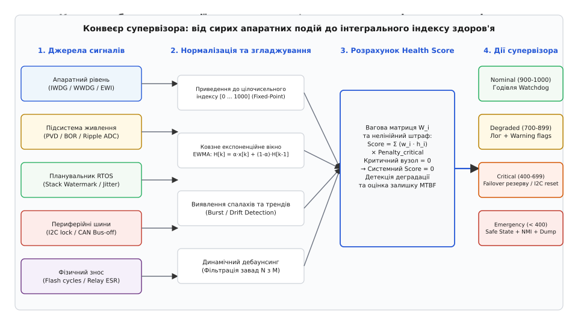
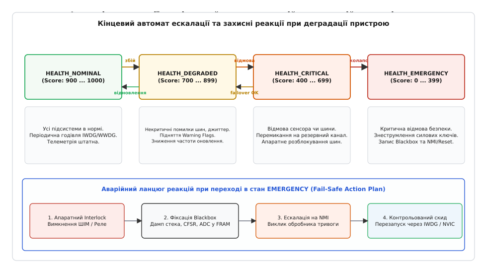

# Монітор здоров'я пристрою

<preknowlist>
- [Watchdog у мікроконтролерах](root:sf-devices/watchdog) — апаратні таймери IWDG/WWDG, віконні обмеження та скидання процесора при зависанні.
- [Обробка аварійних винятків HardFault](root:sf-devices/hardfault) — аналіз стек-фрейму, регістрів HFSR/CFSR та збереження дампу аварії.
- [Самотестування при старті POST/BIST](root:sf-devices/samotest-pry-starti-post-bist) — перевірка Flash (CRC), тестування SRAM алгоритмом March-C та верифікація регістрів.
- [Планування завдань у FreeRTOS](root:sf-devices/freertos) — квантування часу, пріоритети задач, контекстне перемикання та моніторинг стека.
- [Безпечний режим роботи (Safe Mode)](root:sf-devices/safe-mode) — стратегії деградації функціональності при відмові критичних вузлів.
</preknowlist>

Коли сервопривід промислового маніпулятора раптово зупиняється через падіння напруги живлення, а контролер продовжує безтурботно перезавантажувати апаратний сторожовий таймер, система перебуває в стані прихованої відмови. Процесор активний, тактові генератори функціонують, планувальник завдань перемикає потоки, але силова частина знеструмлена, а шина обміну з енкодером заблокована низьким рівнем на лінії даних. Для класичного апаратного сторожового таймера пристрій абсолютно здоровий: головний цикл крутиться, завдання надсилають сигнали активності, а скидання не відбувається. У результаті пристрій втрачає керування над фізичним процесом задовго до того, як виникне фатальний апаратний збій чи спрацює аварійний перезапуск.

Ця розбіжність між формальною працездатністю процесорного ядра та реальним фізичним станом периферії, каналів зв'язку й обчислювальних ресурсів визначає межу між реактивним аварійним відновленням і проактивним наглядом. Програмний супервізор життєдіяльності (лат. *supervidere* — наглядати зверху, англ. *Health Monitor*) будує безперервну картину цілісності мікроконтролерної системи, аналізуючи непрямі ознаки деградації апаратури задовго до катастрофічного колапсу.

## Архітектура підсистеми супервізора

Традиційна реактивна модель захисту мікроконтролера базується на бінарному принципі: система або виконує код, або зависла. Якщо виникає вихід покажчика інструкцій у неініціалізовану пам'ять, ядро генерує виняток `HardFault`. Якщо потік застряг у нескінченному циклі очікування прапорця апаратного регістра, закінчується тайм-аут сторожового таймера `IWDG`, викликаючи апаратне перезавантаження. В обох випадках реакція настає post factum, коли контекст виконання вже зруйновано, транзакції на зовнішніх шинах перервано посеред передачі байта, а виконавчі механізми залишилися під напругою в невизначеному стані.

Проактивний монітор здоров'я вбудованої системи вирішує протилежне завдання: він виявляє ранні симптоми деградації обчислювального процесу, каналів передачі даних та аналогових ланцюгів живлення, здійснюючи контрольовану деградацію або безпечне вимкнення пристрою до втрати керування.


*Конвеєр збору, агрегації метрик здоров'я та ухвалення рішень супервізором*

Архітектура супервізора базується на строгому розподілі чотирьох функціональних фаз, які функціонують як конвеєр обробки діагностичних даних:

1. **Сенсорний шар збору сирих метрик (Metric Collection):** набір легковиважених неблокуючих перевірок, що опитують апаратні лічильники помилок периферії, структури операційної системи реального часу, контролери прямого доступу до пам'яті (DMA) та аналого-цифрові перетворювачі;
2. **Шар нормалізації та часової фільтрації (Normalization & Windowing):** перетворення сирих гетерогенних величин (кількість мілісекунд затримки, мілівольти просідання напруги, кількість бітових помилок CRC) у безрозмірні локальні індекси здоров'я у фіксованому діапазоні `[0 ... 1000]`, згладжені ковзним експоненційним вікном;
3. **Шар агрегації та розрахунку інтегрального індексу (Health Scoring):** виважене об'єднання локальних індексів з урахуванням матриці критичності підсистем та застосуванням мультиплікативних штрафних коефіцієнтів для безпекових вузлів;
4. **Шар ескалації та виконання захисних політик (Policy Engine & Containment):** ухвалення рішень щодо деградації функцій, перемикання на дублюючі канали, переходу в безпечний режим або генерації аварійного переривання з фіксацією діагностичного знімка.

До системи нагляду висуваються жорсткі інженерні обмеження. Вона не має права споживати понад 1–2% процесорного часу ядра, не може використовувати динамічне виділення пам'яті (`malloc` або `new`) через ризик фрагментації купи та недетермінізму, і зобов'язана зберігати працездатність навіть тоді, коли значна частина периферійних модулів мікроконтролера вийшла з ладу.

### Часова модель: періодичне опитування та асинхронні події

Супервізор поєднує дві моделі збору діагностичної інформації: фонове періодичне опитування (англ. *Periodic Polling*) та обробку асинхронних подій від переривань (англ. *Event-Driven Notification*).

Періодичне опитування реалізується через багаторівневий планувальник діагностики, який розподіляє обчислювальне навантаження між трьома часовими квантами (підфазами):

- **Швидкий квант (Fast Tick, інтервал 10–20 мс):** опитування апаратних статусних регістрів шин (CAN, I2C, SPI), перевірка прапорців аварійних переривань та миттєве вимірювання напруги живлення;
- **Середній квант (Medium Tick, інтервал 100 мс):** математичний розрахунок згладжених показників EWMA, оновлення вагової матриці та обчислення системного Health Score;
- **Повільний квант (Slow Tick, інтервал 1000–5000 мс):** важкі фонові операції — сканування водяних знаків стека задач RTOS, перевірка лічильників зносу пам'яті Flash/EEPROM та покрокове фонове сканування Flash (Memory Scrubbing).

```
+-------------------------------------------------------------------------+
|                БАГАТОРІВНЕВИЙ РОЗПОДІЛ ДІАГНОСТИКИ У ЧАСІ               |
+-------------------------------------------------------------------------+
| [Fast Tick: 10-20 мс]   -> Регістри шин, напруга VDD, апаратні помилки |
| [Medium Tick: 100 мс]   -> EWMA фільтри, розрахунок Health Score, FSM  |
| [Slow Tick: 1000 мс]    -> Стек RTOS, знос Flash, Memory Scrubbing     |
+-------------------------------------------------------------------------+
```

Асинхронні події виникають у критичних ситуаціях, які вимагають негайної реакції і не можуть чекати настання чергового періодичного кванту часу. До таких подій належать:
- Спрацьовування детектора просідання напруги `PVD`;
- Переривання раннього попередження віконного сторожового таймера `WWDG EWI`;
- Виявлення апаратного винятку шини `BusFault` або помилки керування пам'яттю `MemManageFault`;
- Перехід контролера шини CAN у стан аварійного відключення `Bus-Off`;
- Спрацьовування апаратного детектора збоїв корекції помилок пам'яті `ECC Error`.

Для безпечної передачі асинхронних подій з контексту обробників переривань (`ISR`) у задачу супервізора використовується неблокуючий кільцевий буфер формату Single Producer Single Consumer (`SPSC Ring Buffer`) на атомарних індексах без використання блокуючих м'ютексів.

```
Контекст переривання (ISR)                     Контекст задачі RTOS
+------------------------+                    +------------------------+
| Подія: PVD / WWDG EWI  |                    | Задача Health Monitor  |
+-----------+------------+                    +-----------+------------+
            |                                             ^
            v (Атомарний запис)                           | (Періодичне читання)
  +-------------------------------------------------------------+
  | Lock-free SPSC Ring Buffer (Фіксований статичний масив)     |
  | [Подія 0] -> [Подія 1] -> [Подія 2] -> ... -> [Подія K]     |
  +-------------------------------------------------------------+
```

## Джерела метрик життєдіяльності

Для побудови достовірного профілю здоров'я супервізор збирає первинні дані з чотирьох незалежних рівнів вбудованої системи: апаратних таймерів процесора, ядра операційної системи, цифрових інтерфейсів зв'язку та аналогової підсистеми електроживлення.

```
+-------------------------------------------------------------------------+
|                      РІВНІ ЗБОРУ МЕТРИК ЗДОРОВ'Я                        |
+-------------------------------------------------------------------------+
| 1. АПАРАТНИЙ РІВЕНЬ:                                                    |
|    - Незалежний таймер IWDG (LSI RC-генератор)                          |
|    - Віконний таймер WWDG + переривання Early Warning Interrupt (EWI)   |
|    - Апаратний захист пам'яті MPU (Guard Regions на дні стека)          |
|    - Контроль тактування CSS (Clock Security System)                    |
|    - Апаратний контроль цілісності пам'яті SRAM/Flash ECC               |
+-------------------------------------------------------------------------+
| 2. РІВЕНЬ ПЛАНУВАЛЬНИКА RTOS:                                           |
|    - Залишок стека задач (Stack High Water Mark, патерн 0xA5A5A5A5)     |
|    - Лічильники пропущених дедлайнів та джиттер квантів часу            |
|    - Тривалість виконання завдань (DWT->CYCCNT та trace-хуки)           |
|    - Моніторинг фрагментації та витоків динамічної пам'яті купи         |
+-------------------------------------------------------------------------+
| 3. ПЕРИФЕРІЙНІ КОМУНІКАЦІЙНІ ШИНИ:                                      |
|    - I2C: зависання лінії SDA stuck low, таймаути шини, фільтри шуму    |
|    - SPI: лічильники помилок CRC, переповнення буфера ORE, Mode Fault   |
|    - CAN: лічильники TEC/REC, стани Error Passive та Bus-Off, Loopback  |
|    - UART: помилки кадрування Framing/Noise/Parity, дрейф бітрейту      |
+-------------------------------------------------------------------------+
| 4. ЖИВЛЕННЯ ТА ФІЗИЧНЕ СЕРЕДОВИЩЕ:                                      |
|    - Детектор просідання живлення PVD/BOR (порційні переривання)        |
|    - АЦП-телеметрія пульсацій та просідань шини VDD                     |
|    - Дрейф внутрішньої опорної напруги VREFINT та калібрування ADC      |
|    - Температурний градієнт кристала за вбудованим датчиком             |
+-------------------------------------------------------------------------+
```

### Апаратні таймери пильності та ранні переривання

Більшість сучасних мікроконтролерів (наприклад, лінійки STM32 на базі ядер ARM Cortex-M) містять два принципово різних типи сторожових таймерів: незалежний `IWDG` (англ. *Independent Watchdog*) та віконний `WWDG` (англ. *Window Watchdog*).

`IWDG` тактується від окремого низькочастотного внутрішнього RC-генератора `LSI` (номінальна частота 32–40 кГц). Він продовжує відлік навіть за повної зупинки основного кварцового генератора `HSE` або збою фазового автопідстроювання частоти `PLL`. Його призначення — безапеляційне апаратне скидання, якщо програмне забезпечення зависло намертво. Однак `IWDG` не має проміжних переривань: єдиний наслідок закінчення його лічильника — встановлення сигналу `RESET` на шині скидання мікроконтролера. 

Слід враховувати, що частота генератора `LSI` має значний технологічний та температурний розкид: у діапазоні від -40°C до +105°C реальна частота може коливатися від 26 кГц до 58 кГц. Тому тайм-аут `IWDG` розраховується з двократним запасом за формулою:

```
T_iwdg = (4 * 2^PR * (RLR + 1)) / f_LSI
```

де `PR` — значення переддільника в регістрі `IWDG_PR` (від 0 до 6, що відповідає коефіцієнтам від 4 до 256), `RLR` — значення 12-бітного регістра перезавантаження `IWDG_RLR` (від 0 до 4095), а `f_LSI` — мінімальна гарантована частота генератора.

На противагу йому, віконний сторожовий таймер `WWDG` тактується від системної шини `APB1` через попередній подільник частоти і контролює не лише факт регулярного перезапуску, а й часове вікно, у якому цей перезапуск дозволено. Оновлення лічильника занадто рано (до відкриття вікна) викликає миттєве скидання так само, як і занадто пізнє оновлення. Найважливішою функцією `WWDG` є переривання раннього попередження (англ. *Early Warning Interrupt*, `EWI`).

Регістр конфігурації `WWDG->CFR` містить біт `EWI`. Коли 7-бітний лічильник, що декрементується, досягає значення `0x40` (рівно за один такт таймера до критичного порогу `0x3F`, що викликає апаратне скидання), генерується переривання `WWDG_IRQHandler`.

```
Значення лічильника WWDG:
0x7F ────────┐
             │  Заборонена зона (оновлення тут -> негайне скидання МК)
W[6:0] ──────┼─────────────────────────
             │  Дозволене вікно оновлення (Refresh Window)
             │  (Супервізор повинен скинути лічильник саме тут)
0x40 ────────┼─────────────────────────  <-- Спрацьовує переривання EWI (Early Warning)
0x3F ────────┴─────────────────────────  <-- АПАРАТНЕ СКИДАННЯ МІКРОКОНТРОЛЕРА (RESET)
```

Переривання `EWI` слугує останнім шансом супервізора перед неминучою загибеллю системи. За період між значеннями `0x40` та `0x3F` (зазвичай від 100 мікросекунд до кількох мілісекунд залежно від переддільника `WWDG` та частоти `APB1`) обробник переривання встигає виконати детермінований набір захисних дій:

- Знеструмити силові ключі інвертора двигуна або нагрівача через скидання бітів активації виходів у регістрі розширеного керування таймером `TIMx->BDTR` (біт `MOE = 0` вимикає головний вихід);
- Зафіксувати в енергонезалежній пам'яті `FRAM` або регістрах резервного живлення `RTC Backup Registers` (наприклад, `RTC->BKP0R`) прапорець причини аварії;
- Зберегти покажчик поточної інструкції `PC` та покажчик стека `SP` для формування аварійного запису.

### Метрики планувальника RTOS та контроль стека

В операційних системах реального часу стабільність системи залежить від передбачуваності виконання окремих задач. Супервізор відстежує чотири фундаментальні параметри планувальника: залишок стека, пропуск періодичних дедлайнів, джиттер часу відгуку та стан динамічної пам'яті.

Переповнення стека (англ. *Stack Overflow*) — найпоширеніша причина важкодіагностованих збоїв у прошивках на C та C++. Коли глибина викликів функцій або розмір локальних масивів перевищує виділену для задачі пам'ять, потік починає перезаписувати сусідні структури даних ядра, змінні сусідніх задач або дескриптор блоку керування задачею (англ. *Task Control Block*, `TCB`).

Для запобігання катастрофі використовується техніка водяного знака стека (англ. *Stack High Water Mark*). При створенні задачі вся виділена під її стек пам'ять заповнюється магічним байтом `0xA5` (патерн `0xA5A5A5A5` для 32-бітних слів). У процесі функціонування задачі покажчик стека `SP` рухається вниз (на архітектурі ARM Cortex-M стек зростає зверху вниз від старших адрес до молодших), перезаписуючи патерн реальними адресами повернення та локальними змінними.

```
Висока адреса (Верхівка стека)
+------------------------------------+ <-- Початковий стан SP (Task Creation)
| Локальні змінні та стек-фрейми     |
| [Використана пам'ять задачі]       |
+------------------------------------+ <-- Поточний покажчик стека SP
|                                    |
| Невикористаний простір стека       |
| (Збережений патерн 0xA5A5A5A5)     |
|                                    |
+------------------------------------+ <-- Водяний знак (High Water Mark limit)
| Залишковий недоторканий бар'єр     |
| Патерн 0xA5A5A5A5                  |
+------------------------------------+ <-- Дно стека (Stack Limit / MPU Guard Region)
Низька адреса
```

Функція `uxTaskGetStackHighWaterMark(TaskHandle_t xTask)` сканує стек від його абсолютного дна вгору, підраховуючи кількість 32-бітних слів, що зберегли значення `0xA5A5A5A5`. Якщо ця кількість падає нижче безпечного бар'єра (наприклад, менше ніж 64 байти або 10% від загального розміру стека), супервізор фіксує критичну деградацію ресурсу пам'яті.

На мікроконтролерах з апаратним модулем захисту пам'яті `MPU` (англ. *Memory Protection Unit*) супервізор налаштовує захисну сторінку (англ. *Guard Region*) розміром 32 або 64 байти на самому дні стека кожної задачі з правами доступу `NO_ACCESS`. При перемиканні контексту через трасувальний хук `traceTASK_SWITCHED_IN()` супервізор перепрограмовує базову адресу регіону `MPU_RBAR` на дно стека активної задачі. Будь-яка спроба процесора виконати інструкцію `PUSH`, яка перетинає межу стека, миттєво генерує апаратний виняток `MemManageFault` ще до того, як чужі дані будуть пошкоджені.

На новітніх мікроконтролерах із архітектурою ARMv8-M (Cortex-M23, Cortex-M33, Cortex-M55, Cortex-M85) захист стека реалізується ще більш елегантно на рівні процесорного ядра без залучення ресурсів `MPU`. Ядро містить виділені системні регістри апаратних лімітів стека: `MSPLIM` (Main Stack Pointer Limit) для стека переривань та `PSPLIM` (Process Stack Pointer Limit) для стека задач. При кожному перемиканні контексту планувальник FreeRTOS записує абсолютну нижню адресу виділеного буфера задачі в регістр `PSPLIM` за одну процесорну інструкцію `MSR PSPLIM, R0`. 

Якщо будь-яка інструкція процесора (`PUSH`, `STM` чи апаратне збереження стек-фрейму при вході в переривання) спробує зменшити покажчик стека `PSP` нижче порогу в `PSPLIM`, процесор апаратно блокує запис у пам'ять і миттєво генерує виняток `UsageFault` із встановленням біта `STKOF` (Stack Overflow Flag) у регістрі `SCB->CFSR`. Це унеможливлює пошкодження даних суміжних потоків із нульовими накладними витратами часу.

Для контролю дедлайнів та тривалості виконання задач супервізор використовує апаратний лічильник циклів ядра `DWT->CYCCNT` (модуль *Data Watchpoint and Trace* архітектури ARM Cortex-M). Перед початком роботи лічильник активується встановленням біта `TRCENA` у регістрі `CoreDebug->DEMCR` та біта `CYCCNTENA` у регістрі `DWT->CTRL`.

При вході в задачу фіксується стартове значення лічильника, а при виході обчислюється фактична тривалість виконання:

```
dt_cycles = DWT->CYCCNT - start_cycles
dt_microseconds = dt_cycles / (SystemCoreClock / 1000000)
```

Перевищення розрахункового найгіршого часу виконання (англ. *Worst-Case Execution Time*, `WCET`) на 20–30% фіксується як метрика затримки. Додатково супервізор обчислює дисперсію часу виконання (англ. *Execution Time Variance*): якщо періодична задача має номінальну тривалість 1.2 мс, але періодично затримується до 4.8 мс, супервізор діагностує конкуренцію за доступ до пам'яті на шині `AHB` або приховану інверсію пріоритетів на спільних ресурсах. Додатково відстежується дисперсія періоду запуску (джиттер): якщо періодична задача з номінальним інтервалом 10 мс викликається з коливаннями понад ±2 мс, це сигналізує про виникнення блокувань на м'ютексах або перевантаження черг повідомлень.

Також супервізор відстежує динамічну пам'ять у купі (Heap) RTOS за допомогою функцій `xPortGetFreeHeapSize()` та `xPortGetMinimumEverFreeHeapSize()`. Постійне монотонне зменшення мінімального історичного залишку свідчить про наявність повільного витоку пам'яті (англ. *Memory Leak*), який через кілька годин або діб призведе до падіння системи.

### Моніторинг цілісності Flash та апаратного ECC

У середовищах із підвищеним рівнем іонізуючого випромінювання або сильними промисловими електромагнітними завадами комірки напівпровідникової пам'яті зазнають випадкових спонтанних інверсій бітів (англ. *Single Event Upset*, `SEU`). 

Сучасні мікроконтролери підвищеної надійності інтегрують апаратні блоки корекції помилок `ECC` (англ. *Error Correction Code*) для пам'яті Flash та внутрішньої SRAM. Блок ECC використовує розширені коди Геммінга або SECDED (Single Error Correction, Double Error Detection), дозволяючи прозоро для ядра виправляти однобітові збої та детектувати двобітові невідновні помилки.

Супервізор періодично опитує регістр діагностики ECC (наприклад, `FLASH_ECCR` у STM32G4/L4):
- Прапорець `ECCC` (ECC Correction Flag) встановлюється апаратно, коли однобітову помилку було успішно виправлено під час читання інструкції чи константи. Супервізор фіксує координати дефектної комірки (регістр `FLASH_ECC_ADDR`) та інкрементує лічильник деградації діелектрика кристала;
- Прапорець `ECCD` (ECC Detection Flag) свідчить про виявлення двобітового пошкодження, яке неможливо відновити апаратно. Одночасно генерується немасковане переривання або виняток шини `BusFault`.

Для запобігання ситуації, коли рідковживані сектори прошивки непомітно накопичують поодинокі збої до стану невідновного двобітового дефекту, супервізор виконує фонове сканування пам'яті (англ. *Memory Scrubbing*). Під час кожного повільного циклу монітор вичитує невеликий блок Flash (наприклад, 64 або 128 байтів), примушуючи апаратний блок ECC перевірити контрольні розряди всієї карти пам'яті протягом тривалого часу експлуатації.

### Моніторинг цифрових шин I2C, SPI, CAN та UART

Цифрові інтерфейси зв'язку є критичною ланкою вбудованої системи: будь-який обрив зв'язку з датчиками чи виконавчими блоками позбавляє пристрій зворотного зв'язку.

**Шина I2C:** Найпоширеніша апаратна відмова протоколу I2C — зависання лінії даних у низькому стані (англ. *SDA stuck low*). Це трапляється, коли мікроконтролер скидається або перериває транзакцію читання посеред передачі байта, коли ведений сенсор утримував лінію `SDA` в нулі для передачі біта `0` або підтвердження `ACK`. Оскільки лінія залишається притиснутою до землі веденим чипом, апаратний блок `I2C` мікроконтролера переходить у стан очікування звільнення шини і повертає статус помилки `BUSY` для всіх наступних викликів.

Супервізор контролює тривалість транзакцій `I2C` за допомогою програмних тайм-аутів. При виявленні блокування `SDA = 0` понад допустимий ліміт (наприклад, 25 мс) супервізор запускає апаратну процедуру відновлення шини (англ. *I2C Bus Clear Sequence*):

1. Програмне відключення апаратного модуля `I2C` скиданням біта `PE` у регістрі `I2C_CR1`;
2. Переналаштування виводів `SCL` та `SDA` в режим звичайного дискретного виходу з відкритим стоком (`GPIO Open-Drain Output`);
3. Генерація 9 послідовних тактових імпульсів на лінії `SCL` вручну через програмне перемикання бітів у регістрі `GPIOx->BSRR` з паузами 5–10 мікросекунд. Отримуючи тактові імпульси, ведений чип продовжує виштовхувати біти свого внутрішнього регістра, доки не звільнить лінію `SDA` (підтягуючий резистор підніме її до високого рівня);
4. Формування умови `STOP` (перехід лінії `SDA` з низького рівня у високий при високому стані лінії `SCL`);
5. Перевірка звільнення шини: зчитування стану вхідного регістра `GPIOx->IDR`. Якщо лінії `SCL` та `SDA` повернулися у високий стан `1`, виводи перемикаються назад у режим альтернативної функції, а модуль `I2C` реініціалізується.

Крім того, супервізор керує вбудованими аналоговими та цифровими фільтрами шуму шини `I2C` (регістри `I2C_CR1->ANFOFF` та `I2C_CR1->DNF`), відсікаючи високочастотні імпульсні завади тривалістю до 50 наносекунд, що виникають від комутації силових реле.

**Шина SPI:** Основними діагностичними метриками шини SPI є:
- Лічильник помилок апаратної контрольної суми `CRC` (регістр `SPI_SR`, біт `CRCERR`), що обчислюється апаратним блоком мікроконтролера за поліномом CRC-8 (поліном `x^8 + x^2 + x + 1`) або CRC-16-CCITT (`x^16 + x^12 + x^5 + 1`);
- Помилка переповнення буфера приймача `ORE` (англ. *Overrun Error*), що виникає, коли процесор не встиг вичитати прийнятий байт з регістра `SPI_DR` до завершення прийому наступного кадру;
- Помилка модового збою `MODF` (англ. *Mode Fault*), коли сигнал вибору веденого `NSS` несподівано переходить у низький стан під час роботи мікроконтролера в режимі Master;
- Виявлення «мертвих» відповідей сенсора: якщо пристрій на шині SPI повертає послідовність суцільних нулів (`0x00`) або суцільних одиниць (`0xFF`) протягом багатьох транзакцій поспіль, це свідчить про фізичний обрив лінії `MISO` або втрату живлення веденого чипа.

**Шина CAN (Controller Area Network):** Протокол CAN має найрозвиненішу вбудовану систему діагностики фізичного та канального рівнів. Апаратний контролер `bxCAN` або `FDCAN` підтримує два внутрішніх 8-бітних лічильники: `TEC` (англ. *Transmit Error Counter*) та `REC` (англ. *Receive Error Counter*).

```
Лічильники помилок CAN:
0 ────────────> 127 ───────────> 255 ───────────> 256+
Error Active        Error Passive       Bus-Off
(Нормальна робота,  (Тільки пасивні     (Контролер повністю
активні прапори     прапори, затримки   відключений від шини,
помилок)            передачі)           передача заблокована)
```

- **Error Active (`TEC < 128` та `REC < 128`):** штатний режим. Контролер активно сигналізує про помилки, надсилаючи домінантні біти;
- **Error Passive (`TEC ≥ 128` або `REC ≥ 128`):** вузол деградував через погіршення сигналу, погане термінування (відсутність резисторів 120 Ом) або електромагнітні завади. Вузол має право надсилати лише рецесивні прапори помилок і додає обов'язкову паузу між повідомленнями;
- **Bus-Off (`TEC > 255`):** критичний стан. Контролер апаратно відключає вихід передавача від трансивера, щоб уникнути блокування всієї мережі.

Супервізор безперервно зчитує регістр статусу помилок CAN (наприклад, `CAN_ESR` або `FDCAN_PSR`). Додатково контролер класифікує тип збою: помилка біт-стафінгу (Bit Stuff Error), помилка форми кадру (Form Error), помилка підтвердження (Acknowledgment Error) або втрата арбітражу (Arbitration Lost). Перехід у стан `Error Passive` реєструється як тривожний прапорець `CAN_DEGRADED`, а стан `Bus-Off` ініціює протокол відновлення: лічильник прогресивної затримки перед очищенням прапорця `ABOM` (англ. *Automatic Bus-Off Management*) та логування інциденту.

Для періодичної перевірки внутрішньої логіки контролера CAN без виходу в реальну мережу супервізор може тимчасово переводити вузол у режим внутрішнього шлейфа (англ. *Loopback Mode*, біт `LBKM` у регістрі `CAN_BTR`), верифікуючи цілісність буферів передачі та фільтрів прийому.

**Шина UART:** Монітор відстежує помилки кадрування (англ. *Framing Error*, `FE`, коли стоп-біт не виявлено), помилки шуму на лінії (англ. *Noise Error*, `NE`), порушення парності (англ. *Parity Error*, `PE`) та переповнення приймача (`ORE`). Висока частота помилок кадрування свідчить про розбіжність швидкостей передачі (дрейф тактового генератора через зміну температури).

### Моніторинг живлення та фізичних умов

Просідання напруги живлення (англ. *Brown-out*) є головною причиною збоїв запису у внутрішню пам'ять `Flash` та пошкодження регістрів мікроконтролера. Якщо напруга живлення падає нижче мінімального робочого порогу ядра (наприклад, 1.8 В або 2.0 В), логічні вентилі переходять у нестабільний стан, викликаючи непередбачуване виконання інструкцій.

Мікроконтролери містять апаратний детектор просідання `BOR` (англ. *Brown-out Reset*) та програмований детектор напруги `PVD` (англ. *Programmable Voltage Detector*). Супервізор конфігурує `PVD` на поріг, що знаходиться на 200–300 мВ вище порогу апаратного скидання `BOR`.

Рівень `BOR` налаштовується в бітах конфігурації кристала (англ. *Option Bytes*, регістр `FLASH_OPTR`) і визначає апаратний поріг скидання ядра (зазвичай 4 дискретні рівні: BOR Level 0 — 1.8 В, Level 1 — 2.1 В, Level 2 — 2.4 В, Level 3 — 2.7 В).

Коли напруга `VDD` падає нижче налаштованого рівня `PVD` (наприклад, 2.8 В при номіналі 3.3 В), модуль `PVD` генерує переривання через лінію `EXTI16`. Це дає супервізору часовий інтервал тривалістю в кілька десятків мікросекунд (поки розряджаються фільтруючі електролітичні конденсатори на платі), щоб:

1. Заблокувати будь-які операції стирання та запису у Flash/EEPROM, запобігаючи пошкодженню файлової системи або конфігурації;
2. Скинути прапорці дозволу роботи силових перетворювачів;
3. Зберегти поточний рівень лічильника перезапусків та код події у збережену область оперативної пам'яті `Backup SRAM`.

Додатково супервізор використовує внутрішній АЦП для фонового моніторингу:
- Каліброваного джерела опорної напруги `VREFINT` (дозволяє виміряти абсолютне значення напруги `VDD` без зовнішніх дільників);
- Внутрішнього температурного датчика кристала (виявлення перегріву процесора вище допустимих +85°C або +105°C);
- Амплітуди пульсацій на лініях аналогового та цифрового живлення за допомогою швидкої вибірки `ADC + DMA`.

Розрахунок фактичної напруги живлення `V_DDA` здійснюється за заводською константою калібрування `VREFINT_CAL`, записаною виробником у захищену системну пам'ять (зазвичай при температурі +30°C і напрузі 3.30 В):

```
V_DDA = 3300 * (*VREFINT_CAL_ADDR) / ADC_Raw_VREFINT
```

Типове номінальне значення внутрішнього джерела опорної напруги становить 1.212 В з температурним коефіцієнтом дрейфу близько ±50 ppm/°C. Супервізор враховує цей дрейф при високоточних вимірюваннях, використовуючи одночасне зчитування температури ядра для термокомпенсації опорної шкали АЦП.

Розрахунок температури кристала `T` (у градусах Цельсія) виконується за двоточковою калібрувальною формулою з використанням констант `TS_CAL1` (значення АЦП при +30°C) та `TS_CAL2` (значення АЦП при +110°C або +130°C):

```
T = 30 + (110 - 30) * (ADC_Raw_Temp * V_DDA / 3300 - TS_CAL1) / (TS_CAL2 - TS_CAL1)
```

## Агрегація метрик та розрахунок Health Score

Різні підсистеми генерують метрики у несумісних одиницях вимірювання: відсотки залишку стека, кількість помилок шини за секунду, мілівольти напруги та градуси Цельсія. Щоб ухвалити комплексне системне рішення, супервізор здійснює математичну нормалізацію сирих даних та їх агрегацію в єдиний показник здоров'я — **Health Score**.

### Нормалізація та фіксована крапка

Кожна `i`-та сира метрика `x_i` перетворюється на безрозмірний індекс здоров'я компонента `h_i ∈ [0 ... 1000]`, де значення 1000 відповідає ідеальному стану, а 0 — повній відмові.

Для монотонно деградуючих метрик (наприклад, залишок стека від мінімуму `S_min` до номіналу `S_nom`) нормалізація здійснюється за лінійним або кусково-лінійним законом:

```
            / 0,                               якщо S <= S_min
h_stack =  |  1000 * (S - S_min) / (S_nom - S_min), якщо S_min < S < S_nom
            \ 1000,                            якщо S >= S_nom
```

Для лічильників помилок (де нуль помилок — це ідеальний стан 1000, а досягнення критичної кількості `E_max` — це 0) використовується інверсна функція штрафу з насиченням:

```
          / 1000 - 1000 * (E / E_max), якщо E < E_max
h_error = |
          \ 0,                         якщо E >= E_max
```

Для збереження детермінізму та уникнення накладних витрат на емуляцію чисел з рухомою комою (якщо ядро мікроконтролера не має апаратного блоку `FPU`, як у Cortex-M0/M3) усі розрахунки виконуються в цілочисельній арифметиці фіксованої крапки формату Q8.8 або цілими числами в масштабі `[0 ... 1000]`.

### Експоненційне згладжування (EWMA)

Поодинокі завади в лінії передачі або короткочасні сплески струму під час запуску двигуна не повинні викликати панічну реакцію супервізора. Водночас системний монітор не має права пропускати накопичувальну деградацію. Для цього кожен локальний показник згладжується за допомогою експоненційно зваженого ковзного середнього (англ. *Exponentially Weighted Moving Average*, `EWMA`):

```
H[k] = alpha * x[k] + (1 - alpha) * H[k-1]
```

де `x[k]` — поточне миттєве значення метрики на кроці `k`, `H[k-1]` — попередній згладжений стан, а `α ∈ (0, 1]` — коефіцієнт згладжування, що визначає ширину часового вікна фільтра.

Крок цілочисельного обчислення формули з коефіцієнтом `α = 1/8` (де ділення на 8 замінюється побітовим зсувом вправо на 3 позиції) має вигляд:

```
H[k]
= (1/8)·x[k] + (7/8)·H[k-1]                  [дискретний фільтр EWMA]
= (x[k] + 7·H[k-1]) / 8                      [зведення до спільного знаменника]
= (x[k] + (H[k-1] << 3) - H[k-1]) >> 3       [оптимізація для MCU: 7·H = 8·H - H]
```

Такий підхід вимагає лише однієї операції віднімання, двох зсувів та одного додавання, що виконуються процесором ARM за 3 машинні такти без використання операцій ділення.

### Вагова матриця та мультиплікативний штраф

Інтегральний показник здоров'я всієї системи `H_system` розраховується як зважена сума локальних показників компонентів з обов'язковим застосуванням нелінійного мультиплікатора безпеки (англ. *Safety Penalty Factor*):

```
H_system = ( sum(w_i * H_i) / sum(w_i) ) * P_critical
```

де `w_i` — статичний ваговий коефіцієнт важливості підсистеми (наприклад, `w_power = 40`, `w_motor = 30`, `w_telemetry = 10`, `w_ui = 5`).

> 🔧 **Навіщо це.** Якщо підсистема інтерфейсу користувача (UI) зависне через збій OLED-екрана, зважена сума знизиться лише незначно (з 1000 до приблизно 960), дозволяючи пристрою продовжувати виконання основного завдання. Але якщо напруга живлення впаде до критичної межі, `H_power` стане рівним `0`. Якби використовувалася звичайна адитивна сума, система показала б результат `600/1000` («задовільний стан») і продовжила б роботу при небезпечній напрузі. Мультиплікатор `P_critical` миттєво обнуляє весь `H_system`, якщо хоча б один критичний вузол безпеки падає нижче мінімального порогу.

```
                  / 0, якщо існує критичний вузол i з H_i < THRESHOLD_CRITICAL
P_critical =     |
                  \ 1, якщо всі критичні вузли працездатні
```

### Оцінка ступеня фізичної деградації компонентів

Супервізор високого рівня відстежує довготривалі тренди старіння апаратури, спираючись на фізичні моделі відмов (англ. *Physics of Failure*):

- **Знос енергонезалежної пам'яті Flash/EEPROM:** підрахунок кількості циклів запису/стирання кожного сектора. З кожним циклом стирання оксидний шар плаваючого затвора зазнає деградації через тунелювання електронів (англ. *Fowler-Nordheim Tunneling*), що призводить до накопичення паразитного заряду і скорочення часу зберігання даних (англ. *Data Retention Time*). Температурна деградація описується моделлю Арреніуса:
  ```
  AF = exp( (E_a / k_B) * (1 / T_use - 1 / T_stress) )
  ```
  де `E_a` — енергія активації дефекту (зазвичай 0.6–0.9 еВ для кремнієвих комірок), `k_B` — стала Больцмана, а `T` — абсолютна температура в Кельвінах. Супервізор зменшує показник здоров'я накопичувача при наближенні до граничної кількості циклів та при тривалій експлуатації за підвищених температур;
- **Збільшення еквівалентного послідовного опору (ESR) конденсаторів:** вимірювання розмаху високочастотних пульсацій на виході імпульсного DC-DC перетворювача за допомогою швидкого пікового детектора на АЦП. Зростання амплітуди пульсацій `ΔV` при стабільному струмі навантаження `ΔI_L` є прямим індикатором висихання електроліту конденсатора:
  ```
  ESR = Delta_V / Delta_I_L
  ```
  Зростання ESR у 2–3 рази свідчить про вичерпання ресурсу фільтруючих ємностей і загрозу виникнення спонтанних перезавантажень МК;
- **Знос контактів електромеханічних реле:** супервізор фіксує кількість спрацьовувань та тривалість брязкоту контактів (англ. *Contact Bounce Time*) під час замикання. Збільшення часу брязкоту свідчить про ерозію контактних площадок та наближення відмови типу «залипання контакту».

Для прогнозування кумулятивного пошкодження від циклічних механічних і теплових навантажень застосовується лінійне правило накопичення пошкоджень Пальмгрена-Майнера:

```
D = sum( n_i / N_i )
```

де `n_i` — фактична кількість циклів навантаження при `i`-му рівні напруженості, а `N_i` — гранична кількість циклів до руйнування при цьому ж навантаженні. Коли показник `D` наближається до `1.0`, супервізор сигналізує про вичерпання ресурсу вузла.

Для прогнозування ймовірності безвідмовної роботи `R(t)` протягом часу `t` використовується розподіл Вейбулла:

```
R(t) = exp( - (t / eta)^beta )
```

де `β` — параметр форми (при `β > 1` модель описує період старіння та зносу апаратури), а `η` — характеристичний час наробітку.

## Сигналізація, ескалація та ізоляція відмов

На основі розрахованого інтегрального показника `H_system` та векторів локальних тривожних прапорців (англ. *Warning Flags*) супервізор керує кінцевим автоматом станів системи.


*Ієрархія ескалації та кінцевий автомат аварійних реакцій супервізора*

Система підтримує чотири дискретні стани життєдіяльності:

```
+-------------------+--------------------+-------------------------------------------+
| Стан системи      | Діапазон Score     | Реакція та поведінка пристрою             |
+-------------------+--------------------+-------------------------------------------+
| HEALTH_NOMINAL    | 900 ... 1000       | Повна функціональність. Годівля IWDG/WWDG. |
+-------------------+--------------------+-------------------------------------------+
| HEALTH_DEGRADED   | 700 ... 899        | Підняття Warning Flags. Зниження частоти  |
|                   |                    | неосновних задач. Діагностичний запис.   |
+-------------------+--------------------+-------------------------------------------+
| HEALTH_CRITICAL   | 400 ... 699        | Перемикання на резервний канал/сенсор.   |
|                   |                    | Апаратне скидання завислої шини I2C/CAN.  |
|                   |                    | Відключення другорядних споживачів.       |
+-------------------+--------------------+-------------------------------------------+
| HEALTH_EMERGENCY  | 0 ... 399          | Перехід у Safe State: вимкнення ШІМ/моторів|
|                   |                    | Атомарний дамп Blackbox у FRAM. NMI/Скид. |
+-------------------+--------------------+-------------------------------------------+
```

### Асиметричний гістерезис переходів між станами

Щоб запобігти високочастотному перемиканню (деренчанню) станів системи навколо порогових значень (наприклад, коли `H_system` коливається між 895 та 905 балами), кінцевий автомат використовує асиметричний часовий фільтр підтвердження:

- **Перехід до гіршого стану (деградація):** вимагає підтвердження протягом `N_down = 3` послідовних циклів вимірювання (або миттєво при критичній апаратній події, такій як PVD або EWI);
- **Повернення до кращого стану (відновлення):** вимагає стабільного утримання високого балу протягом `N_up = 20` послідовних циклів (жорсткий бар'єр стабілізації).

Така асиметрія гарантує, що система негайно реагує на збій і не повертається до повної потужності, доки перехідний процес остаточно не завершиться.

### Безшовне перемикання на резерв (Failover)

Коли сенсорний блок (наприклад, основний датчик положення вала двигуна на шині SPI) починає повертати некоректну контрольну суму `CRC` або генерує затримки понад 50 мс, локальний індекс `H_sensor1` падає. Досягнувши стану `HEALTH_CRITICAL`, супервізор активує алгоритм автоматичного вибору джерела даних:

1. **Ізоляція відмови:** припинення звернень до пошкодженого вузла для запобігання заклинюванню черги повідомлень RTOS;
2. **Арбітраж сенсорів:** перемикання драйвера системи керування на резервний аналоговий або енкодерний канал (Hot Standby);
3. **Голосування 2oo3 (Two out of Three):** у системах з потрійним модульним резервуванням супервізор порівнює покази трьох незалежних сенсорів, виключаючи з контуру керування вузол, чий результат відхиляється від медіани більш ніж на `3σ` (три середньоквадратичні відхилення).

### Перехід у безпечний стан (Safe State) та апаратні інтерлоки

Вимоги стандартів функціональної безпеки (таких як ISO 26262 для автотранспорту або IEC 61508 / IEC 60730 для промисловості та побутової техніки) забороняють залишати виконавчі механізми без нагляду в разі виникнення критичних збоїв.

При переході в стан `HEALTH_EMERGENCY` супервізор виконує послідовність дій для переведення пристрою у гарантований безпечний стан (англ. *Safe State Transition*):

- **Активація апаратних блокувань (Hardware Interlocks):** зняття сигналу дозволу роботи (англ. *Drive Enable*) з драйверів силових транзисторів за допомогою окремого дискретного виводу GPIO;
- **Гасіння ШІМ-генераторів через апаратний вхід Break:** використання виводу `BKIN` розширених таймерів керування двигуном (`TIM1`/`TIM8`). При подачі сигналу на `BKIN` апаратна логіка таймера миттєво (за час менше 25 наносекунд) скидає біт `MOE` (Main Output Enable) у регістрі `TIMx->BDTR` і переводить силові виходи у заздалегідь сконфігурований пасивний або захисний стан (біти `OIS1/OIS1N/OIS2/OIS2N/OIS3/OIS3N`), повністю виключаючи шпарину наскрізного струму в силових напівмостах;
- **Замикання фаз двигуна на землю:** увімкнення всіх нижніх ключів трифазного інвертора для динамічного електродинамічного гальмування ротора;
- **Розмикання захисного контактора:** знеструмлення високовольтної шини живлення за допомогою силового реле.

### Генерація немаскованого переривання (NMI)

Якщо програмний комплекс зазнав настільки важкого пошкодження, що звичайні переривання заблоковані через тривалу критичну секцію або виклик `__disable_irq()`, на допомогу приходить лінія немаскованого переривання (англ. *Non-Maskable Interrupt*, `NMI`).

Лінія `NMI` ядра ARM Cortex-M має найвищий пріоритет після системного сигналу `RESET`. Її неможливо заблокувати програмними прапорцями `PRIMASK` чи `FAULTMASK`. Джерелом `NMI` можуть виступати:
- Зовнішній апаратний супервізор (спеціалізований чип контролю живлення та сторожового таймера), що притискає вивід `NMI` мікроконтролера до землі при фіксації невідповідності сигналів життєдіяльності;
- Внутрішня система захисту тактування `CSS` (англ. *Clock Security System*), яка виявляє руйнування або зупинку зовнішнього кварцового генератора `HSE` і автоматично перемикає ядро на аварійний внутрішній генератор `HSI`, одночасно викликаючи `NMI_Handler`.

В обробнику `NMI_Handler` супервізор не намагається відновити нормальну роботу: він здійснює екстрений скид діагностичного дампу та перезавантажує процесор.

### Чорна скринька (Blackbox Flight Data Recorder)

Для післяаварійного розслідування причин збоїв супервізор підтримує кільцевий буфер діагностичних записів у незалежній енергонезалежній пам'яті (енергонезалежна фероелектрична пам'ять `FRAM`, магніторезистивна `MRAM` або виділений захищений сектор `Flash`).

```
СТРУКТУРА КАДРУ ЧОРНОЇ СКРИНЬКИ (64 байти):
+-------------------------------------------------------------------+
| 0x00: Magic Word (0xDEADBEEF)  | 0x04: Sequence Counter (uint32)  |
+--------------------------------+----------------------------------+
| 0x08: Timestamp RTC / SysTick (uint64)                            |
+--------------------------------+----------------------------------+
| 0x10: Reset Reason Register    | 0x14: System Health Score (0..1K)|
+--------------------------------+----------------------------------+
| 0x18: System Status Flags (32b)| 0x1C: Faulty Subsystem ID (uint32|
+--------------------------------+----------------------------------+
| 0x20: Cortex-M CFSR Register   | 0x24: Cortex-M HFSR Register     |
+--------------------------------+----------------------------------+
| 0x28: Cortex-M MMAR Address    | 0x2C: Cortex-M BFAR Address      |
+--------------------------------+----------------------------------+
| 0x30: Program Counter (PC)     | 0x34: Link Register (LR)         |
+--------------------------------+----------------------------------+
| 0x38: Telemetry: VDD (mV), Temp (C), Task Stack Watermark (12B)   |
+--------------------------------+----------------------------------+
| 0x3C: CRC-32 Checksum over 0x00..0x3B (uint32)                   |
+--------------------------------+----------------------------------+
```

Запис у чорну скриньку проектується як транзакційний та ідемпотентний. Кожен кадр захищається контрольною сумою `CRC-32`. У пам'яті NOR Flash для мінімізації кількості циклів стирання секторів використовується покроковий зсув активного слота через послідовне програмування бітів заголовка (`0xFF -> 0xFE -> 0xFC`). Завдяки цьому при раптовому зникненні напруги посеред запису байтів у пам'ять пошкоджений неповний кадр буде відкинутий під час наступного завантаження системи під час самотестування [POST/BIST](root:sf-devices/samotest-pry-starti-post-bist).

Для захисту від циклічного перезавантаження (англ. *Bootloop Trap*), коли пристрій падає в перші мілісекунди після старту, супервізор підтримує лічильник невдалих запусків у регістрах резервного живлення `RTC Backup Registers`. Якщо лічильник перевищує поріг (наприклад, 3 послідовні збої без переходу в стабільний режим), завантажувач блокує запуск основної прошивки і переводить контролер у режим аварійного відновлення [Safe Mode](root:sf-devices/safe-mode).

## Реалізація монітора здоров'я в коді

Архітектурно монітор реалізується у вигляді статичного модуля, що реєструє спостерігачі за підсистемами та періодично викликається з окремої низькопріоритетної або таймерної задачі RTOS.

:::tabs
```c
#include <stdint.h>
#include <stdbool.h>

#define HEALTH_MAX_COMPONENTS 8
#define HEALTH_SCORE_MAX      1000

typedef enum {
    HEALTH_STATE_NOMINAL = 0,
    HEALTH_STATE_DEGRADED,
    HEALTH_STATE_CRITICAL,
    HEALTH_STATE_EMERGENCY
} health_state_t;

typedef uint16_t (*metric_collector_fn)(void *context);

typedef struct {
    const char          *name;
    metric_collector_fn  collector;
    void                *context;
    uint16_t             weight;
    bool                 is_critical;
    uint16_t             smoothed_score; // Q8.8 або [0..1000]
    uint16_t             fault_count;
} health_component_t;

typedef struct {
    health_component_t components[HEALTH_MAX_COMPONENTS];
    uint8_t            component_count;
    uint16_t           system_score;
    health_state_t     current_state;
    uint32_t           last_update_tick;
} health_monitor_t;

static health_monitor_t g_monitor;

void health_monitor_init(void) {
    g_monitor.component_count = 0;
    g_monitor.system_score = HEALTH_SCORE_MAX;
    g_monitor.current_state = HEALTH_STATE_NOMINAL;
    g_monitor.last_update_tick = 0;
}

bool health_monitor_register(const char *name, metric_collector_fn fn, 
                            void *ctx, uint16_t weight, bool is_critical) {
    if (g_monitor.component_count >= HEALTH_MAX_COMPONENTS) {
        return false;
    }
    health_component_t *c = &g_monitor.components[g_monitor.component_count++];
    c->name = name;
    c->collector = fn;
    c->context = ctx;
    c->weight = weight;
    c->is_critical = is_critical;
    c->smoothed_score = HEALTH_SCORE_MAX;
    c->fault_count = 0;
    return true;
}

void health_monitor_step(void) {
    uint32_t weighted_sum = 0;
    uint32_t total_weight = 0;
    bool critical_failure = false;

    for (uint8_t i = 0; i < g_monitor.component_count; ++i) {
        health_component_t *c = &g_monitor.components[i];
        uint16_t raw_score = c->collector ? c->collector(c->context) : 0;
        
        // EWMA фільтрація: H[k] = (raw + 7*H[k-1]) / 8
        c->smoothed_score = (uint16_t)((raw_score + (uint32_t)c->smoothed_score * 7) / 8);
        
        weighted_sum += (uint32_t)c->smoothed_score * c->weight;
        total_weight += c->weight;

        if (c->is_critical && c->smoothed_score < 400) {
            critical_failure = true;
        }
    }

    if (total_weight > 0) {
        g_monitor.system_score = (uint16_t)(weighted_sum / total_weight);
    } else {
        g_monitor.system_score = 0;
    }

    if (critical_failure) {
        g_monitor.system_score = 0;
        g_monitor.current_state = HEALTH_STATE_EMERGENCY;
    } else if (g_monitor.system_score >= 900) {
        g_monitor.current_state = HEALTH_STATE_NOMINAL;
    } else if (g_monitor.system_score >= 700) {
        g_monitor.current_state = HEALTH_STATE_DEGRADED;
    } else if (g_monitor.system_score >= 400) {
        g_monitor.current_state = HEALTH_STATE_CRITICAL;
    } else {
        g_monitor.current_state = HEALTH_STATE_EMERGENCY;
    }
}
```
```cpp
#include <array>
#include <string_view>
#include <functional>
#include <cstdint>
#include <span>

enum class HealthState : uint8_t {
    Nominal = 0,
    Degraded,
    Critical,
    Emergency
};

struct ComponentMetric {
    std::string_view                             name{};
    std::function<uint16_t()>                    collector{};
    uint16_t                                     weight{10};
    bool                                         is_critical{false};
    uint16_t                                     smoothed_score{1000};
    uint16_t                                     fault_count{0};
};

template <size_t MaxComponents = 8>
class HealthMonitor {
public:
    constexpr HealthMonitor() = default;

    bool register_component(std::string_view name, 
                            std::function<uint16_t()> collector,
                            uint16_t weight, 
                            bool is_critical) noexcept {
        if (component_count_ >= MaxComponents) {
            return false;
        }
        components_[component_count_++] = ComponentMetric{
            .name = name,
            .collector = std::move(collector),
            .weight = weight,
            .is_critical = is_critical,
            .smoothed_score = 1000,
            .fault_count = 0
        };
        return true;
    }

    void evaluate() noexcept {
        uint32_t weighted_sum = 0;
        uint32_t total_weight = 0;
        bool critical_failure = false;

        for (size_t i = 0; i < component_count_; ++i) {
            auto& comp = components_[i];
            const uint16_t raw_score = comp.collector ? comp.collector() : 0;

            // Цілочисельне експоненційне згладжування EWMA (alpha = 1/8)
            comp.smoothed_score = static_cast<uint16_t>(
                (raw_score + static_cast<uint32_t>(comp.smoothed_score) * 7) / 8
            );

            weighted_sum += static_cast<uint32_t>(comp.smoothed_score) * comp.weight;
            total_weight += comp.weight;

            if (comp.is_critical && comp.smoothed_score < 400) {
                critical_failure = true;
            }
        }

        system_score_ = (total_weight > 0) ? static_cast<uint16_t>(weighted_sum / total_weight) : 0;

        if (critical_failure) {
            system_score_ = 0;
            state_ = HealthState::Emergency;
        } else if (system_score_ >= 900) {
            state_ = HealthState::Nominal;
        } else if (system_score_ >= 700) {
            state_ = HealthState::Degraded;
        } else if (system_score_ >= 400) {
            state_ = HealthState::Critical;
        } else {
            state_ = HealthState::Emergency;
        }
    }

    [[nodiscard]] uint16_t system_score() const noexcept { return system_score_; }
    [[nodiscard]] HealthState state() const noexcept { return state_; }
    [[nodiscard]] std::span<const ComponentMetric> components() const noexcept {
        return std::span<const ComponentMetric>(components_.data(), component_count_);
    }

private:
    std::array<ComponentMetric, MaxComponents> components_{};
    size_t                                     component_count_{0};
    uint16_t                                   system_score_{1000};
    HealthState                                state_{HealthState::Nominal};
};
```
:::

Повну практичну реалізацію модуля моніторингу здоров'я, з алгоритмами перевірки стека, відновленням шин після апаратних збоїв та набором стрес-тестів наведено у вставці [Проєкт монітора здоров'я мікроконтролера](root:sf-devices/health-monitor/proj-system-health-monitor.md).

## Інженерні пастки та практичні компроміси

При розробці та інтеграції систем нагляду розробники часто стикаються з типовими архітектурними проблемами, які можуть перетворити захисний модуль на джерело додаткових відмов.

### Ефект спостерігача (Observer Effect)

Будь-яка діагностика споживає ресурси. Якщо функція перевірки стека або сканування шини `I2C` виконується занадто часто або містить блокуючі очікування, вона сама починає створювати пропуски дедлайнів для задач керування. Наприклад, виклик `uxTaskGetStackHighWaterMark()` для 10 задач щосекунди призводить до послідовного сканування кількох кілобайтів пам'яті SRAM процесорним ядром, викликаючи просідання продуктивності та вимиваючи корисні дані з кешу інструкцій.

*Рішення:* Рознесення перевірок у часі. Критичні параметри (напруга, стан CAN) перевіряються з високою частотою (10–50 Гц) через неблокуюче читання готових регістрів, тоді як «важкі» метрики (глибина стека, сканування цілісності Flash) розбиваються на дрібні кроки та виконуються у фоновому режимі з періодом 1–5 секунд.

### Помилкові спрацьовування на перехідних процесах

Під час увімкнення потужного навантаження (пусковий струм колекторного електродвигуна, заряд ємностей підсвічування дисплея) напруга на шині живлення може короткочасно просісти на 200–300 мВ протягом кількох мікросекунд, повертаючись до норми після стабілізації. Якщо детектор супервізора реагує миттєво без часової фільтрації, система помилково зафіксує аварію живлення і перейде в безпечний режим або скинеться.

*Рішення:* Використання лічильників підтвердження (алгоритм N з M) та гістерезису. Аварійний стан фіксується лише тоді, коли тривожний рівень зберігається протягом N послідовних вимірювань або середньозважений бал за вікном EWMA стабільно падає нижче порогу.

### Хто наглядає за наглядачем?

Найгірша ситуація в автономному пристрої — це зависання самого завдання монітора здоров'я. Якщо задача супервізора заблокувалася на мертвому замку (англ. *Deadlock*), а сторожовий таймер прив'язаний до іншого потоку, пристрій втрачає будь-який контроль над системою.

*Рішення:* Апаратний сторожовий таймер `IWDG/WWDG` перезавантажується **виключно всередині функції `health_monitor_step()`** і тільки за умови, що всі зареєстровані задачі системи оновили свої контрольні мітки життєдіяльності (англ. *Alive Tokens*) протягом попереднього циклу. Якщо супервізор зависає або хоча б одне з контрольованих завдань зупиняється — годівля сторожового таймера припиняється, і процесор апаратно перезапускається.

## Внесок супервізора у функціональну безпеку

У стандартах функціональної безпеки (ISO 26262 для автомобілебудування, IEC 61508 для промислових систем безпеки та IEC 60730 для побутових приладів) однією з ключових метрик є показник діагностичного покриття (англ. *Diagnostic Coverage*, `DC`):

```
DC = ( lambda_dd / lambda_total ) * 100%
```

де `lambda_dd` — інтенсивність виявлених небезпечних відмов (англ. *Detected Dangerous Failures*), а `lambda_total` — загальна інтенсивність небезпечних відмов системи.

Без проактивного монітора здоров'я мікроконтролер має діагностичне покриття на рівні лише 0–60% (покриваються лише прямі зависання процесора через сторожовий таймер). Впровадження підсистеми супервізора, що охоплює аналіз стека, дрейф напруг, контроль таймінгів RTOS та діагностику шин зв'язку, підіймає показник `DC` вище 90% (рівень Medium Coverage за IEC 61508) або понад 99% (High Coverage при додаванні апаратного резервування). Це дозволяє пристрою досягати рівнів повноти безпеки SIL 2 / SIL 3 або автомобільних рівнів ASIL B / ASIL C на базі серійних мікроконтролерів загального призначення без потреби у високовартісних спеціалізованих багатоядерних чипах із синхронним виконанням у замкненому циклі (англ. *Lockstep Cores*).

## Зв'язок із суміжними підсистемами та розподілений нагляд

У розподілених системах керування (наприклад, у мережі бортової авіоніки чи промислового польового зв'язку) монітор здоров'я не лише ухвалює локальні рішення, а й транслює свій стан сусіднім вузлам через періодичні серцебиттєві повідомлення (англ. *Heartbeat Messages*). За протоколами CANopen або UAVCAN/DroneCAN кожен вузол щосекунди публікує кадр статусу, що містить поточний стан (`HealthState`), інтегральний бал здоров'я (`HealthScore`), лічильник перезапусків та бітову маску попереджувальних прапорців. Центральний польотний контролер або головний ПЛК агрегує ці повідомлення і у разі переходу веденого вузла у стан `CRITICAL` завчасно перерозподіляє навантаження або блокує запуск небезпечних технологічних кроків.

Монітор здоров'я слугує центральним координатором надійності пристрою, об'єднуючи навколо себе:
- [Самотестування при старті POST/BIST](root:sf-devices/samotest-pry-starti-post-bist) — перевіряє базову цілісність заліза перед передачею керування супервізору;
- [Безпечний режим роботи (Safe Mode)](root:sf-devices/safe-mode) — надає конфігурацію обмеженої функціональності при деградації компонентів;
- [Обробку аварійних винятків HardFault](root:sf-devices/hardfault) — приймає керування, коли проактивні заходи не встигли зупинити апаратний збій ядра;
- [Стратегії перезавантаження](root:sf-devices/reboot-strategy) — визначає, чи безпечно перезапускати пристрій після аварійного скиду, спираючись на історію інцидентів у чорній скриньці.
