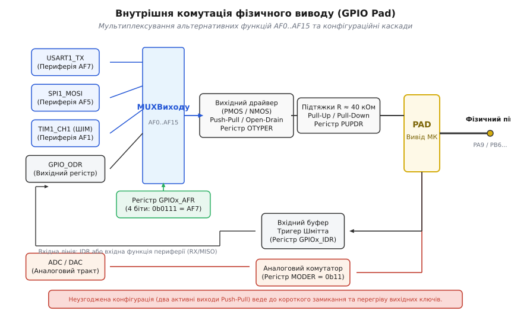
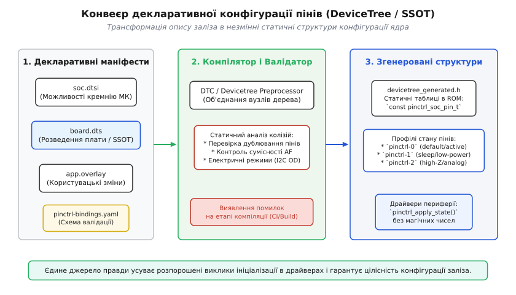

# Конфігурація пінів як єдине джерело правди

<preknowlist>
- [GPIO-регістри](root:sf-devices/gpio-registers) — базовий доступ до портів вводу-виводу через адресний простір пам'яті.
- [Мультиплексування виводів МК](root:sf-devices/pin-multiplexing) — концепція розподілу фізичних контактів між цифровою та аналоговою периферією.
- [CMSIS: стандартний інтерфейс ПЗ для Cortex-M](root:sf-devices/cmsis) — структури регістрового доступу та апаратна абстракція.
- [Шаблон драйвера периферії](root:sf-devices/driver-pattern) — розділення апаратної ініціалізації та прикладної логіки.
</preknowlist>

Коли на друкованій платі фізичний вивід PA9 одночасно налаштовується в драйвері послідовного порту як передавач `USART1_TX` (альтернативна функція AF7, двотактний вихід Push-Pull), а в модулі індикації помилково конфігурується як звичайний дискретний вихід GPIO з низьким логічним рівнем `0` (0 В), кремнієвий кристал мікроконтролера опиняється в стані апаратного короткого замикання. Щойно передавач UART починає передавати байт і підіймає внутрішню лінію до логічної одиниці `3.3 В` через верхній PMOS-транзистор, вихідний регістр GPIO одночасно відкриває нижній NMOS-транзистор до шини землі GND. Опір відкритого каналу транзисторів вихідного каскаду становить близько `25–40 Ом`, тому напруга живлення `3.3 В` падає на сумарному послідовному опорі `50–80 Ом`, породжуючи наскрізний струм величиною понад `40–65 мА`. Це втричі перевищує гранично допустимий струм для одного виводу мікроконтролера (`20–25 мА`), спричиняє локальне перегрівання кремнієвої підкладки, просідання внутрішньої шини живлення `V_DD`, раптові скидання ядра через Brown-Out Reset або незворотну деградацію металізації кристала через електроміграцію.


*Внутрішня комутація фізичного виводу: мультиплексори AF0–AF15 обирають одне джерело керування для вихідного каскаду, а конфігураційні біти MODER, OTYPER та PUPDR визначають електричний режим виводу.*

Причиною таких катастрофічних аварій рідко буває дефект схемотехніки друкованої плати. Майже завжди це наслідок архітектурної вади прошивки: конфігурація апаратних ресурсів розпорошена по десятках окремих модулів вихідного коду, де кожен драйвер самостійно та неявно записує власні магічні константи у конфігураційні регістри портів вводу-виводу.

### Анатомія фізичного виводу та матриця мультиплексування

Сучасний 32-бітний мікроконтролер у компактному корпусі QFP64 або QFN48 має від 30 до 50 доступних фізичних виводів, але містить усередині кремнію десятки складних периферійних блоків: кілька інтерфейсів UART/USART, контролери шин SPI, I2C, CAN/FDCAN, таймери з каналами генерації ШІМ і захоплення сигналів, модулі прямого доступу до пам'яті DMA, тактові генератори та багатоканальні аналого-цифрові перетворювачі (ADC). Якби кожен внутрішній функціональний сигнал вимагав власної ізольованої металевої ніжки на корпусі мікросхеми, розмір кристала й вартість корпусування зросли б у десятки разів, а розведення друкованої плати стало б неможливим через геометричні обмеження.

Розв'язанням цієї інженерної дилеми є апаратне мультиплексування виводів (лат. *multiplex* — многократний, складений з багатьох частин). Усередині кожного фізичного контакту (GPIO Pad) розташована розвинена цифрова та аналогова комутаційна матриця. На кристалі фізичний контакт з'єднується не з одним конкретним драйвером, а з універсальною коміркою вводу-виводу, керованою групою спеціалізованих регістрів:

1. **Регістр режиму `MODER` (Mode Register)**. Визначає базову роль виводу за допомогою двох бітів на кожен контакт:
   - `00` — вхід загального призначення (Input);
   - `01` — цифровий вихід загального призначення (General Purpose Output);
   - `10` — альтернативна функція (Alternate Function), за якої керування лінією передається внутрішній периферії;
   - `11` — аналоговий режим (Analog Mode), за якого цифровий вхідний буфер повністю вимикається, усуваючи наскрізні струми витоку при проходженні аналогових напруг.

2. **Регістри вибору альтернативної функції `AFRL` та `AFRH` (Alternate Function Low/High Registers)**. Оскільки мікроконтролери архітектури ARM Cortex-M підтримують до 16 різних альтернативних призначень на кожен пін (від `AF0` до `AF15`), вибір функції кодується чотирибітним полем `AFR[3:0]`. Для 16 пінів порту (наприклад, `GPIOA0`..`GPIOA15`) виділено два 32-бітних регістри: `AFRL` обслуговує піни 0–7, а `AFRH` — піни 8–15. Значення в цьому полі фізично комутує мультиплексор, спрямовуючи вихідний цифровий потік від таймера (`AF1`), інтерфейсу SPI (`AF5`), інтерфейсу I2C (`AF4`) або порту USART (`AF7`) безпосередньо до вихідного драйвера ніжки.

3. **Регістр типу виходу `OTYPER` (Output Type Register)**. Задає схемотехніку вихідного каскаду:
   - Двотактний вихід (Push-Pull, значення `0`): активне формування як високого рівня через верхній PMOS-транзистор до шини живлення `V_DD`, так і низького рівня через нижній NMOS-транзистор до шини землі `V_SS`. Забезпечує круті фронти сигналів та високу швидкість передачі, але вимагає ексклюзивного монопольного володіння лінією.
   - Відкритий стік (Open-Drain, значення `1`): верхній PMOS-транзистор апаратно вимкнений, і мікроконтролер може лише притягувати лінію до землі через нижній NMOS-ключ. Повернення лінії у високий стан здійснюється зовнішнім або внутрішнім резистором підтяжки (Pull-Up). Цей режим є обов'язковим для шин із розділюваним доступом і двостороннім зв'язком, таких як I2C або 1-Wire.

4. **Регістр конфігурації підтяжок `PUPDR` (Pull-up / Pull-down Register)**. Дозволяє під'єднати внутрішні резистори номіналом близько `30–50 кОм` до шини `V_DD` (Pull-Up, `01`), шини `V_SS` (Pull-Down, `10`) або залишити вивід у високоімпедансному плаваючому стані (No Pull, `00`).

5. **Регістр швидкості наростання фронту `OSPEEDR` (Output Speed Register)**. Регулює крутість фронтів перемикання вихідних ключів (Slew Rate, від низької швидкості 2 МГц до надвисокої 50–100 МГц), що дозволяє зменшити електромагнітні завади (EMI) та уникнути дзвіна на лініях друкованої плати, якщо висока частота не потрібна.

Вхідна частина комірки містить тригер Шмітта (нім. *Schmitt-Trigger*), який перетворює аналоговий сигнал зі спадами та завадами на чіткі логічні рівні `0` та `1` з гістерезисом близько `200–400 мВ`. Цей гістерезис запобігає множинним хибним спрацьовуванням при повільній зміні напруги. Захисні діоди ESD обмежують вхідну напругу в межах від `V_SS - 0.3 В` до `V_DD + 0.3 В`. 

Винятком є спеціалізовані виводи, стійкі до напруги 5 В (Five-Volt Tolerant, маркуються як `FT`). У їхній кремнієвій структурі верхній захисний діод на шину `V_DD` замінений на схему з плаваючою підкладкою (Floating N-Well), що дозволяє безпечно подавати рівень `5 В` на вхід мікроконтролера з живленням `3.3 В` без виникнення паразитного струму через кристал. Проте якщо на такому піні помилково увімкнути внутрішню підтяжку до `V_DD`, через підтягувальний резистор почне протікати зворотний струм, що здатне порушити режим роботи малопотужних джерел живлення.

### Електричні наслідки помилкової конфігурації

Коли конфігурація пінів задається безсистемно, апаратні колізії призводять до трьох типів критичних відмов:

#### 1. Конфлікт вихідних каскадів (Driver Contention)
Якщо два виходи в режимі Push-Pull з'єднані електрично — або через неправильний внутрішній вибір альтернативної функції на одному піні, або через одночасне керування двома пристроями на одній лінії друкованої плати, — виникає стан невизначеності. Коли один транзистор відкритий на шину `3.3 В`, а другий на `0 В`, струм короткого замикання обмежується лише внутрішнім опором каналів польових транзисторів:

```
I_contention
= (V_DD - V_SS) / (R_ds_on_p + R_ds_on_n)  [закон Ома: напруга живлення на сумарному опорі відкритих каналів]
= (3.3 - 0.0) / (35 + 30)                  [підстановка параметрів: V_DD = 3.3 В, R_p = 35 Ом, R_n = 30 Ом]
= 3.3 / 65                                 [додавання опорів каналів транзисторів]
≈ 50.8 мА                                  [розрахунок наскрізного струму короткого замикання]
```

Потужність тепловиділення на транзисторах мікроскопічного вихідного каскаду становить:

```
P_heat
= I_contention² · R_channel                [закон Джоуля-Ленца: теплова потужність на транзисторі]
= (0.0508)² · 35                           [підстановка струму I = 50.8 мА та опору PMOS R = 35 Ом]
≈ 90.3 мВт                                 [розрахунок розсіюваної потужності на кристалі]
```

Густина струму в найтонших алюмінієвих або мідних доріжках внутрішнього кремнієвого шару перетинає критичний поріг, що викликає явище електроміграції (перенесення атомів металу під дією електронного вітру), утворення пустот і локальний тепловий пробій p-n переходу.

#### 2. Плаваючий вхід та наскрізні струми CMOS (Floating Input Shoot-Through)
Якщо фізичний пін сконфігуровано як цифровий вхід (`MODER = 00`), але на друкованій платі він нікуди не під'єднаний і внутрішні резистори підтяжки вимкнені (`PUPDR = 00`), потенціал на виводі починає дрейфувати під дією електростатичних наведень та струмів витоку. 

Вхідний цифровий каскад побудований на комплементарній парі інвертора (PMOS + NMOS). Коли вхідна напруга близька до `0 В`, PMOS відкритий, а NMOS закритий. Коли напруга близька до `V_DD`, NMOS відкритий, а PMOS закритий. Проте коли потенціал плаваючого входу дрейфує в проміжну зону близько `V_DD / 2` (наприклад, `1.65 В`), обидва транзистори інвертора входять у лінійну активну область і частково відкриваються одночасно. 

Через інвертор починає протікати постійний наскрізний струм від шини `V_DD` до `GND` величиною від сотень мікроамперів до кількох міліамперів на кожен плаваючий вивід. Для пристроїв із батарейним живленням, де цільовий струм у режимі очікування має становити `5–15 мкА`, наявність лише одного плаваючого піна збільшує енергоспоживання в сотні разів і розряджає акумулятор за лічені дні.

#### 3. Блокування відкритих шин через некоректний режим виходу
Класичний приклад — налаштування ліній шини I2C (`SCL` та `SDA`). Стандарт протоколу вимагає виключно режиму відкритого стоку (Open-Drain) із зовнішніми підтягувальними резисторами. Якщо розробник конфігурує альтернативну функцію `AF4` (I2C), але помилково залишає біт у регістрі `OTYPER` у стані `0` (Push-Pull), передавач мікроконтролера починає жорстко видавати `3.3 В` на лінію `SDA` під час передачі логічної одиниці. 

Коли підключений зовнішній датчик намагається підтвердити прийом байта і видає сигнал `ACK`, притягуючи лінію `SDA` до нуля своїм внутрішнім ключем, виникає коротке замикання між верхнім PMOS-ключем мікроконтролера та нижнім NMOS-ключем датчика. Датчик не здатний пересилити вихід мікроконтролера, лінія залишається у високому стані, транзакція I2C аварійно зривається, а шина намертво зависає (I2C Bus Lockup).

### Архітектурні варіації мультиплексування: STM32, ESP32 та NXP

Підходи до апаратної реалізації матриці виводів суттєво відрізняються залежно від сімейства мікроконтролерів:

1. **Жорстка матриця альтернативних функцій (STM32 / ARM Cortex-M)**.
   У мікроконтролерах STM32 кожен фізичний вивід має строго фіксовану таблицю з 16 можливих призначень (`AF0`..`AF15`). Наприклад, вивід `PA9` може бути виключно `USART1_TX` (AF7), `TIM1_CH2` (AF1) або `I2C3_SMBA` (AF4). Розробник не може довільно призначити сигнал `SPI1_MOSI` на `PA9`, якщо відповідний мультиплексор не з'єднаний фізичними металевими зв'язками на етапі проектування кремнію. Перевага такого підходу — нульова додаткова затримка розповсюдження сигналу та висока енергоефективність. Недолік — жорсткі геометричні обмеження при трасуванні друкованої плати.

2. **Повнозв'язна матриця комутації (ESP32 IO MUX & GPIO Matrix)**.
   У мікроконтролерах ESP32 від Espressif застосовано дворівневу систему: базовий блок `IO MUX` та гнучку комутаційну матрицю `GPIO Matrix`. Більшість цифрових периферійних сигналів (UART, SPI, I2C, PWM, I2S) можна програмно перенаправити на **будь-який** вільний фізичний вивід мікросхеми шляхом запису номерів сигналів у спеціальні матричні регістри `GPIO_FUNCx_OUT_SEL_CFG`. Це забезпечує виняткову гнучкість при розведенні друкованої плати, проте додає затримку в 1–2 такти системної шини (близько 10–25 нс), що вимагає використання прямого швидкісного блоку `IO MUX` для високочастотних інтерфейсів пам'яті QSPI Flash.

3. **Роздільні конфігуратори функцій та каскадів (NXP i.MX RT / Kinetis IOMUXC)**.
   У процесорах NXP підсистема `IOMUXC` розбиває керування виводом на два окремі регістри: регістр вибору мультиплексора (Mux Register) та регістр конфігурації контактної площадки (Pad Control Register). Pad Control Register дозволяє точно налаштовувати не лише підтяжки та відкритий стік, а й силу навантажувальної здатності (Drive Strength у міліамперах), компенсацію лінії (Keeper Circuit для утримання останнього логічного рівня при відключенні драйвера) та фільтрацію брязкоту на апаратному рівні.

### Конфлікти ліній зовнішніх переривань (EXTI Routing Conflicts)

Окремим підступним джерелом апаратних колізій є спільне використання ліній зовнішніх переривань (EXTI). У більшості мікроконтролерів ARM Cortex-M контролер переривань містить фіксовану кількість вхідних каналів `EXTI0`..`EXTI15`. Кожен канал обслуговує піни з однаковим порядковим номером з усіх портів, але комутується через мультиплексор конфігурації системи (`SYSCFG_EXTICR1`..`SYSCFG_EXTICR4`):

- `EXTI0` може бути під'єднаний або до `PA0`, або до `PB0`, або до `PC0`, або до `PD0`;
- `EXTI1` може бути під'єднаний або до `PA1`, або до `PB1`, або до `PC1`, або до `PD1`.

Якщо розробник схемотехніки розмістить на платі тактову кнопку користувача на виводі `PA0`, а сигнал готовності даних від акселерометра (DRDY) на виводі `PB0`, виникає топологічний глухий кут: мікроконтролер не здатний обробляти апаратні переривання від обох джерел одночасно. Запис конфігурації для `PB0` у регістр `SYSCFG_EXTICR1` мовчазно від'єднує лінію `PA0` від вектора переривань. 

За відсутності єдиного джерела правди такий конфлікт виявляється лише на етапі налагодження готового пристрою, коли натискання кнопки несподівано вимикає опитування датчика або спричиняє пропуск пакетів.

### Шум одночасного перемикання та керування швидкістю фронту (SSN / Slew Rate)

При одночасному перемиканні багатьох виходів мікроконтролера (наприклад, 8-бітної або 16-бітної паралельної шини дисплея чи швидкісної пам'яті) виникає явище шуму одночасного перемикання (Simultaneous Switching Noise, SSN), відоме також як підстрибування землі (Ground Bounce) та просідання живлення (Power Sag).

Кожен фізичний контакт мікросхеми з'єднаний із кристалом мікроскопічним дротяним мікрозварюванням (Bonding Wire), яке має власну паразитну індуктивність `L_bond ≈ 1–3 нГн`. Коли 8 виходів одночасно переходять із логічного нуля в логічну одиницю з максимальною швидкістю фронту (`t_rise ≈ 1–2 нс`), через індуктивність шини живлення протікає імпульсний струм із високою швидкістю наростання `dI/dt`:

```
V_bounce = L_bond · (dI_total / dt)
```

Цей стрибок напруги всередині кристала сягає `300–600 мВ`, що призводить до хибних спрацьовувань сусідніх тригерів Шмітта, випадкових збоїв переривань та спотворення показань чутливого аналого-цифрового перетворювача (ADC).

Єдине джерело правди дозволяє централізовано розв'язати цю проблему: замість виставляння максимальної швидкості `OSPEEDR = Very High` для всіх виводів поспіль, декларативна конфігурація призначає високу швидкість лише лініям SPI/QSPI із частотою понад 20 МГц, а світлодіоди, реле та низькошвидкісні шини I2C/UART обмежує низьким або середнім значенням швидкості (Low/Medium Slew Rate), придушуючи випромінювання EMI та захищаючи аналогові канали.

### Послідовність налаштування регістрів та захист конфігурації

Навіть правильна за значеннями бітів конфігурація може призвести до збою, якщо порушено послідовність запису в регістри керування:

1. **Тактування перед конфігурацією**. Будь-яке звернення до регістрів `GPIOx` при вимкненому тактуванні відповідного порту в системному контролері тактування (наприклад, скинутий біт `RCC_AHB1ENR_GPIOAEN`) призводить до генерації апаратного винятку `BusFault` або апаратного зависання шини AHB/APB. 
2. **Конвеєрна затримка шини**. Після встановлення біта увімкнення тактування в регістрі `RCC` потрібна затримка щонайменше в два такти системної шини, перш ніж периферійний блок почне стабільно відповідати на операції запису. У надійному коді після запису в `RCC` виконують читальний доступ до того ж регістра або інструкцію бар'єра пам'яті `__DSB()`.
3. **Апаратне блокування конфігурації (GPIO Lock Mechanism)**. Для захисту критичних ліній керування (наприклад, дискретних сигналів аварійного вимкнення силових ключів або ліній внутрішньосхемного налагодження SWD/JTAG `PA13/PA14`) від випадкового спотворення при збоях покажчиків у пам'яті мікроконтролери містять регістр блокування `GPIOx_LCKR`. Застосування спеціальної послідовності запису ключа (Lock Key Sequence):

```
Write LCKK = 1 + PinMask
Write LCKK = 0 + PinMask
Write LCKK = 1 + PinMask
Read  LCKK
Read  LCKK (значення 1 підтверджує успішне блокування)
```

Після виконання цієї послідовності біти конфігурації заблокованих пінів у регістрах `MODER`, `OTYPER`, `OSPEEDR`, `PUPDR` та `AFR` стають апаратно незмінними. Будь-які подальші спроби запису ігноруються кристалом аж до повного апаратного перезавантаження мікроконтролера.

### Проблема розпорошеної конфігурації

У багатьох проєктах вбудованих систем конфігурація пінів не розглядається як цілісна підсистема. Замість цього кожен програмний компонент налаштовує виводи на власний розсуд:

:::tabs
:::code konfihuratsiia-piniv-iak-iedyne-dzherelo-pravdy-d/c/uart_driver.c
:::code konfihuratsiia-piniv-iak-iedyne-dzherelo-pravdy-d/cpp/problema-rozporoshenoi.hpp
:::

Такий стиль розробки породжує три небезпечні проблеми:

1. **Баги порядку ініціалізації (Initialization Order Hazards)**. Якщо функція `led_init()` викликається після `uart1_init()`, передавач UART раптово перестає надсилати дані, хоча сам периферійний блок `USART1` залишається увімкненим і виставляє прапорці готовності. Якщо порядок викликів змінити під час рефакторингу `main()`, поведінка системи непередбачувано змінюється.
2. **Неможливість аудиту та перевірки на етапі збирання**. Магічні бітові маски розкидані по різних файлах вихідного коду. Жоден компілятор чи статичний аналізатор не може зрозуміти, чи не претендують два незалежні модулі на той самий фізичний вивід.
3. **Екстремальна крихкість під час перенесення на нову ревізію плати**. Коли інженери-схемотехніки випускають нову версію плати, де лінію перемикання перенесли з `PA9` на `PB4`, програміст змушений вручну шукати всі входження номерів пінів по всій кодовій базі. Пропуск хоча б одного місця призводить до того, що старий код продовжує перезаписувати конфігурацію нового піна.

### Принцип Single Source of Truth (SSOT)

Єдине джерело правди (Single Source of Truth, SSOT) — це фундаментальний архітектурний патерн проектування вбудованого програмного забезпечення, за якого вся конфігурація апаратних ресурсів (розподіл фізичних виводів, режими роботи, альтернативні функції, електричні характеристики, прив'язка до ліній переривань та профілі енергозбереження) описується строго в **одному** декларативному документі або маніфесті.


*Послідовність трансформації апаратного опису: декларативні маніфести DTS проходять компілятор і генератор зв'язувань, утворюючи незмінні статичні структури pinctrl для драйверів ядра.*

Принцип SSOT встановлює суворі правила:
1. **Драйвери периферії позбавляються права самостійно конфігурувати GPIO-регістри**. Драйвер UART знає лише те, як налаштувати швидкість передачі (Baudrate), керувати регістрами передавача `CR1/TDR` та обробляти переривання. Фізичну комутацію пінів драйвер отримує ззовні у вигляді готового дескриптора або незмінної конфігураційної структури.
2. **Конфігурація є декларативною**. Замість процедурного коду («прочитай регістр, застосуй маску, запиши назад») використовується опис зв'язків («пін PA9 = функція USART1_TX, режим Push-Pull, швидкість Very High, без підтяжки»).
3. **Цілісність перевіряється до виконання коду**. Спеціалізовані валідатори або механізми компіляції (`consteval`, макроси DeviceTree, скрипти збірки) перевіряють усю карту пінів на відсутність конфліктів до того, як бінарний файл буде прошито в мікроконтролер.

### Індустріальні стандарти SSOT: STM32CubeMX, DeviceTree та Kconfig

В сучасній розробці вбудованих систем склалися три основні підходи до реалізації єдиного джерела правди.

#### 1. Графічні маніфести та кодогенерація (STM32CubeMX `.ioc`)
У екосистемі STMicroelectronics єдиним джерелом правди виступає файл конфігурації проєкту `.ioc`. Це текстовий INI-подібний маніфест, у якому кожна лінія чіпа має однозначний запис:

```ini
PA9.GPIO_Parameters=GPIO_Speed,PinCustomName
PA9.GPIO_Speed=GPIO_SPEED_FREQ_VERY_HIGH
PA9.Locked=true
PA9.Mode=Trace_Asynchronous
PA9.PinCustomName=DEBUG_UART_TX
PA9.Signal=USART1_TX

PB6.GPIO_Parameters=GPIO_PuPd,GPIO_ModeDefaultOutputSpeed
PB6.GPIO_ModeDefaultOutputSpeed=GPIO_SPEED_FREQ_HIGH
PB6.GPIO_PuPd=GPIO_PULLUP
PB6.Mode=I2C
PB6.Signal=I2C1_SCL
```

Графічний конфігуратор CubeMX містить повну вбудовану базу знань про кремнієву топологію кожного чипа. Якщо користувач намагається призначити `SPI1_MOSI` на пін, який вже зайнятий `TIM1_CH1`, утиліта підсвічує конфлікт червоним кольором і блокує генерацію некоректного коду.

Під час генерації проєкту створюється єдина функція ініціалізації `MX_GPIO_Init()`, яка виконує повну конфігурацію всіх портів за один прохід під час старту мікроконтролера, до запуску прикладних завдань:

:::tabs
:::code konfihuratsiia-piniv-iak-iedyne-dzherelo-pravdy-d/c/1-hrafichni-manifesty-ta.c
:::code konfihuratsiia-piniv-iak-iedyne-dzherelo-pravdy-d/cpp/1-hrafichni-manifesty-ta.hpp
:::

Обмеженням підходу CubeMX є його жорстка прив'язка до пропрієтарного GUI-інструменту, складність автоматичного злиття конфліктів у системах контролю версій Git та відсутність підтримки динамічного перемикання станів пінів для енергозбереження.

#### 2. Дерево пристроїв Zephyr RTOS (DeviceTree та підсистема `pinctrl`)
У операційній системі реального часу Zephyr RTOS концепція SSOT реалізована через ієрархічне дерево пристроїв (DeviceTree Source, DTS). Опис розбито на чіткі шари:

1. **`soc.dtsi`** — опис можливостей кремнію виробника (базові адреси периферії, доступні альтернативні функції);
2. **`board.dts`** — опис апаратної плати (до яких саме пінів підключені мікросхеми та роз'єми);
3. **`app.overlay`** — проектні накладки, що перевизначають або доповнюють конфігурацію для конкретного прикладного застосунку.

Конфігурація пінів описується у вузлах контролера виводів `pinctrl`:

```dts
/* Файл опису плати my_custom_board.dts */
&pinctrl {
    usart1_default: usart1_default {
        group1 {
            pinmux = <STM32_PINMUX('A', 9, AF7)>; /* TX */
            bias-disable;
            drive-push-pull;
            slew-rate = "very-high-speed";
        };
        group2 {
            pinmux = <STM32_PINMUX('A', 10, AF7)>; /* RX */
            bias-pull-up;
        };
    };

    usart1_sleep: usart1_sleep {
        group1 {
            pinmux = <STM32_PINMUX('A', 9, ANALOG)>,
                     <STM32_PINMUX('A', 10, ANALOG)>;
        };
    };

    i2c1_default: i2c1_default {
        group1 {
            pinmux = <STM32_PINMUX('B', 6, AF4)>, /* SCL */
                     <STM32_PINMUX('B', 7, AF4)>; /* SDA */
            bias-pull-up;
            drive-open-drain;
        };
    };
};

&usart1 {
    pinctrl-0 = <&usart1_default>;
    pinctrl-1 = <&usart1_sleep>;
    pinctrl-names = "default", "sleep";
    current-speed = <115200>;
    status = "okay";
};
```

Під час збирання проєкту генератор Zephyr перетворює декларативне дерево DTS у незмінні статичні структури констант мови C у пам'яті Flash:

:::tabs
```c
/* Згенеровано компілятором DeviceTree (C99) */
static const pinctrl_soc_pin_t usart1_default_pins[] = {
    STM32_PINMUX('A', 9, AF7) | STM32_OTYPE_PP | STM32_OSPEED_VHIGH,
    STM32_PINMUX('A', 10, AF7) | STM32_PUPDR_PULLUP,
};

static const struct pinctrl_state usart1_states[] = {
    { .id = PINCTRL_STATE_DEFAULT, .pins = usart1_default_pins, .pin_cnt = 2 },
};
```
:::code konfihuratsiia-piniv-iak-iedyne-dzherelo-pravdy-d/cpp/2-derevo-prystroiv-zephyr.cpp
:::

Драйвер Zephyr під час ініціалізації або зміни режиму живлення викликає стандартну функцію `pinctrl_apply_state(config->pcfg, PINCTRL_STATE_DEFAULT)`. Сам драйвер взагалі не містить імен чи номерів портів і не залежить від конкретного мікроконтролера.

### Управління станами живлення: активний режим проти сну

Одна з найбільших переваг підходу SSOT — це коректне керування станами пінів під час переходу мікроконтролера в режими глибокого енергозбереження (Deep Sleep, Stop Mode або Standby).

У пристроях з автономним живленням перехід у сон вимагає не просто зупинки тактування процесорного ядра, а повної ізоляції ліній вводу-виводу:

1. **Паразитарне живлення через виводи (Parasitic Powering)**. Якщо мікроконтролер вимикає зовнішній датчик через ключ живлення (Power Switch), але залишає активні цифрові виходи SPI або I2C у стані логічної одиниці `3.3 В`, струм починає протікати через захисні ESD-діоди знеструмленого датчика на його внутрішню шину живлення. Це призводить до трьох проблем:
   - Зовнішня мікросхема частково заживлюється паразитарним струмом і зависає в непередбачуваному стані;
   - Споживання пристрою в режимі сну зростає на `2–10 мА`;
   - Виникає ризик тиристорного замикання (Latch-Up) при повторній подачі основного живлення.

2. **Переведення пінів у аналоговий ізольований стан**. Перед входом у глибокий сон підсистема керування живленням повинна перевести всі некритичні піни у стан `MODER = 11` (Analog Mode) без підтяжок. У цьому стані вхідний тригер Шмітта повністю від'єднується від піна, а вихідні ключі перебувають у стані високого імпедансу (High-Z), що повністю унеможливлює протікання витоків.

3. **Фіксація стану виводів (Pin Retention / Pin Hold)**. Деякі мікроконтролери (наприклад, ESP32, nRF52 або STM32 серії L) мають функцію апаратної фіксації стану пінів (`gpio_hold_en()` або `PWR_CR3_APC`). Коли цифровий домен мікроконтролера вимикається, спеціальні тригери в домені живлення Always-On утримують напругу на затворах вихідних ключів, зберігаючи рівні керування зовнішніми силовими реле чи транзисторами без споживання енергії ядром.

### Динамічне перемикання станів: протоколи та аварійне відновлення

Хоча більшість виводів у системі зберігають свою роль постійно, існують законні сценарії, за яких роль піна повинна динамічно змінюватися під час виконання програми:

1. **Однопровідні напівдуплексні інтерфейси (1-Wire, Single-Wire UART, DHT11/22)**.
   При роботі з термодатчиками DS18B20 або однопровідними датчиками вологості один фізичний вивід чергує два стани:
   - Стан передавача (Drive State): вивід конфігурується як вихід Open-Drain (або Push-Pull) для формування імпульсу скидання (Reset Pulse) тривалістю 480 мкс;
   - Стан приймача (Read State): вивід негайно перемикається у високоімпедансний вхід із підтяжкою для вимірювання тривалості імпульсу присутності (Presence Pulse), сформованого датчиком.

2. **Аварійне відновлення заблокованої шини I2C (I2C Bus Recovery Procedure)**.
   Якщо під час передачі байта мікроконтролер несподівано перезавантажився (наприклад, за спрацьовуванням Watchdog), зовнішній слейв-пристрій може залишитися в стані передачі нульового біта, жорстко утримуючи лінію `SDA` на рівні землі. У такому стані апаратний периферійний блок I2C мікроконтролера фіксує помилку зайнятості шини (Bus Busy) і відмовляється генерувати сигнал START.
   Для відновлення працездатності система реалізує процедуру відновлення:
   - Апаратний блок I2C тимчасово деактивується;
   - Пін `SCL` реконфігурується як звичайний дискретний вихід GPIO;
   - Програмно генерується пачка з 9 тактових імпульсів на лінії `SCL`, що примушує слейв завершити передачу байта та відпустити лінію `SDA`;
   - Формується послідовність STOP (перехід SDA з низького рівня у високий при високому рівні SCL);
   - Виводи `SCL` та `SDA` повертаються під керування альтернативної функції `AF4` периферійного блока I2C.

У парадигмі SSOT такі переходи описуються не випадковими записами в регістри, а як перемикання між заздалегідь валідованими профілями стану (`PINCTRL_STATE_RECOVERY` та `PINCTRL_STATE_DEFAULT`), що гарантує збереження цілісності налаштувань.

### Інтеграція в CI/CD: валідація схемотехніки Netlist та прошивки

Сучасні високоякісні процеси розробки апаратного забезпечення розширюють концепцію SSOT за межі кодової бази прошивки, інтегруючи її безпосередньо з САПР друкованих плат (EDA/CAD: Altium Designer, KiCad, Cadence OrCAD).

1. **Експорт списку з'єднань (Netlist / Pinout Export)**. Під час проектування електричної схеми інженер-схемотехнік генерує звіт про призначення виводів (CSV, JSON або XML). У ньому зафіксовано, що пін 18 мікроконтролера (PA9) з'єднаний із вхідним контактом мікросхеми трансивера RS-485.
2. **Автоматична крос-валідація у CI**. Спеціалізований скрипт на етапі збирання прошивки порівнює експортований звіт САПР із декларативним маніфестом прошивки (`board.dts` або C++ таблицею). Якщо розробник прошивки призначив на PA9 функцію `SPI1_MISO` або звичайний вхід, збірка у системі неперервної інтеграції (CI) завершується аварійною помилкою.
3. **Генерація документації та тестових матриць**. З єдиного маніфесту автоматично генеруються апаратні карти для цеху тестування, інтерактивні схеми розведення роз'ємів та конфігурації для автоматичних стендів перевірки плат (ICT / Boundary Scan).

### Статична валідація конфігурації: від макросів до C++20 `consteval`

Найефективніший спосіб уникнути апаратних колізій — це виявити їх на етапі компіляції або під час автоматизованого CI-тестування на хост-системі.

Сучасні стандарти C++20 дозволяють побудувати типізовану, безпечну систему конфігурації пінів з повною валідацією через функції з модифікатором `consteval` та вирази `static_assert`. Помилка конфігурації (наприклад, дублювання піна чи некоректна альтернативна функція) викликає помилку компіляції з чітким текстовим описом, не дозволяючи зібрати некоректний бінарний файл.

Для детального ознайомлення з повною реалізацією апаратного валідатора, який виявляє колізії альтернативних функцій, перевіряє електричну сумісність та генерує діагностичні звіти для складальних систем, зверніться до практичної вставки [Валідатор конфігурації пінів і виявлення колізій](root:sf-devices/konfihuratsiia-piniv-iak-iedyne-dzherelo-pravdy/proj-pinmux-validator.md).

Нижче наведено практичний приклад реалізації єдиного джерела правди на чистому C99 з використанням конфігураційних таблиць у ROM та еквівалентний ідіоматичний підхід на C++20 із compile-time валідацією.

:::tabs
:::code konfihuratsiia-piniv-iak-iedyne-dzherelo-pravdy-d/c/statychna-validatsiia.c
:::code konfihuratsiia-piniv-iak-iedyne-dzherelo-pravdy-d/cpp/statychna-validatsiia.cpp
:::

Конфігурація виводів мікроконтролера як єдиного джерела правди повністю усуває людські помилки розпорошеного коду, перетворює адаптацію прошивки під нову ревізію плати на швидку модифікацію одного маніфесту та надійно захищає кремнієві кристали від електричних аварій ще на стадії компіляції проєкту.
