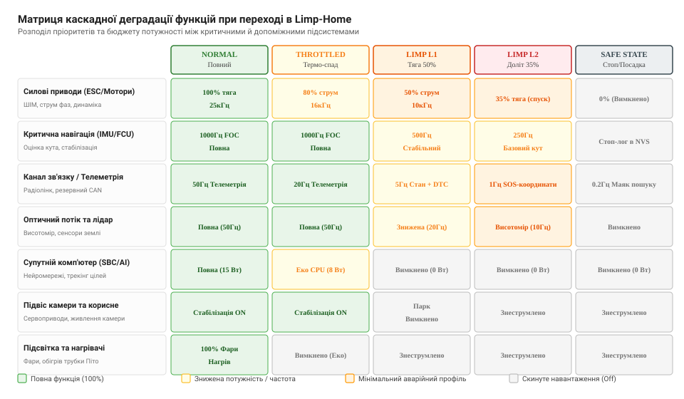
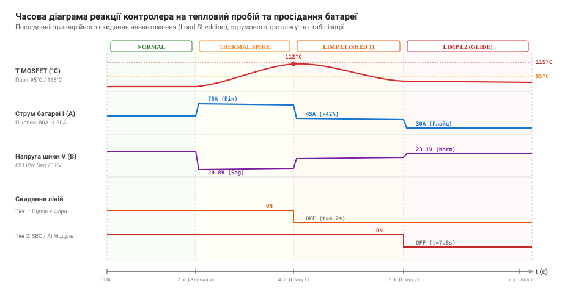

# Кульгавий режим: урізана потужність до сервісу

<preknowlist>
- [Безпечний стан](root:sf-devices/safe-mode) — чому аварійне знеструмлення актуаторів є базовою лінією оборони при невиправних відмовах
- [Деградація з гідністю](root:sf-devices/graceful-degradation) — сходинки відступу від повної функції до спрощеної роботи без втрати керованості
- [Ключі на польових транзисторах](root:hw-components/mosfet-power-switch) — як відкритий канал MOSFET розсіює тепло та чому перегрів руйнує напівпровідниковий кристал
- [Зниження допустимих параметрів (Thermal Derating)](root:hw-components/power-derating) — математика обмеження потужності при зростанні температури силових ключів
- [Просідання напруги батареї (Battery Sag)](root:hw-power/battery-sag) — динаміка падіння напруги акумулятора під піковими навантаженнями через внутрішній опір
- [Діагностика струму в моторах](root:hw-motion/motor-current-sense) — вимірювання фазних струмів шунтами та реакція на насичення магнітопроводу й перевантаження
- [Енергонезалежна пам'ять NVS](root:sys-fw/nvs) — збереження діагностичних кодів несправностей (DTC) та лічильників збоїв між перезапусками
</preknowlist>

Вантажний безпілотний гексакоптер летить над промисловою зоною на відстані двох кілометрів від бази із корисним навантаженням масою чотири кілограми. Під час набору висоти при зустрічному вітрі 14 м/с температура алюмінієвого радіатора силових транзисторів інвертора третього мотора стрімко долає поріг 105°C, а внутрішній опір однієї з комірок силового акумулятора LiPo 6S призводить до динамічного просідання напруги шини з 24.2 В до критичних 19.8 В. Якщо прошивка польотного контролера застосує класичний підхід повного аварійного знеструмлення актуаторів, апарат миттєво втратить аеродинамічну стабілізацію й розіб'ється об бетонні конструкції цеху. Якщо ж алгоритм проігнорує аварійні прапорці й продовжуватиме утримувати максимальну тягу місії, тепловий лавинний пробій випалить кремнієвий кристал силового ключа, закоротить силову шину живлення та спричинить займання батареї в повітрі.

Єдиним фізично обґрунтованим виходом із такої кризи є активація спеціального проміжного стану керування — **кульгавого режиму** (англ. *Limp-Home Mode*, у промислових стандартах також відомого як *Degraded Mobility Mode* або *Safe Return Mode*). У цьому режимі система свідомо жертвує другорядними функціями, обмежує пікові динамічні характеристики та знижує тепловиділення до рівня, який пошкоджене залізо здатне гарантовано витримати протягом часу, необхідного для керованого повернення на базу або безаварійної аварійної посадки.

## Анатомія кульгавого режиму: відмінність від безпечного стану та деградації функцій

У теорії надійності вбудованих комплексів часто виникає термінологічна плутанина між трьома близькими поняттями: безпечним станом, деградацією функцій та кульгавим режимом. Щоб правильно побудувати архітектуру прошивки, межі між цими поняттями треба провести однозначно за фізичною поведінкою виконавчих механізмів.

[Безпечний стан (Safe Mode / Fail-Safe)](root:sf-devices/safe-mode) передбачає негайне зняття керуючого потенціалу з усіх потенційно небезпечних актуаторів: вимикаються силові мости, закриваються нормально-закриті паливні клапани, активуються електромеханічні пружинні гальма. Пристрій визнає, що більше не може контролювати власний рух або тепловий процес, і переходить у пасивне очікування ремонту чи завантаження оновлення по шині або радіоканалу. Для стаціонарного верстата чи нагрівального котла це ідеальна реакція, але для транспортного засобу, автономного підводного апарата чи літака зупинка силової установки в динамічному русі сама по собі стає каталізатором катастрофи.

[Деградація з гідністю (Graceful Degradation)](root:sf-devices/graceful-degradation) працює на рівні окремих сенсорів чи функціональних модулів: відмовив основний барометр — перемикаємося на резервний лазерний далекомір або оцінюємо висоту за супутниковою навігацією; відмовив магнітометр — розраховуємо курс за оптичним потоком та інтегруванням гіроскопів. При цьому місія продовжується, динаміка пристрою не обмежується, а користувач лише отримує сповіщення про зниження надлишковості.

Кульгавий режим займає критичний простір між цими двома крайностями. Це стан, коли апаратна відмова зачепила фундаментальні силові чи обчислювальні вузли, через що продовжувати початкову місію фізично неможливо, але припинення руху призведе до неминучої загибелі апарата. Головне завдання кульгавого режиму — підтримувати рух, навігацію та керованість на мінімально достатньому енергетичному рівні рівно стільки часу, скільки потрібно для виходу з небезпечної зони та збереження дорогого обладнання.

Інженери бортових систем формулюють чотири непорушні інваріанти, які контролер кульгавого режиму зобов'язаний забезпечувати щомиті:

```
+-------------------------------------------------------------------------+
|                  ІНВАРІАНТИ БЕЗПЕКИ LIMP-HOME MODE                      |
+-------------------------------------------------------------------------+
|  1. Термічна й електрична безпека:                                     |
|     T_junction < T_max,  I_phase_peak < I_degraded_limit                |
|                                                                         |
|  2. Кінематична керованість:                                            |
|     omega_control_bandwidth >= omega_min_attitude_stability             |
|                                                                         |
|  3. Енергетичний резерв дольоту:                                        |
|     E_remaining >= E_distance_to_home + E_landing_margin                |
|                                                                         |
|  4. Прозорість діагностики:                                             |
|     DTC збережено в NVS/FRAM, аварійний стан передано в телеметрію      |
+-------------------------------------------------------------------------+
```

Якщо хоча б один із цих чотирьох інваріантів порушується — наприклад, температура силового моста продовжує неконтрольовано зростати навіть після урізання струму на 60% — кульгавий режим вичерпує свої можливості, і автоматика виконує аварійний перехід до термінового скидання парашута або примусової посадки в найближчій точці незалежно від типу поверхні під апаратом.

## Класифікація критичних відмов та матриця деградації підсистем

Причини переходу в кульгавий режим не виникають раптово на порожньому місці: вони є наслідком накопичення дефектів, перевантаження або пошкодження компонентів під час експлуатації. Практика проектування силових плат виділяє чотири основні класи несправностей, на які контролер повинен реагувати за заздалегідь визначеними сценаріями.

Перший клас — **термічне перевантаження силових напівпровідникових ключів**. У трифазних інверторах безколекторних моторів (BLDC/PMSM) перемикання струмів силою 30–80 А на частотах ШІМ 20–40 кГц генерує два типи теплових втрат: динамічні втрати перемикання та статичні втрати провідності на опорі відкритого каналу польового транзистора `R_DS(on)`. Кремнієві транзистори MOSFET мають позитивний температурний коефіцієнт опору: при нагріванні кристала від 25°C до 125°C опір `R_DS(on)` зростає у 1.8–2.2 раза. Це створює позитивний зворотний зв'язок: вища температура спричиняє вищий опір, вищий опір викликає ще більше розсіювання тепла `P = I^2 * R`, що штовхає кристал у лавинний тепловий розгін ([Thermal Runaway](root:hw-components/thermal-runaway)). Ситуація загострюється у разі засмічення каналів охолодження, зупинки вентилятора охолодження драйвера або високої температури повітря.

Другий клас — **відмова або деградація датчиків фазного струму**. Сучасні векторні алгоритми керування (Field Oriented Control, FOC) спираються на безперервне високошвидкісне зчитування миттєвих струмів фаз через низькоомні шунти та підсилювачі струму або інтегральні [давачі струму на ефекті Холла](root:hw-sensing/hall-current-sensor). Якщо через вібрацію руйнується контакт сигнальної лінії, операційний підсилювач переходить у насичення або аналого-цифровий перетворювач (АЦП) фіксує постійний нуль чи нефізичний рівень шуму, пряме векторне регулювання струму зривається. Робота з хибними даними струму призводить до сильних ударних моментів на валу мотора, зриву синхронізації та миттєвого виходу ключів із ладу. Контролер змушений деградувати до алгоритмів безсенсорного трапецеїдального керування або розімкненого крокового дольоту з фіксованим обмеженням напруги.

Третій клас — **деградація акумуляторної батареї**. Хімічні джерела струму під впливом низьких температур, циклічного зносу або внутрішнього пошкодження сепаратора зазнають значного зростання внутрішнього послідовного опору `ESR` (Equivalent Series Resistance). Під час високих струмових навантажень виникає глибоке динамічне просідання напруги ([Battery Sag](root:hw-power/battery-sag)). Якщо напруга загальної шини падає нижче порога спрацьовування стабілізаторів вторинних кіл живлення (5 В та 3.3 В), мікроконтролери скидаються по лінії brownout reset ([скидання за просіданням живлення](root:hw-arch/reset-causes)). Окремий критичний випадок — розбаланс комірок у багатоелементному акумуляторі: якщо п'ять комірок мають напругу 3.7 В, а шоста просідає до 2.9 В, подальший розряд у номінальному темпі незворотно руйнує хімічну структуру дефектної комірки з ризиком внутрішнього замикання.

Четвертий клас — **втрата основного або резервного каналу зв'язку**. Відмова трансивера цифрової шини CAN ([CAN bus-off](root:com-devices/can-bus)), обрив диференціальної пари або відмова радіомодема далекої телеметрії перетворює координований пристрій на автономний ізольований вузол. Якщо зворотний канал не підтверджує приймання телеметрії, пристрій зобов'язаний зафіксувати код несправності та перейти до автономного кульгавого повернення за збереженими навігаційними орієнтирами.

Для системної реакції на всі ці класи відмов розробляється **матриця деградації функцій**, яка жорстко регламентує робочі ліміти кожної підсистеми залежно від встановленого рівня тяжкості аварії.


*Матриця розподілу бюджету потужності та обчислювальних ресурсів за рівнями деградації: від номінального режиму до екстреного аварійного дольоту.*

У матриці деградації кожна підсистема дістає чітко визначений стан. Силові мотори на першому рівні кульгавого режиму урізаються до 50% пікового струму із супутнім зниженням частоти ШІМ для мінімізації нагріву ключів. Навігаційне ядро знижує частоту циклів фільтра Калмана з 1000 Гц до 500 Гц або 250 Гц, вивільняючи процесорні такти для самодіагностики. Допоміжні компоненти — підвіс оптичної камери, освітлювальні фари та супутній одноплатний комп'ютер комп'ютерного зору (SBC) — повністю знеструмлюються за допомогою силових ключів живлення корисного навантаження (Load Switches).

## Термодинаміка силових ключів та перехідний тепловий імпеданс

Щоб зрозуміти, чому просте статичне обмеження потужності не рятує транзистори у динамічних режимах, необхідно звернутися до фізики перехідного теплового імпедансу напівпровідникового кристала `Z_th(j-a)`. 

Кремнієвий кристал MOSFET площею всього 15–25 мм² безпосередньо спаяний із мідною основою вивідної рамки корпусу транзистора (наприклад, корпусів DFN 5x6 або DirectFET). Тепловий ланцюг від кремнію до навколишнього повітря складається з кількох послідовно-паралельних ланок теплового опору `R_th` та теплоємності `C_th`. В інженерній практиці цей ланцюг моделюють за допомогою багатоланкової теплової мережі Фостера або Кауера (Foster / Cauer RC-networks):

```
       P_loss (Тепловий потік від кристала)
         |
         +------+--------[ R_th1 ]--------+--------[ R_th2 ]--------+---> T_ambient
         |      |                         |                         |
        ---    ---                       ---                       ---
        --- C1 --- C_die                 --- C2 --- C_tab          --- C3 --- C_heatsink
         |      |                         |                         |
        GND    GND                       GND                       GND
```

Кожна ланка має власну постійну часу нагріву `tau = R_th * C_th`. Для кристала транзистора `tau_die` становить лише 1–5 мілісекунд; для мідної підкладки корпусу `tau_tab` дорівнює 50–150 мілісекундам; для масивного алюмінієвого радіатора або внутрішніх мідних шарів друкованої плати `tau_heatsink` лежить у діапазоні 2–10 секунд.

Коли мотор різко розганяється або долає порив вітру, виникає імпульс струму амплітудою 80 А тривалістю 300 мілісекунд. Протягом цього короткого проміжку часу тепловий потік потужністю понад 120 Вт просто не встигає фізично дійти до зовнішнього радіатора через шар теплопровідного клею чи припою. Уся теплова енергія поглинається внутрішньою теплоємністю самого кристала `C_die`, що спричиняє миттєвий адіабатичний стрибок температури переходу `T_junction` на 40–60°C вище температури радіатора.

Динамічна температура переходу в довільний момент часу описується інтегралом згортки миттєвих втрат із перехідним тепловим імпедансом:

```
T_junction(t) = T_ambient + Integral_0^t [ P_loss(tau) * (d Z_th(t - tau) / d tau) ] d tau
```

Якщо кристал сягає критичної межі (зазвичай 150°C для стандартного кремнію або 175°C для автомобільних MOSFET), фізичні властивості напівпровідника незворотно деградують:
1. **Зниження порогової напруги затвора `V_GS(th)`**: при 150°C поріг відкривання транзистора падає з 2.5 В до 1.2 В. Наведені високочастотні завади від перемикання сусіднього плеча інвертора через паразитну ємність Міллера `C_gd` можуть спонтанно відкрити закритий транзистор, викликаючи наскрізний струм короткого замикання через стійку напівмоста (Shoot-Through).
2. **Зростання зворотного струму витоку `I_DSS`**: струм через закритий транзистор зростає на чотири порядки, генеруючи додаткове статичне тепло навіть у стані спокою.
3. **Механічне втомне руйнування розварювальних дротиків (Bond Wires)**: через різницю коефіцієнтів лінійного теплового розширення кремнію (2.6 * 10^-6 1/K) та алюмінієвих дротиків струмопідводу (23 * 10^-6 1/K) циклічні термомеханічні удари призводять до відшарування контактів від кристала.

Розуміння теплової динаміки диктує головну вимогу до кульгавого режиму: алгоритм зобов'язаний не просто чекати, поки нагріється зовнішній радіатор, а математично оцінювати миттєву температуру переходу та випереджально обмежувати як амплітуду струму, так і тривалість допустимих струмових сплесків.

## Аномалії датчиків струму та деградація векторного керування (FOC)

Векторне керування безколекторними моторами спирається на точне перетворення миттєвих трифазних струмів статора `I_a, I_b, I_c` у систему координат ротора `d-q` за допомогою прямих перетворень Кларк та Парка:

```
I_alpha = I_a
I_beta  = (I_a + 2 * I_b) / sqrt(3)

I_d =  I_alpha * cos(theta_e) + I_beta * sin(theta_e)
I_q = -I_alpha * sin(theta_e) + I_beta * cos(theta_e)
```

де `I_q` формує корисний електромагнітний крутний момент, а `I_d` регулює магнітний потік статора (у звичайних PMSM підтримується рівним нулю).

Для безпомилкового обчислення координат `I_d, I_q` контролер повинен мати як мінімум два достовірні виміри струмів фаз (третій розраховується з правила Кірхгофа `I_a + I_b + I_c = 0` для зірки без нульового проводу). У польових умовах датчики струму зазнають кількох типів відмов:

```
+-------------------------------------------------------------------------+
|                  ТИПОВІ ВИДИ ВІДМОВ СИСТЕМИ ВИМІРЮВАННЯ СТРУМУ          |
+-------------------------------------------------------------------------+
| 1. Теплове зміщення нуля операційного підсилювача (Input Offset Drift)   |
| 2. Насичення вимірювального тракту АЦП (ADC Saturation / Clipping)      |
| 3. Обрив сигнальної доріжки або шунта фази (Phase Sensor Loss)          |
| 4. Високочастотні завади від паразитної індуктивності шунта (L_shunt)   |
+-------------------------------------------------------------------------+
```

Якщо на одному з фазних шунтів виникає дрейф нуля `Delta_I_offset` (наприклад, через самонагрів шунта або деградацію вхідного каскаду підсилювача), у перетвореній системі координат виникає фіктивна гармоніка струму на частоті обертання електричного поля `f_e`. Це породжує пульсацію крутного моменту з подвійною частотою `2 * f_e`, що викликає сильну вібрацію всього корпусу апарата та акустичний гул.

Якщо ж один із датчиків повністю виходить із ладу (АЦП повертає постійне значення `0x000` чи `0xFFF`), стандартний ПІ-регулятор струму намагається скомпенсувати уявну помилку, миттєво насичує інтегральну складову та заганяє вихідні напруги інвертора в меандр 100% шпаруватості. Це призводить до миттєвого зриву синхронізації та перекидання інвертора.

У кульгавому режимі контролер моторів реалізує дворівневу стратегію відступу:
1. **Відмова одного датчика при трьохфазній схемі**: алгоритм виключає дефектний канал із розрахунку та відновлює відсутній струм за двома здоровими сенсорами `I_failed = - (I_good1 + I_good2)`. Струмовий ліміт при цьому знижується на 30% для компенсації можливої втрати точності.
2. **Відмова двох датчиків або деградація єдиного шунта в ланці постійного струму (DC-link shunt)**: векторне керування FOC повністю вимикається. Інвертор переходить в аварійний скалярний режим керування за законом `V/f = const` або безсенсорне трапецеїдальне шестикрокове перемикання з детекцією положення ротора за переходом проти-ЕРС (Back-EMF) через нуль. Оскільки точний контроль струму в такому режимі втрачено, максимальна фазна напруга жорстко обмежується безпечним стельовим значенням (не більше 40% від номіналу), що гарантує захист мотора від перевантаження за струмом навіть при різких змінах навантаження на валу.

## Електрохімічні аномалії батарей: динаміка просідання та розбаланс комірок

Хімічні джерела струму на основі літію (LiPo, Li-ion NMC, LFP) є динамічними нелінійними системами, чия поведінка кардинально змінюється під час деградації або перевантаження. Еквівалентна електрична схема заміщення комірки акумулятора містить джерело напруги розімкненого кола `V_ocv(SoC)`, послідовний омічний опір електроліту та контактів `R_0`, а також паралельні RC-ланцюжки `R_ct || C_dl` (опір перенесення заряду та ємність подвійного електричного шару) і `R_diff || C_diff` (дифузійні процеси в твердій фазі електродів):

```
       +---[ R_0 ]---+-----[ R_ct ]-----+-----[ R_diff ]-----+
       |             |                  |                     |
     [ + ]          ---                ---                   ---
   V_ocv(SoC)       --- C_dl           --- C_diff             |  V_terminal
     [ - ]           |                  |                     |
       |             +------------------+---------------------+
       +------------------------------------------------------+
```

Коли інвертор споживає імпульсний струм `I_load`, вихідна напруга на клемах комірки `V_terminal` формується з трьох складових:

```
V_terminal(t) = V_ocv(SoC) - I_load * R_0 - V_ct(t) - V_diff(t)
```

де `V_ct(t)` наростає з постійною часу кілька мілісекунд, а дифузійне падіння `V_diff(t)` розвивається протягом десятків секунд.

У старіючих або переохолоджених батареях опір `R_0` зростає у 3–5 разів. При різкому збільшенні тяги просідання напруги `Delta_V = I_load * R_0` стає настільки глибоким, що спрацьовують вхідні компаратори захисту від зниженої напруги (Under-Voltage Lockout, UVLO) інтегральних драйверів затворів та мікроконтролерів.

Особливу небезпеку становить **асиметричний розбаланс комірок**. Батарея 6S номінальною напругою 22.2 В складається з шести послідовно з'єднаних елементів. Якщо п'ять комірок мають номінальну ємність і здоровий опір `R_0 = 3 мОм`, а одна комірка зазнала локального перегріву й має `R_0 = 18 мОм` та залишок ємності 30%, виникає критичний стан:

```
+-------------------------------------------------------------------------+
|                  ПОВЕДІНКА РОЗБАЛАНСОВАНОЇ БАТАРЕЇ ПІД НАВАНТАЖЕННЯМ     |
+-------------------------------------------------------------------------+
| Стан спокою (I = 0 А):                                                 |
| - Комірки 1..5: V = 3.80 В                                             |
| - Комірка 6:    V = 3.75 В  -> Загальна напруга: 22.75 В (Норма)        |
+-------------------------------------------------------------------------+
| Під навантаженням I = 60 А:                                            |
| - Комірки 1..5: V = 3.80 - (60 * 0.003) = 3.62 В (Здоровий стан)       |
| - Комірка 6:    V = 3.75 - (60 * 0.018) = 2.67 В (КРИТИЧНИЙ РОЗРЯД)   |
| - Загальна напруга шини: 5 * 3.62 + 2.67 = 20.77 В                      |
+-------------------------------------------------------------------------+
```

Загальний вольтметр силової шини бачить напругу 20.77 В (в середньому 3.46 В на комірку), що виглядає цілком безпечно. Проте шоста комірка вже загнана у глибокий розряд нижче 2.7 В. При подальшому утриманні струму 60 А напруга дефектної комірки падає нижче 1.5 В і переходить у стан **переполюсовки (Voltage Reversal)**, де струм силою 60 А починає насильно прокачуватися крізь розряджену структуру. Це призводить до розчинення мідного анодного колектора, утворення провідних мідних мікродендритів крізь полімерний сепаратор, внутрішнього короткого замикання та пірофорного займання літію з виділенням кисню й температурою горіння понад 800°C.

Контролер кульгавого режиму спирається на дані системи керування батареєю (Battery Management System, BMS), яка передає напруги кожної окремої комірки по шині SMBus, I2C або CAN ([Smart Battery Protocol](root:com-protocol/can-open)). Щойно напруга найслабшої комірки досягає аварійного порога `V_cell_crit = 3.0 В`, контролер негайно обчислює гранично допустимий струм розряду:

```
I_max_safe = (V_cell_ocv - V_cell_min_allowed) / R_cell_internal_est
```

Струм споживання борту жорстко клампується цим значенням, виключаючи руйнування слабкої комірки та даючи змогу повністю використати залишок енергії здорових елементів для безпечного дольоту.

## Протокол ступеневого зниження потужності (Power Throttling & Thermal Derating)

Фізичне ядро кульгавого режиму складає алгоритм плавного та ступеневого зниження струмових лімітів. Різке вимкнення потужності призводить до кінематичного удару, зриву потоку повітря навколо пропелерів або занесення колісного шасі. Тому зниження потужності реалізують як динамічний процес, керований диференціальними температурними рівнями та моделями просідання напруги.

Математична основа термічного тротлінгу спирається на лінійну або кусково-гладку функцію зниження максимального дозволеного струму інвертора `I_limit` залежно від поточної температури силового радіатора або кристала `T_meas`:

```
              / I_nominal,                                 якщо T_meas <= T_warn
              |
I_limit(T) = < I_nominal - (I_nominal - I_limp_min) * (T_meas - T_warn) / (T_crit - T_warn),
              |                                            якщо T_warn < T_meas < T_crit
              \ I_limp_min,                                якщо T_meas >= T_crit
```

де `T_warn` — температура початку активного тротлінгу (наприклад, 90°C), `T_crit` — критична температура аварійного кульгавого стану (наприклад, 105°C), а `I_limp_min` — гарантований мінімальний струм, необхідний для підтримки базового руху (наприклад, 35–40% від номінального).

Одночасно зі зниженням амплітуди струму контролер адаптує **несучу частоту широтно-імпульсної модуляції (ШІМ)** силового каскаду. Загальні втрати потужності в трифазному мості описуються рівнянням:

```
P_loss = P_conduction + P_switching
P_conduction = 3 * I_phase_rms^2 * R_DS(on)
P_switching = 6 * f_pwm * V_bus * I_phase_avg * (t_rise + t_fall) / 2
```

Як видно з рівняння, втрати перемикання `P_switching` прямо пропорційні частоті ШІМ `f_pwm`. У номінальному режимі частоту обирають високою (наприклад, 25–32 кГц), щоб усунути акустичний писк моторів та мінімізувати гармонійні пульсації струму в обмотках. Однак у кульгавому режимі акустичний комфорт перестає мати будь-яке значення, тоді як зниження `f_pwm` з 25 кГц до 10 кГц миттєво зменшує динамічні втрати перемикання на 60%. Це дає змогу кристалам транзисторів охолонути навіть за збереження помірного струмового навантаження.

Ціною такого кроку є збільшення амплітуди пульсацій струму `Delta_I = (V_bus * D * (1 - D)) / (L_phase * f_pwm)` та додатковий нагрів магнітопроводу статора мотора через вихрові струми. Проте теплова маса статора мотора у десятки разів перевищує теплову масу мініатюрних корпусів транзисторів DFN або TO-263, тому мотор нагрівається набагато повільніше, даючи інвертору виграти рятівні хвилини.

Другим критичним фактором є **динамічне обмеження швидкості наростання струму (Current Slew-Rate Limiting)** та згладжування профілів прискорення. Якщо алгоритм навігації формує стрибкоподібну зміну завдання крутного моменту, індуктивність проводів та хімічний опір акумулятора формують сплеск падіння напруги `Delta_V = L_loop * (dI/dt) + I_peak * ESR`. У кульгавому режимі фільтр задатчика прискорення перемикається на низькочастотний профіль з обмеженням швидкості наростання:

```
dI/dt <= (dI/dt)_max_degraded = 0.25 * (dI/dt)_nominal
```

Це запобігає глибоким просіданням напруги живлення, які могли б перезапустити цифрову частину бортового комп'ютера.

## Керування пріоритетами підсистем та динамічне скидання навантаження (Load Shedding)

Коли акумуляторна батарея пошкоджена або деградувала, збереження енергії для приводів стає питанням життя і смерті пристрою. У типовому робототехнічному комплексі або розвідувальному дроні до 25–40% енергетичного бюджету споживають не мотори, а корисне навантаження: тривісний гіростабілізований підвіс оптичної камери (15–30 Вт), бортовий комп'ютер нейромережевої обробки відео Nvidia Jetson або Raspberry Pi (15–40 Вт), потужні світлодіодні прожектори (20–60 Вт), далекомірні радіопередавачі та нагрівачі датчиків повітряного тиску (трубок Піто).

Контролер кульгавого режиму реалізує ієрархічний алгоритм **скидання навантаження (Load Shedding)**, розділений на чотири пріоритетні рівні (Tiers):

```
+-------------------------------------------------------------------------+
|                ІЄРАРХІЯ СКАНУВАННЯ ТА СКАНУВАННЯ ТАКТІВ                 |
+-------------------------------------------------------------------------+
| Tier 0 (Критичне ядро безпеки - НЕ ВИМИКАЄТЬСЯ НІКОЛИ):                |
| - Основний мікроконтролер польотного контролера (MCU)                   |
| - Первинний інерційний блок (IMU / Гіроскопи / Акселерометри)           |
| - Інвертори основних тягових двигунів (ESC)                             |
| - Приймач аварійного каналу радіокерування                             |
+-------------------------------------------------------------------------+
| Tier 1 (Базова навігація дольоту - вимикається лише при посадці):       |
| - Модуль супутникової навігації GNSS / Compass                          |
| - Лазерний висотомір / Далекомір посадки                               |
| - Низькошвидкісний маяк телеметрії (1-5 Гц)                             |
+-------------------------------------------------------------------------+
| Tier 2 (Супутні обчислення - скидається на рівні Limp L2):              |
| - Одноплатний супутній комп'ютер (SBC / AI Module)                      |
| - Камери виявлення перешкод (Stereo Vision / Depth)                    |
| - Допоміжні лідари 360-градусного картографування                       |
+-------------------------------------------------------------------------+
| Tier 3 (Корисне навантаження та комфорт - скидається на рівні Limp L1): |
| - Сервоприводи та мотори підвісу камери                                |
| - Оптичні сенсори спостереження та передавач відеотрансляції           |
| - Прожектори, підсвітка, обігрівачі сенсорів                            |
+-------------------------------------------------------------------------+
```

Скидання навантаження відбувається каскадно з контрольованими часовими затримками. Якщо напруга батареї або температура силового каскаду виходить за безпечні межі, контролер не відключає все навантаження одночасно: різкий обрив споживання струму силою 10–15 А на довгих проводах живлення створює індуктивний викид напруги `V = L * (dI/dt)`, здатний пробити вхідні конденсатори електроніки.


*Часова послідовність аварійного скидання навантаження (Load Shedding): поетапне знеструмлення кіл корисного навантаження, зниження робочого струму та відновлення напруги шини.*

Як показано на часовій діаграмі, процес розвивається поетапно:
1. **t = 2.5 с**: Виникає аномальне зростання струму до 78 А, температура радіатора перевищує поріг `T_warn = 95°C`, а напруга шини просідає до 20.8 В. Контролер фіксує перехід у стан `STATE_THROTTLED`.
2. **t = 4.2 с**: Температура сягає 112°C, що загрожує пошкодженням ключів. Контролер активує рівень `LIMP-HOME L1` і знеструмлює навантаження рівня **Tier 3** (підвіс камери та освітлення). Струм спадає до 45 А, нагрів припиняється.
3. **t = 7.8 с**: Оцінка заряду акумулятора показує, що для досягнення бази потрібна максимальна економія. Контролер надсилає команду коректного завершення роботи супутньому комп'ютеру, після чого знеструмлює лінію живлення **Tier 2**, записує діагностичний код DTC в енергонезалежну пам'ять NVS і переходить у режим стабільного глайд-дольоту `LIMP-HOME L2` зі споживанням лише 30 А.

## Апаратна схемотехніка ключів скидання навантаження (eFuse та Power Distribution)

Для надійної реалізації скидання навантаження звичайної релейної комутації або примітивного P-канального транзистора недостатньо. У бортовій платі розподілу живлення (Power Distribution Board, PDB) кожен канал навантаження оснащується інтегрованим інтелектуальним комутатором — **електронним запобіжником (eFuse)** або N-канальним транзистором високого боку (High-Side Switch) із вбудованою зарядовою помпою (Charge Pump):

```
       V_BUS (+24V)
          |
       +--+-----------------------------------------------+
       |  |                                               |
       | [ Drain ]                                        |
       |   |                                              |
       |  | |  Q1 (N-MOSFET)                              |
       |   v                                              |
       | [ Source ]                                       |
       |   |                                              |
       |   +-------[ R_sense ]-------+---> V_OUT_PAYLOAD  |
       |   |                         |                    |
       |  [ Current Amp ]            |                    |
       |   |                         |                    |
       |  [ Slew-Rate Gate Driver ] -+                    |
       |   |                                              |
       |  [ Enable / Fault Logic ] <--- GPIO_SHED_TIER3   |
       +--------------------------------------------------+
```

Вибір N-канального MOSFET замість P-канального зумовлений тим, що питомий опір відкритого каналу `R_DS(on)` в N-канальних транзисторів у 2.5–3 рази нижчий за тієї ж площі кристала. Це знижує статичне падіння напруги на ключі до лічених мілівольтів.

Схемотехніка комутатора вирішує три важливі завдання:
1. **Контроль швидкості наростання напруги під час увімкнення (Soft-Start)**: вбудований генератор струму затвора заряджає ємність Міллера транзистора фіксованим струмом 10–50 мкА, забезпечуючи плавне наростання напруги на навантаженні з темпом `dV/dt = 1 В/мс`. Це усуває кидки струму заряду конденсаторів фільтра корисного навантаження.
2. **Блокування зворотного струму (Reverse Current Blocking)**: при різкому гальмуванні сервоприводів підвісу камери їхні двигуни переходять у генераторний режим, викидаючи проти-ЕРС назад у лінію. Зустрічно-послідовна пара транзисторів (Back-to-Back MOSFETs) запобігає перетіканню струму з навантаження у знеструмлену шину.
3. **Автономне апаратне струмове відсікання**: якщо в підвісі камери сталося пряме коротке замикання (наприклад, через перетирання кабелю в шарнірі), інтегральний eFuse апаратно розриває коло за 500 наносекунд, не чекаючи, поки прошивка зафіксує збій у черговому циклі таймера.

## Детермінований автомат переходів станів та збереження діагностичних кодів DTC

Управління кульгавим режимом не можна будувати на хаотичних розгалуженнях `if/else` всередині фонового циклу: взаємодія десятка аварійних прапорців легко створить недосліджені стани або циклічні перемикання режимів туди-сюди. Надійний контролер будується як **детермінований скінченний автомат станів (Finite State Machine, FSM)** із суворими правилами входів, виходів та утримання інваріантів.

Повний набір станів автомата включає:

1. **`STATE_NORMAL`**: Усі параметри в межах норми. Активні всі підсистеми (Tier 0..3), доступна 100% потужність, частота ШІМ максимальна.
2. **`STATE_THROTTLED`**: Зафіксовано попереджувальний перегрів або помірне просідання напруги. Активне плавне обмеження струму (до 80%), ШІМ знижено до 16 кГц, усі споживачі залишаються увімкненими.
3. **`STATE_LIMP_HOME_L1`**: Підтверджена серйозна відмова (перегрів > 105°C, втрата надлишкового сенсора, падіння заряду < 20%). Струм обмежено до 50%, частота ШІМ 10 кГц, навантаження Tier 3 знеструмлено, активовано автоматичне повернення на базу (Return to Launch, RTL).
4. **`STATE_LIMP_HOME_L2`**: Критична відмова силового каскаду (несправність давача струму фази, глибоке просідання комірки < 3.0 В, температура > 115°C). Струм обмежено до 35% (мінімум для підтримки керованого польоту), знеструмлено Tier 2 і Tier 3, навігація переходить у спрощений режим аварійного зниження за вектором безпеки.
5. **`STATE_CRITICAL_LANDING`**: Неможливість утримання висоти/курсу навіть на мінімальній тязі або відмова кількох фаз інвертора. Повна зупинка місії, двигуни переходять на фіксований розрахунковий профіль гасіння швидкості до контакту з землею.
6. **`STATE_LATCHED_FAULT`**: Блокування системи після завершення кульгавого руху та приземлення. Заборона повторного запуску двигунів до проведення технічного обслуговування кваліфікованим персоналом.

```
       +--------------------+
       |    STATE_NORMAL    | <--------------------+
       +--------------------+                      |
                 | (T > T_warn || V < V_warn)      |
                 v                                 | (T < T_warn - Hyst &&
       +--------------------+                      |  V > V_warn + Hyst)
       |  STATE_THROTTLED   | ---------------------+
       +--------------------+
                 | (T > T_crit || Cell_Fault || Cap < 20%)
                 v
       +--------------------+
       | STATE_LIMP_HOME_L1 | (Load Shedding Tier 3: Gimbal/Lights OFF)
       +--------------------+
                 | (Phase_Current_Fault || Cell < 3.0V || T > T_fatal)
                 v
       +--------------------+
       | STATE_LIMP_HOME_L2 | (Load Shedding Tier 2: SBC/AI OFF, Glide Descent)
       +--------------------+
                 | (Altitude <= 0 || Force_Touchdown)
                 v
       +--------------------+
       |STATE_LATCHED_FAULT | (Engines Locked, DTC Frozen in NVS, Beacon ON)
       +--------------------+
```

### Запобігання деренчанню режимів (Mode Chattering / Hunting)

Класична помилка початківців — реалізація переходу між `STATE_NORMAL` та `STATE_THROTTLED` за миттєвим значенням температури без гістерезису. Щойно контролер обмежує струм, нагрів транзисторів спадає, температура падає на 0.5°C нижче порога `T_warn`, і контролер повертає 100% потужності. Це негайно відновлює перегрів, створюючи високочастотне клацання режимів із частотою в кілька герц.

Щоб усунути деренчання рішень, контролер застосовує два механізми захисту:
1. **Температурний та напруговий гістерезис**: повернення зі стану `STATE_THROTTLED` у `STATE_NORMAL` дозволено лише тоді, коли температура опустилася на величину `Delta_T_hyst` (зазвичай 8–10°C) нижче порога спрацьовування, а напруга піднялася на `Delta_V_hyst` (0.6–1.0 В) вище порога просідання.
2. **Мінімальний час утримання стану (Minimum Dwell Time)**: потрапивши в стан `STATE_LIMP_HOME_L1`, система зобов'язана залишатися в ньому щонайменше фіксований інтервал часу (наприклад, не менше 10 секунд), навіть якщо зовнішні показання давачів миттєво нормалізувалися.

### Фіксація діагностичних кодів несправностей (DTC) та Freeze Frames

Кульгавий режим не може бути «тихим»: кожна подія активації деградованого стану супроводжується збереженням діагностичного запису в форматі, спорідненому до стандартів автомобільної та авіаційної телеметрії (SAE J1939, OBD-II, DroneCAN).

Запис про відмову містить:
- **DTC Code**: 16-бітний або 32-бітний ідентифікатор типу несправності (наприклад, `0x3201` — перегрів інвертора фази A, `0x4105` — недостовірність струмового шунта фази B, `0x2210` — критичне просідання напруги комірки #4).
- **Freeze Frame Snapshot**: фіксований зріз ключових телеметричних параметрів у мікросекунду виникнення збою (струм усіх фаз, напруга кожної комірки, оберти мотора, температура кристалів, поточні координати та висота).
- **Монотонний лічильник збоїв та контрольна сума**: дані захищаються контрольною сумою CRC32 та записуються в енергонезалежну пам'ять NVS ([Flash NVS](root:sys-fw/nvs) або [пам'ять FRAM без затримки запису](root:embedded/eeprom-fram)).

Збереження Freeze Frame гарантує, що після повернення апарата на базу інженери сервісної служби зможуть точно реконструювати фізику відмови без ворожіння на логах.

## Кінематичні профілі аварійного руху: оптимізація витрати енергії

У момент переходу в кульгавий режим кардинально змінюється завдання системи автоматичного керування польотом або рухом. У номінальному режимі автопілот оптимізує траєкторію за критерієм мінімального часу польоту або максимальної точності утримання просторового коридору. У кульгавому режимі єдиним критерієм стає **максимізація дальності польоту на залишок доступної енергії батареї (Maximum Range Velocity `V_mr`)** або **мінімізація потужності для безаварійного спуску (Minimum Power Velocity `V_mp`)**.

Для безпілотного апарата залежність споживаної потужності від повітряної швидкості описується класичною кривою потужності (Power-Velocity Curve), яка є сумою індуктивної потужності (необхідної для створення підйомної сили) та профільної потужності (подолання лобового аеродинамічного опору):

```
P_total(V) = P_induced(V) + P_parasitic(V)
P_total(V) = (W^2 / (2 * rho * A_disk * v_i(V))) + (0.5 * rho * C_D0 * S_ref * V^3)
```

де `W` — вага апарата, `rho` — густина повітря, `A_disk` — ефективна площа ометання пропелерів, `v_i(V)` — індукована швидкість потоку через ротор, `C_D0` — коефіцієнт паразитного опору корпусу, `S_ref` — характерна площа міделя.

```
Потужність P
     ^
     |         / (Паразитний опір ~ V^3)
     |        /
     |       /       Крива повної потужності P_total(V)
     |   \  /       -----------------------------------
     |    \/        <- Швидкість V_mp (Мінімальна потужність, макс. тривалість)
     |    /\
     |   /  \       <- Дотична з початку координат -> Швидкість V_mr (Макс. дальність)
     |  /    \
     +---------------------------------------------> Швидкість V
```

Аналіз кривої показує дві критичні точки, які контролер кульгавого режиму використовує залежно від типу аварійної ситуації:

1. **Швидкість мінімальної потужності `V_mp` (Minimum Power Velocity)**: точка абсолютного мінімуму кривої повної потужності. У цій точці витрата енергії за секунду часу є мінімальною. Автопілот перемикається на швидкість `V_mp`, якщо головною загрозою є критичний перегрів ключів інвертора (потрібно максимально розвантажити тепловий потік) або якщо здійснюється вертикальне зниження на парашуті / авторотації.
2. **Швидкість максимальної дальності `V_mr` (Maximum Range Velocity)**: точка дотику прямої, проведеної з початку координат до кривої `P_total(V)`. У цій точці відношення `P / V` (витрата енергії на одиницю подоланої відстані, Дж/м) є мінімальним. Якщо зафіксовано деградацію комірки батареї на великій відстані від дому, автопілот негайно встановлює колійну швидкість `V_mr`, що дає змогу подолати максимальну відстань до посадкового майданчика на залишку міліампер-годин.

Для багатороторних систем окремим критичним обмеженням стає заборона на потрапляння в режим **вихрового кільця (Vortex Ring State, VRS)** під час аварійного спуску в кульгавому режимі. Коли квадрокоптер або гексакоптер знижується строго вертикально зі швидкістю, близькою до індукованої швидкості повітряного потоку від пропелерів (`V_z ≈ v_i`), ротори потрапляють у власний турбулентний кільцевий вихор. Підйомна сила хаотично падає на 60–80%, апарат починає неконтрольовано розгойдуватися та падати. Контролер кульгавого режиму в алгоритмі посадки жорстко накладає кінематичний інваріант: вертикальний спуск завжди супроводжується поступальною горизонтальною швидкістю не менше 3–4 м/с для безперервного зриву вихрового кільця свіжим набігаючим потоком.

## Практична реалізація: модуль керування кульгавим режимом

Розглянемо повнофункціональну архітектуру контролера кульгавого режиму, реалізовану на C та C++. Контролер отримує дані телеметрії сенсорів (напруги, струми, температури), оновлює внутрішній детермінований автомат станів, розраховує динамічний струмовий ліміт та формує сигнали керування ключами скидання навантаження (Load Shedding).

:::tabs
:::code limp-home-mode-d/c/main.c
:::code limp-home-mode-d/cpp/main.cpp
:::

## Архітектурні пастки та правила верифікації в польових умовах

Розробка надійного кульгавого режиму супроводжується низкою апаратних і програмних пасток, які не проявляються на столі розробника, але призводять до фатальних аварій під час перших льотних або ходових випробувань.

### 1. Теплова інерція та затримка розміщення термісторів (Thermal Lag)

У багатьох проектах терморезистор NTC або цифровий датчик температури розміщують на зворотній стороні друкованої плати або на алюмінієвому радіаторі на відстані 15–20 мм від силових транзисторів. Кремнієвий кристал MOSFET має крихітну теплоємність і нагрівається струмом короткого замикання або перевантаження за десятки мілісекунд, тоді як теплова хвиля досягає зовнішнього датчика через термопасту та радіатор лише через 2.5–5 секунд.

Якщо захисний алгоритм спирається суто на сире значення датчика температури, кристал встигне розплавитися задовго до того, як датчик зафіксує перевищення порога `T_warn`.

**Інженерне вирішення**: Впровадження програмної **динамічної теплової моделі кристала** ([Motor Dynamic Thermal Model](root:hw-motion/motor-dynamic-thermal-model)). Контролер розраховує віртуальну температуру `T_junction_est(t)` в реальному часі шляхом інтегрування миттєвих втрат `I_phase^2 * R_DS(on)` із постійною часу теплового переходу `R_th_jc * C_th_j`, використовуючи показання зовнішнього датчика лише для компенсації довготривалого дрейфу навколишнього середовища.

### 2. Індуктивні перенапруги при раптовому скиданні навантаження (Inductive Kickback)

Коли під час переходу в стан `STATE_LIMP_HOME_L1` польовий транзистор силового ключа навантаження миттєво розриває коло живлення підвісу камери або супутнього комп'ютера (струм 5–10 А), розподілена індуктивність джгутів проводів живлення `L_wire` формує потужний позитивний сплеск напруги на силовій шині:

```
V_spike = V_bus + L_wire * (dI_shed / dt)
```

Цей сплеск може перевищити абсолютний максимальний рейтинг напруги `V_DS_max` силових ключів інвертора або спалити вхідні DC/DC-перетворювачі живлення мікроконтролера.

**Інженерне вирішення**: Застосування плавного вимкнення силових ключів навантаження (Soft Slew-Rate Controlled Gate Driving) через інтегральні мікросхеми High-Side eFuse (наприклад, TPS25982 або MAX17525) та встановлення захисних супресорів TVS на силовій шині поруч із ключами комутації навантаження.

### 3. Втрата потоку телеметрії при відключенні супутнього комп'ютера

Якщо архітектура бортового комплексу побудована так, що радіомодем підключено безпосередньо до порту USB/UART супутнього комп'ютера (SBC), а польотний контролер спілкується з радіомодемом через міст усередині операційної системи Linux, знеструмлення SBC на рівні `LIMP_HOME_L2` миттєво знищує канал телеметрії на пульт оператора. Оператор бачить раптове зникнення зв'язку та вважає, що апарат розбився, хоча він просто перейшов в аварійний доліт.

**Інженерне вирішення**: Апаратне підключення основного каналу телеметрії та ліній повернення DTC безпосередньо до апаратних UART/CAN-портів основного польотного мікроконтролера (Tier 0). Супутній комп'ютер у такій схемі є лише паралельним підписником шини або пасивним обчислювальним вузлом, чиє раптове знеструмлення жодним чином не порушує радіозв'язок між польотним ядром і наземною станцією.

### 4. Вторинний колапс напруги при динамічному повторному увімкненні навантаження (Re-engagement Inrush)

Якщо дефект мав тимчасовий характер (наприклад, короткочасний перегрів під час набору висоти на максимальній швидкості) і температура радіатора повернулася в безпечну зону нижче порога гістерезису, автоматика може ухвалити рішення про відновлення повної функціональності та повторне ввімкнення навантаження рівня Tier 2 або Tier 3.

У цей момент виникає небезпечна апаратна пастка: супутній комп'ютер, потужні відеопередавачі та контролери сервоприводів мають велику власну ємність вхідних фільтрів живлення (сумарно сотні або тисячі мікрофарад). Якщо силовой ключ відкриється стрибкоподібно, зарядний струм незаряджених конденсаторів описується рівнянням:

```
I_inrush = C_load * (dV_bus / dt)
```

Цей струмовий імпульс сягає 40–100 А протягом кількох мікросекунд, що викликає глибоке локальне просідання напруги силової шини. У результаті польотний мікроконтролер скидається по лінії brownout reset рівно в момент, коли пристрій вважав, що криза минула і все повернулося до норми.

**Інженерне вирішення**: Алгоритм повернення з кульгавого режиму зобов'язаний керувати швидкістю наростання напруги на затворі ключа комутації (Soft-Start), обмежуючи швидкість наростання `dV/dt` до значень не більше 1–2 В/мс, або використовувати поетапне ступеневе підключення споживачів із паузами не менше 500 мс між окремими пристроями.

### 5. Помилка вибору профілю повернення: опір вітру проти ліміту потужності

При активації кульгавого режиму з обмеженням потужності до 40% апарат може опинитися в ситуації, коли його максимальна горизонтальна швидкість руху `V_air_max` падає до 10 м/с, тоді як швидкість зустрічного вітру становить 12 м/с. Якщо автопілот сліпо продовжує тримати курс строго на базову точку старту (Return to Home), відносно землі апарат рухатиметься назад зі швидкістю 2 м/с, безглуздо спалюючи залишок енергії до повного виснаження батареї над недоступною територією.

**Інженерне вирішення**: Контролер кульгавого режиму повинен безперервно зіставляти розрахункову швидкість щодо землі `V_ground = V_air - V_wind` із відстанню до безпечних посадкових зон. Якщо `V_ground <= 0` або розрахунковий час повернення перевищує залишковий енергетичний ресурс батареї, алгоритм зобов'язаний автоматично відмовитися від польоту на віддалену базу та перенаправити апарат на найближчий запасний посадковий майданчик (Emergency Landing Site) або виконати посадку за вітром у безпечному секторі.

## Методика тестування та верифікація кульгавого режиму на стенді HIL

Валідація логіки переходу в кульгавий режим у реальному польоті пов'язана з надвисоким ризиком розбити дослідний зразок. Тому повний цикл калібрування та верифікації здійснюють на стендах напівавтонатурного моделювання (Hardware-in-the-Loop, HIL).

Стенд HIL містить реальний польотний контролер, підключений до симулятора динаміки польоту та плати впорскування апаратних несправностей (Fault Injection Unit, FIU):

```
       +-----------------------------------------------------------+
       |                  СТЕНД НАПІВНАТУРНОГО МОДЕЛЮВАННЯ (HIL)   |
       +-----------------------------------------------------------+
       |  Математична модель динаміки апарата (PC-Simulator):      |
       |  - Аеродинаміка, вітер, нагрів моторів, розряд батареї     |
       |                            |                              |
       |                            v  (CAN / SPI / Емуляція АЦП)   |
       |  Плата впорскування несправностей (Fault Injection Unit):  |
       |  - Штучний обрив фази мотора                              |
       |  - Стрибок температури NTC (керований цифровий потенціометр)|
       |  - Просідання напруги батареї (програмований DC-Load)     |
       |                            |                              |
       |                            v                              |
       |  Реальний бортовий мікроконтролер із прошивкою Limp-Home: |
       |  - Обробка телеметрії, FSM, тротлінг ШІМ, скидання Tier 3 |
       +-----------------------------------------------------------+
```

Під час автоматизованого тестування проганяють матрицю з сотень критичних сценаріїв:
1. Ступеневе збільшення струмового навантаження до перегріву з вимірюванням часової затримки скидання навантаження Tier 3.
2. Впорскування дрейфу нуля датчика струму на швидкості 15 м/с та фіксація переходу на скалярне керування без зриву стабілізації апарата.
3. Емуляція раптового просідання напруги однієї комірки до 2.8 В при наявності сильного зустрічного вітру для перевірки автоматичного вибору найближчого посадкового майданчика.

Повний програмний комплекс із детермінованим табличним автоматом переходів, захистом від теплового дрейфу, чергою DTC та вичерпними юніт-тестами наведено у вставці [Контролер кульгавого режиму](root:sf-devices/limp-home-mode/proj-limp-home-controller.md).

Кульгавий режим перетворює неминучу катастрофу фізичного пристрою на керовану інженерну подію: заздалегідь розрахована деградація потужності зберігає апарат неушкодженим, гарантує безпеку оточуючих та дає можливість долетіти до сервісного боксу на останньому доступному міліампері енергії.
