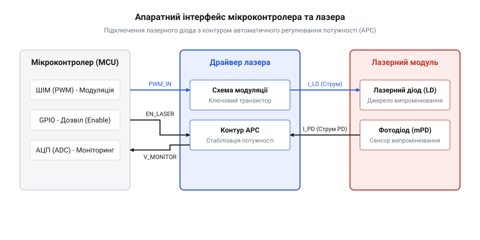
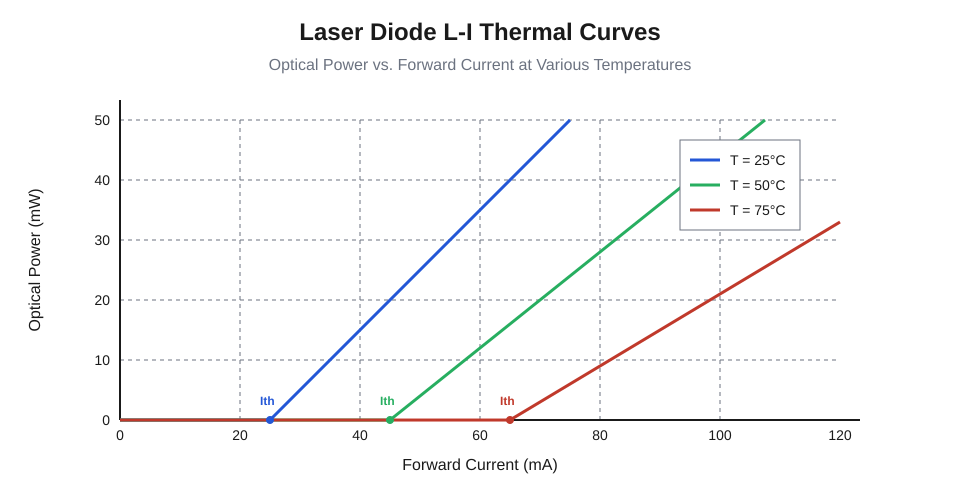
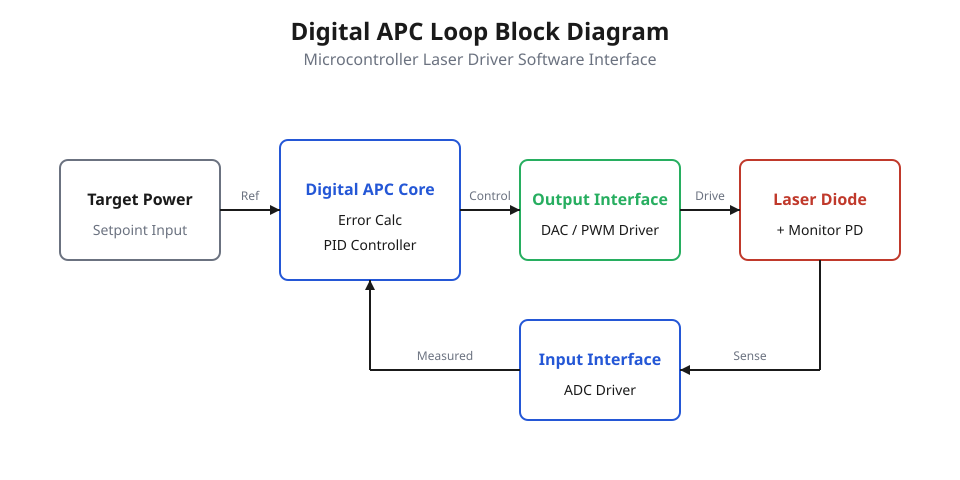
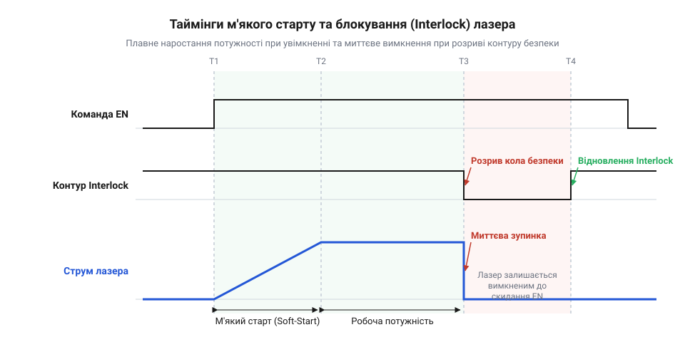
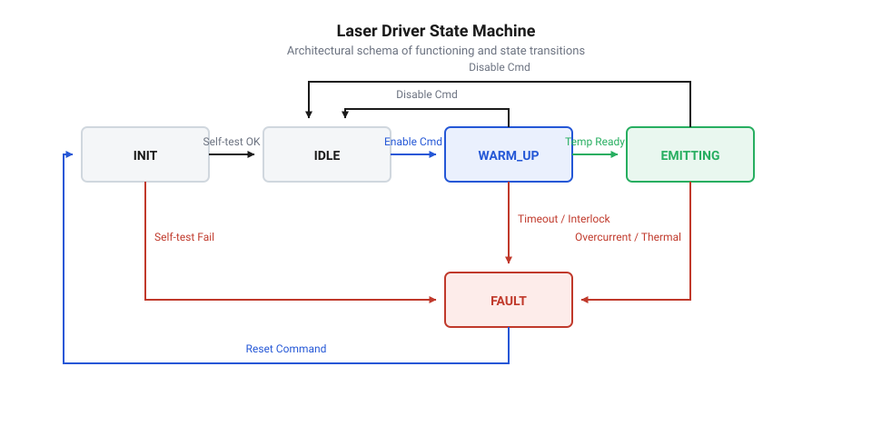

# Програмний інтерфейс мікроконтролера для керування APC лазером

Лазерний напівпровідниковий діод вимагає безперервного динамічного регулювання струму через експоненційну температурну залежність оптичної потужності та ризик миттєвого катастрофічного оптичного пошкодження дзеркал резонатора (Catastrophic Optical Damage, COD). На відміну від звичайних світлодіодів, робоча характеристика лазерного діода має різкий поріг генерації: до досягнення порогового струму діод випромінює слабке спонтанне світло, а після його перевищення переходить у когерентний режим із високою крутизною ват-амперної характеристики. Невелике коливання температури кристала або напруги живлення за фіксованого струму здатне викликати стрибок інтенсивності випромінювання, що руйнує оптичні грані напівпровідника за частки мікросекунди. Для компенсації цих фізичних явищ застосовують контур автоматичного регулювання потужності (Auto Power Control, APC), який спирається на апаратну та програмну взаємодію мікроконтролера з фотодіодом зворотного зв'язку.



## Фізичні особливості напівпровідникового лазера

Оптична потужність випромінювання лазерного діода описується лінійним наближенням вище порогу генерації:

```
P_opt = eta * (I_ld - I_th)
```

де:
- `P_opt` — вихідна оптична потужність (мВт);
- `eta` — диференціальна квантова ефективність або нахил ват-амперної характеристики (мВт/мА);
- `I_ld` — прямий струм накачування лазерного діода (мА);
- `I_th` — пороговий струм виникнення генерації (мА).

Пороговий струм `I_th` сильно залежить від температури p-n переходу `T_j`:

```
I_th(T) = I_th0 * exp((T_j - T_0) / T_char)
```

де `T_char` — характеристична температура напівпровідникового матеріалу (для стандартних інфрачервоних та червоних лазерів GaAs/AlGaAs величина становить 100–180 K). З підвищенням температури пороговий струм зміщується вправо, а коефіцієнт нахилу `eta` спадає внаслідок зростання безвипромінювальної рекомбінації.



Якщо драйвер живить кристал стабільним струмом, нагрівання корпусу під час роботи призведе до падіння потужності променя. Навпаки, охолодження приладу за фіксованого високого струму змістить поріг ліворуч, спричинивши викид оптичної потужності вище абсолютного максимуму `P_max`, що гарантовано зруйнує кристалічну ґратку.

Для забезпечення зворотного зв'язку виробники монтують у спільний герметичний корпус типу TO-56 або TO-18 вбудований моніторний фотодіод (mPD). Фотодіод розташований за задньою гранню лазерного кристала та сприймає випромінювання заднього дзеркала. Генерований фотострум `I_mpd` пропорційний реальній оптичній потужності переднього робочого променя:

```
I_mpd = S_pd * P_opt
```

де `S_pd` — чутливість моніторного фотодіода (типово від 0.05 до 0.5 мА/мВт). Задача мікроконтролера — оцифровувати фотострум та безперервно коригувати струм накачування через виконавчий аналоговий каскад.

## Апаратна структура сполучення з MCU

Програмно-апаратний комплекс керування лазером базується на трьох апаратних вузлах мікроконтролера:
1. **ЦАП або високочастотний ШІМ (PWM)**: формує аналогову опорну напругу `V_set`, яка задає обмеження або безпосереднє значення струму керованого джерела струму на лінійному операційному підсилювачі або інтегральному драйвері.
2. **АЦП (ADC)**: вимірює напругу на виході трансімпедансного підсилювача (TIA), пропорційну фотоструму `I_mpd`, а також напругу з терморезистора NTC для відстеження температури тепловідводу.
3. **Швидкісні GPIO (Enable / Shutdown / Interlock)**: керують апаратним дозволом живлення аналогового каскаду та контролюють зовнішній ланцюг захисного блокування (safety interlock switch).

Схема вимагає обов'язкових захисних елементів між MCU та кристалом:
- Зворотний паралельний діод Шотткі для відсікання негативних викидів напруги;
- Фільтр нижніх частот на вході опорної напруги для придушення тактових завад ШІМ або перехідних процесів ЦАП;
- Апаратне заземлення катода або анода лазера відповідно до типу розпіновки (тип A, B чи C).

## Цифровий контур APC та фільтрація сигналу

Програмний контур APC реалізується як циклічний регулятор, який викликається в перериванні таймера з фіксованим періодом `T_s` (типово від 100 мкс до 1 мс). 



Для компенсації шумів АЦП та квантування застосовується згладжування вимірюваного сигналу фотодіода. ПІ-регулятор (пропорційно-інтегральний) генерує керуючий сигнал:

```
e[k] = Target_ADC - Measured_ADC[k]
P_term = K_p * e[k]
I_term = I_term + K_i * e[k] * T_s
Control_Output[k] = P_term + I_term
```

При побудові цифрового алгоритму обов'язково накладаються жорсткі обмеження:
- **Анти-віндап (Anti-windup)**: інтегральна сума заморожується, якщо вихідний сигнал сягає максимального апаратного струму безпеки `I_limit_safe`.
- **Обмеження швидкості наростання (Slew Rate Limit)**: струм керування не може змінюватися швидше, ніж дозволено специфікацією лазерного діода на мілісекунду, що запобігає перехідним коливанням.
- **Діагностика обриву фотодіода**: якщо струм лазера `I_ld` перевищує пороговий рівень, а сигнал з фотодіода залишається близьким до нуля (`V_mpd < V_dark_threshold`), програма негайно зупиняє генерацію. Без цієї перевірки інтегратор ПІ-контуру викрутить струм на 100%, намагаючись підняти нульовий сигнал відгуку, і випалить лазерний діод.

## Часові діаграми запуску та безпека

Під час увімкнення живлення мікроконтролера його виводи перебувають у невизначеному стані або в режимі входу з підтяжкою. Щоб запобігти випадковому спалаху лазера, апаратний вхід дозволу драйвера має зовнішній стягуючий резистор до землі, а логіка мікроконтролера виконує керовану процедуру м'якого старту (soft-start).



Процедура вмикання випромінювання розбивається на часові інтервали:
1. `t_0 .. t_1`: Ініціалізація периферії MCU, перевірка сигналу захисного блокування (Interlock). ЦАП скинутий в 0.
2. `t_1`: Активація апаратного сигналу `ENABLE`.
3. `t_1 .. t_2`: Плавне ступінчасте збільшення струму з постійною швидкістю до порогового значення `I_th`.
4. `t_2 .. t_3`: Перехід у замкнений контур APC: регулятор виходить на задану робочу точку `Target_ADC` без перерегулювання (overshoot).
5. `t_fault`: У разі розриву петлі блокування або перевищення температури мікроконтролер переводить `ENABLE` у низький рівень за час менше 10 мкс, повністю вимикаючи випромінювання.

## Скінченний автомат драйвера (FSM)

Для гарантування передбачуваності керування алгоритм організований як скінченний автомат із захистом від переходів у некоректні стани.



Автомат підтримує 5 станів:
- `STATE_DISABLED`: Лазер знеструмлений, лінія `ENABLE` у нулі, ЦАП видає нуль. Очікується команда на увімкнення від хоста.
- `STATE_STANDBY`: Перевірка цілісності датчиків: сигнал інтерлоку активний, температура корпусу перебуває в допустимих межах, напруга живлення в нормі.
- `STATE_SOFT_START`: Плавний набір струму з кроком `dI/dt`. Перевіряється поява сигналу фотоструму. Якщо поріг пройдено, а зворотного зв'язку немає — скидання в аварію.
- `STATE_ACTIVE_RUN`: Працює замкнений цифровий контур стабілізації оптичної потужності. Безперервно контролюються межі температури, струму та сигналу монітора.
- `STATE_FAULT_LATCH`: Аварійне вимкнення при виявленні несправності (обрив шлейфа, перегрів, перевищення фотоструму). Вихід із цього стану заблокований до явного скидання помилки хостом після усунення несправності.

Практичну програмну реалізацію драйвера з контуром ПІ-регулювання, обробкою помилок та автоматом станів розібрано у вставці [Практична реалізація драйвера APC лазера на C](root:sf-devices/microcontroller-laser-driver-software-interface/proj-mcu-apc-laser-driver-c-implementation.md).
