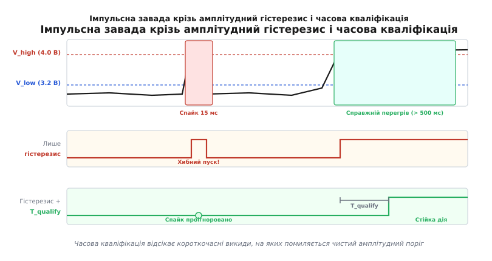
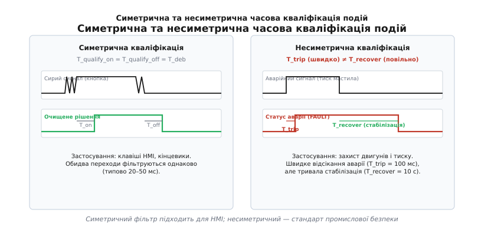
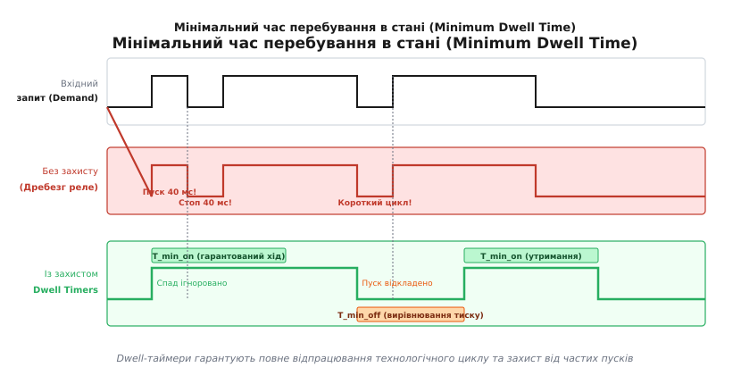
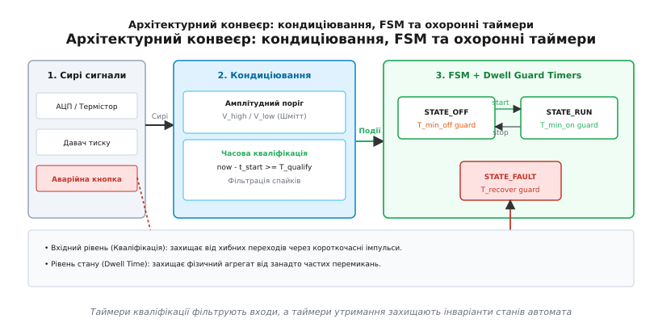

# Мінімальний час стану, затримка й антидребезг рішення

<preknowlist>
- [Неблокуючий час і патерн millis](root:sf-devices/nonblocking-time) — відлік інтервалів через різницю системних міток без зупинки циклу.
- [Апаратний і програмний антидребезг контактів](root:hw-digital/contact-debounce) — придушення механічного брязкоту на фізичному рівні.
- [Компаратор і тригер Шмітта](root:hw-digital/threshold-schmitt) — амплітудний гістерезис і розділення порогів увімкнення та вимкнення.
- [Стани задач і кінцеві автомати](root:sf-devices/task-states) — модель переходів між дискретними режимами системи.
</preknowlist>

Уявіть промислову холодильну установку, де трифазний компресор потужністю 5 кВт живиться через силовий контактор. Контролер фіксує перевищення температури вище порогу +4 °C і вмикає охолодження. Через дві секунди в цеху запускається потужний верстат: напруга на шині короткочасно просідає, аналогова лінія давача температури ловить індуктивну заваду, і АЦП на 12 мілісекунд видає хибне значення +3.6 °C. Автомат станів без часового захисту миттєво розмикає контакти, а ще через 20 мілісекунд, коли напруга стабілізується, знову видає команду на ввімкнення. 

У холодильному контурі за ці 20 мілісекунд тиск між нагнітальною та всмоктувальною магістралями не встиг вирівнятися. Ротор двигуна намагається стартувати проти перепаду тиску у 15 бар і заклинює. Пусковий струм у заблокованому стані (*Locked Rotor Amperage*, LRA) підскакує від номінальних 9 А до 65 А, обмотки миттєво розігріваються, а на контактах контактора виникає електрична дуга, яка зварює срібні напайки за один такий збій.

Миттєва реакція автомата на вхідні умови — головне джерело руйнування механічних і силових вузлів. Навіть коректно налаштований амплітудний гістерезис (розділення порогів увімкнення та вимкнення) не рятує від імпульсних викидів, амплітуда яких перевищує встановлений коридор. Щоб автомат працював надійно, просторових (амплітудних) меж недостатньо — системі потрібні два незалежні часові бар'єри: **кваліфікація рішення** на вході в стан та **мінімальний час перебування** всередині стану.

---

### Межі амплітудного гістерезису та природа імпульсних завад

Амплітудний гістерезис (поріг Шмітта, *Schmitt trigger*) захищає систему від високочастотного шуму малої амплітуди, коли вимірювана величина повільно коливається біля точки перемикання. Якщо поріг увімкнення нагрівача становить 20 °C, а поріг вимкнення — 22 °C, флуктуація в діапазоні 20.0...20.2 °C не викличе безперервного клацання реле.

Проте фізичний світ генерує завади, амплітуда яких значно перевищує будь-який розумний поріг гістерезису:
1. **Імпульсні перехідні процеси (*transient spikes*):** комутація індуктивних навантажень (реле, клапани, двигуни), розряди статичної електрики (ESD) та наведення від частотних перетворювачів (VFD PWM) створюють сплески тривалістю від одиниць мікросекунд до десятків мілісекунд.
2. **Гідравлічні удари та динамічні хвилі тиску:** відкриття або закриття запірного клапана в гідросистемі створює хвилю стиснення рідини, яка на 50–200 мс підкидає тиск на мембрані давача вдвічі вище критичної аварійної межі.
3. **Провали напруги живлення (*brownouts*):** робота радіомодуля (Wi-Fi, GSM, LoRa) під час передачі кадру споживає імпульсний струм до 500 мА. За недостатньої ємності буферних конденсаторів це зміщує опорну напругу АЦП (*ADC Reference*) або підтяжку земляної шини (*ground bounce*), спотворюючи аналогові виміри на час тривалості пакету (5–50 мс).
4. **Хитання рівня рідини (*sloshing*):** у паливних баках або резервуарах поплавковий чи ємнісний давач фіксує хвилі від вібрації та руху, які поперемінно перетинають верхній і нижній пороги кожні 500 мс.
5. **Втрата зв'язку та збої пакетів (*packet drop*):** цифрові давачі на шинах I2C, SPI або RS-485 при виникненні завади можуть повернути поодиноке нульове значення чи таймаут, що при прямому порівнянні сприймається кодом як аварійне падіння сигналу.


*Імпульсна завада крізь амплітудний гістерезис: без часової кваліфікації короткочасний сплеск вище порогу спричиняє помилкове спрацьовування захисту.*

Як видно на часовій діаграмі, поодинокий сплеск тривалістю 15 мс повністю перетинає верхній поріг гістерезису `V_high`. Компаратор реагує миттєво: чистий автомат фіксує аварійний стан і скидає керування. Коли сигнал через 15 мс повертається нижче `V_low`, система знову намагається запуститися. Виникає явище **дребезгу рішень** (*decision chattering* або *flapping*), коли система здійснює повний цикл переходів між станами за час, неспівмірний із фізичною інерцією керованого процесу.

---

### Два часові бар'єри: вхідний і внутрішній

Щоб запобігти дребезгу станів, у кінцевих автоматах впроваджують два різні за змістом і місцем дії механізми:

```
[Сирий сигнал з АЦП / GPIO] 
            │
            ▼
┌────────────────────────────────────────────────────────┐
│ 1. Часова кваліфікація рішення (Decision Debounce)     │
│    Перехід дозволено, лише якщо умова тримається       │
│    безперервно протягом T_qualify                      │
└────────────────────────────────────────────────────────┘
            │
            ▼  [Очищена подія переходу]
┌────────────────────────────────────────────────────────┐
│ 2. Автомат станів (FSM)                                │
│    ┌──────────────────────────────────────────────┐    │
│    │ Стан S_ACTIVE                                │    │
│    │ • При вході: t_enter = now                   │    │
│    │ • Інваріант Dwell Time:                      │    │
│    │   Заборонено вихід, поки (now - t_enter)     │    │
│    │   менше за T_min_dwell                       │    │
│    └──────────────────────────────────────────────┘    │
└────────────────────────────────────────────────────────┘
            │
            ▼
[Силовий виконавець: контактор / клапан / компресор]
```

1. **Часова кваліфікація рішення (*Time Qualification* / *Decision Debounce*):** стоїть *перед* переходом. Вона відповідає на запитання: «Чи є ця умова справжньою стійкою подією, а не випадковою завадою?». Умова вважається істинною лише тоді, коли вхідний предикат утримується в активному стані безперервно протягом часу `T_qualify`.
2. **Мінімальний час перебування в стані (*Minimum Dwell Time* / *Hold-off Timer*):** діє *всередині* стану. Він відповідає на запитання: «Чи відпрацював поточний стан свій мінімально необхідний регламент безпеки?». Автомат блокує вихід із поточного стану протягом часу `T_min_dwell`, навіть якщо надійшов валідний запит на перехід.

Ці два механізми не замінюють, а доповнюють один одного. Кваліфікація входу гарантує, що автомат не здійснить помилкового кроку від короткого спайку. Мінімальний час перебування гарантує, що після здійснення кроку система не перейде у зворотний режим раніше, ніж завершаться внутрішні фізичні перехідні процеси у залізі.

---

### Антидребезг рішень та часова кваліфікація подій

Концепція антидребезгу рішень узагальнює класичний апаратний антидребезг кнопок на будь-які програмні події, умови переходів та спрацьовування порогів.

#### 1. Неперервна часова кваліфікація (Continuous Hold Window)
Найпоширеніша модель фільтрації: таймер запускається у момент, коли предикат умови `P(x)` стає істинним (`true`). Якщо предикат стає хибним (`false`) хоча б на один такт опитування, таймер скидається в нуль. Подія вважається підтвердженою (кваліфікованою), якщо умова безперервно трималася протягом інтервалу `T_qualify`.

```
Часова перевірка неперервної кваліфікації:

1. cond_raw = (pressure < CRITICAL_LOW)
2. if cond_raw == true:
     if timer_started == false:
       t_start = now
       timer_started = true
     else if (now - t_start) >= T_QUALIFY:
       event_confirmed = true
   else:
     timer_started = false
     event_confirmed = false
```

Якщо завада з'явилася на 40 мс при `T_qualify = 200 мс`, умова порушиться на 41-й мілісекунді, таймер скинеться, і автомат ніколи не дізнається про сплеск.

#### 2. Інтегруюча кваліфікація (Leaky Bucket / Integrator Debounce)
Якщо лінія зв'язку або давач зашумлені білим шумом із високою частотою, неперервний таймер може ніколи не досягти `T_qualify`, оскільки поодинокі збої на 1 мс раз на 50 мс постійно обнулятимуть відлік, хоча фізичний процес аварії триває 98% часу.

Для таких умов застосовують інтегруючий фільтр (лічильник із насиченням):
- Якщо умова активна: `accum = min(accum + dt, T_max)`
- Якщо умова неактивна: `accum = max(accum - k * dt, 0)`
- Подія активується, коли `accum >= T_threshold`.

Коефіцієнт розвантаження `k` визначає, наскільки швидко система «пробачає» зникнення умови. При `k = 1` відлік симетричний; при `k = 2` сигнал скидається вдвічі швидше, ніж накопичується.

#### 3. Симетрична проти несиметричної кваліфікації
У людино-машинних інтерфейсах (кнопки, енкодери) час придушення брязкоту на натискання та відпускання зазвичай симетричний (`T_on = T_off = 30..50 мс`).

У силових та захисних автоматах застосовують виключно **несиметричну кваліфікацію** (*Asymmetric Qualification*):
- **Час кваліфікації аварії (`T_trip`):** обирається мінімально можливим, достатнім для відсікання завад живлення, але безпечним для обладнання (наприклад, перевантаження по струму — 20–50 мс, критичне падіння тиску мастила — 200–500 мс, перегрів радіатора — 2000 мс).
- **Час кваліфікації відновлення (`T_recovery`):** встановлюється у десятки або сотні разів більшим (від 10 секунд до 5 хвилин). Це гарантує, що після нормалізації температури чи тиску система повністю стабілізувалася, тепло розсіялося, а коливання рідини вщухли.


*Порівняння симетричного антидребезгу та несиметричної кваліфікації: швидка фіксація аварійного стану проти повільної стабілізації відновлення.*

---

### Мінімальний час перебування в стані (Minimum Dwell Time)

Мінімальний час перебування в стані (*State Dwell Time*) — це часовий інваріант, що накладається на сам стан автомата. При переході в стан `S` фіксується часова мітка входу `t_enter`. Будь-які запити на вихід із цього стану безумовно блокуються (ігноруються або ставляться в чергу), поки справедлива нерівність:

```
(now - t_enter) < T_min_dwell
```

У системах керування електромеханічними установками виділяють чотири типові dwell-інтервали:

```
1. T_min_on (Minimum Run Time):
   Час, протягом якого агрегат зобов'язаний працювати після старту.
   Приклад: компресор після ввімкнення повинен працювати щонайменше 60–120 с,
   щоб оливонасос встиг прокачати мастило до підшипників, а холодоагент
   повністю випарувався з випарника, запобігаючи гідроудару в циліндрах.

2. T_min_off (Minimum Off Time / Anti-Short-Cycle):
   Час, протягом якого агрегату суворо заборонено вмикатися після зупинки.
   Приклад: пауза 180–300 с після вимкнення компресора для повного
   вирівнювання високого і низького тиску через капілярну трубку чи ТРВ.

3. T_dead_time (Interlock Dwell Time):
   Захисна пауза між взаємовиключними станами.
   Приклад: реверс двигуна постійного струму (H-міст) або перемикач «Зірка-Трикутник».
   Перехід STATE_FORWARD -> STATE_REVERSE зобов'язаний проходити через стан
   STATE_COAST із витримкою T_dead_time = 300..500 мс для гасіння дуги в реле
   та зупинки струму самоіндукції.

4. T_purge_time (Ventilation / Purge Dwell):
   Приклад: газовий пальник або нагрівальний котел. Перед запалюванням
   газу вентилятор зобов'язаний продувати камеру згоряння рівно T_purge = 30..60 с
   для видалення залишків вибухонебезпечної суміші.
```


*Захист від частих перемикань (Minimum Dwell Time): блокування зворотного переходу на час T_min_on та T_min_off запобігає дребезгу виконавчих механізмів і тепловому перевантаженню.*

Якщо зовнішній термостат або користувач хаотично смикає вхідний запит (наприклад, змінюючи цільову температуру на пульті керування раз на 3 секунди), dwell-таймери перетворюють цей шум на плавні, безпечні цикли роботи з гарантованими фазами релаксації обладнання.

---

### Неблокуючий відлік часу та арифметика переповнення

Будь-які блокуючі виклики на зразок `delay()`, `sleep()` або `vTaskDelay()` усередині обробників станів FSM категорично неприпустимі. Затримка зупиняє виконання суперциклу або задачі, унеможливлюючи опитування інших аварійних давачів, зв'язок по інтерфейсах (UART, CAN, SPI) та оновлення сторожового таймера (*Watchdog*).

Відлік часу в автоматах реалізується виключно через порівняння різниць міток системного таймера (*Timestamp Deltas*).

#### Монотонний годинник проти астрономічного
Для часового захисту станів дозволено використовувати лише **монотонні лічильники тиків** ядра (*Monotonic Ticks*):
- SysTick мілісекунди (`millis()`, `systick_get_ms()`);
- Апаратні таймери мікросекунд (`micros()`, DWT cycle counter, 64-бітний `esp_timer_get_time()`);
- RTOS тіки (`xTaskGetTickCount() * portTICK_PERIOD_MS`).

> 🔧 **Навіщо це.**
> Ніколи не використовуйте для захисту станів час реального годинника (RTC, `time()`, `gettimeofday()`). Якщо пристрій синхронізує час через NTP або користувач вручну переведе годинник на 1 годину назад, різниця `(now - start)` стане від'ємною, або обчислення дедлайну зависне в блокуванні на цілу годину. Монотонний лічильник завжди зростає строго вперед з постійним темпом і не залежить від часових поясів.

#### Математика переповнення uint32_t (Wraparound Protection)
32-бітний лічильник мілісекунд переповнюється і скидається в 0 приблизно через кожні 49.71 доби безперервної роботи:

```
2³² - 1 мілісекунд
= 4 294 967 295 мс
= 4 294 967.295 с
≈ 49.7103 доби              [переповнення uint32_t]
```

Для коректної роботи алгоритму необхідно завжди обчислювати **різницю** поточного часу та часу старту, а не порівнювати поточний час із наперед обчисленим дедлайном.

**Порівняння двох підходів до обчислення таймаутів:**

```
// ❌ ФАТАЛЬНА ПОМИЛКА: обчислення абсолютної мітки дедлайну
uint32_t deadline = start_time + duration;
if (now >= deadline) {
    // Ламається під час переповнення!
    // Якщо start_time = 0xFFFFFF00, duration = 0x200 (512 мс),
    // то deadline = 0x00000100.
    // Оскільки now = 0xFFFFFF50, умова (now >= 0x00000100)
    // спрацює МИТТЄВО, пропустивши 512 мс очікування!
}

// ✔️ ПРАВИЛЬНО: різниця беззнакових чисел (Two's Complement Subtraction)
if ((uint32_t)(now - start_time) >= duration) {
    // Працює завжди, зокрема при переповненні!
    // Нехай start_time = 0xFFFFFF00, а now вже переповнився і дорівнює 0x00000050.
    // Обчислюємо різницю:
    // 0x00000050 - 0xFFFFFF00 = 0x00000150 (336 мс).
    // Результат математично точний, переповнення компенсовано автоматично.
}
```

Завдяки властивостям двійкового доповнення (*two's complement representation*), беззнакове віднімання `(uint32_t)(now - start)` завжди дає точну кількість тиків, що минули між двома подіями, якщо тільки сама тривалість інтервалу не перевищує `0xFFFFFFFF` (тобто 49.7 доби).

---

### Архітектура інтеграції часового захисту в FSM

Існує три основні патерни проектування часового захисту в автоматах станів:

```
+-------------------------------------------------------------------------+
|                    ПАТЕРНИ АРХІТЕКТУРИ ЧАСОВОГО ЗАХИСТУ                 |
+-------------------------------------------------------------------------+
| 1. Шар кондиціювання      | Події фільтруються ДО автомата.             |
|    (Signal Conditioner)   | FSM отримує чисті події (наприклад,         |
|                           | EV_OVERHEAT_QUALIFIED). Чиста матриця.      |
+---------------------------+---------------------------------------------+
| 2. Внутрішні вартові      | FSM сам перевіряє час: стан тримає t_enter. |
|    (Guard Conditions)     | Перехід блокується умовою:                  |
|                           | if (now - t_enter >= T_MIN_DWELL) ...       |
+---------------------------+---------------------------------------------+
| 3. Явні проміжні стани    | Паузи є окремими станами:                   |
|    (Explicit Delay States)| OFF -> STARTING_DELAY -> RUN -> STOP_DELAY  |
+-------------------------------------------------------------------------+
```


*Розподіл відповідальності: шар кондиціювання фільтрує вхідні сигнали, охоронні таймери станів захищають внутрішні інваріанти, а лінія аварійної зупинки діє в обхід часових затримок.*

#### Патерн 1: Зовнішній кваліфікатор сигналів (Signal Conditioning Layer)
Найкращий вибір для великих систем. Сирі сигнали з АЦП та GPIO потрапляють у модуль кондиціювання (*Signal Conditioner*). Цей модуль містить фільтри, гістерезис і таймери кваліфікації. FSM взагалі не займається відліком затримок вхідних сигналів — він працює лише з чистими високорівневими подіями.

#### Патерн 2: Охоронні умови станів (State Guard Timers)
Використовується безпосередньо всередині автомата для реалізації Minimum Dwell Time. При вході в стан функція `on_enter()` зберігає поточний час: `state_entry_time = get_time_ms()`. Усі правила виходу з цього стану захищаються guard-перевіркою `if (dwell_time_elapsed(state_entry_time, T_MIN_RUN))`.

#### Патерн 3: Проміжні стани затримки (Transit / Staging States)
Замість прихованого таймера всередині стану вводяться явні стани графу:
- `STATE_IDLE`
- `STATE_START_HOLD` (відлік затримки перед пуском, наприклад, розігрів мастила або перевірка тиску)
- `STATE_RUNNING`
- `STATE_COOLDOWN` (відлік мінімального часу роботи вентилятора після зупинки)

Цей підхід робить структуру автомата повністю прозорою для діагностики, журналювання та відображення на панелях оператора (SCADA / HMI), де користувач бачить статус «Підготовка до пуску: залишилося 12 секунд».

#### Критичний виняток: Аварійне переривання (Emergency Override / E-Stop)
У будь-якому автоматі із захисними затримками обов'язково постає архітектурне питання: **що робити при аварії під час дії Dwell Time?**

Якщо компресор зобов'язаний відпрацювати мінімум 60 секунд (`T_min_on`), але на 10-й секунді спрацьовує захист від короткого замикання, кнопка аварійної зупинки (*E-Stop*) або давач витоку газу, автомат **зобов'язаний миттєво проігнорувати `T_min_on`** і негайно знеструмити виконавчий механізм.

Правило пріоритетів формулюється так:
- **Технологічні запити (температура, тиск замовника):** підпорядковуються `T_min_on` та `T_min_off`.
- **Захисти першого рівня безпеки (Safety-Critical, E-Stop, пожежа, струмовий розчіплювач):** безумовно скасовують дію будь-яких dwell-таймерів і примусово переводять систему в стан `STATE_FAULT`.

---

### Повна промислова реалізація на C та C++

Нижче наведено закінчену, перевірену на практиці реалізацію модулів часової кваліфікації сигналів та автомата керування холодильним агрегатом із повним набором dwell-захистів.

:::tabs
:::code minimalnyi-chas-stanu-zatrymka-i-antydrebezh-d/c/main.c
:::code minimalnyi-chas-stanu-zatrymka-i-antydrebezh-d/cpp/main.cpp
:::

---

### Крайові випадки, підводні камені та надійність у полі

Під час практичної експлуатації вбудованих пристроїв інженери регулярно припускаються типових системних помилок при роботі з часовими обмеженнями станів.

#### 1. Проблема холодного старту і перезапуску (Cold Boot vs Warm Reboot)
Що відбувається, коли контролер зазнав короткочасного провалу живлення (*brownout reset*) або перезапустився через спрацьовування сторожового таймера (*watchdog*)?

Якщо компресор працював у момент перезапуску, двигун зупиняється на кілька мікросекунд під час скидання MCU. Якщо після завантаження прошивка ініціалізує таймер у нуль і вважає, що пристрій «давно стояв», вона може миттєво видати команду на ввімкнення компресора. Ротор знову заклінить під високим тиском.

> [!IMPORTANT]
> Правило консервативного старту: після будь-якого перезавантаження пристрою автомат станів зобов'язаний ініціалізуватися так, ніби він щойно перейшов у стан вимкнення (`t_entry = now`), і примусово витримати повний `T_min_off`. Виняток можливий лише за наявності захищеної енергонезалежної пам'яті (FRAM, RTC RAM із живленням від батареї), яка достовірно підтверджує, що пристрій перебував у знеструмленому стані понад встановлений час безпеки.

#### 2. Дрейф і дискретність суперциклу (Loop Jitter)
Таймери кваліфікації оновлюються на кожній ітерації головного циклу або виклику RTOS-задачі. Якщо суперцикл виконує важку операцію (наприклад, стирання Flash-пам'яті тривалістю 200 мс або блокуючий запит до повільного I2C давача), період опитування збільшується.

Похибка детекції події становить:

```
T_actual_delay = T_qualify + T_loop_jitter
```

Якщо `T_qualify = 50 мс`, а такт циклу через блокування стрибає до 150 мс, антидребезг спрацює із затримкою у 200 мс. Архітектурне правило: період виклику функцій кваліфікації повинен бути щонайменше в 5–10 разів меншим за найкоротший часовий інтервал `T_qualify`.

#### 3. Низькочастотне миготіння умов (Flapping / Harmonic Resonance)
Якщо вхідний сигнал миготить із періодом, що ненабагато перевищує `T_qualify` (наприклад, аварія тримається 450 мс при `T_qualify = 400 мс`, потім зникає на 15 секунд і знову з'являється), автомат здійснюватиме переходи рівно з періодом цього миготіння.

Для захисту від такого низькочастотного резонансу застосовують **лічильник частих спрацьовувань** (*Flapping Damping*): якщо протягом останніх 10 хвилин автомат зафіксував більше ніж N переходів (наприклад, > 3 спроб старту), система блокується в стані `STATE_LATCHED_FAULT` і вимагає ручного втручання оператора або розширеної паузи відновлення (наприклад, 1 година).

#### 4. Діагностика та телеметрія відхилених завад
У надійних промислових пристроях модуль кваліфікації обов'язково веде лічильник відхилених імпульсів (*Glitch Reject Counter*). Це дозволяє виявити погіршення умов експлуатації до виникнення аварії:

:::tabs
```c
/* Підрахунок відхилених імпульсів для діагностики шуму лінії */
if (raw_in != q->raw_sample_last) {
    uint32_t pulse_duration = (uint32_t)(now - q->t_change_start);
    if (pulse_duration < q->t_trip_ms && q->raw_sample_last == true) {
        telemetry_increment_rejected_glitches();
    }
}
```
```cpp
// Підрахунок відхилених імпульсів для діагностики шуму лінії
if (rawInput != m_lastSample) {
    const auto pulseDuration = now - m_lastChangeTime;
    if (pulseDuration < m_tripTime && m_lastSample == true) {
        telemetry::recordRejectedGlitch();
    }
}
```
:::

Якщо на новому об'єкті лічильник завад починає рахувати сотні відхилених імпульсів на годину, це однозначний діагностичний маркер: пробито екранування сигнального кабелю, деградував фільтруючий RC-ланцюг або в щиті іскрять силові пускачі. Завдяки часовій фільтрації автомат не зламався сам, а за допомогою лічильника завад вчасно попередив інженера про наближення аварії електромережі.
