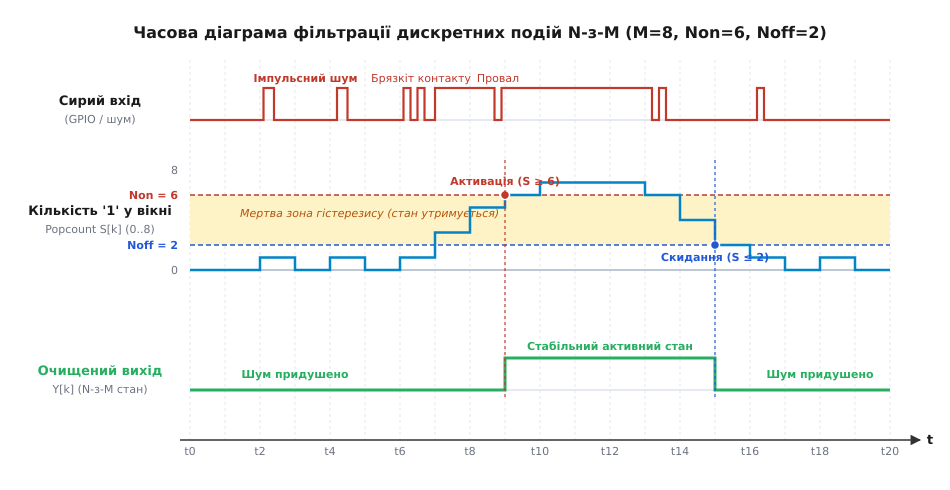
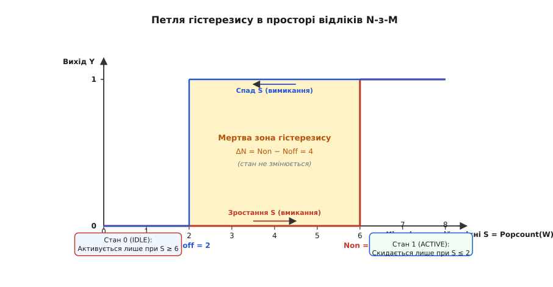

# N з M і гістерезис на подіях

<preknowlist>
- [Умова, дія і чому пристрій клацає: поріг із гістерезисом](root:sf-devices/umova-diia-i-chomu-prystrii-klatsaie) — амплітудний гістерезис і захист від шуму в неперервних сигналах.
- [Мінімальний час стану, затримка й антидребезг рішення](root:sf-devices/minimalnyi-chas-stanu-zatrymka-i-antydrebezh) — часові фільтри стабілізації, таймери затримки підтвердження та dwell time.
- [Головний цикл super-loop](root:sf-devices/super-loop) — періодичне опитування входів та синхронна обробка станів.
- [Апаратний і програмний антидребезг контактів](root:hw-digital/contact-debounce) — фізична природа брязкоту механічних контактів і базові затримки.
</preknowlist>

Високошвидкісний оптичний датчик фасувального конвеєра фіксує проходження банок із продукцією на швидкості 25 одиниць за секунду (1500 штук на хвилину). Поруч із конвеєрною стрічкою встановлено трифазний асинхронний двигун приводу потужністю 11 кВт, керований частотним перетворювачем із ШІМ-комутацією на частоті 16 кГц. У мить пуску двигуна або різкої зміни навантаження електромагнітна завада (англ. *electromagnetic interference*, EMI), наведена на сигнальну лінію 24 В промислового цифрового входу, генерує серію імпульсних викидів тривалістю від 200 наносекунд до 15 мікросекунд. Хоча оптичний датчик фізично відкритий і жодної банки перед ним немає, тригер Шмітта вхідного оптрона встигає зреагувати на сплески напруги. Якщо прошивка мікроконтролера ухвалює рішення за прямим зчитуванням регістра GPIO або обробляє кожне переривання по фронту, лічильник продукції за одну секунду накручує сотні хибних спрацювань, пневматичний відбраковувач починає безладно вистрілювати в повітря, а автомат керування конвеєром зупиняє лінію через аварійну розсинхронізацію потоку.

Ця аварія розкриває фундаментальну відмінність між неперервними та дискретними сигналами. У неперервних сигналах шум додається до амплітуди: там діє класичний тригер Шмітта з двома порогами напруги `V_on` та `V_off`. Але коли сигнал уже оцифровано до двійкового біта `{0, 1}` або коли система обробляє потік дискретних подій (помилки CRC пакетів, спрацювання прапорців, втрата зв'язку, імпульси енкодера), амплітуди більше не існує. У дискретному сигналі немає проміжних значень напруги — є лише нуль або одиниця. Накласти амплітудний поріг на один біт неможливо. Щоб захистити систему від брязкоту подій (англ. *event chattering*) та хибних спрацювань (англ. *false triggers*), поріг і гістерезис необхідно перенести з простору амплітуд у **простір часу та кількості подій**.

---

## Анатомія брязкоту подій у дискретних каналах

У вбудованих системах дискретний сигнал потрапляє в алгоритм ухвалення рішень одним із двох шляхів: через періодичне опитування апаратного регістра входу в [головному циклі super-loop](root:sf-devices/super-loop) із фіксованим періодом дискретизації `T_s` або через лінію апаратних переривань (англ. *External Interrupt*, EXTI). В обох випадках поодинокий двійковий відлік є абсолютно ненадійним.

Джерела спотворення двійкового потоку діляться на чотири фізичні класи:

1. **Механічний брязкіт контактів (англ. *contact bounce*):** кінцеві вимикачі, кнопки, геркони та реле під час замикання та розмикання фізично пружинять. Пружні пластини стикаються й відскакують протягом 1–15 мс, породжуючи серію з 5–50 хаотичних перемикань `0 ⇄ 1`. Додатково на зношених контактах виникає явище мікропробою оксидних плівок (англ. *fritting*), коли опір контакту стрибає між одиницями ом та мегаомами за частки мікросекунди.
2. **Імпульсні наведення та наносекундні завади (англ. *transient glitch / burst noise*):** комутація індуктивних навантажень (обмоток контакторів, електромагнітних гальм), робота колекторних двигунів або розряди статичної електрики (ESD) створюють короткі наведені голки. Струми з високою похідною `di/dt > 1000 А/мкс` індукують у петлях сигнальних провідників напруги амплітудою до десятків вольт. Такі сплески можуть бути коротшими за період опитування, але випадково збігаються з моментом фіксації логічного рівня апаратним тактом порту GPIO.
3. **Граничний шум сенсорів біля порога спрацювання (англ. *edge jitter*):** коли шторка оптичного датчика, поплавок рівня або магніт датчика Холла рухається повільно, аналоговий сигнал усередині первинного сенсора зависає точно в точці перемикання його внутрішнього компаратора. Навіть мікровольтовий тепловий шум напівпровідникового переходу викликає високочастотну автогенерацію цифрового виходу сенсора частотою до сотень кілогерців.
4. **Транспортні помилки та втрата пакетів у цифрових протоколах (англ. *packet drops / bus glitches*):** у мережах CAN, Modbus RS-485 або SPI спотворення бітів завадами спричиняє періодичне випадання окремих кадрів телеметрії. Якщо система сприймає втрату одного кадру як фатальну аварію «обрив зв'язку», відбуваються хибні захисні відключення.

Якщо прошивка реалізує наївне безпам'ятне опитування:

:::tabs
:::code n-z-m-i-histerezys-na-podiiakh-d/c/anatomiia-briazkotu-podii.c
:::code n-z-m-i-histerezys-na-podiiakh-d/cpp/anatomiia-briazkotu-podii.cpp
:::

Цей код перетворює кожну мікросекундну заваду на валідну бізнес-подію системи. Якщо на датчик наведеться пакет із 20 імпульсів брязкоту, лічильник зросте на 20 за мілісекунду. Для захисту потрібен фільтр, який вимагає статистичного підтвердження сигналу в часі.

---

## Фізика контактного брязкоту на мікрорівні

Щоб зрозуміти, чому програмні фільтри повинні бути адаптовані під фізику контактів, розглянемо динаміку механічного замикання під електронним мікроскопом.

Коли оператор натискає кнопку або кулачок верстата штовхає шток кінцевого вимикача, контактні площадки не з'єднуються монолітно в один момент часу. Контактний майданчик має мікрорельєф із шорсткістю в кілька мікрометрів. У мить першого торкання площа контакту мізерна (одиниці квадратних мікронів). Через цю мікроскопічну точку починає протікати струм заряджання паразитної ємності лінії. Густина струму досягає сотень тисяч амперів на квадратний міліметр, викликаючи миттєве локальне плавлення та мікроспалахи металу.

Одночасно виникає механічний удар: пружна пластина стискається і під дією сил пружності відскакує назад на відстань у кілька десятків мікрометрів. Між розведеними контактами, які ще не встигли охолонути, виникає мікродуговий або тліючий розряд, якщо напруга кола перевищує напругу іонізації повітря (~12–15 В для мікрозазорів).

Осцилографічний аналіз процесу показує три чітко виражені часові стадії:

1. **Фаза первинного удару (0–500 мкс):** початкове замикання тривалістю 50–200 мкс, за яким слідує перший глибокий відскок із повним розривом електричного кола на 200–500 мкс.
2. **Фаза затухаючого брязкоту (500 мкс – 8 мс):** серія швидких повторних відскоків із дедалі меншою амплітудою та зростаючою частотою (від 2 кГц до 25 кГц). На цій стадії контакт може замкнутися й розімкнутися від 5 до 40 разів.
3. **Фаза мікрофріттінгу та стабілізації опору (8–15 мс):** механічні відскоки припиняються, але контактний тиск продовжує коливатися через вібрацію пружини. Опір переходу флуктує в межах 0.1–50 Ом, що за наявності слабкої підтяжки (наприклад, внутрішнього Pull-Up мікроконтролера 40 кОм) спричиняє коливання напруги біля логічного порогу входу.

Спроба придушити цей спектр чисто схемотехнічними засобами (простою пасивною RC-ланкою) натрапляє на непереборні обмеження. Щоб надійно згладити 10-мілісекундний брязкіт, потрібна постійна часу `RC ≥ 20 мс` (наприклад, резистор 10 кОм і конденсатор 2.2 мкФ). Але такий великий конденсатор критично затягує фронти сигналу. Напруга на вході мікроконтролера наростає плавно, проходячи через лінійну зону вхідного інвертора протягом кількох мілісекунд. У цій лінійній зоні обидва транзистори CMOS-пари (NMOS та PMOS) одночасно перебувають у напіввідкритому стані. Виникає наскрізний струм короткого замикання між шинами живлення та землі (англ. *crowbar / shoot-through current*), який розігріває кристал, збільшує споживання енергії в сотні разів і робить вхід надчутливим до найдрібніших наведених шумів.

Саме тому сучасна схемотехніка покладається на жорсткі швидкісні входи з апаратним тригером Шмітта, а всю часову та статистичну кваліфікацію сигналу делегує цифровому алгоритму в прошивці.

---

## Чому класичні таймери підтвердження капітулюють перед імпульсними серіями

Найпоширенішим інженерним підходом до придушення брязкоту є таймер підтвердження (англ. *Confirmation Delay* або *Continuous Debounce Timer*), розглянутий у темі про [мінімальний час стану та антидребезг рішення](root:sf-devices/minimalnyi-chas-stanu-zatrymka-i-antydrebezh). Алгоритм простий: стан вважається зміненим на `1`, лише якщо вхідний сигнал безперервно утримується на рівні `1` протягом часу `T_debounce` (наприклад, 10 мілісекунд). Якщо сигнал хоча б на один відлік падає в `0`, таймер скидається в нуль.

Проте за умов жорстких промислових завад безперервний таймер підтвердження має фатальний дефект: **вразливість до голодування (англ. *timer starvation*)**.

Розглянемо реальну ситуацію: на лінію надходить істинний, фізично валідний сигнал тривалістю 50 мс. Одночасно через роботу сусіднього інвертора на лінію накладається високочастотний імпульсний шум: кожні 2 мс у двійковому потоці проскакує поодинокий нульовий відлік тривалістю в один такт опитування (наприклад, послідовність виглядає як `1 1 1 0 1 1 1 1 0 1 1 1 0 1 1 1`). У сигналі 95% одиниць, фізичний об'єкт гарантовано присутній перед датчиком.

Що робить таймер підтвердження з порогом 10 мс?
Кожні 2–3 мс, натрапляючи на поодинокий нуль, лічильник стабільності **обнуляється**. У результаті таймер жодного разу не дораховує до 10 мс. Система повністю «сліпне» і пропускає справжню подію. Виникає хибнонегативне спрацьовування (англ. *false negative* або помилка II роду).

Інший підхід — таймер блокування повторного спрацювання (англ. *Hold-off Time / Cooldown Timer*). Він вирішує протилежну задачу: після фіксації першого фронту блокує будь-які зміни стану на час `T_holdoff`. Цей механізм захищає від розмноження подій *після* того, як рішення вже ухвалено, але він абсолютно беззахисний перед першою поодинокою голкою шуму: випадковий сплеск EMI негайно перемикає вихід і блокує його в хибному стані на весь інтервал кулдауну.

Щоб одночасно відсікати поодинокі голки шуму і не втрачати валідний сигнал через короткі випадкові випадання відліків, потрібен фільтр, який оперує не жорсткою безперервністю, а **статистичною мажоритарністю** в ковзному часовому вікні.

---

## Алгоритм «N з M» (N-of-M Sliding Window Filter)

Алгоритм «N з M» (англ. *N-of-M Filter*, *Sliding Window Majority Voting*, *Glitch Filter*) накопичує історію останніх `M` двійкових відліків у кільцевому бітовому буфері й ухвалює рішення на основі кількості одиниць у цьому вікні.

### Математична постановка

Нехай сигнал опитується з постійним кроком часу `T_s`. У дискретний момент часу `k` ми отримуємо новий вхідний біт:

```
x[k] ∈ {0, 1}
```

Ковзне вікно розміром `M` зберігає вектор останніх `M` відліків:

```
W[k] = (x[k], x[k-1], x[k-2], ..., x[k-M+1])
```

Кількість одиниць у поточному вікні (вага Геммінга, або операція *Popcount* — англ. *population count*) визначається сумою елементів вектора:

```
S[k] = ∑_{i=0}^{M-1} x[k-i],      де 0 ≤ S[k] ≤ M
```

У наївному варіанті мажоритарного голосування (англ. *Majority Voting*) встановлюється єдиний симетричний поріг: якщо `S[k] ≥ M/2`, вихід вважається рівним `1`, інакше `0`.

Однак симетричне мажоритарне голосування містить ту саму класичну ваду, що й аналоговий компаратор без гістерезису. Якщо вхідний сигнал є зашумленим (наприклад, істинна ймовірність отримання одиниці становить рівно 50%), величина `S[k]` буде коливатися біля значення `M/2` (наприклад, послідовно набуваючи значень `3, 4, 3, 4, 3` для `M = 8`). Вихід фільтра почне безперервно клацати між `0` та `1` на кожному такті опитування.

Щоб усунути коливання, в алгоритм вводиться **асиметричний лічильний гістерезис**.

---

## Асиметричний гістерезис у просторі дискретних подій

Гістерезис на подіях формується розділенням порогу активації (вмикання) та порогу деактивації (вимикання).

Задаються два цілочисельні параметри:
- `N_on` — поріг активації: мінімальна кількість одиниць у вікні `M`, необхідна для переходу виходу в стан `1`.
- `N_off` — поріг деактивації: максимальна кількість одиниць у вікні `M`, за якої вихід скидається в стан `0`.

Обов'язковий інваріант надійності:

```
0 ≤ N_off < N_on ≤ M
```

Різниця між порогами утворює дискретну **мертву зону гістерезису (англ. *count deadband*)**:

```
ΔN = N_on - N_off
```

### Рівняння стану дискретного фільтра

Нехай `Y[k] ∈ {0, 1}` — вихідний стан фільтра в момент часу `k`. Правило переходу кінцевого автомата записується як:

```
Y[k] = 1,  якщо S[k] ≥ N_on
Y[k] = 0,  якщо S[k] ≤ N_off
Y[k] = Y[k-1],  якщо N_off < S[k] < N_on  [утримання попереднього стану]
```


*Часова діаграма фільтрації дискретних подій алгоритмом N-з-M: імпульсний шум та брязкіт придушуються у вікні M=8, а перемикання стану відбувається лише при досягненні порогів Non=6 та Noff=2.*

Як видно з часової діаграми:
1. Поодинокі шумові сплески в моменти часу `t2` та `t4` підіймають `S[k]` лише до значення `1`. Оскільки `1 < N_on (6)`, вихід `Y[k]` залишається стабільним нулем.
2. При появі валідного сигналу вхід зазнає брязкоту на фронті `t6..t7`. `S[k]` впевнено зростає і в момент `t9` досягає значення `6 (N_on)`. Вихід `Y[k]` перемикається в `1`.
3. Під час утримання активного стану на вході виникає короткий шумовий провал (нуль у момент `t8.7`). `S[k]` падає з `7` до `6`. Оскільки `6 > N_off (2)`, фільтр повністю ігнорує випадання сигналу.
4. Після зникнення сигналу та завершення брязкоту на зрізі `S[k]` падає, і в момент `t15` опускається до `2 (N_off)`. Вихід `Y[k]` скидається в `0`.


*Петля гістерезису в просторі відліків ковзного вікна: мертва зона між порогами Noff та Non запобігає автоколиванням біля порога.*

Петля гістерезису наочно показує поведінку системи: поки кількість одиниць у вікні перебуває всередині мертвої зони `(N_off; N_on)`, стан виходу залежить виключно від передісторії. Щоб увімкнути систему, треба подолати високий бар'єр `N_on`; щоб вимкнути — опуститися нижче заниженого порогу `N_off`.

---

## Теорія ймовірностей та біноміальний аналіз надійності

Щоб усвідомлено обирати параметри `M`, `N_on` та `N_off`, інженер повинен кількісно розрахувати ймовірність пробиття фільтра шумом та оптимальність детектора з погляду статистичної теорії ухвалення рішень.

### Оптимальність N-з-M за критерієм Неймана-Пірсона

Сформулюємо задачу фільтрації як перевірку двох статистичних гіпотез:
- **Гіпотеза `H_0` (спокій / шум):** фізичний сигнал відсутній, кожен відлік генерується шумом і набуває значення `1` із малою ймовірністю `p_0`.
- **Гіпотеза `H_1` (наявність сигналу):** корисний сигнал присутній, відлік набуває значення `1` із високою ймовірністю `p_1`, де `p_1 > p_0`.

Для незалежних відліків у вікні `W[k] = (x_0, x_1, ..., x_{M-1})` функція правдоподібності гіпотези `H_0` має вигляд:

```
P(W | H_0) = ∏_{i=0}^{M-1} (p_0)^(x_i) · (1 - p_0)^(1 - x_i)
```

Враховуючи, що сума відліків `∑ x_i = S`, перепишемо вираз:

```
P(W | H_0) = (p_0)^S · (1 - p_0)^(M - S)
P(W | H_1) = (p_1)^S · (1 - p_1)^(M - S)
```

За фундаментальною лемою Неймана-Пірсона (англ. *Neyman-Pearson Lemma*), найбільш потужний статистичний критерій для фіксованого рівня хибних тривог базується на відношенні правдоподібності:

```
Λ(W) = P(W | H_1) ÷ P(W | H_0)
```

Логарифмуючи це відношення, отримуємо:

```
ln(Λ(W))
= ln( ((p_1)^S · (1 - p_1)^(M - S)) ÷ ((p_0)^S · (1 - p_0)^(M - S)) )  [підстановка функцій правдоподібності P(W|H1) та P(W|H0)]
= S · ln(p_1 / p_0) + (M - S) · ln((1 - p_1) / (1 - p_0))              [властивість логарифма добутку та частки]
= S · ( ln(p_1 / p_0) - ln((1 - p_1) / (1 - p_0)) ) + M · ln((1 - p_1) / (1 - p_0)) [групування членів відносно кількості одиниць S]
```

Оскільки `p_1 > p_0`, множник перед `S` є строго додатною константою `K > 0`. Отже, умова `ln(Λ(W)) ≥ γ` зводиться до лінійної нерівності:

```
S ≥ (γ - M · ln((1 - p_1)/(1 - p_0))) ÷ K = N_порогів
```

Цей результат строго доводить: **простий підрахунок кількості одиниць `S = Popcount(W)` у вікні є математично оптимальною достатньою статистикою (англ. *sufficient statistic*)** для виявлення дискретного сигналу на тлі незалежного шуму.

### Модель шуму Бернуллі та біноміальний розподіл

Нехай на вході діє некорельований білий двійковий шум із ймовірністю викривлення біта `p`. Кількість помилкових одиниць `k` у вікні `M` підпорядковується біноміальному розподілу:

```
P(S = k) = C(M, k) · p^k · (1 - p)^(M - k)
```

де `C(M, k)` — кількість комбінацій:

```
C(M, k) = M! ÷ (k! · (M - k)!)
```

Кумулятивна ймовірність хибного спрацьовування за одне вікно `P_false` дорівнює:

```
P_false(M, N_on, p) = ∑_{k=N_on}^{M} C(M, k) · p^k · (1 - p)^(M - k)
```

### Покроковий числовий розрахунок для M = 8, N_on = 6, p = 0.05

Нехай рівень шуму на лінії становить `p = 0.05` (5% спотворених відліків). Дослідимо поведінку конфігурації `M = 8`, `N_on = 6`:

```
P(S = 6)
= C(8, 6) · (0.05)⁶ · (0.95)²              [формула Бернуллі для k=6]
= 28 · (1.5625 × 10⁻⁸) · 0.9025            [біноміальний коефіцієнт C(8,6) = 28]
= 3.9484375 × 10⁻⁷                         [обчислена ймовірність для k=6]

P(S = 7)
= C(8, 7) · (0.05)⁷ · (0.95)¹              [формула Бернуллі для k=7]
= 8 · (7.8125 × 10⁻¹⁰) · 0.95              [біноміальний коефіцієнт C(8,7) = 8]
= 5.9375 × 10⁻⁹                            [обчислена ймовірність для k=7]

P(S = 8)
= C(8, 8) · (0.05)⁸ · (0.95)⁰              [формула Бернуллі для k=8]
= 1 · (3.90625 × 10⁻¹¹) · 1.0              [біноміальний коефіцієнт C(8,8) = 1]
= 3.90625 × 10⁻¹¹                          [обчислена ймовірність для k=8]

P_false
= P(S = 6) + P(S = 7) + P(S = 8)           [кумулятивна сума подій]
= 3.9484 × 10⁻⁷ + 5.9375 × 10⁻⁹ + 3.9 × 10⁻¹¹ [додавання компонентів]
≈ 4.0082 × 10⁻⁷                            [підсумкова ймовірність хибного спрацювання]
```

### Середній час між хибними спрацьовуваннями (MTBFA)

Для інженера ймовірність `4 × 10⁻⁷` стає наочною, якщо перевести її в час безвідмовної роботи (англ. *Mean Time Between False Alarms*, MTBFA). Якщо опитування здійснюється з періодом `T_s = 1 мс` (частота 1 кГц):

```
MTBFA = T_s ÷ P_false
```

Зіставимо показники надійності:

| Конфігурація фільтра | `P_false` при `p = 0.05` | Частота хибних спрацювань (`T_s = 1 мс`) | MTBFA (середній час до збою) |
|---|---|---|---|
| Пряме зчитування (`M=1, N=1`) | `5.00 × 10⁻²` (5%) | 50 хибних подій на секунду | **20 мілісекунд** (повна катастрофа) |
| Мажоритарний `3 з 4` | `4.81 × 10⁻⁴` | 0.481 подій на секунду | **2.08 секунди** |
| Мажоритарний `5 з 8` | `5.78 × 10⁻⁵` | 0.0578 подій на секунду | **17.3 секунди** |
| Асиметричний `6 з 8` | `4.01 × 10⁻⁷` | 0.0004 подій на секунду | **41.6 хвилини** |
| Жорсткий `7 з 8` | `5.98 × 10⁻⁹` | 1 подія на 46 годин | **46.4 години** |
| Високонадійний `12 з 16` | `1.69 × 10⁻¹¹` | 1 подія на 1870 років | **1 876 років** |
| Чисте підтвердження `8 з 8` | `3.91 × 10⁻¹¹` | 1 подія на 810 років | **811 років** |

Конфігурація `12 з 16` при кроці 1 мс дає реакцію за 12 мс і забезпечує безпомилкову роботу промислового датчика протягом тисячоліть.

---

## Пакетний шум та марковська модель Гілберта-Елліотта

У реальному промисловому середовищі завади рідко розподілені рівномірно за схемою Бернуллі. Комутація реле, іскріння щіток двигунів та робота потужних контакторів генерують **пакети завад (англ. *burst noise*)**. Під час спалаху завади лінія перебуває у високому рівні шуму протягом 2–10 мс поспіль.

Для моделювання такої поведінки застосовують двостанову марковську модель Гілберта-Елліотта (англ. *Gilbert-Elliott Model*):
- Стан **G (Good / Спокійний):** низька ймовірність помилки `p_G ≈ 10⁻⁴`.
- Стан **B (Bad / Пакет завади):** висока ймовірність помилки `p_B ≈ 0.5` (повна ентропія сигналу).

Ймовірність переходу зі стану `G` у стан `B` за один крок опитування дорівнює `α`, а повернення з `B` у `G` — `β`.

```
        ┌─────────────┐   α (початок завади)   ┌─────────────┐
        │   Стан G    │ ─────────────────────> │   Стан B    │
        │ p_G = 0.0001│ <───────────────────── │  p_B = 0.50 │
        └─────────────┘   β (завершення завади)└─────────────┘
```

Під час перебування каналу в стані `B` вхідний бітовий потік перетворюється на чесну підкидку монети (50% одиниць). Кількість одиниць `S[k]` у вікні розміром `M = 8` здійснює симетричне випадкове блукання довкола математичного сподівання `μ = M/2 = 4`.

### Роль мертвої зони ΔN проти автоколивань

Якщо фільтр має вузьку мертву зону (наприклад, `N_on = 5, N_off = 4`, де `ΔN = 1`):
Під час випадкового блукання в стані `B` лічильник `S[k]` регулярно набуває значень `4` і `5`. Кожен перехід `4 → 5` викликає перемикання виходу в `1`, а наступний перехід `5 → 4` скидає його в `0`. Фільтр перетворюється на генератор пачок імпульсів.

Якщо фільтр налаштовано з широкою мертвою зоною (наприклад, `N_on = 7, N_off = 1`, де `ΔN = 6`):
Щоб перемкнути стан виходу з `0` в `1`, випадкове блукання в стані `B` має піднятися до значення `7`. Ймовірність досягти `7` одиниць у вікні з 8 становить `C(8,7)·(0.5)⁸ + C(8,8)·(0.5)⁸ = (8 + 1)/256 ≈ 0.035` (3.5%).
А щоб після цього скинутися назад у `0`, лічильник повинен опуститися до `1` (ймовірність також `3.5%`).

Ймовірність повного хибного циклу «увімкнення + скидання» за час спалаху завади падає до:

```
P_cycle ≈ 0.035 · 0.035 ≈ 0.0012  (0.12%)
```

Широкий гістерезис `ΔN` гарантує стійкість кінцевого автомата навіть під час прямої дії потужного радіочастотного випромінювання на сигнальну лінію.

---

## Динаміка марковських ланцюгів для N-з-M та аналіз стаціонарного стану

Повна динаміка фільтра описується дискретним марковським процесом над розширеним вектором стану `Z[k] = (S[k], Y[k])`, де `S[k] ∈ {0, 1, ..., M}` — поточна кількість одиниць у вікні, а `Y[k] ∈ {0, 1}` — поточний стан виходу.

На кожному кроці дискретизації один найстаріший біт `x_old` вибуває з вікна, а один новий біт `x_new` записується в нього:

```
S[k+1] = S[k] + x_new - x_old
```

За умов некорельованого шуму з імовірністю одиниці `p`, новий біт набуває значення `x_new = 1` з імовірністю `p`. Оскільки вікно містить `S[k]` одиниць серед `M` бітів, найстаріший біт був одиницею з імовірністю `S[k] / M`.

Ймовірності переходу кількості одиниць `S[k]` за один такт визначаються формулами:

```
P(S -> S + 1) = p · (1 - S/M)              [новий біт 1, старий біт 0]
P(S -> S - 1) = (1 - p) · (S/M)            [новий біт 0, старий біт 1]
P(S -> S)     = p · (S/M) + (1 - p) · (1 - S/M) [біти однакові]
```

Усі інші переходи між несуміжними значеннями суми за один такт строго заборонені (`P = 0`). Це означає, що процес зміни кількості одиниць є одновимірним випадковим блуканням із поверненням (англ. *Birth-Death Chain*) між бар'єрами `0` та `M`.

### Вплив гістерезису на матрицю переходів

Повний простір автомата налічує `2 · (M + 1)` станів (для `M = 8` це 18 станів: `(0,0), (1,0), ..., (8,0)` та `(0,1), (1,1), ..., (8,1)`).

Правило гістерезису створює розрив графа переходів:
- У підпросторі виходу `Y = 0` стани з `S ≥ N_on` є нестабільними: щойно ланцюг потрапляє в точку `S = N_on`, вихід миттєво перемикається в стан `(N_on, 1)`.
- У підпросторі виходу `Y = 1` стани з `S ≤ N_off` є нестабільними: щойно ланцюг опускається до `S = N_off`, вихід миттєво перемикається в стан `(N_off, 0)`.

Ця структура гарантує, що для зміни вихідного стану процес повинен здійснити транзит крізь усю довжину мертвої зони `ΔN`. Середній час першого досягнення протилежного порогу (англ. *Mean First Passage Time, MFPT*) зростає експоненційно зі збільшенням `ΔN`, що пояснює надзвичайну завадостійкість алгоритму в умовах випадкового дрейфу вхідних даних.

---

## Спектральний аналіз ковзного бітового вікна

З погляду цифрової обробки сигналів (ЦОС), обчислення кількості одиниць у ковзному вікні розміром `M` є не чим іншим, як дискретним КІХ-фільтром (англ. *Finite Impulse Response, FIR*) типу «прямокутне вікно» (англ. *moving average / boxcar filter*).

Імпульсна характеристика фільтра:

```
h[n] = 1/M,   для n = 0, 1, ..., M-1
h[n] = 0,     для інших n
```

Передатна функція в `z`-області:

```
H(z)
= (1/M) · ∑_{n=0}^{M-1} z^(-n)            [z-перетворення імпульсної характеристики h[n]]
= (1/M) · ( (1 - z^(-M)) ÷ (1 - z^(-1)) ) [згортання суми геометричної прогресії]
```

Підставляючи `z = e^(j · ω · T_s)`, отримуємо амплітудно-частотну характеристику (АЧХ) фільтра:

```
|H(f)| = | (sin(π · f · M · T_s)) ÷ (M · sin(π · f · T_s)) |
```

Графік АЧХ має характерну форму функції `sinc`, де нулі передатної функції розташовані на частотах, кратних періоду вікна:

```
f_null = m ÷ (M · T_s),      де m = 1, 2, 3, ...
```

Це дає потужний інструмент інженерного синтезу: **якщо відома точна частота промислової завади, розмір вікна `M` та крок `T_s` можна підібрати так, щоб завада потрапляла точно в нуль АЧХ фільтра**.

Наприклад, якщо мережева завада 50 Гц (період 20 мс) наводить гармоніку на частоті 100 Гц після двопівперіодного випрямляча (період 10 мс):
Обираючи `T_s = 1.25 мс` та `M = 8`, отримуємо тривалість вікна `T_window = 8 · 1.25 мс = 10 мс`.
Перший нуль АЧХ потрапляє точно на `f = 1 / 10 мс = 100 Гц`. Мережева завада 100 Гц повністю придушується в дискретному потоці.

---

## Порівняльний аналіз чотирьох архітектур дискретної фільтрації

У вбудованих системах застосовують чотири основні методи обробки дискретних подій:

1. **Неперервний таймер підтвердження (Continuous Dwell Timer):** скидний лічильник часу безперервного утримання.
2. **Реверсивний інтегруючий лічильник із насиченням (Saturating Up-Down Counter):** при `x=1` лічильник зростає на 1 (до стелі `MAX`), при `x=0` зменшується на 1 (до 0).
3. **Експоненційне згладжування ймовірності (EWMA Event Filter):** рекурсивний фільтр `P[k] = α · x[k] + (1 - α) · P[k-1]` з порогами перемикання.
4. **Ковзне бітове вікно N-з-M з асиметричним гістерезисом:** точна фіксація останніх `M` бітів у регістрі процесора.

| Критерій порівняння | Таймер підтвердження | Up-Down лічильник | Експоненційний EWMA | Ковзне вікно N-з-M |
|---|---|---|---|---|
| **Клас системи** | Нелінійний таймер | Нелінійний IIR | Лінійний IIR + компаратор | **Лінійний FIR + гістерезис** |
| **Стійкість до випадання 1 біта** | Нульова (скидання в 0) | Висока (крок назад на 1) | Висока (зміна на `α`) | **Ідеальна (випадання 1 біта)** |
| **Час повної релаксації пам'яті** | Миттєвий при скиданні | Залежить від значення | Теоретично ∞ (асимптота) | **Строго детермінований: `M · T_s`** |
| **Дрейф при змінному шумі** | Немає | Можливий дрейф біля порога | Можливий через накопичення | **Повністю неможливий** |
| **Витрати пам'яті RAM** | 4 байти (час останнього перепаду) | 1–2 байти (лічильник) | 2–4 байти (дробове число `Q15` / `float`) | **1, 2 або 4 байти (`uint32_t`)** |
| **Швидкодія на Cortex-M0+** | 15–25 тактів (розгалуження) | 12–18 тактів (насичення) | 25–40 тактів (множення) | **5–8 тактів (зсув + POPCNT)** |

Ковзне бітове вікно N-з-M забезпечує максимальну стійкість і швидкодію завдяки прямій апаратній трансляції в інструкції зсуву та підрахунку одиниць мікроконтролера.

---

## Векторизація: паралельна фільтрація 32 дискретних входів (Bit-Slicing)

У промислових контролерах (PLC) та платах збору даних часто необхідно одночасно фільтрувати 16, 32 або 64 цифрові входи. Обробка кожного піна в окремому циклі з розгалуженнями створює велике навантаження на процесор.

Застосовуючи техніку **паралельних бітових зрізів (англ. *Bit-Slicing*)**, можна фільтрувати 32 дискретні канали одночасно за фіксовану кількість процесорних інструкцій без жодного розгалуження.

### Принцип вертикального суматора на бітових операціях

Нехай на кожному такті ми зчитуємо 32-розрядний регістр вхідних портів `GPIO->IDR`, отримуючи машинне слово `raw_word`, де кожен `i`-й біт відповідає `i`-му фізичному каналу.

Зберігаємо історію останніх `M` відліків для всіх 32 каналів як масив із `M` слів `uint32_t history_slices[M];`.

Щоб обчислити кількість одиниць у кожному з 32 каналів без циклів по бітах, ми будуємо **вертикальний двійковий суматор (англ. *Parallel Bit-Slice Adder*)** на основі логічних функцій повного суматора (англ. *Full Adder*).

Повний однорозрядний суматор приймає три вхідні біти `A, B, Cin` і обчислює біт суми `Sum` та біт переносу `Cout`:

```
Sum  = A ⊕ B ⊕ Cin
Cout = (A ∧ B) ∨ (Cin ∧ (A ⊕ B))
```

Ці операції діють паралельно на всі 32 біти машинного слова. Каскадуючи такі суматори, ми отримуємо двійкове представлення суми `S[channel]` у вигляді кількох 32-розрядних бітових площин `count_bit0, count_bit1, count_bit2`.

Нижче наведено паралельний фільтр 32 каналів на C та C++.

:::tabs
:::code n-z-m-i-histerezys-na-podiiakh-d/c/pryntsyp-vertykalnoho.c
:::code n-z-m-i-histerezys-na-podiiakh-d/cpp/pryntsyp-vertykalnoho.cpp
:::

Цей підхід дозволяє обробляти 32 промислові дискретні канали всього за ~25 машинних інструкцій процесора, забезпечуючи нульовий джиттер та стабільне виконання в жорсткому реальному часі.

---

## Апаратне захоплення через DMA без переривань CPU

У високонавантажених контролерах (наприклад, польотних контролерах дронів або системах керування перетворювачами напруги) процесор не повинен відволікатися на щомілісекундні переривання для кожного порту GPIO. 

Для розвантаження ядра застосовують архітектуру **таймерного захоплення через прямий доступ до пам'яті (Timer-Triggered DMA Input Capture)**.

### Механізм роботи

1. Апаратний таймер мікроконтролера (наприклад, `TIM2` на STM32 або таймер генератора подій в NXP Kinetis) налаштовується на генерацію події оновлення (Update Event, UEV) з частотою дискретизації, наприклад, 10 кГц (кожні 100 мкс).
2. Замість виклику переривання процесора, подія UEV направляється на апаратний тригер каналу прямого доступу до пам'яті (DMA).
3. DMA-контролер без участі процесорного ядра зчитує 16- або 32-розрядний регістр вхідних даних `GPIOx->IDR` і записує його в циклічний кільцевий буфер (Circular DMA Buffer) в оперативній пам'яті SRAM.
4. Контролер DMA налаштований у режимі подвійної буферизації (Double Buffering) або використовує переривання напівпередачі (Half-Transfer, HT) та повної передачі (Transfer-Complete, TC).
5. Ядро процесора викликається лише один раз за кожні 64 або 128 відліків (тобто раз на 6.4–12.8 мс). Процесор за один прохід обробляє накопичений пакет зрізів за допомогою векторного алгоритму N-з-M.

Така організація знижує навантаження на ядро процесора більш ніж на 95% порівняно з поодиноким опитуванням у кожному перериванні й повністю усуває джиттер тактування відліків, оскільки апаратний таймер забезпечує стабільність кроку дискретизації з наносекундною точністю кварцового резонатора.

---

## Енергоефективність: поєднання глибокого сну та N-з-M фільтрації

В автономних бездротових сенсорах (IoT-вузлах на базі батарейного живлення Li-SOCl2 або CR2032) мікроконтролер 99.9% часу повинен перебувати в режимі глибокого енергозбереження (Deep Sleep / Stop Mode) зі споживанням менше ніж 2 мікроампери.

Якщо для фільтрації брязкоту кнопки або геркона тримати таймер постійно увімкненим на частоті 1 кГц, тактовий генератор і ядро споживатимуть 1–3 мА, що розрядить батарею за кілька тижнів.

Для вирішення цієї суперечності застосовують **двоетапну подієво-керовану стратегію фільтрації (Event-Driven Wakeup & Burst Filter)**:

1. **Режим сну (Stop Mode):** Усі таймери вимкнені. Пін входу налаштований на асинхронне пробудження по зміні логічного рівня (EXTI / GPIO Edge Wakeup).
2. **Пробудження по першому фронту:** Щойно на вході виникає перший перепад напруги (незалежно від того, це валідний сигнал чи завада), контролер миттєво прокидається за 5–10 мікросекунд.
3. **Активація сесії N-з-M:** Прошивка не ухвалює рішення негайно, а запускає апаратний таймер опитування з вікном `M = 8` і кроком `T_s = 1 мс`.
4. **Кваліфікація або скидання:**
   - Якщо за час вікна `8 мс` кількість одиниць не досягла порогу `N_on` (тобто це була поодинока шумова голка тривалістю кілька мікросекунд), фільтр скидає прапорець події, вимикає таймер і негайно повертає мікроконтролер у глибокий сон. Час неспання становить лише 8 мс.
   - Якщо кількість одиниць досягає `N_on`, подія визнається валідною, формується корисне повідомлення, після чого контролер повертається в сон.

Ця гібридна схема поєднує безкомпромісну завадостійкість N-з-M із багаторічним ресурсом автономної роботи від єдиної батареї.

---

## Динамічна адаптація параметрів N-з-M на льоту

У складних технологічних установках швидкість протікання фізичних процесів може змінюватися на порядки залежно від режиму роботи. Наприклад, у ткацькому або друкарському верстаті під час плавного пуску швидкість руху валу становить 60 обертів на хвилину, а в усталеному робочому режимі досягає 6000 обертів на хвилину (частота проходження міток зростає від 10 Гц до 1 кГц).

Якщо зафіксувати параметри фільтра під низьку швидкість (`M = 16`, `T_s = 1 мс`, затримка реакції 12 мс), на високих обертах система просто не встигне зафіксувати мітку (тривалість імпульсу на 6000 об/хв становить менше ніж 0.5 мс). Якщо ж оптимізувати фільтр під високу швидкість (`T_s = 50 мкс`), під час повільного пуску вікно виявиться занадто коротким, і механічний брязкіт спричинить збій лічби.

Для таких систем реалізують **адаптивний фільтр N-з-M із динамічною зміною конфігурації**:

```
[Поточна швидкість процесу ω] ──> [Калькулятор параметрів: M(ω), Non(ω), Ts(ω)] ──> [Фільтр N-з-M]
```

### Збереження інваріанта стану при зміні вікна

Головна небезпека динамічної переконфігурації — виникнення стрибка вихідного стану (глітча) в момент модифікації розміру вікна або порогів.

Щоб гарантувати безпечний перехід:
1. Якщо розмір вікна `M` збільшується: старші новостворені розряди бітової маски копіюють поточний вихідний стан `output_state`.
2. Якщо розмір вікна зменшується: маска обрізається побітовим `AND` з новою маскою `window_mask`, а поріг `N_on` негайно перераховується.
3. Якщо вихідний стан дорівнює `1`, новий поріг деактивації `N_off` застосовується на наступному такті, не викликаючи скидання в нуль, доки реальна кількість одиниць не впаде нижче нового порогу.

Цей підхід забезпечує абсолютну неперервність роботи контуру позиціювання в усьому динамічному діапазоні швидкостей механізму.

---

## Простеження та відлагодження через CoreSight та RTT

Налагодження алгоритмів фільтрації на працюючому промисловому обладнанні ускладнюється тим, що класична точка зупинки відладчика (Breakpoint) зупиняє ядро процесора, порушуючи синхронізацію з фізичним об'єктом і створюючи аварійні перепади в механіці.

Для діагностики поведінки фільтра в режимі реального часу без зупинки CPU застосовують неблокуюче трасування через апаратні інтерфейси ARM CoreSight:
- **Serial Wire Output (SWO / ITM):** виведення поточних значень `S[k]` через апаратні стимульні порти Instrumented Trace Macrocell без затримки виконання інструкцій.
- **SEGGER Real Time Transfer (RTT):** запис бітових зрізів та міток часу в кільцевий буфер SRAM, який зчитується програматором J-Link по шині SWD на швидкості до 2 МБ/с.

Аналізуючи знятий дамп бітового вікна під час реального збою верстата, інженер може з мікросекундною точністю відтворити структуру завади та скоригувати пороги `N_on` і `N_off` з математичною впевненістю.

---

## Вимоги функціональної безпеки та діагностика дискретних каналів

У системах критичного призначення, сертифікованих за стандартами функціональної безпеки (IEC 61508 SIL2/SIL3 або ISO 26262 ASIL B/D), просте придушення завад є лише половиною задачі. Алгоритм фільтрації повинен забезпечувати **діагностичне покриття (англ. *Diagnostic Coverage, DC*)** та виявляти аномальні відмови первинних сенсорів і кабельних трас.

### Детектування залипання сигналу (Stuck-at Faults)

Якщо кінцевий вимикач механічно заклинило в замкнутому стані або сигнальний кабель перебито й замкнуто на шину живлення 24 В (відмова *Stuck-at-1*), чистий фільтр N-з-M буде нескінченно видавати логічну одиницю, вважаючи її валідною.

Щоб відповідати вимогам SIL, фільтр N-з-M доповнюється лічильником максимального часу безперервного стану (англ. *Maximum State Dwell Timeout*). Якщо сигнал перебуває в активному стані довше технологічно допустимого максимуму `T_max_active` (наприклад, оптичний датчик перекритий довше 5 секунд при максимальному часі проходження деталі 200 мс), модуль фільтрації виставляє аварійний діагностичний прапорець `SENSOR_STUCK_FAULT` і переводить автомат керування у безпечний стан.

### Контроль розбіжності каналів у резервованих структурах (1oo2 / 2oo2)

У системах безпеки кнопки аварійної зупинки (E-Stop) та захисні світлові бар'єри завжди виконуються за двоканальною схемою з дубльованими контактами (Channel A та Channel B).

Обидва канали паралельно обробляються незалежними екземплярами фільтра N-з-M. Якщо один фільтр зафіксував перехід у стан `1`, а другий не перемкнувся протягом контрольного часу розбіжності (англ. *Discrepancy Time*, зазвичай 50–200 мс), логіка безпеки реєструє апаратну відмову контактної групи або обрив одного провідника кабелю та блокує повторний запуск обладнання до усунення несправності.

### Контроль спектрального шуму та деградації каналу

Фільтр N-з-M має унікальну можливість вимірювати якість фізичного каналу без додаткових апаратних засобів.

Кількість одиниць у вікні `S[k]` у стані спокою повинна бути близькою до нуля, а в активному стані — близькою до `M`. Якщо значення `S[k]` систематично зависає в діапазоні `2..4` одиниці, це свідчить про:
- Послаблення кріплення датчика та появу механічного тремтіння (джиттеру).
- Забруднення оптики пилом або конденсатом (постійна робота фотоприймача в зоні напівтіні).
- Окислення контактів або порушення екранування кабелю.

Прошивка накопичує кількість відкинутих шумових сплесків (англ. *Glitch Counter*). Якщо за 1 хвилину фільтр відсікає понад 100 поодиноких імпульсів, система формує попереджувальне сервісне повідомлення (англ. *Predictive Maintenance Alert*) до того, як датчик остаточно відмовить і зупинить виробничу лінію.

---

## Чотири практичні кейси з промислової розробки

Розглянемо реальні приклади впровадження фільтрації N-з-M у серійних виробах.

### 1. Інкрементальний оптичний енкодер на вібруючій станині верстата

У важких фрезерних верстатах з ЧПК вібрація шпинделя викликає тремтіння оптичного диска енкодера біля прорізу. Наївний лічильник імпульсів на перериваннях сприймає мікровібрацію як обертання валу, і координата верстата починає несамовито «плисти» в бік, псуючи деталь.

Впровадження фільтра `5 з 8` із частотою опитування 500 кГц на апаратному таймері дозволило повністю усунути накопичення фазової помилки, забезпечивши точність позиціювання до 5 мікрометрів при рівні вібрацій до 10g.

### 2. Оптичний UV/IR сповіщувач полум'я

Пожежні датчики полум'я аналізують ультрафіолетове та інфрачервоне випромінювання. Сонячні відблиски від вікон або спалахи електрозварювання в сусідньому цеху створюють поодинокі потужні оптичні імпульси. Справжнє полум'я характеризується низькочастотною пульсацією горіння в діапазоні 5–25 Гц.

Застосування ковзного вікна `12 з 16` із періодом опитування 10 мс (`T_window = 160 мс`) забезпечило безпомилкове детектування мерехтіння справжнього полум'я та 100% придушення випадкових оптичних відблисків і зварювальних спалахів.

### 3. Датчик швидкості колеса в системі ABS автомобіля

Індуктивний або магніторезистивний датчик ABS зчитує зуби феромагнітного вінця маточини колеса. Під час руху автомобіля по гравію або бруківці удари коліс генерують паразитні імпульси в кабельній трасі шасі.

Фільтр `6 з 8` з адаптивним періодом опитування, синхронізованим із поточною швидкістю обертання колеса, дозволяє блоку захисту ABS відсікати паразитні наведення та запобігати хибному розгальмовуванню коліс під час екстреного гальмування на розбитій дорозі.

### 4. Вхідний захист тиристорного регулятора потужності (Zero-Crossing)

Датчик нульового перетину мережевої синусоїди 230 В / 50 Гц генерує короткий двійковий імпульс у момент переходу напруги через нуль. Високовольтні імпульсні перешкоди в мережі (від увімкнення потужних трансформаторів) створюють хибні імпульси поза моментом нуля, що може викликати відкриття тиристорів у протифазі та коротке замикання.

Використання фільтра `4 з 4` з прив'язкою до вікна очікування нуля повністю усуває загрозу аварійних пробоїв тиристорних ключів.

---

## Інженерні пастки та правила налаштування параметрів

Під час інтеграції алгоритму N-з-M у реальні системи розробники стикаються з чотирма типовими пастками.

### 1. Холодний старт і перехідний процес буфера

Якщо під час запуску мікроконтролера бітова маска ініціалізується нулями (`history = 0`), а на фізичному вході в цей момент присутній стабільний логічний рівень `1` (наприклад, нормально замкнений кінцевик NC), системі знадобиться `N_on` тактів опитування, щоб виставити вихід у `1`. Протягом перших кількох мілісекунд після рестарту прошивка сприйматиме вхід як розімкнений.

**Правило:** Під час старту прошивка повинна виконати первинне вичитування піна та повністю заповнити бітову маску початковим рівнем:
- Якщо пін у `1` — записати в маску `0xFFFFFFFF` та встановити початковий стан `output_state = true`.
- Якщо пін у `0` — записати в маску `0x00000000` та встановити `output_state = false`.

### 2. Вибір періоду опитування T_s та тривалості вікна M

Частота опитування повинна вибиратися з урахуванням спектра механічного брязкоту або фізичної швидкодії датчика:

```
T_window = M · T_s
```

- Якщо тривалість механічного брязкоту кнопки становить `T_bounce ≈ 10 мс`, вікно фільтрації має повністю покривати цей час: наприклад, `T_s = 1 мс`, `M = 16`, `N_on = 12`, `N_off = 4`. Тоді `T_window = 16 мс > 10 мс`.
- Якщо `T_s` вибрати занадто малим (наприклад, 10 мкс при `M = 8`), усе вікно триватиме лише `80 мкс`. Уся пачка брязкоту не поміститься у вікно, і фільтр пропустить серію перемикань.

### 3. Асиметрія часової затримки реакції

Алгоритм N-з-M вносить детерміновану фазову затримку (латентність), яка є асиметричною для увімкнення та вимкнення:

```
t_delay_on  = N_on · T_s
t_delay_off = (M - N_off) · T_s
```

**Приклад розрахунку:** При `T_s = 1 мс`, `M = 8`, `N_on = 6`, `N_off = 2`:
- Час реакції на появу сигналу: `6 · 1 мс = 6 мс`.
- Час реакції на зникнення сигналу: `(8 - 2) · 1 мс = 6 мс`.

Якщо ж встановлено асиметричні пороги (наприклад, `N_on = 7`, `N_off = 3`):
- Увімкнення: `7 мс`.
- Вимкнення: `(8 - 3) = 5 мс`.

Цю затримку необхідно враховувати в контурах аварійного захисту та швидкісного позиціювання.

### 4. Невизначена поведінка при зсуві на розрядність слова (UB)

У мовах C та C++ операція `1U << 32` для 32-розрядного цілого числа є **невизначеною поведінкою (Undefined Behavior)**. На процесорах x86 та ARM інструкція зсуву маскує операнд зсуву за модулем 32 (`32 & 31 = 0`), тому вираз `(1U << 32) - 1` замість очікуваного `0xFFFFFFFF` обчислюється в `(1U << 0) - 1 = 0`. Фільтр виявляється з нульовою маскою і перестає працювати.

**Правило:** Генерація повної 32-бітної маски завжди повинна містити явну перевірку `if (M == 32) mask = 0xFFFFFFFFU;` або використовувати розширення типу до `uint64_t`.

---

## Синергія: каскадування N-з-M з таймерами утримання стану

Для побудови відмовостійких систем дискретного керування найвищу надійність демонструє **двокаскадна архітектура стабілізації**:

```
[Сирий вхід GPIO]
       │
       ▼
┌────────────────────────────────────────────────────────┐
│ Каскад 1: Фільтр ковзного вікна N-з-M                  │
│ • Відсікання поодиноких голок шуму (EMI)               │
│ • Придушення високочастотного брязкоту (Bounce)        │
│ • Статистичне відновлення сигналу з випаданнями        │
└────────────────────────────────────────────────────────┘
       │
       ▼ [Очищений логічний потік]
┌────────────────────────────────────────────────────────┐
│ Каскад 2: Таймер мінімального часу перебування (Dwell) │
│ • Захист виконавчих механізмів від перегріву           │
│ • Заборона швидкого повторного вмикання (Hold-off)     │
│ • Гарантований час роботи контакторів, реле, помп      │
└────────────────────────────────────────────────────────┘
       │
       ▼
[Силовий вихід / Кінцевий автомат FSM]
```

Перший каскад (N-з-M) працює на рівні мілісекундного або мікросекундного дискретного потоку відліків, перетворюючи сирий зашумлений сигнал на чисту цифрову функцію. Другий каскад (Dwell/Hold-off) працює на рівні секундних макроінтервалів технологічного процесу, захищаючи компресори, нагрівачі та силові клапани від надто частого перемикання.

Повний, протестований на екстремальних навантаженнях сирцевий код виробничого модуля фільтрації дискретних подій із підтримкою довільної довжини вікна, симулятором шуму та тестами Монте-Карло наведено у [виробничому модулі фільтрації подій N-з-M](root:sf-devices/n-z-m-i-histerezys-na-podiiakh/proj-n-of-m-event-filter.md).
