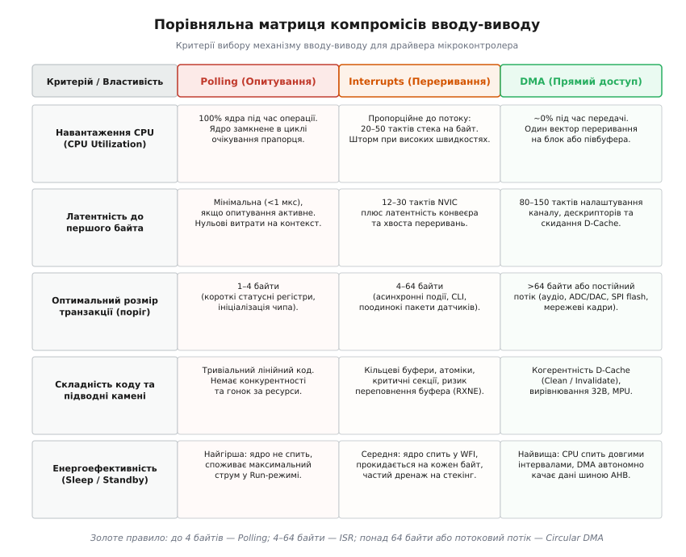
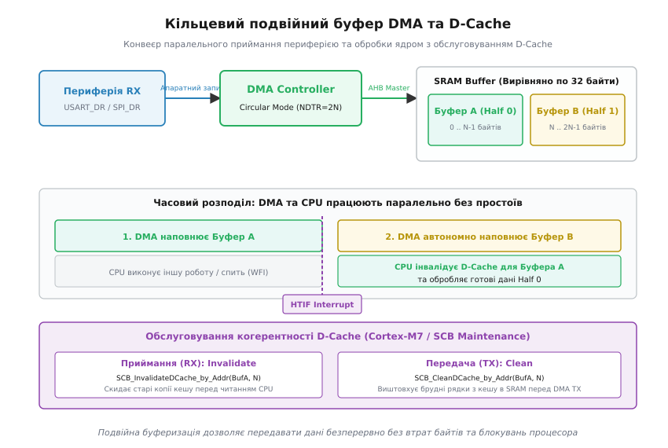

# Опитування, переривання чи DMA у драйвері

<preknowlist>
- [ARM Cortex-M](root:hw-arch/cortex-m) — архітектура ядра, регістри, системні шини AHB/APB, блок NVIC.
- [Memory-mapped IO](root:hw-arch/memory-mapped-io) — доступ до регістрів периферії через адресний простір пам'яті.
- [Переривання](root:hw-arch/interrupts) — апаратні лінії IRQ, вектори винятків та збереження контексту.
- [Контролер DMA](root:hw-arch/dma-controller) — передача блоків даних між пам'яттю та периферією без участі процесора.
- [Бар'єри пам'яті](root:hw-arch/memory-barrier-instructions) — інструкції DMB, DSB, ISB для впорядкування доступу до пам'яті.
- [volatile і компілятор](root:sf-tasks/volatile-register) — заборона кешування регістрів у змінних компілятора.
</preknowlist>

Коли мікроконтролер керує радіомодемом, зчитує вибірки з високошвидкісного АЦП або передає кадри телеметрії через послідовний порт UART на швидкості 921 600 бод, розробник драйвера постає перед фундаментальним вибором каналу введення-виведення: опитувати регістри прапорців у циклі (polling), обробляти кожен прийнятий байт в апаратному перериванні (interrupt-driven I/O) чи доручити транспортування контролеру прямого доступу до пам'яті (DMA). Помилка на цьому етапі призводить до двох крайніх катастроф. Застосування блокуючого опитування для довгого пакету заморожує виконання завдань операційної системи реального часу, спалюючи заряд акумулятора на марне крутіння порожнього циклу. З іншого боку, переривання на кожен окремий байт на мегабітних швидкостях викликає шторм переривань (interrupt storm), коли ядро витрачає понад 70% тактової частоти лише на збереження та відновлення регістрового контексту.

Контролер DMA вирішує проблему навантаження ядра, повністю вивільняючи процесор від рутинного пересилання байтів шиною даних, але приносить власні апаратні пастки: складне налаштування каналів, недетерміновану затримку первинної конфігурації та фатальні розриви когерентності кешу даних (D-Cache Coherency) на продуктивних ядрах Cortex-M7. Інженерний вибір між цими трьома механізмами ніколи не буває питанням смаку чи звички — він підпорядковується жорсткому математичному балансу між розміром корисної транзакції, допустимою латентністю реакції системи, енергетичним бюджетом пристрою та накладними витратами процесора на обслуговування інтерфейсу.

Нижче детально розібрано фізичні механізми, тактову вартість, схемотехнічні особливості та практичні алгоритми організації введення-виведення у драйверах вбудованих систем — від простого опитування з апаратними таймаутами до двобуферного кільцевого DMA з інвалідацією кеш-ліній. Для перевірки граничних режимів та порівняння продуктивності наведено [практичний бенчмарк пропускної здатності та навантаження CPU](root:sf-devices/opytuvannia-pereryvannia-chy-dma-u-draiveri/proj-io-throughput-benchmark.md).


*Порівняльна матриця компромісів: навантаження CPU, латентність, порогові розміри транзакцій та енергоспоживання для Polling, Interrupts і DMA.*

---

## 1. Системні шини та конфлікти доступу (Bus Matrix Contention)

Щоб зрозуміти, чому процесор та периферія поводяться саме так, необхідно поглянути на внутрішню структуру з'єднань сучасного мікроконтролера. Процесорне ядро Cortex-M з'єднується з пам'яттю SRAM, Flash та регістрами периферії через багатошарову шинну матрицю (Multi-Layer AHB Bus Matrix).

Шинна матриця — це апаратний комутатор (crossbar switch), який дозволяє кільком шинним майстрам (Bus Masters) одночасно звертатися до різних підпорядкованих пристроїв (Slaves):

```
МАЙСТРИ (MASTERS):
  [ Ядро: ICode / DCode ] --->\
  [ Ядро: System Bus (S) ] --->+---> [ БАГАТОШАРОВА ШИННА МАТРИЦЯ AHB ]
  [ DMA1 Controller      ] --->+          |          |          |
  [ DMA2 Controller      ] --->/          |          |          |
                                          v          v          v
СЛЕЙВИ (SLAVES):                     [ Flash ]  [ SRAM1/2 ] [ APB1/2 Bridges ]
                                                                |
                                                          [ Периферія ]
```

Коли процесор виконує опитування регістра периферії або читає дані в обробнику переривань, він захоплює шину `System Bus`, проходить через міст `AHB-to-APB Bridge` і виконує операцію читання зі швидкістю низькочастотної периферійної шини APB (Advanced Peripheral Bus), яка зазвичай працює на частоті в 2–4 рази нижчій за частоту ядра.

Коли підключається контролер DMA, він стає паралельним майстром. Якщо DMA пересилає дані між USART на шині APB1 та пам'яттю SRAM1, а процесор у цей самий час намагається прочитати змінну з SRAM1, виникає **конфлікт доступу до шини (bus contention)**. Апаратний арбітр шинної матриці змушений призупиняти одного з майстрів на один або кілька тактів за алгоритмом Round-Robin або за фіксованим пріоритетом.

Тому вибір механізму вводу-виводу впливає не лише на код драйвера, а й на пропускну здатність пам'яті для решти обчислювальних завдань системи.

Вплив шинного протистояння стає особливо помітним у системах цифрової обробки сигналів (DSP), де ядро безперервно зчитує коефіцієнти фільтра з пам'яті SRAM, а DMA паралельно завантажує нові блоки аудіовибірок або кадрів відеокамери. Якщо буфери DMA розміщені в тому самому банку оперативної пам'яті, де лежать робочі масиви алгоритму, ядро зазнає регулярних вимушених пауз (Stall Cycles) на шинному комутаторі.

Для усунення цього ефекту в сучасних мікроконтролерах передбачено кілька фізично розділених банків пам'яті SRAM (наприклад, SRAM1, SRAM2, SRAM3, а також пам'ять із прямим доступом до ядра — DTCM, Data Tightly-Coupled Memory). Архітектурне правило розробника високонавантажених драйверів полягає в тому, щоб розносити буфери DMA та критичні змінні алгоритмів ядра по різних фізичних банках пам'яті. Розміщення буферів DMA в загальній пам'яті SRAM1, а робочого стека та структур ядра в пам'яті DTCM повністю ізолює процесор від шинного шуму контролера DMA, оскільки шина DTCM не проходить через комутатор AHB і не конкурує з периферійними майстрами.

Крім того, слід враховувати вплив контролера Flash-пам'яті (Flash Memory Controller). При високих тактових частотах ядра (168–480 МГц) фізична пам'ять Flash не встигає віддавати опкоди інструкцій за один такт і вимагає встановлення від 3 до 7 циклів очікування (Flash Wait States / Latency). Прискорювачі пам'яті (наприклад, ST ART Accelerator або I-Cache) кешують рядки команд, але під час стрибків у коді (наприклад, при переході у вектор переривання) виникає промах кешу інструкцій, через що ядро зупиняється на кілька тактів до вибірки першої інструкції обробника.

---

## 2. Polling: механіка зайнятого очікування та детермінізм

Опитування (polling, від англ. *poll* — опитувати, перевіряти стан) є прямою синхронною взаємодією процесора з апаратним вузлом. Ядро самостійно читає статусний регістр периферійного пристрою в циклі, доки апаратний біт не повідомить про завершення операції.

Типова передача одного байта через інтерфейс USART з блокуючим опитуванням виконується за наступною схемою:

```
+-------------------------------------------------------------+
| 1. Читання USART->SR (перевірка біта TXE - Transmit Empty) |
+-------------------------------------------------------------+
                              |
                     [ TXE == 0 ? ] ---> ТАК ---> Повтор циклу (CPU 100%)
                              |
                             НІ (TXE == 1)
                              |
                              v
+-------------------------------------------------------------+
| 2. Запис даних у USART->DR (очищає прапорець TXE апаратно)  |
+-------------------------------------------------------------+
```

### Фізична вартість зайнятого очікування (Busy-Wait)

Головний недолік блокуючого опитування — стовідсоткова утилізація обчислювального ресурсу процесорного ядра на весь час передачі або очікування відповіді. Якщо порт UART налаштовано на швидкість 115 200 бод (біт/с), передача одного кадру формату 8N1 (1 старт-біт, 8 біт даних, 1 стоп-біт — разом 10 біт) триває:

```
t_byte = 10 біт / 115200 бод ≈ 86.81 мкс
```

Якщо процесорне ядро працює на тактовій частоті 168 МГц (наприклад, STM32F407 на базі Cortex-M4), то за час передачі одного-єдиного байта процесор встигає виконати:

```
N_cycles = 168 000 000 Гц · 86.81 · 10⁻⁶ с ≈ 14 584 такти
```

Увесь цей час ядро спалює струм у режимі максимального споживання Run Mode (~40–60 мА). Якщо драйвер передає пакет довжиною всього 64 байти за допомогою блокуючого циклу, система випадає з реального часу на:

```
t_packet = 64 · 86.81 мкс ≈ 5.55 мс
```

За 5.55 мілісекунди процесор витрачає майже 933 000 тактів на порожнє опитування пам'яті. Жодне інше низькопріоритетне завдання RTOS або обробник головного циклу суперлупу не отримає керування, якщо тільки вони не витіснять передачу через вкладені переривання.

Навіть якщо швидкість послідовного порту збільшити до 921 600 бод (що є типовим для зв'язку з GNSS-приймачами чи BLE-модулями), тривалість передачі одного байта становитиме приблизно 10.85 мікросекунди. При частоті ядра 216 МГц (Cortex-M7) це все ще відповідає 2343 тактам простою процесора на кожен байт. Корисна робота ядра в цей момент зводиться до виконання інструкцій читання регістра, перевірки бітової маски та умовного переходу `LDR -> TST -> BEQ`, що не приносить жодної системної користі, але нагріває кристал і виснажує батарею.

### Неблокуюче опитування в машині станів (Cooperative Polling)

Щоб уникнути повного блокування ядра в суперлупі (без операційної системи), застосовують неблокуюче опитування через кінцевий автомат (FSM — Finite State Machine):

:::tabs
```c
typedef enum {
    UART_STATE_IDLE,
    UART_STATE_TX_BUSY,
    UART_STATE_RX_READY
} UartState_t;
```
```cpp
enum class UartState : uint8_t {
    Idle,
    TxBusy,
    RxReady
};
```
:::

Функція `driver_poll()` викликається на кожній ітерації головного циклу `main()`. Вона перевіряє прапорець `TXE` чи `RXNE` лише один раз. Якщо біт встановлено, драйвер записує або зчитує один байт і негайно повертає керування іншим підсистемам.

Проте за це доводиться платити неконтрольованим **джитером затримки (Latency Jitter)**. Якщо в системі виконується K незалежних завдань, і кожне завдання займає час τ_i, максимальна затримка реакції на вхідний байт становить:

```
L_max = ∑ [від i=1 до K] (τ_i)
```

Якщо одне з сусідніх завдань затрималося на 200 мікросекунд (наприклад, оновлювало екран або розраховувало ПІД-регулятор), вхідний регістр UART переповниться новими байтами, викликавши помилку Overrun (`ORE`), і дані буде втрачено.

Аналіз поведінки кооперативного опитування показує, що його надійність стрімко падає при зростанні складності прошивки. Доки в системі є лише два-три простих модулі з фіксованим часом виконання до 10–20 мікросекунд, суперлуп працює без збоїв. Проте додавання в систему будь-якої важкої підпрограми (наприклад, обчислення контрольної суми CRC32 великого файлу у Flash або криптографічного перетворення AES) миттєво створює часові «дірки» в опитуванні. У результаті драйвер UART або SPI починає спорадично втрачати випадкові байти на високих швидкостях обміну, що вкрай важко локалізувати під час налагодження, оскільки в покроковому режимі або під час зупинки процесора дефект не відтворюється.

### Захист апаратним таймаутом на базі DWT

Класична помилка при написанні блокуючого опитування — відсутність захисту від апаратної аварії. Якщо лінію передавача замкнуло на землю, відвалилося тактування або завис зовнішній чип, відкритий цикл `while (!(hw->SR & TXE))` назавжди зависне.

Будь-який виробничий код зобов'язаний вимірювати таймаут за допомогою незалежного апаратного лічильника тактів DWT (Data Watchpoint and Trace). Нижче наведено еталонний блокуючий драйвер з контролем часу на C99 та C++20.

:::tabs
:::code opytuvannia-pereryvannia-chy-dma-u-draiveri-d/c/zakhyst-aparatnym.c
:::code opytuvannia-pereryvannia-chy-dma-u-draiveri-d/cpp/zakhyst-aparatnym.cpp
:::

### Коли Polling є оптимальним вибором

Попри низьку енергоефективність, опитування є найкращим рішенням у трьох сценаріях:
1. **Транзакції довжиною 1–2 байти з високою тактовою частотою шини.** Читання статусного регістра SPI Flash або акселерометра на частоті шини 20–40 МГц триває менше 100–200 наносекунд. Час налаштування DMA або стекінгу переривання перевищує тривалість самої передачі.
2. **Етап раннього старту (Bootloader) та відсутність переривань.** До повної ініціалізації стека, таблиці векторів VTOR та підсистеми тактування чипа.
3. **Аварійні дампи (HardFault Handler / Panic Dump).** Коли операційна система зруйнована, стек пошкоджено, а переривання заблоковані, вивести діагностичний текст у порт UART можна виключно синхронним блокуючим опитуванням.

Окремо варто відзначити сценарій апаратної реконфігурації або відновлення інтерфейсів після збоїв шини (наприклад, зависання шини I2C, коли слейв-пристрій утримує лінію даних SDA в низькому рівні через збій тактування). У цьому випадку драйвер змушений тимчасово перевести виводи GPIO з режиму альтернативної функції в режим програмного керування (Bit-Banging) і згенерувати 9 послідовних тактових імпульсів на лінії SCL за допомогою синхронних пауз опитування, щоб примусово звільнити шину. Використання переривань або DMA на цьому етапі фізично неможливе, оскільки апаратний контролер I2C заблокований станом шини.

---

## 3. Interrupts: подієва модель, архітектура NVIC та кільцеві буфери

Переривання позбавляють процесор необхідності марно витрачати час на перевірку стану апаратних вузлів. Периферійний модуль самостійно формує апаратний сигнал на виділеній лінії IRQ (Interrupt Request), коли у приймачі з'явився новий байт (`RXNE`) або вивільнився передавач (`TXE`).

Контролер переривань NVIC (Nested Vectored Interrupt Controller) ядра Cortex-M перериває виконання фонової програми, зберігає мінімальний стан процесора і передає керування на адресу відповідного вектора обробника ISR (Interrupt Service Routine).

```
Головний потік / RTOS           Периферія (UART RX)          NVIC / Ядро
        |                                |                        |
        |                         [Прийшов байт]                  |
        |                                |                        |
        |                         Генерує лінію IRQ ------------->|
        |                                                         |
        |                                            [Автоматичний стекінг]
        |                                            (R0-R3, R12, LR, PC, xPSR)
        |<--------------------------------------------------------| (12 тактів)
        |
[Перехід у ISR]
  - Читання UART->DR
  - Запис у RingBuffer
  - Очищення прапорця
[Вихід з ISR: BX LR]
        |
        |-------------------------------------------------------->|
        |                                            [Розстекування контексту]
        |<--------------------------------------------------------| (12 тактів)
        |
[Продовження обчислень]
```

### Апаратний стекінг NVIC та затримки ядра

Контролер NVIC в ядрах Cortex-M3/M4/M7 має апаратний автомат збереження та відновлення контексту, що працює з фіксованим часом виконання:

1. **Базовий кадр стекінгу (Basic Frame):** ядро автоматично зберігає у поточному стеку 8 регістрів:
   - `R0, R1, R2, R3` (аргументи та тимчасові значення за стандартом AAPCS)
   - `R12` (внутрішній робочий регістр IP)
   - `LR (R14)` (Link Register)
   - `PC (R15)` (Program Counter — адреса повернення)
   - `xPSR` (Program Status Register — прапорці ALU та стан виконання)
2. **Час стекінгу:** рівно **12 тактів процесора** за умови пам'яті SRAM з нульовою затримкою.
3. **Вибірка вектора (Vector Fetch):** виконується шиною ICode паралельно зі стекінгом даних у пам'ять.
4. **Розстекування (Unstacking):** після завершення ISR інструкція `BX LR` зі спеціальним маркером повернення `EXC_RETURN` відновлює 8 регістрів за **12 тактів**.

Сумарні мінімальні апаратні витрати на вхід і вихід з переривання становлять:

```
T_hw_switch = 12 (вхід) + 12 (вихід) = 24 такти CPU
```

Значення `EXC_RETURN`, яке завантажується в регістр `LR` під час виклику винятку, кодує режим роботи ядра та тип стека:
- `0xFFFFFFF1` — повернення в режим обробника (Handler Mode), використання основного стека (MSP);
- `0xFFFFFFF9` — повернення в режим потоку (Thread Mode), використання основного стека (MSP);
- `0xFFFFFFFD` — повернення в режим потоку (Thread Mode), використання стека процесу (PSP), що є стандартом для операційних систем реального часу (FreeRTOS, Zephyr).

### Вплив розширеного кадру FPU та лінивий стекінг (Lazy Stacking)

Якщо в системі задіяно блок апаратних обчислень з плаваючою комою (FPU) і фоновий потік виконував математичні інструкції, збереження додаткових 16 регістрів `S0–S15` та `FPSCR` збільшило б час входу до 29 тактів.

Щоб запобігти цьому, в Cortex-M4/M7 реалізовано апаратний механізм **лінивого стекінгу (Lazy Stacking)**. За замовчуванням ядро лише резервує 64 байти у стеку, змінюючи покажчик `SP`, але фізично не записує туди FP-регістри. Якщо всередині ISR не виконуються операції з плаваючою комою, вхід у переривання займає стандартні 12 тактів. Запис FP-регістрів у пам'ять відбувається апаратно лише тоді, коли перша інструкція всередині ISR спробує звернутися до регістрів FPU.

Якщо ж розробник необережно використовує змінні типу `float` або `double` всередині обробника переривання (наприклад, конвертує ціле значення АЦП у вольти безпосередньо в ISR), механізм лінивого стекінгу негайно деактивується. Процесор змушений скинути всі 16 регістрів FPU в пам'ять, що миттєво додає щонайменше 17 тактів до часу виконання обробника і споживає додаткові 64 байти простору стека. Це фундаментальне правило системного програмування: будь-які обчислення з рухомою комою мають бути винесені з ISR у фонові завдання.

### Пролог та епілог компілятора за стандартом AAPCS

Крім апаратних 24 тактів, компілятор C/C++ зобов'язаний зберегти у стеку регістри `R4–R11` (callee-saved registers), якщо тіло обробника ISR модифікує їх або викликає інші функції:

```assembly
USART1_IRQHandler:
    PUSH    {R4-R7, LR}      ; Пролог: збереження R4-R7 (4-8 тактів)
    LDR     R0, =0x40011000  ; Адреса USART1
    LDR     R1, [R0, #0x04]  ; Читання USART_DR
    ; ... робота з кільцевим буфером ...
    POP     {R4-R7, PC}      ; Епілог: відновлення та повернення (5-9 тактів)
```

Реальна вартість одного виклику ISR (з урахуванням збереження контексту, логіки буфера, бар'єрів пам'яті та скидання прапорців) становить від **35 до 60 тактів процесора на кожен байт**.

### Оптимізації Tail-Chaining та Late-Arriving

Контролер NVIC містить дві апаратні оптимізації для каскадних переривань:
- **Tail-Chaining:** якщо на момент виходу з поточного ISR у черзі вже очікує інше активне переривання, ядро пропускає відновлення 8 регістрів і завантаження нового кадру. Воно миттєво переходить до наступного вектора всього за **6 тактів** замість `12 + 12 = 24`.
- **Late-Arriving:** якщо ядро почало 12-тактовий стекінг для низькопріоритетного переривання, і в цей момент надходить запит від високопріоритетного IRQ, ядро завершує поточний стекінг, але одразу передає керування високопріоритетному обробнику без повторного збереження стану.

### Керування пріоритетами переривань та маскування через BASEPRI

Для захисту спільних даних (наприклад, покажчиків кільцевого буфера) у драйверах застосовують критичні секції. Початківці часто використовують глобальне відключення переривань `__disable_irq()` (інструкція `CPSID i`). Це груба помилка: `CPSID i` виставляє біт у регістрі `PRIMASK`, блокуючи геть усі переривання в системі, включаючи високопріоритетні таймери безпеки двигуна або керування силовими ключами.

У професійних драйверах замість `PRIMASK` застосовують регістр маскування пріоритетів `BASEPRI`:
- Запис ненульового значення порогу P у `BASEPRI` блокує виклики лише тих переривань, чий пріоритет є чисельно більшим або рівним P (тобто мають нижчий або однаковий пріоритет).
- Усі критичні системні переривання з вищим пріоритетом (чисельно меншим за P) продовжують обслуговуватися апаратно без жодних затримок!

Нижче наведено безпечну реалізацію критичної секції на C99 та ідіоматичну RAII-обгортку на C++20.

:::tabs
:::code opytuvannia-pereryvannia-chy-dma-u-draiveri-d/c/keruvannia-priorytetamy.c
:::code opytuvannia-pereryvannia-chy-dma-u-draiveri-d/cpp/keruvannia-priorytetamy.hpp
:::

### Відкладений запис у шині APB та захист від хибного входу (Store Buffer Trap)

Дуже поширена апаратна пастка при роботі з перериваннями Cortex-M — **хибний повторний вхід у переривання (Spurious Interrupt Re-entry)**.

Коли обробник переривання скидає статусний прапорець записом у регістр `SR` або `ICR` (наприклад, `USART1->ICR = USART_ICR_TCCF`), інструкція запису потрапляє у внутрішній буфер відкладеного запису ядра (Store Buffer). Процесор миттєво виконує наступну інструкцію виходу `BX LR`.

Оскільки периферійна шина APB працює повільніше за ядро, фізичний запис у регістр USART завершується на 2–3 такти пізніше, ніж ядро встигає виконати розстекування контексту. На момент повернення в режим потоку контролер NVIC все ще бачить високий рівень сигналу IRQ від периферії і **негайно вдруге запускає той самий обробник переривання**!

Для запобігання цій помилці в кінці кожного обробника переривань застосовують апаратний бар'єр синхронізації даних `__DSB()` або фіктивне зчитування регістра периферії:

:::tabs
```c
// Варіант 1: Апаратний бар'єр даних DSB
USART1->SR &= ~USART_SR_RXNE;
__asm volatile ("dsb" ::: "memory");

// Варіант 2: Фіктивне зчитування для синхронізації мосту шини APB
USART1->SR &= ~USART_SR_RXNE;
(void)USART1->SR;
```
```cpp
// Варіант 1: Апаратний бар'єр даних DSB у C++
USART1->SR &= ~USART_SR_RXNE;
asm volatile ("dsb" ::: "memory");

// Варіант 2: Фіктивне зчитування для синхронізації мосту шини APB
USART1->SR &= ~USART_SR_RXNE;
static_cast<void>(USART1->SR);
```
:::

### Неточні збої шини (Imprecise BusFaults) під час асинхронного запису

Ще один критичний ефект конвеєризації шини — виникнення неточних апаратних винятків (Imprecise BusFaults). Якщо ядро або DMA намагається записати дані за неправильною або заблокованою адресою периферії, сигнал помилки від шинного комутатора AHB надходить через кілька тактів після виконання інструкції `STR`.

У результаті процесорний лічильник `PC`, збережений у стеку винятку BusFault, вказує не на збійну інструкцію запису, а на зовсім інший код, що виконувався через 2–4 такти пізніше. Для діагностики таких прихованих збоїв інженери звертаються до системного регістру `CFSR` (Configurable Fault Status Register): біт `IMPRECISERR` свідчить про асинхронний збій шини. Щоб під час налагодження точно визначити збійний рядок, у системному регістрі `ACTLR` (Auxiliary Control Register) тимчасово виставляють біт `DISDEFWBUF = 1`, що примусово вимикає буфер відкладеного запису і перетворює всі помилки шини на точні (Precise BusFaults) з фіксацією точної адреси в регістрі `BFAR`.

### Дворівнева обробка: Top-Half та Bottom-Half у RTOS

У системах під керуванням операційних систем реального часу (RTOS) обробка переривань розбивається на дві фази:
1. **Top-Half (Швидкий апаратний ISR):** виконується з найвищим пріоритетом. Його задача — мінімальна: зчитати апаратний регістр `DR`, покласти байт у кільцевий буфер, скинути прапорець винятку і звести семафор або надіслати подію планувальнику RTOS (`xSemaphoreGiveFromISR` або `xQueueSendFromISR`).
2. **Bottom-Half (Відкладений фоновий потік):** окреме завдання операційної системи з нормальним пріоритетом. Воно прокидається по семафору, вичитує накопичені дані з кільцевого буфера, перевіряє контрольні суми та парсить пакет протоколу.

Такий розподіл гарантує, що апаратні лінії інших важливих переривань (наприклад, аварійне відключення двигуна або таймери крокового приводу) не блокуватимуться тривалими протокольними операціями.

### Безблокуючий кільцевий буфер (Lock-Free SPSC FIFO)

Оскільки обробник ISR виконується у винятковому контексті, він не повинен виконувати парсинг складних пакетів або затримувати виконання. Дані переносяться з апаратного регістра у проміжний кільцевий буфер.

Для виключення операції ділення за модулем (`% size`), яка на Cortex-M3/M4 виконується інструкцією `UDIV` за 2–12 тактів (а на Cortex-M0 емулюється програмно за десятки тактів), розмір буфера завжди обирається ступенем двійки `Size = 2ᴺ`, а замість ділення застосовується побітова маска `Mask = Size - 1`.

Нижче наведено потокобезпечну реалізацію безблокуючого кільцевого буфера SPSC (Single-Producer Single-Consumer) на C99 та C++20.

:::tabs
:::code opytuvannia-pereryvannia-chy-dma-u-draiveri-d/c/bezblokuiuchyi-kiltsevyi.c
:::code opytuvannia-pereryvannia-chy-dma-u-draiveri-d/cpp/bezblokuiuchyi-kiltsevyi.cpp
:::

Використання апаратного бар'єра пам'яті `__DMB()` (Data Memory Barrier) або C++20 `std::memory_order_release` є критично важливим на сучасних процесорних ядрах Cortex-M4/M7. Без бар'єра конвеєр команд процесора або агресивний оптимізатор компілятора мають право переставити порядок виконання інструкцій так, що інкремент покажчика `head` стане видимим для фонового потоку раніше, ніж фактичні байти запишуться у комірки масиву `storage`. У результаті споживач вичитає сміття зі старого вмісту пам'яті.

### Шторм переривань (Interrupt Storm) на високих швидкостях

Переривання чудово працюють на низьких і середніх швидкостях потоку (до 10–20 кБ/с). Але на високих швидкостях подієва модель викликає деградацію системи.

Розглянемо SPI-інтерфейс, що працює на тактовій частоті 10 МГц (швидкість потоку 1.25 МБ/с або 1 250 000 байт/с):
- Частота генерації IRQ: **1 250 000 переривань щосекунди** (одне переривання кожні 800 наносекунд).
- При частоті процесора 100 МГц часовий інтервал 800 нс дорівнює **80 тактам процесора**.
- Якщо обробник ISR разом зі стекінгом та оновленням буфера займає **50 тактів**, процесор витрачає на обслуговування переривань:

```
Утилізація CPU = 50 тактів / 80 тактів = 62.5% загальної потужності ядра!
```

Ядро виявляється заблокованим: воно безперервно входить у переривання, зберігає контекст, читає один байт, виходить і через кілька тактів знову змушене зберігати контекст. Будь-яка критична секція з відключенням переривань у фоновому потоці призведе до миттєвого переповнення вхідного регістра (`ORE`) та втрати даних.

---

## 4. DMA: архітектура шинних майстрів, циркулярний режим та подвійна буферизація

Прямий доступ до пам'яті (DMA — Direct Memory Access) передає функцію перекачування байтів спеціалізованому апаратному контролеру. DMA є повноправним шинним майстром на шині AHB і виконує транзакції читання та запису між периферією та оперативною пам'яттю паралельно з роботою процесора.

```
       +-------------------+              +-------------------+
       | Процесорне ядро   |              |  Контролер DMA    |
       | ARM Cortex-M      |              |  (Bus Master)     |
       +-------------------+              +-------------------+
                 |                                  |
   Шина I/D-Bus  |                    Шина DMA-AHB  |
                 v                                  v
       ========================================================
                      Матриця системних шин AHB
       ========================================================
                 |                                  |
                 v                                  v
       +-------------------+              +-------------------+
       | Пам'ять SRAM      |              | Периферія (UART/  |
       | (RX/TX Буфери)    |              | SPI/ADC/I2S)      |
       +-------------------+              +-------------------+
```

### Режими роботи DMA: Normal, Circular та Double-Buffering

1. **Normal Mode (Одиночна транзакція):** DMA пересилає N елементів, після чого лічильник `NDTR` скидається в 0, канал вимикається і генерується переривання завершення `TCIF`. Для наступного запуску процесор повинен заново переналаштувати лічильник та звести біт `EN`.
2. **Circular Mode (Кільцевий режим):** після передачі останнього байта лічильник `NDTR` автоматично відновлюється з тіньового регістра перезавантаження, адреса повертається на початок буфера, і потік триває нескінченно.
3. **Double Buffer Mode (Подвійна буферизація):** DMA має два регістри адрес `M0AR` та `M1AR`. Поки DMA наповнює перший буфер, процесор обробляє другий, після чого вони автоматично міняються ролями без зупинки апаратного потоку.

### Внутрішнє FIFO та пакетні передачі (Burst Transfers)

Сучасні контролери DMA (наприклад, DMA1/DMA2 у STM32F4/F7/H7) мають власні 4-слівні (16-байтні) черги FIFO на кожен потік (Stream). Наявність FIFO дозволяє контролеру згладжувати пікові затримки шинного арбітражу, якщо матриця AHB тимчасово зайнята ядром.

Крім того, FIFO забезпечує апаратне перепакування даних (Packing / Unpacking). Якщо периферійний пристрій видає байти (8 біт), DMA може накопичувати їх у своєму FIFO і записувати в оперативну пам'ять SRAM однією 32-бітною транзакцією слова (Word Transfer). Це скорочує кількість звернень DMA до шини пам'яті в 4 рази, вивільняючи шинну матрицю для роботи процесора.

Для передачі великих блоків пам'яті (наприклад, виведення кадру на дисплей через SPI або передача Ethernet-кадру) використовують пакетний режим (Burst Mode). DMA захоплює шину і передає пачку з 4, 8 або 16 слів підряд (інструкції шини AHB `INCR4`, `INCR8`, `INCR16`). Це мінімізує накладні витрати на фази адресації шини, досягаючи теоретичної межі пропускної здатності пам'яті.

### Двовимірний DMA (2D DMA / DMA2D) та рядковий зсув (Stride)

Для графічних дисплеїв, камер та двовимірних матриць сигналів класичний одновимірний DMA є недостатнім. Якщо драйверу необхідно вивести іконку розміром 64 × 64 пікселі у центр великого кадрового буфера екрана розміром 800 × 480, пікселі іконки у фізичній пам'яті кадрового буфера розташовані несуміжно: після кожних 64 пікселів необхідно зробити «стрибок» на 800 - 64 = 736 пікселів вперед.

Контролери 2D DMA (наприклад, Chrom-ART DMA2D у STM32 або модулі 2D-адресації в eDMA) містять апаратний регістр рядкового зсуву (Line Offset / Stride). Контролер виконує двовимірну передачу за формулою:

```
Адреса(x, y) = Базова_Адреса + y · Крок_Рядка + x · Розмір_Пікселя
```

DMA2D автоматично переносить прямокутні вікна, виконує альфа-блендинг (накладання напівпрозорих шарів) та апаратне перетворення колірних форматів (наприклад, перетворення палітри ARGB8888 в екранний формат RGB565) абсолютно без участі процесора, дозволяючи отримувати 60 FPS у складних графічних оболонках при мінімальній частоті ядра.

### Ланцюговий DMA (Scatter-Gather / Linked-List DMA)

У передових мікроконтролерах (наприклад, STM32H7 Master DMA або NXP i.MX eDMA) реалізовано режим зв'язаних списків дескрипторів (Scatter-Gather Linked Lists).

Замість фіксованих регістрів пам'яті процесор формує в оперативній пам'яті масив структур-дескрипторів:

:::tabs
```c
typedef struct DmaDescriptor {
    uint32_t SourceAddress;
    uint32_t DestinationAddress;
    uint32_t ByteCount;
    uint32_t ControlFlags;
    struct DmaDescriptor *NextDescriptor;
} DmaDescriptor_t;
```
```cpp
struct alignas(32) DmaDescriptor {
    uint32_t source_address{0};
    uint32_t destination_address{0};
    uint32_t byte_count{0};
    uint32_t control_flags{0};
    DmaDescriptor* next_descriptor{nullptr};
};
```
:::

Контролер DMA самостійно зчитує з пам'яті перший дескриптор, виконує пересилання блоку, автоматично зчитує адресу наступного дескриптора за покажчиком `NextDescriptor` і переходить до наступного блоку без участі процесора.

Це дозволяє збирати складні мережеві кадри Ethernet (де заголовок Ethernet, заголовок IP, заголовок TCP та тіло корисних даних лежать у різних несуміжних буферах пам'яті) в єдиний апаратний потік передавача без попереднього виклику важкої функції `memcpy()`, що економить мільйони тактів ядра при маршрутизації мережевих пакетів.

### Кільцевий подвійний буфер на Half-Transfer / Transfer-Complete

Найбільш надійний спосіб організації безперервного потоку (UART, SPI, АЦП) — це використання циркулярного буфера розміром $2N$ байтів з двома перериваннями:
- **Half-Transfer Complete (HTIF):** виникає, коли DMA заповнив першу половину буфера (байти `0 .. N-1`).
- **Transfer Complete (TCIF):** виникає, коли DMA дійшов до кінця буфера (байти `N .. 2N-1`) і автоматично повертається на початок.


*Організація кільцевого подвійного буфера DMA з перериваннями половинного (HT) та повного (TC) заповнення і точками інвалідації D-Cache.*

Нижче наведено повну реалізацію кільцевого подвійного приймача DMA на C99 та C++20.

:::tabs
:::code opytuvannia-pereryvannia-chy-dma-u-draiveri-d/c/kiltsevyi-podviinyi-bufer.c
:::code opytuvannia-pereryvannia-chy-dma-u-draiveri-d/cpp/kiltsevyi-podviinyi-bufer.cpp
:::

### Колізії прапорців HTIF та TCIF під час системних пауз

Коли в системі виконується тривала критична секція високого пріоритету (наприклад, калібрування гіроскопа або стирання сектору Flash-пам'яті), процесор не обслуговує винятки потоку DMA. У цей час DMA продовжує автономно пересилати дані шиною AHB.

Якщо пауза ядра перевищує тривалість заповнення половинного буфера, контролер DMA встановлює прапорець `HTIF`, продовжує записувати дані у другу половину буфера, а по її закінченню — виставляє прапорець `TCIF` і знову повертається на початок буфера.

Коли процесор нарешті виходить із критичної секції й потрапляє в `DMA_Stream_IRQHandler`, у регістрі статусу взведені обидва біти `HTIF` та `TCIF`. Грубою помилкою розробника є використання конструкції з взаємним виключенням `if (status & HTIF) ... else if (status & TCIF) ...`. За такої логіки обробник зреагує лише на перший прапорець, а друга половина даних буде втрачена через перезапис новим колом DMA.

Правильна архітектура обробника завжди перевіряє обидві умови послідовно через незалежні оператори `if`, викликаючи обробники для обох половин буфера у строгій хронологічній послідовності (спочатку перша половина, потім друга), що забезпечує неперервність потоку даних.

### Пріоритетизація потоків DMA в регістрах PL

Коли кілька потоків DMA одночасно претендують на доступ до шинної матриці AHB (наприклад, потік відеокамери DCMI та потік модему UART), виникає внутрішня конкуренція шини. Для її розв'язання використовують поле `PL[1:0]` (Priority Level) у конфігураційному регістрі потоку `DMA_SxCR`:
- `0b00` — низький пріоритет (Low);
- `0b01` — середній пріоритет (Medium);
- `0b10` — високий пріоритет (High);
- `0b11` — дуже високий пріоритет (Very High).

Якщо пріоритети двох активних потоків збігаються, апаратний арбітр DMA надає перевагу потоку з меншим числовим номером (Stream 0 має перевагу над Stream 1).

### Приймання пакетів змінної довжини через переривання IDLE Line

Типова проблема DMA — як приймати пакети заздалегідь невідомої довжини через послідовний порт UART, якщо DMA розрахований на фіксовану кількість байтів `NDTR`.

Рішення полягає у комбінації **Circular DMA та переривання IDLE Line (`USART_CR1_IDLEIE`)**:
1. DMA налаштовується в кільцевому режимі на буфер максимального розміру (наприклад, 1024 байти).
2. Драйвер вмикає переривання IDLE в регістрі `USART_CR1`.
3. Коли передавач завершує передачу кадру довільної довжини, лінія RX переходить у високий стан (Idle). Після відсутності активності протягом одного кадрового інтервалу (10 біт) апаратний блок USART генерує переривання IDLE.
4. Обробник UART ISR читає поточне значення лічильника `DMA->NDTR`, обчислює точну кількість фактично прийнятих байтів:
   ```
   bytes_received = TotalBuffer - DMA->NDTR - previous_tail;
   ```
5. Драйвер передає сформований пакет на обробку, скидає прапорець IDLE і залишає DMA активним для наступного пакету без перезапуску каналу.

Цей патерн є промисловим стандартом у драйверах зв'язку для протоколів Modbus RTU, MAVLink та командних інтерфейсів AT-модемів, де пакети надходять пачками нерегулярної довжини, а час очікування між пакетами свідчить про завершення передачі кадру.

---

## 5. Когерентність кешу даних (D-Cache Coherency у Cortex-M7)

На процесорах Cortex-M7 (STM32F7, STM32H7, NXP i.MX RT) встановлено дворівневу систему кеш-пам'яті L1: кеш інструкцій I-Cache та кеш даних D-Cache (зазвичай 16 або 32 КБ з кеш-лініями розміром **32 байти**).

Контролер DMA підключається безпосередньо до матриці шин AXI/AHB і **не має апаратного механізму відстеження кешу (Hardware Cache Snooping)**. DMA звертається виключно до фізичної оперативної пам'яті SRAM, нічого не знаючи про стан кеш-пам'яті ядра.

```
       [ Процесорне ядро Cortex-M7 ]
                     |
            [ L1 Data Cache ] (32-байтні кеш-лінії)
                     |
          === Шинна матриця AXI === <------ [ Контролер DMA ] (Шинний майстер)
                     |                               |
              [ Фізична SRAM ] <---------------------+
```

### Механізм розриву когерентності (Cache Incoherency Trap)

1. **Передача даних (DMA TX: Пам'ять → Периферія):**
   - Процесор записує дані у вихідний буфер. Оскільки D-Cache працює за стратегією зворотного запису (Write-Back), зміни залишаються в L1 D-Cache і позначаються як «брудні» (Dirty). У фізичній SRAM залишаються старі дані.
   - DMA зчитує фізичну SRAM і відправляє в лінію застарілі дані (сміття).
   - **Лікування:** перед запуском передачі викликати операцію **Clean** (`SCB_CleanDCache_by_Addr`), яка примусово виштовхує брудні рядки з кешу в SRAM.
2. **Приймання даних (DMA RX: Периферія → Пам'ять):**
   - DMA приймає байти і записує їх у фізичну SRAM.
   - Якщо процесор раніше читав цю область пам'яті, в його L1 D-Cache залишилася стара копія.
   - Коли процесор намагається прочитати щойно прийнятий буфер, контролер пам'яті виявляє Cache Hit і повертає застаріле значення з кешу, ігноруючи нові дані в SRAM.
   - **Лікування:** перед читанням буфера викликати операцію **Invalidate** (`SCB_InvalidateDCache_by_Addr`), яка скидає теги валідності рядків кешу і змушує ядро перечитати фізичну SRAM.

### Пастка помилкового спільного використання (False Sharing)

Оскільки кеш оперує неподільними блоками по **32 байти**, виникає смертельна небезпека: якщо буфер DMA та звичайна змінна програми потрапляють в одну 32-байтну кеш-лінію:

```
Адреса: 0x2000_0000                     0x2000_001F (32 байти = одна кеш-лінія)
+------------------------------------+---------------------------------------+
| DMA RX Buffer (байти 0..9)         | Звичайна змінна `uint32_t g_counter;` |
+------------------------------------+---------------------------------------+
```

Якщо ядро змінило `g_counter` (записало в кеш-лінію), а потім викликало `SCB_InvalidateDCache_by_Addr()` для буфера DMA RX, операція інвалідації **знищить усю 32-байтну лінію цілком**, і зміни змінної `g_counter` буде незворотно стерто!

**Правила розробки під Cortex-M7:**
1. Кожен буфер DMA повинен мати вирівнювання: `alignas(32)` або `__attribute__((aligned(32)))`.
2. Розмір буфера DMA зобов'язаний бути строго кратним 32 байтам.
3. Заборонено розміщувати інші змінні в межах тієї ж 32-байтної кеш-лінії.

Нижче наведено шаблон обслуговування кешу для DMA-драйвера на C99 та C++20.

:::tabs
:::code opytuvannia-pereryvannia-chy-dma-u-draiveri-d/c/pastka-pomylkovoho.c
:::code opytuvannia-pereryvannia-chy-dma-u-draiveri-d/cpp/pastka-pomylkovoho.hpp
:::

### Виділення некешованої області через MPU

Найкраще архітектурне рішення для усунення розривів когерентності без виклику функцій `SCB` — конфігурація блоку захисту пам'яті MPU (Memory Protection Unit).

Через регістри `MPU_RBAR` та `MPU_RASR` виділяється спеціальний регіон пам'яті (наприклад, SRAM3 за адресою `0x30040000`), для якого встановлюється атрибут **Non-Cacheable** або **Device Memory**. Усі буфери DMA розміщуються в цій секції через атрибут лінкера `__attribute__((section(".dma_section")))`. Процесор та DMA працюють з цією пам'яттю напряму, що повністю ліквідує колізії кешу.

Конфігурація MPU виконується один раз під час завантаження системи. Вона повністю усуває необхідність вставляти виклики `SCB_CleanDCache` чи `SCB_InvalidateDCache` у критичні за часом обробники переривань, захищаючи кодову базу від випадкових помилок інвалідації пам'яті при зміні розмірів структур даних.

Нижче наведено робочий приклад повної конфігурації регіону MPU на C99 та C++20.

:::tabs
:::code opytuvannia-pereryvannia-chy-dma-u-draiveri-d/c/vydilennia-nekeshovanoi.c
:::code opytuvannia-pereryvannia-chy-dma-u-draiveri-d/cpp/vydilennia-nekeshovanoi.hpp
:::

---

## 6. Мультиплексор DMAMUX та апаратна синхронізація (Hardware Event Linking)

У сучасних сімействах мікроконтролерів (STM32G4, STM32H7, STM32U5) між периферійними пристроями та контролером DMA з'явився додатковий апаратний вузол — **мультиплексор запитів DMAMUX**.

DMAMUX вирішує проблему жорсткої прив'язки каналів DMA до конкретних ніжок периферії, дозволяючи динамічно підключати будь-який периферійний запит (UART, SPI, ADC, I2C, Timer) до будь-якого вільного потоку DMA.

Крім того, DMAMUX містить блок генератора синхронізації запитів (DMAMUX Request Generator). Це дозволяє запускати пересилання DMA не програмно процесором і не апаратним запитом периферії, а за зовнішньою системною подією:
- Фронт сигналу на зовнішньому виводі GPIO через блок EXTI;
- Спрацьовування таймера оновлення або порівняння (Timer Update / Output Compare);
- Сигнал аналогового компаратора.

Завдяки цьому реалізується повністю автономний апаратний контур: таймер з фіксованою частотою 100 кГц запускає перетворення АЦП, по завершенню перетворення DMAMUX пересилає вибірку в пам'ять SRAM через Circular DMA, а процесор залишається в стані глибокого сну Stop Mode, не виконуючи жодної інструкції.

---

## 7. Математика вибору: порогові розміри буферів та ціна конфігурації

Первинна ініціалізація каналу DMA вимагає запису в регістри `PAR`, `M0AR`, `NDTR`, `FCR`, `CR`, скидання статусних прапорців та виконання бар'єра `DSB`. Ця послідовність займає від **80 до 150 тактів CPU**. Крім того, переривання завершення `TCIF` додає ще **35–50 тактів** на стекінг.

Порівняємо сумарні тактові витрати ядра C(N) на передачу пакета довжиною N байтів для трьох підходів:

```
C_polling(N) = N · (t_bus_wait + t_write_inst)
C_interrupt(N) = N · (t_nvic_stack + t_isr_logic + t_nvic_unstack)
C_dma(N) = t_dma_setup + t_cache_flush + t_dma_isr
```

Припустимо типові параметри для ядра Cortex-M4 @ 168 МГц на інтерфейсі SPI @ 10 МГц:
- `t_bus_wait` (опитування одного байта): 17 тактів CPU
- `t_interrupt` (повна вартість одного ISR на байт): 45 тактів CPU
- `t_dma_setup` (налаштування каналу DMA): 100 тактів CPU
- `t_dma_isr` (одне переривання по завершенню всього блока): 40 тактів CPU

| Розмір пакета N | Polling (такти) | Interrupts (такти) | DMA (такти) | Оптимальний вибір |
| :--- | :--- | :--- | :--- | :--- |
| **1 байт** | **17** | 45 | 140 | **Polling** (у 8 разів швидше за DMA) |
| **2 байти** | **34** | 90 | 140 | **Polling** |
| **4 байти** | **68** | 180 | 140 | **Polling / ISR** |
| **8 байтів** | 136 | 360 | **140** | **DMA** (точка перетину) |
| **32 байти** | 544 | 1 440 | **140** | **DMA** (у 10 разів менше навантаження) |
| **256 байтів** | 4 352 | 11 520 | **140** | **DMA** (у 82 рази менше навантаження) |
| **1024 байти** | 17 408 | 46 080 | **140** | **DMA** (у 329 разів менше навантаження) |

> 🔧 **Навіщо це.** Практичний поріг рентабельності переходу від переривань до DMA становить **16–64 байти**. Передавати короткі 2-байтні команди через DMA неефективно: налаштування каналу триває довше за саму передачу. Навпаки, передача блоків понад 64 байти через побайтові переривання веде до перевантаження ядра.

Якщо розбити часовий бюджет детальніше, стає зрозуміло, чому для ультракоротких транзакцій DMA завжди програє. Щоб налаштувати потік DMA, ядро має виконати щонайменше 6 інструкцій `STR` (запис у регістри), з яких кожна операція запису в регістр периферії через міст AHB-to-APB займає від 2 до 4 тактів шини APB. Сумарний час доступу до регістрів DMA становить близько 20–30 тактів ядра. Після цього необхідно очистити кеш (ще 30–50 тактів залежно від довжини рядка) і звести біт `EN`. У результаті первинний запуск DMA займає більше 100 тактів до того, як перший біт фізично з'явиться на виводі мікроконтролера.

Для одиночного запису 1 байта в регістр конфігурації акселерометра опитування `SPI->DR = byte; while (!(SPI->SR & TXE));` виконується за лічені 20–30 тактів CPU, забезпечуючи негайну доставку команди без будь-яких проміжних накладних витрат.

---

## 8. Енергетичний профіль: Wakeup Costs проти Race-to-Sleep

Енергоспоживання мікроконтролера в автономних пристроях визначається часом перебування в режимах сну:
- **Run Mode (ядро виконує інструкції):** ~30–60 мА
- **Sleep Mode (ядро зупинено інструкцією WFI):** ~3–8 мА
- **Stop Mode (тактування вимкнено, пам'ять збережена):** ~10–50 мкА

### Енергетична ціна опитування (Polling)
Процесор утримується в активному режимі Run Mode протягом 100% часу передачі. Це найбільш марнотратний підхід.

### Енергетична ціна переривань (Interrupts)
Ядро засинає командою `__WFI()` між байтами. Проте при частоті потоку 100 кБ/с ядро змушене прокидатися 100 000 разів на секунду. Кожне пробудження супроводжується перехідними процесами стабілізації генераторів та перезарядкою внутрішніх ємностей шинної матриці, що знижує енергоефективність.

### Енергетична перевага Streaming DMA
DMA дозволяє процесору перебувати в глибокому сні протягом усього часу наповнення великого буфера. Якщо DMA наповнює буфер розміром 1024 байти на швидкості 115 200 бод, процесор спить:

```
t_sleep = 1024 · 86.81 мкс ≈ 88.89 мс
```

Процесор прокидається лише один раз на 88.89 мс, швидко обробляє готовий масив за ~60 мкс і миттєво знову засинає (*Race-to-Sleep*). Це знижує середній струм споживання пристрою у 10–50 разів.

У сучасних енергоефективних лінійках мікроконтролерів (наприклад, STM32U5, nRF52/nRF53, Silicon Labs EFM32) концепція автономного вводу-виводу розвинена ще далі: контролери DMA низького споживання (Low-Power DMA або Background DMA) здатні самостійно опитувати датчики по I2C/SPI або приймати дані з LPUART у режимі глибокого сну Stop Mode, коли основне ядро повністю знеструмлене, а тактування здійснюється від низькочастотного внутрішнього генератора 2–4 МГц. Процесорне ядро прокидається лише тоді, коли DMA наповнив цільовий масив або отримав спеціальний байт-маркер (Address Match), що дозволяє пристрою працювати роками від однієї дискової батарейки CR2032.

---

## 9. Архітектура трирівневого драйвера (Three-Tier Driver Architecture)

У великих вбудованих проектах (наприклад, бортові комп'ютери автопілота чи промислові контролери PLC) драйвери периферії не пишуться як монолітні функції. Для забезпечення масштабованості та ізоляції апаратних змін застосовують трирівневу модель:

```
+-------------------------------------------------------------+
| 1. Рівень інтерфейсу застосунку (Application API / VFS)     |
|    read(), write(), ioctl() або C++20 co_await Driver.read()|
+-------------------------------------------------------------+
                              |
                              v
+-------------------------------------------------------------+
| 2. Рівень черги транзакцій (Transaction Queue Manager)       |
|    Динамічний вибір: Polling (<4B), ISR (FIFO), DMA (>64B)   |
|    Менеджмент семафорів RTOS, таймаутів та взаємних блокувань|
+-------------------------------------------------------------+
                              |
                              v
+-------------------------------------------------------------+
| 3. Апаратний шар (Hardware Register Abstraction Layer - LL) |
|    Прямий доступ до регістрів: USART->DR, DMA->CR, NVIC     |
+-------------------------------------------------------------+
```

Менеджер транзакцій аналізує кожен вхідний дескриптор `IoTransaction`:
- Якщо запит містить читання 1–2 байтів статусу (наприклад, перевірка `WHO_AM_I` датчика), менеджер виконує синхронний виклик `LL_PollRead()` з апаратним таймаутом без задіяння семафорів RTOS.
- Якщо запит містить командний пакет довжиною 16 байтів, менеджер ставить потік RTOS в очікування на бінарному семафорі та активує передавач на перериваннях.
- Якщо надходить запит на читання блоку Flash-пам'яті розміром 512 байтів, менеджер перевіряє вирівнювання адреси, виконує операцію `SCB_CleanInvalidateDCache`, налаштовує DMA-потік і присипляє потік RTOS до отримання повідомлення від переривання `TCIF`.

Така архітектура дозволяє повністю сховати складність апаратного вибору за єдиним стабільним інтерфейсом, виключаючи людські помилки прикладних програмістів.

---

## 10. Діагностика, типові апаратні пастки та захисне програмування

Під час експлуатації драйверів на базі переривань та DMA у польових умовах виникає низка специфічних апаратних станів відмови, які необхідно передбачити на етапі архітектури:

### Помилки передачі DMA (Transfer Error — TEIF)
Прапорець `TEIF` у статусному регістрі DMA сигналізує про виникнення апаратної помилки на шині (Bus Fault). Це трапляється у випадках:
- Спроба DMA прочитати або записати дані за незарезервованою адресою пам'яті (наприклад, неініціалізований нульовий покажчик `M0AR = 0x00000000`);
- Спроба запису в область пам'яті, захищену блоком MPU або бітами захисту Flash;
- Порушення вирівнювання при спробі виконати 32-бітну транзакцію за непарною адресою.

Обробник переривання DMA обов'язково повинен перевіряти біт `TEIF`. У разі виникнення помилки потік DMA автоматично апаратно вимикається, і драйвер зобов'язаний зафіксувати код помилки в системному журналі та скинути стан каналу.

### Помилки FIFO (Direct Mode Error / FIFO Error — FEIF)
Якщо потік DMA налаштовано на роботу в прямому режимі (Direct Mode без увімкнення FIFO), а швидкість шини пам'яті тимчасово падає через активність ядра, черговий запит периферії може надійти до того, як попередній байт було записано в SRAM. Це викликає помилку `DMEIF` (Direct Mode Error). Увімкнення внутрішнього 4-слівного FIFO усуває цей ризик.

### Безпечна зупинка потоку DMA (Safe Abort Sequence)
Якщо драйверу необхідно терміново скасувати активну передачу DMA (наприклад, через таймаут зв'язку або команду перезавантаження протоколу), неприпустимо просто перезаписувати регістри адреси чи довжини. Апаратна специфікація вимагає виконання суворої послідовності:
1. Скинути біт активації потоку `DMA_CR_EN = 0`.
2. Обов'язково дочекатися в циклі з таймаутом, поки апаратний блок скине біт `EN` у регістрі `CR` (це означає завершення поточної транзакції на шині AHB).
3. Очистити всі статусні прапорці в регістрі `IFCR`.
4. Тільки після цього дозволяється модифікувати регістри `PAR`, `M0AR` або `NDTR`.

Спроба змінити регістри налаштування DMA без очікування апаратного скидання біта `EN` призводить до непередбачуваної поведінки шинної матриці та зависання мікроконтролера.

### Апаратне керування потоком (Hardware Flow Control RTS/CTS)
Для запобігання переповненню кільцевого буфера на високих швидкостях послідовного порту використовують апаратні лінії RTS (Request To Send) та CTS (Clear To Send). У драйвері на перериваннях, якщо кількість вільних байтів у кільцевому буфері падає нижче критичного порогу (Low Watermark), обробник ISR програмно піднімає лінію RTS, змушуючи передавач призупинити надсилання байтів. Після того як фоновий потік вичитає дані, лінія RTS знову опускається в нуль.

При роботі з контролером DMA лінія RTS підключається до апаратного блоку USART: USART самостійно тримає RTS низьким і піднімає його лише тоді, коли його власний вхідний регістр заповнений, а DMA не встиг вичитати байт через затримку шини.

### Профілювання та вимірювання затримок за допомогою логічного аналізатора

Найбільш надійним практичним способом перевірки реальної затримки переривань та утилізації CPU є апаратне профілювання за допомогою вільного виводу GPIO та двоканального осцилографа або логічного аналізатора:

:::tabs
```c
void USART1_IRQHandler(void) {
    // Встановлюємо тестовий пін GPIO в '1' на самому початку ISR
    GPIOA->BSRR = (1u << 5);

    // ... корисна робота обробника ...

    // Скидаємо тестовий пін GPIO в '0' перед виходом
    GPIOA->BSRR = (1u << (5 + 16));
}
```
```cpp
extern "C" void USART1_IRQHandler() {
    // Встановлюємо тестовий пін GPIO в '1' на самому початку ISR
    GPIOA->BSRR = (1u << 5);

    // ... корисна робота обробника ...

    // Скидаємо тестовий пін GPIO в '0' перед виходом
    GPIOA->BSRR = (1u << (5 + 16));
}
```
:::

Підключивши перший канал логічного аналізатора до фізичної лінії зв'язку (наприклад, UART RX), а другий канал — до виводу `PA5`, інженер отримує два критичні часові параметри:
1. **Interrupt Response Latency (Затримка реакції):** часовий інтервал від фронту стоп-біта на лінії зв'язку до підняття піна `PA5`. Цей інтервал показує сумарний час апаратного стекінгу NVIC та виконання прологу функції.
2. **ISR Execution Duration (Тривалість виконання):** тривалість високого рівня на піні `PA5`. Співвідношення сумарного часу високого рівня на `PA5` до загального періоду вимірювання дає точний фізичний відсоток навантаження процесорного ядра без внесення програмних спотворень.

---

## 11. Реальні інженерні кейси: аналіз відмов та виправлення

Щоб закріпити розуміння компромісів між опитуванням, перериваннями та DMA, розглянемо три реальні інженерні інциденти з виробничої практики:

### Кейс 1: Втрата RTCM-поправок у високоточному GNSS-приймачі
**Симптом:** Навігаційний контролер БПЛА на базі STM32F405 періодично втрачав режим RTK Fix (сантиметрова точність). Аналіз логів показав пошкодження контрольних сум пакетів поправок RTCM v3, що надходили через порт UART на швидкості 460 800 бод.

**Діагностика:** Драйвер UART працював на побайтових перериваннях із записом у кільцевий буфер. При швидкості 460 800 бод надходило 46 080 переривань щосекунди (одне IRQ кожні 21.7 мкс). Одночасно на контролері виконувався високопріоритетний обробник таймера розрахунку навігаційного фільтра Калмана тривалістю 35 мкс. Поки ядро виконувало фільтр Калмана з вимкненими перериваннями або з вищим пріоритетом, вхідний регістр UART встигав прийняти два нових байти, викликаючи апаратне переповнення `ORE` та втрату байта в середині пакету.

**Виправлення:** Переведення драйвера на Circular DMA у поєднанні з перериванням IDLE Line повністю усунуло проблему. DMA автономно складав потік у буфер розміром 2048 байтів, а переривання виникало лише один раз наприкінці кожного цілого пакету поправок. Навантаження на процесор знизилося з 28% до 0.6%, а втрати RTK-фіксації зникли повністю.

### Кейс 2: Тріск та спотворення в потоковому I2S аудіотракті
**Симптом:** У портативному цифровому диктофоні на базі Cortex-M7 при записі стереозвуку високої роздільної здатності (24 біт, 48 кГц) періодично виникав клацаючий шум та артефакти звуку.

**Діагностика:** Драйвер кодека I2S генерував 96 000 переривань на секунду (по одному на лівий та правий семпли). Під час звернення операційної системи FreeRTOS до файлової системи FATFS на SD-картці критичні секції драйвера SDIO викликали затримки планувальника, що призводило до пропуску аудіовибірок.

**Виправлення:** Драйвер I2S перевели на подвійну буферизацію Circular DMA з розміром половини буфера 512 стереосемплів. Переривання половинного та повного заповнення (HT/TC) тепер виникали з частотою лише 48000 / 512 ≈ 93.75 Гц (один раз на 10.67 мс). За цей час планувальник гарантовано виділяв квант часу для копіювання блоку аудіо у фоновий потік запису на SD-картку. Звуковий тракт став абсолютно бездоганним.

### Кейс 3: Спорадичні вертикальні смуги на TFT-дисплеї (D-Cache Trap)
**Симптом:** На контролері STM32H753 при передачі кадрового буфера з внутрішньої пам'яті SRAM на дисплей через SPI DMA на зображенні періодично з'являлися смуги з розірваними кольорами.

**Діагностика:** Графічна бібліотека LVGL малювала віджети в масив кадрового буфера, використовуючи кешовану пам'ять L1 D-Cache. Перед запуском передачі DMA програміст викликав `SCB_CleanDCache()`, але вказав некоректний розмір буфера, який не був вирівняний по 32 байти. У результаті хвостові 12 байтів кожного графічного рядка не скидалися з кешу в SRAM, і DMA зчитував старі значення пікселів.

**Виправлення:** Буфери рендерингу оголосили з атрибутом `alignas(32)`, а розмір доповнили до кратного 32 байтам. Перед кожною відправкою кадру додано виклик `SCB_CleanDCache_by_Addr()`, що повністю усунуло дефекти відображення.

---

## 12. Зведена інженерна стратегія розробника драйверів

Для вибору оптимального механізму вводу-виводу використовуйте наступний інженерний алгоритм:

```
                        Розмір транзакції
                                |
             +------------------+------------------+
             |                                     |
         1–4 байти                            > 4 байтів
             |                                     |
     [Потрібна швидка                       [Який характер
    синхронна відповідь?]                      потоку?]
       /           \                          /        \
     ТАК           НІ                    Поодинокі    Постійний
      |             |                     пакети        потік
   POLLING      INTERRUPTS               4–64 байт     >64 байт
(з таймаутом)  (поодинокі IRQ)              |             |
                                       INTERRUPTS    CIRCULAR DMA
                                       (RingBuffer)  (Half/Full Transfer
                                                      + D-Cache Invalidate)
```

1. **До 4 байтів (ініціалізація, регістри, handshake):** використовуйте **Polling з апаратним таймаутом DWT/SysTick**. Це дає мінімальний розмір коду, нульову латентність і відсутність накладних витрат на налаштування каналів.
2. **Від 4 до 64 байтів (команди, телеметрія, CLI, асинхронні датчики):** використовуйте **Interrupts з безблокуючим кільцевим буфером (SPSC Lock-Free FIFO)**. Це забезпечує високу реактивність системи без блокування процесорного ядра.
3. **Понад 64 байти або безперервний потік (аудіо, ADC/DAC, мережа, швидкісний UART/SPI):** використовуйте **Circular DMA з подвійною буферизацією (Half-Transfer / Transfer-Complete)**. На Cortex-M7 обов'язково забезпечте 32-байтне вирівнювання буферів та виклики `SCB_CleanDCache` перед передачею та `SCB_InvalidateDCache` перед читанням (або конфігурацію некешованої області через MPU).
