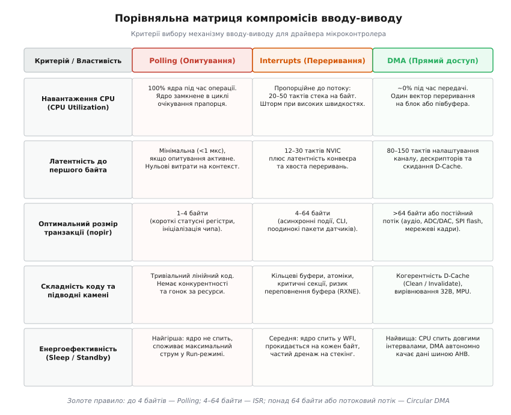

# Опитування, переривання чи DMA у драйвері

<preknowlist>
- [ARM Cortex-M](root:hw-arch/cortex-m) — архітектура ядра, системні шини AHB/APB, контролер NVIC.
- [Memory-mapped IO](root:hw-arch/memory-mapped-io) — доступ до регістрів периферії через адресний простір.
- [Переривання](root:hw-arch/interrupts) — апаратні лінії IRQ та збереження контексту.
- [Контролер DMA](root:hw-arch/dma-controller) — передача блоків даних без участі процесора.
</preknowlist>

Коли мікроконтролер обмінюється даними із зовнішніми мікросхемами через послідовні чи паралельні інтерфейси, вибір способу керування апаратним вузлом визначає продуктивність усієї системи. Використання циклічного очікування прапорця зайнятості для передачі довгого пакету заморожує роботу фонових алгоритмів та планувальника завдань. З іншого боку, генерація переривання на кожен окремий байт на високих швидкостях призводить до шторму переривань, коли процесор витрачає більшу частину тактової частоти на збереження регістрового контексту.

Контролер прямого доступу до пам'яті (DMA) передає дані паралельно з виконанням обчислень, але створює затримки первинного налаштування каналів і вимагає узгодження когерентності кешу на продуктивних процесорних ядрах. Вибір між опитуванням (polling), перериваннями (interrupts) та прямим доступом до пам'яті (DMA) ґрунтується на розмірі переданого блоку, допустимій затримці відповіді та енергетичному бюджеті пристрою.


*Порівняльна матриця компромісів: навантаження CPU, латентність, порогові розміри транзакцій та енергоспоживання для Polling, Interrupts і DMA.*

---

## Порівняльний аналіз трьох механізмів

Кожен із трьох підходів має чітко окреслені фізичні межі ефективності:

| Критерій | Polling (Опитування) | Interrupts (Переривання) | DMA (Прямий доступ) |
| :--- | :--- | :--- | :--- |
| **Навантаження процесора** | 100% на час передачі | Пропорційне кількості байтів | Мінімальне (лише старт і фініш) |
| **Латентність реакції** | Від нульової до неконтрольованої | Фіксована (12–30 тактів стекінгу) | Недетермінована (80–150 тактів налаштування) |
| **Енергоспоживання** | Максимальне (Run Mode) | Середнє (короткі пробудження) | Мінімальне (Race-to-Sleep / WFI) |
| **Складність драйвера** | Мінімальна (кілька рядків) | Середня (FIFO, критичні секції) | Висока (D-Cache, подвійні буфери) |
| **Оптимальний розмір** | **1–4 байти** | **4–64 байти** | **Понад 64 байти** |

---

## 1. Синхронне опитування (Polling)

Опитування полягає в тому, що процесорне ядро самостійно читає статусний регістр периферійного пристрою в циклі, очікуючи готовності передавача (`TXE`) або наявності нового байта у приймачі (`RXNE`).

Головна перевага методу — абсолютна простота та мінімальна латентність: ядро записує байт у регістр даних `DR` без витрат на виклик функцій обробників чи налаштування дескрипторів.

Головний недолік — повне блокування ядра на час транзакції. При швидкості порту 115 200 бод передача одного байта триває 86.8 мкс, що на частоті ядра 168 МГц дорівнює 14 584 тактам процесора. Увесь цей час ядро не виконує корисних обчислень і споживає максимальний струм у режимі Run Mode.

Обов'язковою вимогою до виробничого коду опитування є наявність захисту від апаратних збоїв за допомогою лічильника тактів DWT або системного таймера SysTick.

:::tabs
```c
#include <stdint.h>
#include <stdbool.h>

typedef struct {
    volatile uint32_t SR;
    volatile uint32_t DR;
} SimpleUart_t;

#define UART_SR_TXE (1u << 7)

bool Uart_PollSendByte(SimpleUart_t *uart, uint8_t byte, uint32_t timeout_ticks) {
    volatile uint32_t *DWT_CYCCNT = (volatile uint32_t *)0xE0001004;
    uint32_t start = *DWT_CYCCNT;

    while (!(uart->SR & UART_SR_TXE)) {
        if ((*DWT_CYCCNT - start) >= timeout_ticks) {
            return false; // Таймаут: периферія не відповідає
        }
    }
    uart->DR = byte;
    return true;
}
```
```cpp
#include <cstdint>
#include <expected>

struct SimpleUart {
    volatile uint32_t SR;
    volatile uint32_t DR;
};

inline constexpr uint32_t UART_SR_TXE = (1u << 7);

enum class UartError { Timeout };

class SimplePollingUart {
public:
    [[nodiscard]] static std::expected<void, UartError> send_byte(SimpleUart* uart, uint8_t byte, uint32_t timeout_ticks) noexcept {
        auto* dwt_cyccnt = reinterpret_cast<volatile uint32_t*>(0xE0001004);
        const uint32_t start = *dwt_cyccnt;

        while (!(uart->SR & UART_SR_TXE)) {
            if ((*dwt_cyccnt - start) >= timeout_ticks) {
                return std::unexpected(UartError::Timeout);
            }
        }
        uart->DR = byte;
        return {};
    }
};
```
:::

---

## 2. Апаратні переривання (Interrupt-Driven I/O)

Подієва модель вивільняє ядро від очікування: периферійний блок виставляє сигнал на лінії IRQ лише тоді, коли байт прибув або передавач звільнився. Контролер переривань NVIC зберігає регістровий контекст у стеку та передає керування в ISR.

Апаратний стекінг NVIC на ядрах Cortex-M3/M4/M7 займає рівно 12 тактів на вхід і 12 тактів на вихід. Разом із прологом компілятора та логікою кільцевого буфера сумарна ціна обробки кожного байта становить 35–50 тактів CPU.

Для ізоляції апаратного обробника від тривалих операцій парсингу даних використовують безблокуючий кільцевий буфер (Lock-Free SPSC FIFO) розміром $2^N$ байтів:

:::tabs
```c
#include <stdint.h>
#include <stdbool.h>

#define FIFO_SIZE 128
#define FIFO_MASK (FIFO_SIZE - 1)

typedef struct {
    uint8_t buffer[FIFO_SIZE];
    volatile uint32_t head;
    volatile uint32_t tail;
} FastFifo_t;

bool FastFifo_Put(FastFifo_t *f, uint8_t byte) {
    uint32_t h = f->head;
    if (((h + 1) & FIFO_MASK) == (f->tail & FIFO_MASK)) return false;
    f->buffer[h & FIFO_MASK] = byte;
    __asm volatile ("dmb" ::: "memory");
    f->head = h + 1;
    return true;
}
```
```cpp
#include <cstdint>
#include <cstddef>
#include <array>
#include <atomic>

template <size_t SizePowerOfTwo>
class FastLockFreeFifo {
    static constexpr size_t Mask = SizePowerOfTwo - 1;

private:
    std::array<uint8_t, SizePowerOfTwo> buffer_{};
    alignas(4) std::atomic<size_t> head_{0};
    alignas(4) std::atomic<size_t> tail_{0};

public:
    constexpr FastLockFreeFifo() noexcept = default;

    [[nodiscard]] bool put(uint8_t byte) noexcept {
        const size_t h = head_.load(std::memory_order_relaxed);
        const size_t t = tail_.load(std::memory_order_acquire);
        if ((h - t) >= SizePowerOfTwo) return false;
        buffer_[h & Mask] = byte;
        head_.store(h + 1, std::memory_order_release);
        return true;
    }
};
```
:::

Переривання ідеально підходять для асинхронних команд довжиною від 4 до 64 байтів. На потоках понад 100 кБ/с висока частота IRQ перевантажує процесор, спричиняючи деградацію продуктивності та витісняючи прикладні завдання.

---

## 3. Прямий доступ до пам'яті (DMA)

Контролер DMA функціонує як незалежний шинний майстер на матриці AHB. Він транспортує великі блоки даних між периферією та пам'яттю SRAM без участі процесорного ядра. Коли DMA активний, процесор може виконувати обчислення з пам'яті інструкцій Flash або переходити в режим сну WFI (Wait For Interrupt).

Для безперервних потоків (UART, SPI, ADC, I2S) застосовують подвійну буферизацію у циркулярному режимі (Circular Double-Buffering) з двома перериваннями:
- **Half-Transfer (HT):** DMA заповнив першу половину буфера, процесор обробляє її, поки DMA пише в другу;
- **Transfer Complete (TC):** DMA дійшов до кінця буфера і повертається на початок, а процесор обробляє другу половину.

Для приймання пакетів змінної довжини циркулярний DMA комбінують із перериванням простою лінії **UART IDLE Line**: апаратний блок USART генерує подію при відсутності активності в лінії понад один кадр, після чого драйвер зчитує залишковий лічильник `NDTR` і миттєво визначає розмір отриманого пакету без перезапуску каналу.

На ядрах Cortex-M7 з увімкненим L1 D-Cache контролер DMA не підтримує апаратного відстеження когерентності (Cache Snooping). Буфери DMA повинні мати вирівнювання `alignas(32)`, а перед читанням даних ядро зобов'язане виконати скидання кеш-ліній операцією `SCB_InvalidateDCache_by_Addr()`, щоб вичитати актуальні байти з фізичної SRAM.

---

## Інженерні правила вибору

1. **Короткі регістрові операції (1–4 байти):** використовуйте **Polling з апаратним таймаутом**. Час налаштування переривання чи DMA перевищує тривалість самої передачі.
2. **Асинхронні пакети помірної довжини (4–64 байти):** використовуйте **Interrupts з FIFO**. Забезпечує високу реактивність системи без завантаження ядра зайнятим очікуванням.
3. **Великі блоки та потокові дані (понад 64 байти):** використовуйте **Circular DMA з подвійною буферизацією**. Дозволяє процесору переходити в режим сну під час передачі (*Race-to-Sleep*), скорочуючи енергоспоживання у десятки разів.
