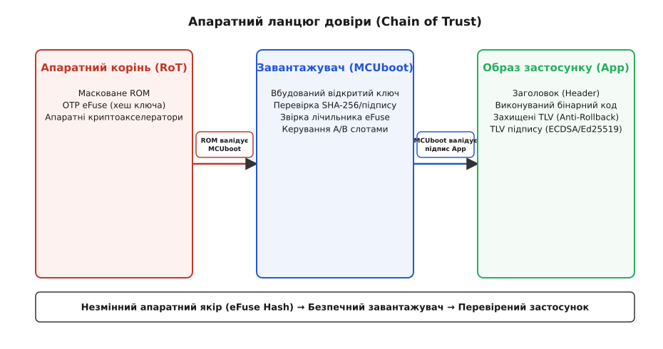
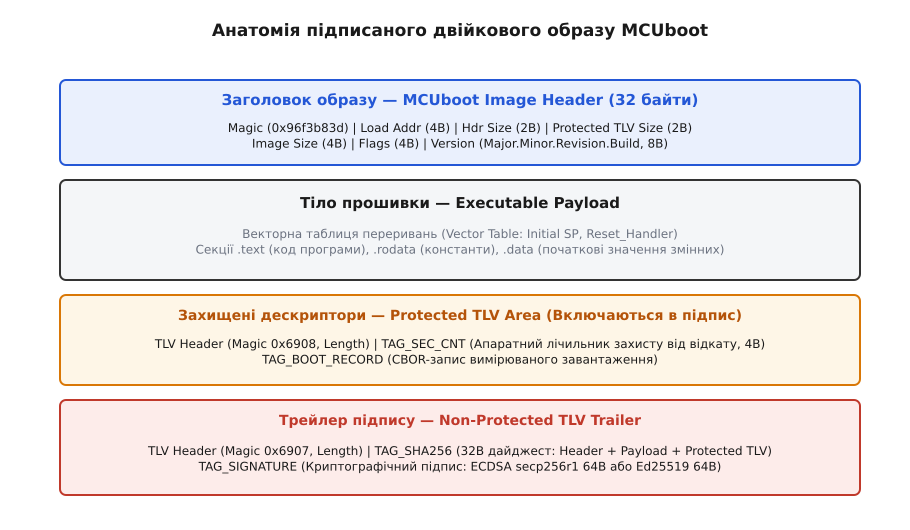
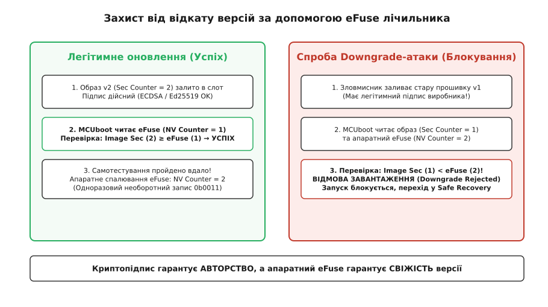
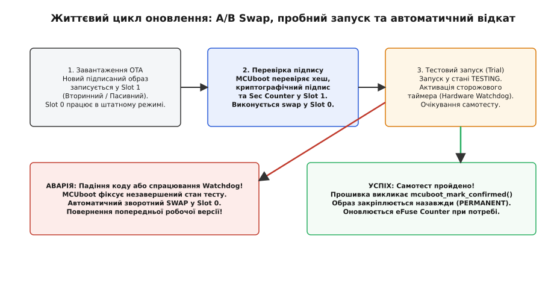

# Підписаний образ і захист від відкату

<preknowlist>
- [OTA-слоти та подвійний образ](root:sf-devices/ota-slots) — поділ флеш-пам'яті на активний і пасивний банки, механіка безпечного перемикання.
- [Secure boot і шифрування Flash](root:sf-security/firmware-secure-boot) — апаратний корінь довіри, різниця між автентичністю коду та таємністю даних.
- [Хеш і цифровий підпис](root:sf-security/hash-and-digital-signature) — математичний принцип пари відкритий/закритий ключ та автентифікація повідомлень.
- [Криптографічні хеш-функції](root:sf-security/cryptographic-hash) — властивості односторонніх функцій, стійкість до колізій і дайджест SHA-256.
- [Таблиця розділів у мікроконтролерах](root:sys-fw/partition-table) — розбиття адресної карти Flash на bootloader, app-слоти та NVS.
</preknowlist>

Коли промисловий контролер автоматики, розумний електролічильник чи польотний контролер дрона отримує файл нової прошивки через мережу, саме лише шифрування каналу зв'язку (TLS) не гарантує безпеки системи. Якщо зловмисник скомпрометує хмарний сервер оновлень, виконає підміну DNS-відповідей або перехопить трафік на корпоративному проксі-сервері, пристрій слухняно отримає та запише у Flash ворожий двійковий код. Захищений транспортний канал завершується в мережевому стеку; щойно байти лягли на флеш-пам'ять, захист з'єднання перестає існувати.

Транспортний протокол TLS автентифікує виключно *серверне з'єднання*, а не *автора двійкового коду*. Якщо прошивка не містить криптографічного підпису автора, будь-який суб'єкт, що контролює точку доставки або має локальний доступ до шини SPI чи інтерфейсу налагодження (SWD/JTAG), може записати в мікроконтролер модифікований бінарник. Ба більше: якщо застосувати симетричну схему автентифікації (наприклад, перевірку за спільним секретним ключем HMAC або паролем), виникає фатальна проблема масштабування. Зловмиснику достатньо розібрати один-єдиний екземпляр пристрою з партії у сто тисяч штук, випаяти мікросхему пам'яті й вичитати спільний ключ — після цього вся лінійка обладнання стає беззахисною перед генерацією підроблених оновлень.

Асиметрична криптографія докорінно змінює баланс сил. Закритий ключ (*Private Key*) ніколи не потрапляє на пристрої й зберігається виключно на захищеному складальному сервері виробника (усередині апаратного модуля безпеки, HSM). Пристрій несе у своїй пам'яті лише відкритий ключ (*Public Key*), за допомогою якого він може математично перевірити справжність підпису, але не здатний згенерувати підпис самостійно. Навіть якщо нападник повністю вичитає всю пам'ять мікроконтролера до останнього байта, він отримає лише відкритий ключ, який не дає жодної змоги підписати підроблений образ.

Ще підступнішою є загроза відкату версії коду — так звана атака зниження версії (*англ. downgrade attack* або *replay attack*). Припустімо, виробник випустив прошивку версії 1.0. Через пів року в її мережевому парсері виявили критичну вразливість переповнення буфера, яка дозволяє віддалене виконання довільного коду. Розробники терміново виправили дефект, зібрали версію 2.0 і розіслали її на всі пристрої. Зловмисник, що прагне захопити контроль над обладнанням, не створює власного шкідливого коду: він бере старий бінарний файл версії 1.0, який колись офіційно підписав сам виробник. Якщо завантажувач мікроконтролера перевіряє виключно валідність криптографічного підпису, версія 1.0 успішно пройде перевірку. Пристрій відкотиться на вразливу версію, і нападник миттєво застосує відомий експлойт.

Надійна система оновлення прошивки (*англ. Over-The-Air Update, OTA*) вимагає одночасного розв'язання двох незалежних завдань: доведення **автентичності автора** (цифровий підпис гарантує, що жоден байт не змінено сторонніми особами) та доведення **свіжості версії** (апаратний захист від відкату унеможливлює повторне встановлення застарілих вразливих образів).


*Апаратний ланцюг довіри: незмінне масковане ROM перевіряє завантажувач другого рівня за хешем ключа в OTP eFuse, а завантажувач верифікує цифровий підпис та лічильник свіжості прошивки застосунку.*

### Ланцюг довіри: від спаленого eFuse до образу застосунку

У комп'ютерній системі довіра не може виникати з програми, яку можна змінити або переписати. Якщо код, який здійснює перевірку підпису, сам зберігається у звичайній перезаписуваній флеш-пам'яті без апаратного контролю, нападник із доступом до шини SPI чи інтерфейсу налагодження (SWD/JTAG) може замінити цей код на функцію, яка завжди повертає успіх.

Основою безпечного запуску є **апаратний корінь довіри** (*англ. Root of Trust, RoT*). Він складається з двох компонентів, інтегрованих безпосередньо в кристал мікроконтролера на етапі виробництва кремнієвої пластини:

1. **Масковане первинне ROM (Primary Boot ROM):** енергонезалежна пам'ять, металізована на фаб-заводі. Її вміст є фізичною топологією кремнієвих транзисторів кристала. Її неможливо модифікувати жодними електричними сигналами чи програмними командами. Саме сюди апаратний лічильник команд процесора (`PC`) вказує після зняття сигналу скидання (`RESET`).
2. **Одноразово програмовані мікрозапобіжники (OTP eFuses):** матриця мікроскопічних полікремнієвих або металевих перемичок, які під дією підвищеної напруги пропалюються, незворотно змінюючи свій стан із логічного `0` на `1`. Спалений запобіжник неможливо повернути в початковий стан жодними програмними командами чи фізичним перепрограмуванням Flash.

Зберігати повний відкритий ключ виробника (наприклад, 256 або 512 бітів) у матриці eFuse буває надто марнотратно для кремнієвої площі мікроконтролерів. Тому інженери застосовують криптографічний компроміс: у блок eFuse пропалюють **SHA-256 дайджест відкритого ключа виробника** (Root Public Key Digest, 32 байти).

Коли живлення подається на чип, масковане ROM зчитує завантажувач другого рівня (*англ. Second Stage Bootloader*, наприклад MCUboot) із зовнішньої або внутрішньої Flash. У тіло завантажувача вбудовано відкритий ключ виробника. Первинне ROM виконує такі строго регламентовані кроки:
- зчитує відкритий ключ вендора, вбудований у двійковий образ завантажувача;
- обчислює апаратним криптографічним блоком SHA-256 хеш від цього відкритого ключа;
- зчитує 32-байтний еталонний дайджест із блоку OTP eFuse мікроконтролера;
- порівнює отриманий дайджест із еталоном за алгоритмом постійного часу (*Constant-Time Compare*), щоб уникнути атак витоку часу;
- якщо дайджести збіглися байт-у-байт, ROM використовує цей відкритий ключ для валідації цифрового підпису всього двійкового блоку завантажувача;
- за умови успішної криптографічної перевірки керування передається у завантажувач другого рівня.

Щоб запобігти апаратним атакам збою живлення (*Fault Injection / Voltage Glitching*), коли нападник за допомогою короткочасного імпульсу просідання напруги намагається змусити процесор пропустити умовну інструкцію переходу `BNE` (Branch if Not Equal), якісний код ROM-завантажувачів містить подвійні надлишкові перевірки (*Redundant State Variables*) та випадкові затримки.

Тепер завантажувач другого рівня стає довіреною ланкою. Він бере на себе валідацію власне образу застосунку (*Application Image*), що зберігається в основному або вторинному слоті оновлення. Жодна інструкція не передається на виконання центральному процесору, доки її цілісність, авторство та актуальність не підтверджені попередньою ланкою ланцюга.

### Анатомія підписаного образу: стандарт MCUboot

Звичайний виконуваний двійковий файл (`.bin`), отриманий після лінкування компілятором `objcopy`, містить лише сирий машинний код і константи. Такий файл не несе інформації про версію, тип цільової архітектури, зміщення точки входу, дайджести цілісності чи криптографічні підписи. Для організації безпечного завантаження відкритий стандарт **MCUboot** загортає скомпільований код у структурований контейнер.

Образ MCUboot складається з чотирьох обов'язкових зон, розміщених у Flash строго послідовно:

```text
+-------------------------------------------------------------+
| Заголовок образу: Image Header (32 байти)                   |
+-------------------------------------------------------------+
| Виконуваний двійковий код: Vector Table + Code + Constants  |
+-------------------------------------------------------------+
| Захищені дескриптори: Protected TLV Area (Magic 0x6908)     |
+-------------------------------------------------------------+
| Трейлер підпису: Non-Protected TLV Area (Magic 0x6907)      |
+-------------------------------------------------------------+
```


*Структура контейнера образу MCUboot: заголовок фіксованого розміру, виконуваний код програми, зона захищених метаданих TLV та кінцевий трейлер цифрового підпису.*

Перші 32 байти займає фіксований заголовок `image_header`. Він містить магічне число `0x96f3b83d`, яке дозволяє завантажувачу миттєво визначити наявність валідного образу в секторі Flash, адресу завантаження `ih_load_addr`, розмір заголовка `ih_hdr_size` (зміщення до виконуваного коду для правильного вирівнювання вектора переривань `VTOR`), сумарний розмір корисного коду `ih_img_size` та 8-байтну структуру семантичної версії `ih_ver` (`major.minor.revision.build`).

Одразу після виконуваного коду програми розміщується зона захищених метаданих — **Protected TLV** (*Type-Length-Value*). Ця область починається власним заголовком `image_tlv_info` із магічним числом `0x6908`. Усі записи всередині цієї зони (наприклад, `IMAGE_TLV_SEC_CNT` — 32-бітний апаратний лічильник захисту від відкату версії) **обов'язково входять до криптографічного хешу образу**. Це означає, що нападник не може підправити номер версії або лічильник безпеки в бінарнику: будь-яка модифікація хоча б одного біта у Protected TLV зробить підпис недійсним.

Наприкінці двійкового файлу знаходиться незахищений трейлер метаданих — **TLV Trailer** із магічним числом `0x6907`. У ньому зберігаються результати криптографічних обчислень:
- `IMAGE_TLV_SHA256` (тип `0x0010`): 32-байтний еталонний дайджест SHA-256, розрахований над масивом `[Image Header + Payload Code + Protected TLVs]`;
- `IMAGE_TLV_KEYHASH` (тип `0x0001`): 32-байтний хеш відкритого ключа підписувача (дозволяє системі підтримувати кілька ключів і швидко знаходити потрібний публічний ключ у пам'яті);
- `IMAGE_TLV_ECDSA256` (тип `0x0022`) або `IMAGE_TLV_ED25519` (тип `0x0024`): безпосередньо 64 байти двійкового цифрового підпису.

Повний перелік типів дескрипторів, прапорців та форматів двійкових структур детально наведено у довіднику [специфікація двійкового формату MCUboot та типів TLV](root:sf-devices/ota-image-signing/api-mcuboot-format.md).

### Криптографія підпису: ECDSA (secp256r1) проти Ed25519

Для цифрового підпису образів прошивки у вбудованих системах класичний алгоритм RSA (наприклад, RSA-2048 чи RSA-4096) поступово виходить із ужитку. Причина полягає в розмірі ключів і підписів: підпис RSA-3072 займає 384 байти, а відкритий ключ разом із модулем — сотні байтів. Крім того, математичні операції піднесення до степеня за модулем вимагають значного обсягу оперативної пам'яті (SRAM) для розміщення великих чисел (*bignum*), чого в мікроконтролерах із 32–64 КБ RAM часто бракує.

Сучасні вбудовані платформи базуються на криптографії на еліптичних кривих (*Elliptic Curve Cryptography, ECC*). Два головні алгоритми в індустрії — це **ECDSA** (на кривій NIST P-256 / secp256r1) та **Ed25519** (EdDSA на скрученій кривій Едвардса Curve25519).

```text
+----------------------+--------------------------+--------------------------+
| Властивість          | ECDSA (secp256r1)        | Ed25519 (Curve25519)     |
+----------------------+--------------------------+--------------------------+
| Розмір ключа (PubKey)| 64 байти (x, y)          | 32 байти (стиснута Y)    |
| Розмір підпису       | 64 байти (r, s)          | 64 байти (R, S)          |
| Рівень стійкості     | ~128 біт                 | ~128 біт                 |
| Генерація випадкового| Вимагає ідеального TRNG  | Детермінована (RFC 8032) |
| числа k при підписі  | (Повтор k = злив ключа!) | Не залежить від RNG      |
| Стійкість до атак по | Залежить від реалізації  | Повні закони додавання,  |
| сторонніх каналах    | (є особливі точки)       | сталий час за замовчанням|
| Апаратне прискорення | Є в більшості чипів      | З'являється в нових MCU  |
|                      | (STM32 PKA, ESP32 ECC)   | (ESP32-C6, NRF5340)      |
+----------------------+--------------------------+--------------------------+
```

Принципова різниця між ними полягає у формуванні підпису та вимогах до обчислювальної стабільності.

**ECDSA (NIST P-256):** крива короткої форми Вейєрштрасса `y² = x³ - 3x + b (mod p)`. Алгоритм підпису вимагає генерації одноразового таємного числа `k` (*nonce*) для кожного підпису. Якщо генератор випадкових чисел (*TRNG*) на складальному сервері збійне і згенерує однакове `k` для двох різних версій прошивки, зловмисник, знаючи два підписи `(r, s₁)`, `(r, s₂)`, елементарною алгебраїчною дією обчислює приватний ключ виробника:

```
d = (s₁·h₂ - s₂·h₁) ÷ (r·(s₂ - s₁)) (mod n)
```

Навіть незначний статистичний перекіс у генераторі випадкових чисел (наприклад, якщо один чи два старших біти числа `k` завжди дорівнюють нулю) дозволяє відновити закритий ключ за допомогою решітчастих алгоритмів розв'язання задачі прихованого числа (Hidden Number Problem). Щоб усунути цей ризик для ECDSA, застосовують стандарт RFC 6979, де `k` обчислюється детерміновано через HMAC від приватного ключа та хешу прошивки.

**Ed25519:** схема цифрового підпису Едвардса на кривій `-x² + y² = 1 - (121665/121666)·x²·y²` над полем `2²⁵⁵ - 19`. Алгоритм Ed25519 детермінований за своєю конструкцією: замість випадкового числа `k` використовується криптографічний хеш SHA-512 від секретного зерна та самого повідомлення. У ньому немає виняткових точок (додавання точок працює за єдиною універсальною формулою для будь-яких координат), що гарантує захист від атак за часом виконання (*timing side-channel attacks*) без спеціальних програмних уповільнювачів. Крім того, верифікація Ed25519 у чистому C на процесорах ARM Cortex-M4 виконується надзвичайно швидко навіть без апаратних криптоакселераторів.

Принцип верифікації для обох алгоритмів підпорядковується парадигмі **Hash-then-Sign**:
1. Завантажувач зчитує весь образ блоками (наприклад, по 512 або 4096 байтів) і оновлює контекст SHA-256.
2. Отриманий 32-байтний дайджест звіряється з полем `IMAGE_TLV_SHA256`.
3. Функція криптографічної верифікації приймає відкритий ключ вендора, 32-байтний хеш і 64-байтний підпис. Якщо результат повертає `VALID`, автентичність образу доведено.

### Апаратний захист від відкату: монотонні лічильники eFuse

Перевірки одного лише криптографічного підпису недостатньо для захисту пристрою від атак класу *Downgrade*. Якщо виробник підписав версію 1.0, цей підпис залишається математично валідним вічно. Щоб заборонити пристрою повертатися до застарілих версій, застосовують **механізм захисту від відкату** (*Anti-Rollback Protection*).


*Механізм блокування відкату: при встановленні v2 перевіряється умова Image Sec ≥ eFuse NV. Після успіху eFuse пропалюється до значення 2. Подальша спроба підсунути стару підписану прошивку v1 блокується завантажувачем.*

#### Семантична версія проти лічильника безпеки

У заголовку образу присутня семантична версія `ih_ver` (`Major.Minor.Patch.Build`). Проте використовувати семантичну версію для апаратного блокування відкату неприпустимо з двох причин:
- Ресурс одноразових запобіжників eFuse на кристалі суворо обмежений (зазвичай від 32 до 128 бітів на весь життєвий цикл виробу).
- Не кожне оновлення прошивки виправляє критичні вразливості безпеки. Якщо реліз містить лише косметичне виправлення графічного інтерфейсу (наприклад, версія 1.0.1 замість 1.0.0), спалювати апаратний запобіжник безглуздо — це позбавить користувача можливості відкотитися на 1.0.0 у разі незначних багів.

Для цього стандарт MCUboot вводить окреме поле в захищеній зоні TLV — **монотонний лічильник безпеки** (`IMAGE_TLV_SEC_CNT`). Цей лічильник інкрементується розробниками **тільки тоді**, коли нове оновлення закриває критичну діру в безпеці або змінює схему шифрування, роблячи запуск усіх попередніх бінарників небезпечним для системи.

#### Унітарне кодування в eFuse (Thermometer Coding)

У звичайній флеш-пам'яті чи RAM число 4 записується як `0x00000004`. Але у Flash зловмисник може переписати сектор назад. У кристалі мікроконтролера регістр eFuse є односпрямованим: біт із `0` можна перевести в `1`, але повернути `1` назад у `0` неможливо.

Тому лічильник безпеки в eFuse представляють у вигляді унітарного коду (*термометричного кодування*):

```text
Лічильник безпеки = 0:  0b0000_0000_0000_0000 (0 бітів пропалено)
Лічильник безпеки = 1:  0b0000_0000_0000_0001 (1 біт пропалено)
Лічильник безпеки = 2:  0b0000_0000_0000_0011 (2 біти пропалено)
Лічильник безпеки = 3:  0b0000_0000_0000_0111 (3 біти пропалено)
Лічильник безпеки = N:  N молодших бітів встановлено в 1
```

Кількість одиничних бітів у регістрі eFuse позначає поточний мінімально допустимий рівень безпеки пристрою (`HW_SEC_CNT`). Деякі сучасні мікроконтролери (наприклад, лінійки STM32H5/H7 із блоком Secure User Flash або ESP32-S3 з блоком eFuse Controller) мають вбудовані апаратні схеми контролю парності та коди корекції помилок (ECC), які гарантують надійне зчитування навіть при деградації кремнію з часом.

Завантажувач під час старту порівнює значення з образу та регістру чипа:

```
Image_Security_Counter >= Hardware_eFuse_Counter
```

Якщо образ має лічильник менший, ніж поточне значення в апаратному eFuse, завантажувач негайно перериває процес, маркує слот як недійсний і переходить у режим аварійного відновлення.

#### Залізне правило пропалювання запобіжників

> ⚠️ **Критичне правило безпеки:** Ніколи не пропалюйте апаратний eFuse під час завантаження або первинного запису образу у пасивний слот!
> Якщо спалити eFuse до значення `2` одразу після копіювання нової прошивки, а нова прошивка виявиться аварійною (наприклад, впадає в `HardFault` на першій секунді через несумісність із ревізією заліза), мікроконтролер більше **не зможе повернутися на стару робочу версію 1**, бо її `Security Counter = 1` буде заблоковано щойно спаленим eFuse. Пристрій перетвориться на «цеглину».
>
> Апаратний eFuse пропалюється **виключно з коду самого нового застосунку**, лише після того, як нова прошивка успішно запустилася, пройшла початкове самотестування периферії, зв'язалася із сервером і підтвердила свою працездатність викликом `boot_set_confirmed()`.

### Двоетапна атомарна прошивка та A/B Swap

Безпечне оновлення вимагає не лише криптографічної перевірки, а й відмовостійкої заміни образу в умовах раптового зникнення живлення. У мікроконтролерах без блоку керування пам'яттю (MMU) код виконується безпосередньо з Flash за фіксованими фізичними адресами (*Execute-In-Place, XIP*).

MCUboot організовує Flash у вигляді трьох ключових розділів:
1. **Первинний слот (Slot 0 / Primary):** розташований за фіксованою адресою виконання (наприклад, `0x08020000`). Процесор завжди завантажується та виконує код із цього слота.
2. **Вторинний слот (Slot 1 / Secondary):** пасивний розділ такого самого розміру. Сюди фоновий мережевий процес OTA записує новий підписаний файл образу.
3. **Розділ підкачки (Scratch Partition):** невеликий розділ розміром в один флеш-сектор (наприклад, 4 або 32 КБ), який використовується як транзакційний буфер для атомарного посекторного обміну (*Swap*) між Slot 0 та Slot 1.


*Життєвий цикл A/B оновлення: завантаження у Slot 1, перевірка підпису, своп у Slot 0, тестовий старт під наглядом Watchdog. Успіх — закріплення та пропалювання eFuse; збій — автоматичний зворотний своп на старий робочий образ.*

Механізм двоетапного перемикання гарантує безперервність роботи:

1. **Завантаження та попередній аудит:** Застосунок приймає пакети оновлення по Wi-Fi/LTE і пише їх у Slot 1. Поточна прошивка у Slot 0 продовжує безперебійно керувати об'єктом.
2. **Валідація образу завантажувачем:** Пристрій ініціює перезавантаження. MCUboot перевіряє цілісність, SHA-256 хеш, цифровий підпис і лічильник безпеки образу в Slot 1. Якщо підпис недійсний — Slot 1 стирається, а старий Slot 0 запускається без змін.
3. **Атомарний своп (Image Swap using Scratch):** Завантажувач посекторно міняє місцями вміст Slot 0 та Slot 1 через буфер Scratch:
   - Сектор N зі Slot 0 копіюється у розділ Scratch.
   - Сектор N зі Slot 1 записується на місце сектора N у Slot 0.
   - Дані зі Scratch записуються у сектор N розділу Slot 1.
   - Оновлюється статусний маркер кроку в трейлері слота.
   Навіть якщо живлення вимкнеться посеред копіювання, метадані в кінці секторів дозволяють завантажувачу після рестарту завершити транзакцію з точного місця обриву.
4. **Пробний запуск (Trial Boot):** Завантажувач передає керування новому образу в Slot 0, виставляючи статус `TESTING`. Одночасно активується апаратний сторожовий таймер (*Hardware Watchdog*).
5. **Розгалуження результату:**
   - **Сценарій успіху:** Новий образ запускається, перевіряє життєздатність датчиків та зв'язку, після чого викликає функцію `mcuboot_mark_confirmed()`. Прапорець `Image OK` записується у трейлер слота. Образ стає постійним. Якщо `Security Counter` у новому образі вищий за апаратний eFuse, застосунок викликає драйвер захищеного пропалювання eFuse.
   - **Сценарій аварії:** Якщо новий образ містить фатальну помилку, зависає або викликає паніку ядра до підтвердження, спрацьовує сторожовий таймер Watchdog і скидає процесор. Під час наступного старту MCUboot бачить статус `TESTING` без позначки `Image OK`. Завантажувач констатує збій і автоматично виконує зворотний своп (*Revert Swap*), повертаючи перевірену стару версію зі Slot 1 у Slot 0.

### Повна реалізація криптографічного перевізника образу та анти-відкату

Наведений нижче модуль демонструє повний цикл низькорівневого розбору двійкового образу: перевірку магічних чисел, захист від переповнення розмірів, поблокове обчислення SHA-256, пошук обов'язкових TLV-дескрипторів, верифікацію лічильника безпеки проти апаратного eFuse та перевірку підпису ECDSA/Ed25519.

:::tabs
:::code ota-image-signing-d/c/main.c
:::code ota-image-signing-d/cpp/main.cpp
:::

Код на C реалізує строго детермінований аналіз без використання динамічної пам'яті (`malloc`), що критично для завантажувачів у режимі жорсткої нестачі SRAM. Варіант на C++ використовує безпечні діапазони `std::span` та тип результату `std::expected` (C++23) для унеможливлення виходу за межі буфера та надійного повернення помилок без використання механізму винятків.

> 🔧 **Навіщо це.** Якщо ви розробляєте підключений пристрій комерційного чи промислового рівня, безпечний OTA-завантажувач — це ваш страховий поліс. Підпис гарантує, що жоден зловмисник не перетворить партію контролерів на ботнет. Апаратний eFuse лічильник гарантує, що пристрій не вдасться повернути до старої версії із закритими дірами. А двоетапний A/B Swap із пробним запуском та сторожовим таймером гарантує, що навіть за збою живлення чи помилки в новому коді прилад самостійно повернеться до робочого стану без виїзду сервісної бригади з програматором.

### Підсумок

Криптографічний захист прошивки у вбудованих системах тримається на чотирьох взаємопов'язаних засадах:
1. **Апаратний якір довіри (Root of Trust):** Масковане первинне ROM звіряє відкритий ключ завантажувача з незмінним дайджестом, зашитим у кристалі в блоці OTP eFuse.
2. **Цифровий підпис (ECDSA / Ed25519):** Завантажувач MCUboot обчислює SHA-256 хеш від заголовка, корисного коду програми та захищених метаданих TLV, після чого математично підтверджує автентичність образу за допомогою публічного ключа виробника.
3. **Апаратний захист від відкату (Anti-Rollback):** Монотонний лічильник безпеки в захищеному блоці TLV звіряється з апаратним eFuse лічильником чипа, унеможливлюючи повернення до старих вразливих релізів.
4. **Атомарний A/B Swap і пробний запуск:** Новий образ тестується під наглядом сторожового таймера Watchdog; апаратний eFuse пропалюється лише після повного успіху самодіагностики, а в разі зависання завантажувач миттєво відкочує систему на попередню робочу прошивку.
