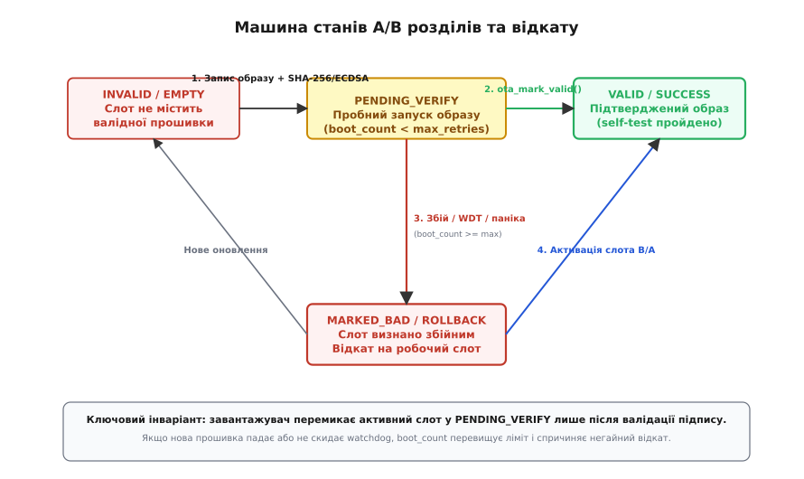
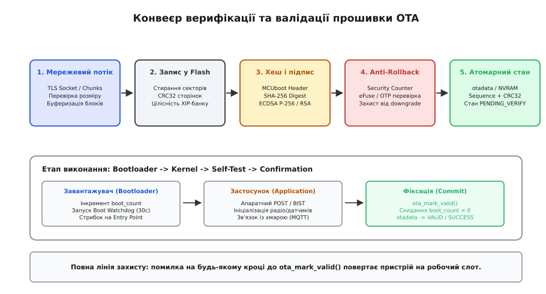

# Відкат OTA: відмовостійка архітектура оновлення прошивки

<preknowlist>
- [OTA-слоти та подвійний образ](root:sf-devices/ota-slots) — поділ флеш-пам'яті на активний і пасивний банки, механіка безпечного перемикання.
- [Сторожовий таймер Watchdog](root:sf-devices/watchdog) — апаратний таймер переривань і перезавантаження при зависанні або збої процесора.
- [Стратегія перезавантажень](root:sf-devices/reboot-strategy) — класифікація причин скидання, обробка аварійних зупинок і стан безпечного режиму.
- [Лічильник перезавантажень](root:sf-devices/reboot-counter) — збереження діагностики та виявлення циклів краху (crash loops) між скиданнями.
- [Підписаний образ і захист від відкату](root:sf-devices/ota-image-signing) — криптографічна автентифікація прошивки та запобігання атакам зниження версії через eFuse.
- [Таблиця розділів у мікроконтролерах](root:sys-fw/partition-table) — розбиття флеш-пам'яті на завантажувач, таблицю метаданих і слоти застосунків.
- [Цілісність запису в енергонезалежну пам'ять](root:sf-data/write-integrity) — атомарне оновлення структур даних, валідація CRC32 та захист від знеструмлення.
</preknowlist>

Коли автономний промисловий контролер насосної станції, встановлений у підземному колекторі за двісті кілометрів від найближчого сервісного центру, отримує оновлення прошивки «по повітрю» (*Over-The-Air, OTA*), будь-яка прихована помилка в коді ініціалізації периферії перетворює робочий вузол на мертву «цеглину». Якщо новий бінарний файл завантажується без жодної похибки в контрольних сумах і успішно проходить криптографічну перевірку підпису, але містить логічну помилку в налаштуванні дільників тактової частоти PLL, процесор застрягає в апаратному винятку `HardFault` ще до того, як запустяться мережевий стек або сервіс віддаленого налагодження. Без фізичного підключення апаратного програматора SWD чи JTAG відновити такий пристрій неможливо, а вартість термінового виїзду аварійної бригади багаторазово перевищує ціну самого електронного модуля.

Цілісність отриманого двійкового файлу на рівні SHA-256 чи цифрового підпису ECDSA гарантує виключно те, що образ передано без спотворень і підписано автентичним закритим ключем розробника. Вона жодним чином не засвідчує, що скомпільований машинний код здатний успішно функціонувати в реальному апаратному середовищі конкретного екземпляра пристрою: чи не переповнить стек нова версія бібліотеки TLS, чи відповідає зовнішній датчик температури новому таймінгу шини I2C, чи підніметься з'єднання з хмарним брокером MQTT за умов нестабільного рівня сигналу антени. Якщо система завантаження беззастережно перемикає активний покажчик на щойно записаний образ, перша ж фатальна помилка під час виконання позбавляє пристрій зв'язку зі світом назавжди.

Відмовостійка інженерна архітектура оновлення вимагає чіткого розмежування двох незалежних подій: факту **запису** двійкового коду у пам'ять та факту його **остаточного затвердження**. Новий виконуваний образ має запускатися виключно у випробувальному стані (*Trial Run*), перебуваючи під безперервним апаратним наглядом сторожового таймера та збереженого в енергонезалежній пам'яті лічильника невдалих стартів. Якщо свіжа прошивка не здатна протягом наперед визначеного часового вікна довести власну життєздатність і явно підтвердити успішний запуск, системний завантажувач зобов'язаний автоматично визнати цей образ збійним і повернути керування на попередній, гарантовано працездатний слот пам'яті. Такий захисний контур зветься **відмовостійким відкатом** (*англ. Fail-Safe Rollback*).


*Машина станів завантажувача: новий образ стартує у випробувальному стані PENDING_VERIFY, і лише після проходження внутрішніх самотестів застосунок закріплює його викликом ota_mark_valid(); будь-який збій або спрацювання watchdog повертає активність на старий перевірений слот.*

### Фізика Flash-пам'яті та природа прихованих відмов

Щоб зрозуміти, чому традиційні наївні методи оновлення прошивки призводять до фатальних відмов, необхідно звернутися до фізичних принципів функціонування енергонезалежної пам'яті NOR Flash. На відміну від статичної оперативної пам'яті (SRAM), де кожен біт можна довільно та незалежно перезаписати у будь-який момент часу, комірки NOR Flash побудовані на польових транзисторах із плаваючим затвором (*Floating Gate*) або пасткою заряду (*Charge Trap*).

Фізичний процес програмування комірки полягає в інжекції електронів крізь тунельний діелектрик на плаваючий затвор за рахунок ефекту інжекції гарячих носіїв (*Hot Carrier Injection*). Накопичений на затворі негативний заряд підвищує порогову напругу відкриття транзистора, що під час зчитування інтерпретується внутрішньою логікою як логічний `0`. Початковим станом стертої комірки є відсутність заряду на плаваючому затворі, що відповідає логічній `1`. Таким чином, процес запису інформації може лише переводити біти зі стану `1` у стан `0`.

Зворотний перехід — переведення бітів зі стану `0` у стан `1` — вимагає повного видалення електронів із плаваючого затвора. Це досягається створенням високої напруженості електричного поля та квантовомеханічним тунелюванням електронів за законом Фаулера-Нордгейма (*Fowler-Nordheim Tunneling*). Фізична структура кристала NOR Flash не дозволяє подавати високу напругу стирання індивідуально на окремий байт чи 32-бітне слово. Високовольтна шина керування об'єднує підкладки тисяч транзисторів, тому операція прання завжди виконується неподільними великими блоками комірок — секторами (типово 4096 байтів) або великими банками (32 КБ, 64 КБ або 128 КБ).

Звідси випливає фундаментальне апаратне обмеження вбудованих систем: неможливо змінити навіть один байт у скомпільованому коді програми без попереднього повного стирання всього сектора, у якому цей байт розташований. Якщо система намагається перезаписати прошивку «на місці» (*In-Place Overwrite*) у той самий фізичний банк пам'яті, з якого процесор у цей момент зчитує інструкції чинного коду (*Execute-in-Place, XIP*), виникає апаратне блокування шини пам'яті. Контролер Flash переходить у режим високовольтного програмування або стирання, припиняючи обслуговування запитів на зчитування команд. Процесорне ядро Cortex-M негайно генерує апаратний виняток `BusFault` або зависає в нескінченному стані очікування шини (*Bus Lockup*).

Ще підступнішим явищем є **метастабільний стан комірки** при раптовому знеструмленні під час циклу програмування сторінки. Якщо напруга живлення мікроконтролера просідає нижче допустимого рівня в процесі інжекції електронів, на плаваючому затворі накопичується неповний, проміжний рівень заряду. Така комірка перебуває на межі порогової напруги компаратора. За кімнатної температури (+25°C) та номінальної напруги 3.3 В внутрішній підсилювач зчитування розпізнає цей стан як логічний `0`, і розрахунок контрольної суми образу завершиться успіхом. Проте, коли пристрій нагріється під час тривалої роботи в шафі автоматики до +70°C або напруга живлення просяде до 2.8 В під час старту стільникового передавача, тепловий рух електронів змістить порогову напругу, і комірка раптово прочитається як `1`. Інструкція процесора спотвориться, ядро спробує виконати неіснуючий код (`Undefined Instruction`) і звалиться в аварійний виняток `HardFault`.

Окрім ефекту витоку заряду, у масивах Flash-пам'яті високої щільності проявляється ефект **паразитного підзаряду сусідніх комірок** (*Write Disturb / Program Disturb*). Коли висока напруга програмування багаторазово прикладається до обраного рядка слів, паразитна ємнісна напруженість впливає на сусідні нестерті комірки того самого сектора, поступово зміщуючи їхню порогову напругу. Якщо вбудована система виконує часті дрібні записи без періодичного перестирання всього сектора, у раніше збереженому машинному коді з'являються спонтанні спотворення бітів, що провокує раптові аварії процесора під час виконання програми.


Сучасні мікроконтролери (наприклад, лінійки STM32H7, TI MSPM0, NXP i.MX RT) інтегрують апаратні блоки виявлення та корекції помилок (ECC), які обчислюють, наприклад, 8 бітів коду Хеммінга на кожні 64 біти даних Flash. Якщо прошивка зазнала часткового пошкодження або метастабільного запису, апаратний блок ECC контролера пам'яті виявляє подвійну нескориговану помилку (*Double-Bit Detection*) та негайно генерує немасковане переривання `NMI` або блокує шину Flash, спричиняючи скидання ядра.

Окрім фізичних дефектів пам'яті, головним джерелом відмов є **логічні та системні помилки нового коду**:

1. **Збій конфігурації генераторів тактування та PLL:** якщо у новій версії прошивки змінено коефіцієнти множення частоти системної шини або активовано зовнішній кварцовий резонатор HSE, який не запускається на платах певної ревізії через більшу паразитну ємність доріжок, ядро застрягає в нескінченному циклі очікування прапорця стабілізації генератора (`while (!(RCC->CR & RCC_CR_HSERDY));`).
2. **Дефіцит оперативної пам'яті (Heap / Stack Exhaustion):** якщо нова версія застосунку додає кілька структур даних або розширює розмір буферів мережевого стека TLS, обсяг вільної пам'яті SRAM вичерпується. Перший же виклик `malloc()` під час ініціалізації завдань RTOS повертає `NULL`. Якщо код не перевіряє результат виділення пам'яті на нуль, відбувається розіменування нульового вказівника і процесор падає в `MemManage_Handler` або `HardFault`.
3. **Мережеві регресії та помилки криптографічних сертифікатів:** прошивка успішно піднімає ядро, але через неправильно скомпільований кореневий сертифікат CA, пошкоджену конфігурацію точки доступу або помилку в парсері AT-команд стільникового модема не може встановити з'єднання з хмарою. Пристрій працює локально, але назавжди втрачає мережеву зв'язність, унеможливлюючи завантаження наступного виправленого релізу.
4. **Несумісність структури енергонезалежних налаштувань (NVS / EEPROM Schema Mismatch):** нова версія коду очікує нову версію структури таблиць у NVS, некоректно виконує міграцію старих ключів і зазнає панічного перезапуску при зчитуванні першого ж обов'язкового калібрувального коефіцієнта.

Якщо система завантаження не володіє логікою автоматичного відкату, кожен із цих дефектів перетворює мікроконтролер на генератор нескінченних перезавантажень (*Crash Loop*) або занурює його у глухе зависання. Сторожовий таймер скидатиме процесор кожні кілька секунд, завантажувач знову і знову обиратиме збійний образ, процесор повторно падатиме в `HardFault`, і батарейне живлення виснажиться за лічені години без найменшого шансу на відновлення.

### Архітектура A/B розділів: чергування банків та прив'язка адрес

Для створення надійної системи оновлення весь адресний простір енергонезалежної Flash-пам'яті мікроконтролера розбивається щонайменше на три обов'язкові функціональні зони: область первинного завантажувача (*Bootloader*), сектор метаданих стану завантаження (*Boot Metadata / otadata*) та два однакових за розміром симетричних слоти для зберігання виконуваного коду застосунку — `Slot_A` (або `ota_0`) та `Slot_B` (або `ota_1`).

```text
+-----------------------------------------------------------------------------------+
| Bootloader | Boot Metadata (2x) | Application Slot A (Bank 1) | Application Slot B (Bank 2) |
| (0x08000000) (0x08008000..0x08009FFF) (0x08010000..0x080FFFFF)   (0x08100000..0x081FFFFF)   |
+-----------------------------------------------------------------------------------+
```

У мікроконтролерах без повноцінного блоку керування пам'яттю (MMU), де інструкції програми виконуються процесором безпосередньо з Flash-пам'яті (*Execute-in-Place, XIP*), виникає фундаментальна апаратна перешкода: абсолютні адреси підпрограм, вектори переривань та вказівники на статичні змінні лінкуються компілятором під жорстко фіксовану базову фізичну адресу. Якщо програму скомпільовано для розміщення за адресою `0x08010000` (початок `Slot_A`), її неможливо безпосередньо виконати з адреси `0x08100000` (`Slot_B`), оскільки всі інструкції абсолютних переходів `BL` та адреси в таблиці векторів продовжуватимуть вказувати на пам'ять першого слота.

В інженерній практиці розробки вбудованих систем застосовують три основні методи подолання проблеми прив'язки адрес:

1. **Апаратне перемикання банків (Dual-Bank Flash Memory Remapping):** сучасні мікроконтролери середнього та вищого класу (наприклад, STM32H7, STM32F7, STM32G4) містять апаратну підтримку двох фізично незалежних банків Flash з бітами конфігурації `nDBANK` та `FB_MODE` (Flash Bank Mode) в Option Bytes. Зміна значення біта `FB_MODE` на апаратному рівні міняє місцями базові адреси Банку 1 та Банку 2: фізичний Банк 2 починає відображатися за нульовою базовою адресою `0x08000000`, а Банк 1 переміщується на зміщення `0x08100000`. Обидва двійкові образи компілюються під одну й ту саму адресу `0x08000000`, а завантажувач перемикає робочий банк записом одного керуючого регістра Flash-контролера.
2. **Віртуальна трансляція адрес через MMU/MPU (ESP32 Flash Cache MMU):** мікроконтролери сімейства ESP32 володіють апаратним блоком таблиці сторінок Flash Cache MMU, який динамічно транслює віртуальний адресний простір інструкцій процесора `0x400D0000..0x40FFFFFF` на будь-які фізичні зміщення зовнішньої мікросхеми SPI Flash. Завантажувач конфігурує таблицю дескрипторів MMU на фізичний початок обраного слота, що дозволяє виконувати однаковий двійковий код без необхідності релокації.
3. **Поблочний обмін завантажувачем (MCUboot Sector Swap):** якщо мікроконтролер (наприклад, Cortex-M0/M3) позбавлений апаратного ремепінгу і має єдиний неперервний банк пам'яті, застосовують механізм поблочного фізичного обміну секторами (*Sector Swap*). Новий образ завжди записується у вторинний слот, після чого завантажувач копіює його секторами в основний слот виконання, одночасно переносячи стару робочу версію у вторинний слот як резервну копію для можливого зворотного відкату.

Незалежно від обраного апаратного підходу незмінним залишається ключовий принцип **повної симетрії та ізоляції**: активний слот, з якого в цей момент виконується програма, є абсолютно недоторканним, а запис нового двійкового коду здійснюється виключно у пасивний банк пам'яті.

### Енергонезалежні метадані завантаження (Boot Metadata)

Щоб завантажувач міг однозначно визначити, з якого саме слота слід розпочинати завантаження, скільки спроб старту вже було використано і чи перебуває поточний образ у випробувальному стані, система повинна зберігати компактну структуру службових параметрів. Оскільки оновлення цих параметрів відбувається безпосередньо під час роботи пристрою в польових умовах, операція запису метаданих має володіти властивістю абсолютної стійкості до знеструмлення (*Power-Loss Atomic Commitment*).

Прямий перезапис одного фіксованого сектора Flash є неприпустимим: якщо напруга живлення зникне в момент, коли сектор уже стерто, але нові дані ще не записано, вміст метаданих перетвориться на масив байтів `0xFF`, завантажувач втратить інформацію про активний слот, і система заблокується.

Для гарантування повної відмовостійкості застосовують **двосекторну журнальну схему з чергуванням** (*Dual-Sector Ping-Pong Metadata*):
- Під службові дані виділяються два окремі фізичні сектори: `Metadata_Sector_0` та `Metadata_Sector_1`.
- Кожен запис містить магічний маркер (*Magic*), монотонно зростаючий лічильник послідовності (*Sequence Counter / Epoch*), ідентифікатор активного слота, статус його валідації, лічильник залишкових спроб запуску та контрольну суму CRC32.
- Під час кожного оновлення стану новий запис формується з номером послідовності `Sequence = Previous_Sequence + 1` і записується у той сектор, який наразі містить застарілі дані або є пошкодженим.
- Завантажувач після кожного апаратного скидання зчитує обидва сектори, перевіряє їхні контрольні суми CRC32 і приймає за істину той запис, який є цілісним та має найбільше значення лічильника послідовності.

:::tabs
```c
#include <stdint.h>
#include <stdbool.h>

#define BOOT_METADATA_MAGIC 0x544F4F42UL /* ASCII "BOOT" */

typedef enum {
    OTA_SLOT_STATE_EMPTY          = 0xFF, /* Слот стертий або не містить валідного образу */
    OTA_SLOT_STATE_UNVALIDATED    = 0x01, /* Новий образ записано, очікує пробного запуску */
    OTA_SLOT_STATE_VALID          = 0x02, /* Прошивку підтверджено застосунком як робочу */
    OTA_SLOT_STATE_MARKED_BAD     = 0x03  /* Прошивка зазнала краху під час випробування */
} ota_slot_state_t;

typedef struct {
    uint32_t magic;               /* Магічний маркер валідності структури (0x544F4F42) */
    uint32_t sequence_number;     /* Монотонний лічильник транзакцій */
    uint8_t  active_slot;         /* Ідентифікатор активного слота: 0 = Slot_A, 1 = Slot_B */
    uint8_t  slot_state;          /* Поточний стан активного слота (ota_slot_state_t) */
    uint8_t  boot_attempts_left;  /* Залишок дозволених спроб запуску */
    uint8_t  max_boot_attempts;   /* Початковий ліміт спроб (типово 3) */
    uint32_t image_version;       /* Числовий монотонний номер версії образу */
    uint32_t image_crc;           /* Контрольна сума всього тіла прошивки */
    uint32_t header_crc;          /* Контрольна сума CRC32 структури метаданих */
} __attribute__((packed)) boot_metadata_t;
```
```cpp
#include <cstdint>

namespace bootloader {

enum class SlotId : uint8_t {
    SlotA = 0,
    SlotB = 1,
    None  = 0xFF
};

enum class SlotState : uint8_t {
    Empty        = 0xFF,
    Unvalidated  = 0x01,
    Valid        = 0x02,
    MarkedBad    = 0x03
};

struct [[gnu::packed]] BootMetadata {
    uint32_t  magic{0x544F4F42UL};
    uint32_t  sequenceNumber{0};
    SlotId    activeSlot{SlotId::SlotA};
    SlotState slotState{SlotState::Empty};
    uint8_t   bootAttemptsLeft{0};
    uint8_t   maxBootAttempts{3};
    uint32_t  imageVersion{0};
    uint32_t  imageCrc{0};
    uint32_t  headerCrc{0};
};

} // namespace bootloader
```
:::

Якщо під час стирання чи запису одного з секторів напруга живлення раптово зникає, його контрольна сума CRC32 після повторного увімкнення не зійдеться. Завантажувач зафіксує апаратну помилку цілісності, відкине зіпсований сектор і прозоро продовжить роботу, спираючись на попередній валідний стан із другого сектора.

### Векторні таблиці, стек та безпечна передача керування

Коли завантажувач ухвалює рішення щодо запуску образу з конкретного слота, він повинен коректно передати керування процесорному ядру. У мікроконтролерах архітектури ARM Cortex-M перші слова двійкового образу мають строго стандартизовану структуру:
- За зміщенням `+0x00` розташоване початкове значення головного покажчика стека (*Initial Main Stack Pointer, Initial MSP*).
- За зміщенням `+0x04` розташована адреса вектора скидання (*Reset_Handler Address*).

Завантажувач не має права сліпо здійснювати стрибок за адресою вектора скидання. Перед передачею керування обов'язково виконуються **санітарні перевірки адрес**:
1. **Валідація MSP:** значення `Initial_MSP` має бути вирівняне по 8-байтовій межі (`MSP & 0x7 == 0`) і перебувати строго у межах фізичної оперативної пам'яті SRAM мікроконтролера (наприклад, `0x20000000 <= MSP <= 0x20040000`). Якщо Flash пошкоджена і містить `0xFFFFFFFF`, спроба встановити такий покажчик стека призведе до негайного падіння при першому ж виклику підпрограми чи збереженні контексту переривання.
2. **Валідація точки входу:** адреса `Reset_Handler` повинна лежати строго у межах фізичного діапазону обраного слота (наприклад, `0x08010000 <= Reset_Handler < 0x08100000`) і мати встановлений молодший біт LSB (`Reset_Handler & 0x1 == 1`). В архітектурі ARM Thumb біт 0 вказує на виконання інструкцій у режимі Thumb; якщо здійснити перехід на парну адресу з `LSB == 0`, процесорне ядро негайно згенерує апаратний виняток `UsageFault` із встановленням прапорця `INVSTATE` (Invalid Execution State).

Перед передачею керування застосунку завантажувач зобов'язаний виконати повну апаратну деініціалізацію та санітарне очищення регістрів процесорного ядра Cortex-M:

1. **Заборона глобальних переривань:** виконання інструкції `__disable_irq()`, яка встановлює регістр `PRIMASK = 1`, запобігаючи виклику будь-якого переривання під час зміни конфігурації.
2. **Повне вимкнення ліній NVIC:** завантажувач у циклі записує одиниці в усі регістри `NVIC->ICER[0..7]` (Interrupt Clear-Enable Registers) та `NVIC->ICPR[0..7]` (Interrupt Clear-Pending Registers), що скидає маски дозволу та скасовує всі відкладені запити на переривання від периферії завантажувача:

:::tabs
```c
for (int i = 0; i < 8; i++) {
    NVIC->ICER[i] = 0xFFFFFFFFUL;
    NVIC->ICPR[i] = 0xFFFFFFFFUL;
}
```
```cpp
for (auto& icer : NVIC->ICER) {
    icer = 0xFFFFFFFFUL;
}
for (auto& icpr : NVIC->ICPR) {
    icpr = 0xFFFFFFFFUL;
}
```
:::


3. **Зупинка та скидання системного таймера SysTick:** таймер зупиняється записом нуля у регістр керування `SysTick->CTRL = 0`, очищається значення поточного лічильника `SysTick->VAL = 0` та регістр перезавантаження `SysTick->LOAD = 0`. Якщо цього не зробити, системне переривання SysTick від завантажувача спрацює одразу після дозволу переривань у застосунку, стрибнувши за старою недійсною адресою.
4. **Скидання конфігурації системного тактування (RCC):** завантажувач вимикає фазове автопідлаштування частоти (PLL) та повертає тактування ядра на внутрішній базовий RC-генератор (HSI), скидаючи всі дільники шин AHB/APB. Це гарантує, що стартовий код застосунку почне роботу з передбачуваного еталонного стану генераторів.
5. **Очищення кешів інструкцій та даних (I-Cache / D-Cache):** якщо мікроконтролер оснащено модулями кешування (наприклад, Cortex-M7), завантажувач скидає лінії кешу викликами `SCB_InvalidateICache()` та `SCB_CleanInvalidateDCache()`, щоб процесор не виконував старі кешовані інструкції з попередніх адрес.
6. **Скидання регістра керування стеком:** завантажувач примусово переводить процесор у режим використання головного стека через `__set_CONTROL(0)`, скидаючи біт `SPSEL` (Process Stack Pointer, PSP).
7. **Апаратні бар'єри пам'яті та синхронізації інструкцій:** виконання `__DSB()` (Data Synchronization Barrier) змушує завершитися всі незавершені операції запису в буферах шини пам'яті; наступний бар'єр `__ISB()` (Instruction Synchronization Barrier) повністю очищає внутрішній конвеєр команд процесора.
8. **Встановлення зміщення таблиці векторів у SCB->VTOR:** завантажувач записує фізичну адресу початку слота в регістр `SCB->VTOR`. Адреса повинна бути строго вирівняна по межі ступеня двійки (типово 512 або 1024 байти).
9. **Встановлення головного покажчика стека застосунку:** виклик `__set_MSP(app_msp)`.
10. **Фінальний перехід:** приведення адреси `Reset_Handler` до покажчика на функцію типу `void (*app_entry)(void)` та безпосередній виклик `app_entry()`.

### Машина станів відкату (The Fail-Safe Rollback State Machine)

Переходи між станами життєвого циклу прошивки підпорядковуються суворій кінцевій машині станів, правила якої узгоджено реалізуються як завантажувачем, так і модулями самого застосунку.

```text
       [ OTA Запис завершено ]
                  │
                  ▼
       ┌──────────────────────┐
       │   PENDING_VERIFY     │ ◄─── Декремент boot_attempts_left при кожному старті
       │ (Випробувальний стан)│
       └──────────┬───────────┘
                  │
          ┌───────┴───────────────────────┐
          │                               │
          │ self_test_ok()                │ boot_attempts_left == 0
          │ ota_mark_valid()              │ (HardFault / WDT reset / Crash Loop)
          ▼                               ▼
     ┌──────────────┐             ┌──────────────┐
     │    VALID     │             │  MARKED_BAD  │
     │ (Робочий)    │             │ (Відкинутий) │
     └──────────────┘             └───────┬──────┘
                                          │
                                          ▼
                              [ Відкат на інший слот ]
```

Розглянемо детальний зміст та інваріанти кожного стану:

#### 1. Стан `INVALID` / `EMPTY`
Слот містить стерту Flash-пам'ять (`0xFF`) або пошкоджений бінарний файл, контрольна сума чи цифровий підпис якого не пройшли верифікацію під час завантаження. Завантажувач ніколи не передає керування на слот у цьому стані.

#### 2. Стан `PENDING_VERIFY` (Кандидат на випробуванні)
Цей стан встановлюється клієнтом OTA безпосередньо після того, як новий двійковий файл повністю записано у пасивний слот, а його цілісність та автентичність підтверджено криптографічною перевіркою:
- Слот призначається цільовим для наступного старту.
- Поле `slot_state` встановлюється у значення `OTA_SLOT_STATE_UNVALIDATED`.
- Лічильник спроб `boot_attempts_left` ініціалізується початковим значенням (типово 3 спроби).
- Пристрій виконує програмне перезавантаження через `NVIC_SystemReset()`.

Коли завантажувач прокидається після перезавантаження, він зчитує метадані та виявляє, що активний слот перебуває у стані `UNVALIDATED`. Завантажувач виконує такі строго регламентовані дії:
1. Зменшує значення `boot_attempts_left` на одиницю.
2. Якщо `boot_attempts_left > 0`, завантажувач оновлює сектор метаданих новим значенням лічильника, ініціалізує апаратний сторожовий таймер (*Boot Watchdog*) на безпечний інтервал (наприклад, 30 секунд) і передає керування новому образу.
3. Якщо ж `boot_attempts_left == 0`, це свідчить про те, що всі дозволені спроби старту вичерпано, а образ так і не підтвердив свою працездатність. Завантажувач оголошує образ аварійним, переводить його статус у `OTA_SLOT_STATE_MARKED_BAD`, перемикає активний покажчик на резервний робочий слот і виконує системне скидання.

#### 3. Стан `VALID` (Підтверджений робочий образ)
Коли новий образ завантажується, він запускає внутрішні процедури самотестування (*Power-On Self-Test, POST*). Якщо всі функціональні підсистеми функціонують штатно, програма здійснює виклик `ota_mark_valid()`. Ця функція оновлює метадані завантажувача:
- Встановлює стан `slot_state = OTA_SLOT_STATE_VALID`.
- Обнуляє лічильник залишкових спроб.
- Закріплює образ як постійний. При наступних штатних перезавантаженнях лічильник спроб не декрементується, а завантажувач стартує цей слот без жодних часових обмежень випробувального режиму.

#### 4. Стан `MARKED_BAD` / `ROLLBACK` (Відкинутий збійний образ)
Слот маркується цим статусом, якщо під час його роботи сталася критична аварія (спрацював апаратний watchdog, процесор упав у `HardFault`, або застосунок сам виявив непереборну помилку периферії й викликав `ota_mark_invalid()`). Завантажувач виключає цей слот із черги запуску і ніколи більше не намагатиметься виконати код із нього, доки туди не буде записано абсолютно нове оновлення.

Для вичерпного практичного освоєння цього механізму зверніться до проекту [Симулятор завантажувача з A/B слотами](root:sf-devices/ota-rollback/proj-ab-bootloader-simulator.md), де наведено повноцінну реалізацію емулятора флеш-пам'яті, журналу метаданих, ін'єкції збоїв живлення та автоматичного відкату мовами C99 та C++20.

### Сторожовий таймер завантаження (Boot Watchdog) та перехоплення збоїв

Головною небезпекою для системи відкату є «мовчазне зависання» (*Silent Hang*). Якщо нова прошивка потрапляє в нескінченний цикл до ініціалізації прикладних задач і не генерує апаратних винятків, без апаратного таймера система залишиться заблокованою назавжди, марнуючи енергію та не зменшуючи лічильник невдалих запусків.

Тому завантажувач другого рівня (*Second-Stage Bootloader*) зобов'язаний самостійно конфігурувати та запускати апаратний незалежний сторожовий таймер (*Independent Watchdog, IWDG*) **до передачі керування застосунку**.

```text
[ Завантажувач ] ── (Старт IWDG: таймаут 30с) ──► [ Стрибок у Reset_Handler ]
                                                            │
                                                            ▼
                                                   [ Застосунок стартує ]
                                                            │
                                      ┌─────────────────────┴─────────────────────┐
                                      ▼                                           ▼
                             [ Успіх: POST OK ]                          [ Зависання / Паніка ]
                                      │                                           │
                                      ▼                                           ▼
                           [ Реконфігурація IWDG ]                     [ IWDG спрацьовує: Reset ]
                           [ ota_mark_valid()    ]                                │
                                                                                  ▼
                                                                       [ Завантажувач фіксує ]
                                                                       [ декремент спроб     ]
```

Особливості проектування сторожового нагляду на етапі завантаження:
1. **Незмінність джерела тактування:** апаратний IWDG тактується від внутрішнього автономного низькочастотного RC-генератора (LSI, ~32–40 кГц), який працює незалежно від основних тактових генераторів HSE/PLL. Навіть якщо нова прошивка повністю зламає системне тактування процесорного ядра, IWDG гарантовано завершить відлік і згенерує апаратний сигнал скидання `RESET`.
2. **Апаратна заборона вимкнення:** у більшості сучасних мікроконтролерів (STM32, NXP LPC, ESP32) одного разу запущений IWDG неможливо зупинити програмними командами аж до наступного апаратного скидання. Новий образ не здатний просто «заглушити» таймер без його регулярного скидання.
3. **Двоетапний таймаут:** завантажувач встановлює широкий початковий таймаут (наприклад, 20–30 секунд), надаючи застосунку достатньо часу для ініціалізації структур даних, запуску планувальника RTOS та встановлення мережевого з'єднання. Після стабілізації застосунок переналаштовує таймер на робочий інтервал (наприклад, 1–2 секунди) і передає функцію скидання (*Watchdog Kicking*) системному диспетчеру завдань.

Додатково в таблицю векторів нового образу вбудовуються хуки перехоплення апаратних винятків (`HardFault_Handler`, `MemManage_Handler`, `BusFault_Handler`, `UsageFault_Handler`). Якщо процесор стикається з критичною помилкою до підтвердження прошивки, обробник збою негайно викликає `NVIC_SystemReset()`, форсуючи швидкий відкат без тривалого очікування повного таймауту watchdog:

:::tabs
```c
/* Обробник аварійних збоїв прошивки у режимі випробування на C99 */
void HardFault_Handler(void) {
    /* Вимикаємо переривання для запобігання каскадним збоям */
    __disable_irq();
    
    /* Збереження діагностичного дампу регістрів у безпечну область RAM (.noinit) */
    extern void save_crash_dump(void);
    save_crash_dump();
    
    /* Негайне системне скидання мікроконтролера */
    NVIC_SystemReset();
    
    while (1) {
        /* Очікування спрацювання сигналу скидання */
    }
}
```
```cpp
// Обробник аварійних збоїв прошивки у режимі випробування на C++20
#include <cstdint>

extern "C" void HardFault_Handler() noexcept {
    // Вимикаємо переривання для запобігання каскадним збоям
    __disable_irq();

    // Збереження діагностичного дампу регістрів у безпечну область RAM
    extern void save_crash_dump() noexcept;
    save_crash_dump();

    // Негайне системне скидання мікроконтролера
    NVIC_SystemReset();

    while (true) {
        // Очікування спрацювання сигналу скидання
    }
}
```
:::

### Збереження діагностичного контексту (Crash Dump Retention)

Коли новий образ зазнає краху і завантажувач повертає керування на старий робочий слот, виникає критична сервісна потреба: розробники повинні точно знати, чому саме нова прошивка не змогла запуститися. Якщо під час апаратного скидання вся оперативна пам'ять затирається, інформація про причину помилки втрачається назавжди.

Для вирішення цієї проблеми у статичній пам'яті SRAM виділяється спеціальний діагностичний сектор, позначений у скрипті лінкувальника як неініціалізований (`.noinit`):

```text
/* Фрагмент скрипта лінкувальника GNU LD */
.noinit (NOLOAD) :
{
    . = ALIGN(4);
    __noinit_start = .;
    *(.noinit*)
    . = ALIGN(4);
    __noinit_end = .;
} > RAM
```

Секція з атрибутом `NOLOAD` гарантує, що стартовий C runtime (`Reset_Handler` старої прошивки) не буде заповнювати цю область нулями або копіювати туди початкові значення під час запуску мікроконтролера.

У цю область записується діагностична структура аварійного дампу (*Crash Dump Header*):

:::tabs
```c
typedef struct {
    uint32_t magic;            /* Маркер наявності аварійного дампу (0xDEADBEEF) */
    uint32_t reset_reason;     /* Причина скидання з регістрів RCC->CSR */
    uint32_t fault_cfsr;       /* Configurable Fault Status Register (SCB->CFSR) */
    uint32_t fault_hfsr;       /* HardFault Status Register (SCB->HFSR) */
    uint32_t fault_mmfar;      /* MemManage Fault Address Register (SCB->MMFAR) */
    uint32_t fault_bfar;       /* BusFault Address Register (SCB->BFAR) */
    uint32_t stacked_r0;       /* Значення регістрів на момент виникнення винятку */
    uint32_t stacked_r1;
    uint32_t stacked_r2;
    uint32_t stacked_r3;
    uint32_t stacked_r12;
    uint32_t stacked_lr;       /* Link Register (адреса виклику) */
    uint32_t stacked_pc;       /* Program Counter (адреса збійної інструкції) */
    uint32_t stacked_psr;      /* Program Status Register */
    uint32_t crc32;            /* Контрольна сума дампу */
} __attribute__((packed)) crash_dump_t;
```
```cpp
struct [[gnu::packed]] CrashDumpContext {
    uint32_t magic{0xDEADBEEFUL};
    uint32_t resetReason{0};
    uint32_t faultCfsr{0};
    uint32_t faultHfsr{0};
    uint32_t faultMmfar{0};
    uint32_t faultBfar{0};
    uint32_t stackedR0{0};
    uint32_t stackedR1{0};
    uint32_t stackedR2{0};
    uint32_t stackedR3{0};
    uint32_t stackedR12{0};
    uint32_t stackedLr{0};
    uint32_t stackedPc{0};
    uint32_t stackedPsr{0};
    uint32_t crc32{0};
};
```
:::

Коли стара прошивка прокидається після виконання процедури автоматичного відкату, вона зчитує діагностичну секцію `.noinit`, перевіряє її CRC32 і, виявивши свіжий дамп аварії нового образу, формує звіт про помилку. Цей звіт надсилається на сервер моніторингу разом із точним значенням `PC` збійної інструкції. Розробникам достатньо співставити адресу `PC` із файлом символів компіляції (`.elf` / `.map`), щоб за лічені хвилини знайти точний рядок вихідного коду C/C++, на якому спіткнулося оновлення.

### Анатомія контейнерів образу MCUboot та структура TLV

Для забезпечення криптографічної перевірки скомпільований машинний код упаковується у стандартизований контейнер. Найпоширенішим відкритим стандартом для мікроконтролерів є формат образу **MCUboot**.

Образ MCUboot складається з трьох послідовних частин: заголовка образу (*Image Header*), виконуваного тіла програми (*Payload*) та масиву дескрипторів метаданих (*Trailer TLV Area*).

```text
+-------------------------------------------------------------------+
| Image Header (32 байти)                                           |
+-------------------------------------------------------------------+
| Payload: Таблиця векторів + Тіло коду + Константи                |
+-------------------------------------------------------------------+
| Protected TLV Area (Magic 0x6908): Security Counter, Flags        |
+-------------------------------------------------------------------+
| Non-Protected TLV Area (Magic 0x6907): SHA-256 Digest, Signature  |
+-------------------------------------------------------------------+
```

Заголовок образу має фіксований розмір 32 байти і строго визначену структуру:

:::tabs
```c
struct image_header {
    uint32_t ih_magic;             /* Магічне число MCUboot (0x96f3b83d) */
    uint32_t ih_load_addr;         /* Базова адреса завантаження (якщо XIP, то 0) */
    uint16_t ih_hdr_size;          /* Розмір заголовка (типово 0x20 = 32 байти) */
    uint16_t ih_protect_tlv_size;  /* Розмір області захищених дескрипторів TLV */
    uint32_t ih_img_size;          /* Точний розмір тіла прошивки без заголовка та TLV */
    uint32_t ih_flags;             /* Бітові прапорці (зашифрований образ, RAM load) */
    struct {
        uint8_t  iv_major;
        uint8_t  iv_minor;
        uint16_t iv_revision;
        uint32_t iv_build_num;
    } ih_ver;                      /* Семантична версія образу (SemVer) */
    uint32_t _pad1;
};
```
```cpp
struct [[gnu::packed]] ImageVersion {
    uint8_t  major{0};
    uint8_t  minor{0};
    uint16_t revision{0};
    uint32_t buildNum{0};
};

struct [[gnu::packed]] ImageHeader {
    uint32_t     magic{0x96F3B83DUL};
    uint32_t     loadAddr{0};
    uint16_t     hdrSize{32};
    uint16_t     protectTlvSize{0};
    uint32_t     imgSize{0};
    uint32_t     flags{0};
    ImageVersion version{};
    uint32_t     reserved{0};
};
```
:::


Після виконуваного коду розміщуються дві секції TLV (*Type-Length-Value*):
1. **Захищена область TLV (Protected TLV, Magic `0x6908`):** містить службові атрибути, які підписуються разом із тілом коду, наприклад монотонний номер версії безпеки `IMAGE_TLV_SEC_CNT` (Type `0x0050`).
2. **Незахищена область TLV (Non-Protected TLV, Magic `0x6907`):** містить власне криптографічні артефакти:
   - `IMAGE_TLV_SHA256` (Type `0x0010`, Length `0x20` = 32 байти) — дайджест SHA-256 від Image Header + Payload + Protected TLV.
   - `IMAGE_TLV_KEYHASH` (Type `0x0001`, Length `0x20` = 32 байти) — SHA-256 хеш відкритого ключа виробника для вибору потрібного ключа з таблиці довіри.
   - `IMAGE_TLV_ECDSA_SIG` (Type `0x0022`, Length `0x40` = 64 байти) — цифровий підпис ECDSA P-256 (вектори r та s).


Конвеєр верифікації завантажувача обчислює дайджест SHA-256 по всьому діапазону байтів від початку заголовка до кінця Protected TLV, порівнює його з полем `IMAGE_TLV_SHA256` і виконує математичну перевірку підпису ECDSA відкритою криптографічною точкою виробника.


*Конвеєр верифікації прошивки завантажувачем: перевірка заголовка, розрахунок SHA-256 та валідація ECDSA підпису*

### Поблочний обмін секторів у системах без апаратного ремепінгу (MCUboot Swap Engine)


У недорогих мікроконтролерах Cortex-M0/M3/M4, де Flash-пам'ять складається з одного суцільного банку (наприклад, `0x08000000..0x08080000`), апаратний ремепінг банків відсутній. Єдиною адресою, з якої процесор може виконувати код XIP, є базовий слот `Slot_0` (`0x08010000`). Вторинний слот `Slot_1` (`0x08048000`) слугує лише буфером для прийому оновлень.

Для реалізації відкату в таких обмежених умовах MCUboot застосовує високооптимізований алгоритм **поблочного обміну секторів через скретч-сектор** (*Scratch Sector Swap*).

```text
[ Slot 0: Старий код ] ◄─── (Копіювання) ───► [ Scratch Sector ] ◄─── (Копіювання) ───► [ Slot 1: Новий код ]
```

Послідовність обміну секторів:
1. Завантажувач стирає виділений буферний сектор `Scratch`.
2. Перший сектор зі `Slot_0` (старий код) копіюється у `Scratch`.
3. Сектор 0 у `Slot_0` стирається, і туди записується перший сектор зі `Slot_1` (новий код).
4. Сектор 0 у `Slot_1` стирається, і туди записується збережений у `Scratch` старий сектор.
5. Процедура циклічно повторюється для всіх секторів прошивки.

Щоб гарантувати повну стійкість до знеструмлення посеред багатокрокового обміну, наприкінці кожного слота виділяється зона службових міток (*Image Trailer*):
- `swap_type`: тип операції (`BOOT_SWAP_TYPE_TEST`, `BOOT_SWAP_TYPE_PERM`, `BOOT_SWAP_TYPE_REVERT`).
- `copy_done`: бітовий маркер завершення копіювання поточного сектора.
- `image_ok`: прапорець валідації застосунком.
- `swap_status`: масив із двійкових записів, де після перенесення кожного окремого сектора записується порядковий номер ітерації.

Якщо живлення зникає під час копіювання сектора номер 7, після перезавантаження MCUboot зчитує `swap_status`, виявляє, що сектор 7 перебуває у секторі `Scratch`, завершує перервану операцію копіювання і продовжує обмін із сектора 8.

Якщо ж образ стартував у режимі `BOOT_SWAP_TYPE_TEST`, але не зміг підтвердити себе через `image_ok` і перезавантажився від watchdog, MCUboot активує операцію **зворотного обміну** (*Revert Swap*): покроково переносить стару прошивку зі `Slot_1` назад у `Slot_0`, а аварійний новий образ витісняє у `Slot_1`, відновлюючи працездатність системи.

### Потокова обробка та буферизація мережевого оновлення

Окремим викликом є прийом нового двійкового образу через мережевий стек мікроконтролера. Обсяг типової прошивки становить від 1 до 4 мегабайтів, тоді як вбудована оперативна пам'ять SRAM обмежена десятками чи сотнями кілобайтів (наприклад, 128 КБ у STM32F4 або 320 КБ у ESP32). Завантажити бінарний файл у RAM повністю перед початком запису у Flash фізично неможливо.

Тому клієнтський драйвер OTA реалізує потоковий конвеєр обробки даних:
1. **Потоковий розрахунок SHA-256:** криптографічний контекст створюється до початку прийому даних. Кожен отриманий мережевий TCP-сегмент розміром від 512 до 1460 байтів негайно передається у функцію оновлення хешу `mbedtls_sha256_update(&ctx, chunk, len)`.
2. **Сторінкова буферизація (Page Buffer Alignment):** оскільки мінімальною одиницею запису Flash є сторінка (256 байтів у SPI Flash), клієнт підтримує невеликий циклічний буфер у SRAM. Запис у Flash здійснюється строго блоками, вирівняними по 256 байтів, що запобігає переповненню та зайвим циклам зчитування.
3. **Неблокуюче стирання секторів:** прання Flash-пам'яті здійснюється секторами по 4 КБ безпосередньо перед записом чергової порції даних, що усуває необхідність тривалого початкового блокування мікроконтролера на стирання всього банку.

### Ізоляція конфігураційних сховищ (Dual-Domain NVS Isolation)

Частою архітектурною пасткою є використання спільного розділу енергонезалежної конфігурації (NVS / EEPROM) для обох слотів прошивки. Розглянемо небезпечний сценарій:
- Пристрій працює зі `Slot_A` (версія 1.0).
- Завантажується `Slot_B` (версія 2.0). Нова версія містить міграцію схеми бази даних: вона модифікує бінарні структури налаштувань у розділі `nvs` та видаляє старі ключі конфігурації.
- Після міграції версія 2.0 стикається з апаратним винятком у модулі керування мотором і зазнає перезавантаження від watchdog.
- Завантажувач виконує автоматичний відкат і запускає `Slot_A` (версію 1.0).
- Версія 1.0 прокидається, намагається зчитати конфігурацію, але бачить модифіковані дані версії 2.0, які вона не здатна розпарсити. Версія 1.0 також зазнає краху!
- Виникає **каскадна відмова** (*Cascade Boot Failure*), що повністю виводить систему з ладу.

Для запобігання каскадним відмовам застосовують два інженерні підходи:
1. **Ізольовані конфігураційні розділи:** таблиця розділів виділяє два незалежні сховища `nvs_a` та `nvs_b`. Кожен слот прошивки взаємодіє виключно зі своїм власним сховищем, копіюючи налаштування під час первинної міграції.
2. **Транзакційна неруйнівна міграція (Non-Destructive Schema Evolution):** нова версія прошивки записує нові структури під новими унікальними ключами (наприклад, `cfg_v2_motor`), не видаляючи та не модифікуючи старі ключі `cfg_v1_motor` аж до моменту остаточного підтвердження образу викликом `ota_mark_valid()`.

### Моделювання зносу Flash-пам'яті та циклічний журнал

Енергонезалежна пам'ять NOR Flash має скінченний ресурс стирання: гарантована кількість циклів прання для типових кристалів становить від 10 000 до 100 000 циклів. Якщо пристрій експлуатується у складі автомобільної електроніки або промислового верстата і зазнає десятків вмикань та вимикань щодня, часте оновлення лічильників завантаження в одному й тому самому фізичному секторі метаданих призведе до електричного пробою діелектрика через кілька років.

Для мінімізації зносу замість постійного прання всього 4 КБ сектора застосовують **циклічний журнал із послідовним додаванням** (*Sequential Appending Log*):
- Фізичний сектор розміром 4096 байтів розбивається на 128 записів по 32 байти.
- Оскільки стертий сектор заповнений байтами `0xFF`, новий запис метаданих просто записується у наступні вільні 32 байти (переведенням відповідних бітів `1 -> 0`).
- Завантажувач під час старту сканує сектор від початку до кінця і знаходить останній непорожній валідний запис.
- Повне стирання сектора виконується лише один раз на 128 оновлень метаданих, коли сектор заповнюється повністю. Це підвищує ефективний термін служби Flash-пам'яті у 128 разів, забезпечуючи понад 1.28 мільйона циклів фіксації станів.

### Криптографічна математика: ECDSA P-256 проти RSA-3072

Вибір криптографічного алгоритму для завантажувача визначається жорстким компромісом між обчислювальними ресурсами процесора, розміром коду криптографічного рушія та часом старту системи:

| Параметр криптосистеми | ECDSA NIST P-256 (secp256r1) | RSA-3072 (PKCS#1 v1.5 / PSS) | Ed25519 (Curve25519) |
|---|---|---|---|
| **Розмір відкритого ключа** | 64 байти (або 33 байти стиснутий) | 384 байти (модуль N) | 32 байти |
| **Розмір цифрового підпису** | 64 байти (вектори r, s) | 384 байти | 64 байти |
| **Час верифікації (Cortex-M4 @ 80 MHz)** | ~140–180 мс (програмний) | ~12–18 мс (при e = 65537) | ~60–90 мс |
| **Використання RAM (Стек під час розрахунку)** | ~1.5–2.5 КБ | ~4.5–6.0 КБ | ~1.0–1.8 КБ |
| **Апаратне прискорення в MCU** | PKA (Public Key Accelerator) | Апаратний модульний помножувач | Рідко підтримується в кремнії |

Верифікація підпису RSA з відкритим експонентом e = 65537 = 2¹⁶ + 1 вимагає лише 17 операцій модульного множення великих 3072-бітних чисел, що робить її надзвичайно швидкою навіть на повільних мікроконтролерах. Проте розмір підпису та ключа (по 384 байти кожен) збільшує накладні витрати на передачу та зберігання заголовків.

Навпаки, алгоритм ECDSA P-256 використовує компактні 32-байтні координати, але операція перевірки вимагає повного скалярного множення двох точок на еліптичній кривій y² ≡ x³ - 3x + b (mod p):

```text
P = u₁ · G + u₂ · Q_A  [скалярне множення точок еліптичної кривої]
```

де u₁ = e · s⁻¹ mod n, u₂ = r · s⁻¹ mod n, G — базова точка генератора кривої, а Q_A — відкритий ключ виробника.

Для захисту від апаратних атак збою напруги (*Fault Injection Voltage Glitching*), коли зловмисник коротким імпульсом просідання живлення намагається пропустити інструкцію перевірки результату `BNE`, криптографічні підпрограми завантажувача проектуються з **подвійними надлишковими перевірками**:

:::tabs
```c
/* Безпечна перевірка статусу підпису, стійка до атак ін'єкції збоїв на C99 */
volatile uint32_t check1 = crypto_verify_signature(hash, sig, pubkey);
volatile uint32_t check2 = crypto_verify_signature(hash, sig, pubkey);

if ((check1 == CRYPTO_SUCCESS) && (check2 == CRYPTO_SUCCESS)) {
    /* Додатковий контроль через бітову маску */
    if ((check1 ^ check2) == 0x00000000UL) {
        boot_candidate_image();
    }
}
/* Будь-який збій ініціює аварійне блокування */
system_security_lockdown();
```
```cpp
// Безпечна перевірка статусу підпису, стійка до атак ін'єкції збоїв на C++20
volatile auto check1 = crypto::verifySignature(hash, sig, pubkey);
volatile auto check2 = crypto::verifySignature(hash, sig, pubkey);

if ((check1 == crypto::Status::Success) && (check2 == crypto::Status::Success)) {
    // Додатковий контроль через бітову маску
    if ((static_cast<uint32_t>(check1) ^ static_cast<uint32_t>(check2)) == 0) {
        bootCandidateImage();
    }
}
// Будь-який збій ініціює аварійне блокування
systemSecurityLockdown();
```
:::


### Завантажувачі U-Boot, systemd та архітектура Linux A/B

У складніших мікропроцесорних системах з Linux (наприклад, промислові комп'ютери на базі ARM Cortex-A53/A72) концепція відкату масштабується з рівня секторів Flash на рівень блокових пристроїв (eMMC / UFS / NVMe).

```text
+-------------------------------------------------------------------------------+
| U-Boot (SPL + U-Boot) | Environment (bootcount) | boot_a | boot_b | system_a | system_b |
+-------------------------------------------------------------------------------+
```

Завантажувач **U-Boot** використовує підсистему `bootcount`. Лічильник завантажень зберігається в енергонезалежних регістрах RTC або виділеному секторі NVRAM. Конфігураційний скрипт завантаження U-Boot містить таку логіку:

```text
# Скрипт завантаження U-Boot для A/B слотів
if test ${upgrade_available} = 1; then
    setexpr bootcount ${bootcount} + 1
    saveenv
    if test ${bootcount} -gt ${bootlimit}; then
        echo "Помилка запуску: перевищено ліміт спроб. Відкат на резервний слот!"
        if test ${active_slot} = a; then
            setenv active_slot b
        else
            setenv active_slot a
        fi
        setenv upgrade_available 0
        setenv bootcount 0
        saveenv
    fi
fi

# Формування параметрів командного рядка ядра Linux
if test ${active_slot} = a; then
    setenv bootargs "console=ttyS0,115200 root=/dev/mmcblk0p5 ro rootwait"
    ext4load mmc 0:3 ${kernel_addr_r} /boot/Image
else
    setenv bootargs "console=ttyS0,115200 root=/dev/mmcblk0p6 ro rootwait"
    ext4load mmc 0:4 ${kernel_addr_r} /boot/Image
fi
bootm ${kernel_addr_r}
```

Після успішного завантаження ядра Linux та ініціалізації простору користувача системний менеджер `systemd` активує службу `systemd-bless-boot.service`. Ця служба перевіряє досягнення цільового рівня `default.target`, ініціалізує таймери моніторингу та скидає змінну `upgrade_available = 0` у середовищі U-Boot через утиліту `fw_setenv`, фіксуючи нову систему як стабільну.

### Математична модель надійності: ланцюги Маркова

Щоб кількісно оцінити надійність системи відкату, побудуємо математичну модель за допомогою ланцюгів Маркова.

Розглянемо дискретні стани пристрою під час життєвого циклу оновлення:
- S₀: Стабільна робота на попередній версії (*Active*).
- S₁: Випробувальний запуск нової версії (*Trial*).
- S₂: Успішний перехід на нову версію (*Success*).
- S₃: Автоматично відновлений стан після відкату (*Rollback*).
- S₄: Невиправний збій («цеглина», *Brick*).

Нехай p_f — ймовірність виникнення фатальної помилки у новому релізі прошивки (наприклад, p_f = 0.02 = 2%), а p_r — ймовірність відмови самого механізму відкату (наприклад, через фізичне пошкодження пам'яті p_r = 0.0001 = 0.01%).

В однослотовій архітектурі без відкату ймовірність перетворення пристрою на «цеглину» дорівнює ймовірності помилки в коді:

```text
P_brick_single = p_f = 2 × 10⁻²  [ймовірність відмови для однослотової схеми]
```

Для флоту з N = 100 000 пристроїв таке оновлення виведе з ладу 2000 контролерів.

У двослотовій системі з автоматом відкату пристрій перетворюється на «цеглину» лише у випадку, коли нова прошивка містить помилку **і водночас** сам механізм відкату зазнає збою:

```text
P_brick_rollback = p_f × p_r = 0.02 × 0.0001 = 2 × 10⁻⁶  [ймовірність відмови для A/B схеми]
```

Для того самого флоту у 100 000 пристроїв математичне сподівання втрат становить лише 0.2 пристрою. Механізм відкату підвищує надійність оновлення на чотири порядки величини.


### Промисловий клієнт оновлення OTA

Нижче наведено повний вихідний код модуля управління завантажувачем та клієнта оновлення мовами C99 та сучасним C++20.

#### Модуль управління станом завантажувача на C99

:::tabs
```c
#include <stdint.h>
#include <stdbool.h>
#include <string.h>

#define BOOT_MAGIC_VALUE       0x424F4F54UL /* "BOOT" */
#define MAX_BOOT_RETRIES       3
#define FLASH_SECTOR_SIZE      4096

typedef enum {
    SLOT_A = 0,
    SLOT_B = 1,
    SLOT_NONE = 0xFF
} slot_id_t;

typedef enum {
    STATE_EMPTY         = 0xFF,
    STATE_PENDING_TEST  = 0x01,
    STATE_CONFIRMED_OK  = 0x02,
    STATE_MARKED_FAILED = 0x03
} slot_status_t;

typedef struct {
    uint32_t magic;
    uint32_t sequence;
    uint8_t  active_slot;
    uint8_t  status;
    uint8_t  retries_left;
    uint8_t  reserved;
    uint32_t crc32;
} __attribute__((packed)) boot_record_t;

/* Програмний розрахунок CRC32 (IEEE 802.3) */
static uint32_t calculate_crc32(const uint8_t *data, size_t length) {
    uint32_t crc = 0xFFFFFFFFUL;
    for (size_t i = 0; i < length; ++i) {
        crc ^= data[i];
        for (uint8_t j = 0; j < 8; ++j) {
            crc = (crc >> 1) ^ (0xEDB88320UL & (-(crc & 1)));
        }
    }
    return ~crc;
}

/* Емуляція апаратного читання/запису секторів Flash */
extern bool flash_read(uint32_t address, void *dest, size_t size);
extern bool flash_erase_sector(uint32_t sector_address);
extern bool flash_write(uint32_t address, const void *src, size_t size);

#define SECTOR_0_ADDR 0x08008000UL
#define SECTOR_1_ADDR 0x08009000UL

/* Перевірка цілісності запису метаданих */
static bool is_record_valid(const boot_record_t *rec) {
    if (rec->magic != BOOT_MAGIC_VALUE) return false;
    uint32_t expected_crc = calculate_crc32((const uint8_t *)rec, sizeof(boot_record_t) - sizeof(uint32_t));
    return rec->crc32 == expected_crc;
}

/* Запис нового стану в енергонезалежну пам'ять із чергуванням секторів */
bool boot_metadata_write(const boot_record_t *new_rec) {
    boot_record_t rec0, rec1;
    flash_read(SECTOR_0_ADDR, &rec0, sizeof(boot_record_t));
    flash_read(SECTOR_1_ADDR, &rec1, sizeof(boot_record_t));

    bool valid0 = is_record_valid(&rec0);
    bool valid1 = is_record_valid(&rec1);

    uint32_t target_addr = SECTOR_0_ADDR;
    uint32_t next_seq = 1;

    if (valid0 && valid1) {
        if (rec0.sequence >= rec1.sequence) {
            target_addr = SECTOR_1_ADDR;
            next_seq = rec0.sequence + 1;
        } else {
            target_addr = SECTOR_0_ADDR;
            next_seq = rec1.sequence + 1;
        }
    } else if (valid0) {
        target_addr = SECTOR_1_ADDR;
        next_seq = rec0.sequence + 1;
    } else if (valid1) {
        target_addr = SECTOR_0_ADDR;
        next_seq = rec1.sequence + 1;
    }

    boot_record_t to_write = *new_rec;
    to_write.magic = BOOT_MAGIC_VALUE;
    to_write.sequence = next_seq;
    to_write.crc32 = calculate_crc32((const uint8_t *)&to_write, sizeof(boot_record_t) - sizeof(uint32_t));

    if (!flash_erase_sector(target_addr)) return false;
    return flash_write(target_addr, &to_write, sizeof(boot_record_t));
}

/* Вибір слота та обслуговування лічильника спроб під час старту завантажувача */
slot_id_t bootloader_select_slot_and_serve_wdt(void) {
    boot_record_t rec0, rec1;
    flash_read(SECTOR_0_ADDR, &rec0, sizeof(boot_record_t));
    flash_read(SECTOR_1_ADDR, &rec1, sizeof(boot_record_t));

    bool valid0 = is_record_valid(&rec0);
    bool valid1 = is_record_valid(&rec1);

    boot_record_t active_rec;
    if (valid0 && valid1) {
        active_rec = (rec0.sequence >= rec1.sequence) ? rec0 : rec1;
    } else if (valid0) {
        active_rec = rec0;
    } else if (valid1) {
        active_rec = rec1;
    } else {
        /* Обидва сектори метаданих недійсні: аварійне відновлення на SLOT_A */
        active_rec.magic = BOOT_MAGIC_VALUE;
        active_rec.sequence = 1;
        active_rec.active_slot = (uint8_t)SLOT_A;
        active_rec.status = (uint8_t)STATE_CONFIRMED_OK;
        active_rec.retries_left = 0;
        boot_metadata_write(&active_rec);
        return SLOT_A;
    }

    /* Обробка випробувального режиму */
    if (active_rec.status == STATE_PENDING_TEST) {
        if (active_rec.retries_left > 0) {
            /* Зменшуємо лічильник спроб та перезаписуємо метадані */
            active_rec.retries_left--;
            boot_metadata_write(&active_rec);
            return (slot_id_t)active_rec.active_slot;
        } else {
            /* Спроби вичерпано: фіксуємо відкат на протилежний слот */
            active_rec.status = (uint8_t)STATE_MARKED_FAILED;
            slot_id_t fallback_slot = (active_rec.active_slot == SLOT_A) ? SLOT_B : SLOT_A;
            active_rec.active_slot = (uint8_t)fallback_slot;
            active_rec.status = (uint8_t)STATE_CONFIRMED_OK;
            active_rec.retries_left = 0;
            boot_metadata_write(&active_rec);
            return fallback_slot;
        }
    }

    if (active_rec.status == STATE_CONFIRMED_OK) {
        return (slot_id_t)active_rec.active_slot;
    }

    /* Якщо активний слот помічено як збійний, форсуємо перемикання */
    slot_id_t safe_slot = (active_rec.active_slot == SLOT_A) ? SLOT_B : SLOT_A;
    active_rec.active_slot = (uint8_t)safe_slot;
    active_rec.status = (uint8_t)STATE_CONFIRMED_OK;
    boot_metadata_write(&active_rec);
    return safe_slot;
}
```
```cpp
// Модуль управління станом завантажувача на C++20
#include <cstdint>
#include <cstddef>
#include <span>
#include <array>
#include <expected>
#include <algorithm>

namespace bootloader {

inline constexpr uint32_t MagicValue = 0x424F4F54UL; // "BOOT"
inline constexpr uint8_t MaxBootRetries = 3;

enum class SlotId : uint8_t {
    SlotA = 0,
    SlotB = 1,
    None  = 0xFF
};

enum class SlotStatus : uint8_t {
    Empty        = 0xFF,
    PendingTest  = 0x01,
    ConfirmedOk  = 0x02,
    MarkedFailed = 0x03
};

struct [[gnu::packed]] BootRecord {
    uint32_t   magic{MagicValue};
    uint32_t   sequence{0};
    SlotId     activeSlot{SlotId::SlotA};
    SlotStatus status{SlotStatus::Empty};
    uint8_t    retriesLeft{0};
    uint8_t    reserved{0};
    uint32_t   crc32{0};
};

enum class FlashError {
    ReadFailed,
    EraseFailed,
    WriteFailed,
    CorruptedRecord
};

// Константний розрахунок CRC32
[[nodiscard]] constexpr uint32_t calculate_crc32(std::span<const uint8_t> data) noexcept {
    uint32_t crc = 0xFFFFFFFFUL;
    for (uint8_t byte : data) {
        crc ^= byte;
        for (uint8_t j = 0; j < 8; ++j) {
            crc = (crc >> 1) ^ (0xEDB88320UL & (-(crc & 1)));
        }
    }
    return ~crc;
}

// Абстракція доступу до апаратної Flash-пам'яті
class IFlashDriver {
public:
    virtual ~IFlashDriver() = default;
    [[nodiscard]] virtual bool read(uint32_t address, std::span<uint8_t> dest) noexcept = 0;
    [[nodiscard]] virtual bool erase_sector(uint32_t sector_address) noexcept = 0;
    [[nodiscard]] virtual bool write(uint32_t address, std::span<const uint8_t> src) noexcept = 0;
};

class MetadataManager {
public:
    static constexpr uint32_t Sector0Addr = 0x08008000UL;
    static constexpr uint32_t Sector1Addr = 0x08009000UL;

    explicit MetadataManager(IFlashDriver& flash) noexcept : m_flash(flash) {}

    [[nodiscard]] bool isValid(const BootRecord& rec) const noexcept {
        if (rec.magic != MagicValue) return false;
        auto span_data = std::span<const uint8_t>(reinterpret_cast<const uint8_t*>(&rec), sizeof(BootRecord) - sizeof(uint32_t));
        return rec.crc32 == calculate_crc32(span_data);
    }

    [[nodiscard]] std::expected<void, FlashError> writeRecord(BootRecord new_rec) noexcept {
        BootRecord rec0{}, rec1{};
        m_flash.read(Sector0Addr, {reinterpret_cast<uint8_t*>(&rec0), sizeof(BootRecord)});
        m_flash.read(Sector1Addr, {reinterpret_cast<uint8_t*>(&rec1), sizeof(BootRecord)});

        const bool valid0 = isValid(rec0);
        const bool valid1 = isValid(rec1);

        uint32_t target_addr = Sector0Addr;
        uint32_t next_seq = 1;

        if (valid0 && valid1) {
            if (rec0.sequence >= rec1.sequence) {
                target_addr = Sector1Addr;
                next_seq = rec0.sequence + 1;
            } else {
                target_addr = Sector0Addr;
                next_seq = rec1.sequence + 1;
            }
        } else if (valid0) {
            target_addr = Sector1Addr;
            next_seq = rec0.sequence + 1;
        } else if (valid1) {
            target_addr = Sector0Addr;
            next_seq = rec1.sequence + 1;
        }

        new_rec.magic = MagicValue;
        new_rec.sequence = next_seq;
        auto span_to_calc = std::span<const uint8_t>(reinterpret_cast<const uint8_t*>(&new_rec), sizeof(BootRecord) - sizeof(uint32_t));
        new_rec.crc32 = calculate_crc32(span_to_calc);

        if (!m_flash.erase_sector(target_addr)) return std::unexpected(FlashError::EraseFailed);
        if (!m_flash.write(target_addr, {reinterpret_cast<const uint8_t*>(&new_rec), sizeof(BootRecord)})) {
            return std::unexpected(FlashError::WriteFailed);
        }

        return {};
    }

    [[nodiscard]] SlotId selectBootSlot() noexcept {
        BootRecord rec0{}, rec1{};
        m_flash.read(Sector0Addr, {reinterpret_cast<uint8_t*>(&rec0), sizeof(BootRecord)});
        m_flash.read(Sector1Addr, {reinterpret_cast<uint8_t*>(&rec1), sizeof(BootRecord)});

        const bool valid0 = isValid(rec0);
        const bool valid1 = isValid(rec1);

        BootRecord active{};
        if (valid0 && valid1) {
            active = (rec0.sequence >= rec1.sequence) ? rec0 : rec1;
        } else if (valid0) {
            active = rec0;
        } else if (valid1) {
            active = rec1;
        } else {
            // Аварійна ініціалізація
            active.magic = MagicValue;
            active.sequence = 1;
            active.activeSlot = SlotId::SlotA;
            active.status = SlotStatus::ConfirmedOk;
            active.retriesLeft = 0;
            (void)writeRecord(active);
            return SlotId::SlotA;
        }

        if (active.status == SlotStatus::PendingTest) {
            if (active.retriesLeft > 0) {
                active.retriesLeft--;
                (void)writeRecord(active);
                return active.activeSlot;
            } else {
                active.status = SlotStatus::MarkedFailed;
                const auto fallback = (active.activeSlot == SlotId::SlotA) ? SlotId::SlotB : SlotId::SlotA;
                active.activeSlot = fallback;
                active.status = SlotStatus::ConfirmedOk;
                active.retriesLeft = 0;
                (void)writeRecord(active);
                return fallback;
            }
        }

        if (active.status == SlotStatus::ConfirmedOk) {
            return active.activeSlot;
        }

        const auto safeSlot = (active.activeSlot == SlotId::SlotA) ? SlotId::SlotB : SlotId::SlotA;
        active.activeSlot = safeSlot;
        active.status = SlotStatus::ConfirmedOk;
        (void)writeRecord(active);
        return safeSlot;
    }

private:
    IFlashDriver& m_flash;
};

} // namespace bootloader
```
:::

#### Модуль підтвердження прошивки з боку застосунку

Коли застосунок успішно завершив діагностику `POST`, він викликає прикладний API-модуль валідації:

:::tabs
```c
/* Прикладний виклик підтвердження прошивки після самотестування на C99 */
bool ota_confirm_running_image(void) {
    boot_record_t rec0, rec1;
    flash_read(SECTOR_0_ADDR, &rec0, sizeof(boot_record_t));
    flash_read(SECTOR_1_ADDR, &rec1, sizeof(boot_record_t));

    bool valid0 = is_record_valid(&rec0);
    bool valid1 = is_record_valid(&rec1);

    boot_record_t current;
    if (valid0 && valid1) {
        current = (rec0.sequence >= rec1.sequence) ? rec0 : rec1;
    } else if (valid0) {
        current = rec0;
    } else if (valid1) {
        current = rec1;
    } else {
        return false;
    }

    /* Якщо ми стартували у випробувальному стані, закріплюємо успіх */
    if (current.status == STATE_PENDING_TEST) {
        current.status = (uint8_t)STATE_CONFIRMED_OK;
        current.retries_left = 0;
        return boot_metadata_write(&current);
    }

    return true;
}
```
```cpp
// Прикладний виклик підтвердження прошивки на C++20
#include <expected>

namespace bootloader {

class ApplicationOtaClient {
public:
    explicit ApplicationOtaClient(MetadataManager& mgr, IFlashDriver& flash) noexcept
        : m_mgr(mgr), m_flash(flash) {}

    [[nodiscard]] std::expected<void, FlashError> confirmRunningImage() noexcept {
        BootRecord rec0{}, rec1{};
        m_flash.read(MetadataManager::Sector0Addr, {reinterpret_cast<uint8_t*>(&rec0), sizeof(BootRecord)});
        m_flash.read(MetadataManager::Sector1Addr, {reinterpret_cast<uint8_t*>(&rec1), sizeof(BootRecord)});

        const bool valid0 = m_mgr.isValid(rec0);
        const bool valid1 = m_mgr.isValid(rec1);

        BootRecord current{};
        if (valid0 && valid1) {
            current = (rec0.sequence >= rec1.sequence) ? rec0 : rec1;
        } else if (valid0) {
            current = rec0;
        } else if (valid1) {
            current = rec1;
        } else {
            return std::unexpected(FlashError::CorruptedRecord);
        }

        if (current.status == SlotStatus::PendingTest) {
            current.status = SlotStatus::ConfirmedOk;
            current.retriesLeft = 0;
            return m_mgr.writeRecord(current);
        }

        return {};
    }

private:
    MetadataManager& m_mgr;
    IFlashDriver&    m_flash;
};

} // namespace bootloader
```
:::

### Крайові випадки та нетривіальні сценарії експлуатації

У реальному масовому виробництві розробники стикаються з рідкісними, але катастрофічними крайовими ситуаціями:

1. **Подвійне пошкодження слотів (Double-Bank Corruption):**
   Що робити, якщо `Slot_B` зазнав краху під час оновлення, система відкотилася на `Slot_A`, але Flash-пам'ять `Slot_A` зазнала деградації бітів (*Bit-Flip / Charge Loss*) через старіння мікросхеми?
   *Рішення:* у надійних архітектурах передбачають третій, недоторканний заводський розділ `Factory Partition / Recovery Boot`. Якщо завантажувач виявляє, що обидва слоти A і B позначені як `MARKED_BAD` або не проходять SHA-256 верифікацію, він передає керування у заводський образ, що запускає мінімальний аварійний веб-сервер або відновлення через USB-DFU.
2. **Знос секторів метаданих Flash (Flash Endurance & Wear Leveling):**
   Сектори NOR Flash гарантують від 10 000 до 100 000 циклів стирання. Якщо оновлення відбуваються рідко (раз на місяць), знос не має значення. Проте, якщо пристрій записує діагностичні маркери запуску в той самий сектор метаданих при кожному вмиканні, сектор вийде з ладу через кілька років.
   *Рішення:* метадані повинні містити лише стан слотів OTA; поточний лічильник звичайних перезавантажень слід зберігати у RAM із батарейним живленням (RTC Backup Registers) або через розподілений механізм зносостійкої файлової системи (NVS/LittleFS).
3. **Зависання сторожового таймера під час тривалого стирання Flash:**
   Стирання великого банку зовнішньої SPI Flash (наприклад, 4 МБ) може займати до 15–30 секунд. Якщо процес завантаження образу блокує ядро в одній операції `flash_erase_chip()`, апаратний IWDG спрацює посеред операції стирання.
   *Рішення:* прання пам'яті здійснюється блоками по 64 КБ або секторами по 4 КБ у неблокуючому циклі, з обов'язковим скиданням сторожового таймера між ітераціями.
4. **Таймінги та цикли очікування Flash (Flash Latency & Wait States):**
   При підвищенні тактової частоти мікроконтролера (наприклад, перехід із внутрішнього генератора HSI 16 МГц на системний генератор PLL 480 МГц) апаратний контролер Flash вимагає обов'язкового збільшення кількості циклів очікування шини пам'яті (*Flash Latency / Wait States*, керівний регістр `FLASH_ACR_LATENCY`). Якщо нова версія програми збільшує дільники PLL до оновлення бітів затримки Flash, процесорне ядро спробує прочитати наступну машинну інструкцію швидше, ніж вихідний компаратор комірки Flash встигне виставити валідні рівні напруги на шині даних. У результаті процесор зчитує нульовий або спотворений машинний код і падає в апаратний виняток `HardFault` на першій же мікросекунді після зміни частоти. Надійний завантажувач зобов'язаний або встановлювати максимально допустиму кількість циклів очікування перед передачею керування, або гарантувати, що запуск застосунку завжди відбувається на консервативній низькій частоті внутрішнього RC-генератора.


### Поглиблена реалізація ESP-IDF: механізм Flash Cache MMU та захист eFuse

У мікроконтролерах сімейства ESP32 та ESP32-S3 компанії Espressif архітектура оновлення прошивки спирається на апаратний блок трансляції віртуальних адрес **Flash Cache MMU**. На відміну від класичних мікроконтролерів Cortex-M, де для перемикання слотів потрібен апаратний контролер Dual-Bank або копіювання байтів через скретч-сектор, кристал ESP32 відображає зовнішню послідовну SPI Flash-пам'ять у віртуальний адресний простір інструкцій процесора `0x400D0000..0x40FFFFFF` (розміром до 3.25 МБ для коду `IRAM` та `0x3F400000..0x3F7FFFFF` для констант `DRAM`).

Трансляція здійснюється через апаратну таблицю сторінок, де кожна сторінка має фіксований розмір 64 КБ (у новіших ревізіях — 32 КБ). Таблиця дескрипторів MMU розміщена в спеціальних регістрах прямого доступу ядра `DPORT_PRO_FLASH_MMU_TABLE[0..63]` та `DPORT_APP_FLASH_MMU_TABLE[0..63]`. Коли завантажувач другого рівня зчитує розділ метаданих `otadata`, він знаходить початкову фізичну адресу обраного розділу (наприклад, фізичне зміщення `0x00110000` для слота `ota_0` або `0x00210000` для слота `ota_1`).

Завантажувач обчислює базовий номер фізичної сторінки:

```text
Page_Offset = Physical_Address / (64 × 1024)  [індекс фізичної сторінки Flash]
```

і заповнює дескриптори регістрів MMU значеннями `Page_Offset, Page_Offset + 1, ..., Page_Offset + N`. Завдяки цьому процесорне ядро Tensilica Xtensa або RISC-V продовжує виконувати двійковий код за фіксованими віртуальними адресами `0x400D0000`, не підозрюючи про те, що фізичні байти зчитуються з абсолютно іншого зміщення мікросхеми Flash.


Метадані стану завантаження в ESP-IDF розміщуються у розділі `otadata` розміром 8192 байти, що складається з двох однакових фізичних секторів по 4096 байтів. Кожен сектор містить структуру `esp_ota_select_entry_t`:

:::tabs
```c
typedef struct {
    uint32_t ota_seq;          /* Порядковий номер послідовності оновлення */
    uint8_t  seq_label[20];    /* Текстова мітка або резерв */
    uint32_t ota_state;        /* Поточний стан образу (ESP_OTA_IMG_*) */
    uint32_t crc;              /* Контрольна сума CRC32 полів запису */
} esp_ota_select_entry_t;
```
```cpp
#include <cstdint>
#include <array>

struct [[gnu::packed]] EspOtaSelectEntry {
    uint32_t                otaSeq{0};
    std::array<uint8_t, 20> seqLabel{};
    uint32_t                otaState{0};
    uint32_t                crc{0};
};
```
:::

Стан образу `ota_state` кодується переліком констант:
- `ESP_OTA_IMG_NEW` (`0x00`): образ щойно записано, він жодного разу не запускався.
- `ESP_OTA_IMG_PENDING_VERIFY` (`0x01`): образ стартував у тестовому режимі, очікує підтвердження.
- `ESP_OTA_IMG_VALID` (`0x02`): застосунок успішно пройшов самотестування та закріпив слот.
- `ESP_OTA_IMG_INVALID` (`0x03`): застосунок зазнав критичного краху під час тестового запуску.
- `ESP_OTA_IMG_ABORTED` (`0x04`): процес оновлення було перервано до завершення запису.

Якщо після перезавантаження образ перебуває у стані `ESP_OTA_IMG_PENDING_VERIFY`, завантажувач запускає сторожовий таймер RTC Watchdog. Якщо прошивка падає в паніку (`esp_system_abort()`) або спрацьовує Watchdog, завантажувач переводить запис у стан `ESP_OTA_IMG_INVALID`, перемикає активний `ota_seq` на сектор зі старим валідним образом і повторно ініціалізує MMU.

Апаратний захист від атак зниження версії (Anti-Rollback) у системі ESP-IDF реалізовано через масив одноразово програмованих мікрозапобіжників **OTP eFuse**. У структурі дескриптора застосунку `esp_app_desc_t` розробник вказує цілочисельну версію безпеки `secure_version` (від 0 до 31). У матриці eFuse за адресою `EFUSE_RD_SYS_DATA_PART1_REG` виділено 32 біти унарного лічильника. Якщо завантажувач виявляє, що значення `secure_version` нового образу менше кількості вже пропалених бітів у eFuse, він негайно блокує старт образу. Коли ж новий реліз успішно підтверджується викликом `esp_ota_mark_app_valid_cancel_rollback()`, драйвер eFuse пропалює нові біти електричним струмом, апаратно та незворотно закріплюючи мінімальну планку безпеки на рівні кристала.

### Архітектура оновлення NXP i.MX RT та TI Sitara: FlexSPI, HAB та XIP Decryption

У високопродуктивних мікроконтролерах типу NXP i.MX RT (Cortex-M7 з частотою до 600 МГц) та мікропроцесорах TI Sitara AM64x/AM62x реалізація A/B відкату ускладнюється наявністю багаторівневих контролерів зовнішньої пам'яті FlexSPI та вбудованих апаратних рушіїв шифрування на льоту (**BEE / OTFAD**).

У мікроконтролерах i.MX RT процесор за замовчуванням виконує код безпосередньо із зовнішньої мікросхеми Octal/Quad SPI Flash через інтерфейс FlexSPI з використанням таблиці конфігураційних команд LUT (*Look-Up Table*). Щоб завантажувач ROM міг розпізнати образ, на початку кожного слота розміщується заголовок **IVT** (*Image Vector Table*):

:::tabs
```c
typedef struct {
    uint32_t header;           /* Тег заголовка IVT (0x402000D1) */
    uint32_t entry;            /* Адреса точки входу Reset_Handler */
    uint32_t reserved1;
    uint32_t dcd;              /* Вказівник на таблицю конфігурації периферії DCD */
    uint32_t boot_data;        /* Вказівник на структуру Boot Data (розмір та адреса) */
    uint32_t self;             /* Абсолютна адреса самої структури IVT */
    uint32_t csf;              /* Вказівник на файл команд безпеки CSF (підписи, сертифікати) */
    uint32_t reserved2;
} ivt_t;
```
```cpp
#include <cstdint>

struct [[gnu::packed]] ImageVectorTable {
    uint32_t header{0x402000D1UL};
    uint32_t entry{0};
    uint32_t reserved1{0};
    uint32_t dcd{0};
    uint32_t bootData{0};
    uint32_t self{0};
    uint32_t csf{0};
    uint32_t reserved2{0};
};
```
:::


У системах із підвищеними вимогами до безпеки прошивка зберігається у зовнішній Flash у зашифрованому вигляді за стандартом AES-128-CTR. Апаратний блок **OTFAD** (*On-The-Fly AES Decryption*) дешифрує інструкції в режимі реального часу з латентністю лише в 1 такт процесора при зверненні ядра до шини FlexSPI. При реалізації A/B перемикання завантажувач повинен переналаштувати не лише базову адресу зчитування у FlexSPI, але й змістити контекстні регістри дешифрування OTFAD (`OTFAD_CTX_START_ADDR` та `OTFAD_CTX_END_ADDR`), щоб блок апаратного дешифрування коректно розшифровував інструкції саме обраного слота.

Підсистема **High Assurance Boot (HAB)** зчитує команди з блоку `CSF`, перевіряє хеші кореневих сертифікатів виробника (SRK — Super Root Keys), зашитих в OTP eFuse процесора, перевіряє цифровий підпис RSA-3072/ECDSA по всьому тілу прошивки і лише після цього активує виконання коду. Якщо перевірка провалюється, апаратний секвенсор HAB повертає статус помилки у регістри безпеки, і завантажувач здійснює автоматичний відкат на резервний слот або переводить мікроконтролер у режим аварійного відновлення через послідовний порт **Serial Downloader**.

### Багаторівневий фреймворк моніторингу та деградації: Limp-Home Safe Mode

Коли система керування складним промисловим або автомобільним вузлом стикається з відмовою нового оновлення, відкат на старий слот вирішує лише первинну задачу порятунку від апаратного зависання. Проте виникає небезпечний вторинний сценарій: що робити, якщо стара версія прошивки вже застаріла і не може підтримувати повноцінний зв'язок із новим API хмарного сервера, або конфігураційні параметри NVS зазнали часткового спотворення?

Для запобігання втраті керованості вбудовані системи реалізують протокол **аварійної деградації та безпечного повернення** (*Limp-Home Safe Mode*).

```text
[ Збій образу B ] ── (Відкат) ──► [ Старт образу A ]
                                          │
                    ┌─────────────────────┴─────────────────────┐
                    ▼                                           ▼
          [ Повна працездатність ]                    [ Збій конфігурації/API ]
                    │                                           │
                    ▼                                           ▼
         [ Штатний режим роботи ]                    [ Перехід у Safe Mode ]
                                                                │
                                                                ▼
                                                     [ Ізоляція силових блоків ]
                                                     [ Активація аварійного BLE/ ]
                                                     [ SoftAP/Cellular каналу ]
                                                     [ Очікування сервісного OTA ]
```

Принципи організації режиму Safe Mode:
1. **Апаратна ізоляція виконавчих механізмів:** при виявленні нештатного перезапуску або аварійного стану конфігурації прошивка негайно переводить усі симетричні ключі керування реле, силовими транзисторами MOSFET, сервоприводами та нагрівачами у пасивний стан закриття (*Safe State*). Це унеможливлює виникнення фізичних аварій (перегрів котла, заклинювання клапана чи неконтрольований рух платформи).
2. **Мінімальний мережевий стек (Rescue Network Daemon):** прошивка не ініціалізує важкі прикладні процеси обробки зображень чи алгоритми штучного інтелекту, а виділяє весь доступний обсяг SRAM для роботи легкої версії клієнта OTA.
3. **Локальні аварійні інтерфейси:** у разі повної відсутності зовнішнього інтернет-з'єднання пристрій автоматично активує вбудований бездротовий модуль у режимі локального маяка: піднімає точку доступу Wi-Fi SoftAP із веб-інтерфейсом відновлення (`192.168.4.1/recovery`), відкриває сервісний GATT-сервер Bluetooth Low Energy (BLE) для прямого підключення зі смартфона інженера або слухає командний рядок аварійного термінала UART CLI.
4. **Аварійне скидання налаштувань (Factory Reset Fallback):** якщо зчитування конфігурації завершується помилкою CRC, система не падає в паніку, а прозоро ініціалізує значення змінних із констант за замовчуванням (*Factory Defaults*), збережених у маскованому коді ROM.

### Аварійний заводський розділ та апаратні інтерфейси порятунку (Factory Recovery & Hardware Override)

У критично важливих промислових системах (наприклад, станціях катодного захисту магістральних газопроводів чи телеметричних буях у відкритому морі) навіть двослотової схеми A/B може виявитися недостатньо, якщо обидва слоти одночасно зазнають пошкодження через електричний пробій Flash-пам'яті, сильну електромагнітну заваду або послідовне завантаження двох несумісних релізів.

Для гарантування абсолютної ремонтопридатності застосовують **трирівневу ієрархію пам'яті з виділеним заводським розділом** (*Factory Recovery Partition*):

```text
+-------------------------------------------------------------------------------------------------------+
| Bootloader | otadata (2x) | Factory Image (RO) | Application Slot A | Application Slot B | NVS Config |
| (0x08000000) (0x08008000)   (0x08010000..0x0807FFFF) (0x08080000..0x0813FFFF) (0x08140000..0x081FFFFF) (0x08200000) |
+-------------------------------------------------------------------------------------------------------+
```

1. **Апаратний захист від запису (Hardware Write Protection):** Заводський розділ `Factory Image` прошивається на складальній лінії виробника і апаратно блокується від модифікації через Option Bytes контролера Flash (`WRP` — Write Protection) або замиканням виводу `WP#` мікросхеми SPI Flash на землю через нульовий резистор. Жодна помилка в коді процесора або збій адресації не здатні стерти або пошкодити цей еталонний образ.
2. **Активація аварійного режиму завантажувачем:** Якщо під час старту завантажувач перевіряє хеші SHA-256 і виявляє, що обидва робочі слоти `Slot_A` та `Slot_B` пошкоджені або марковані як `MARKED_BAD`, він автоматично ініціалізує та запускає `Factory Image`.
3. **Апаратний перемикач інженера (Hardware Rescue Pin / Jumper):** Додатково завантажувач на перших мілісекундах після скидання опитує стан виділеного входу GPIO (наприклад, `GPIO0` або `BOOT0`). Якщо сервісний інженер замикає цей контакт на землю під час подачі живлення, завантажувач ігнорує будь-які налаштування в метаданих `otadata` і примусово стартує заводський образ або активує вбудований у ROM режим прямого програмування USB DFU / UART Bootloader.
4. **Функціонал заводського образу:** Заводська прошивка не намагається виконувати складні виробничі алгоритми керування датчиками чи моторами, а зосереджується виключно на відновленні:
   - Форматує розділ конфігурації NVS, повертаючи системні змінні та калібрувальні коефіцієнти до еталонних заводських значень.
   - Ініціалізує базовий стільниковий, Ethernet або Wi-Fi зв'язок за допомогою вшитих кореневих сертифікатів довіри.
   - Надсилає сигнал лиха на хмарний сервер управління флотом: `device/emergency_recovery_requested`.
   - Завантажує останній стабільний реліз прошивки безпосередньо у `Slot_A`, верифікує цифровий підпис і передає керування після успішного запису.

Відкат OTA — це фундамент живучості автономного обладнання. Поділ пам'яті на два симетричні банки, суворий контроль завантажувача над випробувальним режимом, апаратний сторожовий таймер та багаторівневий самотест застосунку гарантують, що жодна програмна помилка не перетворить віддалений пристрій на бездиханний шматок кремнію.


