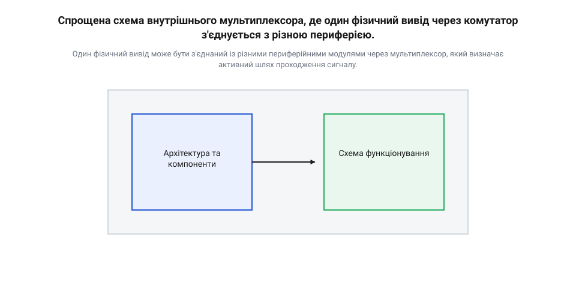
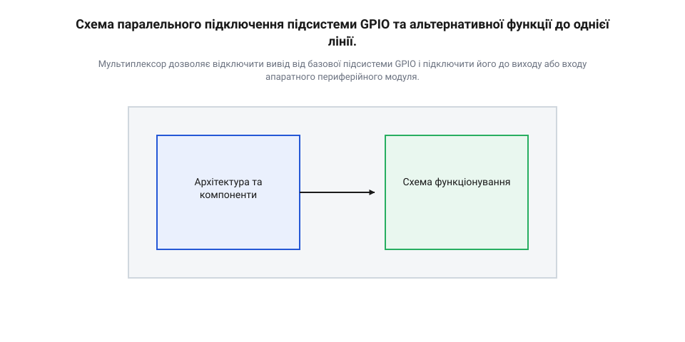
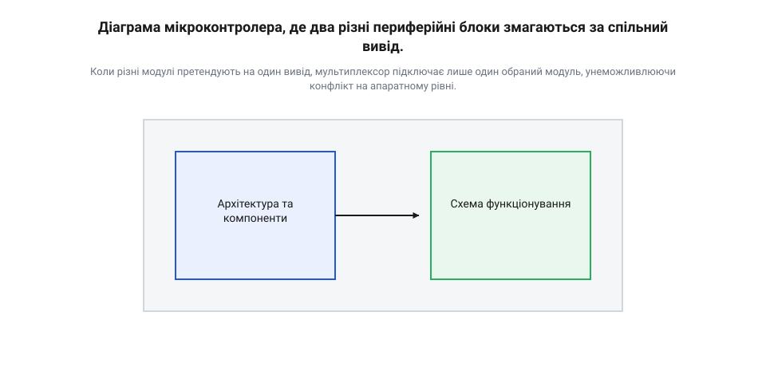

# mcu-pin-multiplexing

<preknowlist>
- [GPIO-регістри](root:sf-devices/gpio-registers) — Принцип керування станом виводу через запис бітів у регістри та розуміння базової підсистеми цифрового вводу/виводу.
- [Модель модуля](root:sf-devices/module-model) — Розуміння, що периферійні пристрої мікроконтролера є окремими апаратними блоками, яким для роботи потрібне фізичне з'єднання з виводами мікросхеми.
</preknowlist>

## Дефіцит виводів у мікроконтролерах

Мікроконтролер — це ціла система на одному кристалі, що містить процесор, пам'ять та десятки периферійних модулів: таймери, аналого-цифрові перетворювачі, інтерфейси зв'язку. Щоб ці внутрішні блоки могли взаємодіяти із зовнішнім світом, їх потрібно з'єднати з фізичними виводами мікросхеми, або ніжками. Однак тут виникає фундаментальне протиріччя між можливостями кристала та фізичними обмеженнями корпусу.

Сучасний мікроконтролер легко вміщує десятки різноманітних модулів, кожен з яких потребує кількох ліній зв'язку. Якби кожен такий блок мав власні виділені ніжки, мікросхема потребувала б сотень виводів. Це зробило б корпус величезним, плату для нього — дорогою та складною в розведенні, а більшість ніжок простоювала б, бо в конкретному пристрої одночасно використовується лише частина периферії. Щоб подолати цей дефіцит фізичних виводів, розробники застосовують @@en|multiplexing@@ (мультиплексування). Суть цього підходу полягає в тому, що один і той самий фізичний вивід може виконувати різні ролі залежно від того, як його налаштує програміст. 

Історично підходи до розподілу виводів мікроконтролерів еволюціонували від жорстко заданих функцій до гнучких комутаційних матриць ([crossbar-switch](root:hw-arch/crossbar-switch)). У ранніх мікросхемах кожна ніжка мала лише одне призначення, що змушувало інженерів ретельно підбирати чип під конкретну задачу або використовувати зовнішні компоненти. Згодом зростання кількості периферії на кристалі почало значно випереджати збільшення кількості ніжок, зумовлене обмеженнями розмірів корпусу та його вартості. Це зробило складне налаштування кожного виводу природною та неминучою потребою, дозволивши розробникам гнучко перепризначати функції виводів під потреби конкретного дизайну плати.

Схожий принцип використовується і за межами мікроконтролера, коли потрібно збільшити кількість доступних ліній. [Аналогові та цифрові мікросхеми-мультиплексори](root:sf-devices/pin-multiplexing/comp-multiplexer-ic.md) працюють як зовнішні комутатори, дозволяючи одному виводу почергово підключатися до багатьох зовнішніх сигналів, тим самим розширюючи можливості базової схеми.

Завдяки мультиплексуванню розробник отримує універсальний мікроконтролер у компактному корпусі, але натомість бере на себе відповідальність за правильну конфігурацію кожної ніжки під час ініціалізації програми.

## Механізм мультиплексування та маршрутизації

Щоб один фізичний вивід міг працювати то як лінія передачі даних, то як звичайний цифровий вхід, усередині мікроконтролера між периферійними модулями та самою ніжкою розташований апаратний комутатор — мультиплексор. Його завдання — замкнути ланцюг між конкретним внутрішнім блоком і зовнішнім виводом, ізолювавши при цьому всі інші модулі, які претендують на цю ж ніжку.

*Один фізичний вивід може бути з'єднаний із різними периферійними модулями через мультиплексор, який визначає активний шлях проходження сигналу.*

Програмно цей комутатор керується через спеціальні конфігураційні регістри. Записуючи певні значення в ці регістри, програма повідомляє мультиплексору, який саме модуль зараз має отримати доступ до виводу. Цей процес називається вибором альтернативної функції (@@en|alternate function@@). За замовчуванням більшість виводів після скидання мікроконтролера налаштовані як звичайні [GPIO-регістри](root:sf-devices/gpio-registers), що запобігає конфліктам. Коли ж потрібно задіяти певну периферію, програміст обирає відповідну альтернативну функцію для цієї ніжки, фактично перемикаючи внутрішній рубильник.

*Мультиплексор дозволяє відключити вивід від базової підсистеми GPIO і підключити його до виходу або входу апаратного периферійного модуля.*

[Перемикання функцій виводів на практиці](root:sf-devices/pin-multiplexing/proj-alternate-pins.md) виглядає як налаштування кількох бітових полів перед початком роботи з периферією. Маршрут сигналу пролягає від ніжки через схеми захисту, далі через мультиплексор, і нарешті потрапляє до активного модуля. Всі інші модулі, підключені до цього ж мультиплексора, фізично відрізані від лінії і не можуть впливати на сигнал або зчитувати його. Їхні виходи нікуди не ведуть, а на входи комутатор подає фіксований безпечний рівень, щоб уникнути помилкових спрацьовувань від завад. При цьому самі відключені модулі не заморожуються: якщо на них подається тактування, вони продовжують працювати всередині кристала, хоча їхній зв'язок із зовнішнім світом розірвано.

*Коли різні модулі претендують на один вивід, мультиплексор підключає лише один обраний модуль, унеможливлюючи конфлікт на апаратному рівні.*

Така архітектура вимагає уважності під час розробки пристрою. Оскільки одна ніжка може обслуговувати лише один модуль у певний момент часу, інженер має заздалегідь розподілити функції так, щоб уникнути апаратних конфліктів. Розуміння цієї логіки маршрутизації робить [конфігурацію пінів як єдине джерело правди](root:sf-devices/konfihuratsiia-piniv-iak-iedyne-dzherelo-pravdy) ключовим етапом під час ініціалізації системи.

## Конфігурація альтернативних функцій виводів

Після подачі живлення або скидання мікроконтролера його фізичні виводи не з'єднані з активними передавачами внутрішніх периферійних модулів. Якби вивід за замовчуванням видавав активний сигнал високого чи низького рівня, а на друкованій платі його вже було б з'єднано з виходом іншої мікросхеми чи заземлено, виникло б коротке замикання з ризиком пошкодження кристала. Щоб запобігти апаратним аваріям, мікроконтролер запускається в безпечному стані: більшість виводів налаштовані як входи з високим імпедансом, а керування ними здійснюють базові [GPIO-регістри](root:sf-devices/gpio-registers).

Коли програмі потрібно передати керування виводом конкретному апаратному блоку — наприклад, передавачу послідовного інтерфейсу чи таймеру, — вона має змінити внутрішню маршрутизацію сигналу. Для цього виводу призначають відповідну альтернативну функцію (@@en|alternate function@@, від англ. *alternate* — замінний, черговий та *function* — призначення).

Керування цим перемиканням реалізовано через спеціальні регістри конфігурації. У цих регістрах для кожного фізичного виводу виділено окреме бітове поле. Запис числового значення у таке поле безпосередньо змінює стан транзисторних ключів внутрішнього мультиплексора:

* Запис значення `0` (або базового коду скидання) залишає вивід під'єднаним до системного порту загального призначення. * Запис числового коду від `1` і вище відключає вивід від регістра даних @@en|GPIO@@ та підключає його до відповідного периферійного блоку.

Хоча документація мікроконтролера може наводити до десятка доступних режимів для однієї ніжки (наприклад, лінії @@en|UART@@, @@en|SPI@@ або каналу @@en|PWM@@), фізичний мультиплексор конкретного виводу в кожен момент часу може вибрати лише один внутрішній [периферійний модуль](root:sf-devices/module-model). Апаратне з'єднання є взаємовиключним: активація нової функції миттєво відрізає вивід від попереднього модуля. Сам відключений модуль може продовжувати обчислення чи прийом даних усередині кристала, але його вихідний сигнал більше не потрапляє на зовнішню ніжку.

Важливим практичним питанням конфігурації є дублювання сигналів: чи може один апаратний модуль бути програмно спрямований одразу на дві чи більше фізичні ніжки? Можливість такого дублювання залежить від напрямку сигналу:

* **Вихідні лінії (наприклад, @@en|TX@@ в @@en|UART@@ або @@en|SCLK@@ в @@en|SPI@@):** Внутрішній вихідний сигнал модуля розводиться до мультиплексорів багатьох виводів. Якщо програма налаштує однакову альтернативну функцію для двох різних фізичних ніжок, мультиплексори обох виводів підключать свої вихідні буфери до цієї єдиної внутрішньої лінії. Сигнал дублюватиметься на обох ніжках одночасно без додаткових апаратних витрат. * **Вхідні лінії (наприклад, @@en|RX@@ в @@en|UART@@ або @@en|MISO@@ в @@en|SPI@@):** З'єднати дві фізичні ніжки з одним внутрішнім входом модуля через звичайні мультиплексори неможливо без ризику конфлікту електричних рівнів, якщо на ці ніжки ззовні надійдуть різні сигнали. У класичній архітектурі вхідний сигнал приймається лише з одного визначеного виводу, а для довільної перемаршрутизації входів потрібна гнучка [матриця комутації](root:hw-arch/crossbar-switch).

Оскільки конфігурація змінює фізичні шляхи проходження струму всередині кристала, перемикати функції виводів слід під час ініціалізації системи до активації самого периферійного модуля. Це гарантує, що [електричні налаштування виводів](root:sf-devices/pad-control) та маршрутизація сигналів узгоджені до початку обміну даними.

## Взаємодія мультиплексора з підсистемою GPIO

Підключення виводу до периферійного модуля — це лише частина роботи. Мультиплексор відповідає виключно за маршрутизацію сигналу, тобто за те, куди фізично піде струм від ніжки вглиб кристала. Проте електричні характеристики самого виводу, такі як стан підтягувальних резисторів, швидкість наростання фронту або тип вихідного каскаду, продовжує контролювати базова підсистема [GPIO-регістрів](root:sf-devices/gpio-registers).

Коли вивід перемикається на альтернативну функцію, його цифровий буфер не вимикається автоматично. Обраний [модуль](root:sf-devices/module-model) починає керувати лінією замість регістра вихідних даних, але налаштування електричного кола залишаються за підсистемою порту. Це означає, що для правильної роботи апаратного інтерфейсу необхідно не лише вибрати відповідну функцію, а й налаштувати вивід як вихід з відкритим колектором чи двотактний вихід через регістри базового порту. Якщо забути про ці електричні налаштування, сигнал може конфліктувати з наявним буфером, що призведе до спотворення даних. Таким чином, конфігурація виводу завжди складається з двох етапів: вибору шляху для сигналу через мультиплексор та забезпечення правильних електричних умов через підсистему базового вводу-виводу.

## Конфлікти периферії та обмеження

Хоча мультиплексування дає гнучкість, воно не є всемогутнім. Більшість мікроконтролерів не мають повної [матриці комутації](root:hw-arch/crossbar-switch), яка б дозволяла підключити будь-який внутрішній модуль до будь-якої фізичної ніжки. Замість цього кожен вивід має жорстко заданий перелік із кількох можливих функцій, передбачених на етапі кристала.

Через це виникають апаратні конфлікти. Уявіть, що для вашого пристрою потрібен інтерфейс I2C та модуль ШІМ. Ви відкриваєте документацію і бачите, що потрібна лінія I2C і потрібний канал ШІМ виведені на ту саму фізичну ніжку мікроконтролера. Оскільки апаратний мультиплексор може підключити до виводу лише один модуль одночасно, ви не зможете використовувати обидві функції на цьому піні паралельно.

Щоб розв'язати таку проблему, доводиться шукати компроміси. Часто мікроконтролер дозволяє «перекинути» потрібну функцію на іншу ніжку — це називається ремапінгом (@@en|remapping@@). Якщо ж іншої ніжки немає або вона вже зайнята чимось важливішим, доведеться використовувати інший апаратний блок (наприклад, другий модуль I2C замість першого) або взагалі змінювати обрану модель мікроконтролера на ту, де таких конфліктів немає.

Іноді виводів мікроконтролера фізично не вистачає для всіх завдань, навіть з урахуванням мультиплексування. У таких випадках проблему вирішують за межами мікросхеми: використовують зовнішні [аналогові та цифрові мікросхеми-мультиплексори](root:sf-devices/pin-multiplexing/comp-multiplexer-ic.md). Вони дозволяють комутувати багато зовнішніх сигналів на один пін мікроконтролера, хоча це й уповільнює роботу системи та ускладнює програму.

Утім, коли виводів вистачає, правильне налаштування мультиплексора вирішує більшість завдань. У коді це виглядає як запис відповідного значення в регістри конфігурації. Погляньмо на приклад.

Детальний приклад коду перемикання альтернативних функцій з покроковою конфігурацією регістрів наведено у практичній вставці [Перемикання функцій виводів на практиці](root:sf-devices/pin-multiplexing/proj-alternate-pins.md).

Тут один і той самий фізичний вивід мікроконтролера перемикається між різними завданнями. Код демонструє, що вибір функції — це лише питання правильного значення у відповідному регістрі. 

Проте відповідальність за уникнення конфліктів лежить на програмісті та інженері-схемотехніку. Якщо вивід налаштовано як цифровий вихід, а ви спробуєте прочитати з нього сигнал за допомогою аналогово-цифрового перетворювача, ви отримаєте лише внутрішній стан самого виходу, а не реальний сигнал із зовнішнього світу. Мультиплексування дає свободу вибору, але вимагає, щоб [конфігурація пінів](root:sf-devices/konfihuratsiia-piniv-iak-iedyne-dzherelo-pravdy) була продумана ще до розробки плати.