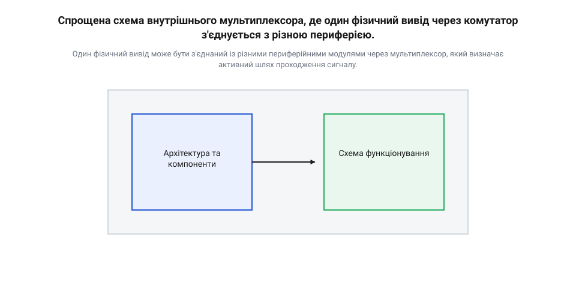
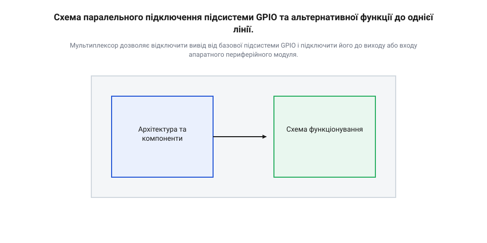
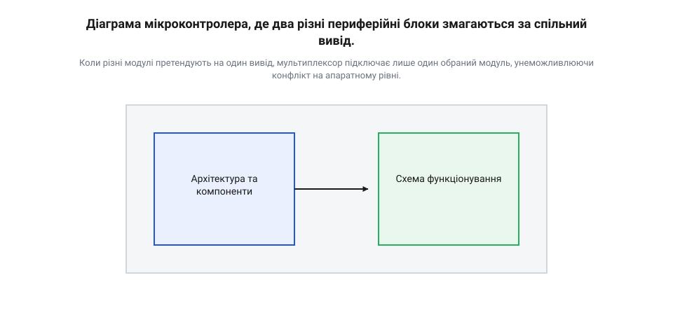

# mcu-pin-multiplexing

<preknowlist>
- [GPIO-регістри](root:sf-devices/gpio-registers) — принципи керування станом виводів через запис бітів у регістри та розуміння базової підсистеми цифрового вводу-виводу
- [Модель модуля](root:sf-devices/module-model) — розуміння периферійних пристроїв мікроконтролера як окремих апаратних блоків, що потребують фізичного з'єднання з виводами
</preknowlist>

## Дефіцит виводів у мікроконтролерах

Сучасний кристал містить десятки функціональних вузлів: апаратні таймери, інтерфейси @@en|UART@@, @@en|SPI@@, @@en|I2C@@ та канали аналого-цифрового перетворення. Кожен такий [периферійний модуль мікроконтролера](root:sf-devices/module-model) потребує з'єднання зі зовнішніми компонентами через електричні виводи. Проте фізичний корпус мікросхеми має суворо обмежену кількість ніжок, диктовану розмірами друкованої плати та собівартістю корпусування.

Якби для кожної внутрішньої лінії виробник виділив окремий контакт, мікроконтролери перетворилися б на дорогі мікросхеми із сотнями ніжок. Розведення друкованої плати навколо такого чипа стало б громіздким і багатошаровим, а переважна більшість виводів у реальному пристрої простоювала б, оскільки жодна система не задіює всі периферійні блоки одночасно.

Це протиріччя розв'язує мультиплексування виводів (англ. @@en|pin multiplexing@@, або @@en|multiplexing@@, від лат. *multiplex* — багатократний). Фізичну ніжку не прив'язують намертво до конкретного апаратного вузла. Вона стає спільним ресурсом, який за потреби програмно підключається до цифрового порту вводу-виводу, послідовної шини чи виходу генератора сигналів.

## Апаратна маршрутизація через внутрішній мультиплексор

Між фізичною контактною площадкою кристала та внутрішніми вузлами розташовано апаратний комутатор — мультиплексор (англ. @@en|multiplexer@@). Це мережа напівпровідникових ключів, керована бітовими регістрами. Комутатор замикає електричне коло між ніжкою та обраним функціональним блоком, повністю ізолюючи решту ліній від зовнішнього інтерфейсу.

*Мультиплексор з'єднує контактну площадку з обраним модулем і фіксує неактивні входи на безпечному рівні.*

Коли модуль від'єднується від виводу, його цифровий вхід не може залишатися високоімпедансним: під дією електромагнітних наводок він генерував би паразитні імпульси. Через такі шуми цифрова логіка помилково фіксувала б байт зв'язку або зайвий крок, подібно до збоїв [апаратного таймера енкодера](root:sf-devices/encoder-hardware-timer-mode). Щоб уникнути хибних спрацьовувань, комутатор автоматично подає на неактивні внутрішні входи безпечний фіксований потенціал — стабільну логічну одиницю чи нуль. При цьому відключені модулі продовжують тактуватися й виконувати внутрішні обчислення, втрачаючи лише доступ до зовнішньої контактної площадки.

## Програмне перемикання альтернативних функцій виводів

Під час апаратного скидання (англ. @@en|reset@@, від англ. *re-* — знову, та *set* — установлювати) кристал переводить усі виводи в безпечний стан. Їх налаштовано як цифрові входи загального призначення (англ. @@en|GPIO@@, від *General-Purpose Input/Output*) із високим електричним опором. Це захищає схему від короткого замикання: якби вивід стартував як активний вихід із низьким або високим потенціалом, він міг би пошкодити підключену на платі зовнішню мікросхему.

Щоб передати вивід апаратному блоку, у конфігураційний регістр записують числовий селектор. Це перемикає ключі комутатора на альтернативну функцію (англ. @@en|alternate function@@, від лат. *alternare* — чергуватися, та *functio* — виконання). Налаштування є двоетапним: мультиплексор лише спрямовує логічний сигнал, тоді як [базові GPIO-регістри](root:sf-devices/gpio-registers) продовжують керувати апаратною частиною виводу — вмикають підтягувальні резистори @@en|pull-up@@ або @@en|pull-down@@, задають швидкість наростання фронту та обирають режим вихідного каскаду між двотактним @@en|push-pull@@ і відкритим стоком @@en|open-drain@@.

*Мультиплексор комутує логічну лінію периферії, а буфери GPIO визначають електричні параметри виводу.*

За потреби один вихідний сигнал модуля можна апаратно розгалузити на кілька фізичних ніжок одночасно. Натомість об'єднувати кілька зовнішніх контактів на один вхідний порт категорично заборонено: без [гнучкої матриці сигналів](root:sf-devices/esp-idf-gpio-matrix-iomux-routing) це спричинить коротке замикання між зовнішніми джерелами струму.

## Конфлікти периферії та апаратні обмеження

Мультиплексування виводів не є універсальною матрицею зв'язку. Через обмеження кремнієвої площі кожен вивід має жорстко зашитий перелік із кількох допустимих альтернативних функцій.

Це породжує апаратні конфлікти: якщо лінії зв'язку модуля @@en|SPI@@ та тактовий вихід таймера виведено на одну фізичну ніжку, мікроконтролер не зможе задіяти їх одночасно. Комутація є взаємовиключною — вибір однієї функції миттєво відсікає іншу від зовнішнього світу.

*Одночасне використання двох функцій на спільній ніжці неможливе через апаратні обмеження мультиплексора.*

Розробники долають такі обмеження ремапінгом (англ. @@en|remapping@@, від англ. *re-* — пере-, та *map* — відображати, призначати) — перенесенням функції периферії на резервну групу виводів через конфігураційний регістр перепризначення. Якщо резервних ніжок немає, обирають інший вільний периферійний блок кристала.

Апаратний конфлікт неможливо виправити програмно після виготовлення плати. Тому [конфігурація виводів кристала](root:sf-devices/konfihuratsiia-piniv-iak-iedyne-dzherelo-pravdy) узгоджується та перевіряється до трасування друкованої плати.