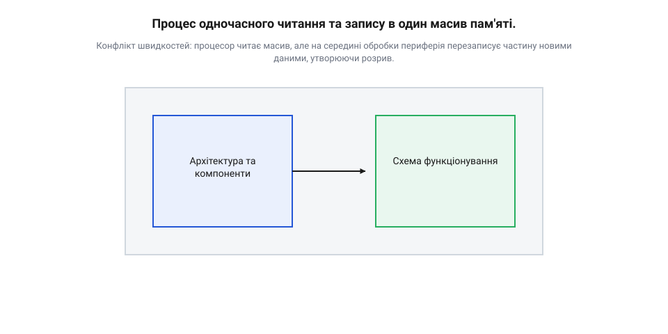
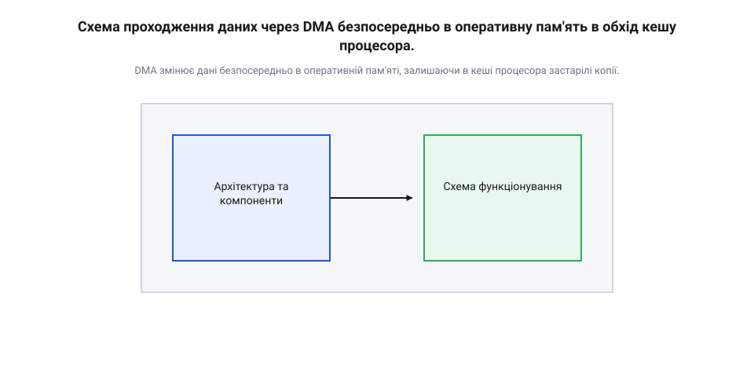
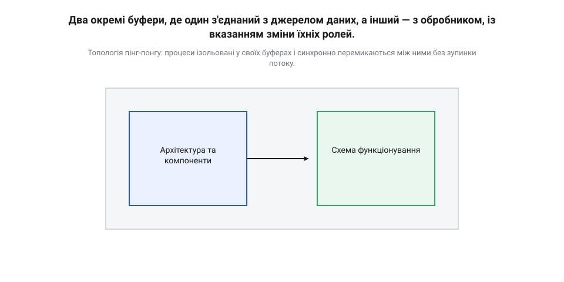
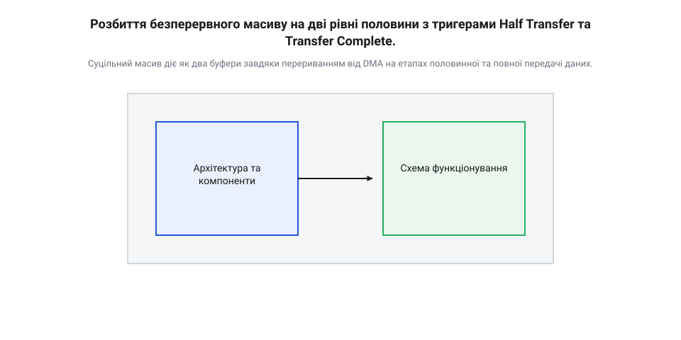

# Подвійна буферизація пінг-понг

<preknowlist>
- [Структура динамічної пам'яті на MCU](root:sf-devices/heap-layout) — Розуміння того, як фізично організована оперативна пам'ять мікроконтролера та де саме можуть розміщуватися масиви для безперешкодного доступу контролером DMA.
</preknowlist>

## Проблема одночасного доступу до даних

Коли аналого-цифровий перетворювач безперервно оцифровує вхідний сигнал і записує результати в єдиний масив в [оперативній пам'яті](root:sf-devices/heap-layout), а процесор одночасно зчитує ці дані для фільтрації чи збереження, виникає неминучий конфлікт: процесор зчитує вибірки в той самий момент, коли апаратний блок їх перезаписує.

*Конфлікт швидкостей: процесор читає масив, але на середині обробки периферія перезаписує частину новими даними, утворюючи розрив.*

Цей ефект називається розривом даних (@@en|data tearing@@). Процесор прочитає половину старих відліків, а іншу половину — вже з нового циклу вимірювань. Склеївши їх, ми отримаємо спотворений сигнал із розривом фази. Крім того, якщо процесор затримається на обробці іншої задачі, периферія просто перетре незлічені дані. Безпечно синхронізувати ці потоки неможливо: зупинивши вхідний потік з АЦП, ми втратимо частину фізичного процесу.

Додатковою проблемою є узгодженість кешу. Коли дані надходять через [контролер DMA](root:sf-devices/dma-controller) прямо в оперативну пам'ять, процесор про це не знає.

*DMA змінює дані безпосередньо в оперативній пам'яті, залишаючи в кеші процесора застарілі копії.*

Якщо процесор почне читати цей масив, він може дістати старі значення зі свого кешу замість свіжих даних з оперативної пам'яті. На відміну від десктопних систем, прості мікроконтролери не мають снупінгу шини (@@en|bus snooping@@) — апаратного механізму, який автоматично оновлював би кеш, коли інший пристрій змінює пам'ять. Процесор просто не знає, що контролер DMA щойно записав туди нові дані. Нам потрібен спосіб розділити простори читання та запису в просторі й часі.

## Механізм двох буферів пінг-понг

Коли периферія та мікропроцесор працюють з одним масивом одночасно, виникає неминучий конфлікт доступу. Якщо процесор читає дані повільніше або в іншому темпі, ніж їх записує контролер прямого доступу, нові значення перекриють старі прямо під час обробки. Щоб уникнути цього, простір пам'яті фізично розділяють на дві незалежні зони.

Поки апаратне джерело наповнює перший буфер, процесор вільно читає та обробляє вже готові дані з другого. Вони не перетинаються в одних і тих самих комірках, тому ризик розриву даних зникає. Щойно перший буфер повністю заповнюється, механізми миттєво міняються ролями: периферія починає писати в другий буфер, а процесор переходить до читання щойно зібраного першого. Такий механізм почергової зміни ролей називають подвійною буферизацією (@@en|double buffering@@) або «пінг-понгом» (@@en|ping-pong@@).

*Топологія пінг-понгу: процеси ізольовані у своїх буферах і синхронно перемикаються між ними без зупинки потоку.*

На практиці в мікроконтролерах ці два буфери найчастіше реалізують не як два окремі масиви, а як один суцільний масив, умовно поділений навпіл. Це роблять для того, щоб [контролер прямого доступу](root:sf-devices/dma-controller) міг працювати в циклічному режимі, постійно збільшуючи адресу запису й автоматично повертаючись на початок після досягнення кінця масиву. 

Щоб процесор знав, коли саме можна безпечно читати дані, DMA налаштовують генерувати апаратні переривання у дві миті: коли заповнюється перша половина масиву та коли масив заповнюється повністю.

*Суцільний масив діє як два буфери завдяки перериванням від DMA на етапах половинної та повної передачі даних.*

Коли DMA заповнює першу половину масиву, він викликає переривання. У цей момент мікропроцесор отримує сигнал і забирає саме цю половину для обробки. Тим часом DMA, не зупиняючись ні на такт, продовжує безперервно писати нові дані в другу половину. Коли ж масив заповнюється до кінця, DMA автоматично починає писати з початку (знову в першу половину), викликавши друге переривання. Тепер процесор може безпечно обробити другу половину. Обидва процеси працюють паралельно, гарантуючи, що периферія не затре дані, які зараз обробляє код.

Ефективність цього механізму прямо залежить від розміру масиву. Об'єм буфера не може бути довільним, його вираховують як компроміс між частотою переривань та затримкою обробки. 

Якщо буфер зробити надто малим, половина масиву заповнюватиметься дуже швидко. DMA генеруватиме переривання настільки часто, що процесор витрачатиме більшість часу на перемикання контексту — збереження та відновлення регістрів під час входу в переривання, — а не на саму обробку даних. Система почне гальмувати від накладних витрат.

З іншого боку, якщо зробити буфер надто великим, процесору доведеться довго чекати, поки DMA назбирає достатньо даних для виклику переривання. Це створює затримку між тим, коли подія відбулася фізично, і тим, коли програма почала на неї реагувати. До того ж великий масив невиправдано споживає [динамічну пам'ять](root:sf-devices/heap-layout), якої в мікроконтролерах завжди обмаль.

Оптимальний розмір буфера обирають так, щоб частота переривань була достатньо низькою для комфортної роботи процесора (зазвичай десятки або сотні герц), але при цьому затримка відгуку не перевищувала вимог конкретної задачі.

Практичний проєкт налаштування подвійної буферизації з обробкою переривань Half-Transfer та Transfer-Complete описано у вставці [Безперервне оцифрування з АЦП через DMA](root:sf-devices/ping-pong-double-buffering/proj-dma-adc-stream.md).

## Апаратне керування через контролер DMA

Проблема виникає тоді, коли процесор змушений постійно перевіряти, чи завершив контролер прямого доступу до пам'яті (DMA) передачу даних. Таке опитування витрачає процесорний час, який можна було б використати для обробки самої інформації. Щоб розв'язати цю проблему, контролер DMA має апаратний механізм сповіщень. Замість того, щоб процесор запитував статус, DMA сам генерує переривання в критичні моменти — коли буфер заповнено наполовину і коли він заповнений повністю.

Апаратний інтерфейс контролера DMA спирається на спеціальні регістри стану, які містять прапорці подій. Найважливішими для нас є прапорці половинної передачі (@@en|Half Transfer@@, HT) та повної передачі (@@en|Transfer Complete@@, TC). Коли DMA записує дані в першу половину масиву і досягає її кінця, апаратура автоматично встановлює прапорець HT, що генерує відповідне переривання. Процесор миттєво реагує на цю подію і починає обробку першої половини. Тим часом DMA без жодних затримок продовжує запис уже в другу половину масиву. Як тільки він доходить до кінця всього масиву, встановлюється прапорець TC, генерується друге переривання, і DMA автоматично починає запис знову з початку масиву. Це дозволяє уникнути втрати даних і забезпечує безперервність потоку.

Такий підхід повністю знімає з процесора завдання відстеження адрес. Увесь процес зводиться до реакції на два переривання. Завдяки цьому [структура динамічної пам'яті на MCU](root:sf-devices/heap-layout) використовується максимально ефективно, оскільки масив розміщується суцільним блоком, а [контролер прямого доступу до пам'яті (DMA)](root:sf-devices/dma-controller) самостійно керує вказівниками на поточну комірку запису.

Побачити, як цей механізм працює на практиці, можна на прикладі [Безперервне оцифрування з АЦП через DMA](root:sf-devices/ping-pong-double-buffering/proj-dma-adc-stream.md). У ньому один буфер прозоро заповнюється апаратно, поки інший одночасно і безпечно обробляється процесором.

## Програмна синхронізація та алгоритми захисту

Навіть якщо апаратна частина працює бездоганно, залишається ризик пошкодження даних на рівні програми. Коли DMA генерує переривання, процесор має гарантувати, що він встигне обробити свою половину буфера до того, як DMA повернеться до неї з новим циклом запису. Якщо процесор запізниться, виникне стан перегонів (@@en|race condition@@): нові дані почнуть затирати старі прямо під час їхньої обробки, що призведе до порушення цілісності інформації.

Щоб цьому запобігти, логіка обробника переривань повинна бути максимально швидкою. Вона не має виконувати саму обробку даних. Замість цього обробник переривання лише встановлює програмний прапорець або надсилає сигнал операційній системі реального часу (RTOS), вказуючи, яка саме половина буфера зараз готова до зчитування. Сама ж обробка, наприклад складна математична фільтрація чи копіювання в інше місце, делегується окремому потоку або головному циклу програми з нижчим пріоритетом.

Такий алгоритм захисту гарантує, що критичне переривання завершиться за лічені мікросекунди, звільняючи ядро для інших завдань і дозволяючи DMA продовжувати свою роботу без зупинок. Якщо ж виявляється, що потік не встигає опрацювати дані до наступного переривання, це є архітектурною помилкою: система фізично не здатна впоратися з таким потоком інформації. У цьому випадку необхідно або збільшувати розмір подвійного буфера, даючи процесору більше часу на реакцію, або знижувати частоту надходження даних.

## Вплив кешу та оптимізацій компілятора

Механізм подвійної буферизації може ідеально працювати на папері, але під час запуску на реальному мікроконтролері процесор раптом починає читати старі дані або взагалі нулі. Така ситуація виникає через те, що сучасні процесори працюють із пам'яттю не безпосередньо, а через швидкий @@en|кеш@@. 

Коли контролер [прямого доступу до пам'яті](root:sf-devices/dma-controller) записує нові дані від периферії, він складає їх просто у фізичну оперативну пам'ять. Процесор про це не знає. Коли він звертається до масиву, то бере дані зі свого @@en|кешу@@, де ще лежать старі значення. Виникає проблема @@en|когерентності@@ (en coherence — зв'язність): фізична пам'ять і @@en|кеш@@ містять різні дані. Щоб процесор гарантовано побачив щойно прийняті байти, перед початком обробки буфера він мусить примусово очистити @@en|кеш@@ (зробити @@en|інвалідацію@@) для тієї ділянки пам'яті, куди писав @@en|DMA@@.

Інший надійний шлях уникнути розсинхронізації — фізично розмістити буфери в таких областях пам'яті, для яких @@en|кешування@@ вимкнене на апаратному рівні. Розуміючи, як влаштована [динамічна пам'ять на мікроконтролері](root:sf-devices/heap-layout), можна вказати лінкеру створити масиви саме в некешованій зоні. У такому разі і процесор, і @@en|DMA@@ працюватимуть із тими самими комірками без додаткових команд @@en|інвалідації@@.

Друга пастка криється в оптимізаціях компілятора. Компілятор аналізує код і, якщо бачить, що в циклі обробки масив не змінюється жодною сусідньою командою, може зберегти його значення в регістрах. Він не здогадується, що дані в масиві постійно оновлює зовнішній апаратний блок. Щоб заборонити компілятору такі оптимізації, вказівники на буфери позначають ключовим словом @@en|volatile@@. Крім того, перед стартом передачі чи обробки використовують спеціальні інструкції — бар'єри пам'яті, які гарантують, що всі попередні операції з пам'яттю завершилися. Як ці механізми взаємодіють у реальній програмі, добре видно під час [безперервного оцифрування сигналу](root:sf-devices/ping-pong-double-buffering/proj-dma-adc-stream.md), де один буфер наповнюється, а інший обчислюється.

## Обробка затримок та переповнень системи

Система подвійної буферизації розрахована на те, що процесор встигає повністю обробити половину масиву до того, як @@en|DMA@@ заповнить іншу. Але виникають ситуації, коли обчислення тривають довше, ніж очікувалося. Це може статися через переривання вищого пріоритету, складніші дані для аналізу або раптове збільшення частоти надходження сигналу.

Якщо процесор затримується, контролер @@en|DMA@@ не чекає на нього. Він спокійно переходить до наступної половини буфера й починає перезаписувати дані, які процесор усе ще намагається прочитати. Виникає стан перегонів на рівні архітектури системи: нові дані змішуються з тими, що зараз обробляються, і результат обчислень стає непередбачуваним.

Щоб система лишалася надійною, таку ситуацію необхідно виявляти й обробляти. Найпростіший спосіб контролю — використовувати прапорці зайнятості для кожної половини буфера. Процесор встановлює прапорець, коли починає читати дані, і знімає після завершення. Якщо під час апаратного переривання @@en|DMA@@ система бачить, що процесор досі тримає прапорець наступного буфера, фіксується помилка переповнення.

Коли переповнення вже сталося, програма має вирішити, що робити далі. Перша стратегія — відкинути нові дані. Апаратна генерація або зупиняється, або нові порції просто ігноруються, доки процесор не звільниться. Це прийнятно для виведення на екран, де втрата одного кадру мине непомітно. Друга стратегія — зупинити всю роботу, спорожнити систему та виконати перезапуск із чистого аркуша. Це необхідно в медичних чи вимірювальних приладах, де краще перервати сигнал, ніж видати спотворений результат. Запобігти ж таким ситуаціям допомагає збільшення розміру самих буферів, що дає процесору більший запас часу на обробку пікових навантажень.