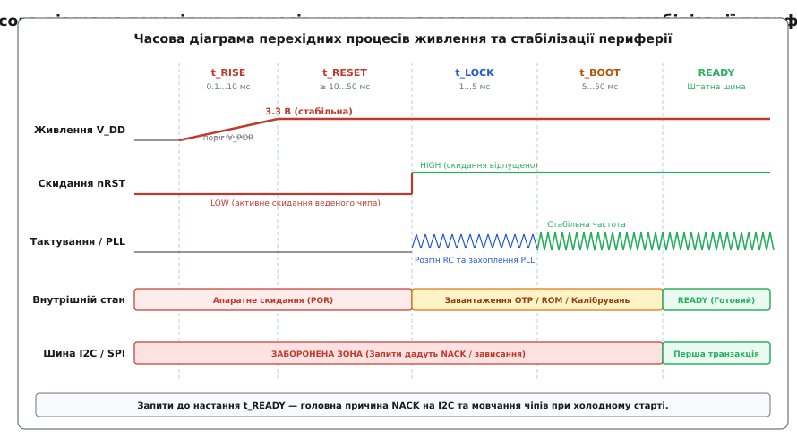
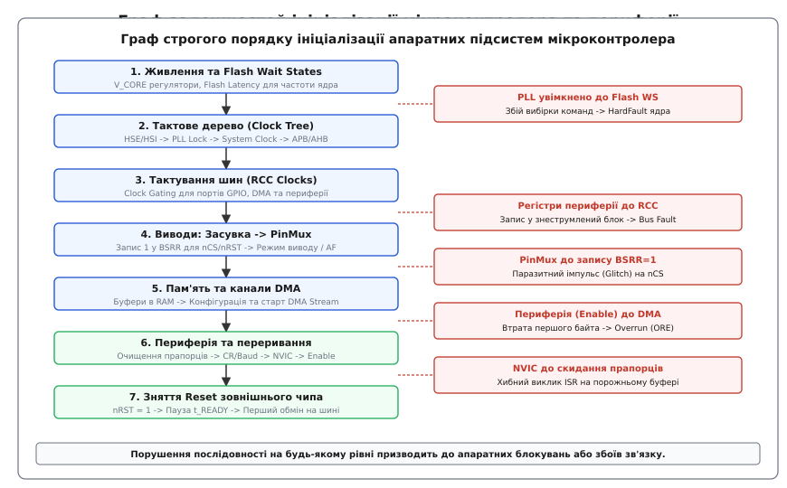

# Послідовність ініціалізації, якої ніхто не пояснює

<preknowlist>
- [Регістри GPIO](root:sf-devices/gpio-registers) — бітовий доступ до конфігурації напрямку, альтернативних функцій та вихідних засувок виводів.
- [CMSIS](root:sf-devices/cmsis) — структура регістрових карт Cortex-M, керування контролером переривань NVIC та бар'єри пам'яті.
- [Перший запуск](root:sf-devices/first-bringup) — методологія поетапного оживлення апаратних вузлів від живлення до коду застосунку.
- [Шина I2C](root:com-devices/i2c-bus) — фізичні та часові вимоги двохпровідного послідовного інтерфейсу.
- [Шина SPI](root:com-devices/spi-bus) — синхронний обмін даними, вибір веденого через лінію Chip Select і часові діаграми.
- [Послідовність живлення](root:hw-power/power-sequencing) — перехідні процеси наростання напруг та узгодження шин живлення.
</preknowlist>

На платі керування щойно зібраного приладу мікроконтролер архітектури ARM Cortex-M на частоті 168 МГц запускається після подачі живлення, за лічені мікросекунди проходить стартовий вектор `Reset_Handler`, налаштовує тактування ядра, входить у функцію `main()`, конфігурує інтерфейс I2C на швидкості 400 кбіт/с і надсилає запит на читання ідентифікаційного регістра `WHO_AM_I` до цифрового сенсора або зовнішнього контролера дисплея. У відповідь на шині виникає тиша: лінія даних SDA залишається підтягнутою до напруги живлення, ведений пристрій не формує біт підтвердження ACK, драйвер шини повертає помилку таймауту, а прошивка переходить у нескінченний цикл аварійної зупинки. Якщо ж у цей момент під'єднати апаратний налагоджувач і виконати гаряче програмне скидання ядра кнопкою Reset на платі, той самий код запускається повторно і сенсор бездоганно відповідає з першої спроби.

Причина такого симптому полягає у фундаментальній різниці між холодним стартом (Cold Boot) та перезавантаженням працюючого ядра (Warm Reset). При холодному старті мікроконтролер та всі зовнішні інтегральні мікросхеми починають рух із нульового потенціалу, коли напруга живлення зростає плавно, внутрішні аналогові вузли скидання ще не спрацювали, кварцові резонатори та системи фазового автопідстроювання частоти (PLL) тільки входять у режим генерації, а внутрішня логіка периферійних чипів завантажує заводські калібрування з енергонезалежної пам'яті. Мікроконтролер, виконуючи сотні мільйонів інструкцій на секунду, випереджає фізичну готовність оточуючого кремнію. Щоб прилад стабільно запускався за будь-яких умов живильної мережі, розробник прошивки повинен керувати не просто списком викликів бібліотечних функцій, а строгою фізичною та логічною послідовністю ініціалізації.

## Фізика перехідних процесів: живлення, скидання та стабілізація тактування

Коли джерело живлення подає напругу на друковану плату, напруга на шині V_DD не з'являється миттєво. Через вихідний опір джерела, роботу схем плавного пуску лінійних стабілізаторів (LDO) або імпульсних перетворювачів, а також сумарну ємність блокувальних та накопичувальних конденсаторів формується скінченний час наростання напруги живлення t_RISE (slew rate). Залежно від схемотехніки цей інтервал становить від десятків мікросекунд до десятків мілісекунд.



*Фізичні етапи готовності периферійного чіпа до зв'язку: запити по шинах I2C або SPI, надіслані до моменту t_READY, призводять до апаратних помилок NACK або спотворення перших пакетів.*

Кожен напівпровідниковий чип містить вбудовану схему скидання за рівнем напруги — Power-On Reset (POR) та детектор просідання Brown-Out Reset (BOR / UVLO). Вузол POR утримує внутрішні цифрові тригери мікросхеми в початковому стані, доки напруга живлення не перетне мінімальний поріг надійного функціонування логічних вентилів (типово 1.4...2.7 В).

Анатомія схеми POR усередині напівпровідникового кристала базується на компараторі з гістерезисом, опорному джерелі напруги (Bandgap Reference) та внутрішньому RC-інтеграторі. Якщо напруга живлення V_DD наростає занадто повільно (наприклад, швидкість наростання dV/dt становить менше 0.05 В/мс через надмірну ємність фільтрів або слабке джерело живлення), напруга може зависнути в зоні метастабільності між 0.8 В і 1.8 В на десятки мілісекунд. У цій проміжній зоні внутрішні аналогові генератори струму зміщення ще не вийшли на робочий режим, але логічні тригери вже здатні хаотично перемикатися під впливом теплових шумів. Як наслідок, вузол POR може зняти сигнал внутрішнього скидання передчасно, залишивши частину регістрів мікросхеми у невизначеному стані.

Ще підступнішою проблемою є короткочасні мікропросідання живлення (Power Glitches). Якщо напруга живлення падає, наприклад, з 3.3 В до 1.2 В на 10 мікросекунд через пусковий струм електродвигуна, а потім швидко повертається до норми, вбудований конденсатор фільтра схеми POR не встигає повністю розрядитися через внутрішній високоомний резистор. Вузол POR взагалі не фіксує факту аварії, тоді як логічні тригери в середині цифрового ядра встигли втратити дані. Процесор продовжує виконувати програму за випадковою адресою, а периферійні мікросхеми перестають відповідати на зовнішні запити. Саме тому надійні апаратні платформи доповнюють зовнішніми мікросхемами супервізорів живлення, які гарантовано формують імпульс скидання тривалістю не менше 100...200 мс після кожного, навіть найкоротшого перетину порогу напруги.

Після того як напруга на шині V_DD досягла номінального значення (наприклад, 3.3 В), зовнішній периферійний чип (радіомодуль, дисплейний контролер, пам'ять EEPROM або АЦП) ще не готовий до взаємодії. Виробники мікросхем висувають жорсткі вимоги до утримання зовнішнього виводу скидання nRST в активному низькому стані: тривалість імпульсу t_RESET повинна становити від 10 мікросекунд для простих логічних мікросхем до 10...50 мілісекунд для складних сенсорів із внутрішніми процесорними ядрами або дисплеїв із зарядовими насосами.

Коли мікроконтролер нарешті піднімає лінію nRST у високий рівень (Release), усередині веденого чипа починається каскад внутрішніх апаратних процедур:
1. **Запуск внутрішнього опорного джерела напруги (Bandgap Reference).** Аналоговий опорний вузол стабілізує робочі струми та внутрішні напруги зміщення протягом 100...500 мкс.
2. **Стабілізація тактового генератора чипа (t_LOCK).** Запуск внутрішнього RC-генератора або розгойдування зовнішнього кварцового резонатора з фазовим автопідстроюванням частоти (PLL), що займає від 1 до 5 мс.
3. **Завантаження енергонезалежної пам'яті калібрувань (OTP / ROM Shadowing).** Внутрішній автомат чипа вичитує заводські коефіцієнти калібрування, трими опорів та ідентифікаційні дескриптори з комірок OTP або маскового ROM у робочі тіньові регістри.
4. **Формування внутрішніх високих напруг.** Запуск вбудованих індуктивних або ємнісних помножувачів напруги (Charge Pumps) для живлення драйверів матриць OLED-дисплеїв або комірок флеш-пам'яті (від 5 до 100 мс).

Весь цей проміжок часу від моменту зняття апаратного скидання до повної готовності цифрового інтерфейсу позначається в технічній документації як t_BOOT або t_READY. Якщо мікроконтролер звернеться до мікросхеми через шину I2C під час фази t_BOOT, чип не зможе розпізнати свою апаратну адресу і виставить лінію SDA у стан високого опору, спричинивши помилку NACK. На шині SPI спроба зчитування регістра ідентифікації поверне нульові байти або `0xFF`, що зазвичай трактується кодом ініціалізації як несправність апаратури.

Звідси випливає непорушне правило холодного старту: після подачі живлення на периферійні мікросхеми та зняття сигналу скидання прошивка зобов'язана витримати гарантовану захисну паузу t_READY згідно з найгіршим значенням із документації (Worst-Case Timing Parameter) перед першою шинною транзакцією.

## Стабілізація тактових генераторів та систем PLL ядра

Окремий шар часових залежностей пов'язаний із запуском власної системи тактування мікроконтролера. Після апаратного скидання процесорне ядро стартує від вбудованого високочастотного RC-генератора (HSI — High-Speed Internal, зазвичай 8, 16 або 64 МГц). Цей генератор має низьку точність (відхилення ±1...2% залежно від температури), проте він здатний почати видавати тактові імпульси вже через кілька мікросекунд після появи живлення.

Для роботи точних інтерфейсів зв'язку (USB, Ethernet, CAN) та досягнення максимальної обчислювальної продуктивності мікроконтролер перемикають на зовнішній кварцовий резонатор (HSE — High-Speed External) та систему фазового автопідстроювання частоти (PLL).

Фізика запуску кварцового резонатора визначається його високою добротністю (Q-factor). Еквівалентна електрична схема кварцу являє собою послідовний коливальний контур із дуже високою індуктивністю та мікроскопічною ємністю, зашунтований паралельною ємністю тримача пластини. Коли внутрішній інвертор мікроконтролера подає напругу на виводи OSC_IN/OSC_OUT, кварцова пластина починає розгойдуватися виключно під дією теплових шумів. Процес розгону коливань до стаціонарної амплітуди (Startup Time) займає:
- Для високочастотних кварців (HSE на 8...25 МГц) — від 1 до 5 мілісекунд.
- Для низькочастотних годинникових кварців (LSE на 32.768 кГц) — від 500 мілісекунд до 2 секунд.

Якщо прошивка спробує перемкнути системний тактовий мультиплексор або вхідний каскад PLL на лінію HSE до того, як апаратний прапорець `HSERDY` (HSE Ready) встановиться в одиницю, на вхід ядра потрапить сигнал із нестабільною амплітудою або нульовою частотою. Процесор миттєво зупиниться через відсутність тактування.

Аналогічні фізичні обмеження діють і для вузла PLL. Петля автопідстроювання складається з фазового детектора, низькочастотного фільтра (Loop Filter) та генератора, керованого напругою (VCO). У процесі захоплення частоти (t_LOCK, зазвичай 100...500 мкс) вихідна частота VCO зазнає перехідних коливань і має значний фазовий джиттер (Jitter). Перемикання системної шини SYSCLK на вихід PLL до появи апаратного прапорця `PLLRDY` призводить до порушення часових інтервалів утримання та встановлення (Setup / Hold Time) внутрішніх тригерів ядра, викликаючи метастабільність і фатальний збій лічильника команд PC.

## Каскад внутрішніх залежностей: правильний порядок налаштування мікроконтролера

Невдалий запуск зовнішніх чипів — це лише половина проблеми. Друга половина криється всередині самого мікроконтролера. Більшість розробників сприймають мікроконтролер як набір незалежних модулів: таймер, порт введення-виведення, контролер прямого доступу до пам'яті (DMA), блок UART. Насправді ці модулі пов'язані жорсткими топологічними залежностями на кремнієвому кристалі.

Спроба налаштувати периферійний блок у довільному порядку призводить до апаратних виняткових ситуацій (HardFault, BusFault), появи паразитних імпульсів на виводах або повного блокування передачі даних.



*Канонічний порядок конфігурації: кожна наступна підсистема спирається на повністю стабілізований та увімкнений стан попередньої ланки.*

Розгляньмо кожен крок канонічного ланцюга ініціалізації мікроконтролера та фізичні наслідки порушення черговості.

### 1. Живлення ядра та затримка Flash-пам'яті (Flash Wait States)

Мікроконтролери після скидання починають виконання коду від повільного внутрішнього RC-генератора. У цьому режимі час доступу до комірок вбудованої Flash-пам'яті вкладається в один такт ядра.

Коли прошивка налаштовує систему тактування для переходу на високу робочу частоту (наприклад, 168 або 480 МГц через PLL), швидкість читання Flash-пам'яті залишається фізично обмеженою (зазвичай не більше 30...50 МГц). Якщо перемкнути джерело тактування системної шини (SYSCLK) на вихід PLL до того, як у регістрі керування контролером Flash (наприклад, `FLASH_ACR`) буде встановлено необхідну кількість циклів очікування (Flash Latency / Wait States), процесорне ядро спробує прочитати наступний опкод інструкції швидше, ніж комірки пам'яті встигнуть віддати електричний заряд на лінії зчитування.

Результат порушення порядку: ядро отримує спотворений код команди, фіксує помилку невирівняного доступу або помилку шини інструкцій (Instruction Bus Error) і негайно падає в обробник `HardFault_Handler` на першому ж переході.

Правильний порядок:
1. Задати рівень внутрішнього регулятора напруги ядра (Voltage Scaling / Overdrive Mode) під цільову частоту.
2. Встановити кількість циклів очікування Flash Latency (WS) відповідно до майбутньої частоти ядра.
3. Увімкнути буфер вибірки наперед (Prefetch Buffer), кеш інструкцій (I-Cache) та кеш даних (D-Cache).
4. Запустити джерело тактування (HSE/HSI), дочекатися прапорця стабілізації.
5. Налаштувати множники та дільники PLL, увімкнути PLL і дочекатися апаратного прапорця `PLLRDY`.
6. Перемкнути системний мультиплексор SYSCLK на вихід PLL.
7. Дочекатися підтвердження перемикання джерела тактування в регістрі статусу (наприклад, біти `SWS` у регістрі `RCC_CFGR`).

### 2. Тактування шин периферії (Clock Gating) та апаратне скидання модулів

З метою енергозбереження всі периферійні блоки сучасних мікроконтролерів (порти GPIO, таймери, контролери шин, блоки DMA) за замовчуванням знеструмлені: їхні лінії синхронізації відключені від шин AHB та APB на рівні логічних вентилів (Clock Gating).

Якщо програма спробує звернутися до регістра конфігурації будь-якого модуля (наприклад, записати режим роботи виводів у `GPIOA->MODER` або швидкість обміну в `USART1->BRR`) до того, як у регістрі модуля тактування RCC (наприклад, `RCC_AHB1ENR` чи `RCC_APB2ENR`) буде виставлено відповідний біт увімкнення тактування, інтерфейс шини APB/AHB не зможе завершити цикл запису.

На ядрах Cortex-M0/M0+ такий запис буде просто мовчки проігноровано, і регістр залишиться у випадковому стані. На ядрах Cortex-M3/M4/M7 спроба звернення до знеструмленого адресного простору викликає апаратне переривання `BusFault` (Precise Data Bus Error) або `HardFault`.

Крім того, при гарячому перезапуску системи або переході з вторинного завантажувача (Bootloader) периферійний модуль може залишатися у частково налаштованому або завислому стані. Тому професійною практикою є примусове скидання модуля через регістри скидання RCC (наприклад, `RCC_APB1RSTR`). Прошивка виставляє біт скидання модуля в 1, витримує два такти шини для проходження сигналу через синхронізатори, а потім повертає біт у 0. Це повертає всі внутрішні скінченні автомати та регістри периферійного модуля у гарантований заводський стан.

Правило: будь-яке налаштування апаратного блоку починається з виклику увімкнення його тактування в модулі RCC, виконання апаратного скидання та витримки двох тактів шини (або фіктивного читання регістра RCC), щоб сигнал дозволу тактування встиг поширитися кремнієвою мережею до логіки модуля.

### 3. Попередній стан засувок GPIO та перемикання альтернативних функцій

Один із найпідступніших апаратних дефектів виникає при налаштуванні ліній з активним низьким рівнем — таких як вибір веденого SPI Chip Select (nCS), апаратне скидання зовнішнього чипа (nRST) або керування лінійними ключами живлення (Enable/Shutdown).

Після скидання мікроконтролера всі виводи портів перебувають у режимі плаваючого входу з високим опором (Floating Input), а їхні внутрішні вихідні засувки даних (регістри `ODR`) обнулені.

Якщо розробник виконує конфігурацію у типовому наївному порядку:
1. Перевести вивід у режим виходу (`MODER = 01`).
2. Виставити високий рівень на виводі (`ODR = 1` або запис у `BSRR`).

То в проміжку між цими двома машинними інструкціями (який може тривати кілька десятків наносекунд, а у разі виникнення переривання — кілька мікросекунд) вивід короткочасно опиняється в режимі низького рівня (LOW). Цей паразитичний спадний імпульс (Glitch) сприймається підключеною мікросхемою флеш-пам'яті або SPI-сенсором як початок сесії передачі даних. Коли згодом програма підніме nCS і почне штатний обмін, ведений пристрій вже збитий з синхронізації і зміщує біти у відповіді.

Правильний порядок налаштування виводів:
1. Записати бажаний логічний стан (для активних низьких сигналів — логічну одиницю) у регістр примусового встановлення/скидання `BSRR` (`BSRR = (1 << PIN)`).
2. Налаштувати конфігурацію вихідного каскаду: тип виходу (Push-Pull для nCS/nRST або Open-Drain для ліній I2C), швидкість наростання фронту (Speed) та внутрішні підтягувальні резистори (Pull-Up/Pull-Down).
3. Якщо вивід використовується внутрішнім периферійним модулем (наприклад, SCK/MOSI/MISO для SPI або TX/RX для UART), підключити номер альтернативної функції у регістрах `AFR[0]` або `AFR[1]`.
4. Лише на останньому кроці перемкнути режим виводу в регістрі `MODER` на вихід (`01`) або альтернативну функцію (`10`).

За такої послідовності вихідний мультиплексор підключається до заздалегідь встановленого логічного рівня, і на фізичній доріжці друкованої плати не виникає жодного паразитного сплеску.

## Гонки та пастки при налаштуванні переривань і DMA

Найбільша концентрація прихованих помилок виникає під час зв'язування периферійного модуля з контролером переривань NVIC та контролером прямого доступу до пам'яті (DMA). Ці помилки проявляються як плаваючі збої, які зникають при додаванні відлагоджувального друку або зміні рівня оптимізації компілятора.

### Пастка 1: Увімкнення переривання в NVIC до очищення залишкових прапорців

Кожен периферійний блок (UART, SPI, таймер, I2C) містить власний регістр статусу (наприклад, `USART_SR` або `SPI_SR`). Після скидання або під час конфігурації деякі біти статусу апаратно встановлюються в одиницю за замовчуванням. Класичний приклад — прапорець `TXE` (Transmitter Empty) у блоці UART: оскільки передавальний буфер порожній, апаратна логіка негайно сигналізує про готовність приймати наступний байт.

Розгляньмо типову помилкову послідовність:
:::tabs
```c
// ПОМИЛКА: неправильний порядок увімкнення переривань
NVIC_SetPriority(USART1_IRQn, 2);
NVIC_EnableIRQ(USART1_IRQn);              // Крок 1: дозвіл лінії в ядрі
USART1->CR1 |= USART_CR1_TXEIE;           // Крок 2: дозвіл переривання в периферії
tx_ring_buffer_init(&uart_tx_buf, 256);   // Крок 3: виділення та ініціалізація буфера
```
```cpp
// ПОМИЛКА: неправильний порядок увімкнення переривань
NVIC_SetPriority(USART1_IRQn, 2);
NVIC_EnableIRQ(USART1_IRQn);              // Крок 1: дозвіл лінії в ядрі
USART1->CR1 |= USART_CR1_TXEIE;           // Крок 2: дозвіл переривання в периферії
uart_tx_queue = std::make_unique<RingBuffer<uint8_t, 256>>(); // Крок 3: створення буфера
```
:::

У мить виконання рядка `NVIC_EnableIRQ` або встановлення біта `TXEIE` ядро Cortex-M фіксує активний рівень запиту переривання. Процесор негайно припиняє виконання лінійного коду і стрибає в обробник `USART1_IRQHandler`. Але структури кільцевого буфера передавача (вказівники `head`, `tail`, буфер у пам'яті) ще не ініціалізовані (рядок 3 ще не виконано). Обробник переривання намагається зчитати дані за нульовим або сміттєвим вказівником, що призводить до негайного краху прошивки або зациклення у нескінченному виклику ISR.

Канонічне правило конфігурації переривань:
1. Повністю підготувати всі програмні структури даних, черги, семафори та буфери пам'яті в RAM.
2. Очистити всі прапорці подій у регістрах статусу периферійного модуля (шляхом читання/запису відповідних бітів згідно з документацією чипа).
3. Налаштувати локальні маски дозволу переривань у регістрах керування периферії (наприклад, `USART_CR1_RXNEIE`).
4. Встановити пріоритет переривання у контролері NVIC викликом `NVIC_SetPriority()`.
5. Очистити можливий завислий прапорець очікування в самому ядрі викликом `NVIC_ClearPendingIRQ()`.
6. І лише тепер увімкнути лінію переривання в ядрі викликом `NVIC_EnableIRQ()`.

### Пастка 2: Гонка запуску DMA проти активації периферійного модуля

При організації обміну через DMA (наприклад, прийом кадру через SPI або UART) початківці часто вмикають спочатку периферійний модуль, а потім конфігурують потік DMA.

Розгляньмо сценарій на прикладі прийому по шині SPI в режимі Slave:
1. Програма вмикає SPI: біт `SPI_CR1_SPE = 1`.
2. Зовнішній Master негайно починає передавати тактові імпульси і жене перший байт.
3. Апаратний блок SPI приймає перший байт у внутрішній зсувний регістр і переносить його у приймальний буфер `DR` / `RDR`.
4. Програма нарешті доходить до рядка активації потоку DMA: `DMA_Stream->CR |= DMA_SxCR_EN`.
5. Але апаратний запит від першого байта вже був згенерований і втрачений, бо канал DMA був вимкнений.
6. Коли Master надсилає другий байт, приймальний регістр SPI все ще зайнятий першим байтом, оскільки DMA його не вичитав.
7. Апаратна частина SPI фіксує переповнення приймача — прапорець Overrun Error (`ORE = 1`).

Більшість апаратних контролерів SPI та UART при виникненні прапорця `ORE` повністю блокують генерацію подальших запитів DMA. У результаті весь подальший потік даних втрачається, контролер DMA очікує завершення передачі, а прийом зависає назавжди.

Правильний порядок налаштування зв'язки DMA та периферії:
1. Сконфігурувати потік або канал DMA: адреса джерела (регістр `DR`/`RDR`), адреса призначення в оперативній пам'яті (RAM), кількість байтів (регістр `NDTR`), розмірність елементів, пріоритет та режим інкременту.
2. Очистити прапорці статусу потоку DMA (прапорці завершення передачі `TCIF`, помилок `TEIF`).
3. Увімкнути потік DMA (`DMA_SxCR_EN = 1`) і переконатися, що канал активний і чекає на апаратні тригери.
4. Дозволити генерацію DMA-запитів усередині регістра керування периферійного модуля (наприклад, `SPI_CR2_RXDMAEN = 1`).
5. І лише на фінальному етапі ввімкнути сам периферійний модуль (`SPI_CR1_SPE = 1`).

При передачі даних порядок аналогічний: канал DMA налаштовується та активується першим, і щойно периферія вмикається і виставляє прапорець готовності передавача `TXE`, контролер DMA негайно підхоплює перший байт без жодних часових розривів.

### Пастка 3: Буферизація запису шини Cortex-M і повторний хибний вхід в ISR

У 32-бітних мікроконтролерах із ядрами Cortex-M3, Cortex-M4 та Cortex-M7 для прискорення роботи використовується буфер відкладеного запису (Write Buffer / Store Buffer) між ядром процесора та системними шинами AHB/APB.

Коли ядро виконує операцію запису в регістр периферії (наприклад, скидання прапорця переривання таймера `TIMx->SR = ~TIM_SR_UIF`), процесор не чекає фізичного завершення транзакції на повільній шині APB. Він розміщує команду запису в конвеєрному буфері і негайно переходить до виконання наступних інструкцій.

Якщо операція скидання прапорця розташована в самому кінці функції обробника переривання (ISR), процесор виконує інструкцію виходу з обробника `BX LR` до того, як транзакція запису на шині APB фізично дійде до регістра периферії та скине вихідний сигнал запиту переривання.

Контролер NVIC бачить, що лінія переривання від таймера все ще перебуває в активному стані. Відповідно, щойно ядро відновлює контекст із стека, воно миттєво знову входить у той самий обробник переривання `TIMx_IRQHandler`. У кращому випадку це призводить до подвійного виконання обробника і перевитрати процесорного часу вдвічі, у гіршому — до порушення протоколів передачі даних.

Вирішення проблеми:
1. Завжди очищати прапорці переривань на початку обробника ISR, а не наприкінці.
2. Якщо скидання відбувається наприкінці, виконати фіктивне зчитування регістра периферії (Read-Back), що змушує шинний міст зачекати на завершення попередньої операції запису.
3. Використовувати інструкцію апаратного бар'єра синхронізації даних CMSIS `__DSB()` (Data Synchronization Barrier), яка примусово спустошує конвеєр запису перед поверненням із переривання.

## Поведінка завантажувача та деініціалізація перед переходом у застосунок

Коли мікроконтролер використовує вторинний завантажувач (Bootloader) для оновлення прошивки «по повітрю» (OTA) або через USB/CAN-інтерфейс, виникає специфічний клас помилок ініціалізації, пов'язаний із передачею керування.

Завантажувач під час своєї роботи вмикає системний таймер `SysTick`, налаштовує переривання USB або CAN, активує потоки DMA для запису нової прошивки у Flash-пам'ять і переналаштовує таблицю векторів переривань (`SCB->VTOR`).

Якщо перед виконанням стрибка на вектор скидання основного застосунку завантажувач просто зчитує нову адресу стека MSP та адресу функції `Reset_Handler` із початку другого образу і робить непрямий перехід `jump_to_app()`, основний застосунок опиняється у критично брудному апаратному середовищі:
- Таймер `SysTick` продовжує цокати з періодом, налаштованим бутлоадером. Щойно основний застосунок дозволить глобальні переривання (`__enable_irq()`), виникне переривання `SysTick_Handler`. Якщо новий код ще не встиг налаштувати власні структури часу або таблицю векторів, станеться перехід за старим вектором у знеструмлену область або зависання.
- Канали DMA бутлоадера можуть продовжувати фоновий запис або читання у буфери пам'яті, затираючи статичні змінні застосунку.
- Регістри периферії залишаються налаштованими на старі швидкості та конфігурації виводів.

Правильна процедура передачі керування від завантажувача до застосунку (Clean De-initialization Handover):
1. Заборонити всі переривання на рівні ядра інструкцією `__disable_irq()`.
2. Зупинити системний таймер `SysTick`, обнулити його лічильник `SysTick->VAL` та регістр перезавантаження `SysTick->LOAD`.
3. Вимкнути всі дозволені лінії переривань у контролері NVIC, записавши `0xFFFFFFFF` у всі регістри `NVIC->ICER[0..7]`, та очистити всі завислі прапорці через регістри `NVIC->ICPR[0..7]`.
4. Вимкнути всі активні канали та потоки DMA, очистити їхні регістри конфігурації та прапорці помилок.
5. Виконати програмне скидання всіх задіяних периферійних модулів через регістри `RCC->APBxRSTR` та `RCC->AHBxRSTR`, повернувши їх до стану після холодного старту.
6. Встановити зміщення таблиці векторів переривань `SCB->VTOR` на базову адресу Flash-пам'яті застосунку.
7. Виконати бар'єри пам'яті `__DSB()` та `__ISB()` (Instruction Synchronization Barrier), щоб ядро очистило конвеєр вибірки команд.
8. Встановити покажчик вершини стека `__set_MSP(*((volatile uint32_t*)APP_FLASH_ADDR))`.
9. Здійснити перехід за адресою вектора скидання `Reset_Handler = *((volatile uint32_t*)(APP_FLASH_ADDR + 4))`.

Ця процедура гарантує, що основний застосунок почне роботу в кришталево чистому апаратному стані, ідентичному холодному пуску.

## Порівняльний приклад: ініціалізація шини зв'язку та периферії

Розгляньмо повний практичний приклад ініціалізації високошвидкісного інтерфейсу SPI з підтримкою прийому по DMA та керуванням лінією апаратного скидання зовнішнього цифрового сенсора. Порівняємо класичну реалізацію мовою C99 на рівні прямих регістрів CMSIS та ідіоматичний підхід мовою C++20 із застосуванням типізованих обгорток, RAII та семантики `std::expected`.

:::tabs
```c
#include <stdint.h>
#include <stdbool.h>
#include "stm32f4xx.h"

// Фізичні часові параметри зовнішнього сенсора з документації
#define SENSOR_RESET_HOLD_US     15000U  // 15 мс утримання апаратного скидання
#define SENSOR_BOOT_READY_US     25000U  // 25 мс очікування внутрішнього завантаження

static void delay_us(uint32_t us) {
    // Відлік мікросекунд на базі лічильника циклів DWT ядра Cortex-M
    uint32_t start = DWT->CYCCNT;
    uint32_t ticks = us * (SystemCoreClock / 1000000U);
    while ((DWT->CYCCNT - start) < ticks) {
        __NOP();
    }
}

typedef enum {
    INIT_OK = 0,
    INIT_ERR_TIMEOUT,
    INIT_ERR_CHIP_ID
} init_status_t;

init_status_t sensor_subsystem_init(uint8_t *rx_dma_buf, uint16_t buf_len) {
    // 1. Увімкнення лічильника DWT для точних мікросекундних пауз
    CoreDebug->DEMCR |= CoreDebug_DEMCR_TRCENA_Msk;
    DWT->CTRL |= DWT_CTRL_CYCCNTENA_Msk;

    // 2. Увімкнення тактування шин RCC для GPIOA, GPIOC, SPI1 та DMA2
    RCC->AHB1ENR |= RCC_AHB1ENR_GPIOAEN | RCC_AHB1ENR_GPIOCEN | RCC_AHB1ENR_DMA2EN;
    RCC->APB2ENR |= RCC_APB2ENR_SPI1EN;
    (void)RCC->APB2ENR; // Фіктивне читання для стабілізації шинного мосту

    // 3. Безпечна конфігурація виводів: спершу засувки, потім режими
    // PC4: апаратне скидання сенсора (nRST, active LOW) -> спочатку притискаємо до LOW
    GPIOC->BSRR = GPIO_BSRR_BR4;
    GPIOC->MODER &= ~GPIO_MODER_MODER4_Msk;
    GPIOC->MODER |= (1U << GPIO_MODER_MODER4_Pos); // Вихід

    // PA4: Chip Select (nCS, active LOW) -> спочатку виставляємо HIGH!
    GPIOA->BSRR = GPIO_BSRR_BS4;
    GPIOA->MODER &= ~GPIO_MODER_MODER4_Msk;
    GPIOA->MODER |= (1U << GPIO_MODER_MODER4_Pos); // Вихід

    // PA5 (SCK), PA6 (MISO), PA7 (MOSI): альтернативна функція AF5 (SPI1)
    GPIOA->MODER &= ~(GPIO_MODER_MODER5_Msk | GPIO_MODER_MODER6_Msk | GPIO_MODER_MODER7_Msk);
    GPIOA->MODER |= (2U << GPIO_MODER_MODER5_Pos) | 
                    (2U << GPIO_MODER_MODER6_Pos) | 
                    (2U << GPIO_MODER_MODER7_Pos);
    GPIOA->AFR[0] |= (5U << GPIO_AFRL_AFSEL5_Pos) | 
                     (5U << GPIO_AFRL_AFSEL6_Pos) | 
                     (5U << GPIO_AFRL_AFSEL7_Pos);
    GPIOA->OSPEEDR |= (3U << GPIO_OSPEEDR_OSPEED5_Pos) | 
                      (3U << GPIO_OSPEEDR_OSPEED7_Pos); // High speed

    // 4. Витримка апаратного скидання зовнішнього чипа
    delay_us(SENSOR_RESET_HOLD_US);
    GPIOC->BSRR = GPIO_BSRR_BS4; // Зняття Reset (nRST = HIGH)
    delay_us(SENSOR_BOOT_READY_US); // Очікування внутрішньої готовності чипа

    // 5. Конфігурація модуля DMA (DMA2 Stream 0 Channel 3 = SPI1_RX)
    DMA2_Stream0->CR &= ~DMA_SxCR_EN;
    while (DMA2_Stream0->CR & DMA_SxCR_EN) { /* Чекаємо вимкнення */ }

    DMA2->LIFCR = DMA_LIFCR_CTCIF0 | DMA_LIFCR_CTEIF0 | DMA_LIFCR_CDMEIF0 | DMA_LIFCR_CFEIF0;
    DMA2_Stream0->PAR = (uint32_t)&(SPI1->DR);
    DMA2_Stream0->M0AR = (uint32_t)rx_dma_buf;
    DMA2_Stream0->NDTR = buf_len;
    DMA2_Stream0->CR = (3U << DMA_SxCR_CHSEL_Pos) | // Канал 3
                       DMA_SxCR_MINC |              // Інкремент пам'яті
                       (1U << DMA_SxCR_PL_Pos) |    // Середній пріоритет
                       DMA_SxCR_TCIE;               // Переривання по завершенню

    // 6. Налаштування регістрів SPI1 (Master Mode, Baud = F_PCLK / 8, CPOL=0, CPHA=0)
    SPI1->CR1 = SPI_CR1_MSTR | SPI_CR1_SSM | SPI_CR1_SSI | (2U << SPI_CR1_BR_Pos);
    (void)SPI1->SR; // Очищення можливих прапорців читанням
    (void)SPI1->DR;

    // 7. Конфігурація NVIC
    NVIC_SetPriority(DMA2_Stream0_IRQn, 5);
    NVIC_ClearPendingIRQ(DMA2_Stream0_IRQn);
    NVIC_EnableIRQ(DMA2_Stream0_IRQn);

    // 8. Увімкнення DMA-потоку ПЕРЕД увімкненням периферії
    DMA2_Stream0->CR |= DMA_SxCR_EN;

    // 9. Дозвіл DMA-запитів у SPI та фінальна активація інтерфейсу
    SPI1->CR2 |= SPI_CR2_RXDMAEN;
    SPI1->CR1 |= SPI_CR1_SPE;

    return INIT_OK;
}
```
```cpp
#include <cstdint>
#include <concepts>
#include <expected>
#include <span>
#include <chrono>
#include "stm32f4xx.h"

namespace hal {

using namespace std::chrono_literals;

enum class InitError : uint8_t {
    Timeout,
    InvalidDeviceSignature,
    HardwareFault
};

class DwtTimer {
public:
    static void init() noexcept {
        CoreDebug->DEMCR |= CoreDebug_DEMCR_TRCENA_Msk;
        DWT->CTRL |= DWT_CTRL_CYCCNTENA_Msk;
    }

    template <typename Rep, typename Period>
    static void delay(std::chrono::duration<Rep, Period> duration) noexcept {
        const auto micros = std::chrono::duration_cast<std::chrono::microseconds>(duration).count();
        const uint32_t ticks = static_cast<uint32_t>(micros) * (SystemCoreClock / 1'000'000U);
        const uint32_t start = DWT->CYCCNT;
        while ((DWT->CYCCNT - start) < ticks) {
            __NOP();
        }
    }
};

class SpiDmaMaster {
public:
    struct Config {
        std::chrono::microseconds reset_hold_time{15'000us};
        std::chrono::microseconds boot_settle_time{25'000us};
        uint32_t baudrate_prescaler{2U}; // F_PCLK / 8
    };

    explicit SpiDmaMaster(const Config& cfg) noexcept : config_(cfg) {}

    [[nodiscard]] std::expected<void, InitError> initialize(std::span<uint8_t> rx_buffer) noexcept {
        DwtTimer::init();

        // 1. Активація тактування підсистем
        enable_peripheral_clocks();

        // 2. Безпечна ініціалізація виводів без паразитних сплесків
        setup_gpio_pins();

        // 3. Фізичний цикл скидання зовнішнього пристрою
        perform_hardware_reset();

        // 4. Підготовка каналу DMA ДО активації SPI
        setup_dma_stream(rx_buffer);

        // 5. Конфігурація та активація інтерфейсу SPI
        setup_spi_registers();

        return {};
    }

private:
    Config config_;

    void enable_peripheral_clocks() noexcept {
        RCC->AHB1ENR |= RCC_AHB1ENR_GPIOAEN | RCC_AHB1ENR_GPIOCEN | RCC_AHB1ENR_DMA2EN;
        RCC->APB2ENR |= RCC_APB2ENR_SPI1EN;
        (void)RCC->APB2ENR; // Бар'єр шини APB
    }

    void setup_gpio_pins() noexcept {
        // nRST (PC4): активний низький -> притискаємо до LOW
        GPIOC->BSRR = GPIO_BSRR_BR4;
        GPIOC->MODER = (GPIOC->MODER & ~GPIO_MODER_MODER4_Msk) | (1U << GPIO_MODER_MODER4_Pos);

        // nCS (PA4): активний низький -> спочатку підтягуємо до HIGH!
        GPIOA->BSRR = GPIO_BSRR_BS4;
        GPIOA->MODER = (GPIOA->MODER & ~GPIO_MODER_MODER4_Msk) | (1U << GPIO_MODER_MODER4_Pos);

        // SCK (PA5), MISO (PA6), MOSI (PA7) -> Alternate Function AF5
        GPIOA->MODER &= ~(GPIO_MODER_MODER5_Msk | GPIO_MODER_MODER6_Msk | GPIO_MODER_MODER7_Msk);
        GPIOA->MODER |= (2U << GPIO_MODER_MODER5_Pos) | 
                        (2U << GPIO_MODER_MODER6_Pos) | 
                        (2U << GPIO_MODER_MODER7_Pos);
        GPIOA->AFR[0] |= (5U << GPIO_AFRL_AFSEL5_Pos) | 
                         (5U << GPIO_AFRL_AFSEL6_Pos) | 
                         (5U << GPIO_AFRL_AFSEL7_Pos);
    }

    void perform_hardware_reset() noexcept {
        DwtTimer::delay(config_.reset_hold_time);
        GPIOC->BSRR = GPIO_BSRR_BS4; // Зняття апаратного скидання
        DwtTimer::delay(config_.boot_settle_time);
    }

    void setup_dma_stream(std::span<uint8_t> buffer) noexcept {
        DMA2_Stream0->CR &= ~DMA_SxCR_EN;
        while (DMA2_Stream0->CR & DMA_SxCR_EN) {}

        DMA2->LIFCR = DMA_LIFCR_CTCIF0 | DMA_LIFCR_CTEIF0 | DMA_LIFCR_CDMEIF0 | DMA_LIFCR_CFEIF0;
        DMA2_Stream0->PAR = reinterpret_cast<uint32_t>(&(SPI1->DR));
        DMA2_Stream0->M0AR = reinterpret_cast<uint32_t>(buffer.data());
        DMA2_Stream0->NDTR = static_cast<uint32_t>(buffer.size());
        DMA2_Stream0->CR = (3U << DMA_SxCR_CHSEL_Pos) | DMA_SxCR_MINC | (1U << DMA_SxCR_PL_Pos) | DMA_SxCR_TCIE;

        NVIC_SetPriority(DMA2_Stream0_IRQn, 5);
        NVIC_ClearPendingIRQ(DMA2_Stream0_IRQn);
        NVIC_EnableIRQ(DMA2_Stream0_IRQn);

        DMA2_Stream0->CR |= DMA_SxCR_EN; // Запуск DMA до запуску SPI
    }

    void setup_spi_registers() noexcept {
        SPI1->CR1 = SPI_CR1_MSTR | SPI_CR1_SSM | SPI_CR1_SSI | (config_.baudrate_prescaler << SPI_CR1_BR_Pos);
        (void)SPI1->SR;
        (void)SPI1->DR;

        SPI1->CR2 |= SPI_CR2_RXDMAEN;
        SPI1->CR1 |= SPI_CR1_SPE; // Активація SPI
    }
};

} // namespace hal
```
:::

## Програмна інженерія послідовності: декларативні стадії та захист від зависань

Коли у складному пристрої кількість периферійних модулів зростає до десятків (кілька датчиків на I2C, екран на SPI, радіотрансивер, модуль пам'яті Flash, звуковий кодек, перетворювач USB), лінійний спагетті-код ініціалізації з розкиданими викликами `delay_ms()` перетворюється на джерело відмов.

Головні вади наївного лінійного підходу:
1. **Блокування сторожового таймера (Watchdog).** Якщо сумарний час витримок перехідних процесів перевищує таймаут апаратного вартівника (наприклад, 100 мс), мікроконтролер перезавантажується посеред ініціалізації і потрапляє в нескінченну петлю перезапусків (Bootloop).
2. **Неможливість діагностики місця збою.** Якщо один із десяти чіпів не відповідає, лінійний код зависає у нескінченному циклі опитування прапорця або падає без збереження коду несправності.
3. **Відсутність механізму відкату (Rollback).** Якщо периферійний чіп не вдалося ініціалізувати, система повинна мати можливість знеструмити несправний вузол, перевести пов'язані виводи GPIO у безпечний стан (високий опір) та перейти в режим обмеженої функціональності (Degraded / Limp-Home Mode).

Для побудови надійних комерційних приладів застосовують архітектуру декларативного диспетчера покрокової ініціалізації (Step-by-Step Initialization Engine). Ініціалізація описується у вигляді скінченного автомата з таблицею дескрипторів етапів. Кожен крок містить функцію виконання дії (Action), фіксовану тривалість витримки (Hold Delay), предикат перевірки готовності (Poll Condition) з індивідуальним таймаутом і код аварійного відкату (Rollback Handler).

Повний робочий проект такого неблокувального диспетчера з мікросекундним контролем на базі таймера DWT та підтримкою безпечного відкату наведено у практичній вставці [Диспетчер покрокової ініціалізації обладнання](root:sf-devices/poslidovnist-initsializatsii-iakoi-nikhto/proj-init-sequence-engine.md).

Зведена таблиця інваріантів послідовності ініціалізації:

| Підсистема / Етап | Обов'язкова попередня умова | Фізична причина заборони зворотного порядку |
|---|---|---|
| Flash Latency (WS) | Регулятор ядра V_CORE у робочому режимі | Робота на підвищеній частоті без циклів очікування ламає вибірку команд і спричиняє `HardFault`. |
| PLL / SYSCLK Switch | Встановлено Flash WS, генератор стабільний (`HSERDY`/`PLLRDY`) | Перемикання на нестабільну або завищену частоту призводить до зупинки конвеєра інструкцій процесора. |
| Clock Gating (RCC) | Стабільне системне тактування шин | Запис у регістри знеструмленого блоку викликає помилку шини `BusFault` або ігнорується. |
| GPIO Output Latch (`BSRR`) | Увімкнено тактування відповідного порту GPIO | Перемикання в режим виходу до встановлення засувки породжує паразитний імпульс (Glitch) на активних низьких лініях. |
| PinMux / Alternate Function | Налаштовано швидкість, підтяжку та вихідний рівень | Підключення периферійного тракту до невизначеного каскаду виводу збиває логіку веденого пристрою. |
| Контролер DMA | Створено буфер у RAM, очищено прапорці потоку | Увімкнення периферії до DMA спричиняє переповнення FIFO / регістрів (`ORE`) та блокування зв'язку. |
| Контролер NVIC | Скинуто прапорці статусу периферії, налаштовано структури | Активні прапорці статусу викликають негайний вхід у ISR на неініціалізованих вказівниках буферів. |
| Peripheral Module Enable | DMA активовано, виводи налаштовані, переривання дозволені | Фінальна точка активації внутрішньої скінченної машини апаратного блоку. |
| Зовнішній nRST Release | Напруга V_DD вище порогу POR та стабільна | Зняття скидання при просадженій напрузі блокує внутрішній запуск та завантаження калібрувань чіпа. |
| Перша транзакція на шині | Витримано захисну паузу t_READY після скидання | Звернення до непрогрітого чипа дає помилки NACK на I2C або спотворення перших бітів на SPI. |

Дотримання цієї ієрархії гарантує однаковий, детермінований і надійний запуск вбудованої системи як при холодному ввімкненні тумблером живлення, так і після швидких програмних перезапусків під час оновлення прошивки.
