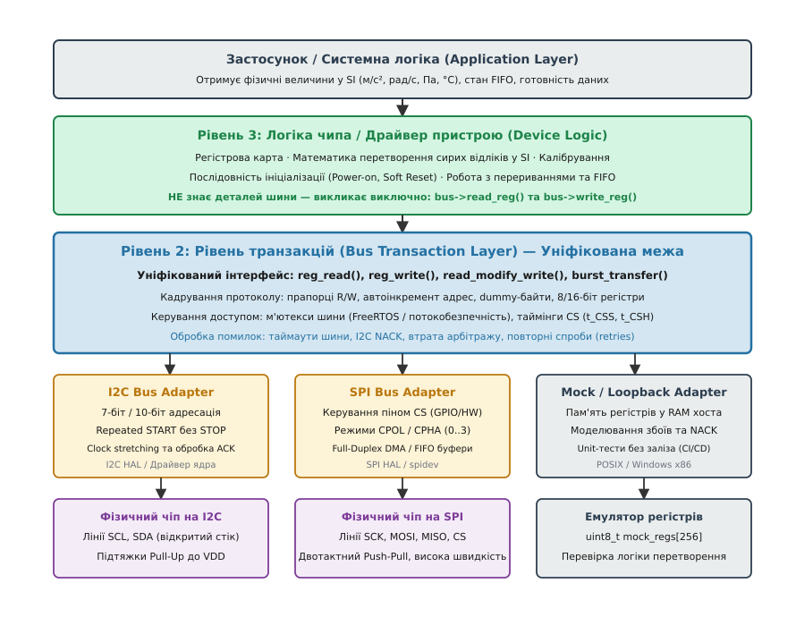
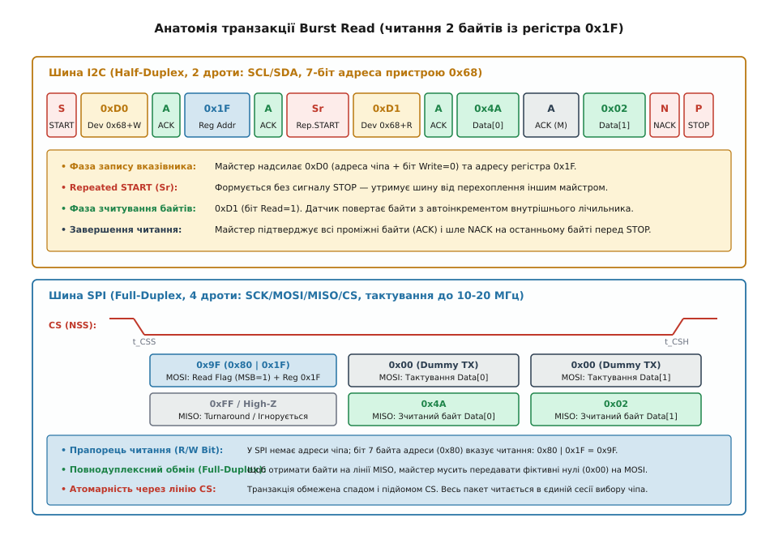

# Рівень транзакцій: відділити чип від шини

<preknowlist>
* [Шина I2C: фізичний рівень, адресація та протокол](root:com-devices/i2c-bus)
* [Шина SPI: повнодуплексний синхронний обмін](root:com-devices/spi-bus)
* [Пакетне зчитування регістрів (Burst Read)](root:com-devices/burst-read)
* [Регістри GPIO та керування лініями введення-виведення](root:sf-devices/gpio-registers)
* [Модульна архітектура драйверів периферії](root:sf-devices/module-model)
* [Відображення пам'яті та апаратні регістри (MMIO)](root:hw-arch/memory-mapped-io)
</preknowlist>

Коли прототип автономного реєстратора руху на базі 6-осьового інерційного модуля Bosch BMI270 або STMicroelectronics LSM6DSO переносять із макетної плати в серійний виріб, схемотехнік замінює двопровідну шину I2C на чотирипровідну шину SPI. На макеті частоти опитування 100 Гц через I2C вистачало для базової перевірки фільтра орієнтації, проте в серійному приладі вимоги зросли: алгоритм навігації потребує вибірки сирих даних акселерометра та гіроскопа на частоті 1.6 кГц. На шині I2C Fast Mode (400 кГц) вичитування 12 байтів сирих вимірювань триває понад 350 мікросекунд, що забирає більше половини доступного мілісекундного часового інтервалу ядра мікроконтролера. Перехід на апаратний SPI зі швидкістю 10 МГц скорочує цей час до 12 мікросекунд.

Якщо код драйвера сенсора написаний монолітно — з прямими викликами апаратного рівня на кшталт `HAL_I2C_Mem_Read(&hi2c1, BMI270_ADDR, REG_DATA, I2C_MEMADD_SIZE_8BIT, buffer, 12, 100)` всередині кожного математичного методу, — зміна шини паралізує розробку. Інженеру доводиться переписувати або розгалужувати через директиви препроцесора `#ifdef USE_SPI` десятки функцій ініціалізації, калібрування, налаштування діапазонів вимірювань і потокового розпакування. Будь-яке виправлення алгоритмічної помилки у формулі обчислення кутів Ейлера доводиться вносити у дві паралельні гілки коду, що неминуче призводить до розсинхронізації кодової бази та прихованих дефектів.

Рівень транзакцій (Bus Transaction Layer) ліквідує цю проблему, впроваджуючи сувору границю абстракції між логікою внутрішніх регістрів мікросхеми та протоколом передачі байтів через фізичні лінії друкованої плати.

---

### Кремнієва анатомія мультипротокольних сенсорів

Сучасні цифрові мікросхеми датчиків, такі як Bosch BMI270, TDK InvenSense ICM-42688 чи STMicroelectronics LSM6DSO, спроєктовані як мультипротокольні пристрої. Їхня кремнієва архітектура чітко розділена на аналоговий сенсорний блок (MEMS), внутрішній масив регістрів конфігурації та цифровий інтерфейсний контролер, підключений до зовнішніх виводів корпусу.

```
       ┌─────────────────────────────────────────────────────────┐
       │                   ІНТЕГРАЛЬНА МІКРОСХЕМА                │
       │                                                         │
       │  ┌─────────────────┐             ┌───────────────────┐  │
       │  │  MEMS Сенсори   │             │ Масив регістрів   │  │
       │  │  (Accel / Gyro) │──── АЦП ───▶│ конфігурації та   │  │
       │  └─────────────────┘             │ даних (Bank 0..3) │  │
       │                                  └─────────▲─────────┘  │
       │                                            │            │
       │                 ┌──────────────────────────▼──────────┐ │
       │                 │   Інтерфейсний автомат протоколу    │ │
       │                 └──────────────────▲──────────────────┘ │
       └────────────────────────────────────┼────────────────────┘
                                            │
               ┌────────────────────────────┴────────────────────────────┐
               ▼                                                         ▼
        [ Режим I2C ]                                             [ Режим SPI ]
  Ніжка CS підтягнута до VDD                                Ніжка CS падає в 0 (Active Low)
  SCL  ──▶ Тактування (до 1 МГц)                            SCK  ──▶ Тактування (до 24 МГц)
  SDA  ◀─▶ Дані (Open-Drain, ACK)                           MOSI ──▶ Вхід даних (Master Out)
  SA0  ──▶ Молодший біт адреси                              MISO ◀── Вихід даних (Slave Out)
```

Під час подачі напруги живлення внутрішній генератор скидання (Power-On Reset, POR) кристала аналізує електричний стан виводу Chip Select (CS):
1. **Вибір I2C**: Якщо лінія CS жорстко підтягнута до шини живлення VDD через резистор 10 кОм, внутрішній комутатор сенсора спрямовує вивід тактування на вхід I2C SCL, вивід даних — на двонаправлений каскад із відкритим стоком I2C SDA, а вивід вибору адреси SA0 (SDO) визначає молодший біт 7-бітної адреси пристрою на шині (наприклад, `0x68` при SA0=0 або `0x69` при SA0=1).
2. **Вибір SPI**: Якщо лінія CS переводиться мікроконтролером у стан логічного нуля, скінченний автомат кристала вимикає логіку декодування адрес I2C і перемикає виводи у 4-провідний повнодуплексний режим SPI: SCK (вхід тактового сигналу), MOSI/SDI (вхід послідовних даних), MISO/SDO (вихід даних Push-Pull) та активний низький CS.

Внутрішня регістрова пам'ять сенсора залишається абсолютно ідентичною в обох режимах: регістр ідентифікатора пристрою `WHO_AM_I` розташований за адресою `0x00` (або `0x75`), вимірювання прискорення по осі X — за адресою `0x12`, а регістр керування живленням — за адресою `0x7D`. Змінюється виключно механізм доступу до цих адрес через фізичний інтерфейс.

---

### Трирівнева архітектура драйвера

Щоб ізолювати алгоритмічний код від апаратних змін, програмний стек розбивають на три незалежні рівні із суворо регламентованими інтерфейсами передачі даних.


*Трирівнева архітектура вбудованого драйвера: фізичний транспорт, транзакційний рівень та апаратна логіка пристрою.*

Розглянемо обов'язки кожного шару та їхні зони відповідальності:

#### Рівень 1: Фізичний рівень шини (Bus Physical Layer / Hardware Controller HAL)
Цей шар відповідає за безпосереднє взаємодію з апаратними регістрами конкретного мікроконтролера (STM32, ESP32, NXP LPC, Nordic nRF). Він керує генераторами тактування, каналами прямого доступу до пам'яті (DMA), таблицями векторів переривань (NVIC) та бітами стану периферійного модуля (наприклад, регістрами `I2C_CR1`, `SPI_DR`). Його завдання — забезпечити базові примітиви передачі байтового потоку: «надіслати блок із N байтів», «прийняти блок із M байтів» або «виконати одночасний дуплексний обмін».

Фізичний шар нічого не знає про те, які саме пристрої підключені до ліній, що означають передані байти, і які регістри знаходяться всередині підключених мікросхем.

#### Рівень 2: Рівень транзакцій (Bus Transaction Layer — серце архітектури)
Цей шар усуває фундаментальну прірву між послідовним байтовим потоком фізичної шини та логікою доступу до внутрішніх комірок пам'яті мікросхеми. Рівень транзакцій бере на себе всю протокольну рутину:
- Формування адресного кадру залежно від типу шини (вставка I2C 7-бітної адреси веденого пристрою або маскування бітів R/W у першому байті SPI).
- Керування умовою Repeated START на шині I2C або утриманням лінії Chip Select (CS) у нулі протягом усієї транзакції на SPI.
- Врахування затримок встановлення та утримання сигналів (Setup/Hold Times), необхідних за документацією конкретного чипа.
- Вставка холостих байтів (Dummy Clocks), які вимагаються багатьма сенсорами під час читання регістрів на високих тактових частотах SPI (>10 МГц).
- Організація багатопотокової безпеки (захоплення та звільнення системних м'ютексів операційної системи RTOS перед виходом на спільну шину).
- Відновлення стану шини у разі виникнення колізій або зависання ведених пристроїв.

#### Рівень 3: Логіка пристрою (Device Register Logic / Sensor Driver)
Верхній шар реалізує алгоритмічну поведінку інтегральної мікросхеми. Він знає карту її регістрів, призначення окремих бітових полів, формати представлення чисел із фіксованою точкою (двійкове доповнення до двох), масштабні коефіцієнти чутливості гіроскопа (наприклад, 16.4 LSB/(град/с) для діапазону ±2000 dps), формули температурної компенсації та послідовності скидання.

Драйвер сенсора працює виключно через абстрактний транзакційний інтерфейс: він викликає `reg_read(reg, buffer, len)` та `reg_write(reg, buffer, len)`, ніколи не замислюючись над тим, летять ці байти через апаратний контролер I2C1, модуль SPI3 чи програмний емулятор пам'яті на сервері модульного тестування (Host-based Unit Testing).

---

### Семантика кадрування: I2C Repeated START проти SPI Chip Select

Головна складність об'єднання I2C та SPI під єдиним інтерфейсом полягає в кардинальній відмінності механізмів адресації та структурування кадрів.


*Кадрування транзакції зчитування регістрів: 2-фазний обмін із сигналом Repeated START на I2C проти повнодуплексного кадру з лінією CS на SPI.*

Розглянемо покроково, що відбувається на фізичних лініях під час виконання абстрактної операції «прочитати 2 байти з регістра `0x12`».

#### Транзакція на шині I2C
1. **Фаза адресації запису**: Майстер формує перепад лінії SDA з високого рівня в низький при високому рівні SCL (умова START). Далі надсилається 7-бітний адресний байт пристрою зі встановленим бітом запису W=0 (наприклад, `0xD0` для адреси `0x68`). Якщо ведений пристрій присутній на шині, на дев'ятому такті він притягує лінію SDA до нуля, видаючи підтвердження (ACK).
2. **Фаза передачі покажчика**: Майстер передає байт внутрішньої адреси регістра (`0x12`), ведений підтверджує отримання бітом ACK і завантажує цю адресу у свій внутрішній адресний лічильник.
3. **Фаза зміни напрямку (Repeated START)**: Замість видачі сигналу STOP (що звільнило б шину і дозволило іншим майстрам перехопити керування або скинуло б внутрішній покажчик датчика), майстер генерує повторний START (Repeated START або ReSTART).
4. **Фаза читання даних**: Майстер надсилає 7-бітну адресу пристрою з бітом читання R=1 (`0xD1`), отримує ACK від веденого і починає тактувати лінію SCL. Ведений пристрій видає перший байт регістра `0x12`, майстер підтверджує його отримання бітом ACK. Потім ведений автоматично інкрементує свій лічильник і видає вміст регістра `0x13`.
5. **Фаза завершення**: Отримавши останній байт, майстер видає відсутність підтвердження (NACK — лінія SDA залишається у високому рівні) і формує перепад SDA з низького в високий при високому SCL (сигнал STOP).

#### Транзакція на шині SPI
1. **Активація пристрою**: Майстер притягує окрему лінію Chip Select (CS) конкретного чипа до логічного нуля. Цей перепад скидає внутрішній інтерфейсний автомат сенсора в початковий стан.
2. **Передача команди та адреси**: Майстер починає тактування лінії SCK і одночасно виставляє на лінію MOSI байт, де адреса регістра скомбінована зі спеціальним бітом операції. Для більшості сенсорів (Bosch, ST, InvenSense) старший біт 7 встановлюється в `1` для читання (`0x80 | 0x12 = 0x92`) або очищується в `0` для запису. Одночасно по лінії MISO чип повертає невизначений (dummy) стан.
3. **Зчитування корисних даних**: Не знімаючи низького рівня з лінії CS, майстер продовжує тактувати лінію SCK, передаючи по лінії MOSI нулі (`0x00`), а по лінії MISO ведений пристрій виштовхує байти регістрів `0x12` та `0x13`.
4. **Деактивація пристрою**: Після отримання останнього біта майстер піднімає лінію CS у високий рівень. Вихідний буфер MISO веденого пристрою негайно переходить у високоімпедансний стан (Hi-Z), звільняючи лінію для інших мікросхем на цій же шині SPI.

Рівень транзакцій повністю приховує ці відмінності: для виклику `bus_read_reg(bus, 0x12, data, 2)` драйвер сенсора не виконує жодних маніпуляцій з лініями чи бітами напрямку.

---

### Полярність, фаза тактування SPI та конфігурація режимів

Протокол SPI допускає чотири комбінації полярності тактового сигналу (CPOL — Clock Polarity) та фази фіксації даних (CPHA — Clock Phase):
- **Режим 0 (Mode 0: CPOL=0, CPHA=0)**: Тактова лінія SCK у стані спокою має низький рівень (LOW). Дані виставляються передавачем по спадаючому фронту, а фіксуються (семплюються) приймачем по першому наростаючому передньому фронту SCK.
- **Режим 1 (Mode 1: CPOL=0, CPHA=1)**: SCK у спокої LOW. Дані змінюються по наростаючому фронту, а зчитуються по спадаючому задньому фронту SCK.
- **Режим 2 (Mode 2: CPOL=1, CPHA=0)**: SCK у спокої HIGH. Семплювання виконується по першому спадаючому фронту.
- **Режим 3 (Mode 3: CPOL=1, CPHA=1)**: SCK у спокої HIGH. Семплювання виконується по наростаючому фронту SCK.

Переважна більшість цифрових інтегральних датчиків спроєктовані так, що підтримують одночасно **Mode 0 та Mode 3**. Це пояснюється тим, що в обох режимах стробування даних відбувається по наростаючому фронту тактового імпульсу SCK, а різниця полягає виключно в постійному рівні лінії під час очікування. Адаптер SPI на рівні транзакцій інкапсулює вибір режиму у структурі дескриптора шини, дозволяючи драйверу не піклуватися про полярність ліній.

---

### Математичний аналіз часових витрат та пропускної здатності шин

Для глибшого розуміння інженерних компромісів розрахуємо точний часовий бюджет транзакцій зчитування блоку даних різного розміру на шинах I2C та SPI.

Нехай необхідно вичитати масив із N байтів із внутрішнього регістра мікросхеми.

#### 1. Розрахунок часу для шини I2C
На шині I2C кожен байт супроводжується дев'ятим тактом підтвердження ACK. При тактовій частоті f_SCL період одного такту становить T_SCL = 1 / f_SCL.
Транзакція зчитування складається з таких обов'язкових часових інтервалів:
- Формування початкового сигналу START: t_STA ≈ T_SCL / 2.
- Передача 7-бітної адреси пристрою з бітом Write + такт ACK: 9 тактів = 9 · T_SCL.
- Передача 8-бітної адреси регістра + такт ACK: 9 тактів = 9 · T_SCL.
- Формування сигналу Repeated START: t_RSTA ≈ T_SCL / 2.
- Передача 7-бітної адреси пристрою з бітом Read + такт ACK: 9 тактів = 9 · T_SCL.
- Зчитування N байтів даних із підтвердженнями ACK/NACK: N · 9 · T_SCL.
- Формування фінального сигналу STOP та час вільного стану шини: t_STO + t_BUF ≈ 1.5 · T_SCL.

```
T_I2C(N) = (28 + 9 · N) · T_SCL                      [Сумарний час транзакції I2C]
```

Для стандартного режиму Fast Mode (f_SCL = 400 кГц, T_SCL = 2.5 мкс):
- Одиничне зчитування (N = 1 байт): T_I2C(1) = (28 + 9) · 2.5 мкс = 92.5 мкс.
- Пакетне зчитування вимірювань IMU (N = 12 байтів): T_I2C(12) = (28 + 108) · 2.5 мкс = 340.0 мкс.
- Вичитування повного буфера FIFO (N = 512 байтів): T_I2C(512) = (28 + 4608) · 2.5 мкс = 11590 мкс = 11.59 мс.

#### 2. Розрахунок часу для шини SPI
На шині SPI передача відбувається повнодуплексно без додаткових бітів підтвердження (кожен байт займає рівно 8 тактів SCK з періодом T_SCK = 1 / f_SCK).
Транзакція містить такі компоненти:
- Час випередження сигналу CS до першого такту SCK (CS Setup Time): t_CSS ≈ 50 нс.
- Передача 1 байта адреси/команди: 8 тактів = 8 · T_SCK.
- Якщо потрібен 1 dummy-байт (для f_SCK > 10 МГц): K_dummy · 8 · T_SCK (де K_dummy = 1 або 0).
- Зчитування N байтів даних: N · 8 · T_SCK.
- Час утримання CS після останнього такту SCK (CS Hold Time): t_CSH ≈ 50 нс.
- Мінімальна міжтранзакційна пауза CS High: t_CS_HIGH ≈ 100 нс.

```
T_SPI(N) = t_CSS + t_CSH + t_CS_HIGH + 8 · (1 + K_dummy + N) · T_SCK   [Сумарний час транзакції SPI]
```

Для типової частоти SPI f_SCK = 10 МГц (T_SCK = 0.1 мкс, без dummy):
- Одиничне зчитування (N = 1 байт): T_SPI(1) = 0.2 мкс + 8 · (2) · 0.1 мкс = 1.8 мкс.
- Пакетне зчитування IMU (N = 12 байтів): T_SPI(12) = 0.2 мкс + 8 · (13) · 0.1 мкс = 10.6 мкс.
- Вичитування повного буфера FIFO (N = 512 байтів): T_SPI(512) = 0.2 мкс + 8 · (513) · 0.1 мкс = 410.6 мкс = 0.41 мс.

Зіставлення показує, що для 12 байтів даних шина SPI у **32 рази швидша**, а для 512-байтового FIFO — у **28 разів швидша**. У системі з жорстким дедлайном циклу стабілізації (наприклад, 1000 мкс у польотному контролері квадрокоптера) використання I2C блокувало б 34% ресурсу процесора на кожній ітерації опитування, тоді як SPI витрачає лише 1% бюджету часу.

---

### Електричні особливості фізичного рівня та розрахунок ліній зв'язку

Надійність рівня транзакцій визначається не лише чистотою коду, а й фізичними характеристиками друкованої плати. Розробник вбудованого ПЗ зобов'язаний розуміти межі фізичного рівня, щоб правильно діагностувати апаратні збої та задавати часові затримки в адаптерах шин.

#### 1. Розрахунок підтягувальних резисторів шини I2C
Шина I2C є пасивною на наростаючому фронті сигналу: транзистор передавача закривається, і лінія підтягується до напруги VDD виключно через зовнішній резистор R_pullup. Форма фронту описується класичною експонентою заряду RC-кола.

Сумарна паразитна ємність шини C_bus складається з ємності доріжок друкованої плати, вхідної ємності ніжок мікроконтролера та ємності підключених ведених пристроїв:
```
C_bus = C_PCB + C_MCU + C_devices                     [Сумарна паразитна ємність шини]
```
де C_PCB — ємність провідників плати (≈ 1.5 пФ/см), C_MCU — вхідна ємність ніжки мікроконтролера (≈ 5–8 пФ), C_devices — ємність підключених сенсорів (≈ 10 пФ на чип).

Для шини з 4 датчиками та довжиною трас 20 см:
```
C_bus = (20 · 1.5) + 8 + (4 · 10) = 78 пФ
```

Резистор R_pullup вибирається між двома граничними значеннями:
- **Мінімальний опір R_min** (захист вихідного транзистора від перевантаження за струмом I_OL ≤ 3 мА при падінні V_OL ≤ 0.4 В):
```
R_min = (VDD - V_OL) / I_OL = (3.3 - 0.4) / 0.003 = 967 Ом
```
- **Максимальний опір R_max** (забезпечення часу наростання фронту t_r ≤ 300 нс для Fast Mode 400 кГц за стандартом NXP):
```
R_max = t_r / (0.8473 · C_bus) = 300·10⁻⁹ / (0.8473 · 78·10⁻¹²) = 4539 Ом (4.54 кОм)
```

Оптимальним компромісом для надійної роботи є номінал 2.2 кОм. Якщо помилково ввімкнути лише внутрішню підтяжку мікроконтролера (R_internal ≈ 40 кОм), час наростання зросте до 2.6 мкс, що повністю спотворить прямокутні тактові імпульси і призведе до масових помилок `BUS_STATUS_ERR_NACK`.

#### 2. Хвильові процеси, дзвін та узгодження ліній SPI
При частотах тактування SPI f_SCK ≥ 10 МГц час наростання вихідних буферів мікроконтролера t_rise становить 1–2 нс. Довжина хвилі фронту сигналу стає співмірною з довжиною провідника на платі. Якщо лінія не узгоджена, на кінці провідника виникає відбиття сигналу, що призводить до явища «дзвону» (ringing) та викидів напруги вище VDD і нижче GND.

Приймач сприймає перетин порогу логічної одиниці під час дзвону як додатковий тактовий імпульс, внаслідок чого всі наступні зчитані байти зсуваються на 1 біт ліворуч.

Для запобігання відбиттям на лініях SCK, MOSI та CS біля виводів передавача мікроконтролера (а також на лінії MISO біля виводу сенсора) встановлюють послідовні демпфуючі резистори:
```
R_series = Z_0 - R_driver ≈ 50 - 20 = 22..33 Ом
```
де Z_0 — хвильовий опір мікросмужкової лінії друкованої плати (≈ 50 Ом), а R_driver — вихідний опір транзисторів GPIO (≈ 15–25 Ом).

---

### Затягування тактування (Clock Stretching) та таймаути SMBus

На шині I2C ведений пристрій має право примусово затримати завершення транзакції, якщо його внутрішній мікроконтролер не встигає обробити попередній байт або очікує завершення аналого-цифрового перетворення.

Механізм затягування тактування (Clock Stretching) працює таким чином:
1. Ведений пристрій притягує лінію SCL до логічного нуля після дев'ятого такту підтвердження.
2. Майстер відпускає лінію SCL і намагається сформувати високий рівень, проте завдяки топології з відкритим стоком лінія SCL залишається в нулі.
3. Апаратний модуль I2C майстра переходить у стан очікування, доки ведений пристрій не відпустить SCL.

Якщо ведений пристрій зависає під час затягування тактування, звичайний драйвер I2C блокує виконання всього мікроконтролера в нескінченному циклі `while (!(I2C->SR1 & I2C_SR1_TXE))`.

Рівень транзакцій запобігає зависанню системи двома шляхами:
- **Апаратний таймаут SMBus**: Якщо апаратний контролер підтримує специфікацію SMBus (System Management Bus), увімкнення прапорця SMBus Timeout налаштовує вбудований таймер на автоматичне скидання шини, якщо лінія SCL залишається притиснутою до нуля довше за 25–35 мс.
- **Програмний захисний таймер**: Кожен виклик драйвера обмежується граничним часом виконання t_timeout (зазвичай 10–50 мс). Якщо таймер спливає до звільнення лінії, адаптер перериває транзакцію, повертає статус `BUS_STATUS_ERR_TIMEOUT` і запускає процедуру відновлення шини.

---

### Фази енергозбереження та перехідні процеси ініціалізації

У бездротових пристроях із батарейним живленням сенсори більшу частину часу проводять у режимі глибокого сну (Deep Sleep або Suspend Mode), споживаючи менше 5 мкА. Коли алгоритм активує сенсор для чергового вимірювання, необхідно враховувати фізичні перехідні процеси всередині кристала:

```
 ┌───────────────────────────────────────────────────────────────────────────┐
 │                ЧАСОВІ ФАЗИ ПРОБУДЖЕННЯ ТА СТАБІЛІЗАЦІЇ MEMS               │
 │                                                                           │
 │ [ Deep Sleep ] ──▶ [ Power-On / Wakeup ] ──▶ [ MEMS Settling ] ──▶ [ Data]│
 │    I < 5 uA           t_OSC = 200..500 us       t_SETTLING = 5..15 ms     │
 └───────────────────────────────────────────────────────────────────────────┘
```

1. **Фаза розгону генератора (t_OSC)**: Пробудження цифрового скінченного автомата та стабілізація внутрішнього RC-генератора тактування (триває 200–500 мкс). До закінчення цієї фази чип не відповідає на запити I2C/SPI (видає NACK).
2. **Фаза зарядової помпи та стабілізації аналогових кіл (t_SETTLING)**: Для роботи ємнісних MEMS-структур внутрішній генератор напруги піднімає напругу зміщення пластин до 20–30 В. Аналогові інтегратори виходять на стаціонарний режим протягом 5–15 мс.
3. **Небезпека зчитування сміття**: Якщо драйвер спробує вичитати регістри прискорення одразу після встановлення біта `PWR_MGMT = ACTIVE`, сенсор поверне нулі або максимальні значення насичення (Saturation Glitches), що призведе до збою фільтра орієнтації.

Рівень транзакцій бере на себе коректну обробку станів живлення: після відправки команди пробудження адаптер виставляє блокування на транзакції читання даних або автоматично вводить затримку `bus_delay_ms(t_settling)`, гарантуючи валідність першого отриманого відліку.

---

### Атомарність операцій Read-Modify-Write та бітові маски

У більшості мікросхем сенсорів один фізичний 8-бітний регістр керує одразу кількома незалежними функціями. Наприклад, у регістрі конфігурації акселерометра `REG_ACC_CONFIG`:
- Біти 7..4 задають вихідну частоту видачі даних (Output Data Rate, ODR).
- Біти 3..2 задають діапазон вимірювань (Full Scale Range: ±2g, ±4g, ±8g, ±16g).
- Біти 1..0 задають смугу пропускання вбудованого фільтра низьких частот (Low-Pass Filter, LPF).

Якщо розробник змінює діапазон вимірювань прямим записом байта `bus_write_u8(bus, REG_ACC_CONFIG, 0x08)`, він ненавмисно затирає налаштування частоти опитування та фільтрації, встановлюючи їх у нульовий дефолтний стан.

Рівень транзакцій реалізує атомарну функцію модифікації регістрів `bus_modify_reg(bus, reg, clear_mask, set_mask)`:
1. Виконується транзакція читання поточного стану регістра.
2. Біти, що підлягають зміні, очищаються за маскою `clear_mask`.
3. Нові значення накладаються за маскою `set_mask`.
4. Якщо результуючий байт збігається з поточним значенням у регістрі, повторний запис не виконується, заощаджуючи пропускну здатність шини.
5. Якщо значення змінилося, виконується транзакція запису оновленого байта.

---

### Проєктування інтерфейсу рівня транзакцій на C99

У мові C99 класичним та найефективнішим інженерним підходом для реалізації поліморфного інтерфейсу є використання структури з таблицею покажчиків на функції (віртуальної таблиці, vtable) у поєднанні з непрозорим покажчиком на контекст конкретного адаптера (`void *ctx`).

Контракт взаємодії повинен підтримувати базові регістрові операції, пакетне читання/запис, повнодуплексний обмін і функції блокування шини в багатозадачному середовищі.

:::tabs
== C99
:::code riven-tranzaktsii-d/c/bus_transaction_c99.h
== C++20
:::code riven-tranzaktsii-d/cpp/BusConcepts.hpp
:::

Тепер покажемо реалізацію конкретних адаптерів: для шини I2C (із формуванням Repeated START) та шини SPI (із керуванням піном CS та накладанням маски читання).

:::tabs
== C99
:::code riven-tranzaktsii-d/c/bus_adapters_c99.c
== C++20
:::code riven-tranzaktsii-d/cpp/CppAdapters.hpp
:::

---

### Реалізація драйвера сенсора поверх рівня транзакцій

Створимо драйвер 6-осьового сенсора (IMU), який приймає абстрактний інтерфейс шини і взагалі не містить коду, специфічного для I2C або SPI.

:::tabs
== C99
:::code riven-tranzaktsii-d/c/imu_sensor.c
== C++20
:::code riven-tranzaktsii-d/cpp/CppImuDriver.hpp
:::

Повну робочу практичну систему з імітатором регістрової пам'яті (Mock Adapter), підтримкою черг повідомлень та тестовим стендом наведено у вставці [Практична реалізація уніфікованого рівня транзакцій для I2C та SPI](root:sf-devices/riven-tranzaktsii/proj-bus-transaction-layer.md).

---

### Робота з апаратним FIFO сенсора та пакетний Burst-режим

У високочастотних вимірювальних системах опитування датчика за кожним окремим перериванням готовності даних (Data Ready Interrupt) призводить до надмірних накладних витрат. Якщо акселерометр працює з частотою видачі f_ODR = 1600 Гц, мікроконтролер змушений кожні 625 мкс обробляти переривання, зберігати регістри на стек процесора, виконувати перемикання контексту RTOS і захоплювати м'ютекс шини.

Сучасні інерційні модулі містять апаратний буфер FIFO (First-In First-Out) об'ємом від 512 до 2048 байтів, організований як кільцева пам'ять із пакетною структурою кадрування.

```
                   СТРУКТУРА ПАКЕТА АПАРАТНОГО FIFO IMU
 ┌───────────────┬───────────────────────────────┬───────────────────────────────┐
 │ Байт 0        │ Байти 1 .. 6                  │ Байти 7 .. 12                 │
 │ Заголовок     │ Вимірювання Акселерометра     │ Вимірювання Гіроскопа         │
 │ (Header Byte) │ X_LSB, X_MSB, Y_LSB..         │ X_LSB, X_MSB, Y_LSB..         │
 └───────────────┴───────────────────────────────┴───────────────────────────────┘
   ▲               ▲                               ▲
   │               │                               │
   │               └─ Дані Accel (6 байтів)       └─ Дані Gyro (6 байтів)
   │
   └─ Біти заголовка:
      - Біт 7: Наявність кадру даних (0 = Data, 1 = Control)
      - Біт 6: Прапорець валідності Accel (1 = включено)
      - Біт 5: Прапорець валідності Gyro (1 = включено)
      - Біт 4: Прапорець температурного байта
      - Біти 3..0: Лічильник пропущених кадрів (Drop Count)
```

Завдяки рівню транзакцій опитування організовується пакетним способом:
1. **Налаштування порогу заповнення (FIFO Watermark)**: Регістр `FIFO_WTM` сенсора програмується на поріг, наприклад, 32 пакети (416 байтів).
2. **Зниження частоти переривань**: Лінія `INT1` сенсора налаштовується на генерацію імпульсу лише тоді, коли кількість накопичених у FIFO байтів досягне порогу. Замість 1600 переривань на секунду процесор отримує лише 1600 / 32 = 50 переривань на секунду.
3. **Пакетний DMA-трансфер**: За єдиний виклик `bus_read_reg(bus, REG_FIFO_DATA, dma_buffer, 416)` рівень транзакцій зчитує весь блок даних у фоновому режимі, не навантажуючи ядро процесора.
4. **Потокове демультиплексування**: Алгоритмічний рівень сканує заголовочні байти масиву `dma_buffer`, витягуючи синхронізовані в часі вектори прискорення та кутової швидкості.

---

### Пам'ять, DMA та когерентність кешу даних

Коли рівень транзакцій переводить передачу даних на рейки прямого доступу до пам'яті (DMA), виникають специфічні низькорівневі обмеження архітектури мікроконтролера, про які драйвер верхнього рівня навіть не повинен здогадуватися.

У сучасних ядрах ARM Cortex-M7 (STM32H7, i.MX RT) процесорне ядро працює через дворівневу систему кешування (L1 I-Cache та L1 D-Cache). Кеш даних використовує рядки розміром по 32 байти (Cache Lines). 

Якщо буфер зчитування виділений у кешованій області SRAM:
1. Контролер DMA записує зчитані з SPI байти безпосередньо у фізичну комірку пам'яті SRAM, оминаючи кеш процессора.
2. Коли процесор виконує інструкцію читання буфера, блок керування пам'яттю повертає старе значення з рядка L1 D-Cache, який не знає про запис DMA.
3. Програма отримує сміття замість реальних даних датчика.

Рівень транзакцій вирішує цю проблему всередині апаратного адаптера одним із двох способів:
- **Програмна інвалідація кешу**: Перед запуском DMA-прийому адаптер викликає `SCB_InvalidateDCache_by_Addr((uint32_t*)buf, (int32_t)len)`, примусово скидаючи валідність відповідного рядка кешу. При наступному читанні ядро завантажить оновлені дані прямо з фізичної пам'яті. При цьому адреса буфера та його розмір зобов'язані бути вирівняні за межею 32 байтів (`__attribute__((aligned(32)))`), інакше інвалідація сусідніх змінних у тому самому рядку призведе до фатального пошкодження пам'яті (Memory Corruption).
- **Використання MPU (Memory Protection Unit)**: Окремий регіон оперативної пам'яті (наприклад, блок AXI SRAM або SRAM4) конфігурується блоком захисту пам'яті MPU як некешована область (Non-Cacheable / Device Memory). Усі транзакційні буфери розміщуються виключно в цій секції через атрибути компонувальника (`__attribute__((section(".noncacheable")))`).

---

### Багатозадачність, RTOS та уникнення інверсії пріоритетів

У реальних проєктах до однієї фізичної шини I2C або SPI підключено декілька мікросхем: високошвидкісний IMU (опитування в задачі стабілізації з пріоритетом `PriorityRealtime`), барометр (задача навігації `PriorityNormal`) та зовнішня мікросхема Flash-пам'яті журналювання (фонова задача `PriorityLow`).

Якщо низькопріоритетна задача починає запис 256-байтового сектора у Flash-пам'ять, а посеред передачі її витісняє задача польотного контролера, яка негайно намагається зчитати дані акселерометра з тієї самої шини, виникає катастрофічне накладання транзакцій: байти адреси IMU будуть сприйняті Flash-пам'яттю як дані тіла сторінки, а дані IMU спотворяться.

Рівень транзакцій гарантує неподільність операцій за допомогою механізму взаємного виключення (Bus Mutex) з обов'язковою підтримкою успадкування пріоритетів (Priority Inheritance):
1. Кожен виклик `bus_read_reg` або `bus_write_reg` починається із захоплення м'ютекса шини `bus->ops->lock(bus->ctx, timeout)`.
2. Якщо шина зайнята низькопріоритетною задачею, високопріоритетна задача переходить у стан очікування (Blocked).
3. Операційна система RTOS автоматично піднімає пріоритет задачі-власника шини до рівня високопріоритетної задачі, унеможливлюючи ситуацію, коли задачі з середнім пріоритетом перехоплюють процесор і безкінечно відкладають завершення транзакції шини (класична небезпека Priority Inversion).
4. **Правило обробників переривань (ISR)**: Оскільки захоплення м'ютекса в перериванні суворо заборонене (призводить до Kernel Panic), обробник апаратного переривання від лінії готовності даних сенсора (`DRDY IRQ`) ніколи не викликає транзакційні функції. Він лише відправляє пряме сповіщення відповідній задачі (`xTaskNotifyFromISR`), яка вже в контексті потоку захоплює м'ютекс і безпечно виконує читання.

---

### Асинхронний неблокуючий менеджер транзакцій

У високонавантажених системах керування навіть блокуюча транзакція SPI тривалістю 10 мікросекунд є неприпустимою втратою продуктивності для центрального процесора. Якщо мікроконтролер керує одночасно 8 сенсорами, сумарний час очікування апаратних прапорців готовності периферії може сягати 20% процесорного бюджету.

Архітектурним розвитком рівня транзакцій є перехід від синхронної моделі викликів до асинхронної черги подій (Event-Driven Transaction Queue).

```
   ┌───────────────────────┐
   │  Задача алгоритму IMU │
   └───────────┬───────────┘
               │ 1. bus_submit_async(&request)
               ▼
   ┌───────────────────────────────────────────────────────────┐
   │      Кільцева черга запитів рівня транзакцій (Queue)      │
   │  [ Дескриптор 1 ] ──▶ [ Дескриптор 2 ] ──▶ [ Дескриптор 3 ]│
   └───────────────────────────┬───────────────────────────────┘
                               │ 2. Диспетчеризація наступного запиту
                               ▼
   ┌───────────────────────────────────────────────────────────┐
   │  Апаратний контролер SPI / I2C + Канал прямого доступу DMA│
   └───────────────────────────┬───────────────────────────────┘
                               │ 3. Передача байтів без участі CPU
                               ▼
   ┌───────────────────────────────────────────────────────────┐
   │ Переривання DMA_IRQHandler (Transfer Complete Interrupt)   │
   └───────────────────────────┬───────────────────────────────┘
                               │ 4. xTaskNotifyFromISR() або Callback
                               ▼
   ┌───────────────────────────────────────────────────────────┐
   │       Обробка результату та розпакування вимірювань       │
   └───────────────────────────────────────────────────────────┘
```

Дескриптор асинхронної транзакції містить усі параметри, необхідні для автономного виконання обміну:
:::tabs
== C99
:::code riven-tranzaktsii-d/c/asynkhronnyi-neblokuiuchyi.c
== C++20
:::code riven-tranzaktsii-d/cpp/asynkhronnyi-neblokuiuchyi.cpp
:::

Потік керування в асинхронній моделі працює таким чином:
1. Потік сенсора формує запит на читання і викликає `bus_submit_async(&req)`. Функція атомарно поміщає дескриптор у кільцевий буфер черги і негайно повертає керування, не чекаючи завершення фізичної передачі.
2. Якщо контролер шини вільний, драйвер активує лінію Chip Select і запускає передачу через DMA.
3. Процесор продовжує виконання інших математичних задач або переходить у режим сну для збереження енергії.
4. Після передачі останнього байта апаратний блок DMA генерує переривання завершення трансферу `DMA_TC_IRQHandler`.
5. Обробник переривання піднімає лінію CS, викликає зареєстрований `callback` або надсилає пряме сповіщення задачі-споживачу через семафор чи чергу FreeRTOS.
6. Диспетчер автоматично витягує з черги наступний очікуючий запит і запускає нову DMA-транзакцію.

---

### Кремнієві аномалії та особливості виробників (Silicon Quirks)

Кожен виробник інтегральних мікросхем реалізує інтерфейсну частину з власними унікальними відхиленнями від стандарту. Рівень транзакцій зобов'язаний інкапсулювати ці апаратні «химери», щоб код драйвера верхнього рівня залишався простим та стандартизованим.

#### 1. Банки регістрів (Register Banking в TDK ICM-20948 та ICM-42688)
Через обмеження 7-бітного адресного простору SPI/I2C (максимум 128 регістрів) виробники складних 9-осьових модулів розбивають карту регістрів на 4 незалежні банки (Bank 0, Bank 1, Bank 2, Bank 3). Для доступу до регістра користувача в Bank 2 мікроконтролер мусить спершу записати значення `0x02` у спеціальний регістр вибору банку `REG_BANK_SEL` (`0x7F`), і лише після цього виконати транзакцію читання чи запису.

Якщо драйвер на кожній операції надсилатиме команду вибору банку, кількість транзакцій на шині подвоїться. 

Рівень транзакцій оптимізує цю поведінку за допомогою кешування активного банку:
- Внутрішня структура адаптера зберігає змінну `current_bank`.
- Якщо запитана адреса регістра належить поточному активному банку, додатковий запис у `REG_BANK_SEL` пропускається.
- Якщо адреса вимагає перемикання банку, адаптер атомарно перемикає банк перед основною операцією.

#### 2. Пейджинг пам'яті в SPI NOR Flash (Page Boundary Wrapping)
Мікросхеми енергонезалежної пам'яті Flash (Winbond W25Q, Macronix MX25) організовані сторінками по 256 байтів. Під час виконання операції Page Program (`0x02`) внутрішній лічильник адрес інкрементує лише молодші 8 бітів адреси.

Якщо драйвер спробує записати 100 байтів, починаючи з адреси `0x00FE` (закінчення сторінки 0), перші 2 байти запишуться за адресами `0x00FE` та `0x00FF`, а наступні 98 байтів «загорнуться» (wrap around) на початок тієї ж сторінки (`0x0000`..`0x0061`), безповоротно затерши попередні дані.

Рівень транзакцій для блокових пристроїв пам'яті автоматично розбиває великий масив запису на фрагменти, гарантуючи, що жодна окрема транзакція не перетинає фізичну межу сторінки 256 байтів.

---

### Арбітраж мультимайстер-шин I2C та втрата арбітражу

У складних розподілених системах до однієї фізичної шини I2C можуть бути підключені два незалежних мікроконтролери (наприклад, основний навігаційний процесор та допоміжний контролер системи керування живленням). Обидва процесори можуть у довільний момент ініціювати транзакцію зчитування або запису до спільних сенсорів.

Протокол I2C вирішує конфлікт одночасного доступу за допомогою апаратного механізму арбітражу на базі ліній із відкритим стоком (Wired-AND):
1. **Одночасний START**: Якщо обидва майстри одночасно генерують сигнал START і починають видавати адресні байти, жоден із них не знає про наявність конкурента.
2. **Побітове порівняння (Bit-by-Bit Arbitration)**: Кожен майстер, виставляючи біт на лінію SDA, одночасно зчитує реальний логічний стан цієї лінії під час високого рівня сигналу SCL.
3. **Виявлення колізії**: Якщо перший майстер намагається надіслати логічну одиницю (відпускає вихідний транзистор SDA), а другий майстер одночасно передає логічний нуль (притягує SDA до землі), лінія SDA залишається в нулі. Перший майстер фіксує невідповідність між переданим `1` та прийнятим `0`.
4. **Реакція на втрату арбітражу (Arbitration Lost)**: Апаратний блок I2C першого майстра негайно вимикає свій вихідний каскад SDA, виставляє апаратний прапор помилки арбітражу (`ARLO` в регістрах ARM Cortex) і переходить у стан веденого пристрою (Slave Receiver). Перший майстер **не має права генерувати сигнал STOP**, оскільки це зламає активну транзакцію другого майстра.

Рівень транзакцій перехоплює подію втрати арбітражу:
- Транзакція негайно повертає код помилки `BUS_STATUS_ERR_ARBITRATION`.
- Диспетчер повторних спроб (Retry Manager) вичікує випадковий псевдовипадковий інтервал часу (Randomized Backoff Jitter), після чого повторює спробу захоплення шини, унеможливлюючи виникнення циклічних синхронних колізій.

---

### Діагностика, відмовостійкість та відновлення шини

Навіть ідеальний програмний код стикається з апаратними збоями на друкованій платі: електромагнітними завадами від імпульсних перетворювачів напруги, статичними розрядами чи раптовими скиданнями процесора сторожовим таймером під час активного обміну.

Рівень транзакцій інкапсулює алгоритми автоматичного відновлення працездатності:

#### 1. Алгоритм розблокування лінії I2C SDA (9 SCL Clocks Recovery)
Якщо мікроконтролер скинувся прямо в момент, коли ведений датчик видавав нульовий біт на лінію SDA, після перезавантаження шина I2C опиняється у «мертвому клінчі»: ведений чекає тактового імпульсу SCL, щоб закінчити передачу байта, а майстер не може розпочати передачу, бо бачить зайняту шину (SDA притягнута до нуля).

Адаптер I2C на рівні транзакцій містить процедуру самовідновлення:
- Апаратний модуль I2C тимчасово вимикається, а виводи перемикаються в режим звичайного GPIO Open-Drain.
- Якщо лінія SDA знаходиться в нулі, майстер генерує до 9 тактових імпульсів на лінії SCL з частотою ~50 кГц.
- Отримавши такти, ведений виштовхує залишок бітів зі свого зсувного регістра і на 9-му такті відпускає лінію SDA.
- Майстер генерує сигнал STOP (перепад SDA з LOW у HIGH при HIGH на SCL) і повертає піни в режим апаратного I2C.

#### 2. Захист від зависання ліній SPI (CS Glitch Filtering)
Якщо лінія CS під дією наведеної завади або перехідних процесів під час пробудження ядра з режиму глибокого сну короткочасно просіла в нуль, внутрішній лічильник бітів SPI-сенсора збивається. Наступна транзакція читання зміститься на кілька бітів, повертаючи спотворені байти.

Адаптер SPI запобігає цьому завдяки примусовій фіксації лінії CS у високому рівні протягом мінімального часу паузи t_CS_HIGH (зазвичай 100–200 нс) перед кожною транзакцією, а також очищенню черги апаратного буфера SPI FIFO перед кожним опущеним фронтом CS.

---

### Діагностичне трасування через Logic Analyzer та Segger SystemView

Для налагодження складних часових взаємодій у реальному часі рівень транзакцій оснащують низькорівневими діагностичними гачками (Trace Hooks).

Шляхом перемикання вільних GPIO пінів мікроконтролера на початку та в кінці виконання адаптера:
:::tabs
== C99
```c
#define DBG_PIN_SET()    (GPIOB->BSRR = GPIO_PIN_12)
#define DBG_PIN_RESET()  (GPIOB->BSRR = (uint32_t)GPIO_PIN_12 << 16)

static bus_status_t spi_read_with_trace(void *ctx, uint16_t reg, uint8_t *buf, size_t len) {
    DBG_PIN_SET();
    bus_status_t st = spi_read_impl(ctx, reg, buf, len);
    DBG_PIN_RESET();
    return st;
}
```
== C++20
:::code riven-tranzaktsii-d/cpp/diahnostychne-trasuvannia.cpp
:::

Інженер отримує можливість підключити цифровий логічний аналізатор (Saleae Logic або Sigrok) і одночасно спостерігати:
- Тривалість перебування задачі в стані блокування м'ютекса (Mutex Wait Latency).
- Реальний часовий джиттер опитування сенсора (Sensor Polling Jitter).
- Співвідношення між перериваннями готовності даних (DRDY IRQ) та фактичним початком вичитування байтів по лініях SCK/MOSI/MISO.

---

### Порівняння архітектурних підходів: C99 VTable проти C++20 Concepts

Вибір між динамічним поліморфізмом у C99 та статичним поліморфізмом у C++20 є класичним інженерним компромісом між гнучкістю під час виконання та абсолютною швидкодією:

| Характеристика | C99 (VTable + Непрозорий Контекст) | C++20 (Concepts + Templates) |
|---|---|---|
| **Механізм поліморфізму** | Динамічний (Runtime через покажчики на функції) | Статичний (Compile-time генерація коду) |
| **Накладні витрати на виклик** | 4–6 машинних інструкцій (`ldr`, `ldr`, `blx`) на кожну операцію | 0 тактів (повний інлайнінг коду адаптера) |
| **Розмір коду Flash** | Один екземпляр коду драйвера для всіх типів шин | Можливе розростання (Code Bloat) при інстанціюванні багатьма шинами |
| **Безпека роботи з пам'яттю** | Покладена на розробника (`uint8_t*` + `size_t len`) | Гарантована компілятором (`std::span`, `std::expected`) |
| **Зміна шини «на льоту»** | Можлива під час виконання (підміна покажчика `bus`) | Вимагає обгортки `std::variant` або абстрактного класу `IBusAdapter` |
| **Модульне тестування (Unit Testing)** | Елементарне (підміна покажчика на `mock_ops`) | Миттєве (передача `MockBus` як шаблонного параметра) |

---

### Резюме архітектурних рішень

1. **Жорсткий розподіл шарів**: Драйвер датчика ніколи не повинен містити викликів HAL або знати про тип фізичної шини. Уся взаємодія будується виключно навколо концепцій регістрових транзакцій `reg_read`, `reg_write` та `reg_modify`.
2. **Інкапсуляція особливостей шини**: Усі бітові маски (MSB-біт читання для SPI, прапорці автоінкременту STMicro, холості dummy-байти) є власністю адаптера транзакційного рівня, а не драйвера сенсора.
3. **Апаратна надійність**: Рівень транзакцій бере на себе захист від багатопотокових колізій (м'ютекси RTOS з успадкуванням пріоритетів), узгодження кешу процесора (DMA Cache Invalidation) та процедури відновлення шини (9-імпульсне розблокування I2C SDA).
4. **Тестованість як фундамент**: Відокремлення чіпа від шини відкриває можливість 100% покриття логіки датчиків автоматизованими модульними тестами на звичайному ПК без фізичного підключення плат і налагоджувачів.
