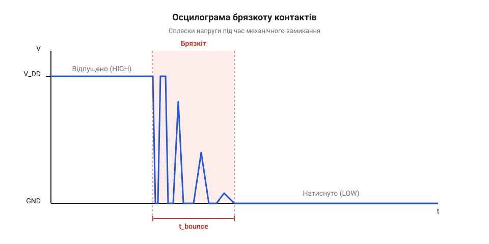
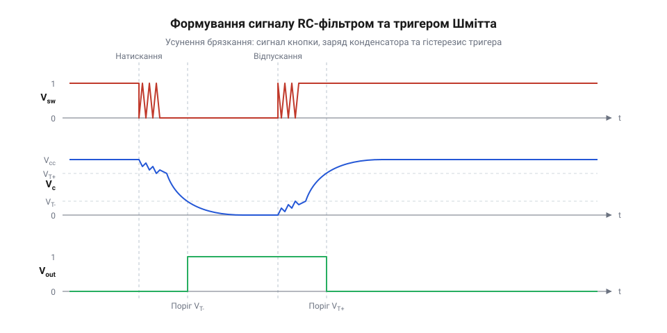
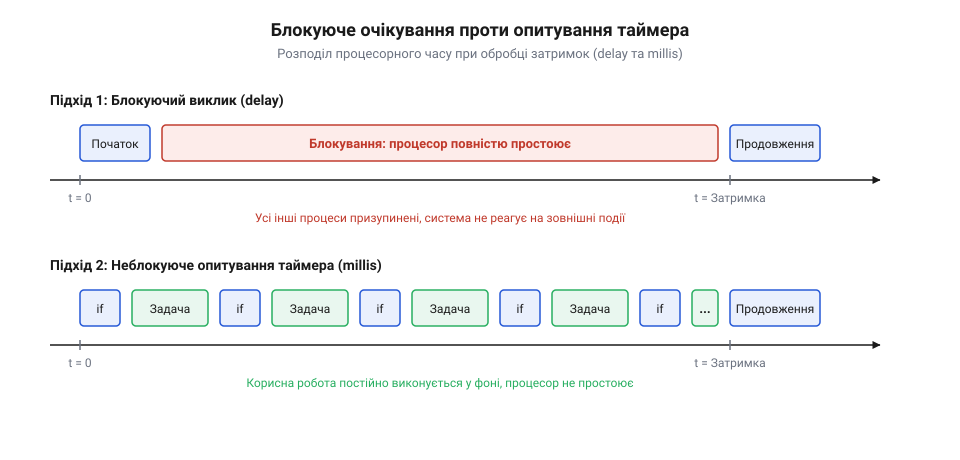
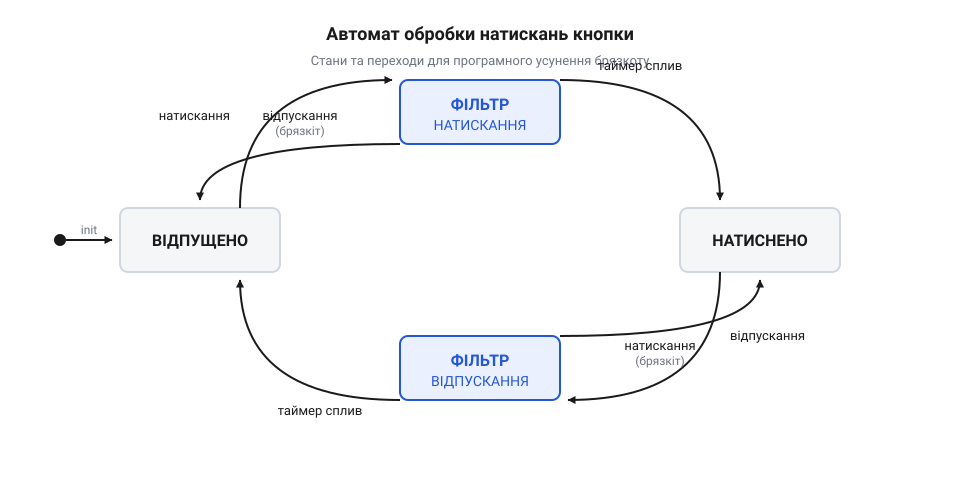

# Усунення брязкоту контактів у вбудованих системах: фізика переходів, апаратні тригери та неблокуючі алгоритми

<preknowlist>
- [Апаратне тактування](root:sf-devices/millis-micros) — принципи вимірювання мілісекундних інтервалів системними таймерами
- [Неблокуюча обробка часу](root:sf-devices/nonblocking-time) — організація періодичних перевірок без використання активного очікування
</preknowlist>

## Фізична природа механічного брязкоту контактів

Усі механічні комутаційні елементи — тактові кнопки, кінцеві вимикачі, геркони та реле — здійснюють замикання електричного кола шляхом фізичного зближення двох струмопровідних металевих поверхонь. На мікроскопічному рівні поверхня металу не є ідеально плоскою: вона вкрита мікронерівностями, шорсткостями та плівками оксидів. Коли рухомий контакт під дією пружини чи зовнішньої сили оператора вдаряється об нерухомий контакт, виникає механічний удар. Пружність металу змушує контакт відскакувати назад подібно до м'яча, що б'ється об тверду підлогу. Перш ніж контакти остаточно зафіксуються у стабільному притиснутому стані, відбувається серія повторних мікровідскоків і мікрозіткнень.

Під час цієї фази відскоків виникає хаотичне коливання електричного опору контактного вузла. У моменти відриву струм переривається, а під дією паразитних індуктивностей провідників можуть виникати короткі мікроіскри та викиди напруги. Вхідний каскад цифрового мікроконтролера сприймає цей перехідний процес не як один логічний перехід, а як хаотичну серію швидких перемикань між логічним нулем та логічною одиницею. Цей фізичний ефект називають брязкотом контактів (@@en|contact bounce@@, або @@en|chatter@@; від англ. *contact* — контакт, *bounce* — відскік, *chatter* — деренчання).


*Осцилограма напруги на виводі кнопки під час механічного замикання контактів: серія мікроімпульсів перед стабілізацією логічного рівня.*

Тривалість брязкоту `T_bounce` залежить від маси контактів, пружності пружини, геометрії перемикача та ступеня зносу поверхонь. Для компактних тактових кнопок на платах інтервал брязкоту зазвичай становить від 1 до 5 мілісекунд, тоді як потужні промислові кінцеві вимикачі та механічні реле можуть деренчати впродовж 15–50 мілісекунд. Якщо цифровий вивід мікроконтролера налаштований на генерацію апаратного переривання за перепадом напруги (@@en|edge-triggered interrupt@@), один механічний клік призводить до виклику 10–50 переривань поспіль. Це спричиняє так званий шторм переривань (@@en|interrupt storm@@), помилкове багаторазове збільшення лічильників подій або миттєвий збій логіки пристрою.

## Апаратне придушення: RC-ланцюги та тригери Шмітта

Апаратне придушення брязкоту дає змогу очистити сигнал ще до того, як він потрапить на вхід обчислювального ядра мікроконтролера. Найпоширенішим пасивним рішенням є інтегруючий RC-фільтр низьких частот, підключений між контактом і цифровим входом.

Коли кнопка замикається на землю, конденсатор розряджається через опір, згладжуючи круті перепади напруги. При розмиканні конденсатор заряджається через підтягувальний резистор `R_pullup`. Постійна часу фільтра `τ` (грецька буква тау) визначається добутком опору резистора `R` на ємність конденсатора `C`:

```
τ = R × C
```

Для гарантованого згладжування високочастотних імпульсів брязкоту постійну часу обирають із розрахунку, щоб час повного перезаряду конденсатора суттєво перевищував типову тривалість дребезгу `T_bounce`:

```
T_settle ≈ 3 × τ
T_settle = 3 × R × C                   [час заряду до 95% напруги живлення]
```

Якщо типовий брязкіт кнопки триває `T_bounce = 5` мс, обираємо `R = 10` кОм і `C = 100` нФ:

```
τ = 10000 × 100 × 10⁻⁹
  = 1 × 10⁻³                           [постійна часу 1 мілісекунда]
T_settle = 3 × 1 × 10⁻³
  = 3 × 10⁻³                           [час стабілізації 3 мілісекунди]
```

Однак простий RC-ланцюг має суттєвий недолік: він робить фронти сигналу надзвичайно пологими. Коли напруга на вході повільно перетинає пороговий рівень стандартного логічного елемента, транзистори вхідного інвертора одночасно переходять у лінійний стан. Через внутрішні шуми живлення та наведення в зоні невизначеності виникають численні паразитні спрацьовування.

Для усунення цієї проблеми сигнал після RC-ланцюга обов'язково пропускають через буфер із тригером Шмітта (@@en|Schmitt trigger@@). Тригер Шмітта має два розділені пороги спрацьовування: верхній поріг увімкнення `V_T+` та нижній поріг вимкнення `V_T-`. Різниця між ними утворює петлю гістерезису `ΔV_hyst`:

```
ΔV_hyst = V_T+ - V_T-
```

Поки пологий або зашумлений сигнал не подолає протилежний поріг, вихід тригера Шмітта залишається стабільним.


*Форма сигналу на вході та виході комбінації RC-фільтра і тригера Шмітта: згладжування напруги та формування чіткого прямокутного імпульсу.*

Для систем із критичними вимогами до затримки реакції (наприклад, оптичні енкодери або високошвидкісні кінцевики) застосовують перемикачі типу SPDT (Single Pole Double Throw) з апаратною RS-засувкою на логічних елементах NAND або NOR. Оскільки рухомий контакт не може фізично одночасно торкатися двох протилежних полюсів, перший же контакт перекидає RS-тригер, а всі наступні мікровідскоки ігноруються без жодної затримки на заряд конденсатора. Детальний схемотехнічний аналіз та практична реалізація представлені в [апаратній схемі тригера Шмітта та засувки](root:sf-devices/switch-debounce/proj-hardware-schmitt-latch-debounce.md).

## Програмні підходи: блокування проти неблокуючого таймера

Апаратна фільтрація вимагає додаткових дискретних компонентів на кожен вхід, що збільшує собівартість плати та займає простір на текстоліті. У більшості масових пристроїв придушення брязкоту перекладають на прошивку мікроконтролера.

Найпоширенішою помилкою інженерів-початківців є використання блокуючих затримок безпосередньо після фіксації перепаду рівня:

```c
// Критично хибний підхід: блокування ядра
if (gpio_read(BUTTON_PIN) == 0) {
    delay_ms(20); // Ядро заблоковане на 20 мс!
    if (gpio_read(BUTTON_PIN) == 0) {
        process_button_press();
    }
}
```

Виклик функції `delay_ms(20)` спалює мільйони процесорних тактів у порожньому циклі. Якщо в системі одночасно працюють комунікаційні протоколи UART чи SPI, генерація кроків крокового двигуна або розрахунок фільтрів, пристрій пропускає байти та втрачає синхронізацію.


*Розподіл процесорного часу: блокуюче очікування паралізує фонові задачі, тоді як періодичне опитування зберігає багатозадачність.*

Єдино правильним підходом у вбудованих системах є використання [періодичного опитування без блокування](root:sf-devices/nonblocking-time). Спеціальний таймерний переривач або системний потік опитує стан вхідного виводу через фіксовані інтервали часу `T_poll = 5..10` мс, оновлюючи програмний фільтр.

## Автомат скінченних станів для обробки кнопок

Надійне виявлення натискання, утримання та відпускання кнопки найкраще описується за допомогою автомата скінченних станів (@@en|Finite State Machine@@, або @@en|FSM@@). Автомат фільтрує як перехід із вимкненого стану в увімкнений, так і зворотний перехід розмикання.

Автомат складається з чотирьох послідовних станів:
1. `STATE_RELEASED` — стабільний стан спокою (кнопка відпущена, очікується перепад рівня).
2. `STATE_DEBOUNCE_PRESS` — зафіксовано перший перепад; увімкнено лічильник стабілізації. Якщо рівень змінюється назад до завершення таймауту, повертаємося у вихідний стан як відхилений шум.
3. `STATE_PRESSED` — стан підтвердженого натискання. Генерується подія `EVENT_BUTTON_DOWN`. Тут може запускатися таймер тривалого утримання (long press).
4. `STATE_DEBOUNCE_RELEASE` — виявлено початок розмикання контактів; перевіряється стабільність високого рівня перед фінальним поверненням у `STATE_RELEASED`.


*Діаграма станів програмного дебаунсера: захист від перехідних процесів замикання та розмикання контактів.*

## Алгоритм зсувного регістра (Vertical Counter / History Mask)

Для опитування десятків цифрових входів створення індивідуального FSM з лічильником для кожної кнопки призводить до значних витрат пам'яті SRAM. Елегантним високоефективним рішенням є алгоритм зсувного регістра історії (@@en|integrator / history shift register@@).

Кожен вхід асоціюється з однією змінною `uint16_t history` (або `uint8_t`). Періодичний обробник (наприклад, кожні 5 мс) зчитує фізичний стан піна, зсуває історію вліво на 1 біт і записує новий стан у молодший розряд:

```c
history = (history << 1) | (gpio_read(pin) & 0x01);
```

Якщо кнопка підтягнута до живлення через pull-up і замикається на землю, то стабільне натискання фіксується за бітовою маскою:

```c
// 8 послідовних нулів після перехідного процесу
if ((history & 0xFF) == 0x00) {
    // Стан кнопки гарантовано стабільний у положенні "натиснуто"
}
// 8 послідовних одиниць при стабільному відпусканні
if ((history & 0xFF) == 0xFF) {
    // Стан кнопки гарантовано стабільний у положенні "відпущено"
}
```

Такий алгоритм потребує лише двох інструкцій зсуву та логічного маскування, дозволяючи фільтрувати брязкіт на 8-бітних та 32-бітних мікроконтролерах із мінімальними накладними витратами. Практична C та C++ реалізація обох підходів зібрана у [робочому проєкті програмного та апаратного дебаунсера](root:sf-devices/switch-debounce/proj-hardware-schmitt-latch-debounce.md).
