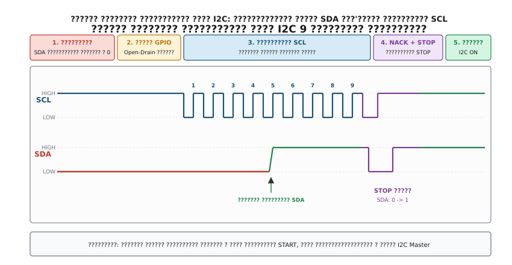
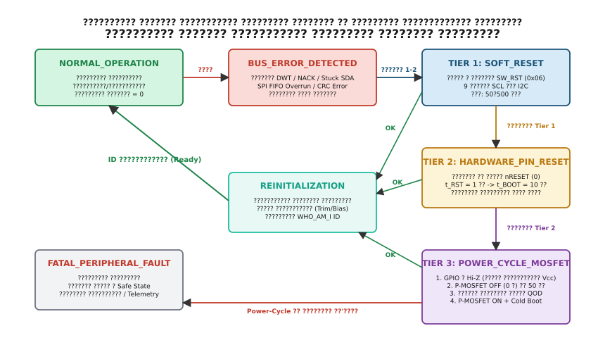

# Таймаути, помилки й повторна ініціалізація чипа

<preknowlist>
- [GPIO-регістри](root:sf-devices/gpio-registers) — конфігурація виводів мікроконтролера, режим відкритого стоку (Open-Drain), альтернативні функції та керування підтяжками.
- [CMSIS](root:sf-devices/cmsis) — прямий доступ до системних регістрів ядра ARM Cortex-M, лічильника циклів DWT та системного таймера SysTick.
- [Опитування, переривання чи DMA у драйвері](root:sf-devices/opytuvannia-pereryvannia-chy-dma-u-draiveri) — моделі асинхронного обміну, прапорці стану апаратної периферії та контексти виконання.
- [Розбір HardFault](root:sf-devices/hardfault) — апаратні виняткові стани процесора, реакція на блокування шин пам'яті та апаратні гонки.
</preknowlist>

Мікроконтролер у складі автономного польового реєстратора або бортового комп'ютера безпілотного апарата несподівано зависає наглухо під час чергового циклу зчитування даних із цифрового барометра чи інерційного модуля на шині I2C. Якщо підключити цифровий запам'ятовувальний осцилограф безпосередньо до провідників друкованої плати, на екрані спостерігається характерна статична картина: лінія тактування SCL підтягнута резистором до шини живлення на рівні 3.3 В, тоді як лінія даних SDA притиснута до нульового потенціалу землі на рівні 0.0 В. Програмний лічильник процесорного ядра `PC` застряг усередині низькорівневої бібліотеки виробника на рядку очікування прапорця готовності передавача: `while (!(I2C1->SR1 & I2C_SR1_TXE));`. Прошивка нескінченно очікує, що апаратний периферійний блок виставить байт адреси на шину, проте апаратний контролер I2C фізично не може згенерувати навіть початкову стартову умову START, оскільки лінія даних заблокована зовнішньою інтегральною мікросхемою.

Зовнішній ведений чип утримує лінію SDA в нулі, оскільки його внутрішній апаратний зсувний регістр був аварійно перерваний посеред передачі нульового інформаційного біта під час попереднього скидання мікроконтролера або короткочасного електромагнітного сплеску. Стандартне перезавантаження процесора через апаратний сторожовий таймер Watchdog виявляється абсолютно марним: після рестарту прошивка знову намагається ініціалізувати транзакцію на заблокованій шині й негайно падає в той самий нескінченний цикл.

Надійність вбудованої системи визначається не тим, як бездоганно драйвер функціонує за ідеальних тепличних умов лабораторного стенда, а тим, як програмна архітектура реагує на неминучі апаратні збої периферійних інтерфейсів, електростатичні розряди та збої зовнішніх інтегральних схем. Будь-який зовнішній чип — цифровий датчик тиску, трьохосьовий акселерометр, зовнішня пам'ять EEPROM/Flash, багатоканальний АЦП або драйвер керування силовими ключами — може в будь-який момент зазнати локального збою внутрішнього тактового генератора, спотворення логічних рівнів через індуктивну заваду від роботи електромотора, просідання напруги живлення або розсинхронізації внутрішнього цифрового автомата станів. Драйвер, побудований на наївних нескінченних циклах опитування статусних регістрів, перетворює локальну відмову другорядного сенсора на катастрофічну відмову всього приладу. Стійка промислова архітектура вимагає детермінованих монотонних таймаутів для кожної апаратної операції, алгоритмів примусового електричного розблокування ліній зв'язку та строгої трирівневої ескалації скидання апаратних компонентів.

## Анатомія апаратного зависання: чому наївні цикли блокують систему

Взаємодія мікроконтролера із зовнішньою периферією через послідовні інтерфейси I2C та SPI принципово різниться за фізичною топологією формування сигналів на провідниках друкованої плати. Проте в обох випадках наївний підхід до опитування апаратних статусних регістрів без часових обмежень призводить до однакового фатального результату — мертвого блокування керівного ядра процесора.

У промислових установках та мобільних робототехнічних платформах лінії зв'язку постійно піддаються впливу синфазних та диференціальних електромагнітних завад. Комутація індуктивних навантажень (обмоток реле, крокових двигунів, тягових інверторів) генерує високочастотні імпульси струму в земляних полігонах друкованих плат, викликаючи локальні сплески потенціалу землі (Ground Bounce). Якщо в момент проходження такого сплеску мікроконтролер виконує читання байта з шини, рівень напруги на лінії тактування може короткочасно перетнути поріг логічного перемикання вхідного тригера Шмітта. Зовнішній чип сприймає такий викид як додатковий тактовий імпульс, що неминуче призводить до розсинхронізації внутрішнього протокольного автомата з керівним ядром мікроконтролера.

Поведінка аналогових кіл фільтрації на входах мікросхем додатково ускладнює картину. Більшість сучасних приймачів I2C містять вбудовані аналогові фільтри придушення перешкод (Spike Suppression Filters), які відсікають імпульси тривалістю менше 50 нс. Проте завади від комутації потужних MOSFET-ключів у імпульсних перетворювачах напруги часто мають тривалість у сотні наносекунд. Такі спотворення безперешкодно проходять через вхідні фільтри, призводячи до появи фантомних фронтів тактування на лініях SCL або SCK.

### Електрична модель та фізика блокування шини I2C (Bus Lockup)

Шина I2C використовує топологію відкритого стоку (Open-Drain) для обох сигнальних ліній — лінії тактування SCL та лінії послідовних даних SDA. Обидва провідники пасивно підтягнуті зовнішніми резисторами `R_pull-up` (типовим номіналом від 1.5 кОм до 10 кОм) до шини живлення `V_DD` (3.3 В). Підключені до шини пристрої (як ведучий процесор Master, так і ведені сенсори Slave) фізично не здатні самостійно подавати високу напругу на лінію: вони можуть лише активно замикати лінію на землю за допомогою відкриття внутрішніх N-канальних польових транзисторів (N-MOSFET).

Розрахунок номіналу підтягувального резистора базується на двох фундаментальних фізичних обмеженнях:
1. **Мінімальний опір резистора** `R_min` обмежується максимально допустимим струмом занурення вихідного каскаду `I_OL` (зазвичай 3 мА за стандартом I2C) для збереження низького рівня напруги `V_OL <= 0.4 В`:
   `R_min = (V_DD - V_OL) / I_OL = (3.3 В - 0.4 В) / 3 мА = 966 Ом`.
2. **Максимальний опір резистора** `R_max` обмежується максимально допустимим часом наростання фронту `t_r` та паразитною ємністю шини `C_bus`:
   `R_max = t_r / (0.8473 * C_bus)`.

Для стандартного режиму Standard Mode (100 кГц), де `t_r <= 1000 нс`, а `C_bus = 200 пФ`, максимальний опір становить приблизно 5.9 кОм.

Логічний рівень одиниці на шині формується пасивно, коли всі підключені транзистори закриті, а зовнішній резистор заряджає сумарну розподілену ємність провідників плати, кабелів та виводів мікросхем `C_bus` за класичним експоненційним законом:
`V(t) = V_DD * (1 - exp(-t / (R_pull-up * C_bus)))`.

Логічний рівень нуля формується активно через відкритий канал N-MOSFET, опір якого у відкритому стані становить `R_DS(on) = 10..50 Ом`, що забезпечує надзвичайно швидкий спад напруги (`t_f <= 300 нс`).

Апаратне зависання шини I2C у стані `SDA = 0` (Bus Lockup) виникає у випадку, коли сесія читання даних переривається в середині передачі байта. Розглянемо детальний ланцюг фізичних подій:

1. Ведучий мікроконтролер ініціює транзакцію читання регістра зовнішнього сенсора, відправляючи адресу пристрою з бітом читання (`R/W = 1`).
2. Ведений чип розпізнає свою адресу, відповідає бітом підтвердження ACK і починає виштовхувати перший байт даних, тактуючись імпульсами SCL від ведучого.
3. Внутрішній скінченний автомат веденого чипа містить тригери бітового лічильника від 0 до 7 та 8-бітний паралельно-послідовний зсувний регістр. На кожному спадному фронті лінії SCL ведений комутує черговий біт даних на лінію SDA.
4. Припустимо, четвертий біт даних, який сенсор повинен передати, має логічне значення 0. Ведений чип відкриває свій N-MOSFET, замикаючи лінію SDA на землю.
5. У цей самий момент на платі відбувається аварійна подія: мікроконтролер зазнає апаратного скидання від сторожового таймера WDT, процесор перериває виконання через збій живлення або відладчик скидає ядро.
6. Апаратний периферійний модуль I2C мікроконтролера скидається. Вивід SCL переходить у стан високого імпедансу й підтягується резистором до напруги 3.3 В.
7. Проте ведений сенсор **не отримував жодного сигналу скидання**. Живлення на ньому не зникало, а окремого виводу скидання він не має або він не був задіяний. Внутрішній лічильник бітів сенсора застряг на позиції 4, вихідний польовий транзистор залишається відкритим, а лінія SDA продовжує утримуватися на нульовому потенціалі. Ведений чип безпорадно чекає, коли ведучий подасть наступний спадний фронт тактування на вивід SCL, щоб передати п'ятий біт.
8. Після перезапуску мікроконтролер намагається почати нову транзакцію. За стандартом I2C умова START генерується переходом лінії SDA з високого рівня на низький при високому рівні лінії SCL.
9. Апаратний периферійний блок I2C мікроконтролера перевіряє фізичний стан ліній перед стартом. Виявивши, що лінія SDA вже перебуває в логічному нулі при високому SCL, контролер вважає, що шину захопив інший ведучий пристрій (у мультимайстерній конфігурації).
10. Контролер мікроконтролера негайно встановлює прапорець зайнятості шини `I2C_SR2_BUSY` і апаратно блокує роботу внутрішнього генератора імпульсів SCL.

Виникає стан мертвого блокування: ведений чип не може відпустити лінію SDA без отримання імпульсів SCL, а ведучий мікроконтролер не може згенерувати імпульси SCL, оскільки лінія SDA затиснута в нуль. Будь-який цикл очікування звільнення шини `while (I2C1->SR2 & I2C_SR2_BUSY);` перетворюється на нескінченне зависання.

Якщо розглянути осцилограму цього стану, стає очевидним, що пасивна підтяжка лінії SCL утримує її на рівні 3.3 В, створюючи ілюзію повної бездіяльності шини. При цьому лінія SDA залишається під напругою близько 0.05..0.15 В (падіння напруги на відкритому каналі N-MOSFET веденого під дією струму підтяжки), що однозначно свідчить про активне замикання лінії зовнішнім компонентом, а не про обрив провідника.

Додатковим джерелом апаратного зависання I2C є механізм розтягування тактових імпульсів (Clock Stretching). За специфікацією I2C ведений пристрій має апаратне право утримувати лінію SCL на низькому рівні після прийому або передачі байта, якщо його внутрішній мікроконтролер чи АЦП ще не завершив обробку даних. Якщо ведений чип зазнав внутрішнього зависання (наприклад, збився внутрішній RC-генератор сенсора або заклинило конвеєр аналого-цифрового перетворення), він залишає лінію SCL затиснутою в нуль нескінченно довго. Ведучий контролер при цьому зависає на очікуванні відпускання лінії SCL.

У складних гетерогенних системах, де веденими вузлами виступають інші мікроконтролери (наприклад, супутні співпроцесори збору даних чи контролери керування живленням), розтягування тактування реалізується на рівні їхнього внутрішнього переривання I2C. Якщо у веденого співпроцесора виникає дедлок у власній операційній системі або зависає вкладений обробник високого пріоритету, лінія SCL залишається притиснутою до землі апаратним блоком веденого, повністю паралізуючи спільну шину зв'язку для всіх інших сенсорів плати.

### Розсинхронізація та переповнення буферів на шині SPI

На відміну від I2C, шина SPI є повнодуплексним інтерфейсом із роздільними односпрямованими лініями передачі MOSI, прийому MISO, тактування SCK та індивідуального вибору чипа CS (Chip Select або NSS). Усі лінії, крім MISO під час неактивного стану веденого, керуються двотактними вихідними каскадами (Push-Pull), тому замикання лінії у відкритому стоці тут неможливе. Проте шина SPI стикається з іншими важкими типами відмов:

1. **Переповнення вхідного буфера (FIFO Overrun, OVR)**. Якщо процесорне ядро або канал прямого доступу до пам'яті DMA не встигає зчитати прийнятий байт із регістра даних `SPI_DR` до того моменту, як з лінії MISO завершиться прийом наступного байта, апаратний блок SPI виставляє прапорець апаратної помилки `SPI_SR_OVR`. У більшості мікроконтролерів (зокрема сімейств STM32F4/F7/H7) встановлення прапорця OVR повністю блокує подальший прийом даних. Скидання прапорця вимагає суворо визначеної послідовності: читання регістра даних `SPI_DR` з наступним читанням статусного регістра `SPI_SR`. Наївний драйвер, що опитує прапорець `while (!(SPI1->SR & SPI_SR_RXNE));`, потрапляє в нескінченний цикл, оскільки нові дані ніколи не будуть записані в буфер при активному прапорці переповнення.
2. **Зсув фази байтів через завади на лініях SCK/CS (Framing Desynchronization)**. Якщо під час передачі 16-бітного кадру на лінію тактування SCK потрапляє одиночний високочастотний імпульс завади, ведений чип сприймає його як додатковий тактовий імпульс. Внутрішній лічильник бітів веденого чипа зсувається на одиницю. Усі наступні транзакції будуть прийматися зі зміщенням: старший біт наступного слова стане молодшим бітом попереднього. Якщо протокол обміну захищений контрольними сумами CRC-8 або CRC-16, усі наступні пакети будуть бракуватися як пошкоджені. Без примусової деактивації та повторної активації лінії CS (перехід з 0 в 1 і знову в 0) внутрішній автомат веденого чипа ніколи не відновить правильне вирівнювання меж байтів.
3. **Зависання прапорця зайнятості `SPI_SR_BSY`**. Під час вимкнення модуля SPI або переконфігурації швидкості тактування драйвер зобов'язаний дочекатися завершення поточної транзакції: `while (SPI1->SR & SPI_SR_BSY);`. Якщо попередня транзакція була обірвана апаратним скиданням або лінія NSS була знята некоректно, прапорець BSY може залишатися встановленим, назавжди блокуючи драйвер.
4. **Апаратна помилка вибору режиму (Mode Fault, MODF)**. Якщо вивід NSS мікроконтролера налаштований у режимі апаратного входу і його рівень несподівано просідає до нуля через наведену заваду, модуль SPI фіксує конфлікт кількох ведучих на шині, автоматично вимикає свій вихідний передавач, виставляє прапорець `SPI_SR_MODF` і переходить у пасивний ведений режим. Драйвер, який не перевіряє прапорець MODF перед відправленням даних, нескінченно очікує завершення передачі в регістрі `SPI_SR_TXE`.

## Детерміновані таймаути без нескінченних циклів

Основою захисного програмування вбудованих пристроїв є повна заборона нескінченних циклів очікування апаратних прапорців (`while (!flag);`). Будь-який цикл очікування апаратного стану зобов'язаний мати жорстко обмежений за часом інтервал виконання — **таймаут**. Якщо апаратний блок не перейшов у потрібний стан за відведений час, функція зобов'язана негайно перервати виконання й повернути вільний від блокування код помилки.

### Чому програмні лічильники ітерацій є антипатерном

Поширеною помилкою серед розробників-початківців є використання програмних циклів із декрементом лічильника.

:::tabs
@tab C99
```c
// НЕПРАВИЛЬНО: крихкий і небезпечний підхід
uint32_t timeout_counter = 100000;
while (!(I2C1->SR1 & I2C_SR1_TXE)) {
    if (--timeout_counter == 0) {
        return -1; // BUS_ERROR_TIMEOUT
    }
}
```
@tab C++20
```cpp
// НЕПРАВИЛЬНО: небезпечний цикл без прив'язки до реального часу
uint32_t timeout_counter = 100000;
while (!(I2C1->SR1 & I2C_SR1_TXE)) {
    if (--timeout_counter == 0) {
        return std::unexpected(BusError::Timeout);
    }
}
```
:::

Цей підхід є категорично неприпустимим у промисловому коді з таких фундаментальних фізичних та архітектурних причин:

1. **Залежність від оптимізації компілятора та структури асемблерного коду**. На рівні оптимізації `-O0` кожна ітерація циклу змушує компілятор генерувати повний набір інструкцій роботи з пам'яттю стека: читання змінної у регістр (`LDR R3, [SP, #4]`), декремент (`SUBS R3, R3, #1`), запис значення назад у стек (`STR R3, [SP, #4]`), зчитування регістра периферії (`LDR R2, [R0, #0]`), логічне порівняння та умовний перехід (`CMP R3, #0`, `BNE .L1`). Така ітерація займає від 12 до 18 тактів процесорного ядра. Під час збирання того самого коду з прапорцем оптимізації `-O2` або `-O3` оптимізатор виділяє для лічильника вільний регістр ядра (`R4`) і замінює все тіло циклу двома інструкціями: `SUBS R4, R4, #1` та `CBZ R4, .L_TIMEOUT`. Тривалість ітерації скорочується до 1–2 тактів. У результаті реальний фізичний інтервал таймауту зменшується у 8–12 разів, і драйвер починає генерувати помилки таймауту на абсолютно справному обладнанні лише тому, що повільний зовнішній чип не встиг виставити біт готовності за скорочений час.
2. **Залежність від тактової частоти процесорного ядра (SysClk)**. Вбудовані системи з батарейним живленням активно використовують алгоритми динамічної зміни частоти та напруги (Dynamic Voltage and Frequency Scaling, DVFS). У режимі активного обчислення ядро працює на частоті 168 МГц або 216 МГц від зовнішнього кварцового резонатора та схеми PLL, а в режимі енергозбереження частота знижується до 16 МГц або навіть 2 МГц від внутрішнього RC-генератора HSI/MSI. Фіксована кількість 100000 ітерацій на частоті 216 МГц виконується приблизно за 0.5..1.0 мс, тоді як на частоті 2 МГц цей самий цикл розтягується до 50..100 мс. Такий розкид робить поведінку системи недетермінованою: реакція на апаратну аварію стає або занадто швидкою, або неприпустимо повільною.
3. **Вплив кеш-пам'яті та прискорювачів Flash (ART Accelerator / I-Cache / Wait States)**. Швидкість читання інструкцій із вбудованої Flash-пам'яті мікроконтролера суттєво нижча за тактову частоту ядра процесора. Наприклад, у мікроконтролерах STM32F4 на частоті 168 МГц час доступу до Flash вимагає налаштування 5 тактів очікування (Flash Latency = 5 Wait States). Якщо тіло циклу очікування потрапляє в конвеєрний прискорювач Flash (наприклад, ST ART Accelerator або I-Cache ядра Cortex-M7), інструкції виконуються без затримок. Якщо ж у процесі виконання виникає промах кешу через перемикання контексту RTOS, процесор змушений вставляти такти очікування на кожному вибиранні команди, змінюючи реальну тривалість кожної ітерації.
4. **Викривлення через асинхронні переривання (Interrupt Preemption)**. Якщо під час виконання програмного циклу очікування ядро отримує високопріоритетне апаратне переривання (наприклад, обробку аудіопотоку I2S або розрахунок ПІД-регулятора двигуна з частотою 20 кГц), процесор припиняє виконання циклу й переходить до обробника ISR. Програмний лічильник `timeout_counter` при цьому не декрементується, але реальний астрономічний час продовжує спливати. Якщо зовнішній сенсор завис і тримає лінію зв'язку, але процесор завантажений перериваннями на 95%, виконання 100000 ітерацій може розтягнутися на кілька секунд, протягом яких уся система перебуватиме в підвішеному стані.

### Високоточні таймаути на базі лічильника циклів DWT (Data Watchpoint and Trace)

Найбільш точним, надійним і повністю детермінованим джерелом вимірювання часу в мікроконтролерах ARM Cortex-M (ядра Cortex-M3, M4, M7, M33) є апаратний лічильник циклів модуля трасування DWT (Data Watchpoint and Trace).

Модуль DWT розташований у системному адресному просторі процесора (System Control Space, SCS) за базовою адресою `0xE0001000`. Модуль містить 32-бітний апаратний лічильник тактів `DWT->CYCCNT` (Cycle Count Register), розташований за зміщенням `0x004`. Лічильник інкрементується на 1 на кожному такті процесорного ядра незалежно від стану конвеєра інструкцій, кешу Flash-пам'яті чи оптимізацій компілятора. При тактовій частоті ядра 168 МГц роздільна здатність лічильника становить 5.95 нс, а при частоті 480 МГц (Cortex-M7) — 2.08 нс.

Для активації модуля DWT необхідно увімкнути живлення та тактування блоку трасування через системний регістр налагодження `CoreDebug->DEMCR` (Debug Exception and Monitor Control Register).

:::tabs
@tab C99
```c
void dwt_init(void) {
    // Вмикаємо біт TRCENA (Trace Enable, біт 24) у регістрі DEMCR
    CoreDebug->DEMCR |= CoreDebug_DEMCR_TRCENA_Msk;
    
    // Скидаємо лічильник циклів у нуль
    DWT->CYCCNT = 0;
    
    // Вмикаємо біт CYCCNTENA (біт 0) у регістрі керування DWT_CTRL
    DWT->CTRL |= DWT_CTRL_CYCCNTENA_Msk;
}
```
@tab C++20
```cpp
inline void dwt_init() noexcept {
    // Вмикаємо блок трасування ядра Cortex-M
    CoreDebug->DEMCR |= CoreDebug_DEMCR_TRCENA_Msk;
    DWT->CYCCNT = 0;
    DWT->CTRL |= DWT_CTRL_CYCCNTENA_Msk;
}
```
:::

### Математика та доведення коректності обробки переповнення 32-бітного лічильника

32-бітний регістр `DWT->CYCCNT` є циклічним лічильником, що працює в діапазоні від 0 до 4 294 967 295 тактів (`0x00000000..0xFFFFFFFF`). На частоті процесора 168 МГц період повного переповнення лічильника становить:
`T_overflow = 2^32 / 168 000 000 Гц = 25.565 с`.

На перший погляд здається, що для коректного вимірювання інтервалів часу необхідно окремо відстежувати момент переповнення через прапорці або переривання. Проте це не так: завдяки правилам модулярної арифметики та представленню цілих чисел у додатковому коді (Two's Complement Representation), операція віднімання двох беззнакових 32-бітних чисел `uint32_t` дає математично точний інтервал часу навіть тоді, коли поточне значення лічильника перейшло через нуль.

Формула розрахунку інтервалу:
`delta_ticks = (uint32_t)(C_now - C_start)`.

Доведемо строгу коректність цієї формули.

Нехай `C_start` — значення лічильника в момент запуску таймауту, а `C_now` — поточне значення лічильника. Розглянемо випадок, коли між `C_start` та `C_now` відбулося рівно одне переповнення лічильника (`C_now < C_start`).

Фактична кількість тактів, що минули, дорівнює сумі тактів від `C_start` до максимального значення `2^32 - 1`, одного такту переходу через нуль та тактів від 0 до `C_now`:
`delta_real = (2^32 - 1 - C_start) + 1 + C_now = 2^32 + C_now - C_start`.

У мовах C та C++ операції над типом `uint32_t` (беззнакове 32-бітне ціле) строго визначені за модулем `2^32`:
`(C_now - C_start) mod 2^32`.

Оскільки `2^32 ≡ 0 (mod 2^32)`, маємо точну тотожність:
`(2^32 + C_now - C_start) mod 2^32 = (C_now - C_start) mod 2^32`.

Таким чином, значення виразу `(uint32_t)(C_now - C_start)` апаратно повертає точну величину `delta_real` без будь-яких умовних переходів чи додаткових обчислень.

Розглянемо конкретний числовий приклад. Припустимо, відлік стартував за 1000 тактів до переповнення, тобто `C_start = 2^32 - 1000 = 4294966296` (`0xFFFFFC18`). Поточне вимірювання виконано після переповнення, коли лічильник показує `C_now = 500` (`0x000001F4`). Реальна кількість тактів, що пройшла, дорівнює `1000 + 500 = 1500`.

Обчислимо різницю у 32-бітній беззнаковій арифметиці:

```
C_now - C_start = 500 - 4294966296 = -4294965796  [різниця лічильників]
                ≡ 1500 (mod 2^32)                [беззнакове приведення mod 2^32]
```

У 32-бітному представленні значення `-4294965796 mod 2^32` дорівнює в точності 1500 (`0x000005DC`). Апаратне віднімання беззнакових 32-бітних чисел дає математично бездоганний результат без жодного умовного розгалуження в машинному коді.

Єдине математичне та фізичне обмеження: тривалість самого вимірюваного таймауту не повинна перевищувати повного періоду переповнення `T_overflow` (25.56 с при 168 МГц або 8.94 с при 480 МГц). Оскільки таймаути шинних транзакцій зазвичай лежать у діапазоні від 10 мкс до 100 мс, це обмеження виконується із запасом у кілька сотень разів.

### Реалізація високоточного таймауту на C99 та C++20

Розглянемо повну реалізацію модуля детермінованих таймаутів.

:::tabs
@tab C99
```c
#include <stdint.h>
#include <stdbool.h>
#include "stm32f4xx.h"

typedef struct {
    uint32_t start_cycles;
    uint32_t timeout_cycles;
} timeout_dwt_t;

static inline void timeout_dwt_start(timeout_dwt_t *t, uint32_t timeout_us, uint32_t cpu_freq_hz) {
    t->start_cycles = DWT->CYCCNT;
    // Обчислення тактів із захистом від переповнення при множенні: (us * freq) / 1000000
    t->timeout_cycles = (uint32_t)(((uint64_t)timeout_us * cpu_freq_hz) / 1000000ULL);
}

static inline bool timeout_dwt_is_expired(const timeout_dwt_t *t) {
    uint32_t elapsed = (uint32_t)(DWT->CYCCNT - t->start_cycles);
    return elapsed >= t->timeout_cycles;
}

// Універсальна функція очікування стану бітової маски в регістрі
int bus_wait_register_mask(volatile uint32_t *reg, uint32_t mask, bool wait_for_set, uint32_t timeout_us) {
    timeout_dwt_t timer;
    timeout_dwt_start(&timer, timeout_us, SystemCoreClock);

    while (1) {
        bool bit_is_set = (*reg & mask) != 0;
        if (bit_is_set == wait_for_set) {
            return 0; // Успіх: умова виконана
        }
        if (timeout_dwt_is_expired(&timer)) {
            return -1; // Помилка: таймаут вичерпано
        }
    }
}
```
@tab C++20
```cpp
#include <cstdint>
#include <concepts>
#include <expected>
#include <chrono>
#include "stm32f4xx.h"

enum class BusError : uint8_t {
    Timeout,
    Nack,
    BusStuck,
    ArbitrationLost,
    Overrun,
    CrcMismatch
};

class DwtTimeout {
public:
    explicit DwtTimeout(std::chrono::microseconds duration, uint32_t cpu_freq_hz = SystemCoreClock) noexcept
        : start_cycles_{DWT->CYCCNT},
          timeout_cycles_{static_cast<uint32_t>((static_cast<uint64_t>(duration.count()) * cpu_freq_hz) / 1'000'000ULL)} {}

    [[nodiscard]] bool is_expired() const noexcept {
        const uint32_t elapsed = DWT->CYCCNT - start_cycles_;
        return elapsed >= timeout_cycles_;
    }

    template <typename Predicate>
        requires std::predicate<Predicate>
    [[nodiscard]] std::expected<void, BusError> wait_until(Predicate&& pred) const noexcept {
        while (!pred()) {
            if (is_expired()) {
                return std::unexpected(BusError::Timeout);
            }
        }
        return {};
    }

private:
    uint32_t start_cycles_;
    uint32_t timeout_cycles_;
};

// Приклад використання для безпечного опитування статусного регістра
std::expected<void, BusError> i2c_wait_flag(volatile uint32_t* reg, uint32_t mask, bool wait_set, std::chrono::microseconds timeout) noexcept {
    const DwtTimeout timer{timeout};
    return timer.wait_until([reg, mask, wait_set] {
        const bool is_set = (*reg & mask) != 0;
        return is_set == wait_set;
    });
}
```
:::

### Таймаути на базі системного таймера SysTick та таймера RTOS

У системах на базі молодших ядер Cortex-M0 та Cortex-M0+, де апаратний блок DWT фізично відсутній у топології кремнієвого кристала, а також для вимірювання тривалих інтервалів масштабу сотень мілісекунд чи секунд, використовують лічильник системного таймера `SysTick` або 32-бітний апаратний таймер загального призначення (TIM2/TIM5).

Системний таймер SysTick генерує періодичне переривання кожну 1 мс (або 100 мкс), інкрементуючи глобальну лічильну змінну.

:::tabs
@tab C99
```c
volatile uint32_t g_system_tick_ms = 0;

void SysTick_Handler(void) {
    g_system_tick_ms++;
}

bool systick_timeout_is_expired(uint32_t start_tick, uint32_t timeout_ms) {
    return (uint32_t)(g_system_tick_ms - start_tick) >= timeout_ms;
}
```
@tab C++20
```cpp
#include <atomic>
#include <cstdint>

inline std::atomic<uint32_t> g_system_tick_ms{0};

extern "C" void SysTick_Handler() {
    g_system_tick_ms.fetch_add(1, std::memory_order_relaxed);
}

inline bool systick_timeout_is_expired(uint32_t start_tick, uint32_t timeout_ms) noexcept {
    return static_cast<uint32_t>(g_system_tick_ms.load(std::memory_order_relaxed) - start_tick) >= timeout_ms;
}
```
:::

Обчислення таймауту на базі SysTick підпорядковується тим самим математичним правилам беззнакового віднімання: `(uint32_t)(g_system_tick_ms - start_tick) >= timeout_ms`.

### Критерії вибору тривалості таймаутів

Вибір тривалості таймауту повинен базуватися на точних фізичних розрахунках часу передачі сигналів за специфікаціями інтерфейсів:

1. **Таймаут одного байта на шині I2C**: для стандартної швидкості Standard Mode (100 кГц) передача 1 байта займає 9 тактових періодів, тобто `9 * 10 мкс = 90 мкс`. З урахуванням допустимого розтягування тактування SCL веденим чипом (Clock Stretching) та затримок планувальника RTOS безпечний таймаут на байтову операцію встановлюється на рівні 1..5 мс.
2. **Таймаут внутрішнього перетворення датчика**: багато типів сенсорів (термопари, датчики тиску, газові аналізатори) вимагають часу на аналого-цифрове перетворення після отримання команди вимірювання. Наприклад, барометр Bosch BMP280 у режимі максимальної фільтрації Ultra High Resolution виконує перетворення за 22.8 мс. Таймаут очікування готовності даних у такому разі встановлюється на рівні 50..100 мс.
3. **Глобальний таймаут шини SMBus**: специфікація системної шини керування SMBus (System Management Bus) визначає обов'язковий часовий ліміт блокування ліній `T_TIMEOUT = 35 мс`. Якщо будь-який пристрій утримує лінію SCL або SDA на низькому рівні понад 35 мс, усі підключені вузли зобов'язані зафіксувати аварійний стан та ініціювати процедуру скидання інтерфейсу.

## Апаратне відновлення шини I2C: протокол 9 тактових імпульсів

Коли таймаут очікування завершення транзакції I2C вичерпано і діагностика фіксує стан `SDA = 0` при високому рівні SCL, просте програмне скидання апаратного периферійного блока мікроконтролера через регістр `I2C1->CR1 |= I2C_CR1_SWRST` не здатне відновити працездатність шини. Проблема криється у фізичному стані веденого пристрою: N-канальний польовий транзистор на виході веденого чипа продовжує замикати лінію даних на землю.

Для безпечного електричного розблокування шини I2C розроблено стандартизований апаратно-програмний алгоритм — **процедуру ручного тактування дев'ятьма імпульсами (I2C Bus Recovery Routine)**.


*Часова діаграма примусового розблокування лінії SDA за допомогою перемикання виводів у режим GPIO Open-Drain, генерації 9 імпульсів SCL та формування умов NACK і STOP.*

### Фізична сутність та покроковий алгоритм відновлення

Причина, через яку ведений чип утримує лінію SDA у низькому логічному рівні, полягає в тому, що його внутрішній цифровий кінцевий автомат (FSM) перебуває посеред циклу передачі байта. Якщо переданий біт дорівнює 0, ведений відкриває свій вихідний N-MOSFET. Щоб перейти до наступного біта або завершити транзакцію, цифровому автомату веденого чипа потрібен черговий спадний фронт на вході тактування SCL.

Оскільки апаратний контролер I2C мікроконтролера блокується при виявленні `SDA = 0` і відмовляється формувати тактові імпульси, ведучий процесор зобов'язаний тимчасово взяти керування лініями SCL та SDA на себе в режимі прямого маніпулювання виводами (Bit-Banging).

Алгоритм виконується за такі сім послідовних етапів:

1. **Вимкнення та ізоляція апаратного модуля I2C**.
   Процесор скидає біт увімкнення периферії `PE` (Peripheral Enable) у регістрі керування `I2C_CR1`. Це від'єднує внутрішні цифрові вузли апаратного контролера I2C від фізичних контактів корпусу мікроконтролера, переводячи виводи в стан під керуванням контролера GPIO.
2. **Переконфігурація виводів SCL та SDA в режим GPIO Open-Drain**.
   Виводи мікроконтролера перемикаються з альтернативної функції (Alternate Function, AF4 у STM32) у режим виходів загального призначення (General Purpose Output) типу відкритий стік (Open-Drain). Обидва виводи переводяться у високий логічний стан (запис 1 у регістр `BSRR`), що закриває вихідні транзистори мікроконтролера й дозволяє зовнішнім підтягувальним резисторам `R_pull-up` підтягнути лінії до `V_DD`.
3. **Попереднє діагностичне опитування лінії SDA**.
   Процесор виконує затримку 10 мкс для завершення перехідних процесів заряду ємності шини, після чого зчитує логічний стан лінії SDA через регістр вхідних даних `GPIO_IDR`:
   - Якщо `SDA == 1` (HIGH), лінія даних вільна. Зависання було спричинене збоєм самого контролера I2C ведучого, а не веденим чипом. Процесор може пропустити фазу тактування та перейти безпосередньо до генерації умови STOP.
   - Якщо `SDA == 0` (LOW), ведений чип утримує лінію. Необхідно виконати примусове тактування лінії SCL.
4. **Генерація серії до 9 тактових імпульсів на лінії SCL**.
   Процесор програмно формує на виводі SCL послідовність прямокутних імпульсів, що відповідають часовим характеристикам режиму Standard Mode (100 кГц):
   - Опустити лінію SCL у логічний нуль (0.0 В), записавши біт у молодшу або старшу половину регістра `BSRR`.
   - Витримати час низького рівня `t_LOW >= 4.7 мкс` (за стандартом I2C).
   - Підняти лінію SCL у логічну одиницю (3.3 В).
   - Витримати час високого рівня `t_HIGH >= 4.0 мкс`.
   - Під час високого рівня SCL зчитати стан лінії SDA через регістр `GPIO_IDR`.
   - **Чому саме 9 імпульсів?** Максимальна довжина будь-якого неподільного блоку передачі в протоколі I2C становить 8 бітів даних плюс 1 біт підтвердження ACK/NACK. Навіть якщо транзакцію було перервано на першому біті, веденому чипу знадобиться щонайбільше 8 тактів SCL, щоб виштовхнути залишок бітів зі свого зсувного регістра, та 1 такт для переходу у фазу очікування ACK. Як тільки останній нульовий біт залишає регістр зсуву, ведений закриває свій вихідний N-MOSFET, і лінія SDA під дією підтягувального резистора піднімається у високий рівень 3.3 В.
   - Якщо на черговому такті зчитано `SDA == 1`, цикл генерації імпульсів можна перервати достроково.
5. **Генерація умови NACK (Not Acknowledge)**.
   Під час дев'ятого тактового імпульсу ведучий контролер утримує власну лінію SDA у високому стані (HIGH). Для веденого пристрою це є сигналом NACK — повідомленням про те, що ведучий відмовляється від прийому подальших даних. Отримавши NACK, ведений чип гарантовано припиняє передачу і переводить свій внутрішній інтерфейсний автомат у стан очікування умови STOP.
6. **Генерація примусової умови STOP**.
   Після того як ведений відпустив лінію SDA і обидві лінії повернулися у високий рівень, ведучий зобов'язаний сформувати коректну умову зупинки STOP (перехід лінії SDA з низького рівня на високий при збереженні високого рівня на лінії SCL):
   - Опустити лінію SDA в 0 при високому або низькому SCL.
   - Підняти лінію SCL у 1 і витримати час встановлення `t_SU;STO >= 4.0 мкс`.
   - Підняти лінію SDA в 1 при утриманні SCL у високому рівні.
   - Витримати час вільного стану шини перед наступною транзакцією `t_BUF >= 4.7 мкс`.
   - Умова STOP є глобальним апаратним скиданням для всіх мікросхем, підключених до даної шини I2C: вона повертає всі внутрішні лічильники байтів і адресні декодери у стан спокою (Bus Idle).
7. **Апаратне скидання та повернення периферійного блока I2C**.
   - Виводи мікроконтролера повертаються в режим альтернативної функції (Alternate Function AF4).
   - Для усунення можливих зависань внутрішніх тригерів самого мікроконтролера виконується апаратне скидання модуля I2C: встановлюється біт `SWRST` у регістрі `I2C_CR1`, витримується пауза 5 мкс, після чого біт `SWRST` очищується.
   - Виконується стандартна конфігурація регістрів частоти (`I2C_CR2`, `I2C_CCR`, `I2C_TRISE`) та повторне ввімкнення модуля бітом `I2C_CR1_PE = 1`.

### Крайові випадки та апаратні пастки відновлення шини

Під час реалізації процедури відновлення шини інженер стикається з трьома критичними крайовими випадками:

1. **Коротке замикання лінії SDA на землю (Hard Ground Short)**. Якщо після подачі всіх 9 тактових імпульсів лінія SDA залишається притиснутою до 0.0 В, це вказує або на фізичне коротке замикання на друкованій платі (металевий задирок, дефект пайки), або на внутрішній електричний пробій вихідного каскаду одного з чипів на шині. Функція розблокування зобов'язана перевірити стан SDA після завершення циклу і повернути фатальну помилку `BUS_ERR_STUCK`, не дозволяючи системі повторювати марні спроби.
2. **Зависання лінії SCL на рівні нуля (Clock Stretching Deadlock)**. Якщо ведений чип з функцією розтягування тактування зазнав внутрішнього апаратного колапсу і притиснув лінію SCL до землі, мікроконтролер у режимі Open-Drain не зможе підняти SCL у високий рівень. Драйвер відновлення повинен контролювати стан лінії SCL після переведення її у високий рівень: якщо через 10 мкс SCL залишається в нулі, це свідчить про апаратний клінч веденого чипа, який не лікується тактуванням і вимагає негайного переходу до ескалації скидання живленням (Tier 3).
3. **Мультимайстерні колізії (Multi-Master Arbitration)**. У системах із кількома ведучими мікроконтролерами на одній шині генерація 9 тактів повинна супроводжуватися перевіркою, чи не почав інший ведучий паралельну транзакцію. Якщо під час високого рівня SCL лінія SDA несподівано змінює стан, функція повинна зафіксувати втрату арбітражу (`ArbitrationLost`).

### Програмна реалізація модуля відновлення I2C на C99 та C++20

:::tabs
@tab C99
```c
#include <stdint.h>
#include <stdbool.h>
#include "stm32f4xx.h"

static void delay_dwt_us(uint32_t us) {
    uint32_t start = DWT->CYCCNT;
    uint32_t ticks = (uint32_t)(((uint64_t)us * SystemCoreClock) / 1000000ULL);
    while ((uint32_t)(DWT->CYCCNT - start) < ticks);
}

int i2c_bus_recover_9_pulses(GPIO_TypeDef *scl_port, uint16_t scl_pin,
                             GPIO_TypeDef *sda_port, uint16_t sda_pin,
                             I2C_TypeDef *i2c) {
    // 1. Вимикаємо периферійний модуль I2C
    i2c->CR1 &= ~I2C_CR1_PE;

    // 2. Налаштовуємо виводи SCL та SDA як GPIO Open-Drain Output
    scl_port->BSRR = (1U << scl_pin);
    sda_port->BSRR = (1U << sda_pin);

    // SCL -> Output Open-Drain
    scl_port->MODER &= ~(3U << (scl_pin * 2));
    scl_port->MODER |= (1U << (scl_pin * 2));
    scl_port->OTYPER |= (1U << scl_pin);
    scl_port->OSPEEDR |= (3U << (scl_pin * 2)); // High speed

    // SDA -> Output Open-Drain
    sda_port->MODER &= ~(3U << (sda_pin * 2));
    sda_port->MODER |= (1U << (sda_pin * 2));
    sda_port->OTYPER |= (1U << sda_pin);
    sda_port->OSPEEDR |= (3U << (sda_pin * 2));

    delay_dwt_us(10);

    // 3. Перевіряємо, чи не затиснута лінія SCL веденим чипом
    if ((scl_port->IDR & (1U << scl_pin)) == 0) {
        return -2; // SCL stuck low: Clock stretching failure
    }

    // 4. Генеруємо до 9 тактових імпульсів на SCL
    bool sda_freed = false;
    for (int i = 0; i < 9; i++) {
        // Якщо SDA вже відпущено веденим, виходимо
        if ((sda_port->IDR & (1U << sda_pin)) != 0) {
            sda_freed = true;
            break;
        }

        // SCL = 0 (Low)
        scl_port->BSRR = (1U << (scl_pin + 16));
        delay_dwt_us(5); // t_LOW >= 4.7 us

        // SCL = 1 (High)
        scl_port->BSRR = (1U << scl_pin);
        delay_dwt_us(5); // t_HIGH >= 4.0 us
    }

    if ((sda_port->IDR & (1U << sda_pin)) != 0) {
        sda_freed = true;
    }

    // 5. Формуємо примусову умову STOP: SDA 0 -> 1 при SCL = 1
    sda_port->BSRR = (1U << (sda_pin + 16)); // SDA = 0
    delay_dwt_us(5);
    scl_port->BSRR = (1U << scl_pin);        // SCL = 1
    delay_dwt_us(5);
    sda_port->BSRR = (1U << sda_pin);        // SDA = 1 (STOP фронт)
    delay_dwt_us(10);

    // 6. Повертаємо виводи в режим альтернативної функції I2C (AF4)
    scl_port->MODER &= ~(3U << (scl_pin * 2));
    scl_port->MODER |= (2U << (scl_pin * 2)); // AF mode
    sda_port->MODER &= ~(3U << (sda_pin * 2));
    sda_port->MODER |= (2U << (sda_pin * 2)); // AF mode

    // 7. Скидаємо та переініціалізуємо апаратний модуль I2C
    i2c->CR1 |= I2C_CR1_SWRST;
    delay_dwt_us(5);
    i2c->CR1 &= ~I2C_CR1_SWRST;
    i2c->CR1 |= I2C_CR1_PE;

    return sda_freed ? 0 : -1;
}
```
@tab C++20
```cpp
#include <cstdint>
#include <chrono>
#include <expected>
#include "stm32f4xx.h"

struct BusPin {
    GPIO_TypeDef* port;
    uint8_t pin;

    void set_high() const noexcept { port->BSRR = (1U << pin); }
    void set_low() const noexcept { port->BSRR = (1U << (pin + 16)); }
    [[nodiscard]] bool read() const noexcept { return (port->IDR & (1U << pin)) != 0; }

    void configure_open_drain() const noexcept {
        port->MODER &= ~(3U << (pin * 2));
        port->MODER |= (1U << (pin * 2)); // Output mode
        port->OTYPER |= (1U << pin);      // Open-drain
        port->OSPEEDR |= (3U << (pin * 2));
    }

    void configure_alternate_function() const noexcept {
        port->MODER &= ~(3U << (pin * 2));
        port->MODER |= (2U << (pin * 2)); // AF mode
    }
};

class I2cRecoveryEngine {
public:
    static std::expected<void, BusError> recover(BusPin scl, BusPin sda, I2C_TypeDef* i2c) noexcept {
        i2c->CR1 &= ~I2C_CR1_PE; // Вимикаємо периферію

        scl.set_high();
        sda.set_high();
        scl.configure_open_drain();
        sda.configure_open_drain();

        delay_us(10);

        // Перевірка стану лінії SCL
        if (!scl.read()) {
            return std::unexpected(BusError::BusStuck);
        }

        bool freed = false;
        for (int pulse = 0; pulse < 9; ++pulse) {
            if (sda.read()) {
                freed = true;
                break;
            }
            scl.set_low();
            delay_us(5);
            scl.set_high();
            delay_us(5);
        }

        if (sda.read()) {
            freed = true;
        }

        // Примусова умова STOP
        sda.set_low();
        delay_us(5);
        scl.set_high();
        delay_us(5);
        sda.set_high();
        delay_us(10);

        // Відновлення режимів пінів
        scl.configure_alternate_function();
        sda.configure_alternate_function();

        // Скидання модуля
        i2c->CR1 |= I2C_CR1_SWRST;
        delay_us(5);
        i2c->CR1 &= ~I2C_CR1_SWRST;
        i2c->CR1 |= I2C_CR1_PE;

        if (!freed) {
            return std::unexpected(BusError::BusStuck);
        }
        return {};
    }

private:
    static void delay_us(uint32_t us) noexcept {
        const uint32_t start = DWT->CYCCNT;
        const uint32_t ticks = static_cast<uint32_t>((static_cast<uint64_t>(us) * SystemCoreClock) / 1'000'000ULL);
        while ((DWT->CYCCNT - start) < ticks);
    }
};
```
:::

## Трирівнева ескалація скидання чипа: від софтверного регістра до скидання живлення

Процедура дев'яти тактових імпульсів ефективно вирішує проблему електричного блокування ліній зв'язку, але вона безсила, якщо у веденого чипа зазнало внутрішнього апаратного збою цифрове ядро, збився фазоінверсний помножувач частоти (PLL), завис інтегрований сигма-дельта АЦП або пошкодилася внутрішня пам'ять конфігураційних регістрів через високовольтну заваду.

Для побудови відмовостійкої системи впроваджують **стратегію трирівневої ескалації скидання (Three-Tier Reset Escalation Strategy)**.


*Скінченний автомат обробки відмов периферійного пристрою: від програмного скидання командним регістром до апаратного імпульсу nRESET та повного циклічного відключення живлення комутатором MOSFET.*

Ескалація базується на принципі мінімально необхідного втручання: система спочатку випробовує найшвидший і найменш ресурсомісткий спосіб відновлення, і лише при повторенні відмови переходить на наступний, більш радикальний рівень.

### Рівень 1 (Tier 1): Програмне скидання через регістри (Soft-Reset)

Перший рівень захисту полягає у відправленні цифрової команди скидання по штатній шині зв'язку (I2C або SPI) без комутації фізичних виводів живлення.

* **Команда загального виклику I2C General Call Software Reset**. Офіційна специфікація I2C виділяє адресу `0x00` як адресу загального виклику (General Call Address). Якщо ведучий передає за адресою `0x00` другий байт зі значенням `0x06`, усі підключені до шини мікросхеми, що підтримують стандартний режим General Call (більшість сенсорів NXP, Texas Instruments, STMicroelectronics), зобов'язані перезавантажити свій внутрішній регістровий блок у значення за замовчуванням (Default Reset State).
* **Спеціалізовані регістри програмного скидання чипів**. Майже кожен сучасний цифровий датчик містить виділений командний регістр для скидання логіки:
  - Датчики Bosch Sensortec (барометри BMP280/BMP388, сенсори BME680, IMU BNO055): запис байта `0xB6` у регістр `RESET` (`0xE0` або `0x7E`).
  - Акселерометри та гіроскопи STMicroelectronics (LIS3DH, LSM6DSO): встановлення біта `SW_RESET` у регістрі керування `CTRL_REG` або біта `BOOT` для примусового перезавантаження калібрувальних коефіцієнтів з OTP-пам'яті.
  - Сенсори TDK InvenSense (MPU6050, ICM42688): запис біта `DEVICE_RESET` (біт 7) у регістрі `PWR_MGMT_1` (`0x6B`).

**Переваги**: надзвичайно висока швидкість виконання (від 50 мкс до 1 мс), повна відсутність комутаційних перехідних процесів на шинах живлення, безпека для сусідніх пристроїв на спільній шині.

**Обмеження**: рівень Tier 1 повністю недієздатний, якщо в чипа завис власний тактовий генератор, пошкоджено блок інтерфейсного автомата або лінія зв'язку залишається електрично заблокованою, оскільки в такому стані мікросхема фізично не здатна прийняти та декодувати команду скидання.

### Рівень 2 (Tier 2): Апаратне скидання виділеною лінією nRESET (Hardware Pin Reset)

Якщо 1–2 спроби програмного скидання не дали результату (чип повертає NACK або зчитаний ідентифікатор пристрою `WHO_AM_I` не збігається з очікуваним еталоном), система активує виділену лінію апаратного скидання `nRESET` (NRST).

Вивід `nRESET` підключається до окремого виводу GPIO мікроконтролера, налаштованого як двотактний вихід (Push-Pull). У нормальному робочому режимі мікроконтролер утримує на цій лінії високий логічний рівень 3.3 В.

Послідовність виконання апаратного скидання:

1. Процесор опускає вивід `nRESET` у логічний нуль (0.0 В).
2. Процесор витримує нормовану тривалість імпульсу скидання `t_RST`, зазначену в технічній документації на чип. Зазвичай мінімальна тривалість становить від 10 мкс (для простих цифрових мікросхем) до 1..5 мс (для складних SoC або вимірювальних мостів).
3. Процесор повертає лінію `nRESET` у високий рівень 3.3 В.
4. Витримується інтервал запуску внутрішньої схеми Power-On Reset та стабілізації аналогових вузлів `t_BOOT / t_POR` (Power-On Reset settling time). Протягом цього інтервалу (від 500 мкс до 20..50 мс) чип перезапускає внутрішній RC-генератор, виконує стабілізацію напруг внутрішнього LDO-регулятора ядра (1.2 В або 1.8 В) та автоматично перезавантажує заводські калібрувальні коефіцієнти (Trim/Bias) з енергонезалежної OTP/ROM-пам'яті у відповідні регістри.

**Переваги**: гарантоване скидання всіх цифрових кінцевих автоматів, тригерів і регістрів мікросхеми до заводського стану без відключення силового живлення.

**Обмеження**: вимагає виділення додаткового виводу мікроконтролера для кожного зовнішнього чипа. Крім того, апаратне скидання виводом nRESET не здатне вивести мікросхему зі стану тиристорного замикання (CMOS Latch-up), спричиненого високовольтним імпульсом ESD або перенапругою на входах, коли паразитна чотиришарова структура P-N-P-N залишається у відкритому стані й закорочує шину живлення на землю до повного зняття напруги.

### Рівень 3 (Tier 3): Повне циклічне скидання живлення шини (Power-Cycle MOSFET / Load Switch)

Коли вичерпано можливості програмного скидання та апаратного виводу nRESET, останнім надійним рубежем відновлення є повне фізичне знеструмлення периферійного вузла — процедура **Power-Cycle**.

Комутація живлення здійснюється за допомогою силового P-канального польового транзистора (High-Side P-MOSFET) або спеціалізованої інтегральної мікросхеми комутації навантаження (Load Switch, наприклад Texas Instruments TPS22918, TPS22919).

#### Фізика та критична небезпека паразитного живлення через діоди захисту ESD (Phantom Back-Powering)

Найбільш небезпечною помилкою під час проектування схем керування живленням периферії є спроба вимкнути комутувальний транзистор живлення, залишивши цифрові лінії зв'язку мікроконтролера в активному стані.

Кожен вхід/вихід цифрової мікросхеми містить внутрішню схему захисту від електростатичного розряду (ESD Protection), яка складається з двох захисних діодів:
- Нижній діод `D_ESD_BOTTOM` підключений катодом до виводу мікросхеми, а анодом — до внутрішньої землі GND.
- Верхній діод `D_ESD_TOP` підключений анодом до виводу мікросхеми, а катодом — до внутрішньої шини живлення `V_DD_CHIP`.

```
                     V_DD_CHIP (Switched Rail)
                         │
                         ▲
                        / \  D_ESD_TOP
                       ─────
                         │
      MCU_GPIO ──────────┴────────── Chip Internal Logic
                         │
                         ▲
                        / \  D_ESD_BOTTOM
                       ─────
                         │
                        GND
```

Якщо комутувальний P-MOSFET розмикає коло живлення (`V_EXT_BUS = 0.0 В`), але мікроконтролер продовжує утримувати хоча б одну лінію зв'язку (SCL, SDA, CS, MOSI, SCK, nRESET) у високому рівні 3.3 В, виникає явище **паразитного зворотного живлення (Phantom Back-Powering)**:

1. Напруга 3.3 В з виводу мікроконтролера виявляється вищою за напругу на знеструмленій шині живлення сенсора.
2. Верхній захисний діод `D_ESD_TOP` всередині сенсора зміщується у прямому напрямку при перевищенні порогу відмикання `V_F = 0.6 В`.
3. Струм із вихідного драйвера мікроконтролера або через підтягувальний резистор `R_pull-up` потече через діод `D_ESD_TOP` безпосередньо у внутрішню шину живлення `V_DD_CHIP`, заряджаючи блокувальні конденсатори сенсора.
4. Напруга на внутрішній шині живлення сенсора встановлюється на рівні:
   `V_DD_CHIP = V_MCU_IO - V_F = 3.3 В - 0.6 В = 2.7 В`.

У результаті сенсор **взагалі не знеструмлюється**. Він продовжує функціонувати в аварійному режимі глибокого просідання напруги (2.7 В замість номінальних 3.3 В), його внутрішній супервізор живлення POR не фіксує падіння нижче порогу скидання (1.4..1.8 В), а струм, що протікає через мініатюрний захисний діод ESD (до 20–50 мА), викликає його локальний перегрів, деградацію P-N переходу та ризик теплового пробою.

#### Суворий регламент процедури циклічного скидання живлення

Щоб гарантувати 100% знеструмлення та відновлення периферійного чипа, процедура Power-Cycle повинна суворо дотримуватися такого алгоритму:

1. **Повна ізоляція інтерфейсу (Tri-state / Hi-Z isolation)**:
   - До зняття напруги живлення абсолютно всі виводи мікроконтролера, електрично підключені до цільового чипа (SCL, SDA, CS, MOSI, MISO, SCK, nRESET, INT), переводяться в режим аналогових входів (Analog Mode, `MODER = 0b11`). У цьому режимі вихідні транзистори мікроконтролера повністю відключені, вхідні буфери Шмітта знеструмлені, а вивід переходить у стан високого імпедансу (Hi-Z) зі струмом витоку менше 1 нА.
   - Всі внутрішні підтягувальні резистори вимикаються (`PUPDR = 0b00`).
   - Якщо на друкованій платі встановлені зовнішні підтягувальні резистори для шини I2C, їхній верхній вивід повинен живитися від комутованої шини `V_SENSOR`, а не від постійної шини 3.3 В.
2. **Розмикання силового ключа (Power Cut)**:
   - Процесор закриває комутувальний P-MOSFET (подає високий рівень на затвор через схему розгойдування або скидає сигнал Enable на мікросхемі Load Switch).
3. **Примусовий розряд залишкової ємності (Active Discharge)**:
   - Блокувальні керамічні та танталові конденсатори шини живлення (`C_decoupling = 10..47 мкФ`) мають розрядитися до залишкової напруги нижче за 0.05 В.
   - Якщо навантаження відключене, струм споживання падає до мікроампер, і саморозряд через струми витоку діелектрика може тривати десятки секунд. Для гарантованого швидкого розряду на комутовану шину встановлюють паралельний розрядний резистор `R_discharge = 1 кОм` або застосовують мікросхеми Load Switch з вбудованим транзистором швидкого розряду виходу (Quick Output Discharge, QOD).
   - Постійна часу розряду становить `tau = R_discharge * C_decoupling = 1000 Ом * 10 мкФ = 10 мс`.
   - Для повного спаду напруги до рівня менше 1% від початкового тривалість знеструмленого стану повинна становити не менше п'яти постійних часу:
     `t_OFF >= 5 * tau = 5 * 10 мс = 50 мс`.
4. **Подача живлення та стабілізація напруги (Power-Up & Slew Rate)**:
   - Процесор відкриває комутувальний P-MOSFET.
   - Витримується час виходу вихідного стабілізатора на режим та заряду ємностей `t_POWER_UP = 10..20 мс`.
5. **Відновлення конфігурації GPIO та холодна ініціалізація (Cold Boot)**:
   - Виводи мікроконтролера повертаються в робочі режими (AF для SPI/I2C, Output Push-Pull для CS та nRESET).
   - Драйвер виконує повний цикл повторної ініціалізації чипа "з чистого аркуша", відновлюючи конфігурацію всіх робочих регістрів.

### Програмна реалізація менеджера ескалації на C99 та C++20

:::tabs
@tab C99
```c
#include <stdint.h>
#include <stdbool.h>
#include "stm32f4xx.h"

typedef struct {
    GPIO_TypeDef *pwr_port;
    uint16_t pwr_pin;       // 1 = Power ON (MOSFET відкритий), 0 = Power OFF
    GPIO_TypeDef *nrst_port;
    uint16_t nrst_pin;
    GPIO_TypeDef *scl_port;
    uint16_t scl_pin;
    GPIO_TypeDef *sda_port;
    uint16_t sda_pin;
} chip_hardware_bus_t;

static void delay_ms_dwt(uint32_t ms) {
    for (uint32_t i = 0; i < ms; i++) {
        uint32_t start = DWT->CYCCNT;
        uint32_t ticks = SystemCoreClock / 1000U;
        while ((uint32_t)(DWT->CYCCNT - start) < ticks);
    }
}

void chip_execute_power_cycle(const chip_hardware_bus_t *hw) {
    // 1. Повна ізоляція шини: переводимо SCL, SDA та nRESET у режим Analog Hi-Z
    hw->scl_port->MODER |= (3U << (hw->scl_pin * 2));
    hw->scl_port->PUPDR &= ~(3U << (hw->scl_pin * 2));

    hw->sda_port->MODER |= (3U << (hw->sda_pin * 2));
    hw->sda_port->PUPDR &= ~(3U << (hw->sda_pin * 2));

    if (hw->nrst_port) {
        hw->nrst_port->MODER |= (3U << (hw->nrst_pin * 2));
        hw->nrst_port->PUPDR &= ~(3U << (hw->nrst_pin * 2));
    }

    // 2. Вимикаємо живлення (MOSFET OFF)
    hw->pwr_port->BSRR = (1U << (hw->pwr_pin + 16));

    // 3. Чекаємо гарантованого розряду блокувальних конденсаторів (50 мс)
    delay_ms_dwt(50);

    // 4. Подаємо живлення (MOSFET ON)
    hw->pwr_port->BSRR = (1U << hw->pwr_pin);

    // 5. Очікуємо стабілізації напруги та завершення POR чипа (20 мс)
    delay_ms_dwt(20);

    // 6. Відновлюємо вивід nRESET у робочий стан HIGH
    if (hw->nrst_port) {
        hw->nrst_port->MODER &= ~(3U << (hw->nrst_pin * 2));
        hw->nrst_port->MODER |= (1U << (hw->nrst_pin * 2)); // Output mode
        hw->nrst_port->BSRR = (1U << hw->nrst_pin);         // High
    }
}
```
@tab C++20
```cpp
#include <cstdint>
#include <chrono>
#include <array>
#include "stm32f4xx.h"

struct HardwareBusConfig {
    BusPin power_switch;
    BusPin reset_pin;
    std::array<BusPin, 2> comm_pins; // SCL/SDA або SCK/MOSI
};

class PowerCycleManager {
public:
    explicit PowerCycleManager(HardwareBusConfig config) noexcept : cfg_{config} {}

    void execute() const noexcept {
        // 1. Ізоляція: переведення всіх ліній в аналоговий режим Hi-Z
        for (const auto& pin : cfg_.comm_pins) {
            set_analog_hiz(pin);
        }
        if (cfg_.reset_pin.port) {
            set_analog_hiz(cfg_.reset_pin);
        }

        // 2. Зняття напруги живлення
        cfg_.power_switch.set_low();

        // 3. Пауза для повного розряду ємностей
        delay_ms(50);

        // 4. Увімкнення напруги живлення
        cfg_.power_switch.set_high();

        // 5. Час стабілізації схеми POR чипа
        delay_ms(20);

        // 6. Відновлення виводу nRESET у високий рівень
        if (cfg_.reset_pin.port) {
            cfg_.reset_pin.set_high();
            cfg_.reset_pin.port->MODER &= ~(3U << (cfg_.reset_pin.pin * 2));
            cfg_.reset_pin.port->MODER |= (1U << (cfg_.reset_pin.pin * 2)); // Output
        }
    }

private:
    HardwareBusConfig cfg_;

    static void set_analog_hiz(const BusPin& pin) noexcept {
        pin.port->MODER |= (3U << (pin.pin * 2));   // Analog Mode
        pin.port->PUPDR &= ~(3U << (pin.pin * 2));  // No Pull
    }

    static void delay_ms(uint32_t ms) noexcept {
        for (uint32_t i = 0; i < ms; ++i) {
            const uint32_t start = DWT->CYCCNT;
            const uint32_t ticks = SystemCoreClock / 1000U;
            while ((DWT->CYCCNT - start) < ticks);
        }
    }
};
```
:::

## Реконфігурація та відновлення стану драйвера (State Recovery)

Скидання мікросхеми за допомогою апаратного виводу nRESET або повного знеструмлення Power-Cycle повертає всі внутрішні регістри пристрою в значення за замовчуванням (Default Reset State). Якщо драйвер після перезапуску просто продовжить опитування даних без повторного налаштування, система зазнає критичного збою в алгоритмах керування. Наприклад, тривісний акселерометр повернеться в режим низької потужності зі зниженою частотою опитування 1 Гц і діапазоном чутливості ±2 g замість необхідних польотному контролеру 800 Гц і ±16 g, а термометр зафіксує вимкнений стан вимірювального моста.

Повноцінне відновлення вимагає збереження та гарантованого поновлення робочого стану драйвера (**Driver State Restoration**).

### Тіньові регістри конфігурації (Shadow Registers)

Надійний драйвер ніколи не розраховує на те, що зовнішній чип пам'ятає свою конфігурацію. Драйвер підтримує у внутрішній структурі пам'яті RAM мікроконтролера точну копію всіх конфігураційних параметрів — блок тіньових регістрів (**Shadow Register Cache**):

1. **Кешовані параметри робочих режимів**:
   - Режим енергоспоживання (Continuous High-Performance, Low-Power, Single-Shot).
   - Частота вихідних даних (Output Data Rate, ODR) та коефіцієнт децимації цифрового фільтра низьких частот (Digital Low-Pass Filter, DLPF).
   - Повні діапазони вимірювання (Full-Scale Range) та коефіцієнти підсилення аналогового каскаду (PGA Gain).
   - Порогові рівні спрацьовування апаратних переривань (Interrupt Thresholds), режими активного рівня (Active-High/Active-Low) та тривалість імпульсу переривання.
2. **Фабричні калібрувальні коефіцієнти (Factory Trim / OTP Calibration Data)**:
   - Багато сучасних сенсорів (наприклад, барометри BMP280/BMP388, цифрові датчики температури та вологості, магнітометри) містять індивідуальні поліноміальні коефіцієнти калібрування, записані на заводі в одноразово програмовану пам'ять OTP (One-Time Programmable) або ROM.
   - Драйвер зчитує цей масив коефіцієнтів під час першого запуску системи та зберігає його в пам'яті мікроконтролера, захищаючи 16-бітною контрольною сумою CRC-16. Під час виконання процедур ескалації Tier 1 або Tier 2, коли живлення чипа не знімалося, повторне зчитування OTP можна пропустити за умови валідності CRC кешу, що заощаджує час відновлення. Проте після виконання Tier 3 (Power-Cycle) драйвер зобов'язаний заново вичитати фабричні коефіцієнти з чипа та звірити їх із кешованими значеннями.

### Стратегії повторних спроб (Retry Policies) та експоненційний відступ (Exponential Backoff)

Під час виникнення помилки зв'язку драйвер не повинен миттєво ініціювати максимальний рівень ескалації. Одиничний збій на лінії зв'язку може бути наслідком короткочасного електромагнітного імпульсу від спрацьовування сусіднього контактора, реле чи ШІМ-інвертора двигуна.

Стійкий драйвер реалізує кінцевий автомат градуйованого відновлення:

1. **Миттєвий повтор транзакції (Immediate Retry)**. Виконується 1 повторна спроба читання/запису без скидання периферії. Якщо збій був одиночним глітчем, транзакція успішно проходить із затримкою не більше кількох мікросекунд.
2. **Ескалація Tier 1 (Soft-Reset + 9 тактів I2C)**. Активується, якщо 2 послідовні транзакції завершилися з помилкою таймауту або NACK.
3. **Ескалація Tier 2 (Hardware nRESET)**. Активується, якщо після виконання Tier 1 чип не відповідає на діагностичний запит ідентифікатора або продовжує повертати помилки.
4. **Ескалація Tier 3 (Power-Cycle MOSFET)**. Застосовується у випадку, коли імпульс nRESET не відновив нормальне функціонування чипа.
5. **Аварійний стан (Fatal Failure / Safe State)**. Якщо після виконання повного циклу знеструмлення Power-Cycle сенсор не проходить перевірку ідентифікатора `WHO_AM_I`, драйвер фіксує відмову апаратного вузла, переводить підсистему в безпечний стан (Safe State), генерує тривожне повідомлення в журнал подій та сповіщає верхній рівень системи про неможливість подальшого використання датчика.

Для запобігання перевантаженню шини живлення та виникненню каскадних колізій (шторму відновлення, Recovery Storm), коли кілька сенсорів на одній шині одночасно намагаються перезапуститися, інтервал між спробами збільшують за алгоритмом **експоненційного відступу з випадковим джитером (Exponential Backoff with Jitter)**:
`t_backoff = t_base * 2^attempt + jitter`,
де `t_base` — базовий інтервал очікування (наприклад, 10 мс), `attempt` — номер поточної спроби, а `jitter` — псевдовипадкова добавка в діапазоні 0..5 мс, розрахована на базі молодших бітів лічильника `DWT->CYCCNT`.

### Діагностична телеметрія та облік відмов

Для забезпечення надійної експлуатації та аналізу відмов у польових умовах драйвер веде внутрішню структуру статистики збоїв.

:::tabs
@tab C99
```c
typedef struct {
    uint32_t timeout_errors;        // Кількість таймаутів очікування прапорців
    uint32_t nack_errors;           // Кількість неотриманих підтверджень ACK
    uint32_t bus_stuck_errors;      // Кількість виявлених блокувань SDA=0
    uint32_t tier1_soft_resets;     // Кількість виконаних програмних скидань
    uint32_t tier2_pin_resets;      // Кількість апаратних імпульсів nRESET
    uint32_t tier3_power_cycles;    // Кількість повних циклів живлення
    uint32_t crc_errors;            // Кількість помилок контрольних сум даних
    uint32_t last_error_code;       // Код останньої зафіксованої помилки
} bus_diagnostics_t;
```
@tab C++20
```cpp
struct BusDiagnostics {
    uint32_t timeout_errors{0};
    uint32_t nack_errors{0};
    uint32_t bus_stuck_errors{0};
    uint32_t tier1_soft_resets{0};
    uint32_t tier2_pin_resets{0};
    uint32_t tier3_power_cycles{0};
    uint32_t crc_errors{0};
    uint32_t last_error_code{0};
};
```
:::

Ці лічильники зберігаються в енергонезалежній пам'яті (EEPROM/Flash) або передаються на диспетчерський пункт через промислові інтерфейси CAN, RS-485 або телеметрію дрона. Різке зростання кількості скидань Tier 2 або Tier 3 під час вібраційних випробувань однозначно вказує на дефект монтажу (нестабільний контакт роз'єму, недостатня ємність фільтрувальних конденсаторів або погана якість пайки), дозволяючи локалізувати та усунути проблему до виходу виробу в серійну експлуатацію.

Детальна розробка закінченого апаратного контролера відновлення шини з повною підтримкою всіх трьох рівнів ескалації, діагностичним кільцевим буфером і вимірюванням часових констант розряду наведена в практичній вставці [proj-bus-recovery-controller.md](root:sf-devices/taimauty-pomylky-i-povtorna-initsializatsiia-chypa/proj-bus-recovery-controller.md).

## Стійкий каркас драйвера: архітектурні шаблони C99 та C++20

Об'єднаємо всі розглянуті механізми (детерміновані таймаути, 9-тактове відновлення шини, трирівневу ескалацію та відновлення тіньових регістрів) у єдину цілісну архітектурну модель драйвера периферійного пристрою.

### Патерн драйвера в мові C99

У C99 стійкий драйвер будують на основі структури екземпляра пристрою (`sensor_device_t`), яка інкапсулює апаратні ресурси, стан тіньових регістрів та лічильники помилок. Усі функції драйвера повертають строгий знаковий чи перелічуваний код статусу `bus_status_t`.

### Патерн драйвера в мові C++20

У C++20 драйвер реалізують як шаблонний клас із нульовою вартістю абстракцій (Zero-Cost Abstractions). Апаратні інтерфейси передаються як шаблонні параметри з перевіркою концептів (`concepts`), що виключає оверхед віртуальних викликів і покажчиків на функції, дозволяючи компілятору повністю вбудовувати низькорівневий код (Inlining).

Обробка помилок організована через тип `std::expected<T, BusError>`, що гарантує на етапі компіляції неможливість використання прочитаних даних без перевірки статусу операції.

:::tabs
@tab C99
```c
#include <stdint.h>
#include <stdbool.h>
#include "stm32f4xx.h"

typedef struct {
    // Апаратні ресурси
    I2C_TypeDef *i2c;
    GPIO_TypeDef *scl_port;
    uint16_t scl_pin;
    GPIO_TypeDef *sda_port;
    uint16_t sda_pin;
    GPIO_TypeDef *nrst_port;
    uint16_t nrst_pin;
    GPIO_TypeDef *pwr_port;
    uint16_t pwr_pin;

    // Конфігурація
    uint8_t dev_addr;
    uint8_t expected_id;

    // Тіньові регістри (кеш)
    uint8_t shadow_ctrl_reg;
    uint8_t shadow_config_reg;

    // Лічильники відмов
    uint8_t consecutive_errors;
    uint32_t total_recoveries;
} sensor_device_t;

int sensor_read_register(sensor_device_t *dev, uint8_t reg, uint8_t *val);
int sensor_write_register(sensor_device_t *dev, uint8_t reg, uint8_t val);
int sensor_recover_escalation(sensor_device_t *dev);

int sensor_init(sensor_device_t *dev) {
    uint8_t id = 0;
    int res = sensor_read_register(dev, 0x0F /* WHO_AM_I */, &id);
    if (res != 0 || id != dev->expected_id) {
        return sensor_recover_escalation(dev);
    }

    // Записуємо робочі конфігураційні регістри
    dev->shadow_ctrl_reg = 0x57;   // ODR = 100 Hz, всі осі увімкнено
    dev->shadow_config_reg = 0x08; // Діапазон +/-4g
    res = sensor_write_register(dev, 0x20, dev->shadow_ctrl_reg);
    if (res != 0) return sensor_recover_escalation(dev);

    res = sensor_write_register(dev, 0x21, dev->shadow_config_reg);
    if (res != 0) return sensor_recover_escalation(dev);

    dev->consecutive_errors = 0;
    return 0; // Успішно ініціалізовано
}

int sensor_recover_escalation(sensor_device_t *dev) {
    dev->consecutive_errors++;
    dev->total_recoveries++;

    // Рівень 1: Розблокування шини 9 тактами + Soft-Reset
    if (dev->consecutive_errors == 1) {
        // Спроба відправити Soft-Reset команду
        uint8_t reset_cmd = 0xB6;
        sensor_write_register(dev, 0x25, reset_cmd);
    }
    // Рівень 2: Імпульс nRESET
    else if (dev->consecutive_errors == 2 && dev->nrst_port) {
        dev->nrst_port->BSRR = (1U << (dev->nrst_pin + 16)); // Low
        dev->nrst_port->BSRR = (1U << dev->nrst_pin);        // High
    }
    // Рівень 3: Повний Power-Cycle
    else if (dev->consecutive_errors >= 3 && dev->pwr_port) {
        // chip_power_cycle
    }

    // Після будь-якого скидання перевіряємо працездатність зчитуванням ID
    uint8_t id = 0;
    if (sensor_read_register(dev, 0x0F, &id) == 0 && id == dev->expected_id) {
        // Відновлюємо конфігурацію з тіньових регістрів
        sensor_write_register(dev, 0x20, dev->shadow_ctrl_reg);
        sensor_write_register(dev, 0x21, dev->shadow_config_reg);
        dev->consecutive_errors = 0;
        return 0; // Відновлено
    }

    return -1; // Спроба відновлення невдала
}
```
@tab C++20
```cpp
#include <cstdint>
#include <expected>
#include <chrono>
#include "stm32f4xx.h"

template <typename BusInterface, typename PowerController>
class ResilientSensorDriver {
public:
    struct ShadowConfig {
        uint8_t ctrl_reg{0x57};
        uint8_t config_reg{0x08};
    };

    ResilientSensorDriver(BusInterface bus, PowerController power, uint8_t dev_addr, uint8_t expected_id) noexcept
        : bus_{bus}, power_{power}, dev_addr_{dev_addr}, expected_id_{expected_id} {}

    [[nodiscard]] std::expected<void, BusError> initialize() noexcept {
        auto check_id = [this]() -> std::expected<void, BusError> {
            auto id_res = bus_.read_byte(dev_addr_, 0x0F /* WHO_AM_I */);
            if (!id_res.has_value() || *id_res != expected_id_) {
                return std::unexpected(BusError::Nack);
            }
            return {};
        };

        if (!check_id().has_value()) {
            return recover_and_reconfigure();
        }

        // Запис конфігурації
        auto res1 = bus_.write_byte(dev_addr_, 0x20, shadow_cfg_.ctrl_reg);
        if (!res1.has_value()) return recover_and_reconfigure();

        auto res2 = bus_.write_byte(dev_addr_, 0x21, shadow_cfg_.config_reg);
        if (!res2.has_value()) return recover_and_reconfigure();

        consecutive_faults_ = 0;
        return {};
    }

    [[nodiscard]] std::expected<int16_t, BusError> read_measurement(uint8_t lsb_reg, uint8_t msb_reg) noexcept {
        auto lsb = bus_.read_byte(dev_addr_, lsb_reg);
        if (!lsb) {
            auto rec = recover_and_reconfigure();
            if (!rec) return std::unexpected(rec.error());
            return std::unexpected(lsb.error());
        }

        auto msb = bus_.read_byte(dev_addr_, msb_reg);
        if (!msb) {
            auto rec = recover_and_reconfigure();
            if (!rec) return std::unexpected(rec.error());
            return std::unexpected(msb.error());
        }

        consecutive_faults_ = 0;
        return static_cast<int16_t>((*msb << 8) | *lsb);
    }

private:
    BusInterface bus_;
    PowerController power_;
    uint8_t dev_addr_;
    uint8_t expected_id_;
    ShadowConfig shadow_cfg_{};
    uint8_t consecutive_faults_{0};

    [[nodiscard]] std::expected<void, BusError> recover_and_reconfigure() noexcept {
        ++consecutive_faults_;

        if (consecutive_faults_ == 1) {
            // Tier 1: Відновлення шини + Soft Reset
            bus_.recover_bus();
            bus_.write_byte(dev_addr_, 0x25, 0xB6);
        } else if (consecutive_faults_ == 2) {
            // Tier 2: Апаратний імпульс nRESET
            power_.pulse_reset_pin();
        } else {
            // Tier 3: Повний Power-Cycle MOSFET
            power_.execute_power_cycle();
            consecutive_faults_ = 0;
        }

        // Перевірка відновлення працездатності
        auto id_check = bus_.read_byte(dev_addr_, 0x0F);
        if (id_check && *id_check == expected_id_) {
            // Відновлення тіньових регістрів
            bus_.write_byte(dev_addr_, 0x20, shadow_cfg_.ctrl_reg);
            bus_.write_byte(dev_addr_, 0x21, shadow_cfg_.config_reg);
            consecutive_faults_ = 0;
            return {};
        }

        return std::unexpected(BusError::BusStuck);
    }
};
```
:::

Використання детермінованих монотонних таймаутів, процедури 9 тактів розблокування шини, градуйованої трирівневої ескалації та кешу тіньових регістрів перетворює вразливий лабораторний драйвер на надійний промисловий програмний компонент, здатний автономно відновлювати працездатність обладнання після найважчих апаратних збоїв.