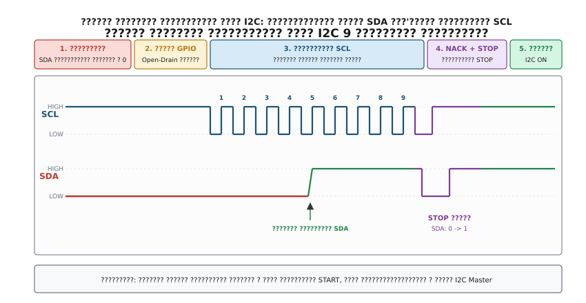
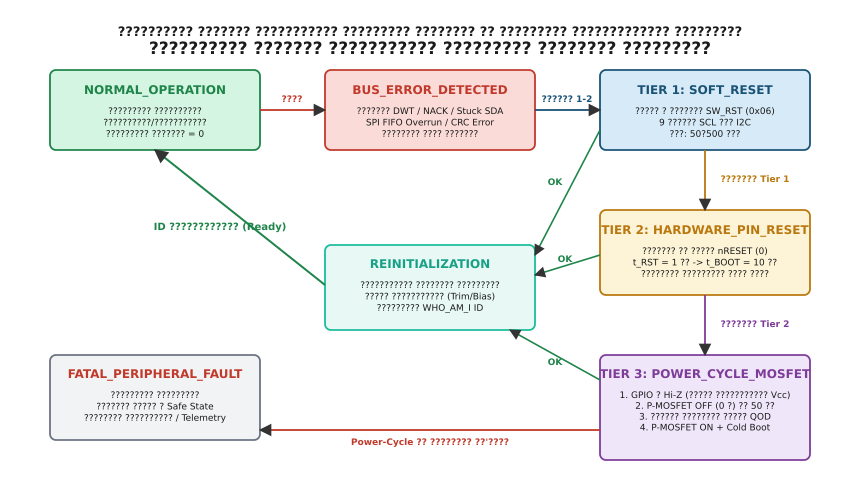

# Таймаути, помилки й повторна ініціалізація чипа

<preknowlist>
- [GPIO-регістри](root:sf-devices/gpio-registers) — конфігурація виводів мікроконтролера, режим відкритого стоку (Open-Drain), керування підтяжками.
- [CMSIS](root:sf-devices/cmsis) — прямий доступ до системних регістрів ядра ARM Cortex-M та лічильника DWT CYCCNT.
- [Опитування, переривання чи DMA у драйвері](root:sf-devices/opytuvannia-pereryvannia-chy-dma-u-draiveri) — моделі опитування статусних прапорців периферії та обробка помилок.
</preknowlist>

Коли мікроконтролер опитує апаратний периферійний інтерфейс I2C або SPI у нескінченному циклі `while (!(I2C1->SR1 & I2C_SR1_TXE));`, будь-яка зовнішня завада на сигнальних лініях або локальний збій веденого сенсора перетворюється на повну зупинку системи. Якщо чип збився посеред передачі байта або лінія живлення зазнала короткочасного просідання, апаратний блок процесора не отримує очікуваного підтвердження й назавжди зависає на очікуванні прапорця готовності. Стандартний сторожовий таймер Watchdog у такій ситуації лише перезавантажує мікроконтролер, але після рестарту прошивка знову стикається із заблокованою шиною і повторно входить у мертву петлю.

Відмовостійка взаємодія з периферією базується на трьох послідовних лініях захисту: апаратно незалежних таймаутах для кожної операції, алгоритмі примусового електричного розблокування ліній зв'язку та трирівневій ескалації процедур скидання зовнішнього чипа.

---

## 1. Детерміновані таймаути на лічильнику DWT

Наївні лічильники ітерацій циклу на зразок `uint32_t timeout = 10000; while (--timeout);` непридатні для виробничого коду. Реальний час їх виконання змінюється в десятки разів залежно від рівня оптимізації компілятора (`-O0` проти `-O3`), конвеєра інструкцій та тактової частоти процесорного ядра.

Надійний таймаут будують на монотонному апаратному джерелі часу — 32-бітному лічильнику циклів ядра DWT CYCCNT (Data Watchpoint and Trace) в архітектурі ARM Cortex-M. Лічильник інкрементується на кожен такт процесора незалежно від стану системних переривань або коду, що виконується.

Завдяки властивостям 32-бітної беззнакової модульної арифметики різниця двох вимірів лічильника `delta_ticks = (uint32_t)(C_now - C_start)` залишається строго коректною навіть у разі переповнення лічильника через нуль.

Якщо лічильник стартував за 1000 тактів до переповнення (`C_start = 2^32 - 1000 = 4294966296`), а поточне значення становить `C_now = 500`, беззнакове віднімання `(uint32_t)(500 - 4294966296)` апаратно повертає `1500` тактів без жодних умовних розгалужень у машинному коді.

:::tabs
@tab C99
:::code taimauty-pomylky-i-povtorna-initsializatsiia-chypa/c/main.c
@tab C++20
:::code taimauty-pomylky-i-povtorna-initsializatsiia-chypa/cpp/main.cpp
:::

---

## 2. 9-тактове розблокування шини I2C (Bus Unlock)

Найтиповіший збій на шині I2C — зависання лінії даних SDA у низькому рівні (0.0 В), коли лінія тактування SCL підтягнута резистором до 3.3 В. Це стається, коли ведучий мікроконтролер скидається або перериває зв'язок саме тоді, коли ведений чип виставляє нульовий біт чергового байта на лінію SDA через відкритий внутрішній N-MOSFET.

Апаратний контролер I2C не здатний згенерувати умову START на заблокованій шині. Для відновлення зв'язку мікроконтролер програмно перемикає виводи SCL та SDA в режим GPIO відкритого стоку (Open-Drain) і виконує процедуру примусового тактування:

1. **Вимкнення периферійного модуля I2C**: скидання біта `PE` (Peripheral Enable) у регістрі керування `I2C_CR1` для переведення виводів під прямий контроль порту GPIO.
2. **Опитування лінії SDA**: зчитування логічного рівня через регістр `GPIO_IDR`. Якщо `SDA == 1`, лінія вільна; якщо `SDA == 0`, ведений чип утримує лінію.
3. **Генерація серії з 9 тактів на лінії SCL**: ведучий програмно формує прямокутні імпульси частотою ~100 кГц (тривалість низького рівня `t_LOW >= 4.7 мкс` та високого рівня `t_HIGH >= 4.0 мкс`).
4. **Контроль відпускання лінії**: на кожному такті ведучий перевіряє стан SDA. Щойно ведений чип виштовхує решту бітів поточного байта до біта NACK/ACK, він закриває транзистор і лінія SDA підтягується у високий рівень.
5. **Формування умови STOP**: ведучий примусово формує стандартний перехід SDA з низького рівня у високий при високому рівні SCL, переводячи протокольні автомати всіх ведених пристроїв у стан очікування (Idle).

*Часова діаграма відновлення шини I2C 9 тактовими імпульсами.*

Після завершення послідовності виводи повертаються в режим альтернативної функції (Alternate Function), а периферійний модуль I2C повторно ініціалізується. Якщо після 9 тактів лінія SDA залишається затиснутою в нуль, на платі присутнє коротке замикання або чип зазнав незворотного внутрішнього замикання.

---

## 3. Трирівнева ескалація скидання чипа

Якщо відновлення ліній зв'язку або повторна транзакція зазнає невдачі, драйвер переходить до ескалації скидання. Однотипне грубе скидання живленням на кожну помилку є помилковим: воно створює струмові сплески, вимагає сотень мілісекунд на перезавантаження і скидає стан усіх сусідніх мікросхем на спільній шині живлення.

Відмовостійка архітектура використовує трирівневу ієрархію скидання (Three-Tier Reset Escalation):

*Скінченний автомат трирівневої ескалації скидання периферії.*

### Рівень 1 (Tier 1): Програмне скидання через регістри (Soft-Reset)
Ведучий надсилає команду скидання через інтерфейс зв'язку: запис у спеціалізований командний регістр сенсора (наприклад, біт `SW_RESET` або запис коду `0xB6`) чи відправлення команди I2C General Call Reset (байт `0x06` на адресу `0x00`).
* **Переваги**: час виконання 50 мкс — 1 мс, відсутність впливу на сусідні компоненти.
* **Обмеження**: не діє, якщо заклинило внутрішній інтерфейсний автомат чи лінія зв'язку фізично заблокована.

### Рівень 2 (Tier 2): Апаратне скидання лінією nRESET
Мікроконтролер формує низький рівень на виділеному фізичному виводі скидання чипа `nRESET` тривалістю від 10 мкс до 1 мс.
* **Переваги**: апаратний перезапуск внутрішнього кінцевого автомата сенсора в обхід шини зв'язку.
* **Обмеження**: вимагає окремої траси на друкованій платі; не усуває заклинювання аналогових вузлів, які потребують зняття напруги.

### Рівень 3 (Tier 3): Циклічне скидання живлення (Power-Cycle)
Повне відключення лінії живлення сенсора за допомогою комутувального P-канального MOSFET-ключа або мікросхеми комутації навантаження (Load Switch).

Для гарантованого скидання процедура Power-Cycle повинна враховувати ефект **паразитного зворотного живлення (Phantom Back-Powering)**. Якщо зняти напругу з виводу живлення чипа, але залишити сигнальні лінії мікроконтролера у високому рівні 3.3 В, струм потече через внутрішні захисні діоди ESD мікросхеми прямо у внутрішню шину живлення:

`V_DD_CHIP = V_MCU_IO - V_F = 3.3 В - 0.6 В = 2.7 В`

Чип продовжує живитися від сигнальних ліній в аварійному режимі й не скидається внутрішнім супервізором POR (Power-On Reset).

Регламент безпечного знеструмлення вимагає:
1. **Ізоляція ліній**: переведення всіх підключених виводів GPIO в режим аналогових входів (Hi-Z, `MODER = 0b11`) до розмикання силового ключа.
2. **Знеструмлення та активний розряд**: розмикання комутувального ключа живлення і витримування паузи `t_OFF >= 5 * tau` (де постійна часу розряду `tau = R_discharge * C_decoupling`) для повного спаду залишкової напруги конденсаторів нижче 0.05 В.
3. **Подача живлення та повторна ініціалізація**: увімкнення ключа, очікування стабілізації напруги (10–20 мс), переведення GPIO у робочий режим та повна повторна конфігурація всіх регістрів сенсора з нуля.

Практична реалізація повного драйвера контролера відновлення шини з константами розряду та моніторингом помилок наведена в проектній вставці [proj-bus-recovery-controller.md](root:sf-devices/taimauty-pomylky-i-povtorna-initsializatsiia-chypa/proj-bus-recovery-controller.md).
