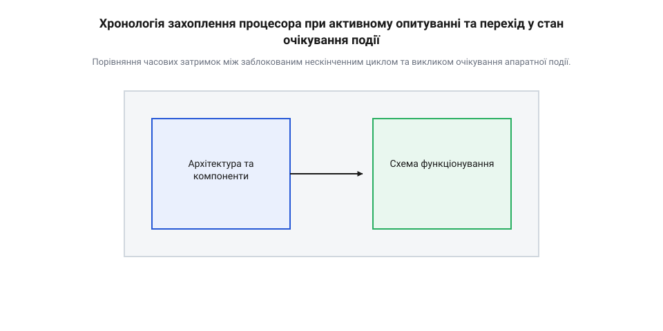
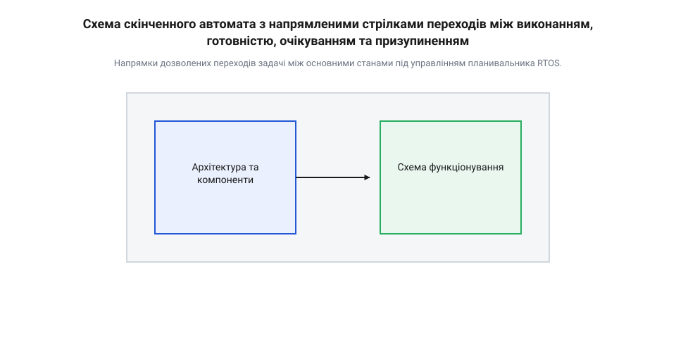
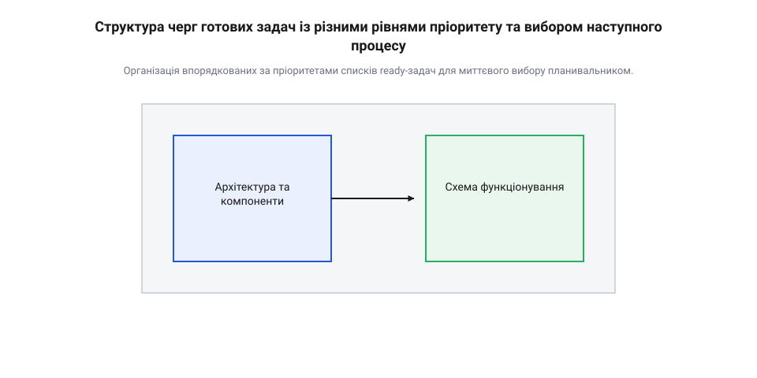

# Автомат станів задачі

<preknowlist>
- [Черга робіт: відкладене виконання на спільному потоці](root:sf-devices/work-queue) — концепції асинхронної обробки подій та відкладеного виконання коду
- [Архітектура кільцевого буфера UART](root:sf-devices/uart-ring-buffer-architecture) — принципи асинхронної буферизації вхідних даних для очікування задач без блокування CPU
</preknowlist>

## Монополізація процесора в неперервному циклі

Розробка прошивки для мікроконтролера зазвичай починається з простих рішень: зчитати рівень на вході, дочекатися готовності датчика або прийняти байт із послідовного інтерфейсу. Найпростіший спосіб досягти цього — написати нескінченний цикл опитування або полінгу (англ. *polling*, від середньонід. *pol* — голова, підрахунок голосів по головах), який безперервно перевіряє стан апаратного прапорця. Поки апаратний вузол не змінить свій стан, процесор виконує мільйони однакових інструкцій перевірки на секунду. Такий режим називають активним очікуванням (англ. *busy waiting*, від *busy* — зайнятий та давньофр. *waitier* — чатувати). На перший погляд пристрій виконує своє завдання, проте фізично @@en|CPU@@ стає заручником одного єдиного прапорця периферії.

Причина цієї проблеми криється в самій природі виконання інструкцій процесором. Фізичне ядро не має вродженого уявлення про «доцільність» чи «важливість» виконуваного коду — воно лише послідовно вибірає команди з пам'яті. Якщо програма замкнена в циклі @@en|polling loop@@, процесор витрачає 100% своїх обчислювальних тактів та споживаної електроенергії на порівняння значень у регістрі. Якщо в цей же час пристрою потрібно обробити натискання кнопки користувачем, оновити графічний екран або вирахувати траєкторію руху приводу, система виявляється повністю заблокованою. Будь-який інший функціонал чекає, поки заблокована задача не вийде зі свого циклу. Якщо розглянути [історичний шлях становлення](root:sf-devices/task-states/hist-task-state-machine-evolution.md) концепцій багатозадачності, стає зрозуміло, що саме монополізація процесора спонукала розробників до створення механізмів квантування часу та поділу задач на стани.

Математично втрату обчислювальної спроможності можна оцінити через коефіцієнт корисного використання процесора `U`. Позначимо через `t_exec` час корисного виконання обчислень, а через `t_poll` — сумарний час, витрачений на активне очікування прапорців у циклі:

```
U = t_exec ÷ (t_exec + t_poll)
  = 1 ÷ (1 + t_poll ÷ t_exec)      [ділення чисельника й знаменника на t_exec]
```

У реальних пристроях тривалість очікування апаратної події часто перевищує час обробки в сотні чи тисячі разів (`t_poll >> t_exec`). У результаті коефіцієнт `U ≈ 0`, що свідчить про практично повну марнотратність процесорного часу при максимальному енергоспоживанні.


*Порівняння часових затримок між заблокованим нескінченним циклом та викликом очікування апаратної події.*

Ситуація додатково ускладнюється, коли пристрій повинен взаємодіяти з кількома апаратними модулями одночасно. Якщо полінг одного датчика затримує виконання програми, вхідний буфер послідовного порту може переповнитися, що призведе до втрати важливих даних. Навіть коли в системі реалізовано [архітектуру кільцевого буфера](root:sf-devices/uart-ring-buffer-architecture) для асинхронного збереження даних, основний потік обчислень все одно зависає, якщо не має способу повідомити систему про відсутність роботи. 

Щоб повернути пристрою гнучкість, задача повинна вміти добровільно або примусово віддавати процесорний час іншим процесам, коли вона чекає на зовнішню подію. В архітектурах без операційної системи цю задачу вирішує [кооперативний планивальник задач](root:sf-devices/task-states/proj-bare-metal-cooperative-state-machine.md) на основі явних прапорців. У складніших системах управління перебирає на себе операційна система реального часу (англ. *Real-Time Operating System*, або @@en|RTOS@@).

Порівняємо монопольний полінг із неблокувальним підходом на практичному прикладі коду:

:::tabs
@tab C (ESP-IDF)
:::code root\eng\sf-devices\task-states/task-states-d/c/esp-idf/vmonopolizingtask.c c
@tab C++ (Arduino MCU)
:::code root\eng\sf-devices\task-states/task-states-d/cpp/arduino/buttonhandler.cpp cpp
:::

## Базові стани життєвого циклу задачі

Для вирішення проблеми монополізації процесора в багатозадачних системах використовують концепцію, де кожна задача розглядається як скінченний автомат (грец. *automatos* — саморухомий) @@en|finite state machine@@. Замість того щоб виконуватися безперервно, задача постійно перебуває в одному із чітко визначених станів. Управління цими станами покладено на центральний модуль операційної системи — планувальник (англ. *scheduler*, від пізньолат. *schedula* — аркушик паперу, розклад). Planning @@en|scheduler@@ визначає, який саме процес має право користуватися ресурсами фізичного ядра @@en|CPU@@ у кожен момент часу.

В операційній системі реального часу @@en|RTOS@@ виділяють чотири базові стани життєвого циклу задачі:

1. **Виконання** (англ. *Running*, від *run* — бігти) @@en|Running@@ — задача безпосередньо виконується процесором. В одноядерному мікроконтролері у станi @@en|Running@@ одночасно може перебувати лише одна задача. 2. **Готовність** (англ. *Ready*, від *ready* — готовий) @@en|Ready@@ — задача має всі необхідні дані й ресурси для виконання, але чекає, поки @@en|scheduler@@ виділить їй процесорний час, оскільки в даний момент фізичне ядро зайняте іншим процесом. 3. **Очікування або блокування** (англ. *Blocked* / *Waiting*, від *block* — колода, перешкода) @@en|Blocked@@ — задача не може виконуватися, оскільки чекає на настання певної події (таймауту, надходження даних із буфера або звільнення системного ресурсу). Навіть якщо процесор повністю вільний, задача у стані @@en|Blocked@@ не отримує процесорних тактів. 4. **Призупинення** (англ. *Suspended*, від лат. *suspendere* — підвішувати) @@en|Suspended@@ — задача примусово вилучена з розкладу планувальника викликом системного @@en|API@@. Вона залишається в пам'яті пристрою, але @@en|scheduler@@ ігнорує її до моменту явного відновлення.


*Напрямки дозволених переходів задачі між основними станами під управлінням планивальника RTOS.*

Зміна станів відбувається за суворими математичними правилами. Коли виконувана задача у стані @@en|Running@@ робить системний виклик очікування (наприклад, затримку часу або зчитування з черги), вона самостійно переходить у стан @@en|Blocked@@. Коли очікувана подія настає (минає затримка або приходить байт), задача переходить у стан @@en|Ready@@, а **не напряму** в @@en|Running@@. Це фундаментальне правило багатозадачних систем: вихід із блокування означає лише те, що задача знову здобула право претендувати на процесор. Оцінку того, коли саме вона почне виконуватися, дає [формалізований математичний апарат](root:sf-devices/task-states/math-task-state-transitions-and-queueing.md) черг із урахуванням пріоритетів усіх активних задач.


*Організація впорядкованих за пріоритетами списків ready-задач для миттєвого вибору планивальником.*

Якщо в стані @@en|Ready@@ опиняється задача з вищим пріоритетом, ніж у тієї, що виконується зараз, @@en|scheduler@@ здійснює витіснення або преемптивність (англ. *preemption*, від лат. *praeemptio* — попереднє викуплення, першочергове право) @@en|preemption@@. Поточна задача переводиться зі стану @@en|Running@@ у стан @@en|Ready@@, а її регістри процесора, значення вказівника стека та лічильника інструкцій зберігаються в системній пам'яті. Для збереження цього стану використовується [структура контрольного блоку](root:sf-devices/task-control-block-structure) задачі (@@en|TCB@@). Після цього @@en|scheduler@@ відновлює значення регістрів нової задачі з її @@en|TCB@@ та переводить її зі стану @@en|Ready@@ у @@en|Running@@.

Час реакції системи `T_latency` на зовнішню подію при переході задачі зі стану @@en|Blocked@@ у @@en|Running@@ складається з часу обробки переривання `t_isr`, часу обчислення списків готовності `t_sched` та затримки на збереження і відновлення регістрів `t_ctx`:

```
T_latency = t_isr + t_sched + t_ctx
          = t_isr + t_sched + t_ctx    [сумарний квант затримки переходу Blocked -> Running]
```

Узагальнений приклад управління станами задач у C та C++ демонструє перехід задач у стан @@en|Blocked@@ за допомогою системних викликів:

:::tabs
@tab C (FreeRTOS API)
:::code root\eng\sf-devices\task-states/task-states-d/c/esp-idf/vtask1.c c
@tab C++ (RTOS Wrapper)
:::code root\eng\sf-devices\task-states/task-states-d/cpp/arduino/rtostask.cpp cpp
:::

Управління життєвим циклом здійснюється через уніфікований [системний інтерфейс керування](root:sf-devices/task-states/api-rtos-task-state-management-interface.md) операційної системи. Для точного аналізу часу перебування задач у кожному зі станів та виявлення прихованих затримок розробники застосовують спеціальний [модуль трасування станів](root:sf-devices/task-states/proj-rtos-task-state-tracer.md), який фіксує всі зміни станів у пам'яті пристрою.

## Механізми переходу в стан очікування

Коли задача виконується процесором, вона не може «заснути» сама по собі без чітко визначеної причини та керуючої дії. Фізичне ядро мікроконтролера не знає, коли зовнішній пристрій закінчить передачу даних чи коли надійде сигнал від датчика — воно лише безупинно виконує машинні інструкції. Щоб вийти зі стану виконання (англ. *running*) @@en|Running@@ та звільнити обчислювальний ресурс для інших процесів, задача повинна перевірити умови свого продовження. Якщо потрібні дані ще не готові або настала потреба в паузі, задача звертається до ядра операційної системи реального часу (англ. *Real-Time Operating System*, або @@en|RTOS@@) і переходить у стан очікування або блокування (англ. *blocked*) @@en|Blocked@@. Існує два основні шляхи потрапляння в цей стан: добровільна затримка за ініціативою самого коду та примусовий перехід, викликаний очікуванням зовнішнього ресурсу з обмеженим часовим інтервалом.

Добровільне очікування виникає тоді, коли програма свідомо віддає процесор на визначений проміжок часу або до моменту надходження системного сигналу. Найпростіший випадок — часова затримка, коли задача викликає системну функцію затримки. У цей момент планувальник (англ. *scheduler*) @@en|scheduler@@ вилучає задачу зі списку готових до виконання й поміщає її у список очікування таймера. Проте значно частіше в реальних пристроях блокування відбувається при спробі зчитати дані з периферії або отримати доступ до спільного ресурсу. Якщо задача звертається до синхронізаційних примітивів — таких як рахунковий або бінарний семафор (грец. *sema* — знак та *phoros* — той, що носить) @@en|semaphore@@, взаємне виключення або м'ютекс (англ. *mutex*, від *mutual exclusion*) @@en|mutex@@ чи черга повідомлень (англ. *message queue*) @@en|message queue@@ — а ресурс виявляється зайнятим або порожнім, задача миттєво переходить у стан @@en|Blocked@@. Для прикладу, під час обробки вхідного потоку даних застосовують [організацію кільцевого буфера RX](root:sf-devices/uart-rx-ring-buffer-mcu) для асинхронного UART: задача викликає функцію зчитування з черги, і якщо буфер порожній, вона зупиняється доти, доки апаратне переривання від послідовного порту не занесе перший байт і не надішле сигнал розблокування.

Окрім добровільного очікування беззастережної події, у системному програмуванні критично важливо обробляти випадки, коли очікуваний ресурс так і не стає доступним. Для цього в системних викликах RTOS передбачено механізм граничного часу очікування або таймаут (англ. *timeout*, від *time* — час та *out* — вихід) @@en|timeout@@. Коли задача здійснює запит на отримання семафора чи байта з черги, вона вказує максимальну кількість системних квантів або тіків (англ. *system tick*, від звуконаслідування клацання годинника) @@en|system tick@@, яку вона готова чекати. Якщо за цей час подія не відбувається, апаратне переривання системного таймера змушує @@en|scheduler@@ примусово вилучити задачу зі списку очікування подій і повернути її в стан готовності (англ. *ready*) @@en|Ready@@. При цьому системна функція повертає код помилки, що дозволяє програмі уникнути вічного заблокованого стану та вжити відновлювальних заходів (наприклад, перезапустити периферійний модуль або сповістити користувача).

Внутрішньо механіка відліку затримок та таймаутів спирається на регулярні апаратні переривання системного таймера ядра. З кожним тактом таймера @@en|scheduler@@ зменшує лічильники залишку часу для всіх задач, розташованих у списку очікування. Точний момент розблокування задачі `T_unblock` можна виразити відносно моменту початку очікування `T_start`, кількості виділених системних тіків `N_ticks` та частоти системного таймера `f_tick`:

```
t_delay = N_ticks ÷ f_tick               [переведення кількості тіків у секунди]
T_unblock = T_start + t_delay            [підсумовування початкового часу та тривалості затримки]
```

Якщо під час перевірки системного тіка лічильник `N_ticks` досягає нуля або переривання від апаратного модуля сповіщає про готовність даних, @@en|scheduler@@ переміщує контрольний блок задачі (англ. *Task Control Block*, або @@en|TCB@@) зі списку очікування до списку ready-задач. Далі застосовується [механіка перемикання контексту](root:sf-devices/rtos-context-switch-mechanics): якщо розблокована задача має пріоритет, вищий за поточний виконуваний процес, витіснення (англ. *preemption*) @@en|preemption@@ відбувається негайно під час обробки переривання таймера.

Розглянемо практичну реалізацію добровільного очікування на дані з черги з використанням таймауту на C та C++:

:::tabs
@tab C (ESP-IDF / FreeRTOS)
:::code root\eng\sf-devices\task-states/task-states-d/c/esp-idf/vuartreceivertask.c c
@tab C++ (Arduino / RTOS Wrapper)
:::code root\eng\sf-devices\task-states/task-states-d/cpp/arduino/timeoutqueue.cpp cpp
:::

## Призупинення та управління готовими задачами

Окрім стану очікування подій або таймаутів, у багатозадачних операційних системах існує додатковий стан — призупинення (англ. *suspended*, від лат. *suspendere* — підвішувати) @@en|Suspended@@. Головна відмінність між @@en|Blocked@@ та @@en|Suspended@@ полягає у ступені автономності виходу з цього стану. У стані @@en|Blocked@@ задача залишається приєднаною до системного таймера або очікуваного об'єкта синхронізації: щойно минає таймаут або виникає переривання, @@en|scheduler@@ автоматично переводить її у стан готовності @@en|Ready@@. Натомість у стані @@en|Suspended@@ задача повністю «заморожується» й усувається з будь-яких системних розкладів перевірки. Вона не реагує ні на таймаути, ні на апаратні переривання периферії. Повернення призупиненої задачі до життя можливе виключно через прямий системний виклик відновлення `vTaskResume` з іншої активної задачі або обробника переривання.

Механізм призупинення застосовується в архітектурі вбудованих систем для тимчасового вимкнення цілих функціональних модулів. Наприклад, під час бездротового оновлення прошивки по повітрю система може призупинити задачі обробки користувацького інтерфейсу та збору телеметрії, щоб виділити всі ресурси пам'яті й процесорного часу для запису спалах-пам'яті. Також призупинення дозволяє реалізувати режими глибокого енергозбереження: коли рівень заряду акумулятора падає нижче критичного порогу, контролер системи призупиняє енергоємні задачі обчислення та залишає активною лише задачу моніторингу живильної мережі.

Коли задача перебуває у стані @@en|Ready@@, вона повністю готова до виконання і лише чекає, поки @@en|scheduler@@ виділить їй процесорний час. Для швидкого вибору наступної виконуваної задачі RTOS організовує ready-задачі у впорядковані списки або черги готовності. Для кожного доступного рівня пріоритету ядро створює окрему двобічну зв'язану чергу. Оскільки пошук задачі з найвищим пріоритетом у багатьох мікроконтролерах реалізовано апаратно через спеціальні інструкції підрахунку провідних нульових бітів (наприклад, `CLZ` в архітектурі ARM Cortex-M), вибір наступного процесу відбувається за сталий час `O(1)`. Якщо декілька готових задач мають однаковий пріоритет, @@en|scheduler@@ розподіляє між ними кванти часу за алгоритмом кругового обслуговування або карусельного розкладу (англ. *Round-Robin*, від фр. *ruban* — стрічка) @@en|round-robin@@.

Однак при неправильному розрахунку пріоритетів та умов переходу між станами виникають небезпечні системні аномалії:
1. **Застрягання задач у стані очікування**: Якщо задача переходить у стан @@en|Blocked@@ без вказівки таймауту (`portMAX_DELAY`) і чекає на подію від периферійного модуля, який збійнув або вимкнений, вона залишається в очікуванні назавжди. Пам'ять її стека залишається заблокованою, а виконання логіки зупиняється. 2. **Голодування задач** (англ. *starvation*, від давньоангл. *steorfan* — гинути) @@en|starvation@@: Якщо високопріоритетна задача не виконує системних викликів очікування (наприклад, безперервно проводить обчислення у нескінченному циклі), вона монополізує процесор. Задача з нижчим пріоритетом ніколи не отримує квантів часу та повністю голодує, навіть якщо перебуває у стані @@en|Ready@@.

Для запобігання голодуванню використовують механізм добровільної передачі управління — ільд (англ. *yield*, від давньоангл. *gieldan* — віддавати, сплачувати) @@en|yield@@. Викликаючи системну функцію `taskYIELD()`, виконувана задача добровільно віддає залишок своего часового кванта іншим готовим задачам із таким самим пріоритетом. Для виконання тривалих фонових обчислень без монополізації ядра також широко використовують [чергу робіт для відкладеного виконання](root:sf-devices/work-queue), де невеликі кванти обчислювальних задач виконуються на спільному системному потоці.

Оцінимо математично тривалість повного циклу виконання `T_cycle` для групи з `N` готових задач одинакового пріоритету при квантуванні часу (англ. *time slicing*) @@en|time slicing@@:

```
t_work = N × t_slice                     [сумарний час виконання обчислень усіх N задач]
t_overhead = N × t_ctx                   [сумарні затрати на перемикання контексту TCB]
T_cycle = t_work + t_overhead            [тривалість повного кругового циклу Round-Robin]
```

З формули видно, що надто малий квант часу `t_slice` збільшує частку накладних витрат `t_ctx`, тоді як надто великий квант погіршує чутливість системи до подій реального часу.

Нижче наведено приклад управління станом призупинення та добровільною передачею кванта часу на C та C++:

:::tabs
@tab C (ESP-IDF / FreeRTOS)
:::code root\eng\sf-devices\task-states/task-states-d/c/esp-idf/vworkertask.c c
@tab C++ (Arduino / RTOS Wrapper)
:::code root\eng\sf-devices\task-states/task-states-d/cpp/arduino/managedtask.cpp cpp
:::

## Проєктування неблокувальних задач для RTOS

Побудова надійної архітектури програмного забезпечення для операційних систем реального часу вимагає від розробника суворого дотримання принципів неблокувального проєктування. Основне правило розробки задач у RTOS полягає в тому, що жодна задача не повинна виконувати активного опитування в циклі чи містити прихованих затримок без передачі управління планивальнику. Будь-який нескінченний цикл `while(1)` всередині задачі зобов'язаний починатися або завершуватися системним викликом, який переводить задачу у стан @@en|Blocked@@ при відсутності корисного навантаження. Це гарантує, що процесорний час розподіляється раціонально, а системи реального часу залишаються детермінованими.

Під час проєктування взаємодії між кількома неблокувальними задачами виникають складні архітектурні пастки синхронізації:
1. **Інверсія пріоритетів** (англ. *priority inversion*) @@en|priority inversion@@: Виникає тоді, коли низькопріоритетна задача A захоплює м'ютекс @@en|mutex@@ для роботи з ресурсом (наприклад, шиною I2C). Високопріоритетна задача C намагається захопити цей же м'ютекс і блокується. Якщо в цей момент з'являється среднепріоритетна задача B, якій м'ютекс не потрібен, вона витісняє задачу A, оскільки її пріоритет вищий за A. У результаті високопріоритетна задача C змушена чекати, поки виконується середньопріоритетна задача B! Для вирішення цієї проблеми застосовують [інверсію пріоритетів та успадкування пріоритету](root:sf-devices/priority-inversion-and-inheritance) (англ. *priority inheritance*) @@en|priority inheritance@@: м'ютекс тимчасово підвищує пріоритет власниці A до рівня задачі C на весь час утримання ресурсу. 2. **Взаємне блокування** або дедлок (англ. *deadlock*, від *dead* — мертвий та *lock* — замок) @@en|deadlock@@: Виникає, коли задача A утримує Ресурс 1 і чекає на Ресурс 2, а задача B утримує Ресурс 2 і чекає на Ресурс 1. Обидві задачі назавжди застрягають у стані @@en|Blocked@@. Для уникнення дедлоків слід завжди захоплювати ресурси в єдиному глобальному порядку або завжди використовувати таймаути замість нескінченного очікування.

Окрім синхронізації, неблокувальна задача повинна гарантувати безпеку власного стека та стабільність всієї системи. Оскільки кожен процес виділяє фіксовану область пам'яті під стек, локальні масиви великого розміру чи глибока рекурсія можуть призвести до переповнення стека (англ. *stack overflow*) @@en|stack overflow@@. Розробники мусять налаштувати [запобігання та виявлення переповнення стека](root:sf-devices/task-stack-overflow-detection), розставляючи захисні мітки стека (англ. *stack canary*) @@en|stack canary@@. Також для моніторингу зависання задач використовують системний сторожовий таймер (англ. *watchdog timer*) @@en|watchdog timer@@: кожна неблокувальна задача повинна періодично переходити у стан виконання та скидати свій лічильник здоров'я («годувати сторожа»). Якщо задача зависає в нескінченному активному циклі чи блокується назавжди, сторожовий таймер перезавантажує мікроконтролер.

Узагальнена структура надійної неблокувальної задачі будується за шаблоном обробника подій (англ. *Event-Driven Task Loop*):

```
Крок 1: Ініціалізація локальних змінних та периферійних інтерфейсів.
Крок 2: Вхід у нескінченний цикл while(1).
Крок 3: Перехід у стан Blocked із викликом xQueueReceive() або ulTaskNotifyTake() з таймаутом.
Крок 4: Обробка отриманої події або перевірка умов за таймаутом.
Крок 5: Скидання прапорця сторожового таймера (Watchdog Reset).
```

Нижче наведено приклад практичної побудови неблокувальної задачі з обробкою подій із черги, захистом м'ютексом із успадкуванням пріоритетів та скиданням сторожового таймера на C та C++:

:::tabs
@tab C (ESP-IDF / FreeRTOS)
:::code root\eng\sf-devices\task-states/task-states-d/c/esp-idf/vnonblockingworkertask.c c
@tab C++ (Arduino / RTOS Wrapper)
:::code root\eng\sf-devices\task-states/task-states-d/cpp/arduino/nonblockingworker.cpp cpp
:::