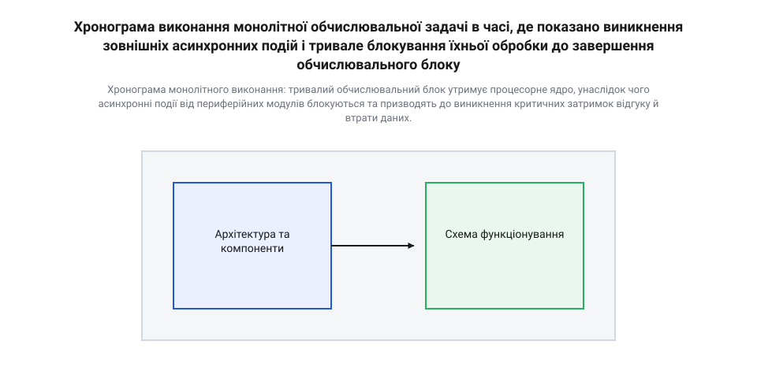
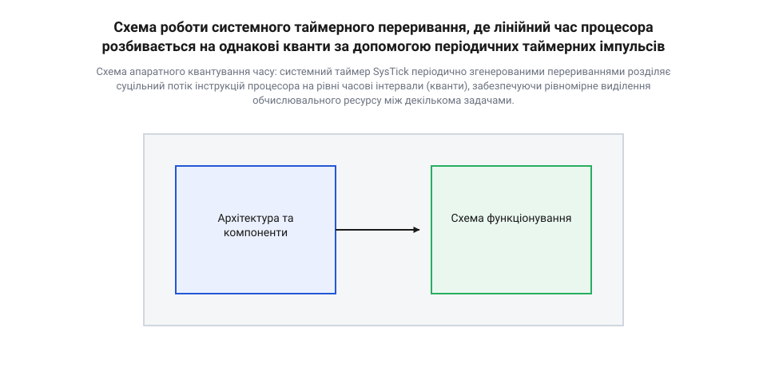
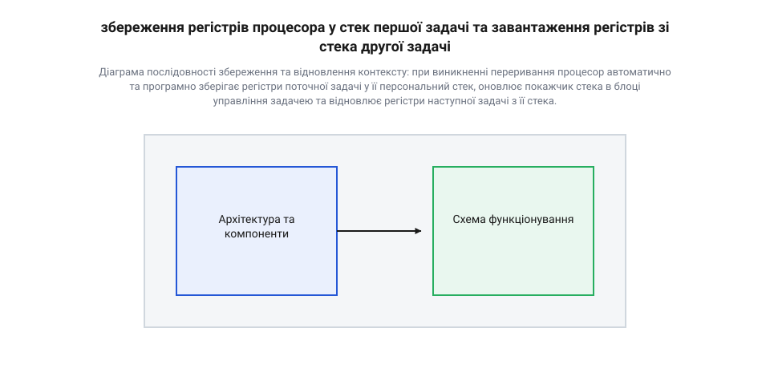
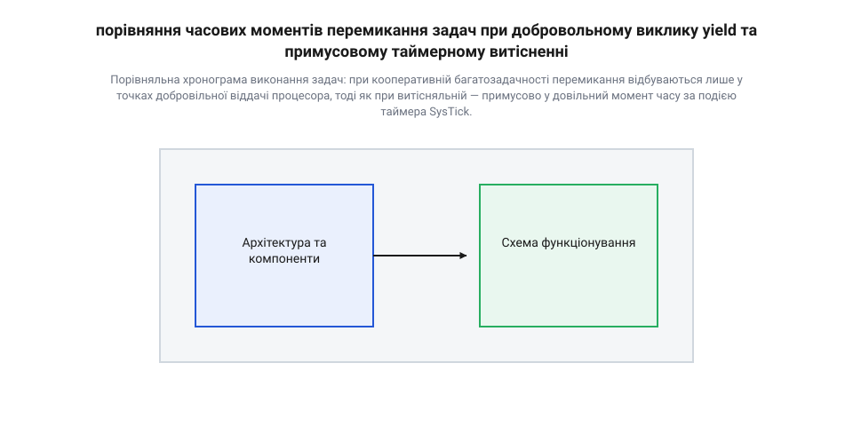
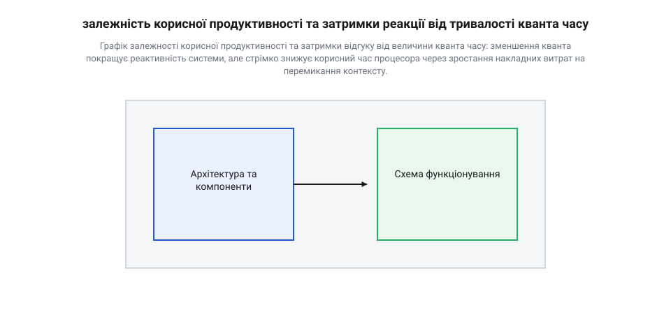
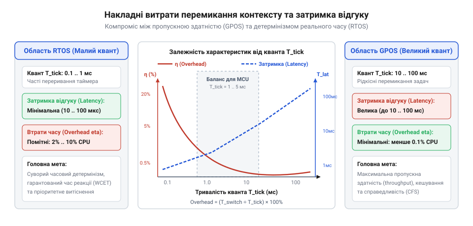

# Розподіл часу: від мейнфреймів до мікроконтролерів

<preknowlist>
- [Super-loop](root:sf-devices/super-loop) — розуміння архітектури нескінченного циклу обробки, неблокувальних автоматів станів та обмежень опитування периферії без використання операційної системи
- [FreeRTOS](root:sf-devices/freertos) — базове уявлення про роль та структуру операційних систем реального часу у вбудованих пристроях
</preknowlist>

## Поломка чутливості системи за монолітного виконання

Традиційна розробка програмного забезпечення для вбудованих систем часто починається з найпростішої архітектурної моделі: нескінченного обчислювального циклу. У такій структурі мікроконтролер послідовно виконує набір інструкцій від початку до кінця, після чого повертається на початок. Поки задачі зводяться до коротких операцій — зчитати стан виводу, оновити лічильник чи встановити рівень на цифровому виході — система демонструє відмінну передбачуваність та високу швидкість виконання. Однак ситуація кардинально змінюється, коли перед прошивкою виникає потреба виконати обчислювально містку операцію. Це може бути розрахунок контрольної суми CRC32 для великого блоку флеш-пам'яті, цифрова фільтрація масиву відліків аналого-цифрового перетворювача, математичне перетворення матриць координації або криптографічне шифрування пакета даних.

Коли процесорне ядро входить у монолітну функцію обчислень, лінійний потік виконання коду монополізує процесор на весь час роботи цієї функції. Якщо обчислення займають десятки або сотні мілісекунд, процесор виявляється глухим до будь-яких зовнішніх подій навколишнього світу. У цей період пристрій втрачає свою головну властивість — реактивність @@en|responsiveness@@ (від лат. *respondere* — відповідати, здатність системи своєчасно реагувати на зовнішні події). З погляду зовнішнього спостерігача або суміжної апаратури мікроконтролер перестає відповідати на запити, впадаючи в стан тимчасового анабіозу.

Головна причина цієї проблеми криється у фізичній природі послідовного виконання команд одноядерним процесором. Процесорне ядро не має вродженого уявлення про «важливість» чи «терміновість» інструкцій — воно лише послідовно вибирає команди з пам'яті та виконує їх згідно з вказівником команд. Якщо програма виконує [архітектуру нескінченного циклу](root:sf-devices/super-loop), час між двома послідовними опитуваннями периферійного пристрою прямим чином залежить від сумарного часу виконання всіх функцій, включених у цей цикл.

Визначимо часову затримку відгуку @@en|latency@@ (від лат. *latens* — прихований, невидимий час очікування від моменту виникнення події до початку її обробки). Якщо тривалість монолітної обчислювальної задачі становить `t_calc`, а час безпосередньої обробки події периферії дорівнює `t_proc`, то в найгіршому випадку, коли подія виникає одразу після початку обчислювального блоку, підсумкова затримка відгуку обчислюється так:

```
L_max = t_calc + t_proc
```

Якщо `t_calc` становить `100` мілісекунд, а апаратний модуль вимагає відгуку протягом `1` мілісекунди, затримка системи перевищує допустиму норму у `100` разів.

Фізичним наслідком такого дефіциту реактивності є не просто запізнення, а незворотна втрата даних та порушення функціонування пристрою. Сучасні периферійні модулі мікроконтролерів (наприклад, прийомопередавачі UART, SPI або CAN) володіють невеликими апаратними буферами першим прийшов — першим вийшов @@en|FIFO@@ (від англ. *First In, First Out*). Якщо процесор заблокований монолітним обчисленням і не зчитує дані з апаратного регістра, вхідний буфер швидко переповнюється.

Розглянемо випадок прийому даних через інтерфейс UART на швидкості `115200` біт/с. При такій швидкості один байт (з урахуванням стартового та стопового бітів) передається за `86.8` мікросекунд. Якщо апаратний буфер FIFO контролера UART має обсяг `16` байтів, він повністю заповниться за такий проміжок часу:

```
t_overflow = 16 × 86.8
           = 1388.8 мікросекунд
           ≈ 1.39 мілісекунди    [час до переповнення буфера FIFO]
```

Якщо в цей час процесор зайнятий монолітною задачею тривалістю `100` мілісекунд, апаратний модуль згенерує помилку переповнення, а всі наступні байти будуть втрачені. Математично кількість втрачених байтів `N_lost` за час блокування визначається співвідношенням:

```
N_lost = max(0, ⌊(t_calc - t_overflow) ÷ t_byte_interval⌋)
```

При `t_calc = 100` мілісекундах та `t_byte_interval = 0.0868` мілісекунди кількість втрачених байтів сягатиме більше тисячі екземплярів, що робить надійний обмін даними абсолютно неможливим.

Історично аналогічний виклик виник у 1960-х роках на перших обчислювальних центрах, де [еволюція розподілу часу від мейнфреймів](root:sf-devices/time-sharing-history/hist-mainframe-to-embedded-timesharing.md) змусила розробників відмовитися від суто пакетної обробки @@en|batch processing@@ (від англ. *batch* — пачка, порція завдань) на користь квантування обчислювального ресурсу. У мейнфреймах пакетне виконання одного монолітного завдання залишало інтерактивні термінали користувачів заблокованими на години. Адаптація цих концепцій у вбудованих системах показала: нависання тривалих монолітних блоків коду над обробкою асинхронних сигналів знищує детермінізм пристрою.


*Хронограма монолітного виконання: тривалий обчислювальний блок утримує процесорне ядро, унаслідок чого асинхронні події від периферійних модулів блокуються та призводять до виникнення критичних затримок відгуку й втрати даних.*

Для наочності розглянемо практичну реалізацію цієї проблеми в коді прошивки. Програма виконує обчислення контрольної суми великого масиву даних у монолітному циклі, через що активне опитування @@en|polling@@ (від англ. *poll* — опитувати по черзі) прапорців периферії стає неможливим:

:::tabs
@tab C (ESP-IDF)
:::code root\eng\sf-devices\time-sharing-history/time-sharing-history-d/c/esp-idf/calculate-heavy-crc32.c c
@tab C++ (STM32 HAL)
:::code root\eng\sf-devices\time-sharing-history/time-sharing-history-d/cpp/stm32/monolithiccalculator.cpp cpp
:::

Проблему поломки чутливості неможливо вирішити простим збільшенням тактової частоти процесора чи додаванням додаткових перевірок прапорців усередині обчислювального алгоритму. Збільшення частоти лише пропорційно зменшує час, але не усуває сам факт блокування при зростанні обсягу даних, а ручне вкраплення перевірок периферії в обчислювальні функції порушує модульність коду та перетворює програму на непідтримувану мереживу зв'язків.

Стає зрозуміло, що для збереження високої реактивності система потребує механізму, який здатен автоматично та незалежно від структури прикладної функції розбивати монолітний потік виконання процесора на фрагменти. Обчислювальний процес повинен примусово перериватися через чіткі інтервали часу, передаючи контроль іншим задачам. Саме ця ідея лежить в основі концепції розподілу процесорного часу @@en|time sharing@@ (від англ. *time* — час, *share* — ділити), де апаратне забезпечення бере на себе роль ритмічного арбітра обчислювального ресурсу.

## Апаратний ритм квантування та таймерне переривання

Для усунення блокування системи монолітними обчисленнями необхідно відібрати у прикладної функції можливість безперервно утримувати процесорний ресурс. Покладати цю відповідальність на розробника коду ненадійно: будь-яка помилка або неврахований цикл призведе до замикання процесора. Розв'язанням є залучення апаратної периферії, яка здатна втручатися у виконання інструкцій процесора на фізичному рівні — незалежно від того, який саме код виконується у даний момент.

Таким апаратним арбітром є системне таймерне переривання @@en|tick interrupt@@ (від англ. *tick* — цокання, регулярний такт годинника, та *interrupt* — переривання). У сучасних мікроконтролерних архітектурах для цього виділяють спеціалізований лічильник — системний таймер (наприклад, модуль SysTick в архітектурі ARM Cortex-M). Цей таймер являє собою апаратний відраховувач, який тактується безпосередньо від системної шини або внутрішнього генератора процесорного ядра і працює повністю паралельно з блоком вибірки та декодування інструкцій.

Принцип апаратного квантування часу @@en|time slicing@@ (від англ. *slice* — скибка, нарізати на частини) полягає у поділі безперервної часової осі процесора на рівні часові відрізки — кванти. Системний таймер налаштовується на постійний період відліку `t_tick` (зазвичай від `1` до `10` мілісекунд). Коли апаратний лічильник таймера доходить до нуля, він генерує виняток процесора.

Апаратна логіка процесорного ядра негайно призупиняє виконання поточного потоку інструкцій, автоматично зберігає базовий набір регістрів у стек і здійснює перехід за вектором переривання до обробника таймерної події. У результаті суцільний потік виконання програми розбивається на окремі порції:

```
[Потік інструкцій Задача A] ──> | SysTick | ──> [Обробник таймера] ──> | SysTick | ──> [Потік Задача B]
```

Для забезпечення детермінованого ритму в мікроконтролерах використовують спеціалізований [системний таймер переривань](root:sf-devices/time-sharing-history/comp-system-tick-timer.md), який генерує апаратні сигнальні імпульси незалежно від поточного стану обчислювального ядра.

На базі таких регулярних імпульсів створюється ілюзія паралельного виконання декількох задач на одному фізичному ядрі процесора. Фізично одноядерний мікроконтролер у будь-який конкретний момент часу `t` спроможний виконувати лише одну-єдину інструкцію. Проте, якщо процесор перемикає виконання між Задачею A та Задачею B кожні `1` мілісекунду, то на часових масштабах людського сприйняття (десятки мілісекунд) або відносно повільних фізичних процесів (наприклад, зміни температури датчика) обидві задачі виконуються одночасно.


*Схема апаратного квантування часу: системний таймер SysTick періодично згенерованими перериваннями розділяє суцільний потік інструкцій процесора на рівні часові інтервали (кванти), забезпечуючи рівномірне виділення обчислювального ресурсу між декількома задачами.*

Розглянемо математичну модель апаратного квантування. Нехай у системі виконується `N` задач, кожній з яких виділяється квант часу `t_quantum`. Кожне перемикання між задачами вимагає виконання процедури збереження та відновлення стану регістрів процесора — перемикання контексту @@en|context switch@@ (від англ. *context* — сукупність умов, стан регістрів процесора). Ця процедура забирає фіксований час накладних витрат @@en|overhead@@ (від англ. *overhead* — додаткові витрати понад основну роботу) `t_overhead`.

Тоді повний цикл обслуговування всіх задач `T_cycle` (круговий період) обчислюється як:

```
T_cycle = ∑ (t_quantum + t_overhead)    [для i від 1 до N]
        = N × (t_quantum + t_overhead)  [при однакових квантах задач]
```

Максимальна затримка реакції системи на зовнішню подію `L_max` для будь-якої з задач у такій системі обмежена часом одного повного кругового циклу `T_cycle`. На відміну від монолітного виконання, де затримка прямувала до нескінченності при зростанні обчислювального блоку, при апаратному квантуванні затримка стає чітко обмеженою зверху:

```
L_max ≤ N × (t_quantum + t_overhead)
```

Ефективність використання процесора `U_effective` з урахуванням накладних витрат на перемикання квантів оцінюється відношенням корисного часу квантів до повного часу цикла:

```
U_effective = (N × t_quantum) ÷ (N × (t_quantum + t_overhead))
            = t_quantum ÷ (t_quantum + t_overhead)            [скорочення N]
            = 1 ÷ (1 + t_overhead ÷ t_quantum)                [ділення чисельника і знаменника на t_quantum]
```

З цієї формули чітко видно фундаментальний інженерний компроміс квантування часу: якщо зробити квант `t_quantum` занадто малим для зменшення затримки відгуку `L_max`, то відношення `t_overhead ÷ t_quantum` зросте, і суттєва частка продуктивності процесора буде марнована на обслуговування переривань та перемикання регістрів. Навпаки, якщо збільшити квант `t_quantum`, зросте корисна ефективність `U_effective ≈ 1`, але погіршиться чутливість системи.

Проілюструємо апаратний механізм квантування часу на практичному прикладі C та C++ коду для мікроконтролера, де системний таймер SysTick генерує квантувальні імпульси і забезпечує почергове надання процесорного часу двом незалежним задачам:

:::tabs
@tab C (CMSIS / STM32)
:::code root\eng\sf-devices\time-sharing-history/time-sharing-history-d/c/stm32/init-systick-1ms.c c
@tab C++ (Arduino / Microchip SAMD)
:::code root\eng\sf-devices\time-sharing-history/time-sharing-history-d/cpp/arduino/hardwaretimeslicer.cpp cpp
:::

Апаратний ритм таймерного переривання створює стабільний підгрунковий фундамент, на якому будуються сучасні операційні системи реального часу, такі як [FreeRTOS](root:sf-devices/freertos). Завдяки регулярному апаратному квантуванню розробник отримує детермінований контроль над часовим ресурсом процесора.

Однак самої лише наявності таймерного переривання недостатньо для повноцінного перемикання повністю ізольованих задач з власними локальними змінними та стеками викликів. Для того щоб примусово зупинити Задачу A і передати контроль Задачі B без спотворення їхнього внутрішнього стану, система повинна володіти низькорівневим механізмом консервації фізичних регістрів процесора. Саме цей апаратний та програмний процес збереження й відновлення стану створює основу для повноцінного перемикання контексту процесора.

## Збереження та відновлення контексту процесорного ядра

Періодичне вининення таймерного переривання створює лише апаратний ритм для квантування часу. Однак сам по собі перехід у функцію обробника переривання не розв'язує головну задачу — збереження повноти стану перерваного обчислення. Якщо процесорне ядро виконує складну математичну операцію у момент спрацьовування таймера, фізичні регістри процесора містять проміжні результати, прапорці арифметичних операцій та адресу наступної інструкції. Якщо системний планувальник просто переключить виконання на іншу задачу, нова програма негайно перезапише вміст цих регістрів. Повернення до попередньої задачі призведе до фатального спотворення її обчислень і падіння всієї прошивки.

Для безпечного призупинення та подальшого відновлення обчислень виникає потреба консервації повного фізичного стану процесорного ядра — збереження контексту @@en|context@@ (від лат. *contextus* — з'єднання, сплетіння, сукупність поточних значень регістрів процесорного ядра, покажчика стека та прапорців стану). Фізичний контекст процесора складається з кількох груп регістрів:

- Вказівник команд @@en|program counter@@ (`PC`) — регістр, який зберігає оперативну адресу інструкції, що має бути виконана наступною. - Покажчик стека @@en|stack pointer@@ (`SP`) — регістр, який вказує на вершину оперативної пам'яті RAM, виділеної під поточний стек @@en|stack@@ (від англ. *stack* — стос, купа, структура даних типу LIFO). - Регистр зв'язку @@en|link register@@ (`LR`) — зберігає адресу повернення з підпрограм або спеціальний код повернення з винятку. - Регистр стану процесора @@en|program status register@@ (`xPSR`) — містить арифметичні прапорці (нуль, переповнення, знак) та поточний рівень привілеїв виконання. - Регистри загального призначення @@en|general-purpose registers@@ (`R0`-`R12`) — оперативні комірки ядра для збереження локальних змінних і параметрів арифметико-логічного пристрою.

Перемикання контексту @@en|context switch@@ виконується у декілька атомарних етапів. Сучасні 32-бітні мікроконтролерні архітектури (наприклад, ARM Cortex-M) ділять цей процес на апаратну та програмну фази для мінімізації затримки переривання.

Апаратне збереження auto-stacking @@en|auto-stacking@@ (від англ. *auto* — автоматичний, та *stacking* — укладання у стек) запускається негайно при виникненні винятку. Апаратна логіка ядра автоматично штовхає у поточний стек задачі базовий кадр з 8 регістрів: `xPSR`, `PC`, `LR`, `R12`, `R3`, `R2`, `R1` та `R0`. Це відбувається за кілька тактів до входу в обробник переривання.

Програмне збереження виконується усередині спеціалізованого переривання планувальника (наприклад, `PendSV_Handler`). Програмний код зберігає решту регістрів загального призначення (`R4`-`R11`), які апаратура не зберегла самостійно. Якщо процесор володіє блоком обчислень з плаваючою крапкою (FPU), у стек додатково зберігаються регістри плаваючої крапки `S0`-`S31`.

Після збереження всіх регістрів у стек відбувається збереження покажчика стека в блок управління задачею @@en|Task Control Block@@ (від англ. *Task Control Block*, TCB — структура даних ядра для збереження метаданих та стека задачі). Першим полем у структурі TCB завжди є вказівник на поточний стек задачі. Після завершення укладання регістрів поточний вміст фізичного регістра `SP` записується в TCB призупиненої задачі.

Наступним кроком є переключення активного TCB: планувальник змінює глобальний вказівник поточної задачі `pxCurrentTCB` на TCB нової задачі, яка має бути запущена. З нового TCB вичитується збережене значення `SP` і завантажується у фізичний регістр покажчика стека процесора.

На етапі відновлення з нового стека програмно вилучаються регістри `R4`-`R11`. Під час апаратного відновлення auto-unstacking @@en|auto-unstacking@@ (від англ. *auto* — автоматичний, та *unstacking* — вилучення зі стека) при виконанні інструкції повернення з переривання апаратура процесора автоматично витягує кадр `R0`-`R3`, `R12`, `LR`, `PC`, `xPSR`. В результаті значення `PC` стає адресою, на якій нова задача була зупинена минулого разу, а регістри ядра набувають точного стану цієї задачі.

Детальний аналіз на низькому рівні описує [механізм збереження контексту](root:sf-devices/rtos-context-switch-mechanics) в обробниках винятків.


*Діаграма послідовності збереження та відновлення контексту: при виникненні переривання процесор автоматично та програмно зберігає регістри поточної задачі у її персональний стек, оновлює покажчик стека в блоці управління задачею та відновлює регістри наступної задачі з її стека.*

Оцінимо обсяг оперативної пам'яті RAM, необхідний для підтримки багатозадачності з ізольованими контекстами. Якщо у монолітній програмі виконується один спільний стек, то при квантуванні часу кожна задача вимагає власний виділений масив пам'яті під стек.

Визначимо розмір контекстного кадру регістрів `S_frame`. Для 32-бітного ядра без плаваючої крапки розмір кадру складає:

```
S_frame = (8 + 8) × 4
        = 16 × 4
        = 64 байти    [8 регістрів auto-stacking + 8 регістрів software stacking]
```

Якщо позначити через `S_call_stack` максимальну глибину стека викликів функцій та локальних змінних задачі, а через `S_margin` — резервний запас від переповнення стека, то мінімальний розмір стека однієї задачі `S_task` дорівнює:

```
S_task = S_frame + S_call_stack + S_margin
```

Загальний обсяг оперативної пам'яті `S_total_ram` для збереження контекстів та стеків `N` задач із розміром блоку TCB `S_tcb` обчислюється формулою:

```
S_total_ram = ∑ (S_task_i + S_tcb)    [для i від 1 до N]
            = N × (S_frame + S_call_stack + S_margin + S_tcb)    [при одинакових стеках задач]
```

При `N = 8` задачах із середнім стеком `S_task = 512` байтів та `S_tcb = 64` байти загальні витрати RAM становитимуть `8 × (512 + 64) = 4608` байтів. Для мікроконтролерів із суворим обмеженням пам'яті (наприклад, 10–20 КБ RAM) це складає значну частку системного ресурсу, що вимагає ретельного планування розмірів стека.

Для програмного керування переходами використовують [системний інтерфейс планувальника](root:sf-devices/time-sharing-history/api-scheduler-context-switch.md), який ініціює зміну активного процесу та керує блоками TCB.

Проілюструємо структуру блоку управління задачею та підготовку кадру контексту у коді на C та C++:

:::tabs
@tab C (ESP-IDF)
:::code root\eng\sf-devices\time-sharing-history/time-sharing-history-d/c/esp-idf/task-sensor-entry.c c
@tab C++ (STM32 HAL)
:::code root\eng\sf-devices\time-sharing-history/time-sharing-history-d/cpp/stm32/taskcontrolblock.cpp cpp
:::

## Кооперативна та витісняльна стратегії планування задач

Наявність апаратного механізму підміни контексту надає системі технічну можливість перемикати виконання між задачами. Проте виникає фундаментальне архітектурне питання: хто саме і на основі яких критеріїв вирішує, у який саме момент часу поточна задача повинна передати контроль іншій? Відповідь визначається обраною стратегією планування задач @@en|task scheduling@@ (від англ. *schedule* — розклад, план дій). У розробці вбудованих систем виділяють дві протилежні концепції: кооперативну та витісняльну багатозадачність.

Кооперативне планування @@en|cooperative scheduling@@ (від лат. *cooperatio* — співпраця, модель багатозадачності, у якій виконання задачі не переривається примусово) покладається на самодисципліну самих задач. У цій моделі задача тримає процесорний ресурс доти, доки самостійно не викличе функцію добровільної віддачі процесора @@en|yield@@ (від англ. *yield* — поступатися, передавати управління планувальнику) або не завершить поточний крок обробки.

Головною перевагою кооперативного підходу є повна відсутність асинхронних переривань виконання коду на рівні довільних інструкцій. Оскільки перемикання контексту відбувається лише у заздалегідь відомих точках — викликах `task_yield()` або завершенні стану у [неблокувальних автоматах станів](root:sf-devices/super-loop), розробнику не потрібно застосовувати складні засобі синхронізації та захисту спільних даних. Усі операції з глобальними змінними є природно атомарними відносно інших задач. Крім того, накладні витрати @@en|overhead@@ на збереження контексту мінімізуються, оскільки у точках добровільного виклику не потрібно зберігати повний кадр усіх регістрів процесора.

Недоліком кооперативної моделі є її вразливість до поведінки окремих задач. Якщо одна із задач входить у тривалий монолітний розрахунок або зависає в нескінченному циклі без виклику `yield`, уся система втрачає реактивність. Затримка відгуку @@en|latency@@ для найважливішої задачі прямо залежить від тривалості найдовшого обчислювального кроку будь-якої іншої задачі в системі.

Витісняльне планування @@en|preemptive scheduling@@ (від англ. *preempt* — витісняти, примусово забирати наперед) передає повну владу над процесорним ресурсом планувальнику ядра. Перемикання контексту відбувається примусово: або за апаратним тиком системного таймера, або за появою зовнішнього переривання від периферійного модуля.

У витісняльних операційних системах реального часу, таких як [FreeRTOS](root:sf-devices/freertos), планувальник використовує пріоритети задач @@en|task priority@@. Якщо у системі з'являється задача з вищим пріоритетом (наприклад, по події прийому кадру CAN-шини), планувальник негайно призупиняє виконання низькопріоритетної задачі на довільній інструкції та передає управління високопріоритетній.

Ця модель забезпечує жорстку детермінованість затримки відгуку для критичних задач. Проте ціною витіснення є виникнення стану гонки @@en|race condition@@ (від англ. *race condition* — ситуація змагання за спільний ресурс при несинхронізованому доступі). Якщо витіснення відбудеться під час запису структури даних в пам'ять, високопріоритетна задача зчитає напівзмінені, спотворені дані. Для захисту спільних ресурсів розробник змушений використовувати критичні секції @@en|critical section@@ (від лат. *criticus* — вирішальний, ділянка коду з тимчасово вимкненими перериваннями) та м'ютекси @@en|mutex@@ (від англ. *mutual exclusion* — взаємне виключення).

Детальний аналіз відмінностей пропонує [порівняння двох моделей](root:sf-devices/cooperative-vs-preemptive-multitasking) у контексті часового детермінізму.


*Порівняльна хронограма виконання задач: при кооперативній багатозадачності перемикання відбуваються лише у точках добровільної віддачі процесора, тоді як при витісняльній — примусово у довільний момент часу за подією таймера SysTick.*


*Графік залежності корисної продуктивності та затримки відгуку від величини кванта часу: зменшення кванта покращує реактивність системи, але стрімко знижує корисний час процесора через зростання накладних витрат на перемикання контексту.*

Порівняємо математичні вирази найгіршої затримки реакції системи `L_max` для обох моделей.

У кооперативній системі з `N` задачами, де тривалість найдовшого неблокувального кроку `i`-ї задачі дорівнює `t_step_i`, а затримка входу в переривання — `t_ISR`, найгірша затримка реакції для критичної події обчислюється так:

```
L_coop_max = max(t_step_1, t_step_2, ..., t_step_N) + t_ISR
```

У витісняльній системі з пріоритетами найгірша затримка реакції для найвищого пріоритету `L_preempt_max` визначається лише апаратною затримкою входу в переривання `t_ISR` та часом перемикання контексту `t_overhead`:

```
L_preempt_max = t_ISR + t_overhead
```

Оскільки у витісняльній системі `L_preempt_max` не залежить від тривалості виконання інших задач `t_step_i`, вона забезпечує детермінований час відгуку порядку одиниць мікросекунд.

Математичний розрахунок втрат продуктивності дає деталізовану [оцінку накладних витрат](root:sf-devices/time-sharing-history/math-time-slicing-overhead.md) при високій частоті квантування.

Практичний приклад демонструє [реалізацію простого планувальника](root:sf-devices/time-sharing-history/proj-cooperative-vs-preemptive-scheduler.md) на мікроконтролері.

Розглянемо практичну реалізацію обох підходів у коді для мікроконтролера:

:::tabs
@tab C (ESP-IDF)
:::code root\eng\sf-devices\time-sharing-history/time-sharing-history-d/c/esp-idf/vcooperativetask.c c
@tab C++ (Arduino)
:::code root\eng\sf-devices\time-sharing-history/time-sharing-history-d/cpp/arduino/icooperativetask.cpp cpp
:::

## Пропускна здатність систем проти детермінізму відгуку

Коли обчислювальна система обробляє потік задач, виникає фундаментальне протиріччя між бажанням виконати якомога більше корисної роботи за одиницю часу та вимогою відповісти на зовнішній сигнал за суворо обмежений інтервал. Настільний комп'ютер чи сервер розраховані на максимальну сумарну обчислювальну потужність: якщо фоновий процес затримається на кілька мілісекунд через сортування великого масиву, користувач цього навіть не помітить. У вбудованих пристроях ситуація кардинально протилежна. Прошивка керує реальним фізичним світом: клапаном двигуна, імпульсом інвертора чи прийманням пакунка даних з мережевого інтерфейсу. Запізнення реакції навіть на частку мілісекунди може призвести до аварійного відключення обладнання або втрати зв'язку. Саме ця відмінність у вимогах сформувала дві протилежні філософії підходу до @@en|time sharing@@ (від англ. *time* — час та *share* — ділити, тобто розподіл процесорного часу між кількома задачами).

Операційні системи загального призначення (@@en|general-purpose operating system@@, або @@en|GPOS@@) оптимізують поняття @@en|throughput@@ (від англ. *through* — наскрізь та *put* — класти, тобто пропускна здатність систем). Головний критерій успіху для @@en|GPOS@@ — максимізувати відсоток часу, протягом якого процесор виконує інструкції користувацьких програм, і звести до мінімуму адміністративні простої. Для цього сучасні планувальники з [справедливим розподілом ресурсів](root:sf-os/gpos-completely-fair-scheduler) (на кшталт @@en|completely fair scheduler@@, або @@en|CFS@@) намагаються забезпечити @@en|fairness@@ (від англ. *fair* — чесний, справедливий розподіл ресурсів) між усіма активними процесами. Якщо в системі запущено три обчислювальні задачі, кожна з них має отримати приблизно третину процесорного ресурсу. Щоб зменшити відносні накладні витрати на перемикання, @@en|GPOS@@ виділяє порівняно великі кванти часу — від 10 до 100 мілісекунд. Крім того, операційні системи цього класу активно використовують динамічну зміну пріоритетів, апаратне кешування та віртуальну пам’ять. Однак таке рішення створює високий @@en|jitter@@ (від англ. *jitter* — тремтіти, джиттер або відхилення затримки відгуку): час відповіді системи на зовнішній сигнал коливається у широкому діапазоні і залежить від того, скільки фонових задач зараз виконується та чи стався промах кешу.

У вбудованих системах справедливий розподіл ресурсів не має жодної цінності, якщо система не гарантує часовий @@en|determinism@@ (від лат. *determino* — визначаю, обмежую, тобто детермінізм часових інтервалів). Операційна система реального часу (@@en|real-time operating system@@, або @@en|RTOS@@) проектується навколо двох вимог: мінімальна @@en|latency@@ (від лат. *latens* — прихований, затримка відгуку на подію) та суворе дотримання верхньої межі часу виконання у найгіршому випадку (@@en|worst-case execution time@@, або @@en|WCET@@). На відміну від @@en|GPOS@@, де пріоритети постійно перераховуються для підтримки справедливості, планувальник вбудованої системи працює за суворим пріоритетним витісненням. Якщо подія високого пріоритету виникає під час виконання низькопріоритетної задачі, система негайно зупиняє поточний потік і передає керування обробнику. Вибір між цими архітектурними підходами визначає, чи буде [витісняльне планування задач](root:sf-devices/cooperative-vs-preemptive-multitasking) орієнтоване на пропускну здатність, чи на забезпечення часового детермінізму.

Створення ілюзії паралелізму вимагає регулярних апаратних переривань від системного таймера та виконання програмного коду планувальника. Що частіше відбуваються ці переривання, то швидше система реагує на події, але тим більше процесорних тактів витрачається на «адміністративну» роботу замість корисної обробки. Щоб оцінити ці витрати кількісно, визначимо основні змінні системи. Нехай `T_tick` позначає тривалість одного кванта часу системного таймера, `T_switch` — сумарний час, витрачений на збереження регістрів, роботу алгоритму вибору задачі та відновлення контексту, `N` — кількість активних задач у черзі виконання, а `η` (грецька буква ета) — частку процесорного ресурсу, що втрачається на накладні витрати (@@en|overhead@@, від англ. *over* — понад та *head* — голова, накладні витрати на обслуговування).


*Залежність накладних витрат (overhead) та затримки відгуку (latency) від періоду системного таймера.*

Перед покроковим розрахунком обчислимо частку втрат процесорного часу `η` для одного кванта, а потім переконаємося, що ця частка залишається сталою для повного циклу виконання `N` задач:

```
η = T_switch ÷ T_tick
T_cycle = N × T_tick                  [тривалість кругового циклу N задач]
η_total = (N × T_switch) ÷ T_cycle   [підстановка тривалості циклу]
        = (N × T_switch) ÷ (N × T_tick) [розгортання знаменника]
        = T_switch ÷ T_tick          [скорочення кількості задач N]
```

З отриманої формули чітко видно: частка накладних витрат `η` залежить виключно від співвідношення часу перемикання `T_switch` до тривалості кванта `T_tick`.

Розглянемо практичний обчислювальний приклад для мікроконтролера, що працює на частоті 72 МГц. Припустимо, що виконання процедури перемикання контексту та обробка системного таймера займають `T_switch = 2` мікросекунди (`2 × 10⁻⁶` с).

**Розрахунок накладних витрат при різному квантуванні:**

```
η_10ms = 0.002 мс ÷ 10 мс
       = 0.0002                      [частка від загального часу]
       = 0.02%                       [відсоток втрат процесорного часу]

η_1ms = 0.002 мс ÷ 1 мс
      = 0.002                        [частка від загального часу]
      = 0.2%                         [відсоток втрат процесорного часу]

η_100us = 0.002 мс ÷ 0.1 мс
        = 0.02                       [частка від загального часу]
        = 2.0%                       [відсоток втрат процесорного часу]
```

Ці розрахунки показують небезпечну пастку: зменшення кванта часу `T_tick` з 10 мс до 100 мкс покращує потенційну @@en|latency@@ у 100 разів, але накладні витрати @@en|overhead@@ зростають експоненційно — з `0.02%` до `2.0%`. Якщо ж розробник намагається встановити квант часу в 10 мікросекунд, на накладні витрати піде вже `20%` усієї обчислювальної потужності мікроконтролера. Більш розширені варіанти формальних підрахунків описує [розрахунок накладних витрат](root:sf-devices/time-sharing-history/math-time-slicing-overhead.md) при проектуванні обчислювальних систем.

Окрім часових витрат, концепція @@en|time sharing@@ ставить суворі вимоги до пам'яті. У @@en|GPOS@@ кожна задача має власний ізольований віртуальний простір адресації, а операційна система виділяє мегабайти пам'яті під стек кожного потоку. У мікроконтролерах із оперативною пам'яттю обсягом від 16 до 256 кілобайт кожен потік змушений мати власний виділений статичний або динамічний масив під стек у єдиній адресній зоні. У момент, коли відбувається перемикання, на цьому стеку має вміститися як апаратний контекст процесора, так і локальні змінні функцій. Тому головна вимога до малогабаритної [операційної системи реального часу](root:sf-devices/freertos) — мінімізація її апаратного відбитку пам'яті (@@en|footprint@@, від англ. *foot* — нога та *print* — відбиток, обсяг пам'яті, що займає система) та гарантія того, що створення нової задачі не призведе до невизначеної поведінки через вичерпання ресурсів RAM.

Щоб збалансувати детермінізм, затримку та ефективність використання ресурсів, сучасні вбудовані системи комбінують кілька підходів. Для задач без жорстких вимог до часу часто використовують [простий нескінченний цикл](root:sf-devices/super-loop) із кооперативними автоматами станів, що взагалі не вимагає перемикання контексту та додаткових стеків. Для критичних задач застосовують пріоритетне витіснення з квантом `T_tick = 1` мс. А для мінімізації енергоспоживання у системах з батарейним живленням застосовують @@en|tickless mode@@ (від англ. *tick* — цокання та *-less* — без, безтаймерний режим). У цьому режимі, коли в черзі немає готових до виконання задач, планувальник вимикає періодичні переривання системного таймера та програмує апаратний таймер на один разовий виклик у момент настання найближчої запланованої події. Це дозволяє мікроконтролеру залишатися у глибокому режимі сну без марного витрачання енергії на порожні переривання квантування часу.

Історичний процес міграції алгоритмів підтверджує: концепція поділу ресурсів пройшла шлях від величезних обчислювальних центрів 1960-х років до найменших 8-бітних та 32-бітних мікроконтролерів. Перші концепції розподілу часу створювалися для того, щоб усунути простої дорогих мейнфреймів під час повільних операцій введення-виведення. Своєю чергою, сучасні вбудовані системи запозичили апаратні переривання та ідею квантів, але повністю перебудували критерії планування: замість максимізації пропускної здатності мейнфреймів мікроконтролери зосередилися на миттєвому реагуванні на фізичні події реального світу.