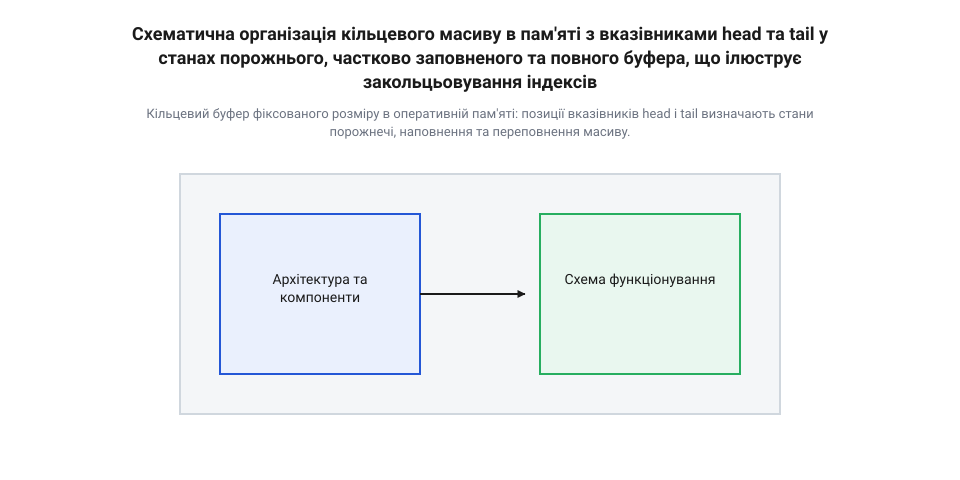
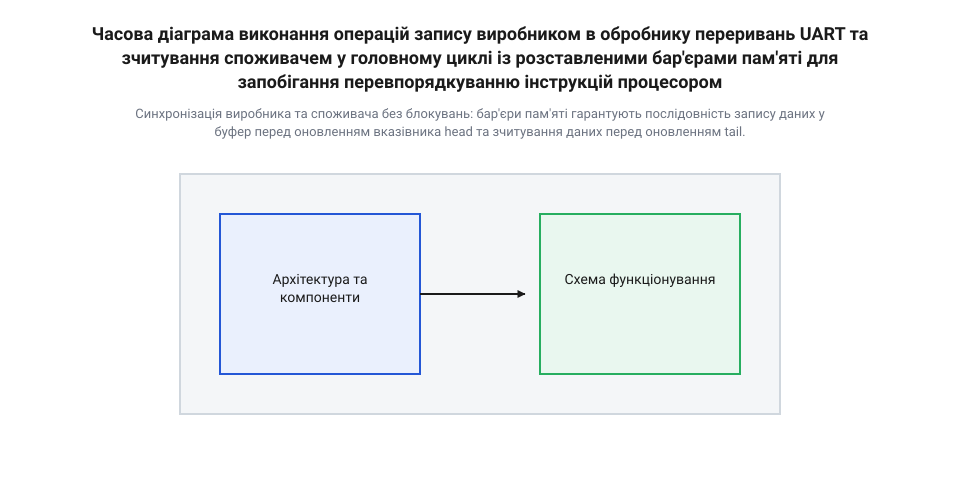
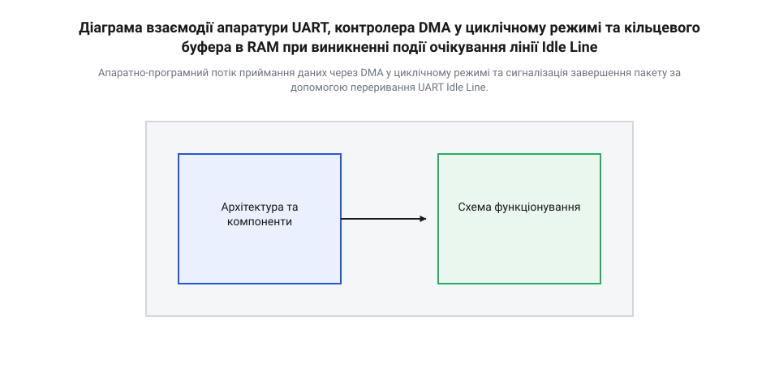

# Архітектура кільцевого буфера UART

<preknowlist>
- [Організація кільцевого буфера RX для асинхронного UART](root:sf-devices/uart-rx-ring-buffer-mcu) — Базові поняття асинхронного приймання UART та побайтових переривань на рівні периферії MCU.
- [Черга робіт: відкладене виконання на спільному потоці](root:sf-devices/work-queue) — Принципи винесення обробки збережених у буфері даних з контексту переривання ISR у фонову задачу.
</preknowlist>

## Втрата байтів у побайтовому UART

Коли мікроконтролер приймає дані через послідовний інтерфейс @@en|UART@@ (англ. @@en|Universal Asynchronous Receiver-Transmitter@@ — універсальний асинхронний приймач-передавач), кожен байт надходить на фізичний вивід пристрою у вигляді послідовності електричних імпульсів. Зазвичай передача відбувається за схемою з одним стартовим бітом, вісьмома бітами даних та одним стоповим бітом (формат 8N1). Це означає, що для транспортування 1 байта корисної інформації по лінії зв'язку проходить 10 бітових інтервалів. При поширеній швидкості 115 200 біт/с (бод) тривалість передачі одного біта становить приблизно 8,68 мікросекунди, а увесь байт надходить до периферійного модуля за 86,8 мікросекунди. На апаратному рівні вхідний зсувний регістр приймача послідовно зчитує рівні напруги на лінії @@en|RX@@ і після формування повного байта переносить його у вхідний регістр даних периферійного контролера (наприклад, `USART_RDR` у мікроконтролерах STM32 або `U0RBR` у класичних архітектурах). З цього моменту в центрального процесора залишається суворо обмежений проміжок часу — рівно 86,8 мікросекунди, щоб прочитати цей байт. Якщо процесор не встигає забрати значення до моменту, коли зсувний регістр повністю змонтує наступний байт, апаратура змушена перезаписати вміст вхідного регістру. Нові дані безповоротно втрачаються, а периферійний модуль виставляє прапорець апаратної помилки переповнення @@en|Overrun Error@@ (англ. @@en|overrun error@@ — помилка переповнення, або скорочено `ORE`).

У найпростіших навчальних проектах приймання даних реалізують через побайтове опитування прапорців — метод @@en|polling@@ (англ. @@en|polling@@, від @@en|poll@@ — опитування). Програма потрапляє у нескінченний цикл, де безперервно перевіряє стан прапорця готовності вхідного регістру (наприклад, `RXNE` — Receive Data Register Not Empty). Такий підхід гарантує негайне зчитування байта лише за умови, що процесор не зайнятий жодною іншою задачею. Проте реальна прошивка вбудованої системи повинна виконувати математичні розрахунки, опитувати датчики по інтерфейсах I2C чи SPI, розраховувати керуючі впливи для двигунів та оновлювати стан індикаторів. Якщо функція обробки події в основному циклі затримує виконання програми хоча б на 100 мікросекунд, черговий байт, що надходить по лінії UART, неминуче переповнює апаратний регістр і спричиняє помилку @@en|Overrun Error@@.

Природним кроком для звільнення центрального процесора від блокуючого очікування є перенесення операції зчитування в обробник переривання — @@en|ISR@@ (англ. @@en|Interrupt Service Routine@@ — обробник переривання). Спеціальний [драйвер на перериваннях](root:sf-devices/interrupt-driven-uart-driver) налаштовує периферійний модуль так, що при появі прапорця готовності даних апаратура контролера генерує сигнал переривання, примусово призупиняє виконання основного коду та передає керування функції-обробнику. Коли реалізується [побайтове оброблення в перериваннях](root:sf-devices/uart-rx-ring-buffer-mcu), процесору більше не потрібно марнувати такти в циклі опитування: байт вилучається з апаратного регістру негайно у момент його виникнення. Однак на високих швидкостях обміну та у складних багатозадачних системах побайтові переривання створюють нове критичне вузьке місце. При швидкості 921 600 бод нові байти надходять кожні 10,8 мікросекунди, що вимагає виклику @@en|ISR@@ понад 92 000 разів на секунду. Накладні витрати на збереження та відновлення контексту регістрів процесора (від 12 до 26 тактів в один бік для ядер ARM Cortex-M) починають поглинати до половини обчислювальної потужності мікроконтролера. Більше того, якщо в системі виконується критична секція коду з тимчасово забороненими перериваннями або працює високопріоритетний обробник від таймера чи апаратного аналогово-цифрового перетворювача, обробник UART змушений чекати. Затримка виклику @@en|ISR@@ на час, що перевищує інтервал приходу байта, знову призводить до помилки @@en|Overrun Error@@ та втрати трафіку.

Історія розвитку інтерфейсу UART демонструє постійний пошук компромісу між апаратними витратами кремнію та навантаженням на програмне забезпечення процесора. На ранніх етапах обчислювальної техніки периферійні адаптери містили лише найпростіші зсувні регістри з побайтовим опитуванням, що вимагало від процесора безперервного моніторингу статусного регістру для запобігання втраті даних. Зі зростанням швидкостей передачі та ускладненням операційних систем виникла потреба в апаратній буферизації, результатом чого стала поява класичних мікросхем на кшталт 16550 @@en|UART@@ з інтегрованими апаратними накопичувачами @@en|FIFO@@ (англ. @@en|First In, First Out@@ — першим прийшов, першим вийшов). Це дозволило зняти з процесора вимогу негайної реакції на кожен окремий байт. Наступним еволюційним кроком у мікроконтролерних системах стало впровадження програмних кільцевих буферів в оперативній пам'яті (RAM), які повністю розв'язали темпи асинхронного приймання та повільної пакетної обробки повідомлень. Сучасним стандартом високопродуктивних прошивок є інтеграція кільцевого буфера безпосередньо з апаратним модулем прямого доступу до пам'яті (DMA) у циклічному режимі, де апаратура самостійно складає вхідний потік у пам'ять без залучення процесора, а сигналізація про закінчення пакета відбувається за подією простою лінії (Idle Line Detection).

Сучасний периферійний контролер @@en|UART@@ містить у складі кремнієвого ядра власні апаратні буфери приймання та передачі @@en|FIFO@@. Типовий обсяг такого апаратного буфера становить від 8 до 64 байтів. Для оптимізації генерації переривань у регістрах конфігурації периферії задаються порогові рівні спрацьовування — @@en|watermark@@ (англ. @@en|watermark@@ — поріг спрацьовування). Наприклад, переривання можна спровокувати лише тоді, коли апаратне @@en|FIFO@@ заповниться на чверть, половину або три чверті обсягу. Це суттєво зменшує частоту викликів @@en|ISR@@, оскільки процесор за один вхід в обробник зчитує одразу групу байтів. Якщо апаратний буфер повністю заповнюється, а процесор не встигає його розвантажити, контролер виставляє прапорець @@en|Overrun Error@@ та зупиняє приймання нових байтів. Щоб запобігти втратам на рівні фізичного каналу, апаратне @@en|FIFO@@ працює у зв'язці з програмним кільцевим буфером у RAM та апаратними сигналами керування потоком. Зокрема, [апаратне керування потоком](root:com-devices/uart-hardware-flow-control) використовує лінії @@en|RTS/CTS@@ (англ. @@en|Request to Send / Clear to Send@@ — запит на передачу / готовність до приймання), де деактивація сигналу RTS автоматично повідомляє передавач про тимчасову неготовність приймача до зчитування нових даних.

Математична модель обчислення мінімально необхідного обсягу накопичувача базується на співвідношенні між швидкістю надходження даних та максимальною затримкою обробки в системі реального часу. Якщо позначити швидкість обміну як `B` бод, а тривалість передачі одного байта як `t_byte = 10 / B`, то за час найгіршої затримки виконання основної задачі `T_delay` у систему надходить `N` байтів:

```
t_byte = 10 / B                       [тривалість приймання одного байта]
N_min = ceil(T_delay / t_byte)        [мінімально необхідна місткість накопичувача]
```

Як розраховує [модель розрахунку затримок](root:sf-devices/uart-ring-buffer-architecture/math-uart-buffer-sizing-and-latency.md), якщо найгірша затримка основної програми становить 10 мілісекунд при швидкості 115 200 бод (`t_byte ≈ 86,8` мкс), мінімальний обсяг буфера має складати `N_min = ceil(0,010 / 0,0000868) = 116` байтів. Будь-який розмір, менший за це значення, гарантовано призведе до переповнення при виникненні пікових затримок у головному циклі.

Для надійної роботи вбудованої системи виникає чітка архітектурна вимога: відокремити асинхронний процес приймання даних від процесу їхнього логічного аналізу. Витягування байта з апаратного регістру має відбуватися максимально швидко — в обробнику переривання або через модуль DMA. Однак сам обробник не повинен виконувати розбір протоколу, перевірку контрольних сум чи виконання команд. Замість цього він швидко складає отриманий байт у проміжний програмний накопичувач в оперативній пам'яті та передає задачу в [відкладену чергу робіт](root:sf-devices/work-queue) для подальшої обробки у фоновому режимі. Динаміку виконання таких операцій визначає [автомат станів задачі](root:sf-devices/task-states), що переводить фоновий процес із стану очікування у стан готовності лише за наявності накопичених даних. Ідеальним інструментом для організації такого накопичувача є потокобезпечний кільцевий буфер.

## Анатомія та індексація кільцевого буфера

Кільцевий буфер — це структура даних фіксованого розміру, що базується на звичайному лінійному масиві в оперативній пам'яті, але логічно замкнена у кільце. Основне призначення цієї структури полягає у забезпеченні асинхронного обміну даними між двома незалежними компонентами прошивки: джерелом даних (виробником, @@en|producer@@) та отримувачем даних (споживачем, @@en|consumer@@). У контексті периферії @@en|UART@@ виробником виступає обробник переривань @@en|ISR@@ (або модуль @@en|DMA@@, який записує прийняті з лінії байти), а споживачем — основний цикл програми або задача операційної системи реального часу, яка зчитує накопичені байти та виконує їхню логічну обробку. Така схема взаємодії описується як модель одного виробника та одного споживача — @@en|SPSC@@ (англ. @@en|Single-Producer Single-Consumer@@ — один виробник, один споживач).

Усі операції над кільцевим буфером керуються двома цілочисельними індексами або вказівниками. Перший вказівник називається @@en|head@@ (англ. @@en|head@@ — голова; вказівник запису) — він вказує на позицію в масиві, куди буде записано наступний новий байт. Модифікувати індекс @@en|head@@ має право виключно виробник. Другий вказівник називається @@en|tail@@ (англ. @@en|tail@@ — хвіст; вказівник зчитування) — він вказує на позицію, з якої споживач зчитає черговий байт. Модифікацію індексу @@en|tail@@ виконує тільки споживач. Завдяки суворому розподілу прав модифікації між двома потоками виконання, ці структури утворюють [безблокувальні черги SPSC](root:sf-tasks/lock-free-spsc-ring-buffer), що дозволяють безпечно передавати байти з контексту переривання в основну програму без застосування м'ютексів чи вимкнення переривань.

Коли виробник додає байт у буфер, він записує значення у комірку `data[head]` і збільшує індекс @@en|head@@ на одиницю. Коли споживач забирає байт, він зчитує `data[tail]` і збільшує @@en|tail@@ на одиницю. Оскільки розмір масиву `SIZE` фіксований, при досягненні кінця масиву індекс повинен повертатися на початок (до позиції 0). У класичній математиці закольцьовування реалізують через операцію взяття залишком від ділення (модульну арифметику). Проте в мікроконтролерній техніці обчислення остачі вимагає використання апаратної інструкції ділення (наприклад, `UDIV`), яка на базових ядрах ARM Cortex-M0/M0+ взагалі відсутня і виконується програмно за десятки тактів. Щоб усунути накладні витрати, розмір буфера суворо обирають як степінь двійки (`SIZE = 2ⁿ`). При такій умові бітова маска `MASK = SIZE - 1` дозволяє замінити операцію ділення швидким побітовим оператором `AND`:

```
next_head = (head + 1) mod SIZE       [класична модульна арифметика]
          = (head + 1) & (SIZE - 1)   [оптимізація для SIZE = 2ⁿ через бітову маску]
```

Як пояснює [математична індексація масивів](root:sf-devices/uart-ring-buffer-architecture/math-ring-buffer-index-arithmetic.md), бітова операція `& MASK` виконується процесором за один машинний такт, повністю відсікаючи старші біти при виході індексу за межі масиву `SIZE - 1` і миттєво скидаючи його в 0.

Критичним моментом при проектуванні кільцевого буфера є коректне розрізнення двох граничних станів: коли буфер повністю порожній і коли він повністю заповнений. В обох випадках індекси @@en|head@@ та @@en|tail@@ можуть збігатися (`head == tail`). Якщо виробник записав у буфер `SIZE` елементів, індекс @@en|head@@ зробить повне коло і наздожене @@en|tail@@. Без додаткових прапорців програма не зможе визначити, чи в буфері знаходиться 0 байтів, чи `SIZE` байтів.

Найбільш елегантним та потокобезпечним рішенням цієї проблеми у вбудованих системах є жертвування однією робочою коміркою масиву. Буфер вважається порожнім, коли індекси рівні, і повним, коли наступний крок індексу @@en|head@@ наздоганяє @@en|tail@@. При масиві розміром `SIZE` максимальна корисна місткість становить `SIZE - 1` байтів:

```
is_empty = (head == tail)                      [буфер порожній: індекси збігаються]
is_full  = ((head + 1) & MASK) == tail        [буфер повний: наступний крок head досягає tail]
count    = (head - tail) & MASK               [поточна кількість накопичених байтів]
```


*Кільцевий буфер фіксованого розміру в оперативній пам'яті: позиції вказівників head і tail визначають стани порожнечі, наповнення та переповнення масиву.*

Нижче наведено практичну реалізацію потокобезпечного кільцевого буфера для обміну даними @@en|UART@@. Базову структуру розробка реалізує мовою C із кваліфікаторами `volatile` для захисту від оптимізацій компілятора при зверненні з переривань, а версія мовою C++ використовує шаблони та атомарні оператори стандарту `std::atomic` із впорядкуванням пам'яті:

:::tabs
@tab C
:::code root\eng\sf-devices\uart-ring-buffer-architecture/uart-ring-buffer-architecture-d/c/uart-ring-buffer-init.c c
@tab C++
:::code root\eng\sf-devices\uart-ring-buffer-architecture/uart-ring-buffer-architecture-d/cpp/uartringbuffer.cpp cpp
:::

Повноцінний проект з усіма методами містить [бібліотека кільцевого буфера](root:sf-devices/uart-ring-buffer-architecture/proj-lockfree-spsc-uart-ring-buffer.md), а специфікацію викликів висвітлює [інтерфейс бібліотеки буфера](root:sf-devices/uart-ring-buffer-architecture/api-uart-ring-buffer-c-lib.md). Правильно спроектований кільцевий буфер є основою для подальшої побудови обробників UART на базі прямого доступу до пам'яті (DMA).

## Стратегії обробки переповнення та колізій

Коли швидкість надходження даних по послідовному каналу @@en|UART@@ тимчасово перевищує темп їх зчитування та обробки основною програмою, кільцевий буфер досягає своєї максимальної місткості `SIZE - 1` байтів. У цей момент індекс запису @@en|head@@ робить крок і опиняється безпосередньо перед індексом зчитування @@en|tail@@ — умова `((head + 1) & MASK) == tail` стає істинною. Якщо виробник (обробник переривань @@en|ISR@@ або модуль @@en|DMA@@) приймає черговий байт з апаратного регістру при заповненому буфері, виникає ситуація колізії (англ. @@en|collision@@, від @@en|collide@@ — зіштовхуватися), або переповнення буфера (англ. @@en|overflow@@ — переповнення). Ігнорування цієї ситуації призводить до того, що вказівник @@en|head@@ наздоганяє @@en|tail@@, буфер помилково ідентифікується як порожній, а нові або старі байти безповоротно втрачаються. Залежно від вимог до надійності системи та характеру трафіку розробник прошивки обирає одну з трьох базових стратегій поведінки при переповненні: відкидання нових даних, перезапис найстаріших даних або апаратне призупинення приймання.

Перша стратегія полягає у відкиданні нових байтів — @@en|Drop New@@ (англ. @@en|drop new@@ — відкидати нове). Коли функція запису виявляє стан повного буфера, вона відмовляється зберігати новий байт у масиві, залишає вказівник @@en|head@@ без змін і повертає статус помилки чи збільшує лічильник втрачених байтів. Головна перевага цієї стратегії — повне збереження цілісності раніше накопичених даних. Усі кадри чи пакети, що вже знаходяться у кільцевому буфері, залишаються неушкодженими. Проте новий потік даних повністю втрачається доти, доки споживач не зчитає хоча б один байт і не вивільнить місце. Цей підхід є оптимальним для командних інтерфейсів та мережевих протоколів із контролем цілісності (наприклад, з перевіркою за допомогою кадрових символів чи обчисленням контрольної суми CRC): краще відкинути новий пакет повністю, ніж отримати спотворену комбінацію зі старих та нових фрагментів.

Друга стратегія передбачає примусовий перезапис найстаріших даних — @@en|Overwrite Oldest@@ (англ. @@en|overwrite oldest@@ — перезаписувати найстаріше). При надходженні нового байта у повний буфер функція запису вміщує його у комірку `buffer[head]`, просуває індекс @@en|head@@ на наступну позицію, але водночас примусово переміщує індекс зчитування @@en|tail@@ вперед: `tail = (tail + 1) & MASK`. У результаті найстаріший незасвоєний байт витісняється з кольця, а буфер завжди містить останні `SIZE - 1` прийнятих байтів. Такий режим ідеально підходить для систем моніторингу та телеметрії, де найновіші показники датчиків мають вищий пріоритет за застарілі дані. Однак стратегія @@en|Overwrite Oldest@@ вимагає підвищеної обережності при роботі у потокобезпечному середовищі. Оскільки вказівник @@en|tail@@ традиційно належить виключно споживачу, його модифікація з контексту переривання джерела (виробника) порушує класичний принцип [безблокувальних черг SPSC](root:sf-tasks/lock-free-spsc-ring-buffer). Якщо споживач у головному циклі саме в цей момент виконує зчитування `buffer[tail]`, виникає стан гонки (англ. @@en|race condition@@ — стан гонки), що може призвести до зчитування дубльованих або зіпсованих даних.

Третя стратегія базується на запобіганні переповненню шляхом зворотного зв'язку — апаратного або програмного керування потоком @@en|Flow Control@@ (англ. @@en|flow control@@ — керування потоком). Замість пасивного очікування колізії, програма стежить за рівнем заповнення буфера. Якщо кількість накопичених байтів досягає високого порогу (англ. @@en|high watermark@@ — верхня позначка рівня), наприклад 80% від загального обсягу, драйвер деактивує лінійний сигнал @@en|RTS@@ (Request to Send) або відправляє символ `XOFF`. Зовнішній передавач, отримуючи такий сигнал, призупиняє відправу наступних байтів. Після того як споживач зчитає накопичений масив і рівень заповнення впаде нижче низького порогу (англ. @@en|low watermark@@ — нижня позначка рівня, наприклад 20%), драйвер знову виставляє сигнал @@en|RTS@@ чи відправляє `XON`, дозволяючи відновлення обміну. Використання [апаратного керування потоком](root:com-devices/uart-hardware-flow-control) гарантує повну відсутність втрат даних, але вимагає додаткових сигнальних ліній зв'язку або підтримки дуплексного протоколу.

Розрахунок заповненості кільцевого буфера для прийняття рішення про зміну порогів watermark виконується за формулою різниці індексів за модулем розміру:

```
count = (head - tail) & MASK         [поточна кількість байтів у буфері]
free  = (tail - head - 1) & MASK     [кількість вільних комірок для запису]
```

Як демонструє [модель розрахунку затримок](root:sf-devices/uart-ring-buffer-architecture/math-uart-buffer-sizing-and-latency.md), динамічний моніторинг залишкового обсягу `free` дозволяє своечасно переводити фонову задачу через [автомат станів задачі](root:sf-devices/task-states) у стан високого пріоритету або передавати сигнал у [відкладену чергу робіт](root:sf-devices/work-queue).

Критичним аспектом реалізації будь-якої стратегії у багатозадачних системах та обробниках переривань є забезпечення атомарності та впорядкування операцій пам'яті. У сучасних високопродуктивних мікроконтролерах із ядрами ARM Cortex-M4/M7 або RISC-V процесор чи компілятор можуть перевпорядковувати операції читання та запису (англ. @@en|instruction reordering@@ — перевпорядкування інструкцій) для оптимізації конвеєра. Якщо записати значення байта `buffer[head] = data` та оновити вказівник `head = next_head`, компілятор без відповідних обмежень може спочатку оновити індекс `head`, а вже потім зберегти байт у масив. Споживач, побачивши зміну `head`, негайно зчитає зі старої комірки масиву некоректні дані.

Для усунення цієї проблеми в прошивках застосовують бар'єри пам'яті — @@en|Memory Barrier@@ (англ. @@en|memory barrier@@ — бар'єр пам'яті). Вони примусово вирівнюють операції запису та зчитування в точній послідовності вихідного коду. У мові C для архітектур ARM використовується апаратна інструкція `__DMB()` (англ. @@en|Data Memory Barrier@@ — бар'єр даних пам'яті), а у C++11 — атомарні вказівники `std::atomic` із семантикою захоплення та вивільнення (англ. @@en|Acquire-Release semantics@@). Детальніше принципи атомарного впорядкування описують [бар'єри пам'яті Cortex-M](root:hw-arch/memory-barrier-instructions).


*Синхронізація виробника та споживача без блокувань: бар'єри пам'яті гарантують послідовність запису даних у буфер перед оновленням вказівника head та зчитування даних перед оновленням tail.*

Нижче наведено практичну реалізацію розширеного функціоналу кільцевого буфера з підтримкою стратегії відкидання при переповненні та застосуванням бар'єрів пам'яті. Використання функцій відповідає довіднику з [програмного інтерфейсу API бібліотеки](root:sf-devices/uart-ring-buffer-architecture/api-uart-ring-buffer-c-lib.md) та реалізує алгоритми з [проектного lockfree SPSC буфера](root:sf-devices/uart-ring-buffer-architecture/proj-lockfree-spsc-uart-ring-buffer.md):

:::tabs
@tab C
:::code root\eng\sf-devices\uart-ring-buffer-architecture/uart-ring-buffer-architecture-d/c/uart-ring-buf-put-drop.c c
@tab C++
:::code root\eng\sf-devices\uart-ring-buffer-architecture/uart-ring-buffer-architecture-d/cpp/ringbufferspsc.cpp cpp
:::

## Автоматизація обміну через DMA та Idle

Навіть за наявності потокобезпечного кільцевого буфера та оптимізованого обробника переривань, побайтове зчитування вхідних даних через @@en|ISR@@ створює значне навантаження на процесор під час високих швидкостей трафіку. При швидкості 1 500 000 бод процесор змушений переривати виконання фонової програми кожні 6,6 мікросекунди. Значна частина обчислювальних тактів марнується лише на збереження та відновлення регістрового контексту процесора. Для кардинального розвантаження процесора вбудована система переносить функцію транспортування байтів із програмного обробника на апаратний модуль прямого доступу до пам'яті — @@en|DMA@@ (англ. @@en|Direct Memory Access@@ — прямий доступ до пам'яті).

Модуль @@en|DMA@@ належить до периферійних співпроцесорів, здатних самостійно зчитувати байти з вхідного регістру даних @@en|UART@@ (наприклад `USART_RDR`) та записувати їх безпосередньо в оперативну пам'яті (RAM) по системній шині, не залучаючи ядра процесора. Для реалізації безперервної буферизації модуль @@en|DMA@@ конфігурують у циклічний режим — @@en|Circular Mode@@ (англ. @@en|circular mode@@ — циклічний режим). У цьому режимі контролеру @@en|DMA@@ виділяється лінійний масив пам'яті розміром `SIZE` байтів і задається лічильник кількості операцій передачі (наприклад регістр `NDTR` у контролерах STM32). Кожного разу, коли периферійний модуль @@en|UART@@ приймає новий байт, він надсилає апаратний запит контролеру @@en|DMA@@. Контролер переносить байт у `buffer[head]`, апаратно збільшує внутрішню адресу призначення та зменшує значення регістру `NDTR` на одиницю.

Головна особливість циклічного режиму @@en|DMA@@ полягає в тому, що після досягнення кінця масиву (`NDTR == 0`) контролер не зупиняє роботу і не генерує примусове переривання завершення. Замість цього апаратура DMA автоматично перезавантажує початкову адресу масиву у свій вказівник і відновлює лічильник `NDTR = SIZE`. Таким чином, модуль @@en|DMA@@ перетворюється на апаратного виробника (англ. @@en|hardware producer@@ — апаратний виробник), який замкнено по колу записує байти у кільцевий буфер в RAM.

Програмі більше не потрібно модифікувати вказівник @@en|head@@ вручну в обробнику переривань. Поточна позиція апаратного вказівника запису розраховується з поточного стану регістру лічильника @@en|DMA@@:

```
head = SIZE - DMA_NDTR                 [обчислення апаратного вказівника head з лічильника DMA]
```

Як описує [карта регістрів периферії DMA](root:sf-devices/uart-ring-buffer-architecture/api-uart-dma-hardware-registers.md), регістр `NDTR` зменшується апаратурою від значення `SIZE` до `0`, що дає змогу точно визначати координату останнього записаного байта у будь-який момент часу.

Однак сам по собі циклічний режим @@en|DMA@@ порушує іншу важливу вимогу обробки даних: здатність вчасно виявляти завершення пакетів неозначеної довжини. Стандартні апаратні переривання DMA генеруються лише при заповненні половини буфера — @@en|Half Transfer@@ (англ. @@en|half transfer@@, `HT`) та повного буфера — @@en|Transfer Complete@@ (англ. @@en|transfer complete@@, `TC`). Якщо зовнішній пристрій надіслав короткий кадр з 10 байтів при розмірі буфера 128 байтів, контролер DMA тихо збереже ці 10 байтів у пам'ять, але жодного переривання не згенерує. Байти залишаться "завислими" в RAM, а програма дізнається про них лише тоді, коли наступні повідомлення дозаповнять буфер до межі `HT` (64 байти).

Для вирішення цієї проблеми апаратний циклічний DMA об'єднують із периферійним перериванням очікування лінії — @@en|Idle Line Detection@@ (англ. @@en|idle line detection@@ — виявлення вільної лінії). Подія @@en|Idle Line@@ виникає тоді, коли приймальна лінія `RX` після завершення приймання байта залишається у високому логічному стані протягом часу, що дорівнює тривалості одного кадр-інтервалу (зазвичай 10 бітових інтервалів). Прапорець `IDLE` у статусних регістрах @@en|UART@@ свідчить про те, що передавач завершив відправку чергової порції даних і в лінії настала тиша.

При виникненні події @@en|Idle Line@@ периферійний модуль генерує єдине переривання процесора. В обробнику `USART_IRQHandler()` програма зчитує поточний стан лічильника `DMA_NDTR`, обчислює нове значення `head = SIZE - DMA_NDTR`, визначає кількість щойно прийнятих байтів і миттєво передає їх на розбір у [відкладену чергу робіт](root:sf-devices/work-queue). Поєднання циклічного DMA та переривання Idle створює найефективнішу архітектуру приймання UART у мікроконтролерах.


*Апаратно-програмний потік приймання даних через DMA у циклічному режимі та сигналізація завершення пакету за допомогою переривання UART Idle Line.*

При проектуванні систем із DMA у циклічному режимі необхідно враховувати два критичні апаратні нюанси: когерентність кеш-пам'яті та гонку зчитування індексів.

На високоефективних ядрах (наприклад ARM Cortex-M7) процесор має оперативну кеш-пам'ять даних (D-Cache). Оскільки модуль @@en|DMA@@ записує байти в RAM вхідним шляхом системної шини повз процесор, кеш-пам'ять процесора не знає про оновлення комірок у RAM. Споживач при зчитуванні ризикує прочитати застарілі значення з кешу. Для вирішення цієї проблеми масив кільцевого буфера розміщують у некешованій ділянці пам'яті за допомогою блоку захисту пам'яті (MPU) або виконують примусову інвалідацію кешу перед зчитуванням даних. Практичні аспекти синхронізації кешу аналізує тема [узгодженість кеш-пам'яті DMA](root:hw-arch/cache-coherency-dma).

Другий нюанс — асинхронне виникнення переривання `IDLE` у момент, коли DMA саме здійснює запис байта. Драйвер повинен коректно обробляти скидання прапорця `IDLE` (яке вимагає послідовного читання регістрів статусу та даних або запису в регістр зняття прапорців `ICR`) та зберігати попередній індекс зчитування. Загальний принцип побудови таких систем розкриває [драйвер UART у циклічному режимі](root:sf-devices/uart-dma-circular-mode).

Нижче наведено практичний приклад реалізації драйвера приймання UART з використанням циклічного DMA та обробкою події Idle Line. Реалізація спирається на [практичний драйвер UART DMA](root:sf-devices/uart-ring-buffer-architecture/proj-uart-dma-circular-idle-driver.md) та конфігураційну карту з [апаратного інтерфейсу і карти регістрів UART та DMA](root:sf-devices/uart-ring-buffer-architecture/api-uart-dma-hardware-registers.md):

:::tabs
@tab C
:::code root\eng\sf-devices\uart-ring-buffer-architecture/uart-ring-buffer-architecture-d/c/uart-dma-init.c c
@tab C++
:::code root\eng\sf-devices\uart-ring-buffer-architecture/uart-ring-buffer-architecture-d/cpp/uartdmacircularreceiver.cpp cpp
:::

## Потокобезпека та синхронізація SPSC

Апаратне приймання байтів через переривання периферії або модуль прямого доступу до пам'яті вирішує задачу збереження вхідного трафіку в оперативну пам'ять, але створює фундаментальну проблему паралелізму. Вміст кільцевого буфера модифікується з двох принципово різних контекстів виконання: обробник переривання (від англ. *Interrupt Service Routine*, @@en|ISR@@) або модуль прямого доступу (від англ. *Direct Memory Access*, @@en|DMA@@) виступає в ролі джерела даних і просуває вказівник запису `head` (від англ. *head* — голова). У той самий час фонова задача операційної системи або головний цикл програми зчитує накопичені байти та просуває вказівник зчитування `tail` (від англ. *tail* — хвіст). Оскільки ці контексти виконуються асинхронно та можуть переривати один одного в довільний момент часу, виникає стан гонитви (від англ. *race*, *condition* — стан, @@en|race condition@@).

Спроба захистити індекси буфера класичними інструментами синхронізації вбудованих систем швидко виявляє свої обмеження. Повне вимкнення апаратних переривань на час роботи з буфером збільшує затримку реакції мікроконтролера (від англ. *Microcontroller Unit*, @@en|MCU@@) на інші критичні події реального часу. Використання ж блокуючих м'ютексів є категорично неприпустимим в обробниках переривань, оскільки виклик блокуючої функції всередині контексту переривання призводить до невизначеної поведінки або негайного краху системи. 

Архітектурним розв'язком цієї проблеми є модель однопотокового виробника та однопотокового споживача (від англ. *single* — один, *producer* — виробник, *consumer* — споживач, @@en|Single Producer Single Consumer@@, @@en|SPSC@@). У цій моделі права на модифікацію стану суворо розділені між двома учасниками:

- **Виробник (Producer):** контекст переривання UART або DMA. Він має виключне право змінювати індекс `head` і лише читає індекс `tail` для перевірки наявності вільного місця у буфері. - **Споживач (Consumer):** фонова задача обробки даних. Вона має виключне право змінювати індекс `tail` і лише читає індекс `head` для перевірки наявності доступних для зчитування байтів.

Оскільки жоден контекст не намагається записати значення в індекс, який належить іншому, у системі зникає потреба у взаємному виключенні за допомогою м'ютексів чи вимкнення переривань. Базовою передумовою атомарності у 32-бітних архітектурах є те, що читання та запис вирівняних 32-бітних змінних виконуються процесором за один атомарний такт шини. Однак на шляху до коректної безблокувальної обробки стоять оптимізації компілятора та апаратного забезпечення.

Компілятор C або C++ за замовчуванням припускає, що змінні не змінюються ззовні поточного контексту виконання. Якщо фоновий цикл очікує нових даних, перевіряючи умову `head != tail`, компілятор може прочитати значення `head` у регістр процесора один раз перед початком циклу й надалі виконувати перевірку лише цього регістру. В результаті фонова задача потрапляє в нескінченний цикл, навіть коли ISR успішно записує байти в оперативну пам'ять (від англ. *Random Access Memory*, @@en|RAM@@) і збільшує `head`.

Для запобігання такій оптимізації індекси `head` та `tail` оголошують з модифікатором @@en|volatile@@ (від латинського *volatilis* — летючий). Інструкція `volatile` вказує компілятору, що кожне читання або запис змінної має здійснюватися безпосередньо в пам'яті, минаючи регістровий кеш процесора.

Проте модифікатор `volatile` вирішує лише частину проблеми: він керує поведінкою компілятора, але не контролює конвеєр процесора та порядок виконання інструкцій у пам'яті. Розглянемо послідовність дій виробника під час додавання нового байта в буфер:

1. Записати прийнятий байт у комірку `buffer[head]`.
2. Оновити вказівник `head = (head + 1) & mask`.

Сучасні суперскалярні процесори та компілятори можуть змінити порядок цих двох операцій ради оптимізації конвеєра. Якщо оновлення `head` буде виконане або стане видимим для іншого ядра чи контексту раніше, ніж фактичний запис байта в масив `buffer`, споживач побачить умову `head != tail`, прочитає комірку `buffer[old_head]` і отримає старе сміття замість щойно прийнятого байта.

Щоб гарантувати суворий порядок операцій пам'яті, застосовують бар'єри пам'яті (від англ. *memory* — пам’ять, *barrier* — бар’єр, @@en|memory barrier@@) та семантику передачі володіння (від англ. *acquire* — набувати, *release* — випускати, @@en|Acquire-Release@@). Зокрема, у процесорних архітектурах ARM Cortex-M використовується спеціальна інструкція бар'єра даних (від англ. *Data Memory Barrier*, @@en|DMB@@):

- **Release-бар'єр у виробнику:** гарантує, що запис байта в масив `buffer` повністю завершиться в пам'яті до того, як оновлене значення `head` стане доступним для читання споживачем. - **Acquire-бар'єр у споживачі:** гарантує, що прочитане значення `head` буде зафіксоване до того, як розпочнеться зчитування байта з масиву `buffer`.

Семантика Acquire-Release забезпечує точкову синхронізацію без надлишкових затримок, які виникають при використанні повного симетричного бар'єра пам'яті.

Нижче наведено практичну реалізацію потокобезпечного кільцевого буфера SPSC мовами C та C++. У цих прикладах надійна [безблокувальна черга SPSC у](root:sf-tasks/lock-free-spsc-ring-buffer) системах реального часу будується без вимкнення переривань та без залучення м'ютексів.

:::tabs
:::code root\eng\sf-devices\uart-ring-buffer-architecture/uart-ring-buffer-architecture-d/c/gcc/uart-ring-buf-init.c c
:::code root\eng\sf-devices\uart-ring-buffer-architecture/uart-ring-buffer-architecture-d/cpp/gcc/uartringbuffer.cpp cpp
:::

Представлена розробка демонструє базовий паттерн синхронізації. Повноцінна [реалізація потокобезпечного кільцевого буфера](root:sf-devices/uart-ring-buffer-architecture/proj-lockfree-spsc-uart-ring-buffer.md) розгортає повний робочий приклад бібліотеки з додатковими перевірками та обробкою помилок. Коли в системі застосовується [черга робіт для відкладеного](root:sf-devices/work-queue) виконання, фоновий потік вичищає накопичені байти блоками, а детальний [програмний інтерфейс бібліотеки кільцевого](root:sf-devices/uart-ring-buffer-architecture/api-uart-ring-buffer-c-lib.md) буфера визначає набір функцій для перевірки поточного стану та масового копіювання даних.

## Розрахунок обсягу буфера та затримок

Побудувавши потокобезпечну структуру безблокувального буфера, інженер постає перед практичним завданням вибору його оптимального обсягу `N`. У мікроконтролерах із суворими обмеженнями на обсяг RAM виділення занадто великого масиву пам'яті є невиправданим марнотратством, яке відбирає ресурси у стеків задач або динамічної кучі. З іншого боку, занадто малий буфер швидко переповнюється під час тимчасових затримок обробки, що призводить до незворотної втрати даних (від англ. *overflow* — переповнення, @@en|overflow@@).

Мінімально необхідний розмір кільцевого буфера розраховується на основі математичного співвідношення між максимальною швидкістю надходження даних та найгіршим часом затримки реакції споживача.

Швидкість надходження байтів залежить від налаштувань послідовного інтерфейсу (від англ. *Universal Asynchronous Receiver-Transmitter*, @@en|UART@@) та швидкості передачі сигнальних символів у бодах (від прізвища винахідника Émile Baudot, @@en|baud rate@@). Класичний асинхронний кадр UART містить 1 стартовий біт, 8 бітів даних та 1 стоповий біт, що утворює загалом 10 бітів на один переданий байт. Якщо швидкість лінії становить `R` бітів за секунду, то вхідний байтовий потік `B` у байтах за секунду обчислюється як:

```
B = R ÷ 10
```

Під час роботи системи фонова задача зчитування буфера може затримуватися через виконання обробників переривань з вищим пріоритетом, роботу критичних секцій прошивки, затримки зчитування з Flash-пам'яті або затримки виклику планувальника операційної системи реального часу. Найдовший можливий інтервал часу, протягом якого задача споживача не здатна забрати жодного байта з буфера, називається найгіршим часом виконання (від англ. *worst-case* — найгірший випадок, *execution time* — час виконання, @@en|Worst-Case Execution Time@@, @@en|WCET@@) й позначається як `T_max`.

За час затримки `T_max` периферія UART або модуль DMA безперервно записують нові байти в буфер. Загальна кількість байтів `N_incoming`, яка надійде за цей період, дорівнює добутку швидкості потоку на тривалість затримки:

```
N_incoming = B × T_max
```

Оскільки в кільцевому буфері одна комірка завжди залишається порожньою для розрізнення повного та порожнього станів, а індексація виконується за допомогою бітової маски, підсумковий розмір масиву `N_buffer` має бути найближчим степенем двійки `2ⁿ`, який задовольняє нерівність `N_buffer > N_incoming`.

Розглянемо два практичних приклади математичного розрахунку для різних швидкостей обміну.

**Приклад 1. Стандартна швидкість 115200 бод при затримці 5 мс:**

```
B = 115200 ÷ 10
  = 11520                     [інтенсивність вхідного потоку, байт/с]

N_incoming = 11520 × 0.005
           = 57.6             [обсяг байтів за час затримки 5 мс]

N_min = 57.6 + 1
      = 58.6                  [мінімальна ємність з урахуванням вільної комірки]

N_buffer = 64                 [найближчий більший степінь 2]
```

Як видно з першого розрахунку, при швидкості 115200 бод та затримці обробки 5 мс у буфер надійде 57.6 байта. Оскільки розмір буфера має дорівнювати степеню двійки, найближче безпечне значення становить 64 байти (`2⁶`). Якщо затримка обробки у найгіршому випадку перевищить 5.55 мс, буфер обсягом 64 байти неминуче переповниться.

**Приклад 2. Високошвидкісний зв'язок 921600 бод при затримці 2 мс:**

```
B = 921600 ÷ 10
  = 92160                     [інтенсивність вхідного потоку, байт/с]

N_incoming = 92160 × 0.002
           = 184.32           [обсяг байтів за час затримки 2 мс]

N_min = 184.32 + 1
      = 185.32                [мінімальна ємність з урахуванням вільної комірки]

N_buffer = 256                [найближчий більший степінь 2]
```

При високошвидкісному обміні навіть незначна затримка у 2 мс вимагає виділення 256 байтів RAM. У таких сценаріях побайтова обробка через переривання виснажує обчислювальні ресурси ядра, тому застосування DMA стає критично необхідним.

Коли затримки виконання задач неможливо зменшити програмно, використовують апаратні механізми захисту. У таких сценаріях, коли активовано [апаратне керування потоком RTS/CTS](root:com-devices/uart-hardware-flow-control) у лініях зв'язку, драйвер контролює рівень заповнення буфера за допомогою порогів.

При досягненні верхньої межі заповненості (від англ. *high watermark* — верхня позначка рівня води, @@en|high watermark@@) `W_high` драйвер знімає сигнал RTS, вимагаючи від передавача призупинити надсилання даних. Однак передавач не зупиняється миттєво: байти, які вже знаходяться в його апаратному FIFO (від англ. *First In, First Out*, @@en|FIFO@@) або зсувному регістрі передачі, все одно будуть відправлені в лінію. Запас ємності `N_buffer - W_high` повинен перевищувати цей залишковий апаратний обсяг трафіку. Для відновлення передачі використовується нижня межа заповненості (від англ. *low watermark* — нижня позначка рівня води, @@en|low watermark@@) `W_low`, яка створює гістерезис і запобігає частому осцилюванню лінії RTS.

Спроектований таким чином буфер гарантує надійність системи, враховуючи [автомат станів задачі та](root:sf-devices/task-states) планувальник операційної системи. Для більш складних профілів навантаження докладна [математична модель розрахунку обсягу](root:sf-devices/uart-ring-buffer-architecture/math-uart-buffer-sizing-and-latency.md) буфера розкриває додаткові формули розрахунку джиттера та оцінки імовірності втрати пакетів.