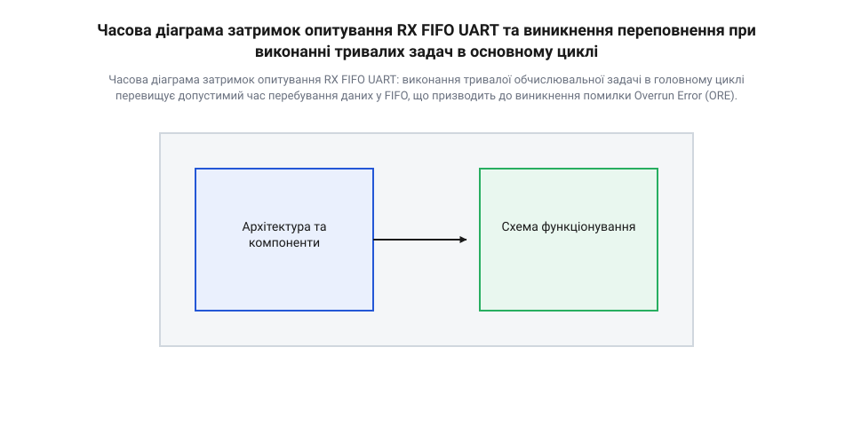
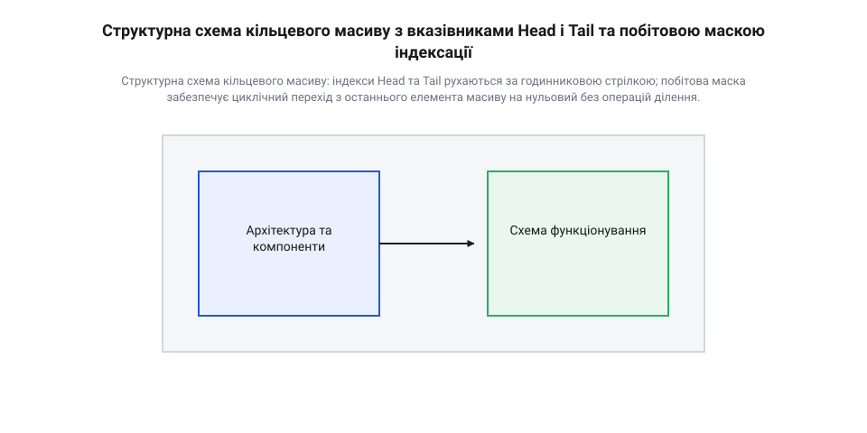
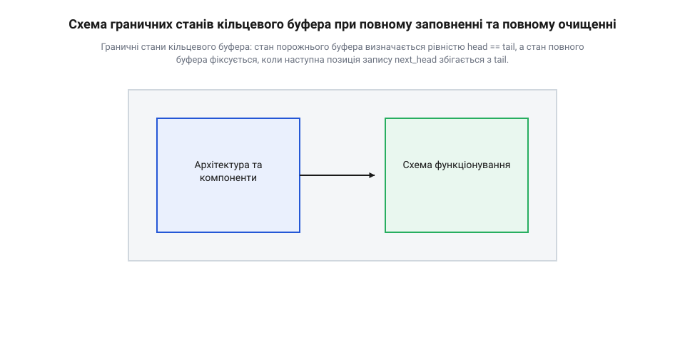
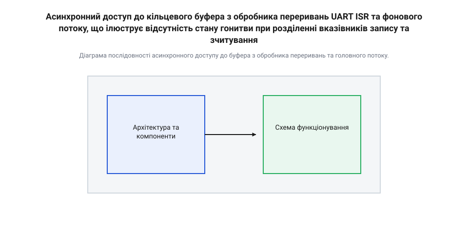
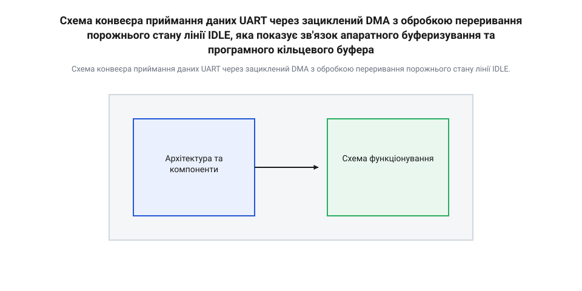
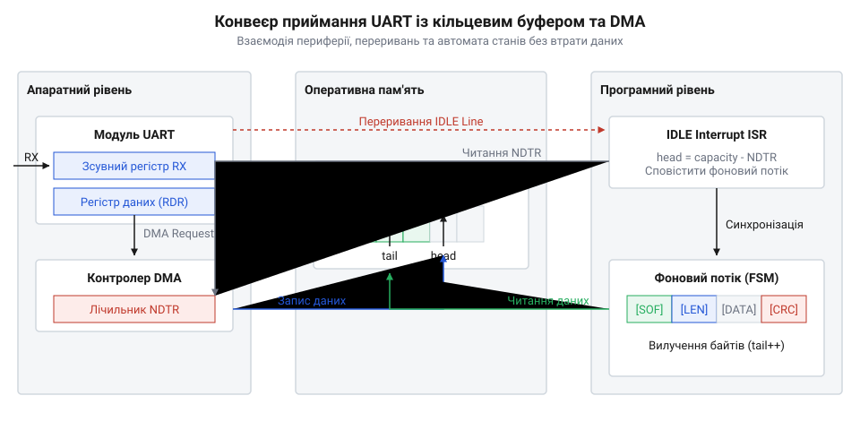

# Організація кільцевого буфера RX для асинхронного UART

<preknowlist>
- [Архітектура кільцевого буфера UART](root:sf-devices/uart-ring-buffer-architecture) — Принципи організації буферів у пам'яті мікроконтролера та відмінності статичного виділення масивів.
- [Черга робіт: відкладене виконання на спільному потоці](root:sf-devices/work-queue) — Парадигма перенесення обробки вхідних даних із середовища обробника переривань у фоновий контекст.
</preknowlist>

## Чому опитування UART втрачає дані

У багатьох вбудованих системах приймання послідовних даних здається найпростішим завданням: периферійний модуль контролера приймає байти з фізичної лінії, а програма зчитує їх у міру потреби. Проте при використанні синхронного опитування (@@en|polling@@, від англ. *poll* — опитувати) регістрів периферії система швидко зіштовхується із фатальною нестабільністю. Якщо мікроконтролер зайнятий викликом тривалої математичної функції, оновленням графічного дисплея або затриманий виконувачем високого пріоритету, черговий байт, що надійшов по фізичній лінії, залишається незчитаним. Затримка обробки викликає [переповнення апаратного буфера](root:sf-devices/uart-ring-buffer-architecture), що призводить до незворотного спотворення інформаційного потоку.

Історично проблема синхронізації швидкостей виникла ще на світанку обчислювальної техніки при підключенні електромеханічних телетайпів. Перші мікросхеми універсальних асинхронних трансіверів, такі як легендарний чип 8250, мали всього один однобайтовий регістр приймача (@@en|receive holding register@@). Якщо процесор не встигав вилучити байт до завершення приймання наступного кадру, виникала апаратна помилка переповнення (@@en|overrun error@@, скорочено ORE). Згодом у мікросхемі 16550 з'явився апаратний буфер першим прийшов — першим вийшов (@@en|FIFO@@, від англ. *first in, first out*) місткістю 16 байтів, який пом'якшив часові вимоги до процесора. У сучасних мікроконтролерах апаратний FIFO приймача зазвичай містить від 1 до 16 осередків. Однак зі зростанням швидкостей передачі до мегабіт на секунду навіть апаратний FIFO заповнюється за лічені мікросекунди. Це змусило інженерів перейти від блокуючого приймання байт-за-байтом до виділення програмних кільцевих накопичувачів у оперативній пам'яті (@@en|RAM@@, англ. *random-access memory*).

Щоб зрозуміти фізичну природу втрати даних, слід розглянути внутрішній устрій універсального асинхронного приймача-передавача (@@en|UART@@, від англ. *universal asynchronous receiver-transmitter*). Периферійний модуль мікроконтролера складається із двох послідовних регістраційних рівнів. Першим є апаратний зсувний регістр приймача (@@en|RX Shift Register@@), який тактується з частотою базового генератора та відновлює логічні рівні з фізичного виводу RX. Коли вхідний кадр (байт із стартовим та стоповим бітами) повністю сформовано, зсувний регістр паралельно копіює значення в накопичувальний регістр даних RDR (@@en|receive data register@@) або на вхід апаратного FIFO. При цьому периферія виставляє прапорець статусу RXNE (@@en|RX register not empty@@ — регістр приймання не порожній). Якщо в цей момент RDR або FIFO вже заповнені до межі, а новий байт зсувного регістра намагається перезаписати дані, модуль фіксує апаратну помилку ORE (@@en|overrun error@@). При виникненні ORE більшість архітектур мікроконтролерів блокують подальше приймання байтів до виконання спеціальної процедури скидання прапорця, що спричиняє каскадну втрату всіх наступних пакетів.

Для демонстрації часового вікна розглянемо стандартний асинхронний кадр 8N1 (1 стартовий біт, 8 бітів даних, без біта парності, 1 стоповий біт — усього 10 бітових інтервалів на один байт). Розрахуємо тривалість приймання одного байта `T_frame` при швидкості передачі (@@en|baud rate@@, від імені Еміля Бодо, *Baudot*) у 115200 біт/с.

Час приймання одного байта обчислюється як відношення кількості бітів у кадрі до швидкості передачі:

```
T_frame = 10 / BaudRate           [формула тривалості одного кадру UART 8N1]
= 10 / 115200                     [підстановка швидкості 115200 біт/с]
≈ 86.8 × 10⁻⁶ с                   [тривалість кадру становить приблизно 86.8 мікросекунди]
```

Якщо апаратний FIFO приймача має глибину `N_fifo = 4` байти, то гранично припустима затримка реагування системи `T_max_latency` розраховується як час повного заповнення цих осередків, однак на практиці цей час жорстко обмежується впливом інших задач. У реальному мікроконтролері фоновий код опитування постійно витісняється перериваннями вищого пріоритету (@@en|nested interrupts@@, від англ. *nest* — гніздувати) — наприклад, обробниками системного таймера, DMA чи аварійного захисту. Таке апаратне витіснення (@@en|preemption@@, від лат. *praeemere* — займати заздалегідь) уносить непередбачуване часове тремтіння (@@en|jitter@@, від англ. *jitter* — тремтіти) в інтервали перевірки периферії. Поки процесор виконує високопріоритетний обробник, апаратний FIFO продовжує асинхронно приймати байти з фізичної лінії. Якщо сумарна затримка на виконання переривань вищого пріоритету перевищить час накопичення чотирьох байтів, виникає переповнення FIFO і втрата даних. Для обчислення цього критичного порогу гранично припустима затримка `T_max_latency` становить:

```
T_max_latency = N_fifo × T_frame  [граничний інтервал опитування до переповнення FIFO]
= 4 × 86.8 × 10⁻⁶ с               [підстановка глибини FIFO у 4 байти]
≈ 347.2 × 10⁻⁶ с                  [максимальний час затримки становить 347.2 мікросекунди]
```

Якщо основний цикл фонової програми або процедура виклику [відкладеної черги робіт](root:sf-devices/work-queue) затримує перевірку прапорця RXNE більше ніж на 347.2 мікросекунди, п'ятий байт знищить четвертий, викликавши помилку переповнення. При вищих швидкостях (наприклад, 921600 біт/с) це часове вікно звужується до 43.4 мікросекунд, що унеможливлює використання будь-якого опитування в реальному часі.


*Часова діаграма затримок опитування RX FIFO UART: виконання тривалої обчислювальної задачі в головному циклі перевищує допустимий час перебування даних у FIFO, що призводить до виникнення помилки Overrun Error (ORE).*

Зменшити ризик переповнення можна застосуванням [апаратного контролю потоку](root:com-transport/uart-flow-control-rts-cts) через лінії RTS/CTS, однак цей метод вимагає додаткових фізичних провідників та підтримується не всіма периферійними пристроями. Єдиним універсальним програмним рішенням є відмова від опитування в основному циклі на користь асинхронного приймання даних за допомогою переривань або системного прямого доступу до пам'яті (@@en|DMA@@, англ. *direct memory access*). Обробник переривань приймача має миттєво вилучати байт з апаратного RDR і зберігати його в проміжному програмному накопичувачі — [програмному кільцевому буфері](root:sf-devices/uart-ring-buffer-architecture), звідки фоновий потік зможе вилучати дані в міру звільнення процесорного часу.

## Архітектура та керування індексами буфера

Програмний кільцевий буфер (@@en|ring buffer@@ або @@en|circular buffer@@) — це структура даних, що є суцільним масивом фіксованого розміру в оперативній пам'яті, логічні кінці якого замкнені в кільце. Основне призначення цієї структури у контексті UART — утворення асинхронного містка між джерелом даних з жорсткими часовими обмеженнями (обробником переривань ISR або каналом DMA) та споживачем даних в основному циклі програми або [автоматі станів задачі](root:sf-devices/task-states).

Керування буфером здійснюється за допомогою двох незалежних зміщень або індексів:
1. Індекс запису або голова (@@en|head@@, від англ. *head* — голова) — вказує на позицію у масиві, куди буде записано наступний байт, що надійшов від UART. Зміщувати індекс `head` має право виключно джерело даних (записувач / @@en|producer@@). 2. Індекс зчитування або хвіст (@@en|tail@@, від англ. *tail* — хвіст) — вказує на позицію, з якої буде вилучено наступний байт для обробки. Зміщувати індекс `tail` має право виключно споживач даних (@@en|consumer@@).

Кожен записаний байт просуває `head` уперед на одну позицію. Коли індекс досягає фізичного кінця масиву, він циклічно повертається на нульове значення. Аналогічно рухається індекс `tail`.


*Структурна схема кільцевого масиву: індекси Head та Tail рухаються за годинниковою стрілкою; побітова маска забезпечує циклічний перехід з останнього елемента масиву на нульовий без операцій ділення.*

У класичній реалізації однопотокового буфера з одним джерелом і одним споживачем (@@en|SPSC lock-free buffer@@, англ. *single-producer single-consumer*) ключовою проблемою є розрізнення стану порожнього та повністю заповненого буфера. Якщо обидва індекси збігаються (`head == tail`), буфер порожній. Якщо ж буфер повністю заповнити `N` елементами, індекс `head` здійснить повний оберт і знову стане рівним `tail`. Щоб уникнути неоднозначності без запровадження додаткових лічильників, які вимагають взаємного блокування вказівників, зазвичай один осередок масиву залишають зарезервованим (порожнім). У цьому випадку корисна місткість буфера становить `capacity = N - 1`.

При зміщенні індексів на наступний крок традиційна модулярна арифметика використовує операцію взяття залишку від ділення `%`: `next_index = (current_index + 1) % N`. Проте операція цілочисельного ділення на багатьох 32-бітних мікроконтролерах без апаратного дільника (наприклад, архітектури ARM Cortex-M0/M0+) виконується за кілька десятків тактів процесора, що неприпустимо для швидких обробників переривань.

Для усунення обчислювальних затримок розмір буфера `N` обирають як точний степінь двійки: `N = 2ᵏ` (наприклад, 64, 128, 256, 1024 байти). У цьому разі операція взяття залишку за модулем `N` еквівалентна побітовому додаванню (@@en|bitwise AND@@) з маскою `mask = N - 1`.

Розглянемо математичну модель обчислення індексів та доступного об'єму осередків через побітову маску. Нехай `N` — розмір буфера (`N = 2ᵏ`), `mask = N - 1`, `head` — поточний індекс запису, `tail` — поточний індекс зчитування.

Залежності для обчислення наступної позиції та об'єму пам'яті виглядають так:

```
next_head = (head + 1) & mask              [обчислення індексу наступного осередку запису з маскуванням]
used_bytes = (head - tail) & mask          [обчислення кількості накопичених байтів у буфері]
free_bytes = (tail - head - 1) & mask      [обчислення кількості вільних осередків для запису]
```

Завдяки властивостям додаткового коду цілочисельного віднімання та побітового маскування, формула `(head - tail) & mask` коректно обчислює кількість зайнятих байтів навіть тоді, коли `head` перейшов через нульову межу масиву, а `tail` ще перебуває в кінці масиву. Математичний механізм полягає в тому, що при відніманні беззнакових цілих чисел у додатковому коді від'ємна різниця `head - tail` автоматично згортається за модулем `2³²` (або `2¹⁶` залежно від розрядності); подальше побітове маскування з оператором `& mask` (де `mask = N - 1` для `N = 2ᵏ`) відтинає старші розряди і залишає точний залишок за модулем `N`, усуваючи потребу в умовних розгалуженнях `if (head < tail)`. Детальний математичний доказ та [модулярна арифметика індексації кільцевого буфера](root:sf-devices/uart-rx-ring-buffer-mcu/math-ring-buffer-indexing-and-latency.md) дозволяють розрахувати граничні затримки обробки вхідних даних для будь-яких розмірів масиву.


*Граничні стани кільцевого буфера: стан порожнього буфера визначається рівністю head == tail, а стан повного буфера фіксується, коли наступна позиція запису next_head збігається з tail.*

При практичній реалізації на мові C/C++ ключовою вимогою є забезпечення асинхронної цілісності. Оскільки індекс `head` змінюється в перериванні ISR, а індекс `tail` — у фоновому контексті, змінні індексів мають бути оголошені з кваліфікатором `volatile`. Це забороняє компілятору кешувати значення індексів у регістрах процесора та змушує його здійснювати читання безпосередньо з оперативної пам'яті при кожній перевірці умов.

Нижче наведено приклад реалізації типізованого кільцевого буфера мовами C та C++, який забезпечує потокобезпечний неблокуючий доступ для архітектури з одноголовим перериванням приймача:

:::tabs
:::code root\eng\sf-devices\uart-rx-ring-buffer-mcu/uart-rx-ring-buffer-mcu-d/c/mcu/ring-buffer-init.c c
:::code root\eng\sf-devices\uart-rx-ring-buffer-mcu/uart-rx-ring-buffer-mcu-d/cpp/mcu/ringbuffer.cpp cpp
:::

Детальніше питання забезпечення коректності та [алгоритми атомарних операцій SPSC lock-free буферів](root:sf-devices/lock-free-ring-buffer-spsc) розглядають механізми виключення бар'єрів пам'яті. Готовий законсервований модуль даного буфера доступний у вихідному коді вкладеної [практичної реалізації C-бібліотеки кільцевого буфера](root:sf-devices/uart-rx-ring-buffer-mcu/proj-embedded-uart-rx-ring-buffer-c.md).

## Синхронізація доступу ISR та фону

Головна небезпека при розробці програмного кільцевого буфера для асинхронного (англ. @@en|asynchronous@@, від грецького α- — без та χρόνος — час) інтерфейсу UART полягає у виникненні стану гонитви даних (англ. @@en|race condition@@). Стан гонитви виникає тоді, коли два або більше потоків виконання асинхронно звертаються до спільної ділянки пам'яті, і принаймні одна з операцій є записом. У контексті вбудованих систем обробник переривань (англ. @@en|interrupt service routine@@, ISR) виступає в ролі асинхронного джерела даних, яке може перервати виконання основного фонового потоку програми у будь-який момент часу — між двома машинними інструкціями процесора або навіть посередині виконання однієї багатоциклової інструкції.

Розглянемо структуру буфера, де вказівник запису `head` модифікується виключно в середовищі ISR при надходженні нового байта, а вказівник зчитування `tail` модифікується виключно у фоновому контексті під час вилучення даних. На перший погляд, така модель @@en|single-producer single-consumer@@ (SPSC) гарантує розділення відповідальності. Проте якщо індекси `head` або `tail` мають розмірність 16 або 32 біти на 8-бітній чи 16-бітній архітектурі мікроконтролера, оновлення значення виконується за кілька послідовних команд АЛУ. Якщо переривання UART спрацює саме тоді, коли фоновий потік оновив лише молодший байт `tail`, обробник ISR прочитає спотворений напівзмінений індекс. Це призведе до хибного розрахунку вільного об'єму та незворотного пошкодження структурних даних.

Крім апаратної багатоцикловості, серйозну загрозу становлять агресивні оптимізації компілятора. Компілятор мови C/C++ не знає про існування асинхронних апаратних переривань і припускає, що змінні в межах функції можуть змінюватися лише тими командами, які явно прописані в даному коді. Якщо фоновий цикл перевіряє стан буфера `while (head == tail)`, компілятор може виконувати кешування в регістрах (англ. @@en|register caching@@) процесора: завантажити значення `head` у регістр загального призначення один раз перед початком циклу та постійно порівнювати його з cached-значенням `tail`. У результаті, навіть якщо ISR успішно прийме сотні байтів і змінить `head` в RAM, фоновий цикл ніколи не дізнається про надходження даних і зависне у вічному очікуванні.

Для запобігання хибному кешуванню змінних у процесорних регістрах використовується специфікатор волатильного (англ. @@en|volatile@@, від латинського @@la|volatilis@@ — летючий) доступу. Позначення індексів як `volatile uint16_t head;` гарантує, що кожна операція читання або запису буде здійснюватися безпосередньо через звернення до оперативної пам'яті. Проте специфікатор `volatile` не забезпечує атомарних (англ. @@en|atomic@@, від грецького ἄтоμος — неподільний) операцій та не перешкоджає компілятору чи суперскалярному конвеєру процесора змінювати порядок виконання незалежних команд.

Щоб запобігти порушенню послідовності зберігання даних у буфері, коли індекс `head` оновлюється раніше, ніж сам байт записується в масив, використовуються бар'єри пам'яті (англ. @@en|memory barrier@@). Вони примусово вирівнюють операції запису в RAM, гарантуючи, що вміст осередку пам'яті стане доступним для зчитування до того, як зміниться вказівник заповнення. За рівнем впливу на систему такі механізми поділяють на бар'єр компіляції (англ. @@en|compiler barrier@@) та апаратний бар'єр пам'яті (англ. @@en|processor memory barrier@@). Бар'єр компіляції забороняє компілятору виконувати переставляння інструкцій (англ. @@en|instruction reordering@@) запису та читання місцями під час оптимізації машинного коду. Він не створює додаткових інструкцій у машинному коді й має нульову вартість виконання, проте діє виключно на етапі трансляції. Якщо мікроконтролер містить апаратний буфер запису (англ. @@en|write buffer@@) або конвеєр із позачерговим виконанням команд, ядро процесора може самостійно затримати передачу байта в оперативну пам'ять вже після зміни значення `head`. Для нейтралізації цієї апаратної затримки застосовують апаратний бар'єр пам'яті, як-от інструкцію `__DMB()` в архітектурі ARM. Він примусово зупиняє виконання наступних команд до повного завершення шинних транзакцій у RAM, гарантуючи фізичну присутність даних у пам'яті ціною кількох додаткових тактів процесора.

Карта регістрів та сигнатури переривань приймача UART мікроконтролера формують апаратний фундамент для побудови надійного обробника. Взаємодія з периферійним модулем UART здійснюється через статусний регістр `USART_SR` (або `USART_ISR` у сучасних родинах), регістр даних `USART_DR` (`USART_RDR`), а також регістри керування `USART_CR1`–`USART_CR3`. Приймання кожного нового байта супроводжується встановленням прапорця `RXNE` (Read Data Register Not Empty) у статусному регістрі. Якщо переривання по `RXNE` дозволено в регістрі `CR1`, процесор призупиняє фоновий потік, зберігає контекст у стеку та здійснює перехід за вектором переривання `void USART1_IRQHandler(void)`. Всередині обробника критично важливо дотримуватися жорсткого порядку дій: спочатку перевірити наявність апаратних помилок — прапорця переповнення апаратного FIFO `ORE` (Overrun Error), помилки паритету `PE` та помилки кадру `FE`. Читання регістра даних `RDR` автоматично скидає прапорець `RXNE`. Якщо ж виникла помилка `ORE`, її необхідно скинути явним читанням статусного регістра з наступним читанням регістра даних або допомогою регістра очищення прапорців `USART_ICR`, інакше модуль UART блокує приймання всіх наступних байтів.

Коли спрощена модель SPSC стає недостатньою (наприклад, при скиданні буфера з фонового потоку або при оновленні неатомарних лічильників), необхідно застосовувати критичні секції (англ. @@en|critical section@@, від латинського @@la|criticus@@ — вирішальний та @@la|sectio@@ — розріз). Критична секція тимчасово маскує апаратні переривання UART або глобальні переривання процесора за допомогою інструкцій `__disable_irq()` та `__enable_irq()`, перетворюючи послідовність операцій на неподільний атомарний блок.

```c
// Приклад реалізації критичної секції для безпечного читання 16-бітного індексу
uint16_t get_head_safe(const ring_buffer_t *rb) {
    uint32_t primask = __get_PRIMASK();
    __disable_irq();
    uint16_t head_val = rb->head;
    __set_PRIMASK(primask);
    return head_val;
}
```

Використовуючи [математичну модель індексації](root:sf-devices/uart-rx-ring-buffer-mcu/math-ring-buffer-indexing-and-latency.md), розробник має мінімізувати час перебування процесора у критичній секції. Затримка виконання ISR не повинна перевищувати час приймання одного кадру UART на поточній швидкості, щоб не спровокувати втрату даних. Організовуючи [структуру кільцевого буфера](root:sf-devices/uart-ring-buffer-architecture), важливо проєктувати код так, щоб фоновий потік використовував [атомарні операції SPSC](root:sf-devices/lock-free-ring-buffer-spsc) без повного блокування переривань, а тривалу обробку пакетів переносив у [концепцію черги робіт](root:sf-devices/work-queue).

Наведене нижче графічне представлення ілюструє часовий розподіл подій та відсутність конфліктів при паралельному доступі.


*Діаграма послідовності асинхронного доступу до буфера з обробника переривань та головного потоку.*

Як видно з діаграми, чітке розмежування прав на модифікацію змінних `head` та `tail` у поєднанні з кваліфікатором `volatile` усуває загрозу виникнення станів гонитви без надлишкових витрат на блокування процесора.

## Реалізація буфера та крайні стани

Програмний C-інтерфейс кільцевого буфера приймача UART розробляється як неблокуюча модульна бібліотека з чітким розділенням контекстів виклику. Модуль надає типізований структ `ring_buffer_t`, який зберігає вказівник на виділений буфер пам'яті `buffer`, його ємність `capacity`, побітову маску індексації `mask`, а також волатильні індекси `head` та `tail`. Публічний API містить функції `ring_buffer_init` для первинного налаштування структури та перевірки степеня двійки, `ring_buffer_push_from_isr` для запису нового байта з обробника переривань без очікування, `ring_buffer_pop` для вилучення найстарішого байта у фоновому контексті, `ring_buffer_peek` для інспекції даних без зсуву вказівника `tail`, `ring_buffer_available` для визначення кількості готових до зчитування байтів, та `ring_buffer_flush` для атомарного скидання стану. Всі функції повертають стабілізовані коди помилок (наприклад, `RING_BUFFER_OK`, `RING_BUFFER_EMPTY`, `RING_BUFFER_FULL`), що дозволяє викликати їх у реальному часі без ризику зациклення CPU.

Критично важливим аспектом реалізації є коректне визначення межі між порожнім та повним станом буфера. Оскільки індекси `head` та `tail` рухаються по колу за модулем ємності N, рівність індексів `head == tail` свідчит про те, що буфер повністю порожній. Проте, якщо буфер заповниться до кінця і `head` зробить повне коло, оновлене значення `head` знову стане рівним `tail`. Без введення додаткових прапорців або лічильників заповнення система не зможе відрізнити порожній буфер від повністю заповненого.

Щоб уникнути неоднозначності без введення додаткових змінних, використовується класичний підхід із залишенням одного захисного осередку порожнім. При цьому максимальна кількість байтів, яку може вмістити буфер ємністю N, дорівнює N - 1. Стан повного буфера визначається мовою логічних виразів:

```
is_full
= ((head + 1) & mask) == tail      [перевірка рівності наступного індексу запису поточній позиції tail]
```

Для обчислення поточної кількості байтів, доступних для зчитування у фоновому контексті, застосовується модулярна різниця індексів:

```
available_bytes
= (head - tail) & mask             [обчислення дистанції між head та tail за маскою ємності]
```

Відповідно, кількість вільних осередків для запису розраховується як:

```
free_space
= (capacity - 1) - available_bytes  [віднімання зайнятого об'єму від максимальної робочої ємності]
```

При надходженні нового байта у функцію `ring_buffer_push_from_isr` в умовах повністю заповненого буфера виникає крайній стан переповнення (англ. @@en|buffer overflow@@). Вбудована система має чітко визначену стратегію обробки цієї ситуації:
1. Стратегія відкидання (англ. @@en|drop policy@@): новий байт ігнорується, функція повертає код помилки `RING_BUFFER_FULL`, а в структурі буфера фіксується лічильник втрачених байтів. 2. Стратегія перезапису (англ. @@en|overwrite policy@@): найстаріший байт примусово витісняється шляхом інкременту індексу `tail`. Проте ця стратегія вимагає модифікації `tail` із середовища ISR, що порушує модель SPSC і вимагає застосування критичних секцій у фоновому потоці. 3. Апаратне призупинення: автоматична активація сигналів RTS/CTS через [апаратний контроль потоку](root:com-transport/uart-flow-control-rts-cts) при досягненні верхнього порогу заповнення.

Розглянемо практичну реалізацію неблокуючого кільцевого буфера мовою C та C++.

:::tabs
@tab C
:::code root\eng\sf-devices\uart-rx-ring-buffer-mcu/uart-rx-ring-buffer-mcu-d/c/stm32/ring-buffer-init.c c
@tab C++
:::code root\eng\sf-devices\uart-rx-ring-buffer-mcu/uart-rx-ring-buffer-mcu-d/cpp/stm32/ringbuffer.cpp cpp
:::

Вивчивши [практичну реалізацію буфера](root:sf-devices/uart-rx-ring-buffer-mcu/proj-embedded-uart-rx-ring-buffer-c.md), розробник отримує повністю готову бібліотеку C для інтеграції у власні прошивки.

Для забезпечення максимальної продуктивності на високих швидкостях зв'язку (понад 115200 бод) байт-за-байтовий ввід через переривання по `RXNE` створює надлишкове навантаження на процесор. Оптимальним розв'язком є побудова апаратного конвеєра з використанням зацикленого DMA (англ. @@en|circular DMA@@).

У цьому режимі контролер DMA самостійно записує прийняті з FIFO UART байти в оперативну пам'ять, автоматично оновлюючи апаратний вказівник запису. Для обробки кадрів довільної довжини апаратне зациклення DMA комбінується з перериванням порожнього стану лінії (англ. @@en|IDLE line interrupt@@) UART. Коли передача пакета завершується і лінія RX залишається в пасивному стані протягом часу одного кадру, мікроконтролер генерує переривання IDLE.

Обробник переривання IDLE зчитує поточний залишок лічильника DMA `NDTR` (Number of Data to Transfer), обчислює новий апаратний `head` за формулою `head = capacity - NDTR` і сповіщає фоновий потік. Фоновий потік вилучає накопичені байти та передає їх у [автомат станів задачі](root:sf-devices/task-states) для подальшого аналізу.

Нижче наведено схему функціонування даного конвеєра.


*Схема конвеєра приймання даних UART через зациклений DMA з обробкою переривання порожнього стану лінії IDLE.*

Повний [конвеєр зацикленого DMA](root:sf-devices/uart-rx-ring-buffer-mcu/proj-uart-dma-circular-buffer-pipeline.md) розгортає детальний приклад налаштування периферії та демонструє [зацикленому режимі DMA](root:sf-devices/uart-dma-circular-mode) для безперервного неблокуючого приймання даних без втрат.

## Інтеграція буфера в приймальний конвеєр

Навіть найдосконаліший кільцевий буфер мовою C із підтримкою потокобезпечної моделі SPSC є лише проміжним елементом оперативної пам'яті мікроконтролера. Сам по собі буфер не обробляє дані, не перевіряє цілісність пакетів і не захищає систему від ситуацій, коли фоновий потік застрягає в обчисленнях. Якщо швидкість надходження байтів з апаратури UART перевищує швидкість їх вилучення з буфера, заповнення масиву неминуче досягне межі `capacity - 1`, після чого відбудеться втрата даних.

Щоб запобігти цьому, кільцевий буфер необхідно інтегрувати в цілісний приймальний конвеєр (англ. @@en|receiver pipeline@@, від латинського @@la|pipa@@ — труба). Приймальний конвеєр об'єднує апаратний рівень мікроконтролера, шар безпечної буферизації в RAM та фоновий рівень аналізу даних у єдиний асинхронний механізм, який працює без блокування процесора.

Конвеєр приймання асинхронного потоку UART будується на чіткому розділенні обов'язків між трьома автономними рівнями:

1. **Первинне апаратне захоплення (ISR або DMA)**: приймання байтів із виводу RX відбувається на найвищому пріоритеті апаратного переривання по `RXNE` або за допомогою зацикленого каналу DMA. Єдиним завданням цього рівня є перенесення байта з регістра даних UART `RDR` у кільцевий буфер та миттєвий вихід із контексту ISR. Тут суворо заборонено виконувати розбір байтів, порівняння контрольних сум чи будь-які тривалі обчислення. 2. **Детектування та сигналізація подій**: асинхронний потік UART у більшості протоколів передається пакетами. Для фіксації завершення пакета використовується апаратне переривання порожнього стану лінії (англ. @@en|IDLE line interrupt@@) або таймер затишшя. При виникненні паузи на лінії RX мікроконтролер генерує подійний сигнал, який сповіщає фонову систему про наявність порції даних, готової до розбору. 3. **Фонова обробка та розбір кадрів**: фоновий потік вилучає накопичені байти з кільцевого буфера, передає їх у неблокуючий потоковий парсер (англ. @@en|stream parser@@, від латинського @@la|pars@@ — частина) та десеріалізує структуру пакета.

Для проєктування надійного конвеєра необхідно розрахувати максимальний допустимий час затримки фонового потоку (англ. @@en|worst-case execution time@@, WCET), протягом якого система гарантує відсутність переповнення буфера.

Швидкість надходження байтів R_in визначається швидкістю передачі (англ. @@en|baud rate@@). Оскільки стандартний символ UART містить 1 старт-біт, 8 бітів даних та 1 стоп-біт (разом 10 бітів на кадр), швидкість приймання обчислюється як:

```
R_in
= Baud / 10                        [розрахунок кількості байтів на секунду з урахуванням службових бітів]
```

Для швидкості 115200 бод надходження одного байта триває:

```
t_byte
= 1 / R_in                         [час приймання одного байта в секундах]
= 10 / 115200                      [підстановка параметрів швидкості 115200 бод]
≈ 0.0000868 s                      [один байт надходить кожні 86.8 мікросекунди]
```

При робочій ємності кільцевого буфера N = 256 байтів (максимальна кількість елементів N_max = N - 1 = 255) гранична допустима затримка фонового потоку T_max становить:

```
T_max
= N_max × t_byte                   [множення ємності буфера на час приймання одного байта]
= 255 × 0.0000868                  [підстановка робочої ємності та часу байта]
≈ 0.02214 s                        [граничний інтервал оновлення фонового потоку становить 22.14 мс]
```

Якщо фоновий потік застрягне у блокуючій операції (наприклад, затримці `HAL_Delay()` або запису на SD-карту) на час, що перевищує 22.14 мс, кільцевий буфер повністю заповниться, і нові байти будуть відкинуті. Розраховуючи [оптимізовану індексацію буфера](root:sf-devices/uart-rx-ring-buffer-mcu/math-ring-buffer-indexing-and-latency.md), розробник має обирати розмір масиву виходячи з реального часу відгуку фонових задач прошивки.

Найбільш продуктивна схема конвеєра досягається шляхом комбінування програмного буфера з апаратурою зацикленого DMA. Контролер DMA напряму записує вхідні байти з регістра UART у пам'ять, оновлюючи апаратний індекс запису `head = capacity - NDTR`.

Коли передача пакета припиняється і лінія RX залишається в пасивному стані протягом часу одного кадру, спрацьовує переривання IDLE Line. В обробнику ISR визначається кількість нових байтів і надсилається сповіщення у [фонову чергу робіт](root:sf-devices/work-queue). Фонова задача вилучає накопичений блок байтів, застосовуючи [атомарні операції SPSC](root:sf-devices/lock-free-ring-buffer-spsc) для безпечного узгодження індексів без зупинки приймання DMA.

Завдяки цьому [зацикленому режиму DMA](root:sf-devices/uart-dma-circular-mode) досягається мінімальне навантаження на CPU під час приймання байтів, а обробка вхідних даних здійснюється блоками лише після завершення надходження пакета.

Наведемо повноцінний приклад неблокуючого приймального конвеєра мовами C та C++, який інтегрує обробник переривань UART, кільцевий буфер та потоковий автомат станів для декодування пакетів виду `[SOF][LEN][DATA...][CRC]`.

:::tabs
@tab C
:::code root\eng\sf-devices\uart-rx-ring-buffer-mcu/uart-rx-ring-buffer-mcu-d/c/stm32/uart-pipeline-init.c c
@tab C++
:::code root\eng\sf-devices\uart-rx-ring-buffer-mcu/uart-rx-ring-buffer-mcu-d/cpp/stm32/ringbuffer-2.cpp cpp
:::

Використовуючи [перевірену реалізацію буфера](root:sf-devices/uart-rx-ring-buffer-mcu/proj-embedded-uart-rx-ring-buffer-c.md), розробник інтегрує неблокуючий моніторинг вхідного потоку у фоновий цикл програми.

Нижче наведено структуру взаємодії компонентів у приймальному конвеєрі UART.


*Схема функціонування повного приймального конвеєра UART від периферійного модуля до фонового аналізу пакетів.*

У реальних пристроях приймальний конвеєр може стикатися з апаратними збоями на фізичній лінії UART (наприклад, завадами чи імпульсними перешкодами). При виникненні апаратної помилки `ORE` (Overrun Error) або `FE` (Framing Error) обробник ISR повинен скинути відповідні прапорці статусного регістра UART та сповістити фоновий потік про порушення цілісності потоку.

Якщо обсяг вхідних даних тимчасово перевищує обчислювальні можливості фонового процесу, застосовується верхній поріг заповнення (англ. @@en|high watermark@@). При досягненні 80% ємності буфера конвеєр активує лінію RTS, задіявши [програмний контроль потоку](root:com-transport/uart-flow-control-rts-cts) для примусової зупинки передавача передавального пристрою.

При десеріалізації збійних пакетів фоновий автомат станів повертається в початковий стан `PARSER_STATE_SOF`, вилучаючи пошкоджені байти. Для подальшої обробки розпарсених пакетів використовується [автомат станів задачі](root:sf-devices/task-states), який виконує бізнес-логіку програми. Детальний розбір побудови конвеєрів з апаратним зацикленням містить повністю розгорнутий [конвеєр приймання даних](root:sf-devices/uart-rx-ring-buffer-mcu/proj-uart-dma-circular-buffer-pipeline.md), що завершує проектування високоінформативної та надійної системи зв'язку мікроконтролера.