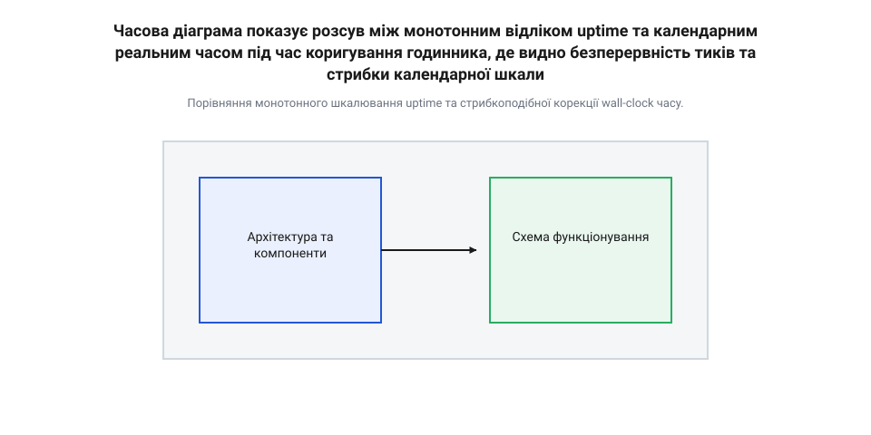
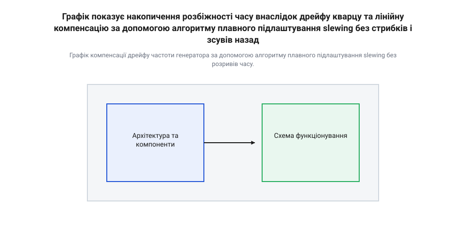
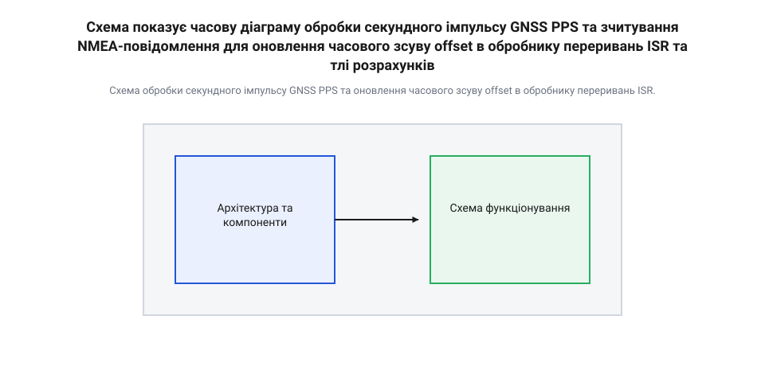

# Синхронізація uptime з реальним часом

<preknowlist>
- [Точний час](root:sf-devices/millis-micros) — Робота з системними лічильниками тактів і мілісекунд.
- [Неблокуючий час](root:sf-devices/nonblocking-time) — Обробка часових інтервалів без затримок основного циклу.
</preknowlist>

## Проблема розсуву системного та календарного часу

Автономний контролер після подачі живлення починає обробку циклічних задач: опитує давачі кожні 100 мілісекунд, відправляє телеметрію щосекунди та відраховує таймаут 30 секунд до перезапуску інтерфейсу при втраті зв'язку. Якщо за хвилину після старту пристрій з'єднується з сервером і коригує годинник із "00:01:00" на "14:35:22" (стрибок уперед на кілька годин), таймери, прив'язані до календарного часу, миттєво генерують хибні спрацьовування. При стрибку часу назад таймери зависають на час розсуву, блокуючи виконання алгоритмів. Щоб уникнути таких збоїв, внутрішні інтервали прошивки повинні відраховуватися виключно від монотонного системного лічильника безперервної роботи (uptime).

У будь-якому мікроконтролері базовим джерелом відліку часу є апаратний таймер-лічильник, тактований від кварцового резонатора або внутрішнього RC-генератора. Звертаючись до [структури апаратних таймерів](root:sf-devices/microcontroller-hardware-timers-architecture), прошивка отримує безперервний потік тиків (число імпульсів), який після ділення на частоту перетворюється на значення @@en|uptime@@ (від англ. *up* — вгору/працюючи та *time* — час) — кількість мілісекунд або мікросекунд, що минули від моменту подачі живлення або скидання процесора. Цей лічильник є монотонним: його значення строго зростає з кожним тактом генератора, ніколи не зменшується та не має раптових стрибків (за винятком контрольованого апаратного переповнення регістра, яке легко компенсується програмно).

Натомість астрономічний або календарний час — @@en|wall-clock time@@ (від англ. *wall clock* — настінний годинник) — представляє точну часову координату на цивільній часовій шкалі у форматі @@en|UTC@@ (@@en|Coordinated Universal Time@@, від фр. *Temps Universel Coordonné*). Цей час підлягає постійним зовнішнім коригуванням: синхронізація через мережу, перехід на літній/зимовий час, введення високосних секунд або ручне введення користувачем.

Коли розробник прошивки використовує @@en|wall-clock time@@ для відліку затримок чи формування періодичних подій, він припускає, що часова шкала є неперервною та рівномірною. Проте будь-яка зовнішня синхронізація порушує це припущення. Розглянемо два базові сценарії руйнування внутрішнього планування:

- **Стрибок часу вперед (Forward Jump):** Якщо таймер налаштовано на спрацювання в момент `t_target = t_current + delay`, і під час очікування значення `t_current` раптово збільшується на величину `Δt` через мережеве оновлення, умова `t_current >= t_target` стає істинною передчасно. В результаті періодичні задачі виконуються пачкою без витримування паузи, а таймаути мережевих запитів закриваються до отримання відповіді. - **Стрибок часу назад (Backward Jump):** Якщо `t_current` зменшується на `Δt` (наприклад, годинник був виставлений із випередженням і його підкоригували назад), різниця `t_target - t_current` збільшується на `Δt`. Планувальник задач «замерзає», адже цільова мітка часу опиняється у віддаленому майбутньому. Якщо код обчислює залишок часу як віднімання беззнакових чисел `delay_left = t_target - t_current`, то при стрибку назад у момент, коли `t_current` вже перевищив початкове значення, виникає від'ємне число або підповнення беззнакового типу, що призводить до непередбачуваної поведінки.

Використовуючи [обробку часових інтервалів](root:sf-devices/nonblocking-time) без затримки основного циклу, прошивка повинна оперувати лише тими джерелами часу, які гарантують відсутність зворотного ходу та довільних стрибків.

Еволюція систем обліку часу в програмному забезпеченні пройшла шлях від найпростіших системних лічильників тактів до чіткого архітектурного розділення монотонного та календарного часу. У ранніх операційних системах та перших прошивках мікроконтролерів існувало єдине поняття системного годинника, який одночасно використовувався і для відліку затримок виконання задач, і для фіксації поточного часу доби. Під час спроб синхронізувати цей годинник із зовнішніми джерелами еталонного часу виникали критичні збої: плановики задач некоректно обчислювали таймаути, виникали нескінченні цикли очікування подій або передчасне спрацьвування алгоритмів захисту. Усвідомлення цієї проблеми призвело до розробки стандартизованих підходів у специфікаціях @@en|POSIX@@ (@@en|Portable Operating System Interface@@, від англ. *portable* — переносний) та операційних системах реального часу (@@en|RTOS@@, @@en|Real-Time Operating System@@). Було введено концепцію монотонного таймера (@@en|monotonic clock@@, від грец. *μόνος* — один, єдиний та *τόνος* — натяг/тон, монотонний), який функціонує як строго зростаюча шкала без можливості примусового переведення назад чи стрибків уперед. Це створило надійну основу для внутрішнього планування задач, повністю ізольовану від процесів коригування календарного часу.


*Порівняння монотонного шкалювання uptime та стрибкоподібної корекції wall-clock часу.*

Як видно з діаграми, монотонна шкала @@en|uptime@@ демонструє лінійне та безперервне зростання незалежно від зовнішніх подій. Натомість шкала @@en|wall-clock time@@ містить розриви першого роду при ступінчастій корекції або зміну швидкості під час плавного коригування.

Наведений нижче приклад демонструє принципову різницю між некоректним використанням календарного часу та правильним підходом на основі монотонного лічильника.

:::tabs
:::tab{title="C++"}
:::code root\eng\sf-devices\uptime-clock-sync/uptime-clock-sync-d/cpp/cpp/process-sensor-bad.cpp cpp
:::
:::tab{title="C"}
:::code root\eng\sf-devices\uptime-clock-sync/uptime-clock-sync-d/c/c/process-sensor-bad-c.c c
:::

Завдяки чіткому розділенню відповідальності в прошивці формується два ізольовані контури:
1. **Контур внутрішнього планування:** Обробка затримок, опитування периферії, [системні лічильники тактів](root:sf-devices/millis-micros), автомати станів, контрольні таймери (watchdogs). Цей контур працює виключно з монотонним @@en|uptime@@. 2. **Контур зовнішньої інтерпретації:** Формування записів у журнал подій (logs), відображення часу на дисплеї, штампування пакетів протоколів зв'язку. Цей контур запитує поточний @@en|wall-clock time@@, який розраховується як трансляція монотонного @@en|uptime@@ через динамічний часовий зсув.

Опанувавши це розділення, розробник гарантує, що жодна зовнішня синхронізація часу чи зміна часового поясу не здатна порушити стабільність алгоритмів керування пристроєм.

## Прив'язка uptime до абсолютного часу

Знаючи, що внутрішній планувальник прошивки повинен спиратися лише на монотонний лічильник @@en|uptime@@, постає питання: як отримати точний календарний час для журналювання подій чи надсилання даних на сервер? Відповіддю є архітектурна модель часового зсуву — @@en|time offset@@ (від англ. *offset* — зсув, компенсація).

Календарний час у будь-який момент обчислюється як сума поточного монотонного часу @@en|uptime@@ та збереженого часового зсуву `offset`. Зсув являє собою різницю між точкою відліку календарного часу (наприклад, @@en|Unix epoch@@, від англ. *epoch* — точка відліку ери, 1 січня 1970 року 00:00:00 UTC) та моментом старта монотонного лічильника пристрою.

Ввівши позначення:
- `T_wall` — поточний календарний час (у мілісекундах від початку @@en|Unix epoch@@);
- `T_up` — поточне значення монотонного лічильника @@en|uptime@@ пристрою (у мілісекундах);
- `O` — поточний часовий зсув `time_offset` (у мілісекундах).

Основне співвідношення для обчислення реального часу має вигляд:

```
T_wall = T_up + O
       = 125400 + 1760000000000    [додавання поточного uptime до збереженого offset]
       = 1760000125400             [отримання повної мітки UTC у мілісекундах]
```

Коли пристрій отримує події синхронізації від зовнішнього джерела (наприклад, сервера [протоколів мережевої синхронізації](root:sf-devices/ntp-sntp-embedded-protocols) NTP або супутникового модуля GNSS), яке повідомляє точне значення реального часу `T_sync` у момент монотонного тику `T_up_sync`, модуль часу оновлює зсув `O` за формулою:

```
O_new = T_sync - T_up_sync
      = 1760000500000 - 500000    [обчислення нового зсуву на основі еталонного часу]
      = 1760000000000             [новий стабільний offset для системи]
```

Головна перевага цього підходу полягає в тому, що коригування календарного часу зводиться до перезапису однієї змінної `O_new`. При цьому монотонний лічильник `T_up` не зазнає жодних змін, а внутрішні таймери прошивки продовжують свій рівномірний відлік без найменшого збою.

Програмний інтерфейс (API) підсистеми системного та реального часу прошивки (від англ. @@en|Application Programming Interface@@, @@en|API@@) забезпечує уніфікований доступ до часових сервісів для всіх модулів прошивки. Модуль надає функції для зчитування монотонного uptime (`time_get_uptime_ms()`), отримання поточного календарного часу UTC (`time_get_wall_clock_ms()`), а також методи встановлення та плавного коригування часового зсуву (`time_set_offset()`, `time_adjust_offset()`). Для контролю достовірності даних API містить структуру статусів синхронізації (наприклад, прапорці `TIME_STATE_UNSYNCED`, `TIME_STATE_SYNCED`, `TIME_STATE_SLEWING`), що дозволяє іншим компонентам прошивки оцінювати точність часових міток. Крім того, підсистема реалізує механізм реєстрування зворотних викликів (від англ. @@en|callback@@ — зворотний виклик), які автоматично сповіщають зацікавлені модулі про факт стрибка часу або зміну стану синхронізації для оновлення локальних розкладів чи скидання кешу.

У мікроконтролерних системах оновлення та зчитування часового зсуву `O` відбувається в різних контекстах: зчитування здійснюється основними потоками або обробниками подій, тоді як оновлення відбувається у фоновому мережевому потоці або в обробнику переривань (від англ. @@en|ISR@@, @@en|Interrupt Service Routine@@). Оскільки зміна `O` на 32-бітному або 8-бітному процесорі для 64-бітного цілого числа не є атомарною операцією, зчитування зсуву під час його часткового перезапису призведе до отримання пошкоджених даних. Для забезпечення атомарності застосовують тимчасове заблокування переривань, атомарні типи даних `std::atomic<int64_t>` або безблокувальний подвійний буфер.

Нижче наведено практичну реалізацію базового модуля часу, який забезпечує потокобезпечний розрахунок реального часу та гаряче оновлення часового зсуву. Більш розширену версію подано у відповідному [модулі обліку часу](root:sf-devices/uptime-clock-sync/proj-uptime-clock-sync-module.md).

:::tabs
:::tab{title="C++"}
:::code root\eng\sf-devices\uptime-clock-sync/uptime-clock-sync-d/cpp/cpp/timesyncstate.cpp cpp
:::
:::tab{title="C"}
:::code root\eng\sf-devices\uptime-clock-sync/uptime-clock-sync-d/c/c/time-get-wall-clock-ms.c c
:::

До першого успішного отримання еталонного часу статус підсистеми залишається `TIME_STATE_UNSYNCED`. У цьому стані значення `offset` за замовчуванням дорівнює 0, а значення `get_wall_clock_ms()` збігається з `get_uptime_ms()`. Логи або записи телеметрії повинні позначатися прапорцем недостовірності часу, щоб сервери обробки даних не плутали відносний час після старту з реальним UTC. При первинному старті пристрою часовий зсув встановлюється миттєво (@@en|stepping@@, від англ. *step* — крок, робити крок). Проте якщо пристрій вже працює і відхилення часу становить лише кілька мілісекунд, застосовують плавне підлаштування (@@en|slewing@@, від англ. *slew* — повертати, плавно повертати), де значення зсуву поступово змінюється на невелику величину з кожним тиком. Більш детальний аналіз математичних моделей та алгоритмів компенсації наведено у відповідних [розрахунках дрейфу та коригування](root:sf-devices/uptime-clock-sync/math-clock-drift-and-slewing-calculations.md).

## Дрейф генератора та алгоритми коригування

Навіть якщо системний лічильник @@en|uptime@@ є суворо неперервним та монотонним, його часовий хід спирається на фізичний кварцовий генератор мікроконтролера, який у реальному світі ніколи не працює з ідеальною математичною частотою. Фізичне явище поступово накопичуваної розбіжності між часом внутрішнього лічильника та фізичним еталонним часом називають дрейф (від @@nl|drijven@@ — плавати, відхилятися). Через зміну температури навколишнього середовища, старіння кристалу та нестабільність напруги живлення внутрішня частота генератора постійно відхиляється від номіналу. Якщо прошивка обчислює календарний час @@en|wall-clock time@@ на основі сталого часового зсуву, отриманого під час єдиної синхронізації при включенні, годинник пристрою неминуче почне «поспішати» або «відставати» від абсолютного часу @@en|UTC@@.

Основними фізичними чинниками, що спричиняють дрейф кварцового резонатора (від @@de|Quarz@@ — твердий мінерал), є:

1. Температурна залежність. Частотно-температурна характеристика стандартних низькочастотних кварців на 32.768 кГц описується параболічною кривою з вершиною близько +25 °C. При відхиленні температури в бік морозів (-40 °C) або нагріву (+85 °C) частота генерації неминуче знижується, сповільнюючи відлік часу. 2. Механічна релаксація та старіння. З часом у кристалі кварцу виникають мікродеформації, а на його поверхні осаджуються мікроскопічні частки, що призводить до незворотного зміщення резонансної частоти на кілька мільйонних часток за рік. 3. Коливання елементів обв'язки. Зміна паразитної ємності друкованої плати та нестабільність живильної напруги тактового генератора змінюють кут фазового зсуву в колі зворотного зв'язку осцилятора.

Величину відхилення частоти у технічній літературі вимірюють у мільйонних частках (англ. @@en|PPM@@ — «частин на мільйон», від @@en|parts per million@@). Величина 1 @@en|PPM@@ відповідає помилці в одну мікросекунду (від @@grc|μικρός@@ — малий) за одну секунду фізичного часу, що становить приблизно 86.4 мілісекунди на добу або 31.5 секунди на рік.

Для оцінки масштабу проблеми обчислимо накопичений дрейф звичайного загальнопромислового кварцового резонатора з точністю ±20 @@en|PPM@@:

```
error_per_second = 20 × 10⁻⁶ s
error_per_day    = 20 × 10⁻⁶ × 86400 s 
                 = 1.728 s                 [накопичена похибка за добу]
error_per_month  = 1.728 s × 30 
                 = 51.84 s                 [накопичена похибка за місяць]
```

Якщо пристрій працює в жорстких температурних умовах (-40 °C...+85 °C) без термокомпенсації, дрейф звичайного кварцу може досягати 100...200 @@en|PPM@@, що призводить до розходження календарного часу на 8.6...17.2 секунди щодня.

Коли підсистема часу отримує новий точний календарний timestamp від зовнішнього джерела (наприклад, [протоколу мережевої синхронізації](root:sf-devices/ntp-sntp-embedded-protocols)), виникає розбіжність між поточним значенням `T_wall` та еталоном `T_ref`. Для усунення цієї розбіжності існує два фундаментально різних підходи: ступеневе зміщення (англ. @@en|stepping@@, від @@en|step@@ — крок) та плавне підлаштування (англ. @@en|slewing@@, від @@en|slew@@ — повертати навколо осі).

При ступеневому зміщенні `T_offset` оновоюється миттєво. Якщо пристрій поспішав, шкала `T_wall` миттєво стрибає назад. Як вже розкрито раніше, для внутрішніх програмних таймерів це небезпечно, проте навіть для календарного журналювання миттєвий стрибок часу назад є неприпустимим: у логах з'являються записи, де подія B має менший timestamp, ніж подія A, яка відбулася раніше. Це руйнує цілісність часових рядів у базах даних та робить неможливим розслідування системних аварій.

Альтернативою є плавне підлаштування @@en|slewing@@. Замість одномоментного зміщення часового зсуву, підсистема часу тимчасово змінює швидкість відліку `T_wall`, штучно прискорюючи або сповільнюючи плин календарного часу на малу величину (наприклад, на ±500 @@en|PPM@@), поки накопичена похибка повністю не знівелюється. Під час плавного підлаштування шкала `T_wall` залишається суворо монотонною та неперервною.

Графічне порівняння двох підходів коригування наведено нижче:


*Графік компенсації дрейфу частоти генератора за допомогою алгоритму плавного підлаштування slewing без розривів часу.*

Як видно з графіку, при ступеневому коригуванні `T_wall` зазнає вертикального розриву. При використанні @@en|slewing@@ графік `T_wall` м'яко змінює кут нахилу, плавно зближуючись із лінією еталонного часу без жодних скачків.

Математично процес плавного підлаштування описується як введення динамічного коефіцієнта коригування швидкості `rate_adj` до формули розрахунку реального часу. Детальний аналіз [математичних моделей дрейфу годинника](root:sf-devices/uptime-clock-sync/math-clock-drift-and-slewing-calculations.md) показує, що фазова похибка `delta_T` виправляється на кожному системному кроці за допомогою покрокового алгоритму:

```
delta_T      = T_ref - T_wall                [обчислення фазової похибки]
rate_adj     = clamp(delta_T / T_slew, -R_max, R_max) [обмеження швидкості плавної корекції]
T_offset_new = T_offset_prev + rate_adj × dt [покрокове оновлення зсуву]
```
де `T_slew` — бажаний інтервал згладжування (наприклад, 100 секунд), `R_max` — максимально припустима відносна швидкість підлаштування (наприклад, 0.0005, тобто 500 @@en|PPM@@), а `dt` — крок опитування у мікросекундах.

Якщо накопичена помилка перевищує певний поріг (наприклад, 1 секунду), пристрій здійснює @@en|stepping@@ при первинній синхронізації після старту, але під час штатної роботи застосовується виключно @@en|slewing@@. Для аналізу високонавантажених процесів розробники також застосовують [профілювання продуктивності системних таймерів](root:sf-devices/esp-timer-profiling), щоб переконатися у відсутності затримок при оновленні часових параметрів.

Нижче наведено програмну реалізацію підсистеми плавного коригування часу @@en|slewing@@ мовами C та C++:

:::tabs
@tab C (ESP-IDF)
:::code root\eng\sf-devices\uptime-clock-sync/uptime-clock-sync-d/c/esp-idf/clock-set-time-stepping.c c
@tab C++ (C++17)
:::code root\eng\sf-devices\uptime-clock-sync/uptime-clock-sync-d/cpp/clockslewer.cpp cpp
:::

## Обробка подій синхронізації RTC та GNSS

Для автономних мікроконтролерних систем, які не мають постійного підключення до IP-мереж із серверами часу, основними джерелами еталонного часу є супутникові приймачі (англ. @@en|GNSS@@ — «глобальна навігаційна супутникова система», від @@en|global navigation satellite system@@, такі як GPS, GLONASS, Galileo) та зовнішні мікросхеми годинників реального часу (англ. @@en|RTC@@).

Апаратний годинник реального часу (англ. @@en|RTC@@) з автономним резервним живленням призначений для збереження календарного часу при повному вимкненні основної напруги пристрою. Внутрішній устрій @@en|RTC@@ включає ланцюг перемикання на резервну батарею (наприклад, дискову батарейку CR2032 або суперконденсатор) та каскад лічильників секунда-хвилина-година-день. Для тактування традиційно використовується зовнішній кварцовий резонатор на 32.768 кГц, обраний через зручність ділення частоти навпіл (2¹⁵ = 32768 Гц) до 1 Гц. Критерієм вибору @@en|RTC@@ для відповідальних застосувань є точність ходу у @@en|PPM@@ та наявність апаратної термокомпенсації (англ. @@en|TCXO@@, від @@en|temperature compensated crystal oscillator@@), як у мікросхемі @@en|DS3231@@, яка знижує дрейф з 20 @@en|PPM@@ до 2 @@en|PPM@@ у широкому діапазоні температур (-40 °C...+85 °C).

Підключення мікросхеми @@en|RTC@@ до мікроконтролера здійснюється за допомогою послідовних шин @@en|I2C@@ або @@en|SPI@@. Виводи мікросхеми містять не лише лінії даних та тактування, а й вихід прямокутного сигналу переривання SQW/INT, який можна налаштувати на генерацію секундного імпульсу 1 Гц для прив'язки монотонного часу. Карта регістрів @@en|RTC@@ містить двійково-десяткові (англ. @@en|BCD@@, від @@en|binary-coded decimal@@) значення секунд, хвилин, годин, дати та місяця, зчитування яких виконується пакетним транзакційним запитом. У регістрах керування та живильних режимів особливе значення має прапорець збою осцилятора чи скидання резервного живлення (наприклад, прапорець OSF/VBAT), аналіз якого при старті дозволяє прошивці чітко визначити, чи зберегла мікросхема дійсний точний час, чи потребує первинного налаштування.

При використанні модуля @@en|GNSS@@ розробник зустрічається з унікальною особливістю: супутниковий приймач надає точний час по двох принципово різних каналах зв'язку:
1. Фізична апаратна лінія імпульсу секунди (англ. @@en|PPS@@ — «імпульс за секунду», від @@en|pulse per second@@). Це цифровий сигнал, крутий наростаючий фронт якого має апаратну прив'язку до початку кожної астрономічної секунди @@en|UTC@@ із точністю краще 50 наносекунд. Проте сам імпульс @@en|PPS@@ є «німим»: він не містить жодної інформації про те, яка саме секунда, хвилина чи рік зараз почалися. 2. Послідовний текстовий або бінарний протокол (наприклад, @@en|NMEA-0183@@ або @@en|UBX@@) через @@en|UART@@. У цьому потоці надходять текстові строки (наприклад, `$GPRMC`), що містять повну дату й час. Однак через буферизацію в @@en|UART@@, затримки обробки в прошивці навігаційного модуля та коливання затримок у чергах ОС, текстове повідомлення запізнюється відносно початку секунди на 50...300 мілісекунд.

Співпраця цих двох каналів дозволяє досягти субмікросекундної точності прив'язки: крутий фронт @@en|PPS@@ фіксує точний момент `T_uptime_pps` в [обробнику переривань](root:sf-devices/microcontroller-hardware-timers-architecture), а наступне за ним текстове повідомлення @@en|NMEA@@ ідентифікує номер цієї секунди в епосі @@en|UTC@@. Для досягнення аналогічної субмікросекундної точності в мережах Ethernet без супутникових приймачів перегляньте статтю про [протокол точного часу PTP (IEEE 1588) та апаратне штампування пакетів](root:sf-devices/ptp-ieee1588-hardware-timestamping).

Схему обробки імпульсу @@en|PPS@@ та текстового пакета наведено нижче:


*Схема обробки секундного імпульсу GNSS PPS та оновлення часового зсуву offset в обробнику переривань ISR.*

Критичною вимогою до розробника прошивки є суворе дотримання правил роботи в обробнику переривань (англ. @@en|ISR@@ — «службовий обробник переривань»):

1. В обробнику переривання @@en|GPIO@@ за фронтом @@en|PPS@@ виконується лише фіксація значення поточного `T_uptime` (наприклад, через швидкий виклик апаратного таймера або `esp_timer_get_time()`). 2. В @@en|ISR@@ категорично заборонено виконувати транзакції по шинах @@en|I2C@@/@@en|SPI@@, розбирати текстові строки @@en|UART@@ або викликати блокуючі функції ОС. 3. Захоплене значення `T_uptime_pps` передається в робочу задача верхнього рівня через безблокуючу чергу (англ. @@en|lock-free queue@@) або атомарний буфер.

Розробляючи [драйвер обробки подій синхронізації](root:sf-devices/uptime-clock-sync/proj-rtc-gnss-pps-sync-handler.md), розробник об'єднує апаратні переривання із системним часовим зсувом.

Нижче наведено практичну реалізацію обробника подій @@en|PPS@@ та синхронізації з @@en|GNSS@@ мовами C та C++:

:::tabs
@tab C (ESP-IDF)
:::code root\eng\sf-devices\uptime-clock-sync/uptime-clock-sync-d/c/esp-idf/pps-gpio-isr-handler.c c
@tab C++ (C++17)
:::code root\eng\sf-devices\uptime-clock-sync/uptime-clock-sync-d/cpp/ppsevent.cpp cpp
:::

## Крайні стани та переповнення uptime

Підсистема обліку часу прошивки повинна розроблятися з урахуванням обробки граничних станів (англ. @@en|edge cases@@), таких як апаратне переповнення (англ. @@en|overflow@@ — «переливання за край») лічильників системних тактів та робота пристрою в незасинхронізованому стані.

Системний монотонний time counter спирається на апаратний таймер мікроконтролера певного розряду. Залежно від бітності лічильника та частоти його тактування, період повного обгортання (переповнення) лічильника кардинально різниться:

```
32-bit millisecond counter (millis):
  Max value = 2³² - 1 = 4 294 967 295 ms
  Period    = 4 294 967 295 / (1000 × 86400) 
            ≈ 49.71 days                   [переповнення через 49.7 діб]

32-bit microsecond counter (micros):
  Max value = 2³² - 1 = 4 294 967 295 us
  Period    = 4 294 967 295 / (1000000 × 3600) 
            ≈ 1.19 hours (71.58 min)       [переповнення через 71.5 хвилин]

64-bit microsecond counter (uptime_us):
  Max value = 2⁶⁴ - 1 ≈ 1.84 × 10¹⁹ us
  Period    = 1.84 × 10¹⁹ / (1000000 × 86400 × 365.25)
            ≈ 584 942 years                [практично нескінченний час]
```

Як розкрито у правилах побудови [неблокуючих часових затримок](root:sf-devices/nonblocking-time), беззнакове віднімання `(uint32_t)(t_now - t_start)` коректно обробляє одне переповнення 32-бітного лічильника, якщо вимірюваний інтервал не перевищує повного періоду обгортання (49 діб для мілісекунд або 71 хвилину для мікросекунд).

Проте для формування суворо монотонного 64-бітного значення `T_uptime`, яке не повинно переповнюватися протягом усього терміну служби пристрою, прошивка повинна використовувати розширення бітності. Якщо апаратний таймер процесора є 32-бітним, обробник переривання переповнення таймера інкрементує старше 32-бітне слово у пам'яті, формуючи повноцінне 64-бітне число.

Другим критичним крайнім станом є робота прошивки у незасинхронізованому стані (холодний старт пристрою при відсутності зв'язку з джерелами точного часу та розрядженій батареї @@en|RTC@@).

У цьому стані підсистема часу дотримується таких архітектурних правил:

1. Прапорець `is_synced` встановлюється в `false`. 2. Початкове значення календарного часу `T_wall` стартує з нульової епохи (1970-01-01 00:00:00 @@en|UTC@@) або з фіксованого часу компіляції прошивки `BUILD_TIMESTAMP`. 3. Кожна часова мітка (англ. @@en|timestamp@@), що записується у журнал подій, супроводжується метаданими якості часу (англ. @@en|time quality metadata@@).

Формування логів без прапорця синхронізації є небезпечним: якщо пристрій відправить мережевий пакет із календарною датою `1970-01-01`, це спричинить відхилення пакету серверами через порушення валідності криптографічних ключових сертифікатів (англ. @@en|TLS/SSL certificates@@), які вимагають перевірки поточного часового вікна.

Високонадійні прошивки підтримують ієрархічний енум статусу синхронізації:

```
typedef enum {
    TIME_QUALITY_UNSYNCED      = 0, // Час не синхронізовано (базовий uptime від 1970 року)
    TIME_QUALITY_RTC_UNVERIFIED = 1, // Час прочитано з RTC, але відсутнє підтвердження GNSS/NTP
    TIME_QUALITY_NTP_COARSE    = 2, // Синхронізовано через мережу NTP (точність ~10-50 мс)
    TIME_QUALITY_GNSS_PPS      = 3  // Високоточна синхронізація за PPS (точність < 1 мкс)
} time_quality_t;
```

Крім того, підсистема часу зобов'язана зберігати всі внутрішні часові мітки виключно у форматі Всесвітнього координованого часу (англ. @@en|UTC@@). Включення часових поясів (англ. @@en|timezones@@) та сезонного переходу на літній/зимовий час (англ. @@en|DST@@ — «літній час», від @@en|daylight saving time@@) всередині ядра обліку часу є грубою помилкою. Переходи @@en|DST@@ створюють скачки часу на 1 годину назад або вперед удвічі на рік, повторюючи розриви монотонності. Перетворення часу @@en|UTC@@ у місцевий часовий пояс здійснюється виключно на верхньому рівні представлення користувачу (в @@en|UI@@ або веб-інтерфейсі).

Спроектована [реалізація модуля синхронізації uptime](root:sf-devices/uptime-clock-sync/proj-uptime-clock-sync-module.md) гарантує стійкість системи до будь-яких мережевих збоїв, перезавантажень та перезапусків живлення.