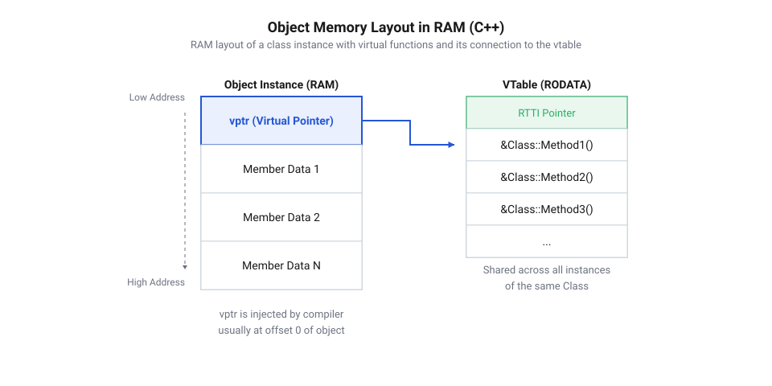
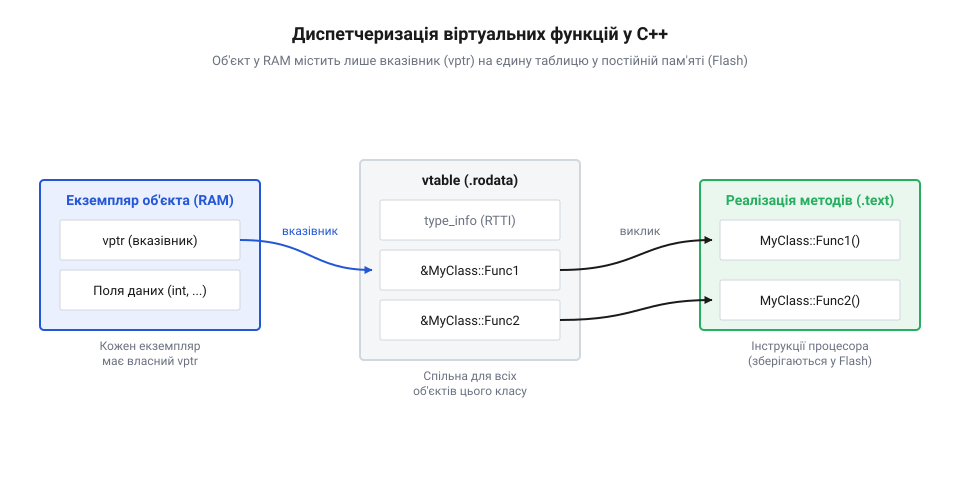
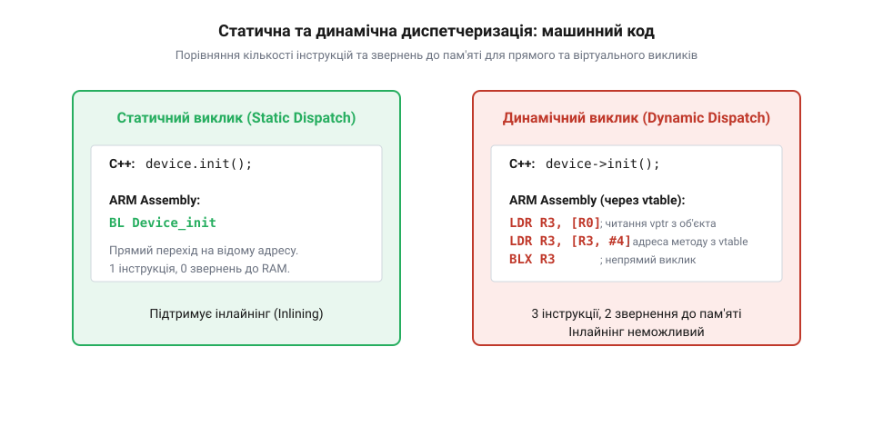
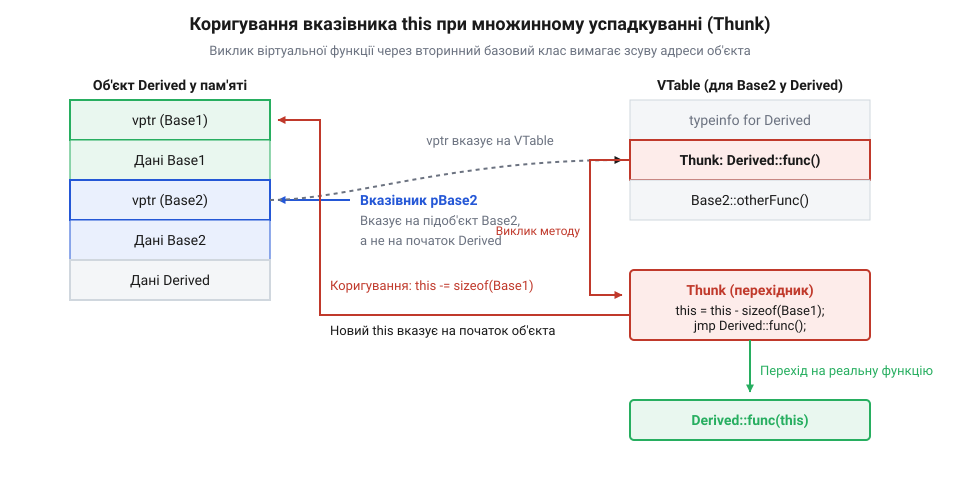

# Таблиця віртуальних методів у C++ для мікроконтролерів: структура vptr у RAM, сегмент rodata та ціна непрямого виклику

<preknowlist>
- [Аналіз дизасемблера](root:sf-devices/chytannia-dyzasemblera) — читання асемблерних інструкцій виклику функцій та роботи з регістрами
- [Шаблон драйвера](root:sf-devices/driver-pattern) — організація інтерфейсів периферійних модулів через структури покажчиків
</preknowlist>

## Ціна об'єктної абстракції у вбудованому C++

Використання об'єктно-орієнтованого програмування у прошивках мікроконтролерів дає змогу створювати чисті модульні архітектури: уніфікований інтерфейс датчика `Sensor`, абстрактний комунікаційний порт `Stream` або базовий клас приводу `MotorDriver`. Клієнтський код працює з базовим покажчиком або посиланням, не прив'язуючись до конкретної апаратної реалізації (чи це внутрішній АЦП, чи зовнішній чіп на шині I2C).

Проте у вбудованих системах кожна абстракція має фізичну ціну в байтах оперативної пам'яті (RAM), комірках енергонезалежної пам'яті програм (Flash) та тактах процесорного ядра. Коли розробник додає ключове слово `virtual` до оголошення методу класу, поведінка програми докорінно змінюється: прямий виклик функції за фіксованою адресою замінюється динамічною диспетчеризацією (@@en|dynamic dispatch@@; від грец. *dynamis* — сила, рух та англ. *dispatch* — відправлення, розподіл). Щоб свідомо застосовувати віртуальні методи на мікроконтролерах із кількома кілобайтами пам'яті, необхідно чітко розуміти внутрішній механізм роботи таблиці віртуальних методів (@@en|virtual method table@@, або @@en|vtable@@) та прихованого покажчика об'єкта (@@en|vptr@@).

## Розташування об'єкта в RAM: прихований покажчик vptr

Як тільки клас отримує хоча б один віртуальний метод (або успадковує його від предка), компілятор автоматично додає до внутрішньої структури екземпляра класу приховане поле даних — покажчик на таблицю методів `vptr` (@@en|virtual table pointer@@).

У більшості сучасних компіляторів (зокрема GCC ARM Embedded та Clang/LLVM) покажчик `vptr` розміщується на самому початку об'єкта за нульовим зміщенням `offset = 0`.


*Структура об'єкта з віртуальними методами в оперативній пам'яті RAM: додавання прихованого покажчика vptr та вирівнювання полів.*

Розмір цього покажчика визначається розрядністю архітектури мікроконтролера:
- На 32-бітних ядрах (ARM Cortex-M0/M3/M4/M7, ESP32 Xtensa, RISC-V RV32) `sizeof(vptr) = 4` байти.
- На 64-бітних процесорах `sizeof(vptr) = 8` байтів.
- На 8-бітних мікроконтролерах (AVR ATmega) `sizeof(vptr) = 2` байти.

Розглянемо вплив появи `vptr` на споживання пам'яті компактним класом сенсора:

```cpp
class RawSensor {
    uint16_t id;    // 2 байти
    uint8_t flags;  // 1 байт
}; // sizeof = 4 байти (з урахуванням паддінгу вирівнювання)

class VirtualSensor {
public:
    virtual ~VirtualSensor() = default;
    virtual int read() = 0;
private:
    uint16_t id;    // 2 байти
    uint8_t flags;  // 1 байт
}; // sizeof = 8 байтів на 32-бітній архітектурі!
```

Додавання віртуального деструктора та одного методу подвоїло споживання оперативної пам'яті кожним створеним об'єктом. Якщо система створює масив із 100 таких об'єктів (наприклад, калібрувальні точки або елементи черги), 400 байтів дефіцитної SRAM витрачається виключно на збереження однакових адресних покажчиків.

## Структура vtable у сегменті Flash (.rodata)

Сама таблиця віртуальних методів `vtable` генерується компілятором під час збирання проєкту і є статичним масивом покажчиків на функції. Оскільки адреси коду функцій відомі на етапі лінкування і не змінюються під час виконання прошивки, лінкер розміщує таблиці `vtable` у секції незмінних даних `.rodata` у Flash-пам'яті мікроконтролера.

Для кожного поліморфного класу створюється рівно один екземпляр таблиці `vtable` у Flash, незалежно від того, скільки об'єктів цього класу створено в RAM.

Таблиця містить:
1. Заголовний блок RTTI (@@en|Run-Time Type Information@@), де зберігається покажчик на структуру `typeinfo` (якщо RTTI увімкнено у прапорцях компілятора).
2. Зсув від початку об'єкта (@@en|offset-to-top@@), необхідний для множинного успадкування.
3. Послідовний масив адрес функцій у порядку їх першого оголошення у класі.


*Шлях виконання віртуального методу: читання vptr з RAM, індексація vtable у Flash (.rodata) та непрямий виклик адреси функції.*

## Дизасемблерний аналіз: прямий виклик проти непрямого

Щоб оцінити процесорні накладні витрати динамічної диспетчеризації, порівняємо машинний код, що генерується компілятором для статичного та віртуального викликів на архітектурі ARM Cortex-M4.

При прямому виклику звичайного методу `sensor.read()` компілятор генерує лише одну інструкцію безумовного переходу зі збереженням адреси повернення:

```assembly
; Прямий виклик методу (Static Dispatch)
bl   Sensor_read        ; 1 такт, прямий перехід за фіксованою адресою
```

При виклику віртуального методу `pSensor->read()` процесор змушений виконати ланцюжок непрямої адресації:

```assembly
; Динамічний виклик методу (Virtual Dispatch)
ldr  r3, [r0, #0]       ; 1. Читання vptr із нульового зміщення об'єкта (1-2 такти)
ldr  r3, [r3, #8]       ; 2. Читання адреси цільового методу з vtable (1-2 такти)
blx  r3                 ; 3. Непрямий перехід за значенням у регістрі (2-4 такти)
```


*Дизасемблерне порівняння: прямий перехід BL проти трикрокової вибірки через регістри LDR та BLX.*

Прямий виклик займає 1 такт процесора, а його адреса відома наперед, що дозволяє апаратному модулю передбачення переходів (@@en|branch predictor@@) завчасно завантажити інструкції в конвеєр. Більше того, компілятор може повністю усунути виклик функції за допомогою інлайнінгу (@@en|inlining@@).

Віртуальний виклик вимагає виконання трьох послідовних інструкцій:
1. Завантаження адреси `vptr` з оперативної пам'яті у регістр `r3`.
2. Завантаження адреси функції з пам'яті Flash таблиці `vtable` зі зміщенням слота.
3. Непрямий перехід `blx r3`.

Якщо дані об'єкта або таблиця `vtable` відсутні у швидкому кеші інструкцій (або Flash-пам'ять працює з циклами очікування @@en|wait states@@ на високій частоті 168–240 МГц), процесор зазнає затримки на вибірку пам'яті. Непрямий перехід очищує апаратний конвеєр процесора, що сумарно збільшує час виклику методу з 1 такту до 6–12 тактів. У критичних циклах обробки сигналів АЦП або генерації імпульсів двигуна така затримка є неприпустимою.

## Множинне успадкування та коригувальні перехідники (Thunks)

Ситуація ще більше ускладнюється при використанні множинного успадкування, коли похідний клас реалізує інтерфейси кількох базових класів одночасно:

```cpp
class InterfaceA {
public:
    virtual void actionA() = 0;
};

class InterfaceB {
public:
    virtual void actionB() = 0;
};

class Device : public InterfaceA, public InterfaceB {
public:
    void actionA() override { /* ... */ }
    void actionB() override { /* ... */ }
};
```

В об'єкті `Device` неможливо розмістити одну спільну таблицю методів, оскільки покажчик на `InterfaceB*` повинен бачити таблицю, де метод `actionB()` стоїть на очікуваному ним зміщенні. Тому компілятор додає в об'єкт два незалежні покажчики: `vptr_InterfaceA` на початку об'єкта та `vptr_InterfaceB` зі зміщенням `sizeof(InterfaceA)`.

Коли клієнт викликає метод через покажчик другого інтерфейсу:

```cpp
InterfaceB* pB = &device;
pB->actionB();
```

Покажчик `pB` вказує не на початок екземпляра `Device`, а всередину нього зі зміщенням. Проте сам метод `Device::actionB()` очікує отримати як перший неявний аргумент `this` покажчик на повний об'єкт `Device`.

Для розв'язання цієї колізії компілятор генерує спеціальну проміжну функцію-перехідник (@@en|thunk@@, або @@en|trampoline@@).


*Коригування покажчика this у thunk-перехіднику: зміщення адреси об'єкта перед передачею керування реальному методу.*

Перехідник виконує арифметичне коригування регістра `r0` (в якому передається `this`) та здійснює миттєвий стрибок на реальну функцію:

```assembly
; Коригувальний thunk для InterfaceB::actionB()
sub  r0, r0, #4         ; this = this - sizeof(InterfaceA)
b    Device_actionB     ; перехід на цільовий метод
```

Це вносить додаткові накладні витрати на виконання перехідника та збільшує розмір коду прошивки у Flash.

## Нуль-коштовні альтернативи для вбудованих систем: CRTP

Коли поліморфізм необхідний на етапі проектування архітектури, але динамічна диспетчеризація заборонена вимогами швидкодії, у вбудованому C++ застосовують шаблон статичного поліморфізму — ідіому CRTP (@@en|Curiously Recurring Template Pattern@@, або дивно повторюваний шаблон).

Базовий клас параметризується типом свого нащадка:

```cpp
template <typename Derived>
class SensorBase {
public:
    int read() {
        return static_cast<Derived*>(this)->read_impl();
    }
};

class AdcSensor : public SensorBase<AdcSensor> {
public:
    int read_impl() {
        return adc_get_raw();
    }
};
```

Компілятор резолвить виклик методу під час компіляції:
1. В об'єкті відсутній прихований покажчик `vptr` (`sizeof(AdcSensor)` дорівнює лише розміру його корисних даних, заощаджуючи RAM).
2. У Flash-пам'яті не створюються таблиці `vtable` та перехідники thunk.
3. Виклик методу `read()` повністю інлайниться без жодної інструкції переходу.

Практичний інструмент низькорівневого аналізу пам'яті та таблиць `vtable` на рівні байтів реалізовано у [практичному проєкті інспектора пам'яті віртуальних таблиць](root:sf-devices/virtual-dispatch-cpp/proj-vtable-memory-inspector.md).
