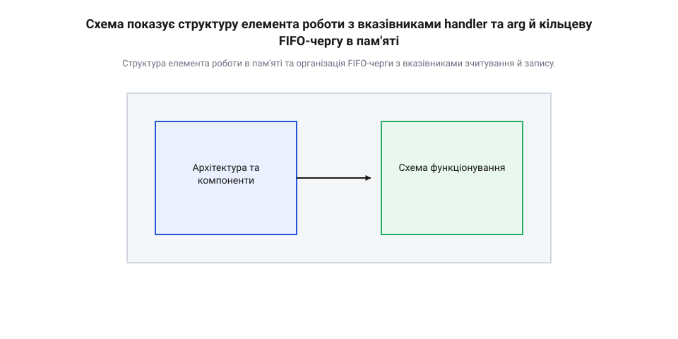
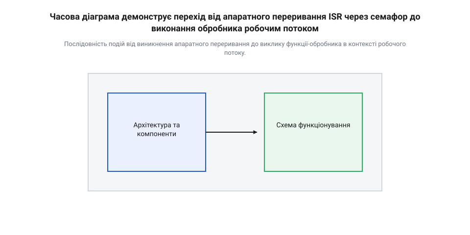
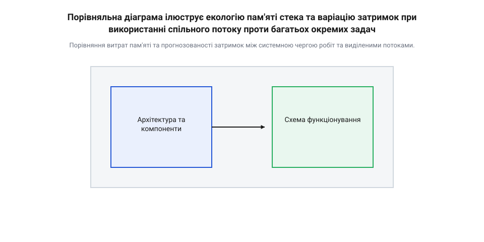
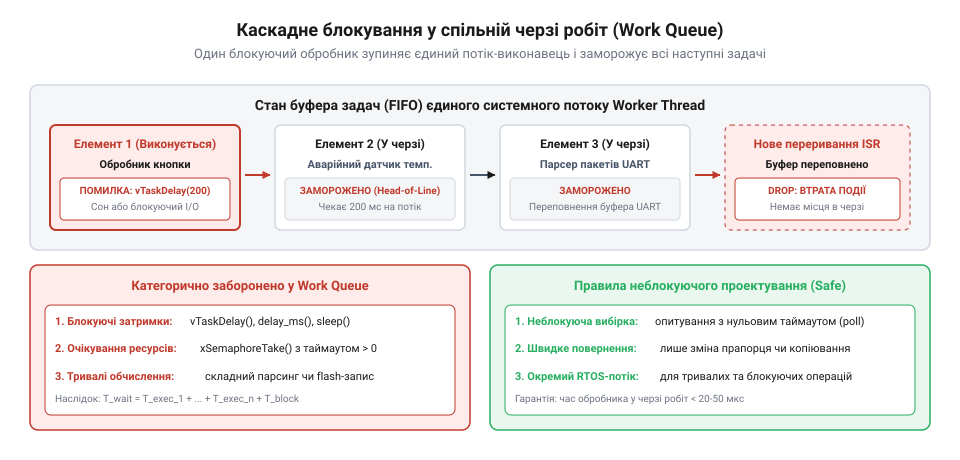

# Черга робіт: відкладене виконання на спільному потоці

<preknowlist>
- [Автомат станів задачі](root:sf-devices/task-states) — Принципи зміни станів потоків RTOS (блокований, готовий, виконання) та функціонування планувальника.
- [Архітектура кільцевого буфера UART](root:sf-devices/uart-ring-buffer-architecture) — Механіка роботи буферів FIFO з вказівниками запису та зчитування для збереження послідовності.
</preknowlist>

## Затримки переривань через тривалу обробку

Коли на вивід мікроконтролера надходить апаратний імпульс від зовнішнього давача або шина передачі даних завершує прийом чергового байта, центральний процесор негайно призупиняє виконання поточного коду. Процесор зберігає регістровий контекст та здійснює апаратний перехід за вектором у спеціальну функцію — @@en|Interrupt Service Routine@@ (від лат. *interruptus* — перерваний, апаратна процедура обробки сигналів, або скорочено @@en|ISR@@). Головне призначення обробника переривань полягає у миттєвій реакції на подію обладнання. Проте якщо всередині цієї функції розробник розміщує тривалі операції — наприклад, зчитування великого масиву даних по повільній шині I2C, обчислення контрольної суми CRC, розбір JSON-пакета чи логіку опитування декількох регістрів, — система потрапляє у критичну архітектурну пастку.

Під час виконання обробника переривань процесор блокує обробку інших апаратних сигналів з аналогічним або нижчим пріоритетом. Час, протягом якого апаратне переривання очікує на можливість бути виконаним через зайнятість процесора іншим обробником, називається @@en|interrupt latency@@ (від лат. *latens* — прихований, часова затримка реакції системи). Якщо обробник переривання виконується занадто довго, інші периферійні модулі позбавляються процесорного часу. Це призводить до катастрофічних наслідків для стабільності прошивки: виникає переповнення апаратних буферів прийому даних (@@en|buffer overflow@@), скидаються байти при високошвидкісному [прийомі даних UART](root:sf-devices/uart-rx-ring-buffer-mcu), пропускаються тактові імпульси системних таймерів та порушується детермінованість часу відгуку всієї системи. Розкид і нестабільність часу між появою апаратної події та її реальною обробкою створює часовий джитер (@@en|jitter@@, від англ. *jitter* — тремтіння або розкид часу), що робить систему непридатною для задач реального часу.

Розв'язанням цієї проблеми є фундаментальний розділ контексту обробки на дві послідовні фази. Цей підхід історично зародився в ядрах універсальних операційних систем, де [еволюція відкладеного виконання](root:sf-devices/work-queue/hist-deferred-execution-evolution.md) сформувала розділення на верхній та нижній halves обробки переривань:

1. @@en|Top half@@ (перша фаза) — безпосередній апаратний обробник переривання (@@en|ISR@@). Його задача обмежена критично швидкими діями: зняти прапор апаратного переривання, прочитати дані з апаратного регістра у тимчасовий буфер і зафіксувати подію.

2. @@en|Bottom half@@ (друга фаза) — відкладена обробка. Усі обчислення, робота з пам'яттю, розбір протоколів та взаємодія з іншими периферійними модулями виносяться за межі контексту переривань.

Для реалізації відкладеного виконання в операційних системах реального часу розроблені спеціалізовані архітектурні [механізми bottom half](root:sf-devices/interrupt-bottom-half-mechanisms). Серед них найгнучкішим та найефективнішим з точки зору використання ресурсів пам'яті є паттерн черги робіт. Потреба в цьому паттерні зумовлена фундаментальною відмінністю між апаратним контекстом переривання та системним контекстом потоку RTOS. При виникненні апаратної події мікроконтролер виконує лише мінімальне апаратне збереження робочих регістрів у стек, минаючи планувальник і не оновлюючи @@en|Task Control Block@@ (від англ. *task* — завдання, *control* — управління, *block* — блок структури, скорочено @@en|TCB@@). Оскільки обробник переривання не має власного @@en|TCB@@ і не перебуває під управлінням планувальника, він принципово не може перейти у [блокований стан задач](root:sf-devices/task-states) чи очікувати на звільнення ресурсів. Через це всередині @@en|ISR@@ суворо заборонено викликати стандартні блокуючі функції системного API: будь-яка спроба заснути чи заблокувати виконання призводить до падіння ядра. Для безпечної взаємодії RTOS надає спеціалізовані неблокуючі виклики з суфіксом `FromISR` (від англ. *From Interrupt Service Routine* — з обробника переривання, як-от `xQueueSendFromISR`), які лише відкладають подію без виклику планового перемикання контексту (@@en|context switch@@, від англ. *context switch* — перемикання контексту). Передаючи сформований у фазі @@en|top half@@ пакет даних та функцію його обробки через такі виклики у фоновий потік, розробник переносить обробку у повноцінний контекст з повним збереженням регістрів та підтримкою системних викликів, звільняючи апаратний обробник переривань за частки мікросекунди.

## Архітектура та елементи черги робіт

Системна черга робіт (@@en|work queue@@, від англ. *work* — робота, *queue* — черга від лат. *cauda* — хвіст) є накопичувальним буфером та механізмом диспетчеризації відкладених завдань. Вона будується навколо атомарних одиниць обробки — елементів робіт (@@en|work item@@). Кожен такий елемент описує конкретне завдання, яке має бути виконане у фоновому контексті операційної системи.

Основою елемента роботи є структура даних, яка об'єднує два ключові поля: вказівник на функцію зворотного виклику — @@en|callback@@ (від англ. *call* — викликати, *back* — назад, тобто зворотний виклик функції), та вказівник на контекстні дані:

```c
typedef void (*work_func_t)(void *arg);

typedef struct {
    work_func_t func;  // Вказівник на функцію-обробник
    void *arg;         // Вказівник на контекстні дані події
} work_item_t;
```

Поле `func` містить адресу функції, яка реалізує відкладену логіку. Поле `arg` передає універсальний вказівник типу `void*` на структуру або масив з даними, які були зафіксовані під час виникнення події (наприклад, виміряне значення напруги, прийнятий байт або мітка часу). Передача контексту через `void*` забезпечує абсолютну універсальність черги: один і той самий механізм може обробляти елементи робіт для абсолютно різних периферійних модулів.

Буфер черги робіт організовано за принципом @@en|FIFO@@ (від англ. *First-In, First-Out* — першим прийшов, першим оброблений). Внутрішньо це може бути кільцевий буфер фіксованого розміру або зв'язаний список.


*Структура елемента роботи в пам'яті та організація FIFO-черги з вказівниками зчитування й запису.*

Постановка елемента в чергу робіт з контексту переривання має відповідати суворим вимогам безпеки RTOS. Всередині @@en|ISR@@ заборонено використовувати динамічне виділення пам'яті (`malloc`), оскільки це викликає невизначені затримки та загрожує фрагментацією купи. Тому елементи робіт або виділяються статично на етапі компіляції, або беруться з попередньо розміщеного стабільного пулу пам'яті. Сам процес розміщення елемента в черзі виконується через спеціальний [інтерфейс системної черги](root:sf-devices/work-queue/api-rtos-work-queue-interface.md), що використовує неблокуючі атомарні функції або критичні секції ядра. Проте використання єдиного статичного елемента створює ризик його повторної постановки до завершення попередньої обробки. Якщо нове переривання виникає в момент, коли елемент уже перебуває в черзі, повторне додавання того самого об'єкта здатне пошкодити вказівники зв'язаного списку або затерти ще не оброблені контекстні дані. Для захисту від цього кожен елемент містить атомарний прапорець очікування (@@en|pending bit@@, від англ. *pend* — висіти, чекати рішення). Під час виклику з @@en|ISR@@ функція постановки атомарно перевіряє цей біт: якщо елемент уже активний, повторний запит миттєво відхиляється, реалізуючи об'єднання подій (@@en|event coalescing@@, від лат. *coalescere* — зростатися). Робочий поток скидає прапорець лише після виконання функції-обробника, повертаючи елемент у стан готовності. Ціною такого захисту є можливий пропуск швидкоповторюваних подій, тому для збереження кожного сигналу використовують [архітектуру кільцевого буфера](root:sf-devices/uart-ring-buffer-architecture) або пул із кількох елементів. Детальніше про механізми захисту спільних структур даних від одночасного доступу з ISR та потоків читайте у статті про [критичні секції в RTOS](root:sf-devices/critical-sections-in-rtos).

Нижче наведено практичний приклад створення елемента роботи та його безпечної постановки в чергу з контексту обробника переривань:

:::tabs
@c|esp-idf
:::code root\eng\sf-devices\work-queue/work-queue-d/c/process-sensor-data-cb.c c
@cpp|arduino
:::code root\eng\sf-devices\work-queue/work-queue-d/cpp/deferredworkitem.cpp cpp
:::

## Функціонування робочого потоку в RTOS

Наявність черги із записаними елементами робіт сама по собі не виконує код. Для вилучення завдань та виклику їхніх функцій-обробників в операційній системі створюється спеціальний системний потік — @@en|worker thread@@ (робочий потік). Це стандартна задача RTOS із власним стеком та призначеним пріоритетом виконання. Подібна архітектура з використанням фонового системного потоку та черги повідомлень застосовується також у [сервісній черзі таймерів RTOS](root:sf-devices/rtos-timer-service-queue) для обробки часових подій.

Життєвий цикл робочого потоку побудовано у вигляді нескінченного циклу, який взаємодіє з примітивом синхронізації (лічильним семафором або чергою повідомлень RTOS):

1. **Очікування події**: Робочий потік звертається до черги робіт. Якщо черга порожня, потік переходить у блокований стан (@@en|blocked state@@), повністю звільняючи процесор для виконання інших задач системи.

2. **Пробудження**: Коли @@en|ISR@@ додає новий елемент у чергу і сигналізує примітиву синхронізації (наприклад, викликом `xSemaphoreGiveFromISR`), планувальник RTOS переводить робочий потік зі стану очікування у стан готовності до виконання (@@en|ready state@@). Спираючись на аналіз [станів задач RTOS](root:sf-devices/task-states), планувальник надає робочому потоку процесорний час.

3. **Вилучення та виклик**: Робочий потік витягує елемент з FIFO-черги, витягає з нього вказівник на функцію `func` та контекст `arg`, після чого здійснює прямий виклик `func(arg)`.

4. **Завершення обробки**: Після виходу з callback-функції робочий потік перевіряє наявність наступних елементів у черзі. Якщо черга порожня, потік знову блокується.


*Послідовність подій від виникнення апаратного переривання до виклику функції-обробника в контексті робочого потоку.*

Головна перевага використання системної черги робіт полягає у кардинальній оптимізації оперативної пам'яті (RAM). У класичній архітектурі RTOS для кожної фонової задачі виділяється окремий потік зі своїм персональним стеком (зазвичай від 1 до 4 кілобайт). Якщо у пристрої є 10 різнорідних фонових задач (обробка кнопок, перевірка акумулятора, зчитування температурних давачів, оновлення дисплея тощо), створення 10 окремих потоків вимагатиме від 10 до 40 кілобайт RAM лише під стеки.

При використанні черги робіт усі 10 різнорідних задач обробляються послідовно на єдиному стеку системного робочого потоку. Це зменшує витрати пам'яті у 5–10 разів.


*Порівняння витрат пам'яті та прогнозованості затримок між системною чергою робіт та виділеними потоками.*

Проте об'єднання виконання багатьох робіт на спільному потоці вимагає дотримання суворих обмежувальних правил. Оскільки потік один, елементи черги виконуються суворо послідовно. Якщо одна з callback-функцій заблокується (наприклад, викличе довготривалу затримку `vTaskDelay` або чекатиме на вхідну мережеву відповідь), виконання всіх наступних робіт у черзі буде заблоковано!

Для правильного проектування системи необхідно проводити [оцінку затримок черги](root:sf-devices/work-queue/math-work-queue-latency-and-sizing.md) та враховувати такі архітектурні компроміси:

- **Заборона блокування**: Callback-функції у черзі робіт повинні бути короткими і не містити блокуючих системних викликів. - **Взаємний вплив (Interference)**: Використання спільного потоку створює залежність затримки виконання однієї роботи від часу виконання попередніх завдань у черзі. - **Переповнення буфера**: Якщо швидкість надходження робіт з переривань перевищує швидкість їх обробки робочим потоком, буфер черги вичерпується, що призводить до втрати подій.

Коли задача вимагає тривалого або блокуючого виконання, від спільного потоку слід відмовитися на користь [окремих потоків виконання](root:sf-devices/dedicated-worker-threads-rtos).

Для закріплення матеріалу на практиці читач може ознайомитися з прикладами, де реалізована відкладена [обробка переривань акселерометра](root:sf-devices/work-queue/proj-deferred-isr-work-queue.md) через системну чергу, а також розглянути побудову [власного рушія черги](root:sf-devices/work-queue/proj-custom-work-queue-engine.md) з нуля.

Нижче наведено базовий приклад реалізації циклу робочого потоку в RTOS:

:::tabs
@c|esp-idf
:::code root\eng\sf-devices\work-queue/work-queue-d/c/system-worker-thread-task.c c
@cpp|arduino
:::code root\eng\sf-devices\work-queue/work-queue-d/cpp/workerthreadtask.cpp cpp
:::

## Взаємний вплив задач і блокування

Архітектура `@@en|work queue@@` (англ. *work* — робота, *queue* — черга) забезпечує високу ефективність використання оперативної пам'яті, проте створює приховану залежність між усіма зареєстрованими завданнями. Оскільки всі елементи робіт (`@@en|work item@@`) виконуються послідовно у контексті одного робочого потоку (`@@en|worker thread@@`), виклик будь-якого `@@en|callback@@` (англ. *call* — викликати, *back* — назад) безпосередньо впливає на час початку виконання усіх наступних елементів у черзі. У разі, якщо один із обробників переходить у блокований стан або виконує тривалі обчислення, вся системна черга робіт зупиняється.

Головна небезпека спільного потоку полягає у виникненні ефекту `@@en|head-of-line blocking@@` (англ. *head* — голова, *line* — черга, *block* — перешкода), коли перший елемент у буфері затримує виконання всіх задач, що знаходяться позаду нього. Якщо обробник переривання (`@@en|ISR@@`) виносить другу половину обробки (`@@en|bottom half@@`) у чергу робіт з розрахунком на оперативне реагування, тривала затримка у попередньому обробнику повністю руйнує детермінованість системи. Наприклад, якщо обробник кнопки заснув на 200 мілісекунд через виклик затримки, нижня половина обробника аварійного датчика змушена чекати завершення цього сну, що може призвести до втрати критичних даних.


*Послідовне виконання робіт у єдиному потоці-виконавці, де тривалий або блокуючий обробник викликає затримку виконання всіх наступних задач у буфері.*

Системний параліч черги супроводжується ризиком переповнення кільцевого буфера робіт. Коли робочий потік заблокований, а апаратні переривання продовжують надходити, `@@en|ISR@@` додає нові елементи робіт у чергу. Як тільки статичний буфер заповнюється до межі, нові завдання відкидаються, спричиняючи втрату подій. Математична оцінка затримок показує, що найгірший час очікування елемента в черзі дорівнює сумі часів виконання всіх попередніх елементів плюс час блокування:

T_wait = T_exec_1 + T_exec_2 + ... + T_exec_n + T_block

Для запобігання взаємному впливу та збоям у системній черзі робіт обробники мають проєктуватися за жорсткими правилами неблокуючої обробки:

1. **Заборона блокуючих викликів:** Всередині `@@en|callback@@` категорично заборонено викликати функції затримки потоку, очікувати на м'ютекси або семафори з ненульовим таймаутом, а також проводити синхронний обмін даними через повільні інтерфейси. 2. **Мінімальний час виконання:** Обробник повинен виконувати лише критичний мінімум дій — зчитування прапорців апаратного стану, переміщення байтів у буфер або оновлення автомата станів, після чого негайно повертати керування. 3. **Використання неблокуючих спроб (Poll):** Якщо обробнику потрібен доступ до спільного ресурсу, слід використовувати функції захоплення з нульовим таймаутом. У разі зайнятості ресурсу обробник змінює свій внутрішній стан і повертає керування, не зупиняючи потік.

У наведеному нижче прикладі демонструється правильний підхід до організації відкладеної обробки датчика, де замість блокуючого очікування готовності шини обробник перевіряє стан неблокуючим чином та виносить тривалі операції.

:::tabs
:::code root\eng\sf-devices\work-queue/work-queue-d/c/sensor-work-callback.c c
:::code root\eng\sf-devices\work-queue/work-queue-d/cpp/sensorworkitem.cpp cpp
:::

Якщо виникає потреба виконати тривалу або блокуючу операцію, її слід виносити із системної черги робіт у окремий контекст виконання.

## Вибір між чергою та окремим потоком

Розробник системного програмного забезпечення для мікроконтролерів постійно постає перед архітектурним вибором: відправити завдання у спільний `@@en|worker thread@@` системної `@@en|work queue@@` чи виділити під нього окрему задачу `@@en|RTOS@@`. Обидва підходи вирішують задачу розвантаження переривань, проте базуються на фундаментальному компромісі між споживанням оперативної пам'яті (`@@en|RAM@@`) та детермінованістю виконання.

Головна перевага системної черги робіт — мінімальне використання пам'яті. Кожен окремий потік у реальному часі потребує власного блоку керування задачею (`@@en|Task Control Block@@`, TCB) та виділеного стека (зазвичай від 1 до 4 кілобайт). Якщо у складній системі створити 15–20 окремих задач для обслуговування кожного периферійного модуля, витрати пам'яті на самі лише стеки можуть сягнути 40–80 кілобайт, що є неприпустимим для мікроконтролерів із обмеженим обсягом SRAM. Черга робіт дозволяє десяткам різнорідних задач почергово використовувати один і той самий `@@en|shared stack@@` робочого потоку, заощаджуючи дорогоцінні ресурси.

З іншого боку, окремий потік забезпечує ізоляцію та жорстку детермінованість часу відгуку. Коли [автомат станів задачі](root:sf-devices/task-states) переводить потік у стан готовності, операційна система може миттєво переключити контекст (`@@en|context switch@@`), призупинивши виконання менш пріоритетних задач. У системній черзі робіт усі обробники виконуються з однаковим пріоритетом робочого потоку, без можливості `@@en|preemption@@` (лат. *prae-emption* — випереджальне захоплення) одного `@@en|callback@@` іншим.

Для прийняття обґрунтованого рішення слід використовувати такі критерії розмежування робіт:

1. **Тривалість обробки та блокування:** Поодинокі, короткі події (обробка натискання кнопки, фіксація таймауту, відправка короткого пакету) ідеально підходять для черги робіт. Завдання, що вимагають блокуючого очікування I/O або тривалих математичних розрахунків, потребують виділення під [окремі потоки-виконавці в RTOS](root:sf-devices/dedicated-worker-threads-rtos) з власним пріоритетом. 2. **Вимоги до часового детермінізму:** Якщо подія вимагає гарантованого часу відгуку у мікросекундному діапазоні і не може чекати завершення сторонніх обробників, її слід виносити в окремий високопріоритетний потік або використовувати інші [механізми відкладеної обробки](root:sf-devices/interrupt-bottom-half-mechanisms) переривань. 3. **Частота викликів:** Високочастотні події (наприклад, побайтовий прийом UART на високих швидкостях) спроможні повністю заповнити системну чергу та заблокувати інші підсистеми. Такі джерела даних обробляються через виділені потоки з кільцевими буферами.

Порівняльний аналіз двох підходів зведено у таблицю:

| Критерій вибору | Спільна черга робіт (Work Queue) | Окремий потік RTOS (Dedicated Thread) |
| :--- | :--- | :--- |
| **Накладні витрати пам'яті** | Дуже низькі (один стек на всі завдання) | Високі (окремий стек та TCB для кожної задачі) |
| **Дозволені блокування** | Категорично заборонені | Дозволені будь-які блокуючі виклики |
| **Керування пріоритетом** | Єдиний пріоритет для всіх callback | Індивідуальний пріоритет кожної задачі |
| **Випередження (Preemption)** | Відсутнє між обробниками черги | Повне випередження за пріоритетом RTOS |
| **Часовий детермінізм** | Залежить від завантаження черги | Високий, гарантований витісненням |

Правильне комбінування системної черги робіт для коротких фонових подій та окремих потоків для тривалих реальних задач дозволяє створити збалансовану, надійну та оптимізовану за пам'яттю архітектуру вбудованої системи.