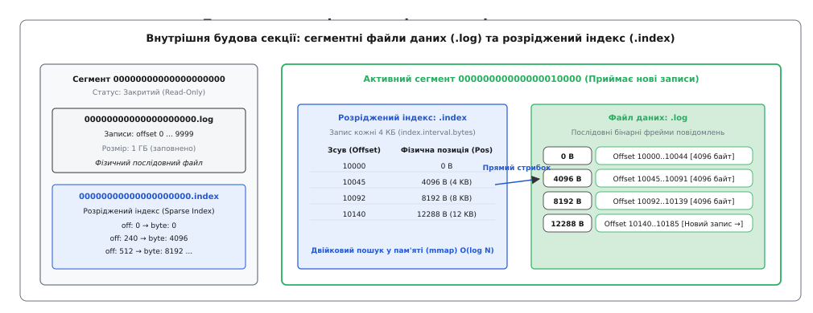

# ⚙️ Реалізація сегментованого журналу подій з розрідженим індексом

У розподілених архітектурах журнал подій (англ. *event log* або *commit log*) є фундаментальним будівельним блоком персистентності, на якому тримаються розподілені черги повідомлень, механізми реплікації транзакційних баз даних та консенсусні протоколи типу Raft і Paxos. Головна перевага моделі журналу полягає у фізиці дискового вводу-виводу: послідовний запис (англ. *sequential I/O*) у кінець файлу виконується з максимальною пропускною здатністю накопичувача (150–250 МБ/с для магнітних HDD та 3–7 ГБ/с для швидких накопичувачів NVMe SSD), тоді як випадковий доступ (англ. *random I/O*) сповільнює роботу на кілька порядків через механічне переміщення головок диску або постійне перебалансування B-дерев і LSM-структур.

Створимо власну повноцінну інженерну реалізацію сегментованого журналу подій мовами C та C++, яка втілює ключові архітектурні механізми дискового зберігання Apache Kafka: бінарне фреймування повідомлень, розрахунок контрольних сум CRC32 для захисту від пошкоджень, розбиття на фіксовані сегменти, керування життєвим циклом файлів, часові індекси та швидкий двійковий пошук через пам'яттєво-ефективний розріджений індекс.


*Кожен сегмент складається з бінарного логу послідовних записів (.log) та розрідженого індексу (.index), що зіставляє логічний зсув із фізичною позицією байта на диску.*

---

## 1. Архітектура файлового сховища на диску

У промислових системах топік ніколи не зберігається як один гігантський файл розміром у сотні гігабайтів. Такий монолітний підхід унеможливлює видалення застарілих даних за терміном давності (англ. *retention policy*), оскільки видалення байтів із початку звичайного файлу операційної системи вимагає повного перезапису гігабайтів даних зі зсувом усього вмісту.

Замість цього секція логу розбивається на окремі **сегменти** (англ. *segments*). Кожен сегмент складається з групи файлів з однаковою базовою назвою:
1. `00000000000000000000.log` — файл первинних даних, куди послідовно записуються бінарні фрейми повідомлень.
2. `00000000000000000000.index` — файл розрідженого індексу зсувів (англ. *offset index*), який зіставляє логічний зсув повідомлення з його точною фізичною позицією (зсувом у байтах) усередині відповідного `.log`-файлу.
3. `00000000000000000000.timeindex` — файл розрідженого часового індексу (англ. *time index*), що дозволяє знаходити зсув повідомлення за часовою міткою створення (Unix Timestamp).

Назва кожного файлу сегмента формується як 20-значне десяткове число, доповнене нулями зліва (наприклад, `00000000000010500000.log`). Це число позначає **базовий зсув** (англ. *base offset*) — логічний порядковий номер найпершого повідомлення, збереженого в цьому сегменті.

### Правила ротації сегментів (Segment Rolling)

У будь-який момент часу в кожній секції існує рівно один **активний сегмент** (англ. *active segment*), до якого додаються нові повідомлення. Усі попередні сегменти є закритими (англ. *immutable / read-only*): вони доступні лише для читання споживачами або фонового очищення.

Ротація активного сегмента (створення нового файлу) відбувається за однією з трьох умов:
* **Ліміт за розміром:** Розмір поточного `.log` файлу досяг конфігураційного порогу `segment.bytes` (за замовчуванням у Kafka це 1 ГБ, у нашій навчальній реалізації — 10 МБ).
* **Ліміт за часом:** З моменту першого запису в сегмент минуло більше часу, ніж задано параметром `segment.ms` (зазвичай 7 днів), навіть якщо файл не заповнений повністю.
* **Заповнення індексу:** Розмір індексного файлу досяг ліміту `segment.index.bytes` (зазвичай 10 МБ).

Щойно умова спрацьовує, активний сегмент примусово скидає буфери на диск (`fflush`/`fsync`), закривається на запис, і відкривається новий сегмент, чиє ім'я точно дорівнює наступному вільному логічному зсуву (`next_offset`).

---

## 2. Формат бінарних даних та розріджений індекс

Журнал уникає використання текстових форматів (JSON, XML), оскільки вони збільшують обсяг даних на диску в 3–5 разів та витрачають значні ресурси процесора на строковий парсинг.

### Бінарний фрейм запису в `.log`

Кожен запис пакується в строго вирівняний бінарний контейнер:

```
+------------------+------------------+------------------+------------------+
| CRC32 (4 байти)  | Magic (1 байт)   | Flags (1 байт)   | Offset (8 байтів)|
+------------------+------------------+------------------+------------------+
| Timestamp (8 B)  | KeyLen (4 байти) | Key (змінна довжина)                |
+------------------+------------------+-------------------------------------+
| ValueLen (4 B)   | Value (змінна довжина)                                 |
+------------------+--------------------------------------------------------+
```

* **CRC32 (4 байти, IEEE 802.3):** Контрольна сума всього фрейму (крім самого поля CRC). Дозволяє миттєво відкинути неповні записи (англ. *torn writes*), спричинені раптовим вимкненням живлення.
* **Magic (1 байт):** Версія формату (наприклад, `0x01`). Забезпечує пряму й зворотну сумісність.
* **Flags (1 байт):** Атрибути запису (наприклад, біти 0–2 вказують на алгоритм стиснення: 0 — без стиснення, 1 — gzip, 2 — snappy, 3 — lz4, 4 — zstd).
* **Offset (8 байтів, int64):** Унікальний монотонічний логічний зсув запису.
* **Timestamp (8 байтів, int64):** Час створення запису (Unix Epoch у мілісекундах).
* **Key Length (4 байти, int32):** Довжина ключа в байтах. Значення `-1` означає відсутність ключа (null key).
* **Key Bytes:** Байти ключа, що використовуються для маршрутизації за секціями та ущільнення журналу.
* **Value Length (4 байти, int32):** Довжина корисного навантаження (тіла повідомлення).
* **Value Bytes:** Довільні бінарні дані повідомлення.

### Механіка розрідженого індексу `.index`

Якби індекс містив запис для кожного окремого повідомлення, розмір індексного файлу зрівнявся б із розміром файлу даних, витісняючи корисні дані з дискового кешу. 

Тому застосовується **розріджений індекс** (англ. *Sparse Index*). Запис в індекс додається лише тоді, коли обсяг записаних у `.log` байтів після попередньої індексної позначки перевищує інтервал `INDEX_INTERVAL_BYTES` (за замовчуванням у Kafka це 4096 байтів — розмір однієї фізичної сторінки віртуальної пам'яті x86-64):

```
+-------------------------------+-------------------------------+
| Relative Offset (4 байти)     | Physical Position (4 байти)   |
+-------------------------------+-------------------------------+
```

* **Relative Offset (4 байти, uint32):** Відносний зсув відносно базового зсуву сегмента:
  ```
  relative_offset = global_offset - base_offset
  ```
  Зберігання 4-байтового відносного числа замість 8-байтового абсолютного економить 50% пам'яті індексу.
* **Physical Position (4 байти, uint32):** Фізичний зсув у байтах від початку файлу `.log`.

Завдяки розрідженню індексний файл для сегмента розміром 1 ГБ займає лише `(1 ГБ / 4 КБ) × 8 байтів ≈ 2 МБ`. Такий мізерний обсяг дозволяє повністю завантажити індекс у пам'ять або відобразити його через `mmap(2)`, де пошук позиції виконується за алгоритмом двійкового пошуку `O(log N)` без жодного фізичного звернення до повільного диску.

---

## 3. Повний вихідний код рушія журналу

Нижче наведено робочу реалізацію рушія на мовах C та C++. Реалізація забезпечує створення сегментів, формування бінарних фреймів, обчислення контрольних сум, автоматичне ведення розрідженого індексу та двофазний пошук повідомлень (двійковий пошук в індексі з наступним коротким скануванням сторінки).

:::tabs
:::code proj-append-log/c/main.c
:::code proj-append-log/cpp/main.cpp
:::

---

## 4. Покроковий розбір алгоритму читання та пошуку

Алгоритм читання за довільним числовим зсувом (Offset Lookup) є компромісом між споживанням пам'яті та затримкою вводу-виводу. Розгляньмо його покроково на прикладі запиту `read_at(offset = 10072)` у сегменті з `base_offset = 10000`:

1. **Розрахунок відносного зсуву:** Рушій обчислює шуканий відносний індекс:
   ```
   search_rel = 10072 - 10000 = 72
   ```
2. **Двійковий пошук в індексі (Phase 1):** Рушій зчитує масив `IndexEntry` розміром 8 байтів кожен. Якщо індекс містить 1000 записів, алгоритм виконує `log2(1000) ≈ 10` ітерацій, щоб знайти найбільший запис, чий `relative_offset <= 72`.
   Припустимо, індекс містить позначки:
   * Запис 0: `rel_offset = 0  -> pos = 0`
   * Запис 1: `rel_offset = 45 -> pos = 4096`
   * Запис 2: `rel_offset = 92 -> pos = 8192`
   Найближчим меншим значенням до 72 є Запис 1 (`rel_offset = 45`, `pos = 4096`).
3. **Пряме позиціювання (Seek):** Рушій виконує одноразовий `fseek(log_file, 4096, SEEK_SET)`, миттєво переміщуючи покажчик читання в операційній системі на початок потрібної дискової сторінки.
4. **Обмежене лінійне сканування (Phase 2):** Рушій послідовно читає бінарні фрейми записів, починаючи з байта 4096. Оскільки розрідження індексу гарантує, що наступна позначка була створена не пізніше ніж через 4096 байтів, рушій гарантовано просканує не більше ніж 4 КБ даних.
5. **Валідація та вилучення:** Знайшовши заголовок із полем `offset == 10072`, рушій звіряє контрольну суму CRC32 і копіює корисне навантаження в буфер споживача.

Завдяки такій двофазній схемі будь-яке повідомлення з терабайтного сховища зчитується рівно за одну операцію дискового пошуку (seek) та одне коротке читання 4 КБ сторінки, яка майже завжди вже знаходиться в кеші ядра Linux.

---

## 5. Часовий індекс `.timeindex` та перемотування за часом

На практиці споживачам часто потрібно почати вичитування даних не за числовим зсувом (який є суто внутрішнім ідентифікатором брокера), а за календарним часом (наприклад: «перечитати всі події за вчора з 14:00», або «відновити стан бази даних на момент аварії об 11:35:00»).

Для цього поруч із файлом `.index` створюється третій файл сегмента — **часовий індекс** `.timeindex` (Time Index).

### Структура запису в `.timeindex`
Кожен запис у `.timeindex` займає фіксовані 12 байтів:

```
+-----------------------------------+-------------------------------+
| Timestamp (8 байтів, int64)       | Relative Offset (4 байти)     |
+-----------------------------------+-------------------------------+
```

* **Timestamp (8 байтів):** Найбільша часова мітка серед усіх повідомлень, доданих до логу з моменту попередньої індексної позначки.
* **Relative Offset (4 байти):** Відносний зсув першого повідомлення, чий час створення дорівнює або перевищує значення `Timestamp`.

### Двоетапне перетворення «Час → Фізичний байт»
Коли клієнт викликає API пошуку за часом (наприклад, `offsetsForTimes(ts = 1700000000000)`):
1. **Пошук сегмента:** Брокер переглядає список сегментів і знаходить той, чий діапазон часу містить запитуваний `ts`.
2. **Двійковий пошук у `.timeindex`:** Виконується двійковий пошук за масивом 12-байтових записів для визначення цільового `relative_offset`.
3. **Двійковий пошук у `.index`:** Знайдений `relative_offset` подається на вхід звичайного індексу зміщень `.index`, який повертає фізичну позицію байта у файлі `.log`.
4. **Сканування:** Сервер читає повідомлення з файлу `.log`, знаходячи перше повідомлення, чий заголовок містить `timestamp >= target_ts`.

---

## 6. Пакетування (Batching) та амортизація дискових витрат

Якщо продюсер надсилає повідомлення по одному (наприклад, корисне навантаження розміром 50 байтів), накладні витрати бінарного заголовка (CRC32, Offset, Timestamp, довжини ключів — разом 34 байти) становлять майже 40% від усього обсягу переданих даних. Більше того, кожен окремий мережевий пакет викликає окреме переривання ядра та системний виклик `write(2)`.

У промислових журналах подій цю проблему вирішують за допомогою **пакетування записів** (RecordBatch). Продюсер накопичує повідомлення в пам'яті протягом короткого вікна (наприклад, `linger.ms = 10` або до досягнення `batch.size = 64 КБ`).

Усі повідомлення в пакеті записуються під єдиним спільним заголовком пакета (Outer Batch Header):
* Обчислюється один спільний `CRC32` на весь пакет із сотень повідомлень.
* Зберігається один базовий зсув `base_offset` та базовий час `first_timestamp`.
* Усі повідомлення всередині пакета кодуються з використанням відносних дельт зміщення (`delta_offset = 0, 1, 2...`) та змінної довжини цілих чисел (Protobuf/ZigZag varint), що зменшує накладні витрати метаданих до кількох бітів на повідомлення.
* Весь пакет цілком стискається алгоритмом LZ4 або Zstd, після чого записується на диск за один системний виклик `writev(2)`.

---

## 7. Системні оптимізації ядра та захист від збоїв

Під час експлуатації журналу під високим навантаженням надійна робота рушія забезпечується низкою низькорівневих системних механізмів:

### Захист від обірваних записів (Torn Writes)
Якщо сервер зазнає раптової втрати електроживлення або апаратного збою ядра посеред запису великого пакета розміром 64 КБ, на диск може встигнути записатися лише 20 КБ. При перезапуску рушій виявить, що останній фрейм має пошкоджений заголовок або його обчислена контрольна сума не збігається з полем `CRC32`.
* Рушій автоматично викликає системний виклик `ftruncate(2)`, відтинаючи пошкоджений залишок файлу до останнього повністю валідного фрейму.
* Це гарантує, що журнал залишається внутрішньо несуперечливим, а неповні записи не потраплять до споживачів.

### Відновлення втраченого індексу (Index Rebuild)
Оскільки індексні файли `.index` та `.timeindex` є лише вторинними структурами прискорення пошуку, їхнє пошкодження або раптове видалення не призводить до втрати бізнес-даних. При виявленні битого індексу рушій видаляє пошкоджений `.index` файл і виконує швидкий послідовний прохід файлом `.log` від початку до кінця, записуючи нову індексну позначку через кожні 4 КБ. Відновлення індексу для гігабайтного файлу займає менше 1 секунди.

### Налаштування сторінкового кешу та скидання брудних сторінок (Dirty Page Writeback)

Оскільки журнал подій повністю покладається на сторінковий кеш ядра Linux замість керування буферами всередині пам'яті процесу (Heap), продуктивність запису безпосередньо залежить від параметрів підсистеми віртуальної пам'яті ОС:

1. **`vm.dirty_background_ratio` (зазвичай 5–10%):** Відсоток загальної оперативної пам'яті системи, заповненої «брудними» (ще не записаними на диск) сторінками, при досягненні якого фонові потоки ядра Linux (`flusher threads` або `kworker`) починають асинхронно скидати дані на накопичувач. Це не блокує виконання прикладного процесу брокера.
2. **`vm.dirty_ratio` (зазвичай 20–30%):** Жорсткий поріг брудних сторінок. Якщо швидкість вхідного потоку продюсерів перевищує фізичну пропускну здатність дисків, і обсяг брудних даних досягає цього значення, ядро Linux примусово переводить усі виклики `write(2)` у синхронний блокуючий режим. Процес брокера заморожується, поки накопичувач не звільнить частину сторінок.
3. **`vm.dirty_expire_centisecs` (зазвичай 3000 = 30 секунд):** Максимальний вік брудної сторінки в пам'яті, після якого вона підлягає обов'язковому скиданню на диск.

Правильне налаштування цих параметрів запобігає раптовим лавиноподібним «I/O Spikes», коли ядро намагається одночасно скинути десятки гігабайтів накопичених даних, що могло б викликати зависання мережевих сокетів та тайм-аути клієнтів.

Часто виникає питання: чому б не використовувати прямий ввід-вивід із прапорцем `O_DIRECT`, обходячи сторінковий кеш ОС? Прапорець `O_DIRECT` змушує будь-яке читання й запис звертатися безпосередньо до фізичного накопичувача, що вимагає вирівнювання буферів у пам'яті за розміром сектора диска (512 або 4096 байтів). У моделі журналу подій це було б катастрофою для продуктивності: якщо кілька незалежних споживачів читають свіжі повідомлення з різницею в частки секунди, сторінковий кеш віддає дані прямо з RAM без жодного читання з диска. Використання `O_DIRECT` змусило б накопичувач повторно зчитувати ті самі блоки диска для кожного клієнта, миттєво перевантажуючи шину PCIe та контролер SSD.

### Перевага нульового копіювання (Zero-Copy Transfer)
У традиційних застосунках передача даних із файлу в мережевий сокет вимагає чотирьох перемикань контексту (User/Kernel mode) та чотирьох копіювань пам'яті:
1. `Disk` -> `Page Cache` ядра (через контролер DMA).
2. `Page Cache` -> `User Space Buffer` (копіювання процесором).
3. `User Space Buffer` -> `Socket Buffer` ядра (копіювання процесором).
4. `Socket Buffer` -> `Network Interface Controller (NIC)` (через контролер DMA).

У журналі подій дані у файлі зберігаються в тому самому бінарному вигляді, у якому вони передаються клієнтам по мережі. Це дозволяє використовувати системний виклик **`sendfile(2)`** або **`splice(2)`**, який передає байти безпосередньо зі сторінкового кешу ядра Linux у чергу мережевого адаптера (DMA-to-DMA). Це повністю усуває завантаження центрального процесора на копіювання пам'яті та дозволяє одному серверу утилізувати мережеві канали 100 Gbps на повній швидкості.
